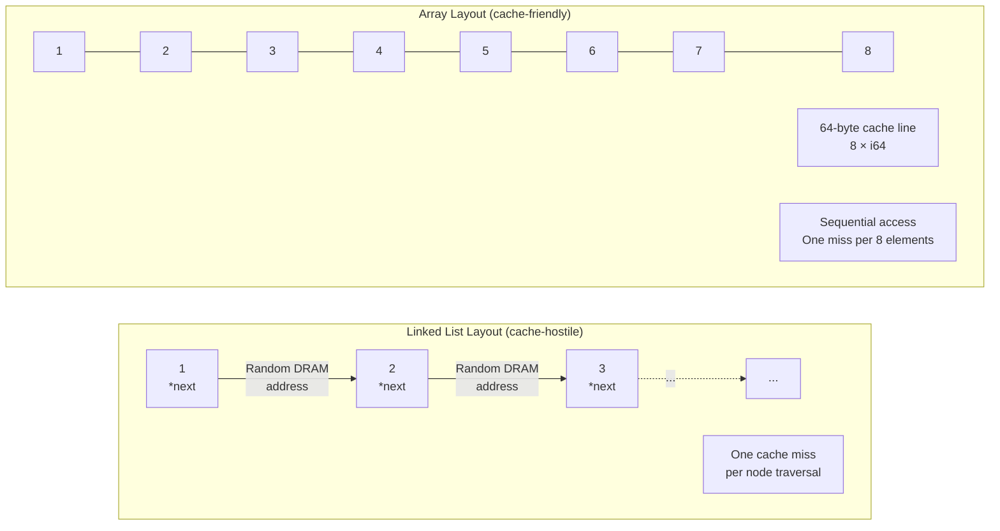
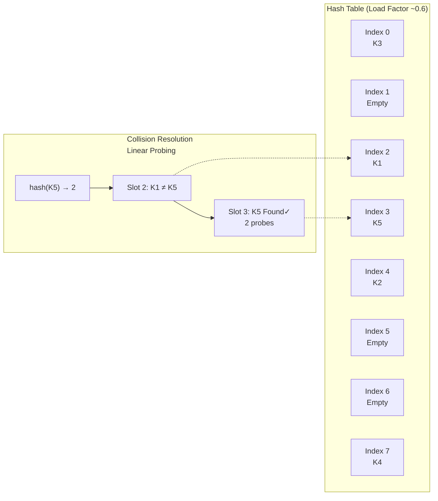
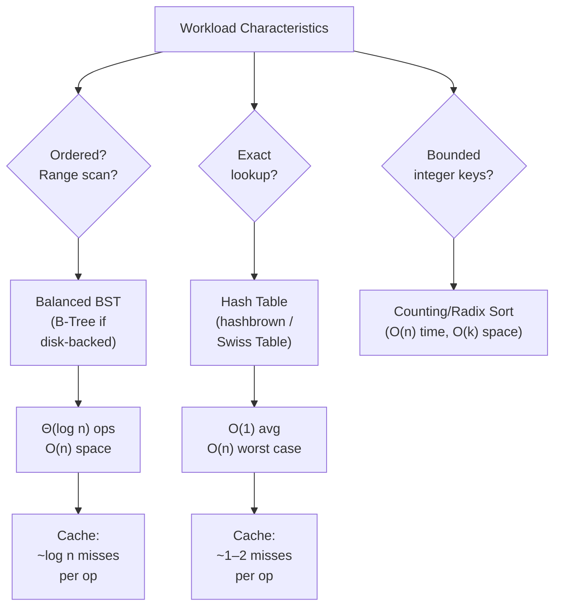

# Lesson 2: Algorithmic Analysis and Computational Complexity

## 1. First-Principles Intuition & Invariants

Every program you have ever written is, at its core, a claim about resources. It claims some amount of time to produce its output, some amount of memory to hold its working state, and some amount of energy to push electrons through the silicon doing the work. Algorithmic analysis is the discipline of making those claims precise, verifiable, and hardware-independent—expressing the resource cost of a computation as a function of the problem's size rather than the speed of the machine executing it. For a performance engineer, this is not an academic exercise. It is the foundational lens through which every optimization decision is made.

The critical mental model to internalize from the start is that algorithmic complexity describes *scaling behavior*, not absolute performance. An O(1) hash lookup can be slower than a linear scan of a ten-element array. An O(n log n) sort can be faster on modern hardware than an O(n) counting sort if the constant factors and cache behavior align favorably. The asymptotic notation is a prediction about what happens as n grows toward infinity, and the engineer's job is to understand when their actual n is large enough for that prediction to dominate over constant factors and hidden coefficients. This judgment cannot be developed without first understanding the mathematics, and it cannot be applied without first measuring the actual workload.

### The Formal Language of Asymptotic Bounds

The Big-O family of notations—O, Ω, and Θ—forms a vocabulary for expressing algorithm cost with deliberately controlled precision. Big-O notation, O(f(n)), defines an *upper bound*. Formally, we say T(n) = O(f(n)) if and only if there exist positive constants c and n₀ such that T(n) ≤ c · f(n) for all n ≥ n₀. This is an upper-bound contract: we are asserting that the algorithm will never behave worse than f(n) modulo a constant multiplier, past some threshold input size.

Big-Omega notation, Ω(f(n)), is the lower bound: T(n) = Ω(f(n)) if there exist constants c and n₀ such that T(n) ≥ c · f(n) for all n ≥ n₀. This bound is equally important for the performance engineer because it describes the floor of an algorithm's cost—the fundamental minimum that no implementation can undercut. The comparison-based sorting lower bound of Ω(n log n) is perhaps the most consequential lower-bound result in applied computer science: it proves that no general comparison sort can outperform n log n in the worst case, forcing engineers toward radix sort, counting sort, or other non-comparison approaches when they need asymptotically superior behavior.

Big-Theta notation, Θ(f(n)), is the tight bound: T(n) = Θ(f(n)) when T(n) is simultaneously O(f(n)) and Ω(f(n)). This is the most informative classification, asserting that f(n) characterizes both the ceiling and the floor of the growth rate. When you say that merge sort is Θ(n log n) in the worst case, you are making a precise claim that its cost is pinched between two constant multiples of n log n: it cannot be faster, and it cannot be slower, by more than a constant factor.

The complexity classes most frequently encountered in production systems, from most to least favorable, are O(1), O(log n), O(n), O(n log n), O(n²), O(n³), and the exponential families O(2ⁿ) and O(n!). The gulf between these classes is not linear. At n = 10⁶, an O(n log n) algorithm executes roughly 20 million operations. An O(n²) algorithm requires 10¹² operations—a factor of 50,000 more. The difference between choosing a quadratic and a linearithmic algorithm is not a performance tuning concern: it is the difference between a system that works and a system that does not.

### Little-o and Little-ω: The Strict Bounds

Senior engineers sometimes overlook the strict variants of these bounds. Little-o notation, o(f(n)), means that T(n) grows strictly *slower* than f(n): the ratio T(n)/f(n) approaches zero as n approaches infinity. This is a stronger claim than Big-O. While O(n²) permits algorithms that grow exactly as fast as n², o(n²) excludes them, admitting only algorithms that grow strictly sub-quadratically. This distinction matters when reasoning about whether an improvement changes the asymptotic class or merely reduces the constant—a distinction with profound implications for how much an optimization scales.

### The Recurrence Relation as a First-Class Analysis Tool

Recursive algorithms demand a different analysis tool: the recurrence relation. A recurrence expresses the cost of a problem of size n in terms of the cost of smaller sub-problems. Merge sort, for example, splits n elements into two halves, sorts each recursively, then merges them in O(n) time, yielding the recurrence T(n) = 2T(n/2) + O(n). Solving this recurrence—by substitution, recursion tree expansion, or the Master Theorem—yields T(n) = Θ(n log n).

The Master Theorem provides a closed-form solution for recurrences of the form T(n) = aT(n/b) + f(n), where a ≥ 1 and b > 1 are constants and f(n) is an asymptotically positive function. It compares f(n) to n^(log_b a), the cost of the recursive work, and declares the dominant term the winner. If f(n) = O(n^(log_b a - ε)) for some ε > 0, the recursive work dominates and T(n) = Θ(n^(log_b a)). If f(n) = Θ(n^(log_b a)), both terms are equal and T(n) = Θ(n^(log_b a) · log n). If f(n) = Ω(n^(log_b a + ε)) and the regularity condition holds, the combining work dominates and T(n) = Θ(f(n)).

For merge sort: a = 2, b = 2, f(n) = Θ(n), and n^(log₂ 2) = n¹ = n. Since f(n) = Θ(n^(log_b a)), we are in case two: T(n) = Θ(n log n). The Master Theorem is not universal—it cannot directly solve all recurrences—but it covers the most common divide-and-conquer patterns found in sorting, matrix multiplication, and tree algorithms.

### Amortized Analysis: Spreading the Cost Across Operations

Standard worst-case analysis evaluates the cost of a single operation in isolation. Amortized analysis evaluates the *average cost per operation across a sequence*, allowing expensive individual operations to be absorbed by the many cheap operations surrounding them. This distinction is not merely theoretical: it determines whether data structures like dynamic arrays, splay trees, and hash tables are practically useful.

The canonical example is the dynamic array, implemented as `std::vector` in C++ or `Vec` in Rust. When a push operation exceeds the current capacity, the array allocates a new buffer of twice the previous size and copies all existing elements. This reallocation is O(n) in isolation—potentially catastrophic if analyzed naively. But how often does it occur? Starting from capacity 1 and doubling, a sequence of n push operations triggers reallocations at sizes 1, 2, 4, 8, ..., n/2. The total copy work is 1 + 2 + 4 + ... + n/2 = n - 1, a geometric series summing to Θ(n). Dividing by n operations yields an amortized cost of O(1) per push.

There are three formal methods for proving amortized bounds. The *aggregate method* computes the total cost of n operations and divides by n, as in the dynamic array analysis above. The *accounting method* assigns each operation a "charge"—which may exceed or fall below its actual cost—and proves that the total charge always covers the total actual cost, with the difference represented as "credit" stored in the data structure. The *potential method* defines a potential function Φ over the state of the data structure and defines the amortized cost of operation i as cᵢ + Φᵢ - Φᵢ₋₁, where cᵢ is the actual cost. If the potential never goes negative and starts at zero, the sum of amortized costs upper-bounds the sum of actual costs, proving the amortized bound.

For the dynamic array with the potential function Φ = 2·(size) - capacity: an ordinary push with space available costs 1 unit of actual work, and the potential increases by 2 (size grows by one, capacity unchanged), giving amortized cost 1 + 2 = 3. A push that triggers a doubling of capacity k: actual cost is k (copying k elements) + 1 (inserting), and before the push, Φ = 2k - k = k. After the push into a new array of capacity 2k with size k+1, Φ = 2(k+1) - 2k = 2. The potential change is 2 - k. Amortized cost = (k+1) + (2 - k) = 3. The amortized cost is O(1) for every push, without exception.

Understanding amortized analysis at this depth is essential for evaluating the performance characteristics of real systems. When a Rust `Vec::push` triggers an allocation in a hot loop, the solution is not to avoid `Vec`—it is to `reserve` the known capacity upfront, eliminating the reallocation entirely and converting the amortized guarantee into an actual O(1) guarantee.

---

## 2. Core Architecture & Mechanics

The abstract complexity of an algorithm and its concrete performance on real hardware are coupled through the data structures that hold its working state. Choosing the wrong data structure for a workload is the most common source of avoidable performance degradation in production systems, and the choice cannot be made correctly without understanding the internal mechanics of each structure at the memory level.

### The Memory Hierarchy as a First-Class Constraint

Modern CPUs execute instructions at a rate that main memory cannot support. A modern x86-64 core can retire roughly four instructions per cycle at 3–4 GHz, but a cache miss to DRAM incurs a latency of 60–100 nanoseconds—200 to 400 cycles wasted waiting for data. The memory hierarchy exists to bridge this gap: L1 cache (4 cycles, ~32 KB), L2 cache (12 cycles, ~256 KB), L3 cache (40 cycles, ~8–32 MB), and DRAM (200+ cycles). Cache lines are 64 bytes wide on x86-64. The CPU always fetches and evicts data in 64-byte chunks, regardless of how many bytes the program actually requested.

This physical reality recontextualizes asymptotic analysis. An algorithm with better asymptotic complexity but poor cache behavior can be slower than a theoretically inferior algorithm with excellent spatial locality. The fundamental metric that connects algorithmic analysis to cache performance is *sequential memory access*: code that accesses memory in a linear, predictable stride allows the hardware prefetcher to load cache lines before they are needed, hiding latency entirely. Code that accesses memory through pointer indirections—as in a linked list traversal—defeats prefetching because each pointer dereference reveals the address of the next access only after the current cache miss resolves.

### Arrays, Linked Lists, and the Pointer Chasing Tax

The array is the foundational data structure for performance-sensitive code. Its elements occupy contiguous memory, so accessing element i requires computing the base address plus i × element_size—a single multiplication and addition, executable in one cycle. More importantly, iterating over an array accesses consecutive cache lines. A 64-byte cache line holds eight 64-bit integers or four 128-bit doubles. When the first element of a cache line is accessed, the hardware prefetcher immediately initiates a fetch of the next line, and the program pays the cache miss latency only once per 8 or 16 elements, not once per element.

Linked lists present the opposite profile. Each node contains a data payload and a pointer to the next node. The nodes are heap-allocated independently, scattered across virtual address space. Traversing a linked list of n elements requires n pointer dereferences, each potentially a cache miss. Even if the list is small enough to fit in L3 cache, the pointer chasing serializes memory accesses: the CPU cannot prefetch node k+1 until it has fetched node k and read the pointer within it. This serialization converts what appears to be an O(n) traversal into a workload that is O(n) in cache misses, each costing 40–200 cycles. The practical result is that linked list traversal can be 10–20× slower than array traversal on the same data, even at equivalent asymptotic complexity.

The following ASCII diagram illustrates the memory layout contrast:



This disparity explains why high-performance queues in production systems—from LMAX Disruptor to kernel ring buffers—are built on contiguous arrays, not linked lists, despite linked lists offering O(1) insertion and deletion without shifting elements. The asymptotic advantage of O(1) insertion is overwhelmed by the cache miss penalty on every access in a throughput-sensitive system.

### Hash Tables: Amortized O(1) with Hidden Costs

A hash table achieves O(1) average-case lookup, insertion, and deletion by mapping keys to array indices through a hash function. The internal mechanics, however, determine whether that O(1) is a tight bound or an optimistic fiction. The two canonical collision resolution strategies—separate chaining and open addressing—have fundamentally different cache profiles.

Separate chaining stores a linked list at each bucket. On a lookup, the hash function computes the bucket index (one array access), and then the code traverses the chain to find the matching key. Each chain node is an independent heap allocation. For a well-tuned load factor, chains are short—expected length 1 at a load factor of 1—but each node dereference is a pointer chase into potentially cold memory. For small key-value pairs, the metadata overhead of the linked list node can exceed the size of the data itself.

Open addressing stores all entries directly in the backing array. On collision, it probes a sequence of alternative slots—linear probing advances by one, quadratic probing by increasing squares, double hashing by a secondary hash. Linear probing has the best cache behavior of the three: collisions are resolved by scanning consecutive slots, which the hardware prefetcher handles efficiently. The pathology of linear probing is *primary clustering*: runs of occupied slots grow longer over time, increasing the average probe length. This is tamed by keeping the load factor below 0.7–0.75, triggering a resize—which is a Θ(n) rehashing operation—when the threshold is crossed.

The load factor at which a hash table is resized has an outsized impact on both time and space performance. A load factor of 0.5 halves memory efficiency but minimizes collisions and maximizes lookup speed. A load factor of 0.9 packs the table densely, saving memory but dramatically increasing the probe length for the last 10% of entries inserted, pushing the worst-case lookup cost toward O(n) in degenerate cases.



Rust's standard `HashMap` uses `hashbrown`, an implementation of Swiss Tables developed at Google. Swiss Tables maintain a parallel array of one-byte "control bytes" alongside the main entry array. Each control byte encodes either a sentinel (empty or deleted) or the top 7 bits of the entry's hash. A SIMD probe loads 16 consecutive control bytes in a single instruction and compares all 16 against the target hash's top 7 bits simultaneously, producing a bitmask of candidate slots. This reduces the average number of cache lines touched per lookup to approximately one for typical workloads, making `hashbrown`'s constant factors significantly better than a naive open-addressing table.

### Trees: Balanced BSTs and Cache Obliviousness

Binary search trees offer O(log n) lookup, insertion, and deletion for ordered data, with the ability to perform range scans, predecessor and successor queries, and ordered iteration—capabilities that hash tables cannot provide. The standard self-balancing variants—red-black trees (used in `std::map` and `std::set` in C++, and in the Linux kernel's scheduling and memory management), AVL trees, and B-trees—each make different trade-offs between rebalancing cost and tree height.

Red-black trees maintain balance through color invariants: each node is colored red or black, the root is black, red nodes have only black children, and all paths from a node to its null descendants contain the same number of black nodes. These invariants guarantee that the tree height is at most 2 log₂(n+1), ensuring O(log n) operations. Rotations and color changes during insertion and deletion touch at most O(log n) nodes and require at most two rotations for insertion and three for deletion. The resulting structure is shallower than an AVL tree (which maintains a stricter height balance) but involves more complex rebalancing logic.

The critical performance limitation of pointer-based balanced BSTs is again cache behavior. Each node is a separate heap allocation, and traversing from root to leaf at depth log₂(n) requires log₂(n) pointer dereferences, each potentially a cache miss. For n = 10⁶, that is 20 cache misses per lookup. At 100 ns per miss, a single lookup costs 2 microseconds from cache misses alone—tolerable in isolation, but catastrophic at high throughput.

B-trees address this directly by storing multiple keys per node, where the node size is chosen to match a cache line or OS page. A B-tree of order m stores between m-1 and 2m-1 keys per node. With a node size of 4 KB (one memory page) and 64-byte keys, a single node holds 64 keys. The tree height for n elements is log_m(n), which for m=64 reduces the 20 levels of a binary BST to roughly 3–4 levels. Databases use B+ trees (a variant where data lives only in leaf nodes, and all leaves are linked) for exactly this reason: index lookups touch 3–4 pages, minimizing I/O.

### Algorithm Selection Decision Framework



---

## 3. High-Performance Optimization & Failure Modes

Theory identifies the class; benchmarks identify the constant. This section moves from the complexity model into the concrete engineering workflow: how to instrument, profile, and iteratively optimize algorithmic performance in production C and Rust code, and how to recognize the failure modes that cause theoretically optimal algorithms to perform worse than naive alternatives.

### Benchmarking Methodology: The Criterion Standard

Before any optimization, you must establish a reproducible, statistically rigorous baseline. For Rust, `criterion` is the production-grade microbenchmarking framework. For C/C++, Google Benchmark serves the same role. Both frameworks run the benchmark function repeatedly, discard warm-up iterations, measure wall time with nanosecond resolution, and perform statistical analysis to characterize the sample distribution.

The following is a complete Rust benchmark using Criterion that compares three lookup strategies across a range of collection sizes, exercising the core algorithmic analysis claim that O(log n) tree lookup and O(1) hash lookup diverge from O(n) linear scan as n grows.

```rust
// Cargo.toml dependencies:
// [dev-dependencies]
// criterion = { version = "0.5", features = ["html_reports"] }
// rand = "0.8"

use criterion::{black_box, criterion_group, criterion_main, BenchmarkId, Criterion};
use std::collections::{BTreeMap, HashMap};

fn build_linear_vec(n: usize) -> Vec<u64> {
    (0..n as u64).collect()
}

fn build_btree(n: usize) -> BTreeMap<u64, u64> {
    (0..n as u64).map(|i| (i, i * 2)).collect()
}

fn build_hashmap(n: usize) -> HashMap<u64, u64> {
    (0..n as u64).map(|i| (i, i * 2)).collect()
}

fn bench_lookup(c: &mut Criterion) {
    let mut group = c.benchmark_group("lookup_comparison");

    for size in [100usize, 1_000, 10_000, 100_000, 1_000_000] {
        let vec = build_linear_vec(size);
        let btree = build_btree(size);
        let hmap = build_hashmap(size);
        // Always search for the worst-case element: the last one.
        let target = (size as u64) - 1;

        group.bench_with_input(
            BenchmarkId::new("Vec/linear_scan", size),
            &size,
            |b, _| {
                b.iter(|| {
                    black_box(vec.iter().find(|&&x| x == black_box(target)))
                })
            },
        );

        group.bench_with_input(
            BenchmarkId::new("Vec/binary_search", size),
            &size,
            |b, _| {
                b.iter(|| {
                    black_box(vec.binary_search(&black_box(target)))
                })
            },
        );

        group.bench_with_input(
            BenchmarkId::new("BTreeMap/get", size),
            &size,
            |b, _| {
                b.iter(|| {
                    black_box(btree.get(&black_box(target)))
                })
            },
        );

        group.bench_with_input(
            BenchmarkId::new("HashMap/get", size),
            &size,
            |b, _| {
                b.iter(|| {
                    black_box(hmap.get(&black_box(target)))
                })
            },
        );
    }

    group.finish();
}

criterion_group!(benches, bench_lookup);
criterion_main!(benches);
```

Run this with `cargo bench` and examine the HTML report in `target/criterion/`. The `black_box` calls are essential: they insert an opaque barrier that prevents the compiler from dead-code-eliminating the lookup entirely, which would trivially reduce the benchmark to zero time. Without `black_box`, the optimizer can often prove at compile time that the result is unused and emit no code for the benchmark body at all.

Interpreting the output requires understanding what Criterion measures. It reports mean, median, and standard deviation of per-iteration time. A bimodal distribution—visible in the violin plots—indicates that the CPU is experiencing cache state variation between iterations: some runs find the data in L2, others go to DRAM. This is itself a signal about the data structure's cache footprint relative to the cache hierarchy.

### The Constant-Factor Problem: When Big-O Lies

The asymptotic hierarchy describes behavior as n → ∞, but most practical workloads operate at finite, often small n. Compiler engineers and systems programmers frequently find that an O(n) algorithm outperforms an O(log n) algorithm for n < 32 because the linear algorithm is branchless, SIMD-vectorizable, and fits in a single cache line, while the logarithmic algorithm incurs branch mispredictions and pointer dereferences.

The standard library recognizes this: `std::sort` in both C++ and Rust uses a hybrid algorithm called Timsort (Rust) or introsort (many C++ implementations) that falls back to insertion sort for small sub-arrays. Insertion sort is O(n²) in theory and faster than quicksort in practice for n ≤ 16 because its inner loop compiles to a handful of compare-and-shift instructions with no function call overhead and perfect cache behavior.

The following C implementation demonstrates this hybrid principle with a manually inlined insertion sort fallback inside a recursive merge sort:

```c
#include <stdint.h>
#include <string.h>
#include <stdlib.h>

#define INSERTION_THRESHOLD 16

static void insertion_sort(int64_t *arr, size_t n) {
    for (size_t i = 1; i < n; i++) {
        int64_t key = arr[i];
        size_t j = i;
        // Backward scan: shift elements right while they are greater than key.
        while (j > 0 && arr[j - 1] > key) {
            arr[j] = arr[j - 1];
            j--;
        }
        arr[j] = key;
    }
}

static void merge(int64_t *arr, int64_t *tmp, size_t left, size_t mid, size_t right) {
    size_t i = left, j = mid, k = left;
    while (i < mid && j < right) {
        if (arr[i] <= arr[j]) {
            tmp[k++] = arr[i++];
        } else {
            tmp[k++] = arr[j++];
        }
    }
    while (i < mid) tmp[k++] = arr[i++];
    while (j < right) tmp[k++] = arr[j++];
    memcpy(arr + left, tmp + left, (right - left) * sizeof(int64_t));
}

static void merge_sort_internal(int64_t *arr, int64_t *tmp, size_t left, size_t right) {
    size_t n = right - left;
    if (n <= 1) return;

    // Fall back to insertion sort for small sub-arrays to exploit cache locality
    // and avoid recursion overhead at the bottom of the divide-and-conquer tree.
    if (n <= INSERTION_THRESHOLD) {
        insertion_sort(arr + left, n);
        return;
    }

    size_t mid = left + n / 2;
    merge_sort_internal(arr, tmp, left, mid);
    merge_sort_internal(arr, tmp, mid, right);
    merge(arr, tmp, left, mid, right);
}

void hybrid_merge_sort(int64_t *arr, size_t n) {
    if (n <= 1) return;
    int64_t *tmp = malloc(n * sizeof(int64_t));
    if (!tmp) return; // In production, propagate the error.
    merge_sort_internal(arr, tmp, 0, n);
    free(tmp);
}
```

Compile this with `gcc -O2 -march=native -o sort_bench sort_bench.c` and measure against a naive merge sort without the threshold. On a modern x86-64, the hybrid version typically sorts arrays of 10⁶ elements 15–25% faster than the pure recursive variant due to reduced function call overhead and the cache-friendly access pattern of insertion sort at the leaf level.

### Profiling Algorithmic Hotspots with `perf` and `valgrind --tool=callgrind`

When a benchmark confirms a performance problem, the next step is identifying which part of the algorithm is responsible. `perf stat` provides hardware performance counters that directly measure the CPU's view of the execution.

```bash
# Compile with debug info preserved alongside optimizations
gcc -O2 -g -march=native -o sort_bench sort_bench.c

# Measure IPC, cache miss rates, and branch mispredictions
perf stat -e cycles,instructions,cache-misses,cache-references,branch-misses ./sort_bench

# Record a sampling profile at 99 Hz, attributing samples to source lines
perf record -g -F 99 ./sort_bench
perf report --stdio --no-children
```

The output of `perf stat` for an algorithm with poor cache behavior will show a cache-miss rate above 5–10% and an instructions-per-cycle (IPC) ratio below 1.0, indicating that the CPU is stalling on memory accesses rather than executing instructions. A well-optimized sorting algorithm on data that fits in L3 cache should achieve IPC of 2–4 and a cache-miss rate below 1%.

For instruction-level cache simulation and accurate cache miss attribution to source lines, `valgrind --tool=callgrind` provides a cycle-accurate cache simulation:

```bash
valgrind --tool=callgrind --cache-sim=yes --branch-sim=yes \
    --callgrind-out-file=callgrind.out ./sort_bench

callgrind_annotate --auto=yes callgrind.out | head -100
```

Callgrind's output attributes L1, L2, and LL (last-level) cache misses to individual source lines, making it straightforward to identify which loop or data structure access is generating the most cache pressure. This is the correct tool for diagnosing the pointer-chasing pathology in linked structures: you will see LL cache misses concentrated precisely on the pointer dereference line of the traversal loop.

### Space Complexity and Its Practical Ceiling

Space complexity is frequently treated as a secondary concern relative to time, but in memory-constrained environments—JVM heaps, embedded systems, kernel memory pools—the space bound determines whether an algorithm is deployable at all. The relationship between time and space is often a trade-off, and understanding the trade-off surface is a core performance engineering skill.

Merge sort is Θ(n) space due to the auxiliary array required for the merge step. In-place merge sort variants exist but are notoriously complex and have worse constant factors on cache than the out-of-place variant. Quicksort is O(log n) space (for the recursion stack in the average case, O(n) in the worst case without tail call optimization), making it more space-efficient than merge sort at the cost of an unstable sort and a quadratic worst case on adversarial input. Heapsort achieves O(1) auxiliary space with an O(n log n) guarantee, but its memory access pattern is cache-hostile: the heap's tree structure means that building and extracting from the heap accesses memory in a non-sequential pattern, causing significantly more cache misses than merge sort or well-implemented quicksort.

The practical upshot is that heapsort's cache-hostile access pattern makes it 2–5× slower than quicksort in practice despite identical asymptotic bounds. This is why `std::sort` in every major standard library implementation uses a quicksort or introsort variant rather than heapsort, reserving the heap's fallback only to guarantee O(n log n) worst-case behavior when the quicksort pivot selection degenerates—a safeguard invoked by tracking recursion depth and switching to heapsort when it exceeds 2 log₂(n).

### Algorithmic Anti-Patterns in Production Code

Several recurring anti-patterns cause algorithms that are theoretically efficient to perform poorly in production. The most pervasive is *inadvertent O(n²) behavior* hidden inside apparently linear code. Consider a de-duplication routine implemented as: for each element, scan all previously seen elements to check for membership. The outer loop runs n times, and the inner scan runs up to n times, producing O(n²) total work. The correct implementation inserts elements into a hash set (O(1) amortized per insertion) and checks membership before insertion, reducing total work to O(n). This pattern appears in log parsing, graph construction, and event deduplication, and it is often missed in code review because the quadratic behavior only manifests at production data volumes.

A second anti-pattern is *repeated heap allocation in a hot loop*. Dynamic memory allocation is not O(1) in wall time: the allocator must find a free block, potentially coalescing adjacent free regions, and update internal bookkeeping structures. Under contention in a multithreaded program, `malloc` acquires a lock, serializing all allocations. The correct pattern for a hot loop that processes batches of objects is to allocate a slab or arena upfront and dispense fixed-size objects from it. In Rust, the `bumpalo` crate provides a bump allocator that reduces allocation to a pointer increment—O(1) with an extremely small constant. In C, a hand-rolled arena allocator is straightforward:

```c
#include <stdint.h>
#include <stddef.h>
#include <string.h>
#include <stdlib.h>

typedef struct {
    uint8_t *base;
    size_t   offset;
    size_t   capacity;
} Arena;

Arena arena_create(size_t capacity) {
    return (Arena){
        .base     = malloc(capacity),
        .offset   = 0,
        .capacity = capacity,
    };
}

void *arena_alloc(Arena *a, size_t size, size_t align) {
    // Align the current offset upward to the required alignment.
    size_t aligned = (a->offset + align - 1) & ~(align - 1);
    if (aligned + size > a->capacity) return NULL;
    a->offset = aligned + size;
    return a->base + aligned;
}

void arena_reset(Arena *a) {
    // O(1) bulk deallocation: reset the offset to zero.
    a->offset = 0;
}

void arena_destroy(Arena *a) {
    free(a->base);
    a->base = NULL;
}
```

Resetting an arena to reuse it for the next batch is a single store to `offset`: O(1) with zero `free` calls and no allocator lock contention, regardless of how many objects were allocated within the arena. This pattern is used pervasively in compilers, game engines, and high-frequency trading systems where allocation throughput is on the critical path.

A third anti-pattern is *algorithmic mismatch with data distribution*. General-purpose O(n log n) comparison sorts are optimal for arbitrary comparison functions over arbitrary keys, but many production workloads have bounded integer keys, known value ranges, or skewed distributions that admit faster specialized algorithms. Radix sort processes integer keys digit by digit, achieving O(n · k) time where k is the number of digits (typically 8 passes of an 8-bit radix sort for 64-bit integers), which is linear in n for fixed-width keys. At n = 10⁷ with 64-bit keys, radix sort is consistently 2–4× faster than `std::sort` because it makes no comparisons and accesses memory in sequential, prefetcher-friendly passes. The standard library cannot specialize for this because it has no static knowledge of the key type's value distribution.

### The Empirical Complexity Measurement Workflow

When inheriting an unfamiliar codebase, one of the most powerful diagnostic techniques is *empirical complexity estimation*: measure the wall time of a function at several values of n, fit the data to a polynomial or logarithmic curve, and derive the apparent complexity class. This is particularly valuable when the source code is too complex to analyze statically, or when algorithmic complexity depends on runtime data characteristics that are difficult to reason about analytically.

The procedure is straightforward. Run the target function at n = 1000, 2000, 4000, 8000, 16000. If doubling n doubles the time, the function is O(n). If doubling n increases time by a factor of 4, it is O(n²). If doubling n increases time by approximately n log n, verify by checking whether time/n grows logarithmically with n. This approach requires careful benchmark design—the function must be isolated, its inputs must be randomized to avoid best-case or worst-case bias, and the measurements must be averaged over enough iterations to suppress noise.

The following shell script automates this empirical analysis for any benchmarkable binary that accepts a size argument:

```bash
#!/usr/bin/env bash
# empirical_complexity.sh
# Usage: ./empirical_complexity.sh ./my_benchmark
# Assumes the benchmark binary accepts a single integer argument: the problem size.

set -euo pipefail

BINARY="${1:?Usage: $0 <benchmark_binary>}"
SIZES=(1000 2000 4000 8000 16000 32000 64000)

echo "n,time_ns"
for n in "${SIZES[@]}"; do
    # Run 10 iterations, take the median to suppress outliers.
    times=()
    for _ in $(seq 1 10); do
        t=$( { time "$BINARY" "$n" > /dev/null; } 2>&1 | grep real | awk '{print $2}')
        # Convert mm:ss.ms to nanoseconds
        mins=$(echo "$t" | cut -dm -f1)
        secs=$(echo "$t" | cut -dm -f2 | sed 's/s//')
        ns=$(echo "($mins * 60 + $secs) * 1000000000" | bc)
        times+=("$ns")
    done
    # Sort and take the median (index 5 of 10 elements, 0-indexed)
    median=$(printf '%s\n' "${times[@]}" | sort -n | sed -n '5p')
    echo "$n,$median"
done
```

Pipe this output to a Python script using `numpy.polyfit` to fit a polynomial or `scipy.optimize.curve_fit` for logarithmic curves, and you have a quantitative complexity estimate extracted from runtime behavior alone.

### Anticipating Phase Transitions

One of the most subtle failure modes in production systems is the *algorithmic phase transition*: a data structure or algorithm that performs well under normal load degrades suddenly and catastrophically as a threshold is crossed. Hash table performance is smooth and near-O(1) until the load factor hits the resize threshold; then it performs a Θ(n) rehash while holding any internal lock, causing a latency spike visible as a p99 outlier in production metrics. Dynamic array appends are amortized O(1) until the buffer fills; then a single append triggers an O(n) reallocation that can exceed the timeout of an upstream client.

The correct mitigation in both cases is *pre-sizing*: allocating the anticipated capacity upfront when the final size is knowable or estimable. In Rust:

```rust
// Avoid incremental reallocation when the final size is bounded.
let mut map: HashMap<u64, String> = HashMap::with_capacity(expected_entries);
let mut vec: Vec<u64> = Vec::with_capacity(expected_entries);
```

In C++ with `std::unordered_map`:

```cpp
// Reserve before bulk insertion to prevent rehashing during the insert loop.
std::unordered_map<uint64_t, std::string> map;
map.reserve(expected_entries);
// max_load_factor defaults to 1.0; tune down for fewer collisions at the cost of memory.
map.max_load_factor(0.7f);
```

Pre-sizing eliminates the phase transition entirely. The O(1) amortized guarantee becomes an actual O(1) guarantee for every operation within the reserved capacity, and the latency distribution narrows to a tight band around the mean, eliminating the high-percentile outliers that violate SLOs.

The discipline of algorithmic analysis is ultimately the discipline of making performance contracts explicit and verifiable. Big-O notation is the vocabulary; recurrence relations and amortized analysis are the proof techniques; benchmarking and profiling are the empirical validation methods. A senior engineer who understands all three layers—the asymptotic bound, the constant factor driven by memory hierarchy, and the runtime measurement confirming the prediction—can reason about performance with the same rigor and confidence that a compiler engineer brings to register allocation or a kernel developer brings to interrupt latency. That command over the full stack, from mathematical abstraction to CPU cache line, is what separates algorithmic analysis as a theoretical exercise from algorithmic analysis as a performance engineering superpower.
