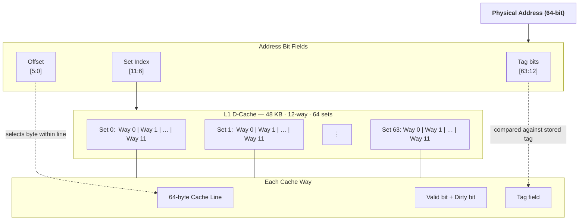
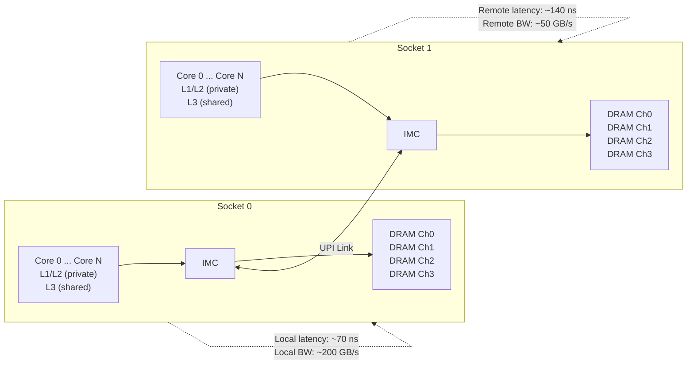

# Lesson 3: CPU and Memory Subsystem Optimization

## 1. First-Principles Intuition & Invariants

The central tension in modern performance engineering is not clock speed — it is latency asymmetry. A contemporary processor core can retire two to four floating-point operations per cycle, sustaining a theoretical throughput of hundreds of gigaflops per second, yet that same core will stall for two hundred to three hundred cycles the moment it must fetch a cache line from main memory. The gap between what the processor *can* compute and what the memory system *can* feed it is the defining constraint of nearly every performance-critical workload written today. Understanding this asymmetry at a physical level, not merely as a heuristic, is the prerequisite for every optimization technique covered in this lesson.

The memory hierarchy exists because the speed-of-light and fabrication economics impose a fundamental inverse relationship between storage capacity and access latency. SRAM cells, which form the substrate of CPU caches, require six transistors per bit and must sit within a few millimeters of the execution units to achieve single-digit nanosecond access. DRAM, by contrast, uses one transistor and one capacitor per bit, is physically distant from the die, and requires a row-activation sequence (the DRAM RAS/CAS protocol) that adds tens of nanoseconds before the first byte is transferred. The latency numbers that every performance engineer must internalize are approximately: L1 data cache at 4–5 cycles (roughly 1.5 ns on a 3 GHz core), L2 at 12–15 cycles, L3 at 30–50 cycles, local DRAM at 60–80 ns, and remote NUMA memory at 120–200 ns or more. These are not abstract figures — they are the physical constants of your execution environment, as invariant to your workload as the speed of light is to network latency.

The cache operates on the granularity of a **cache line**, which is 64 bytes on every modern x86-64 and ARM64 processor. This is the atomic unit of transfer between any two levels of the hierarchy. When a load instruction references an address that is not resident in cache, the hardware issues a cache-line fill from the next level, dragging in all 64 bytes regardless of how many the program actually needed. This behavior is the double-edged sword at the heart of spatial locality: if adjacent bytes are needed soon, the prefetch was productive; if they are never touched, the bandwidth and cache capacity were wasted. The performance engineer's job is to structure data and access patterns so that the hardware's assumptions are consistently correct.

Temporal locality and spatial locality are the two classical principles, but they are not symmetric in importance or mechanism. Temporal locality — the probability that a recently accessed address will be accessed again — is exploited by the cache's LRU-approximate replacement policy. Spatial locality — the probability that addresses near a recently accessed one will be accessed soon — is exploited both by the cache-line fill mechanism and by the hardware prefetchers embedded in every modern CPU. These prefetchers (Intel calls them the Data Cache Unit Prefetcher and the Streamer, AMD has analogous structures in Zen) monitor access patterns in a streaming buffer and issue speculative L2 or L3 fills before the core stalls. They work reliably for linear stride-1 and constant-stride patterns; they fail entirely on pointer-chasing traversals like linked list walks, where each access address is determined only after the previous load resolves. This failure mode — pointer chasing killing prefetch effectiveness — is one of the most common root causes of underperforming systems code.

Branch prediction adds another axis of complexity. Modern processors are deeply superscalar and out-of-order: they maintain a reorder buffer (ROB) of 200–600 in-flight instructions and execute them speculatively ahead of unresolved branches. The branch predictor — a combination of a bimodal predictor, a global history register, and an indirect branch target buffer — achieves better than 99% accuracy on well-structured code. When it mispredicts, the pipeline must be flushed and partially refilled, costing 15–20 cycles on current Intel and AMD microarchitectures. For a tight loop processing millions of elements, a 1% misprediction rate translates into a consistent, measurable throughput penalty. When branch misprediction and cache miss latency compound — as they do when the branch outcome depends on a value loaded from cold memory — the stall can reach hundreds of cycles, completely serializing execution.

NUMA (Non-Uniform Memory Access) introduces a topology dimension that scalar analysis misses. On multi-socket servers, each physical socket has its own memory controllers and local DRAM. When a thread running on socket 0 allocates or touches memory that was physically allocated on socket 1 — either because the OS scheduled it differently or because the allocator did not respect NUMA topology — every memory access crosses an interconnect (HyperTransport on AMD, UPI on Intel Xeon), adding 50–100 ns of additional latency and consuming inter-socket bandwidth that is typically two to four times narrower than local memory bandwidth. The resulting performance degradation is not uniform or obvious: code that runs correctly and efficiently on a developer's workstation (single socket, 128 GB) can degrade by 40–60% when deployed to a 2-socket production machine with the same aggregate RAM.

## 2. Core Architecture & Mechanics

### The Cache Hierarchy: Physical Structure and Replacement Dynamics

Modern L1 and L2 caches are **set-associative**: the cache is divided into sets, each holding a fixed number of ways (lines). An incoming address is mapped to a specific set by hashing the lower address bits (excluding the offset bits), and the cache checks all ways in that set in parallel. A typical L1 data cache is 48 KB, 12-way associative, with 64-byte lines, yielding 64 sets. The L3 is shared across all cores, often 8-way or 16-way, and uses a more complex replacement policy (Intel's Adaptive Replacement Cache in some generations, pseudo-LRU in others).



A **cache conflict miss** occurs when two frequently accessed addresses map to the same set and their combined working set exceeds the associativity. This is a subtle failure mode: two arrays that are a multiple of 4 KB apart in virtual address space will often alias to the same L1 set, causing thrashing even if the total data volume would otherwise fit comfortably. The classic manifestation is a matrix transpose whose inner loop accesses two rows whose base addresses differ by exactly a cache-set stride.

Write behavior deserves explicit attention. L1 caches are almost universally **write-back**: stores are absorbed into cache and the line is marked dirty. The dirty line is only written back to L2 when it is evicted. This means a tight loop performing repeated stores to the same line is effectively free from an L2 bandwidth perspective, as long as eviction is infrequent. L2 and L3 also use write-back policies on most x86 architectures, so the memory bus only sees traffic when the LLC (Last Level Cache) evicts dirty lines. The write-combining buffer (WCB) is a separate structure — typically four to twelve entries on Intel cores — that merges non-temporal store instructions targeting write-combining memory regions, and is the hardware mechanism that enables high-throughput streaming writes.

### The Hardware Prefetch Engine

The prefetch engine is not a single unit. Intel's microarchitecture exposes at least four distinct prefetchers: the L1 Streamer (detects forward and backward sequential access), the L1 Stride Prefetcher (detects constant-stride patterns in a specific IP context), the L2 Streamer (operates on L2 miss streams), and the L2 Spatial Prefetcher (speculatively fills neighboring cache lines in the same 4 KB page). These are independent engines with separate hardware tables tracking access histories indexed by instruction pointer. The important engineering implication is that the stride prefetcher operates per-PC (instruction pointer), so a single load instruction touching memory at a constant stride will train it correctly, while a function that handles varying strides from different call sites may confuse it.

```text
Access Pattern vs. Prefetch Effectiveness:

Pattern: A[0], A[1], A[2], A[3]...     (stride 8B)
Prefetch: ████████████ EFFECTIVE — streamer trains after 2–4 accesses

Pattern: A[0], A[128], A[256]...        (stride 1KB)  
Prefetch: ████████░░░░ PARTIAL — stride prefetcher handles, deeper misses

Pattern: p = head; p = p->next; ...     (pointer chase)
Prefetch: ░░░░░░░░░░░░ INEFFECTIVE — each address unknown until load resolves

Pattern: A[rand()%N]                    (random access)
Prefetch: ░░░░░░░░░░░░ INEFFECTIVE — no detectable pattern
```

For pointer-chasing workloads, the only mechanism that helps is software prefetching with `__builtin_prefetch` (GCC/Clang) or the `_mm_prefetch` intrinsic. The critical technique is **prefetch distance**: issuing a prefetch for the element `k` iterations ahead of the current one, calibrated so the prefetch latency is hidden by the intervening work. If each iteration takes roughly 10 cycles and L3 latency is 40 cycles, a prefetch distance of 4–8 iterations is a reasonable starting point, validated empirically with `perf stat`.

### Branch Prediction Microarchitecture

The modern branch predictor is a hierarchical structure. At its core sits a **TAGE predictor** (TAgged GEometric history length predictor, Seznec 2006), which uses multiple predictor tables indexed by XORing the branch PC with global branch history of geometrically increasing lengths. The longest history that produces a valid tag match wins. This architecture is remarkably effective at capturing correlated branches across a loop body or a call chain, but it has a finite number of entries (typically 4K–32K tagged entries across the tables), and when two branches alias to the same entry, they corrupt each other's histories. This aliasing is a primary source of mispredictions in large, branch-heavy codebases.

The **indirect branch predictor** (tracking `call [rax]`-style dispatches) is a separate structure called the Indirect Branch Target Buffer (IBPB / IBTB). Virtual function calls, function pointer dispatch tables, and computed gotos all consume this resource. After Spectre and Retpoline, indirect branches became substantially more expensive on patched kernels: retpoline replaces the speculative execution of an indirect branch with a serializing `lfence` on some microcode configurations, costing 10–30 extra cycles per indirect call.

### NUMA Topology and Memory Access Latency

On a dual-socket Xeon system, the memory topology looks like the following:



Linux exposes NUMA topology through `numactl --hardware` and the `/sys/devices/system/node/` hierarchy. The kernel's default memory allocation policy is **local allocation**: memory pages are allocated on the NUMA node where the faulting thread runs. This is correct when threads consistently run on the same socket, but breaks down when the OS scheduler migrates threads (which it will do to balance load) or when threads share data across sockets. The `libnuma` API and the `numactl` tool allow explicit binding — a topic covered in the optimization section.

### Memory Bandwidth and the Roofline Model

The **Roofline model**, formalized by Williams, Waterman, and Patterson (2009), provides a clean framework for diagnosing whether a kernel is compute-bound or memory-bandwidth-bound. The model defines **arithmetic intensity** as the ratio of floating-point operations to bytes transferred from DRAM: $I = \frac{\text{FLOPs}}{\text{Bytes}}$. The achievable performance is bounded by $\min(\text{Peak FLOPs}, \text{Peak BW} \times I)$. A kernel with intensity below the **ridge point** (the crossover, typically 5–15 FLOPs/byte on current hardware) is memory-bandwidth-bound: adding more compute units does nothing, and the only way to improve throughput is to either increase intensity (more computation per loaded byte) or increase effective bandwidth (better access patterns, caching, or compression).

Memory bandwidth saturation is a qualitatively different failure mode from cache miss latency. A single-threaded pointer chase is latency-bound: the processor is stalled waiting for one outstanding miss at a time. A vectorized streaming kernel processing large arrays is bandwidth-bound: multiple cache lines are in flight simultaneously via the memory-level parallelism (MLP) of the out-of-order engine, but the DRAM bus is simply saturated. `perf stat -e cache-misses,LLC-load-misses,cycle_activity.stalls_l3_miss` distinguishes these cases: high stall cycles with low LLC miss counts indicates latency-bound behavior; high LLC miss counts with moderate stall cycles per miss indicates bandwidth saturation.

## 3. High-Performance Optimization & Failure Modes

### Data Layout: Structure of Arrays vs. Array of Structures

The most impactful single change available to a performance engineer is often data layout transformation. Consider a particle simulation maintaining position, velocity, and mass for one million particles. The intuitive object-oriented layout is an Array of Structures (AoS):

```c
// AoS: poor spatial locality for vectorized kernels
typedef struct {
    float x, y, z;    // 12 bytes
    float vx, vy, vz; // 12 bytes
    float mass;       // 4 bytes
    float padding;    // 4 bytes: align to 32 bytes
} Particle;           // Total: 32 bytes/particle

Particle particles[1000000]; // 32 MB
```

A kernel that updates only positions using velocities must load every 32-byte struct to access 24 bytes of data it needs, with 8 bytes of mass and padding going to waste in every cache line. Worse, AVX2 vectorization that processes 8 floats per instruction cannot directly load contiguous `x` values — they are strided 32 bytes apart.

The Structure of Arrays (SoA) layout inverts this:

```c
// SoA: ideal spatial locality for vectorized kernels
typedef struct {
    float x[1000000];
    float y[1000000];
    float z[1000000];
    float vx[1000000];
    float vy[1000000];
    float vz[1000000];
    float mass[1000000];
} ParticleSystem;
```

Now the position update kernel loads from contiguous `x`, `y`, `z`, `vx`, `vy`, `vz` arrays. Each cache line holds 16 consecutive `x` values. AVX-512 can process 16 floats per instruction, the hardware streamer trains immediately on the first access, and no bandwidth is wasted. The performance difference on a bandwidth-bound kernel like this is typically 2x–4x, achievable with a data layout change and no algorithmic modification.

The practical code for a position update with explicit SIMD and memory alignment illustrates the full implementation:

```c
#include <immintrin.h>
#include <stdlib.h>
#include <stddef.h>
#include <string.h>
#include <stdio.h>

#define N 1024 * 1024
#define ALIGN 64 // Cache-line aligned allocation

typedef struct {
    float * __restrict__ x;
    float * __restrict__ y;
    float * __restrict__ z;
    float * __restrict__ vx;
    float * __restrict__ vy;
    float * __restrict__ vz;
} ParticleSoA;

static void alloc_particles(ParticleSoA *p, size_t n) {
    p->x  = aligned_alloc(ALIGN, n * sizeof(float));
    p->y  = aligned_alloc(ALIGN, n * sizeof(float));
    p->z  = aligned_alloc(ALIGN, n * sizeof(float));
    p->vx = aligned_alloc(ALIGN, n * sizeof(float));
    p->vy = aligned_alloc(ALIGN, n * sizeof(float));
    p->vz = aligned_alloc(ALIGN, n * sizeof(float));
}

// AVX2 position update: 8 particles per iteration, dt broadcast
void update_positions_avx2(ParticleSoA *p, size_t n, float dt) {
    __m256 vdt = _mm256_set1_ps(dt);

    for (size_t i = 0; i < n; i += 8) {
        // Load 8 consecutive positions and velocities
        __m256 px = _mm256_load_ps(&p->x[i]);
        __m256 py = _mm256_load_ps(&p->y[i]);
        __m256 pz = _mm256_load_ps(&p->z[i]);
        __m256 pvx = _mm256_load_ps(&p->vx[i]);
        __m256 pvy = _mm256_load_ps(&p->vy[i]);
        __m256 pvz = _mm256_load_ps(&p->vz[i]);

        // FMA: x += vx * dt
        px = _mm256_fmadd_ps(pvx, vdt, px);
        py = _mm256_fmadd_ps(pvy, vdt, py);
        pz = _mm256_fmadd_ps(pvz, vdt, pz);

        _mm256_store_ps(&p->x[i], px);
        _mm256_store_ps(&p->y[i], py);
        _mm256_store_ps(&p->z[i], pz);
    }
}

int main(void) {
    ParticleSoA sys;
    alloc_particles(&sys, N);

    // Initialize with dummy data
    for (size_t i = 0; i < N; i++) {
        sys.x[i] = (float)i * 0.001f;
        sys.y[i] = (float)i * 0.002f;
        sys.z[i] = (float)i * 0.003f;
        sys.vx[i] = 1.0f; sys.vy[i] = 0.5f; sys.vz[i] = 0.25f;
    }

    update_positions_avx2(&sys, N, 0.016f);

    printf("x[0] = %f, x[N-1] = %f\n", sys.x[0], sys.x[N - 1]);

    free(sys.x); free(sys.y); free(sys.z);
    free(sys.vx); free(sys.vy); free(sys.vz);
    return 0;
}
```

Compile with `gcc -O3 -march=native -mfma -mavx2 -o particles particles.c` and profile with `perf stat -e L1-dcache-loads,L1-dcache-load-misses,LLC-loads,LLC-load-misses ./particles`. The LLC miss rate on this SoA kernel should be below 0.5% once the hardware streamer fully engages.

### Cache Blocking (Tiling) for Algorithmic Locality

When a kernel's working set exceeds the L2 or L3 cache, the solution is to restructure the loop order so that the data accessed in each sub-problem fits within cache. This technique, called cache blocking or tiling, is best illustrated with matrix multiplication, which has $O(N^3)$ work and $O(N^2)$ data, giving it theoretically high arithmetic intensity — but only if implemented correctly.

The naive triple-nested loop accesses the `B` matrix column-by-column in the inner loop, which is a stride-N access pattern when `B` is stored row-major. For a 2048×2048 float matrix, each row of `B` is 8 KB, so accessing a full column touches 2048 × 8 KB = 16 MB, which thrashes the L3. The solution is to tile the computation so that a submatrix of `B` (a **block**) fits in L2:

```c
#include <stdlib.h>
#include <string.h>
#include <stdio.h>

#define N 2048
#define BLOCK 64  // Tune to L2 size: 64 floats * 64 floats * 4 bytes = 16KB < 32KB L2

void matmul_blocked(
    const float * __restrict__ A,
    const float * __restrict__ B,
    float       * __restrict__ C,
    int n, int block)
{
    // Zero output
    memset(C, 0, (size_t)n * n * sizeof(float));

    for (int ii = 0; ii < n; ii += block) {
        for (int kk = 0; kk < n; kk += block) {
            for (int jj = 0; jj < n; jj += block) {
                // Inner kernel: operates on BLOCK x BLOCK tiles
                int i_max = ii + block < n ? ii + block : n;
                int k_max = kk + block < n ? kk + block : n;
                int j_max = jj + block < n ? jj + block : n;

                for (int i = ii; i < i_max; i++) {
                    for (int k = kk; k < k_max; k++) {
                        float a_ik = A[i * n + k];
                        for (int j = jj; j < j_max; j++) {
                            C[i * n + j] += a_ik * B[k * n + j];
                        }
                    }
                }
            }
        }
    }
}

int main(void) {
    float *A = aligned_alloc(64, N * N * sizeof(float));
    float *B = aligned_alloc(64, N * N * sizeof(float));
    float *C = aligned_alloc(64, N * N * sizeof(float));

    for (int i = 0; i < N * N; i++) {
        A[i] = (float)(i % 17) * 0.1f;
        B[i] = (float)(i % 13) * 0.1f;
    }

    matmul_blocked(A, B, C, N, BLOCK);
    printf("C[0] = %f\n", C[0]);

    free(A); free(B); free(C);
    return 0;
}
```

Compile with `gcc -O3 -march=native -o matmul matmul.c`. The key insight in the loop ordering (`ii`, `kk`, `jj` as outer tiling loops, `i`, `k`, `j` as inner loops with `k` hoisted) is that the innermost loop accesses `B[k][j]` and `C[i][j]` with stride 1, maximizing spatial locality. The hoisted scalar `a_ik` eliminates a repeated load from `A`. To empirically find the optimal block size, run this loop with `perf stat -e cache-references,cache-misses` for `BLOCK` values of 32, 64, 96, and 128, selecting the value that minimizes `cache-misses / cache-references`.

### Branch Elimination with Branchless Arithmetic

Profile-guided branch elimination is a standard technique, but the more powerful approach is making hot-path conditionals branchless at the source level, exposing them to the compiler's conditional move (`cmov`) generation. Consider a clamping operation or a selection kernel:

```c
#include <stdint.h>
#include <stdio.h>
#include <stdlib.h>

// Branchy version: predictor fails on random input distribution
int32_t clamp_branchy(int32_t x, int32_t lo, int32_t hi) {
    if (x < lo) return lo;
    if (x > hi) return hi;
    return x;
}

// Branchless version: compiles to 2 cmov instructions, no branch
int32_t clamp_branchless(int32_t x, int32_t lo, int32_t hi) {
    int32_t t = x < lo ? lo : x;  // cmovl
    return t > hi ? hi : t;        // cmovg
}

// Branchless conditional accumulation: sum positive values only
int64_t sum_positive_branchless(const int32_t * __restrict__ arr, size_t n) {
    int64_t total = 0;
    for (size_t i = 0; i < n; i++) {
        // Arithmetic right shift of int32: fills with sign bit (0 or -1)
        // mask = 0xFFFFFFFF if arr[i] > 0, 0x00000000 otherwise
        int32_t mask = -(arr[i] > 0);  // compiler emits: xor+cmp+neg or cmov
        total += (int64_t)(arr[i] & mask);
    }
    return total;
}

int main(void) {
    const size_t N = 1 << 24;
    int32_t *data = malloc(N * sizeof(int32_t));
    for (size_t i = 0; i < N; i++) data[i] = (int32_t)(rand() % 2001) - 1000;

    int64_t s = sum_positive_branchless(data, N);
    printf("Sum of positives: %ld\n", s);

    free(data);
    return 0;
}
```

Inspect the generated assembly with `objdump -d -M intel ./sum | grep -A 30 sum_positive`. On `-O2` or higher with `gcc`, the inner loop should contain no `j*` jump instructions — only `cmp`, `setg`, `neg`, and `add`. The misprediction penalty of 15–20 cycles on a 50% branch is replaced by a deterministic 2–3 cycle `cmov` sequence, which on random data distributions typically yields a 2x–5x speedup on this class of kernel.

The nuance is that `cmov` is not always faster than a branch. When the branch is highly predictable (greater than 95% one direction), the branch predictor's speculative execution hides all latency, and a `cmov` that creates a data dependency chain can actually be slower. Use `perf stat -e branch-misses,branches` to measure the misprediction rate before choosing your strategy. A rate above 2–3% on a hot-path conditional is a strong signal to prefer `cmov`.

### Software Prefetching for Pointer-Chasing Workloads

A linked list traversal is the canonical prefetch-hostile workload. The hardware prefetcher cannot predict the next node address because it is stored in the current node. The workaround is to issue a prefetch several nodes ahead, using whatever traversal state is already available:

```c
#include <stdlib.h>
#include <stdio.h>
#include <time.h>

typedef struct Node {
    struct Node *next;
    int64_t value;
    char padding[48]; // pad to 64 bytes = one cache line
} Node;

// Cold traversal: every node miss is a full L3/DRAM round trip
int64_t traverse_naive(Node *head) {
    int64_t sum = 0;
    while (head) {
        sum += head->value;
        head = head->next;
    }
    return sum;
}

// Prefetch-ahead traversal: issue prefetch for node k+DIST ahead
#define PREFETCH_DIST 8

int64_t traverse_prefetch(Node *head) {
    int64_t sum = 0;
    Node *prefetch_ptr = head;

    // Prime the prefetch pipeline
    for (int i = 0; i < PREFETCH_DIST && prefetch_ptr != NULL; i++) {
        __builtin_prefetch(prefetch_ptr->next, 0, 1);
        prefetch_ptr = prefetch_ptr->next;
    }

    while (head) {
        // Prefetch the node DIST steps ahead
        if (prefetch_ptr) {
            __builtin_prefetch(prefetch_ptr->next, 0, 1);
            prefetch_ptr = prefetch_ptr->next;
        }
        sum += head->value;
        head = head->next;
    }
    return sum;
}

static Node *build_random_list(size_t n) {
    Node **nodes = malloc(n * sizeof(Node *));
    for (size_t i = 0; i < n; i++) {
        nodes[i] = aligned_alloc(64, sizeof(Node));
        nodes[i]->value = (int64_t)i;
    }
    // Shuffle to create random pointer traversal order
    for (size_t i = n - 1; i > 0; i--) {
        size_t j = rand() % (i + 1);
        Node *tmp = nodes[i]; nodes[i] = nodes[j]; nodes[j] = tmp;
    }
    for (size_t i = 0; i < n - 1; i++) nodes[i]->next = nodes[i + 1];
    nodes[n - 1]->next = NULL;
    Node *head = nodes[0];
    free(nodes);
    return head;
}

int main(void) {
    srand(42);
    const size_t N = 1 << 20; // 1M nodes, each 64 bytes = 64MB, cold in LLC
    Node *list = build_random_list(N);

    struct timespec t0, t1;

    clock_gettime(CLOCK_MONOTONIC, &t0);
    int64_t s1 = traverse_naive(list);
    clock_gettime(CLOCK_MONOTONIC, &t1);
    printf("Naive:    %ld ns, sum=%ld\n",
        (t1.tv_sec - t0.tv_sec) * 1000000000L + (t1.tv_nsec - t0.tv_nsec), s1);

    clock_gettime(CLOCK_MONOTONIC, &t0);
    int64_t s2 = traverse_prefetch(list);
    clock_gettime(CLOCK_MONOTONIC, &t1);
    printf("Prefetch: %ld ns, sum=%ld\n",
        (t1.tv_sec - t0.tv_sec) * 1000000000L + (t1.tv_nsec - t0.tv_nsec), s2);

    return 0;
}
```

Compile with `gcc -O2 -o list_traverse list_traverse.c` and run with `numactl --cpunodebind=0 --membind=0 ./list_traverse` to ensure local NUMA allocation. With a 64 MB working set exceeding the L3, the naive traversal operates at roughly 100–200 Mops/s, entirely dominated by DRAM latency. The prefetch version, depending on `PREFETCH_DIST` and the actual L3 latency of your CPU, should achieve 300–500 Mops/s — a 2x–3x gain from one structural change. Tune `PREFETCH_DIST` by running the benchmark with values 4, 8, 16, and 32, then select the minimum-latency result. If the distance is too small, the prefetch arrives late; too large, and prefetched lines are evicted before they are needed.

### NUMA-Aware Allocation and Thread Binding

On multi-socket systems, the first optimization step is measurement: `numactl --hardware` reveals the NUMA topology, and `numastat -p <pid>` shows per-node allocation for a running process. Unexpected cross-node traffic manifests as a large discrepancy between `numa_hit` and `numa_miss` in `/proc/vmstat`.

The `numactl` tool provides coarse-grained control at process launch:

```bash
# Bind process to socket 0 cores and socket 0 memory
numactl --cpunodebind=0 --membind=0 ./your_binary

# Interleave allocation across nodes (best for shared data with no NUMA affinity)
numactl --interleave=all ./your_binary

# Measure NUMA miss rate before and after
grep -E 'numa_hit|numa_miss|numa_foreign|numa_interleave' /proc/vmstat
```

For fine-grained per-thread binding in C, use `libnuma` directly:

```c
#include <numa.h>
#include <numaif.h>
#include <pthread.h>
#include <stdlib.h>
#include <stdio.h>
#include <string.h>

#define ARRAY_SIZE (1 << 26) // 256M floats = 1 GB
#define NUM_THREADS 4

typedef struct {
    int thread_id;
    int numa_node;
    float *data;
    size_t start, end;
    double result;
} ThreadArg;

static void *worker(void *arg_ptr) {
    ThreadArg *arg = arg_ptr;

    // Bind this thread to the specified NUMA node
    struct bitmask *cpu_mask  = numa_allocate_cpumask();
    struct bitmask *node_mask = numa_allocate_nodemask();
    numa_bitmask_setbit(node_mask, arg->numa_node);

    // Set memory policy: allocate from local node
    if (set_mempolicy(MPOL_BIND, node_mask->maskp, node_mask->size + 1) != 0) {
        perror("set_mempolicy");
    }

    double sum = 0.0;
    for (size_t i = arg->start; i < arg->end; i++) {
        sum += arg->data[i];
    }
    arg->result = sum;

    numa_free_nodemask(node_mask);
    numa_free_cpumask(cpu_mask);
    return NULL;
}

int main(void) {
    if (numa_available() < 0) {
        fprintf(stderr, "NUMA not available\n");
        return 1;
    }

    int num_nodes = numa_num_configured_nodes();
    printf("NUMA nodes: %d\n", num_nodes);

    // Allocate on node 0 explicitly
    float *data = numa_alloc_onnode(ARRAY_SIZE * sizeof(float), 0);
    if (!data) { perror("numa_alloc_onnode"); return 1; }
    for (size_t i = 0; i < ARRAY_SIZE; i++) data[i] = 1.0f;

    pthread_t threads[NUM_THREADS];
    ThreadArg args[NUM_THREADS];
    size_t chunk = ARRAY_SIZE / NUM_THREADS;

    for (int t = 0; t < NUM_THREADS; t++) {
        args[t].thread_id = t;
        args[t].numa_node = t % num_nodes; // distribute across nodes
        args[t].data  = data;
        args[t].start = t * chunk;
        args[t].end   = (t == NUM_THREADS - 1) ? ARRAY_SIZE : (t + 1) * chunk;
        args[t].result = 0.0;
        pthread_create(&threads[t], NULL, worker, &args[t]);
    }

    double total = 0.0;
    for (int t = 0; t < NUM_THREADS; t++) {
        pthread_join(threads[t], NULL);
        total += args[t].result;
    }

    printf("Total sum: %f\n", total);
    numa_free(data, ARRAY_SIZE * sizeof(float));
    return 0;
}
```

Compile with `gcc -O2 -o numa_sum numa_sum.c -lnuma -lpthread`. On a single-socket machine the NUMA effect is invisible, but on a 2-socket production server the threads assigned to `numa_node=1` accessing `data` allocated on node 0 will show 2x higher average access latency, visible as elevated `cycle_activity.stalls_l3_miss` in `perf stat`. The fix is to either allocate data on the node that owns it (`numa_alloc_onnode` per thread's node) or use interleaved allocation for globally shared read-mostly data.

### Measurement Workflow: perf, Valgrind Cachegrind, and LIKWID

No optimization discussion is complete without a disciplined measurement workflow. The sequence for single-threaded workload analysis is as follows.

First, establish a baseline with `perf stat`, which samples hardware performance counters with minimal overhead:

```bash
# Comprehensive single-core counters: IPC, cache behavior, branch prediction
perf stat -e cycles,instructions,cache-references,cache-misses,\
branch-instructions,branch-misses,\
L1-dcache-loads,L1-dcache-load-misses,\
LLC-loads,LLC-load-misses \
-r 5 ./your_binary
```

The key derived metrics to extract are Instructions Per Cycle (IPC = `instructions / cycles`), L1 miss rate (`L1-dcache-load-misses / L1-dcache-loads`), LLC miss rate (`LLC-load-misses / LLC-loads`), and branch misprediction rate (`branch-misses / branch-instructions`). An IPC below 1.0 on a modern out-of-order core with a 4-wide issue engine is a strong indicator of either memory stalls or branch mispredictions. An IPC above 3.0 suggests the kernel is compute-bound and the cache hierarchy is well-utilized.

For line-level cache miss attribution, `valgrind --tool=cachegrind` instruments every memory access in software (10–50x slowdown) and reports per-function and per-line L1 and LL miss counts:

```bash
valgrind --tool=cachegrind --cache-sim=yes --branch-sim=yes \
         --cachegrind-out-file=cg.out ./your_binary
cg_annotate cg.out --auto=yes | head -100
```

LIKWID provides the most precise hardware counter access, particularly for memory bandwidth measurement via its memory controller performance monitoring unit (uncore PMU) support, which `perf` does not expose uniformly across all architectures:

```bash
# Measure memory bandwidth using LIKWID's MEM group
likwid-perfctr -C 0 -g MEM -m ./your_binary

# Measure floating-point throughput vs. theoretical peak
likwid-perfctr -C 0 -g FLOPS_SP -m ./your_binary
```

The LIKWID `MEM` group reports `Memory bandwidth [MBytes/s]` directly from the IMC counters, allowing you to compare measured bandwidth against the theoretical peak (available from `likwid-topology` or the CPU data sheet, e.g. 51.2 GB/s for dual-channel DDR5-6400). When measured bandwidth exceeds 90% of the theoretical peak, the kernel is bandwidth-saturated and no amount of algorithmic optimization will help without reducing memory traffic — through compression, reduced precision (FP32 to FP16 or BF16), or increased arithmetic intensity via blocking.

### False Sharing and Cache Line Contention

False sharing is a multi-threaded pathology where two threads repeatedly write to distinct variables that happen to reside on the same 64-byte cache line. Each write invalidates the line in the other core's L1 (via the MESI coherence protocol), causing a stream of unnecessary cache-line bouncing through the L3. The result is that two threads sharing no logical data can run up to 10x slower than expected simply due to allocation adjacency.

The diagnostic is `perf c2c` (cache-to-cache), which requires Linux 4.3 and a modern Intel or AMD processor with PEBS/IBS support:

```bash
perf c2c record -g -- ./your_binary
perf c2c report --stdio | head -60
```

The report identifies the specific cache lines experiencing high `HITM` (Hit In a Modified state) counts — these are the lines being bounced. The fix is padding shared structures to cache-line boundaries using `alignas` or `__attribute__((aligned(64)))`:

```c
#include <stddef.h>
#include <stdint.h>
#include <stdalign.h>

// WRONG: counter[0] and counter[1] share a cache line
typedef struct { int64_t value; } Counter;
Counter counters_bad[8];

// CORRECT: each counter occupies its own cache line
typedef struct {
    alignas(64) int64_t value;
    char _pad[64 - sizeof(int64_t)];
} AlignedCounter;
AlignedCounter counters_good[8];
```

This is not premature optimization — it is a correctness-class issue in the sense that ignoring it produces results that are both slower and architecture-dependent, breaking on machines with different core counts or NUMA topology.

The discipline of CPU and memory subsystem optimization ultimately reduces to a single iterative workflow: measure with hardware counters, identify the dominant bottleneck (latency, bandwidth, branch misprediction, or false sharing), apply the structural change that addresses that specific bottleneck, and re-measure to confirm the hypothesis. Every technique in this lesson — SoA layout, cache blocking, branchless code, software prefetching, NUMA binding — is a targeted intervention for a specific class of bottleneck. Applying them without measurement is guesswork; applying them after measurement is engineering.
