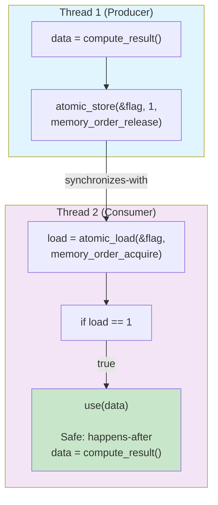

# Lesson 4: Concurrency, Synchronization, and Lock-Free Techniques

## 1. First-Principles Intuition & Invariants

Modern processors do not execute memory operations in the order a programmer writes them. Neither does the compiler. Neither does the interconnect fabric between CPU cores. This uncomfortable truth sits at the foundation of every concurrency bug ever written, and understanding it at the physical level is the prerequisite for writing correct, high-performance concurrent code. The lesson that follows treats concurrency not as a library problem or an API problem, but as a hardware contract problem: the question of which guarantees the silicon makes, which ones it deliberately withholds for performance, and how software must compensate.

### The Memory Hierarchy as the Root of Contention

Each core in a modern multiprocessor has its own L1 and L2 caches, usually private, with L3 shared across a socket. When two threads on different cores read and write the same memory location, the CPU's cache coherence protocol must intervene to maintain the invariant that no core ever observes a stale value. The dominant protocol family in x86-64 and ARM is MESI (Modified, Exclusive, Shared, Invalid), and understanding its state machine explains the dominant performance pathology of concurrent programs: cache line contention.

A 64-byte cache line is the atom of transfer between cache and main memory. When core A holds a cache line in state Modified and core B attempts a write to any byte within that same line, the hardware must first broadcast an invalidation to core A's cache, force core A to write the line back to L3 or main memory, transfer the line to core B, and transition it to the Modified state on core B. This round trip through the cache coherence fabric costs somewhere between 50 and 300 CPU cycles on a typical multi-socket system. At 3 GHz, 300 cycles is 100 nanoseconds—a hundred times the cost of an L1 hit. In a tight loop where multiple threads hammer a shared counter, this latency dominates everything else. The lock is not what makes your mutex slow; the coherence traffic the lock variable itself generates is what makes it slow.

This insight motivates *false sharing*, one of the most insidious performance bugs in concurrent systems. False sharing occurs when two logically independent variables happen to reside in the same cache line. Thread A writes field `a` and thread B writes field `b`, and even though they never share logical state, the hardware sees two writers to one cache line and generates full coherence traffic. The fix is alignment: pad or reorder structures so that independently written fields occupy separate cache lines. The C11/C++17 standard provides `alignas(std::hardware_destructive_interference_size)` for exactly this purpose, though that constant is frequently 64 bytes on x86-64 and 128 bytes on some ARM implementations due to spatial prefetcher behavior.

### The Memory Model as a Formal Contract

The behavior of processors that reorder memory operations is not random or undefined—it is governed by a *memory consistency model*, a formal specification of which reorderings are legal and which observations are possible across concurrent threads. Without a memory model, the happens-before relationship between operations in different threads is undefined, and no reasoning about shared state is possible.

The x86-64 Total Store Order (TSO) model is relatively strong by industry standards. It guarantees that stores from a single core are observed by all other cores in the order they were issued, and that a core always reads its own most recent store before it propagates to others. What TSO does *not* guarantee is that a store becomes immediately visible to other cores; a store sits in the store buffer for some time before draining to L3. This means a load on another core can read a stale value even after the writing core has executed the store instruction. The practical consequence is that lock-free algorithms on x86-64 get some ordering "for free" that the same algorithm on ARM or RISC-V must pay for explicitly with memory barrier instructions.

The C++ memory model, defined in ISO C++11 and refined through C++20, provides a hardware-portable abstraction over these physical reorderings through `std::atomic` and its associated `std::memory_order` enum. The model defines a happens-before relation: if operation A *synchronizes-with* operation B, then A happens-before B, and all side effects of A are visible to B. The synchronizes-with relation is established by specific pairs of atomic operations: a *release* store to an atomic variable synchronizes-with an *acquire* load of the same variable that reads the stored value. This is the foundational contract on which every lock-free algorithm is built. Release-acquire pairs are the vocabulary; happens-before is the grammar; data-race-free programs are the only well-formed sentences.

The six memory orderings in `std::memory_order` form a lattice from weakest to strongest. `memory_order_relaxed` provides no synchronization and no ordering, only atomicity of the individual operation—useful for metrics counters and sequence numbers that are read only for approximate information. `memory_order_acquire` and `memory_order_release` establish the synchronizes-with edge described above; they are the workhorse ordering for most lock-free data structures. `memory_order_acq_rel` combines both for read-modify-write operations like compare-and-swap on a lock word. `memory_order_seq_cst` imposes a single total order on all sequentially consistent operations across all threads and all variables—it is the default when you write `std::atomic<int>::fetch_add` with no explicit ordering, and it is expensive on architectures that must issue a full memory barrier to enforce it. `memory_order_consume` was intended to track data-dependency ordering and avoid barriers on dependency-ordered architectures like Alpha, but its definition proved impossible to implement correctly in compilers, and all major compilers currently promote it silently to `memory_order_acquire`.

Understanding these orderings is not academic ceremony. The difference between using `memory_order_relaxed` and `memory_order_seq_cst` on a hot path can be the difference between 2 nanoseconds per operation and 20 nanoseconds per operation on a 32-core machine. The penalty compounds with thread count because every `seq_cst` store issues a fence that serializes the store buffer across the entire coherence domain.

### Contention Models and the Fundamental Tradeoff

Concurrent systems exhibit two distinct performance regimes that require different engineering strategies. In the *low-contention regime*, threads rarely compete for the same resource, and the dominant costs are the fixed overhead of synchronization primitives themselves—the syscall cost of a futex, the branch misprediction from an atomic CAS loop, the cache miss on the lock variable. In the *high-contention regime*, many threads compete for the same resource simultaneously, and the dominant costs are queuing delay, coherence traffic, and the serial bottleneck imposed by the critical section. Amdahl's Law is the mathematical expression of this bottleneck: if a fraction `s` of execution is serialized, the maximum speedup from `N` threads is `1 / (s + (1 - s) / N)`. As `N` grows large, the speedup approaches `1/s`, and that ceiling is determined entirely by the serial fraction, not the thread count.

The engineering response to contention is always to either reduce the size of the serial section, eliminate it entirely with lock-free techniques, or shard the shared state to reduce the probability of collision. Lock-free algorithms eliminate blocking, but they trade the mutex's serial section for CAS retry loops, which under high contention can generate even more coherence traffic than a well-tuned mutex. The discipline of choosing the right synchronization primitive for a given access pattern is therefore not about dogmatic preference for lock-free over locks; it is about understanding the contention regime and selecting the mechanism whose performance profile matches it.

---

## 2. Core Architecture & Mechanics

### Mutex Implementation and the Futex Fast Path

The Linux `pthread_mutex_t` and its C++ wrapper `std::mutex` are built atop the kernel's *futex* (fast userspace mutex) primitive. A futex is a 32-bit integer in userspace memory. In the uncontended case, locking a futex requires only a single CAS instruction in userspace: if the word reads 0 (unlocked), atomically set it to 1 (locked) and return immediately. No syscall occurs. This fast path costs roughly 20–40 nanoseconds—dominated by the cache miss on the lock word and the atomic RMW operation, not by kernel entry.

Contention changes the picture. When a second thread attempts to acquire an already-held lock, the kernel `futex(FUTEX_WAIT)` syscall is issued, which atomically checks that the futex word still reads the contended state (usually 2, to distinguish "locked with waiters" from "locked without waiters") and blocks the thread on the kernel wait queue associated with the futex's physical address. The locking thread sets the word to 2 on first contention, so the unlocking thread knows to call `futex(FUTEX_WAKE)` to drain one waiter. This three-state protocol (0=unlocked, 1=locked, 2=locked-with-waiters) avoids spurious syscalls on unlock when no thread is waiting.

The following implementation captures the essential mechanics of this protocol in portable C11:

```c
#include <stdint.h>
#include <stdatomic.h>
#include <linux/futex.h>
#include <sys/syscall.h>
#include <unistd.h>

typedef struct {
    atomic_int state;  /* 0=unlocked, 1=locked, 2=locked+waiters */
} futex_mutex_t;

static inline void futex_wait(atomic_int *addr, int expected) {
    syscall(SYS_futex, addr, FUTEX_WAIT | FUTEX_PRIVATE_FLAG,
            expected, NULL, NULL, 0);
}

static inline void futex_wake(atomic_int *addr, int n) {
    syscall(SYS_futex, addr, FUTEX_WAKE | FUTEX_PRIVATE_FLAG,
            n, NULL, NULL, 0);
}

void futex_mutex_lock(futex_mutex_t *m) {
    int expected = 0;
    /* Fast path: uncontended lock via CAS */
    if (atomic_compare_exchange_strong_explicit(
            &m->state, &expected, 1,
            memory_order_acquire, memory_order_relaxed)) {
        return;
    }
    /* Slow path: mark contention and block */
    do {
        /* If already marked 2, or we can transition 1->2, wait */
        if (expected == 2 ||
            atomic_compare_exchange_weak_explicit(
                &m->state, &expected, 2,
                memory_order_acquire, memory_order_relaxed)) {
            futex_wait(&m->state, 2);
        }
        expected = 0;
    } while (!atomic_compare_exchange_weak_explicit(
                 &m->state, &expected, 2,
                 memory_order_acquire, memory_order_relaxed));
}

void futex_mutex_unlock(futex_mutex_t *m) {
    int prev = atomic_exchange_explicit(&m->state, 0, memory_order_release);
    if (prev == 2) {
        /* There are waiters; wake one */
        futex_wake(&m->state, 1);
    }
}
```

The `FUTEX_PRIVATE_FLAG` optimization tells the kernel this futex is not shared across processes, allowing it to use a process-local hash table for the wait queue rather than the global one, which reduces kernel lock contention significantly on many-core systems.

### Lock-Free Data Structures: The Michael-Scott Queue

The canonical lock-free data structure for high-throughput producer-consumer workloads is the Michael-Scott queue, published by Maged Michael and Michael Scott in 1996. It achieves lock-freedom—the system-wide guarantee that at least one thread makes progress in a finite number of steps, even if other threads are arbitrarily slow—through a carefully designed CAS-based protocol on two atomic pointers: `head` and `tail`.

The queue is singly linked. `head` points to a sentinel node whose `next` pointer points to the first real element. `tail` points to either the last node or, during a concurrent enqueue, may lag one node behind the actual tail. This deliberate laziness in updating `tail` is the key to making enqueue a two-step operation that tolerates a crash between steps: first CAS the last node's `next` pointer from null to the new node, then CAS `tail` forward. Any thread observing a `tail` whose `next` is not null can help advance `tail` itself—this is the helping mechanism that preserves the lock-free property.

```c
#include <stdatomic.h>
#include <stdlib.h>
#include <stdint.h>
#include <stdbool.h>

/*
 * Tagged pointer to prevent ABA problem on systems without
 * hardware double-word CAS. Uses a 64-bit value with the
 * low 16 bits as a version counter (assumes 8-byte alignment).
 */
typedef struct node_t node_t;
struct node_t {
    uintptr_t            value;
    _Atomic(node_t *)    next;
};

typedef struct {
    _Atomic(node_t *) head;
    _Atomic(node_t *) tail;
} ms_queue_t;

void ms_queue_init(ms_queue_t *q) {
    node_t *sentinel = calloc(1, sizeof(node_t));
    atomic_store_explicit(&sentinel->next, NULL, memory_order_relaxed);
    atomic_store_explicit(&q->head, sentinel, memory_order_relaxed);
    atomic_store_explicit(&q->tail, sentinel, memory_order_relaxed);
}

void ms_queue_enqueue(ms_queue_t *q, uintptr_t value) {
    node_t *node = malloc(sizeof(node_t));
    node->value  = value;
    atomic_store_explicit(&node->next, NULL, memory_order_relaxed);

    node_t *tail, *next;
    for (;;) {
        tail = atomic_load_explicit(&q->tail, memory_order_acquire);
        next = atomic_load_explicit(&tail->next, memory_order_acquire);

        /* Confirm tail hasn't changed since we loaded it */
        if (tail != atomic_load_explicit(&q->tail, memory_order_acquire))
            continue;

        if (next == NULL) {
            /* Tail is pointing to the last node; try to link new node */
            node_t *expected_null = NULL;
            if (atomic_compare_exchange_weak_explicit(
                    &tail->next, &expected_null, node,
                    memory_order_release, memory_order_relaxed)) {
                break;  /* Enqueue succeeded; tail will be advanced below */
            }
        } else {
            /* Tail is falling behind; advance it */
            atomic_compare_exchange_weak_explicit(
                &q->tail, &tail, next,
                memory_order_release, memory_order_relaxed);
        }
    }
    /* Best-effort tail advance; another thread may do it if we fail */
    atomic_compare_exchange_weak_explicit(
        &q->tail, &tail, node,
        memory_order_release, memory_order_relaxed);
}

bool ms_queue_dequeue(ms_queue_t *q, uintptr_t *value) {
    node_t *head, *tail, *next;
    for (;;) {
        head = atomic_load_explicit(&q->head, memory_order_acquire);
        tail = atomic_load_explicit(&q->tail, memory_order_acquire);
        next = atomic_load_explicit(&head->next, memory_order_acquire);

        if (head != atomic_load_explicit(&q->head, memory_order_acquire))
            continue;

        if (head == tail) {
            if (next == NULL)
                return false;  /* Queue is empty */
            /* Tail is falling behind; help advance it */
            atomic_compare_exchange_weak_explicit(
                &q->tail, &tail, next,
                memory_order_release, memory_order_relaxed);
        } else {
            /* Read value before CAS; the node may be freed after CAS */
            *value = next->value;
            if (atomic_compare_exchange_weak_explicit(
                    &q->head, &head, next,
                    memory_order_release, memory_order_relaxed)) {
                free(head);  /* Free the old sentinel */
                return true;
            }
        }
    }
}
```

This implementation deliberately avoids the ABA problem by using the sentinel-node scheme: the head pointer always points to a node that has *already been dequeued*, so its previous value is never relevant to any future CAS. The allocation pattern is one node per enqueued item, which is a recognized limitation; real production systems often pair this with a slab allocator or hazard pointer scheme to reclaim memory without blocking.

### The Happens-Before Graph and Memory Ordering in Practice

The relationship between acquire/release pairs can be visualized as a directed acyclic graph where each node is an atomic operation and each edge represents a synchronizes-with relationship that establishes happens-before ordering.



The release store on `flag` and the acquire load that reads value `1` form the synchronizes-with edge. Everything that *happened before* the release store in Thread 1 is visible to everything that *happens after* the acquire load in Thread 2. This is not a philosophical claim about time—it is a hardware guarantee implemented by preventing the compiler and CPU from moving stores after a release barrier or loads before an acquire barrier in the generated instruction stream.

The analogous pair in the Michael-Scott queue is the `memory_order_release` on the CAS in `enqueue` and the `memory_order_acquire` on the load of `tail->next` in `dequeue`. The release CAS that links the new node publishes not just the pointer but every initialization write to that node that preceded it. The acquire load that observes a non-null `next` reads all those initialization writes. Remove either ordering and you have a data race: the `value` field of a newly enqueued node could appear uninitialized to a concurrent dequeuer.

### Seqlocks for Read-Mostly State

When reads vastly outnumber writes and the payload is small enough to copy, the sequence lock offers a compelling alternative to reader-writer mutexes. A seqlock uses a single atomic counter. Writers increment the counter to an odd value before modifying the payload and back to an even value after; readers spin on the counter before reading, then verify it has not changed and is even after reading. If the counter changed during the read, the reader retries. Writers never block on readers; readers retry rather than block on writers. The result is a protocol with zero reader overhead in the uncontended case and O(1) write overhead at the cost of potential reader starvation under sustained write pressure.

```c
#include <stdatomic.h>
#include <string.h>

typedef struct {
    atomic_uint seq;
    char        data[64];
} seqlock_t;

void seqlock_write(seqlock_t *sl, const char *src, size_t len) {
    unsigned seq = atomic_load_explicit(&sl->seq, memory_order_relaxed);
    atomic_store_explicit(&sl->seq, seq + 1, memory_order_release);
    /* Compiler barrier: writes to data must not cross seq stores */
    memcpy(sl->data, src, len);
    atomic_store_explicit(&sl->seq, seq + 2, memory_order_release);
}

void seqlock_read(const seqlock_t *sl, char *dst, size_t len) {
    unsigned seq;
    do {
        seq = atomic_load_explicit(&sl->seq, memory_order_acquire);
        if (seq & 1) continue;  /* Write in progress; spin */
        memcpy(dst, sl->data, len);
    } while (atomic_load_explicit(&sl->seq, memory_order_acquire) != seq);
}
```

The Linux kernel's `jiffies`, `timespec` for `clock_gettime`, and the VDSO timekeeping path all use seqlocks for exactly this reason: thousands of reads per second against a handful of timer interrupt writes.

### Read-Copy-Update (RCU) for Pointer-Stable Structures

For pointer-chased data structures—linked lists, hash tables, trees—where readers vastly outnumber writers and reader latency is critical, RCU provides the strongest read-side guarantees of any synchronization primitive: reads are completely wait-free and require no atomic operations. The mechanism relies on two invariants. First, writers never modify a node in place; they allocate a new version of the node, copy and modify it, then atomically swing a pointer from the old version to the new one. Second, the old version is not freed until a *grace period* has elapsed: a point in time by which every reader that could have observed the old pointer has either finished reading or restarted.

In userspace, `liburcu` provides a production-quality RCU implementation. Readers call `rcu_read_lock()` and `rcu_read_unlock()` around their critical section (which on modern userspace RCU translates to a single memory barrier or even a compiler barrier, not a syscall), and writers call `synchronize_rcu()` to wait for all concurrent readers to complete before freeing old objects.

The practical shape of an RCU-protected hash table lookup is striking in its simplicity:

```c
#include <urcu.h>
#include <urcu/rcuhlist.h>

struct entry {
    struct cds_hlist_node node;
    uint64_t              key;
    uint64_t              value;
    struct rcu_head       rcu;   /* For deferred free */
};

uint64_t ht_lookup(struct cds_hlist_head *buckets,
                   size_t nbuckets, uint64_t key) {
    uint64_t hash   = key % nbuckets;
    uint64_t result = 0;
    struct entry *e;

    rcu_read_lock();
    cds_hlist_for_each_entry_rcu(e, &buckets[hash], node) {
        if (e->key == key) {
            result = CMM_LOAD_SHARED(e->value);
            break;
        }
    }
    rcu_read_unlock();
    return result;
}

static void entry_free_rcu(struct rcu_head *head) {
    struct entry *e = caa_container_of(head, struct entry, rcu);
    free(e);
}

void ht_remove(struct cds_hlist_head *buckets,
               size_t nbuckets, uint64_t key) {
    uint64_t hash = key % nbuckets;
    struct entry *e;

    /* Writer side still needs a mutex to serialize concurrent removes */
    pthread_mutex_lock(&write_lock);
    cds_hlist_for_each_entry_rcu(e, &buckets[hash], node) {
        if (e->key == key) {
            cds_hlist_del_rcu(&e->node);
            call_rcu(&e->rcu, entry_free_rcu);
            break;
        }
    }
    pthread_mutex_unlock(&write_lock);
}
```

The write side still uses a mutex because RCU only protects read-side concurrency; concurrent writers must still serialize with each other. But the read path, which dominates in a read-heavy workload, pays nothing beyond a compiler barrier.

---

## 3. High-Performance Optimization & Failure Modes

### Measuring Contention: The Benchmarking Workflow

No concurrency optimization should proceed without measurement. The first instrument to reach for is `perf stat` with hardware performance counters that expose cache coherence behavior directly. The events `cache-misses`, `LLC-load-misses` (Last-Level Cache), and especially the x86-specific `mem_load_retired.l3_miss` and `mem_inst_retired.lock_loads` counters reveal false sharing and atomic contention at the hardware level.

For a suspected false sharing problem, the following workflow produces actionable data:

```bash
# Compile with debug info and no inlining for symbol resolution
cc -O2 -g -fno-inline -o bench bench.c -lpthread

# Count L3 cache misses attributed to lock instructions
perf stat -e mem_inst_retired.lock_loads,\
             cache-misses,\
             LLC-load-misses,\
             cycles,\
             instructions \
    ./bench

# Profile cache miss hotspots at the source line level
perf record -e cache-misses -c 1000 --call-graph dwarf ./bench
perf report --sort=srcline

# Measure memory access latency with PEBS (Precise Event-Based Sampling)
perf mem record -e mem_loads ./bench
perf mem report
```

If `mem_inst_retired.lock_loads` is high relative to `instructions`, the program is spending significant time in atomic RMW operations—a signal that lock contention or CAS retry loops are degrading throughput. If `LLC-load-misses` is concentrated on a small number of hot source lines corresponding to shared data structures, false sharing or genuine sharing is the bottleneck.

The `perf c2c` subcommand (cache-to-cache) is specifically designed to identify false sharing by tracking which cache lines experience cross-core "hitm" (hit in a modified state) events:

```bash
perf c2c record -- ./bench
perf c2c report --call-graph --stdio
```

The report lists cache lines sorted by HITM frequency, with the writer and reader threads identified by TID and the source line annotated. A cache line appearing in this report with high HITM counts for two logically independent variables is a confirmed false sharing victim.

### Eliminating False Sharing with Cache-Line Alignment

Once `perf c2c` has identified false sharing victims, the fix is mechanical. For per-thread counters or per-shard lock structures, align each element to a full cache line:

```c
#include <stdatomic.h>

#ifdef __x86_64__
  #define CACHE_LINE_SIZE 64
#elif defined(__aarch64__)
  #define CACHE_LINE_SIZE 128  /* Spatial prefetcher uses 2x64 on many ARM cores */
#else
  #define CACHE_LINE_SIZE 64
#endif

typedef struct {
    atomic_uint64_t count;
    char            _pad[CACHE_LINE_SIZE - sizeof(atomic_uint64_t)];
} __attribute__((aligned(CACHE_LINE_SIZE))) padded_counter_t;

/*
 * Array of per-thread counters: each element occupies exactly one
 * cache line, so no two threads share a line regardless of access pattern.
 */
padded_counter_t thread_counters[64];

uint64_t sum_counters(int nthreads) {
    uint64_t total = 0;
    for (int i = 0; i < nthreads; i++)
        total += atomic_load_explicit(&thread_counters[i].count,
                                      memory_order_relaxed);
    return total;
}
```

The same technique applies to lock arrays used in hash table sharding, work-stealing deques, and any per-CPU or per-shard data structure where the access granularity is one element per thread.

### The ABA Problem and Hazard Pointers

The ABA problem is the central correctness hazard of pointer-based lock-free algorithms. It occurs when a CAS observes a pointer value `A`, the pointer is changed to `B` by another thread, then changed back to `A` before the CAS executes, and the CAS succeeds despite the intermediate modification. In a lock-free stack, ABA can cause a node that has been popped and freed to be re-linked into the structure, corrupting it silently.

The industrial-strength solution, applicable in environments without garbage collection, is *hazard pointers*, introduced by Maged Michael in 2004. Each thread maintains a small array of *hazard pointer slots*, which are globally visible atomic pointers. Before dereferencing a pointer loaded from a shared data structure, a thread publishes it in one of its hazard pointer slots. A thread wishing to free a retired node must first scan all hazard pointer slots; if the node's address appears in any slot, the free is deferred. The node is added to a pending-free list and retried after the next scan.

```c
#include <stdatomic.h>
#include <stdlib.h>
#include <string.h>

#define MAX_THREADS    64
#define HAZARD_PER_THR 2
#define RETIRE_THRESH  (2 * MAX_THREADS * HAZARD_PER_THR)

typedef struct {
    _Atomic(void *) ptrs[HAZARD_PER_THR];
} hazard_record_t;

static hazard_record_t hazard_table[MAX_THREADS];

typedef struct retire_entry_t retire_entry_t;
struct retire_entry_t {
    void             *ptr;
    retire_entry_t   *next;
};

static __thread retire_entry_t *retire_list  = NULL;
static __thread size_t          retire_count = 0;
static __thread int             thread_id    = -1;
static atomic_int               next_thread_id = 0;

static int get_thread_id(void) {
    if (thread_id == -1)
        thread_id = atomic_fetch_add_explicit(
                        &next_thread_id, 1, memory_order_relaxed);
    return thread_id;
}

/* Publish a hazard pointer before dereferencing a shared pointer */
void hp_protect(int slot, void *ptr) {
    int tid = get_thread_id();
    atomic_store_explicit(&hazard_table[tid].ptrs[slot], ptr,
                          memory_order_seq_cst);
}

void hp_clear(int slot) {
    int tid = get_thread_id();
    atomic_store_explicit(&hazard_table[tid].ptrs[slot], NULL,
                          memory_order_relaxed);
}

static bool hp_is_hazardous(void *ptr) {
    int active = atomic_load_explicit(&next_thread_id, memory_order_acquire);
    for (int t = 0; t < active; t++)
        for (int s = 0; s < HAZARD_PER_THR; s++)
            if (atomic_load_explicit(&hazard_table[t].ptrs[s],
                                     memory_order_acquire) == ptr)
                return true;
    return false;
}

static void hp_scan(void) {
    retire_entry_t *remaining = NULL;
    size_t          rem_count = 0;

    retire_entry_t *cur = retire_list;
    retire_list  = NULL;
    retire_count = 0;

    while (cur) {
        retire_entry_t *next = cur->next;
        if (hp_is_hazardous(cur->ptr)) {
            cur->next    = remaining;
            remaining    = cur;
            rem_count++;
        } else {
            free(cur->ptr);
            free(cur);
        }
        cur = next;
    }
    retire_list  = remaining;
    retire_count = rem_count;
}

/* Call this instead of free() for nodes removed from lock-free structures */
void hp_retire(void *ptr) {
    retire_entry_t *entry = malloc(sizeof(retire_entry_t));
    entry->ptr   = ptr;
    entry->next  = retire_list;
    retire_list  = entry;
    retire_count++;
    if (retire_count >= RETIRE_THRESH)
        hp_scan();
}
```

Integrating this into the Michael-Scott queue means replacing `free(head)` in `ms_queue_dequeue` with `hp_retire(head)`, and wrapping the `atomic_load` of `tail->next` in `hp_protect` / `hp_clear` calls. The overhead is a scan of `MAX_THREADS * HAZARD_PER_THR` pointers on each retire batch, amortized across `RETIRE_THRESH` retirements—typically negligible relative to the cost of the data structure operations themselves.

### Deadlock Prevention: Lock Ordering and Trylock Protocols

Deadlock is the cyclic-wait failure mode of lock-based systems: thread A holds lock X and waits for lock Y while thread B holds lock Y and waits for lock X. The classical prevention strategy is *total lock ordering*: assign a canonical integer rank to every lock in the program and enforce that all threads acquire locks in strictly ascending rank order. No cycle can form in a total order, so deadlock is structurally impossible. This works well when the set of locks and their relationships are static, as in a database table-level locking scheme or a network socket layer.

When lock ordering is infeasible—because the acquisition order depends on runtime data, as in a graph traversal that must lock arbitrary pairs of nodes—the trylock protocol provides a dynamic fallback. Each thread attempts `pthread_mutex_trylock` on the second lock; on failure, it releases the first lock, backs off with exponential jitter, and retries. The jitter is essential: without it, two threads can livelock by symmetrically backing off and retrying at the same interval indefinitely.

```c
#include <pthread.h>
#include <time.h>
#include <stdlib.h>

#define MAX_BACKOFF_NS 1000000UL  /* 1ms ceiling */

static void backoff_sleep(unsigned *state) {
    struct timespec ts;
    unsigned jitter = (*state = *state * 6364136223846793005ULL + 1) >> 33;
    unsigned ns     = 1000 + (jitter & 0xFFFF);  /* 1µs–65µs */
    if (ns > MAX_BACKOFF_NS) ns = MAX_BACKOFF_NS;
    ts.tv_sec  = 0;
    ts.tv_nsec = (long)ns;
    nanosleep(&ts, NULL);
}

/*
 * Lock two mutexes in arbitrary order without deadlock.
 * Returns with both mutexes held.
 */
void lock_pair(pthread_mutex_t *a, pthread_mutex_t *b) {
    unsigned rng = (unsigned)(uintptr_t)a ^ (unsigned)(uintptr_t)b;
    for (;;) {
        pthread_mutex_lock(a);
        if (pthread_mutex_trylock(b) == 0)
            return;              /* Both acquired */
        pthread_mutex_unlock(a);
        backoff_sleep(&rng);

        /* Swap roles to avoid persistent asymmetric livelock */
        pthread_mutex_t *tmp = a; a = b; b = tmp;
    }
}
```

The swap of `a` and `b` after each failed attempt is a subtle but important detail: if two threads are always trying in the same order, one will consistently win the first lock and the other will consistently fail the trylock. Swapping roles each iteration ensures both threads make progress on average.

### Throughput vs. Latency: Batching and the Disruptor Pattern

The final dimension of concurrency performance engineering is the throughput-latency tradeoff inherent to any queue-based architecture. The standard MPSC (multi-producer single-consumer) or MPMC queue optimizes for low per-item latency by processing items one at a time, but this minimizes cache utilization: each enqueue and dequeue pays a full cache miss on the queue head and tail pointers regardless of how much work accompanies the item.

The LMAX Disruptor is the production solution for extreme-throughput pipelines. It replaces the linked-list queue with a fixed-size ring buffer whose size is a power of two, allowing index wrapping with bitwise AND instead of modulo. Producers claim slots by atomically incrementing a sequence counter; consumers follow producer sequences with their own sequence counter. The critical insight is that the ring buffer itself is statically allocated at startup, so all accesses hit cached memory after warmup. No allocation occurs on the hot path. Backpressure is applied by checking `producer_sequence - consumer_sequence < buffer_size` before claiming a slot; a producer that would overflow the buffer spins until a consumer advances.

```c
#include <stdatomic.h>
#include <stdint.h>
#include <stdlib.h>
#include <stdbool.h>

#define RING_SIZE  4096  /* Must be power of two */
#define RING_MASK  (RING_SIZE - 1)

typedef struct {
    uint64_t data;
    uint64_t seq;  /* Sequence number embedded in slot for consumer validation */
} __attribute__((aligned(64))) slot_t;

typedef struct {
    slot_t            ring[RING_SIZE];
    atomic_uint64_t   producer_seq __attribute__((aligned(64)));
    atomic_uint64_t   consumer_seq __attribute__((aligned(64)));
} disruptor_t;

void disruptor_init(disruptor_t *d) {
    atomic_store_explicit(&d->producer_seq, 0, memory_order_relaxed);
    atomic_store_explicit(&d->consumer_seq, 0, memory_order_relaxed);
    for (int i = 0; i < RING_SIZE; i++) {
        atomic_store_explicit(
            (_Atomic uint64_t *)&d->ring[i].seq,
            (uint64_t)i, memory_order_relaxed);
    }
}

bool disruptor_publish(disruptor_t *d, uint64_t value) {
    uint64_t pos, diff;
    do {
        pos  = atomic_load_explicit(&d->producer_seq, memory_order_relaxed);
        diff = pos - atomic_load_explicit(&d->consumer_seq,
                                          memory_order_acquire);
        if (diff >= RING_SIZE)
            return false;  /* Ring full; caller should spin or drop */
    } while (!atomic_compare_exchange_weak_explicit(
                 &d->producer_seq, &pos, pos + 1,
                 memory_order_relaxed, memory_order_relaxed));

    slot_t *slot  = &d->ring[pos & RING_MASK];
    slot->data    = value;
    atomic_store_explicit((_Atomic uint64_t *)&slot->seq, pos + 1,
                          memory_order_release);
    return true;
}

bool disruptor_consume(disruptor_t *d, uint64_t *value) {
    uint64_t pos  = atomic_load_explicit(&d->consumer_seq,
                                         memory_order_relaxed);
    slot_t  *slot = &d->ring[pos & RING_MASK];
    uint64_t seq  = atomic_load_explicit((_Atomic uint64_t *)&slot->seq,
                                         memory_order_acquire);

    if (seq != pos + 1)
        return false;  /* Slot not yet published */

    *value = slot->data;
    atomic_store_explicit(&d->consumer_seq, pos + 1, memory_order_release);
    return true;
}
```

Each `slot_t` carries its own sequence number and is padded to a full cache line. The producer and consumer sequence counters are on separate cache lines to eliminate false sharing between the writer and reader paths. The result is a data structure that sustains tens of millions of operations per second on a single producer-consumer pair because the entire ring fits in L2 cache after warmup and the hot path contains no memory allocation, no syscall, and at most one CAS retry.

### Failure Mode: Spurious Wakeups and Condition Variable Discipline

A concurrency bug that affects almost every codebase using `pthread_cond_wait` at some point is the failure to wrap the wait in a predicate loop. POSIX explicitly permits spurious wakeups: `pthread_cond_wait` may return without a corresponding `pthread_cond_signal` for implementation-defined reasons related to signal delivery and kernel scheduling. The correct pattern is invariably a `while` loop, never an `if`:

```c
pthread_mutex_lock(&mu);
while (!condition_is_true())       /* NOT: if (!condition_is_true()) */
    pthread_cond_wait(&cond, &mu);
/* condition_is_true() is now guaranteed */
pthread_mutex_unlock(&mu);
```

The `while` loop also handles the case where multiple waiters are unblocked by a `pthread_cond_broadcast` and one of them consumes the state before the others are scheduled—a race that is impossible to prevent with `pthread_cond_signal` alone. C++11's `std::condition_variable::wait` accepts a predicate lambda precisely to enforce this discipline and make the spurious-wakeup loop the only available interface.

The relationship between condition variables and their associated mutexes is not arbitrary. The mutex must protect the predicate variable, and the predicate must be checked while the mutex is held both before waiting and after returning from the wait. Any deviation from this discipline—checking the predicate before acquiring the mutex, releasing the mutex before the predicate check on return—introduces a TOCTOU race that can cause the waiter to sleep indefinitely after the signal has already been sent.

Concurrency is ultimately a discipline of invariants: invariants about which thread owns which data at which point in time, invariants about which operations precede which others, and invariants about which hardware guarantees are in force. Every technique in this lesson—from release-acquire pairs to hazard pointers to ring buffer sequence ownership—is a mechanism for making those invariants hold under the full adversarial concurrency of a production system. The engineer who internalizes the hardware memory model, measures before optimizing, and chooses synchronization primitives based on contention regime rather than habit will consistently produce systems that perform at the boundary of what the hardware permits.
