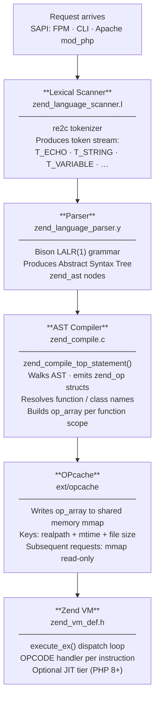
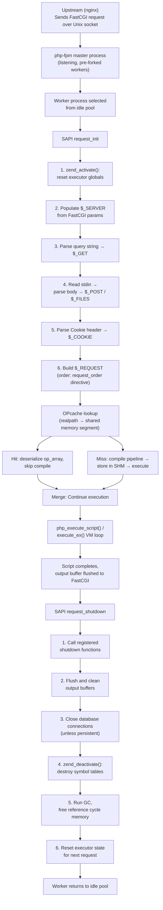

# Lesson 1: Language Fundamentals, Type System, Execution Model

## 1. First-Principles Intuition & Invariants

PHP occupies a peculiar position in the history of production systems: it was not designed so much as it accumulated. Rasmus Lerdorf's 1994 "Personal Home Page Tools" were a small set of Perl CGI scripts, later rewritten in C, never intended to become the substrate for a third of the world's web infrastructure. Understanding PHP at a practitioner level means understanding this archaeological reality — the language carries the weight of thirty years of pragmatic accretion, and its apparent inconsistencies are, in fact, a coherent fossil record of decisions made under real production pressure. The senior engineer who treats PHP as simply "a scripting language" misses the sophisticated execution engine underneath and the precise, exploitable semantics governing every type coercion.

The first invariant to internalize is that PHP is a **request-scoped, share-nothing architecture** by default. Unlike a Java servlet container or a Node.js event loop, a vanilla PHP process boots the runtime, parses and executes a script, produces output, and then discards every variable, object, and resource allocation. The request lifecycle is the fundamental unit of execution, not the process lifetime. This is not a limitation — it is a deliberate architectural property that provides extraordinary fault isolation and statelessness, eliminating entire categories of concurrency bugs at the cost of re-initialization overhead on each request. When you later work with PHP-FPM worker pools or the Swoole/RoadRunner persistent-process model, you must hold this original invariant consciously, because violating it without understanding it is how production memory leaks and state corruption bugs are born.

The second invariant governs the type system. PHP is **dynamically typed and historically weakly typed**, meaning that types attach to values at runtime rather than to variable declarations, and that the engine will silently coerce values across type boundaries during operations. As of PHP 7.0 through 8.x, the language has layered a **gradually typed** system on top of this legacy foundation. You can declare scalar parameter types, return types, union types, intersection types, and even `never` and `never`-returning functions. But the underlying Zend Engine has not abandoned its coercive roots — it has rather added a strict mode toggle, controlled by `declare(strict_types=1)`, that changes how the engine resolves type mismatches at function call boundaries within a given file. This distinction is architecturally critical: `strict_types` is a **per-file, compile-time directive**, not a global runtime flag. A library compiled without it can receive a float where an `int` is declared and silently truncate the value, while your calling code, compiled with strict mode, will throw a `TypeError` for the same call. The engine resolves strictness at the call site's compilation context, not the callee's.

The Zend Engine's type system at the value representation layer is built around a tagged union called `zval` (Zend value). Every PHP value in the runtime is a `zval`, and understanding its physical layout explains the semantics of assignment, reference semantics, copy-on-write behavior, and the cost model of operations. A `zval` in PHP 7+ is a 16-byte structure consisting of a type tag (one byte), flags, and a value union that can hold a `long` integer, a `double`, a pointer to a `zend_string`, a pointer to a `zend_array`, a pointer to a `zend_object`, or a resource handle, among others. The PHP 7 rewrite, led by Dmitry Stogov and Nikita Popov, was specifically motivated by reducing the size and indirection of this structure — PHP 5's `zval` was heap-allocated separately from the containing hash table bucket, requiring two separate allocations and two pointer dereferences for the most common operation in the entire runtime: a simple variable lookup.

```c
/* Simplified conceptual layout of PHP 7+ zval (zend_types.h) */
typedef struct _zval_struct {
    zend_value value;        /* 8 bytes: union of long, double, ptr */
    union {
        uint32_t type_info;  /* 4 bytes: IS_LONG, IS_DOUBLE, IS_STRING, etc. */
    } u1;
    union {
        uint32_t next;       /* hash collision chain for arrays */
        uint32_t cache_slot; /* inline cache for property access */
        uint32_t lineno;     /* AST node line number */
    } u2;
} zval; /* Total: 16 bytes, fits two cache lines on a 64-byte cache line CPU */
```

The third invariant is the execution model itself: PHP compiles source text to an **opcode stream** that is interpreted by the Zend virtual machine. This is not a tree-walking interpreter, nor is it a JIT compiler by default in older versions — it is a register-based bytecode VM. The compilation pipeline goes through lexing (re2c-generated scanner), parsing (Bison-generated LL parser producing an AST), AST-to-opcode compilation (the `zend_compile` phase), and then interpretation (the `execute_ex` dispatch loop). PHP 8.0 introduced a JIT compiler built on the DynASM assembler (the same toolchain used by LuaJIT), but it operates as an optional tier on top of the opcode interpreter, not a replacement for it.

## 2. Core Architecture & Mechanics

### The Zend Engine Compilation Pipeline

When PHP receives a request for `index.php`, the Zend Engine does not interpret source text directly. It executes a multi-stage compilation pipeline that transforms source bytes into an in-memory opcode array, which the virtual machine then executes. If OPcache is enabled — and in any production deployment it must be — the opcode array is serialized to shared memory after the first compilation, and subsequent requests skip the entire compilation pipeline by deserializing the cached opcode array directly. The pipeline is worth dissecting in full because every performance optimization, every profiling decision, and every understanding of class loading order flows from it.



Each function and method in PHP compiles to a `zend_op_array` structure, which is conceptually equivalent to a bytecode method in the JVM. It contains the opcode array itself, a literals table (constants embedded in the source: strings, integer literals, class names), a variable table mapping PHP variable names to CV (compiled variable) slots, and try-catch block descriptors. The literals table is what makes OPcache's preloading feature so valuable: by preloading all application files at FPM worker startup, the engine resolves class and function name references once and stores the resolved pointers in the shared memory segment, eliminating hash table lookups on the hot path.

The Zend VM uses a **register-based** design rather than a stack-based one (unlike the JVM or CPython). Each opcode has up to two source operands (`op1`, `op2`) and one result operand, and each operand has a type tag indicating whether it refers to a compiled variable (CV), a temporary variable (TMP/VAR), a literal from the constant table (CONST), or an unused operand (UNUSED). This design allows the VM to avoid the push/pop overhead of stack-based VMs for two-operand operations, at the cost of a slightly more complex dispatch loop.

### Type System: Weak Coercions and the Comparison Table

PHP's comparison semantics are the source of more subtle bugs than any other single language feature. The `==` operator in PHP does not compare types — it coerces both operands to a common type before comparing. The `===` operator requires both value and type identity. The practical consequence is that entire categories of conditionals behave in ways that are non-obvious without reading the coercion rules precisely.

The coercion hierarchy for `==` comparisons works as follows: if both operands are numeric strings, they are compared numerically. If one operand is a `bool`, the other is cast to `bool`. If one operand is `null`, the other is cast to `bool`. If one operand is a `float`, the other is cast to `float`. If one operand is an `int`, the other is cast to `int`. These rules are applied in this priority order, and they interact with the internal representation of strings in ways that have historically produced authentication bypasses and type confusion vulnerabilities.

```php
<?php
declare(strict_types=0); // Default: coercive mode

var_dump(0 == "foo");       // PHP 7: bool(true)  — "foo" cast to int(0)
                             // PHP 8: bool(false) — BREAKING CHANGE
var_dump(0 == "0");         // bool(true)  — "0" is numeric, cast to 0
var_dump("1" == "01");      // bool(true)  — both numeric strings
var_dump("10" == "1e1");    // bool(true)  — scientific notation is numeric
var_dump(100 == "1e2");     // bool(true)
var_dump("" == null);       // bool(true)  — both falsy
var_dump("0" == false);     // bool(true)  — "0" is falsy
var_dump("0" == null);      // bool(false) — null casts to ""  != "0"
var_dump([] == false);      // bool(true)
var_dump([0] == [false]);   // bool(true)  — element-wise comparison with coercion

// The PHP 8 fix for the 0 == "foo" case:
// Non-numeric strings are no longer cast to int when compared with int.
// Instead, the int is cast to string.
var_dump(0 == "foo");       // PHP 8: bool(false) — 0 cast to "0", "0" != "foo"
```

The PHP 8 change to `0 == "foo"` was a targeted fix for a notoriously exploited class of authentication bypasses where hash comparison functions would return a numeric string like `"0e12345"` (a valid scientific-notation zero), and comparing it with the integer `0` would return `true` in PHP 7. This is precisely the category of "magic hash" vulnerabilities. PHP 8 broke this by reversing the coercion direction: when comparing an integer with a non-numeric string, PHP 8 casts the integer to a string rather than the string to an integer.

### Variable Scope and the Symbol Table

PHP's scope model is deceptively simple and differs sharply from JavaScript's lexical scoping or Python's LEGB rule. PHP has precisely **function scope** and **global scope**, and nothing between them. A variable defined inside a `for` loop is visible for the entire function body after the loop. A function defined at the top level cannot see variables defined in the global scope without an explicit `global` declaration or access via the `$GLOBALS` superglobal array.

```php
<?php
$counter = 0;

function increment(): void {
    // $counter is NOT visible here. This is not JavaScript.
    // The following line creates a NEW local $counter initialized to null,
    // then attempts to increment it, producing a TypeError in strict mode
    // or a notice + 0+1=1 result in non-strict mode.
    $counter++;
}

function increment_correct(): void {
    global $counter; // Binds local symbol $counter to the global symbol table entry
    $counter++;
}

function increment_via_superglobal(): void {
    $GLOBALS['counter']++; // Direct hash table access, slightly slower
}
```

At the engine level, every function call frame gets its own **symbol table** — a `zend_array` (PHP's hashtable implementation) mapping variable name strings to `zval` entries. The `global` keyword does not copy the value — it inserts a reference (`IS_REFERENCE` zval) into the local symbol table pointing at the same `zval` stored in the global symbol table. This is an important distinction: modifications through `global $x` and modifications to `$GLOBALS['x']` both operate on the same underlying value, but the reference indirection means there is a difference in behavior when you rebind the variable with `=` versus when you mutate it through a compound operator.

PHP's superglobals — `$_GET`, `$_POST`, `$_COOKIE`, `$_SESSION`, `$_SERVER`, `$_FILES`, `$_ENV`, `$_REQUEST`, and `$GLOBALS` — are populated by the SAPI (Server API) layer before the script begins executing. They are exempt from the normal scope rules and are visible in every scope including function bodies without a `global` declaration. They are populated during the SAPI `request_init` phase: the FPM SAPI reads the FastCGI parameter block from the upstream proxy, decodes query string and POST body, and populates these arrays before invoking `php_execute_script`. Understanding this population order matters for security: `$_REQUEST` is a merge of `$_GET`, `$_POST`, and `$_COOKIE` in a priority order controlled by `request_order` in `php.ini`, and relying on it without understanding that order creates parameter pollution vulnerabilities.

### The Request Lifecycle in Detail

The PHP-FPM execution model is worth tracing from TCP accept to script completion, because every performance characteristic of a PHP application is a consequence of where in this lifecycle work is done.



Notice that steps 1 through 6 of `request_shutdown` happen on **every request**. The destructor cascade for all objects, the reference cycle collector, the symbol table teardown — these are fixed costs that PHP-FPM absorbs once per request. This is the fundamental overhead that persistent-process servers like Swoole eliminate: by keeping the process alive and manually resetting only what needs resetting, they amortize the initialization and teardown cost across thousands of requests. But this requires that every library in the application be "coroutine-safe" and explicitly manage its state between requests, which is why naive adoption of Swoole with frameworks designed for FPM produces state corruption.

### Opcodes Under the Microscope

Working directly with the opcode representation of PHP code is an essential diagnostic skill. The `phpdbg` interactive debugger and the `OPcache` extension's `opcache_get_status()` function expose opcode streams, but the most practical tool is the `php-ast` extension paired with the userland `nikic/php-parser` library, or more directly, the `vld` (Vulcan Logic Disassembler) extension for opcode-level inspection.

```php
<?php
// Source under analysis
function add_typed(int $a, int $b): int {
    return $a + $b;
}
```

Using `php -d vld.active=1 -d vld.execute=0 -r` or dumping via OPcache's internal API, the compiled opcode stream for `add_typed` looks conceptually like:

```text
line   opcode          op1       op2       result
----   ------          ---       ---       ------
  3    RECV            $a        [CV 0]           # receive param, store to CV slot 0
  3    RECV            $b        [CV 1]           # receive param, store to CV slot 1
  4    ADD             CV0($a)   CV1($b)   ~0     # add two CVs, store to TMP ~0
  4    VERIFY_RETURN_TYPE ~0                      # type-check return value
  4    RETURN          ~0                         # return TMP ~0 to caller
       RETURN          null                       # implicit return at end of function
```

`RECV` opcodes handle parameter binding, including type coercion or `TypeError` generation based on the `strict_types` context. `VERIFY_RETURN_TYPE` is inserted by the compiler whenever a function has a declared return type — it checks the runtime type of the return value against the declared type and throws `TypeError` if they don't match after any applicable coercions. The `ADD` opcode's handler in `zend_vm_def.h` is specialized by the operand types: when both operands are `IS_LONG`, it emits the `ZEND_ADD_SPEC_CV_CV_RETVAL_USED` specialization which performs a direct C `long` addition with overflow check to `double`, making it essentially as fast as native integer addition with a single branch.

PHP 8.0's JIT compiles these opcode sequences to native x86-64 machine code at runtime. The JIT is triggered for functions that exceed a configurable call count threshold (controlled by `opcache.jit_hot_func` in `php.ini`). For the `add_typed` function above, once JIT-compiled, the entire function becomes a few native `mov` and `add` instructions — the type-check overhead is eliminated because the JIT can observe that the types have been constant across all observed calls and emit a type guard with a deoptimization exit rather than a full check on every call.

## 3. High-Performance Optimization & Failure Modes

### OPcache Configuration as a First-Class Engineering Decision

The single highest-leverage optimization available in any PHP deployment is correct OPcache configuration, yet it is frequently treated as a checkbox rather than a system design decision. OPcache works by allocating a shared memory segment (using `mmap` on Linux) that is mapped read-only into every FPM worker process's address space. This means the shared segment must be large enough to hold all compiled opcode arrays for the entire application, and it must be sized at startup — it cannot grow dynamically.

Undersizing the OPcache memory causes **cache eviction** under load: when the segment fills, older entries are evicted using an LRU-like policy, and subsequent requests for evicted files trigger a full recompile. In a Symfony or Laravel application with thousands of class files, this means the compilation pipeline runs on every request under memory pressure, potentially multiplying response latency by a factor of five to ten. The correct approach is to measure the actual memory footprint using `opcache_get_status()['memory_usage']` under a full warm cache state and then set `opcache.memory_consumption` to 120–150% of that measured value.

```php
<?php
// Operational diagnostic: assess OPcache saturation in production
$status = opcache_get_status(false);

$mem = $status['memory_usage'];
$used_mb    = round($mem['used_memory'] / 1024 / 1024, 2);
$free_mb    = round($mem['free_memory'] / 1024 / 1024, 2);
$wasted_mb  = round($mem['wasted_memory'] / 1024 / 1024, 2);
$wasted_pct = round($status['memory_usage']['current_wasted_percentage'], 2);

$scripts = $status['opcache_statistics'];
$hit_rate = round($scripts['opcache_hit_rate'], 4);
$misses   = $scripts['misses'];
$hits     = $scripts['hits'];

printf("OPcache Memory: %.2fMB used / %.2fMB free / %.2fMB wasted (%.2f%%)\n",
    $used_mb, $free_mb, $wasted_mb, $wasted_pct);
printf("Hit rate: %.4f%% | Hits: %d | Misses: %d\n",
    $hit_rate, $hits, $misses);

// Wasted memory above opcache.max_wasted_percentage (default 5%) triggers
// a full cache restart — a thundering herd event in production.
// Set opcache.max_wasted_percentage=20 to defer restarts.
```

The `validate_timestamps` directive is equally critical. When set to `1` (the default), the engine checks the file's mtime and size on every request to detect changes, adding a `stat()` syscall per cached file per request. In production, where files never change without an explicit deployment, this directive should be set to `0`, and cache invalidation should be performed explicitly using `opcache_reset()` or `opcache_invalidate($file, true)` as part of the deployment pipeline.

### Type Juggling Failure Modes in Production

The interaction between PHP's coercive type system and application logic produces failure modes that are qualitatively different from type errors in strictly typed languages. Rather than failing loudly at a type boundary, PHP silently reshapes values, and the error propagates until it manifests as incorrect behavior far from the original site.

Consider a canonical production failure pattern: data from a JSON API payload is decoded with `json_decode()`, which preserves JSON numeric types as PHP integers and floats. But the same field arriving as a query parameter through `$_GET` is always a string. An application that handles both intake paths without normalization will behave differently depending on whether a request comes from an API client or a browser form, with the same comparison logic producing different results.

```php
<?php
// Failure mode: inconsistent intake path creates branching behavior

// Path A: API client sends JSON body
// json_decode('{"user_id": 42}') → $data->user_id is int(42)
$id_from_json = 42; // IS_LONG

// Path B: Browser sends form or query string
// $_GET['user_id'] → always IS_STRING
$id_from_get = "42"; // IS_STRING

// In PHP 8, both pass == comparison correctly:
var_dump($id_from_json == $id_from_get); // bool(true) — numeric string coercion

// But strict type-declared functions behave differently:
function load_user(int $user_id): array {
    // DB query...
    return ['id' => $user_id];
}

// With declare(strict_types=1) in the calling file:
// load_user($id_from_json) → OK, is int
// load_user($id_from_get)  → TypeError: must be int, string given

// Without strict_types: both succeed, but string "42" is silently cast to int(42)
// This masks the intake normalization bug entirely.
```

The engineering prescription is explicit normalization at every intake boundary — API controller, form handler, CLI argument parser — using `filter_input()`, `filter_var()`, or a typed DTO (Data Transfer Object) that validates and coerces in one controlled location. The type system then becomes a correctness guarantee rather than a silent coercion machine.

### Reference Semantics and Copy-on-Write

PHP uses **copy-on-write (COW)** semantics for all value types, including arrays. When you assign `$b = $a` where `$a` is an array, the engine does not copy the underlying `zend_array` structure. Instead, both `$a` and `$b` hold a `zval` pointing at the same `zend_array`, with its reference count incremented to 2. The copy only happens when either variable is written to — the engine performs a `SEPARATE_ARRAY` operation before the write, allocating a new `zend_array` and copying all bucket entries. For large arrays, this means that a seemingly simple assignment followed by a modification triggers an O(n) deep copy.

```php
<?php
// COW demonstration: measuring allocation cost

$large = range(1, 100000); // zend_array with 100K entries, refcount=1

$copy = $large;             // refcount becomes 2, NO allocation yet
                             // Both $large and $copy share the same zend_array

$copy[] = 999999;           // Write triggers SEPARATE_ARRAY:
                             // - New zend_array allocated
                             // - All 100K buckets copied
                             // - $copy now points to new array
                             // - $large refcount decremented to 1
                             // Cost: O(n) allocation + copy here, not at assignment

// Explicit references bypass COW entirely:
$ref = &$large;             // IS_REFERENCE zval created
                             // Both $large and $ref point through SAME reference container
                             // Any write to $ref writes to $large directly
                             // refcount semantics change: reference container has refcount=2
$ref[] = 888888;            // No copy. $large is modified.
var_dump(count($large));    // int(100001)
```

A common performance failure mode in PHP applications is passing large arrays to functions that only read them and then incidentally modify a temporary copy. Because the function's parameter creates a new `zval` with an incremented refcount, any write inside the function triggers a full O(n) copy of the array's bucket storage. The fix is to either use references (`&$array` parameter type) for truly large mutable arrays, or restructure the code to avoid modifying copies of large data structures in hot paths. The `memory_get_usage()` function paired with the `xdebug_debug_zval()` function (from the Xdebug extension) exposes the internal refcount of a named variable and allows you to verify COW sharing behavior in a development environment.

### JIT Configuration and When It Does Not Help

PHP 8's JIT is a tracing JIT implemented in the `ext/opcache` extension. It operates at the opcode level using a method-JIT (function-level compilation) or tracing mode controlled by the `opcache.jit` directive, which accepts a four-digit configuration code encoding the CPU-specific optimization level, trigger policy, optimization level, and register allocation strategy. The common recommendation `opcache.jit=1255` enables tracing JIT with aggressive optimization.

The JIT delivers measurable improvements for **CPU-bound workloads** — numerical computation, string processing, recursive algorithms, rendering-heavy template engines. For the typical PHP application, which is dominated by I/O wait on database queries and HTTP calls, the JIT provides minimal benefit because the hot path is not in PHP opcode execution — it is in network round-trips. Profiling with Blackfire or SPX before enabling JIT and measuring the actual distribution of CPU time between PHP execution and I/O wait is prerequisite to making a principled configuration decision.

Furthermore, JIT introduces a subtle failure mode in long-running process models like Swoole: JIT-compiled code can deoptimize and fall back to interpreted execution when type guards are invalidated by a polymorphic call site. In a request-isolated FPM model this is stateless, but in a persistent process, type feedback collected from one request's execution profile can be invalidated by another request's polymorphic usage, causing repeated deoptimization and recompilation overhead on the hot path. Monitoring `opcache_get_status()['jit']['buffer_free']` and `['opt_count']` versus `['opt_failures']` in production persistent-process deployments is the correct way to detect this condition.

### Practical Diagnostic Workflow

Diagnosing a slow PHP request in production requires a systematic approach through the execution layers described in this lesson. The sequence moves from coarsest to finest granularity, stopping at the layer where the problem is confirmed.

First, confirm whether the request's latency is in PHP execution or in I/O by examining FPM slow logs. Set `request_slowlog_timeout = 2` and `slowlog = /var/log/php-fpm/slow.log` in your FPM pool configuration. The slow log captures a stack trace at the opcode level when a request exceeds the threshold, showing the function call chain, source file, and line number at the moment of capture — without any instrumentation code in the application.

```ini
; /etc/php-fpm.d/www.conf — slow log configuration
[www]
request_slowlog_timeout = 2s
slowlog = /var/log/php-fpm/slow.log
request_terminate_timeout = 30s
```

If the slow log shows stack frames inside database or HTTP client functions, the problem is I/O latency and the JIT and OPcache configuration are irrelevant. If the slow log shows frames inside application logic — template rendering, data transformation, collection processing — then proceed to function-level profiling with SPX (`php-spx`) or Blackfire, both of which instrument the opcode dispatch loop to measure wall time and memory allocation per function call without the overhead of Xdebug's full trace mode.

The mental model to carry forward from this lesson is that PHP's apparent simplicity conceals a precisely specified execution engine with a rich type system, a copy-on-write memory model, an OPcache-backed opcode cache with JIT tier, and a request-scoped share-nothing architecture that makes strong guarantees in exchange for per-request initialization cost. Every optimization decision — from OPcache sizing to `strict_types` adoption to persistent-process server selection — is a trade-off against that foundational architecture, and the engineer who understands the architecture makes those trade-offs deliberately rather than by cargo-cult convention.
