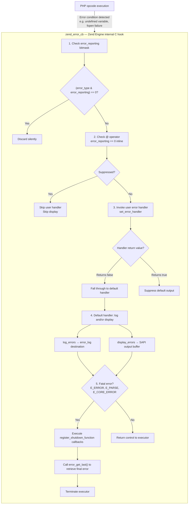
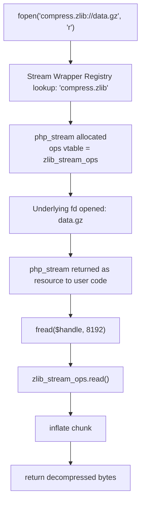

# Lesson 3: Error Handling, Streams, Standard PHP Library

## 1. First-Principles Intuition & Invariants

PHP's error and exception subsystems are frequently misunderstood as equivalent mechanisms for signaling that something has gone wrong, when in truth they represent two fundamentally different models of failure that coexist uneasily within the same runtime. Understanding why they coexist, and how they interact at the engine level, is the prerequisite for writing PHP that is genuinely robust rather than merely defensively guarded.

The older of the two mechanisms is PHP's procedural error system, which predates PHP 5 and derives from C-style error reporting. When a core function like `fopen` encounters a missing file or when the engine itself encounters a parse anomaly at runtime, it raises an error at one of several severity levels defined by the `E_*` integer bitmask constants. These constants are not arbitrary: they encode a hierarchy of severity that maps directly to whether the script can continue executing. `E_PARSE` and `E_ERROR` represent fatal conditions after which the engine tears down the execution context entirely. `E_WARNING` and `E_NOTICE` are non-fatal advisory signals; execution continues past them. `E_DEPRECATED` and `E_STRICT` are informational markers pointing at code that will break in a future version or violates best practices. The `E_USER_*` family mirrors each of these at the application layer, allowing library authors to participate in the same signaling infrastructure without coupling to exceptions.

What is critical to understand is that this error system is global state. The error reporting level (`error_reporting`), the display flag (`display_errors`), and the registered handler (`set_error_handler`) are all stored on the executor globals struct inside the Zend Engine. When you call `set_error_handler`, you are installing a callback into a slot on that global struct, and every subsequent error raised by the engine will pass through your callback unless the error falls into the uncatchable `E_ERROR` or `E_PARSE` categories. User-installed error handlers cannot intercept fatal errors because by the time the engine raises `E_ERROR`, it has already begun unwinding the execution stack, and there is no longer a stable execution context from which to call user code. This is why `register_shutdown_function` exists as a secondary escape valve: shutdown functions are called after the execution stack is torn down, and `error_get_last()` inside a shutdown function is the only reliable way to log what caused an `E_ERROR` termination.

The exception model, introduced with PHP 5's object model rewrite, operates on entirely different machinery. Exceptions are not global state mutations; they are objects allocated on the heap that travel upward through the call stack via a structured unwind mechanism. When you `throw` an exception, the Zend Engine walks the current execution frame's exception handler table, a compact structure compiled from your `try`/`catch`/`finally` blocks, until it either finds a matching catch clause or exhausts all frames and invokes the uncaught exception handler registered via `set_exception_handler`. The unwind guarantees that `finally` blocks execute even if no catch clause matches, making `finally` the correct place to release resources that must be freed regardless of success or failure.

PHP's exception hierarchy, as shipped, is intentionally shallow but was reorganized significantly in PHP 7. Before PHP 7, only user-thrown `Exception` subclasses were catchable. Engine-level fatal errors like division by zero or type errors simply terminated the script. PHP 7 introduced the `Throwable` interface as the common root, with `Exception` and `Error` as its two direct implementors. `Error` is the base class for engine-generated exceptions: `TypeError`, `ValueError`, `ArithmeticError`, `DivisionByZeroError`, `ParseError`, and `AssertionError` all extend it. This means code like `intdiv(1, 0)` now throws `DivisionByZeroError` rather than killing the process, which is a dramatic improvement for long-running server processes. However, this also means that catch clauses targeting `Exception` will not catch `TypeError` or `ValueError`, a subtle source of bugs when migrating pre-PHP-7 code. Catching `Throwable` itself is the correct strategy when you genuinely want to catch everything, though doing so at a broad scope without re-throwing is usually a code smell indicating swallowed errors.

Streams are PHP's most underappreciated abstraction. At their core, streams generalize the concept of a byte sequence that can be read from or written to, decoupling user code from the specific source or sink of that data. The same `fread`/`fwrite`/`stream_get_contents` API works uniformly against local files, TCP sockets, HTTP responses, in-memory buffers, compressed archives, encrypted channels, and any custom source that implements the stream wrapper protocol. This uniformity is not cosmetic: it enables middleware-style data transformations via stream filters, and it allows test code to substitute a `php://memory` stream for a real file or network socket without changing the code under test at all.

The SPL, the Standard PHP Library, was designed to bring to PHP the kind of data structure and iteration abstractions that Java's collections framework or the C++ STL provide to those languages. Its implementation is a set of C extensions bundled with the PHP core that expose classes like `SplStack`, `SplQueue`, `SplMinHeap`, `SplDoublyLinkedList`, `SplFixedArray`, and the `SplFileObject` file abstraction. The `Iterator` and `IteratorAggregate` interfaces formalize the concept of a traversable sequence, while `ArrayAccess` allows objects to participate in bracket-notation array operations. These interfaces are not merely conventions: the `foreach` construct in PHP's opcode compiler generates `ZEND_FE_FETCH_R` opcodes that the runtime dispatches through the `get_iterator` vtable slot on the class's `zend_class_entry`, which means implementing `Iterator` correctly has direct performance implications.

Understanding the invariants that govern all three systems simultaneously is what separates production PHP engineering from ad-hoc scripting. The invariant for the error system is that every error mode must be explicitly configured; there is no safe default because the defaults were chosen for development convenience, not production safety. The invariant for exceptions is that every thrown value must either be caught and handled or allowed to propagate to a boundary handler that can log and respond appropriately; swallowing exceptions without logging is as dangerous as ignoring `errno` in C. The invariant for streams is that every opened stream is a resource that consumes a file descriptor from the operating system's per-process limit, and that limit is typically 1024 on Linux unless reconfigured; failing to close streams is therefore not a stylistic issue but a correctness issue under load.

---

## 2. Core Architecture & Mechanics

### The Zend Error Dispatch Pipeline

When any PHP operation raises an error, control passes through a deterministic sequence of checks before the error is either displayed, logged, suppressed, or handed to user code. Understanding this pipeline at the opcode level clarifies why certain combinations of `error_reporting`, `@` suppression, and custom handlers produce surprising results.



A critical subtlety: when you install a custom error handler via `set_error_handler`, passing `null` as the second argument installs a handler that receives all error types including `E_STRICT` and `E_DEPRECATED`. Passing a bitmask as the second argument restricts delivery. But the handler is never called for `E_ERROR`, `E_PARSE`, `E_CORE_ERROR`, or `E_CORE_WARNING` regardless, because these are generated before or during executor initialization when no user code can run. The practical implication is that your custom error handler should convert non-fatal errors to exceptions where appropriate, and separately a shutdown function should handle the fatal case:

```php
<?php
declare(strict_types=1);

/**
 * Converts non-fatal PHP errors into ErrorException instances so that
 * the exception hierarchy can handle them uniformly. Fatal errors are
 * unreachable here and must be handled via a shutdown function.
 */
set_error_handler(static function (
    int    $errno,
    string $errstr,
    string $errfile,
    int    $errline
): bool {
    // If the error was suppressed with @, error_reporting returns 0
    // for the current expression context. Respect the caller's intent.
    if (!(error_reporting() & $errno)) {
        return false;
    }

    throw new \ErrorException($errstr, 0, $errno, $errfile, $errline);
});

register_shutdown_function(static function (): void {
    $error = error_get_last();

    if ($error !== null && in_array($error['type'], [E_ERROR, E_PARSE, E_CORE_ERROR], true)) {
        // At this point the execution stack is gone. We can only log.
        $message = sprintf(
            '[FATAL] %s in %s on line %d',
            $error['message'],
            $error['file'],
            $error['line']
        );
        error_log($message);
        // Optionally write to a dedicated alert sink, but never attempt
        // to call application-layer code that may depend on destroyed state.
    }
});
```

The `ErrorException` class is part of PHP's standard distribution and exists precisely for this purpose: it bridges the procedural error system and the object exception system by wrapping error metadata (severity, file, line) into a throwable value. Its `getSeverity()` method returns the original `E_*` bitmask value, which allows catch clauses to discriminate by original error level if needed.

### The Exception Unwind Mechanism

PHP's exception handling compiles each `try` block into an exception handler entry in the opcode array's exception table. The table is a flat array of `zend_try_catch_element` structs, each recording the opcode offset range covered by the try block, the catch opcode offset, and the finally opcode offset. When an exception is thrown, the executor scans this table backward from the current opcode offset until it finds an enclosing range, then jumps to the corresponding catch or finally handler. If no handler is found in the current frame, the frame is popped and the scan continues in the calling frame, repeating until either a handler is found or the bottom of the call stack is reached.

```
Call Stack at throw point:

Frame 3: processRecord()       ← throw new DatabaseException(...)
Frame 2: persistBatch()        ← try { processRecord() } catch (RuntimeException $e)
Frame 1: handleRequest()       ← try { persistBatch() } finally { releaseConnection() }
Frame 0: index.php             ← set_exception_handler installed

Unwind sequence:
  Frame 3: No handler → pop frame, propagate exception object upward
  Frame 2: Check exception table → DatabaseException IS-A RuntimeException → catch fires
           Execution resumes at catch block opcode offset
           If catch re-throws → continue unwind
  Frame 1: Finally block executes unconditionally before frame exits
  Frame 0: set_exception_handler callback fires if exception is uncaught
```

The `finally` block deserves careful treatment. It executes even if the `try` block contains a `return`, a `break`, or a `continue` statement. The Zend Engine saves the pending return value and jump target on the execution frame, runs the finally block to completion, and then restores the saved action. If the `finally` block itself throws or returns, the pending action from the `try` block is discarded, which is a source of subtle bugs when developers accidentally use `return` in `finally` blocks.

The exception class hierarchy for production applications should be deliberately designed, not assembled ad-hoc. A clean architecture partitions exceptions into three categories: infrastructure exceptions (database unavailable, network timeout, file not found), domain exceptions (invariant violations, business rule failures), and programming errors (invalid argument types, out-of-range indices). Infrastructure exceptions benefit from retry logic at the call site. Domain exceptions carry information the caller needs to construct a meaningful response. Programming errors should almost never be caught; they indicate code defects that should crash loudly during development and be caught only at the application boundary for logging.

```php
<?php
declare(strict_types=1);

/**
 * Root of the application's exception hierarchy. All application-specific
 * exceptions extend this, so callers can catch AppException to handle any
 * known application error without inadvertently swallowing engine errors
 * or third-party library exceptions.
 */
abstract class AppException extends \RuntimeException
{
    public function __construct(
        string     $message,
        int        $code = 0,
        ?\Throwable $previous = null
    ) {
        parent::__construct($message, $code, $previous);
    }
}

/** Infrastructure layer: transient failures that may be retried. */
abstract class InfrastructureException extends AppException {}

final class DatabaseConnectionException extends InfrastructureException {}
final class CacheUnavailableException    extends InfrastructureException {}
final class ExternalServiceException     extends InfrastructureException
{
    public function __construct(
        string     $message,
        private readonly string $serviceIdentifier,
        int        $code = 0,
        ?\Throwable $previous = null
    ) {
        parent::__construct($message, $code, $previous);
    }

    public function getServiceIdentifier(): string
    {
        return $this->serviceIdentifier;
    }
}

/** Domain layer: violations of business invariants, not retryable. */
abstract class DomainException extends AppException {}

final class InsufficientInventoryException extends DomainException
{
    public function __construct(
        private readonly string $sku,
        private readonly int    $requested,
        private readonly int    $available
    ) {
        parent::__construct(
            "Insufficient inventory for SKU {$sku}: requested {$requested}, available {$available}"
        );
    }

    public function getSku(): string    { return $this->sku; }
    public function getRequested(): int { return $this->requested; }
    public function getAvailable(): int { return $this->available; }
}
```

### Stream Architecture: Wrappers, Filters, and Contexts

PHP's stream subsystem is implemented in `main/streams/` in the PHP source tree and exposes a uniform I/O interface regardless of the underlying transport. Each stream is internally a `php_stream` struct containing a pointer to a `php_stream_ops` vtable, which is essentially a set of function pointers for read, write, seek, flush, close, and stat operations. When you call `fopen('https://example.com/data.json', 'r')`, the stream wrapper registry is consulted for a handler registered to the `https://` scheme, and the HTTP wrapper's `open` function is called to establish the connection and return a `php_stream` backed by a socket. From that point, `fread` calls operate identically whether the stream is backed by a file descriptor, a socket, a compressed archive, or an in-memory buffer.



Stream filters sit between the stream and the caller, transforming bytes as they flow through. They are attached via `stream_filter_append` or `stream_filter_prepend`, forming a pipeline. PHP ships with the `string.rot13`, `string.toupper`, `string.tolower`, `string.strip_tags`, `convert.base64-encode`, `convert.base64-decode`, `zlib.inflate`, and `zlib.deflate` filters. Custom filters are registered by extending `php_user_filter` and calling `stream_filter_register`.

The following example implements a stream filter that computes a running SHA-256 hash of all bytes passing through it, useful for verifying integrity of a large file download without buffering the entire file:

```php
<?php
declare(strict_types=1);

/**
 * A stream filter that computes an incremental SHA-256 digest of all
 * bytes that pass through it. After the stream is fully consumed,
 * retrieve the digest via the public $digest property on the filter
 * object returned by stream_filter_append().
 *
 * Usage:
 *   $fp     = fopen('php://input', 'r');
 *   $filter = stream_filter_append($fp, 'digest.sha256', STREAM_FILTER_READ);
 *   stream_get_contents($fp);
 *   fclose($fp);
 *   $hex = stream_filter_remove($filter) ?: '';
 *   // Retrieve digest from the filter object via the registry trick below.
 */
final class Sha256DigestFilter extends \php_user_filter
{
    /** @var \HashContext */
    private \HashContext $context;

    public string $digest = '';

    public function onCreate(): bool
    {
        $this->context = hash_init('sha256');
        return true;
    }

    public function filter($in, $out, &$consumed, bool $closing): int
    {
        while ($bucket = stream_bucket_make_writeable($in)) {
            hash_update($this->context, $bucket->data);
            $consumed += $bucket->datalen;
            stream_bucket_append($out, $bucket);
        }

        if ($closing) {
            $this->digest = hash_final($this->context);
        }

        return PSFS_PASS_ON;
    }
}

stream_filter_register('digest.sha256', Sha256DigestFilter::class);

// Demonstration: hash a large file without loading it into memory.
$path   = '/var/data/large-dataset.csv';
$handle = fopen($path, 'rb');

if ($handle === false) {
    throw new \RuntimeException("Cannot open {$path}");
}

/** @var Sha256DigestFilter $filterInstance */
$filterInstance = stream_filter_append($handle, 'digest.sha256', STREAM_FILTER_READ);

// Process the stream line by line; the filter sees all bytes.
while (!feof($handle)) {
    $line = fgets($handle, 65536);
    // Process $line here without accumulating the whole file.
}

stream_filter_remove($filterInstance);
fclose($handle);

echo "SHA-256: " . $filterInstance->digest . PHP_EOL;
```

Stream contexts configure the behavior of wrapper operations. A context is an opaque resource created by `stream_context_create` that carries per-wrapper options and notifications as a nested associative array. The HTTP wrapper reads options like `method`, `header`, `content`, `timeout`, `max_redirects`, and `ssl` peer verification settings from the context. The `notification` callback in the context receives progress events, making it possible to implement upload/download progress reporting without any additional extensions.

```php
<?php
declare(strict_types=1);

/**
 * Makes an authenticated POST request using stream contexts, demonstrating
 * full control over HTTP semantics without requiring cURL or Guzzle.
 * Appropriate for environments where extension availability is constrained.
 */
function httpPost(string $url, array $payload, string $bearerToken): string
{
    $body    = json_encode($payload, JSON_THROW_ON_ERROR);
    $context = stream_context_create([
        'http' => [
            'method'           => 'POST',
            'header'           => implode("\r\n", [
                'Content-Type: application/json',
                'Accept: application/json',
                'Authorization: Bearer ' . $bearerToken,
                'Content-Length: ' . strlen($body),
            ]),
            'content'          => $body,
            'timeout'          => 10.0,
            'ignore_errors'    => true,   // Don't suppress response body on 4xx/5xx.
            'follow_location'  => 1,
            'max_redirects'    => 3,
        ],
        'ssl' => [
            'verify_peer'      => true,
            'verify_peer_name' => true,
            'cafile'           => '/etc/ssl/certs/ca-certificates.crt',
        ],
    ]);

    $response = file_get_contents($url, false, $context);

    if ($response === false) {
        throw new \RuntimeException("HTTP request to {$url} failed");
    }

    // $http_response_header is a magic variable populated by the HTTP wrapper.
    $statusLine = $http_response_header[0] ?? '';
    if (!preg_match('/^HTTP\/\d+(?:\.\d+)?\s+([0-9]{3})/', $statusLine, $matches)) {
        throw new \RuntimeException("Unparseable HTTP response status: {$statusLine}");
    }

    $statusCode = (int) $matches[1];
    if ($statusCode >= 400) {
        throw new \RuntimeException("HTTP {$statusCode} from {$url}: {$response}");
    }

    return $response;
}
```

### Custom Stream Wrappers

Registering a custom stream wrapper allows any PHP I/O function to work against a data source you define entirely in PHP. The class must implement the requisite methods: `stream_open`, `stream_read`, `stream_write`, `stream_eof`, `stream_close`, `stream_seek`, `stream_tell`, `stream_stat`, `url_stat`, `dir_opendir`, `dir_readdir`, `dir_closedir`, `mkdir`, `rmdir`, and `rename`. Not all are required; unimplemented methods simply cause the corresponding operation to fail gracefully. The following wrapper exposes a Redis hash as a readable and writable stream, mapping logical byte offsets to hash field names:

```php
<?php
declare(strict_types=1);

/**
 * Registers the 'redis-blob://' stream scheme, allowing code like:
 *   file_put_contents('redis-blob://mykey', $data);
 *   $data = file_get_contents('redis-blob://mykey');
 *
 * This wrapper stores the blob as a single Redis string under the given key.
 * It satisfies the full read/write/seek contract required for compatibility
 * with stream filters and streaming parsers.
 */
final class RedisBlobStreamWrapper
{
    /** @var \Redis */
    private static \Redis $redis;

    private string $key     = '';
    private string $buffer  = '';
    private int    $position = 0;
    private bool   $writable = false;

    public static function register(\Redis $redis): void
    {
        self::$redis = $redis;
        if (!in_array('redis-blob', stream_get_wrappers(), true)) {
            stream_wrapper_register('redis-blob', self::class);
        }
    }

    public function stream_open(string $path, string $mode, int $options, ?string &$opened_path): bool
    {
        // Strip the scheme: redis-blob://mykey → mykey
        $this->key      = substr($path, strlen('redis-blob://'));
        $this->writable = str_contains($mode, 'w') || str_contains($mode, 'a') || str_contains($mode, '+');
        $this->position = 0;

        $existing = self::$redis->get($this->key);
        $this->buffer = ($existing !== false) ? $existing : '';

        if (str_contains($mode, 'w')) {
            $this->buffer = '';
        }

        if (str_contains($mode, 'a')) {
            $this->position = strlen($this->buffer);
        }

        return true;
    }

    public function stream_read(int $count): string|false
    {
        $chunk           = substr($this->buffer, $this->position, $count);
        $this->position += strlen($chunk);
        return $chunk;
    }

    public function stream_write(string $data): int
    {
        $len = strlen($data);
        $this->buffer = substr($this->buffer, 0, $this->position)
                      . $data
                      . substr($this->buffer, $this->position + $len);
        $this->position += $len;
        return $len;
    }

    public function stream_eof(): bool
    {
        return $this->position >= strlen($this->buffer);
    }

    public function stream_seek(int $offset, int $whence = SEEK_SET): bool
    {
        $length = strlen($this->buffer);
        $this->position = match ($whence) {
            SEEK_SET => $offset,
            SEEK_CUR => $this->position + $offset,
            SEEK_END => $length + $offset,
            default  => -1,
        };

        if ($this->position < 0) {
            $this->position = 0;
            return false;
        }

        return true;
    }

    public function stream_tell(): int
    {
        return $this->position;
    }

    public function stream_flush(): bool
    {
        return self::$redis->set($this->key, $this->buffer) !== false;
    }

    public function stream_close(): void
    {
        $this->stream_flush();
    }

    public function stream_stat(): array
    {
        $size = strlen($this->buffer);
        return [
            'size'  => $size,
            'mtime' => time(),
            'ctime' => time(),
            'mode'  => 0100644,
        ];
    }

    public function url_stat(string $path, int $flags): array|false
    {
        $key    = substr($path, strlen('redis-blob://'));
        $exists = self::$redis->exists($key);
        if (!$exists) {
            return false;
        }
        $size = self::$redis->strlen($key);
        return [
            'size'  => $size,
            'mtime' => time(),
            'ctime' => time(),
            'mode'  => 0100644,
        ];
    }
}
```

### SPL Data Structures: Internal Mechanics

`SplFixedArray` is the most instructive SPL class for understanding why SPL structures exist at all. A regular PHP array, when used as an indexed list, is internally a HashTable, which maintains a doubly linked list of `Bucket` structs for iteration ordering, a hash collision chain, and per-element reference-counted `zval` wrappers. For an array of one million integers, this overhead is substantial: each bucket consumes approximately 72 bytes on a 64-bit build, meaning one million integers consume roughly 72 MB rather than the 8 MB an ideal int64 array would require. `SplFixedArray` allocates a plain C array of `zval`s without the hash infrastructure, reducing memory consumption by roughly 60% and improving cache locality for sequential access.

`SplMinHeap` and `SplMaxHeap` implement a binary heap stored as a contiguous array, providing O(log n) insert and O(log n) extract-min/max with O(1) peek. PHP's standard array sorted with `usort` offers no such complexity guarantee; it uses a comparison-based sort, so maintaining a sorted order under insertions requires O(n log n) work per insertion. Using `SplMinHeap` for a priority queue is not stylistic preference but a correctness decision when the data structure's growth characteristics matter.

```php
<?php
declare(strict_types=1);

/**
 * Demonstrates SplMinHeap as a task scheduler priority queue.
 * Tasks are ordered by their scheduled Unix timestamp; the heap
 * always yields the earliest scheduled task at the top.
 */
final class ScheduledTask
{
    public function __construct(
        public readonly int    $scheduledAt,
        public readonly string $name,
        public readonly array  $payload
    ) {}
}

final class TaskScheduler
{
    private \SplMinHeap $heap;

    public function __construct()
    {
        $this->heap = new class extends \SplMinHeap {
            protected function compare(mixed $a, mixed $b): int
            {
                // SplMinHeap::compare must return positive if $a < $b
                // (counterintuitive; min-heap inverts comparison semantics).
                return $b->scheduledAt <=> $a->scheduledAt;
            }
        };
    }

    public function schedule(ScheduledTask $task): void
    {
        $this->heap->insert($task);
    }

    public function tickDue(int $now): \Generator
    {
        while (!$this->heap->isEmpty()) {
            $top = $this->heap->top();
            if ($top->scheduledAt > $now) {
                break;
            }
            yield $this->heap->extract();
        }
    }

    public function count(): int
    {
        return $this->heap->count();
    }
}

// Usage: schedule tasks and process those due at or before "now".
$scheduler = new TaskScheduler();
$now       = time();

$scheduler->schedule(new ScheduledTask($now + 300, 'send-digest',   ['user' => 42]));
$scheduler->schedule(new ScheduledTask($now - 10,  'retry-webhook', ['attempt' => 3]));
$scheduler->schedule(new ScheduledTask($now - 5,   'expire-token',  ['token'   => 'abc']));

foreach ($scheduler->tickDue($now) as $task) {
    printf("Executing: %s (was due %ds ago)\n", $task->name, $now - $task->scheduledAt);
}
```

### SPL Iterators and the `foreach` Dispatch Chain

PHP's `foreach` construct is not syntactic sugar over array traversal; it is a generalized dispatch mechanism that checks whether the operand implements `Iterator`, `IteratorAggregate`, or is a plain array/object, and routes accordingly. When the operand implements `IteratorAggregate`, `foreach` calls `getIterator()` to obtain an `Iterator` object, then executes the five-method protocol: `rewind`, `valid`, `current`, `key`, `next` in a tight loop. Each call crosses from the opcode executor into the object's vtable, so the five-method overhead per iteration is real, though for I/O-bound work it is negligible.

`IteratorAggregate` is preferable to `Iterator` for domain objects because it separates traversal state from the object itself. Implementing `Iterator` directly on a domain object means the object carries mutable iteration position state, which causes bugs when the same object is iterated twice simultaneously (such as in a nested foreach). Returning a fresh `ArrayIterator` or `Generator` from `getIterator` avoids this entirely.

The `SplFileObject` class combines `SplFileInfo` metadata access with the `Iterator` interface, making line-by-line file traversal idiomatic:

```php
<?php
declare(strict_types=1);

/**
 * Parses a CSV file of arbitrary size in constant memory by iterating
 * SplFileObject line by line. The key insight is that SplFileObject::current()
 * returns the parsed fields array when CSV_MODE is set, so no manual
 * str_getcsv() calls are required in the loop body.
 */
function parseLargeCsv(string $path): \Generator
{
    $file = new \SplFileObject($path, 'r');
    $file->setFlags(\SplFileObject::READ_CSV | \SplFileObject::SKIP_EMPTY | \SplFileObject::DROP_NEW_LINE);
    $file->setCsvControl(',', '"', '\\');

    $headers = null;

    foreach ($file as $lineNumber => $fields) {
        if ($headers === null) {
            $headers = $fields;
            continue;
        }

        if (count($fields) !== count($headers)) {
            throw new \UnexpectedValueException(
                "Column count mismatch on line {$lineNumber}: "
                . "expected " . count($headers) . ", got " . count($fields)
            );
        }

        yield array_combine($headers, $fields);
    }
}

// The generator holds the SplFileObject open and advances it only
// when the caller calls next(), making memory consumption constant
// regardless of file size.
foreach (parseLargeCsv('/var/data/users.csv') as $record) {
    // $record is an associative array: ['id' => '42', 'email' => '...', ...]
    processUserRecord($record);
}
```

---

## 3. High-Performance Optimization & Failure Modes

### Error Handler Re-entrancy and Exception Storms

A production failure mode that rarely appears in benchmarks but destroys live systems is error handler re-entrancy. If your custom error handler is expensive, calls functions that can themselves raise `E_WARNING`, or accesses a database that might be unavailable, it can trigger recursive error handler invocations. PHP does not protect against infinite recursion in error handlers; it will simply exhaust the call stack until `E_ERROR` terminates the process. The mitigation is to make error handlers unconditionally cheap: they should write to a pre-opened log handle or push to an in-process ring buffer, never perform I/O that can fail.

Exception storms present a subtler problem. When every non-fatal error is converted to an `ErrorException` via `set_error_handler`, any hot loop that triggers `E_NOTICE` or `E_WARNING` on each iteration now allocates an `Exception` object, populates a stack trace (which itself calls `debug_backtrace`), throws it, and unwinds the stack on every iteration. `debug_backtrace` is not free: it walks the entire call stack and allocates a large array. In tight loops, this can reduce throughput by an order of magnitude. The fix is to either suppress the specific error at the call site or, better, eliminate the condition that generates the error. A missing array key that generates `E_NOTICE` on every iteration of a data processing loop is a code defect, not an environmental condition; fix the code rather than absorbing the cost of exception allocation.

### Stream Resource Leaks Under Exception Paths

The most common PHP resource management bug is a stream handle that is never closed because an exception was thrown between `fopen` and `fclose`. PHP's reference-counted garbage collector will eventually close orphaned stream handles when the resource's reference count drops to zero, but under load a long-lived process can open thousands of streams before the GC runs, exhausting the OS file descriptor limit. The correct pattern is to treat stream handles exactly as C treats `FILE*`: open, guard with a try/finally, and close unconditionally in the finally block.

```php
<?php
declare(strict_types=1);

/**
 * A thin RAII-style wrapper that ensures an opened stream handle is always
 * closed, regardless of whether the callback throws. This is the stream
 * equivalent of std::unique_ptr<FILE, fclose> in C++.
 *
 * @template T
 * @param resource $handle   An already-opened stream resource.
 * @param callable $fn       Receives the handle and returns a value of type T.
 * @return T                 The value returned by $fn.
 * @throws \Throwable        Re-throws any exception from $fn after closing $handle.
 */
function withStream(mixed $handle, callable $fn): mixed
{
    if (!is_resource($handle)) {
        throw new \InvalidArgumentException('Expected an open stream resource');
    }

    try {
        return $fn($handle);
    } finally {
        fclose($handle);
    }
}

// Usage: the handle is guaranteed to be closed even if processStream() throws.
$result = withStream(
    fopen('/var/log/application.log', 'r') ?: throw new \RuntimeException('Cannot open log'),
    function ($handle): array {
        $lines = [];
        while (!feof($handle)) {
            $line = fgets($handle, 4096);
            if ($line !== false) {
                $lines[] = rtrim($line, "\n");
            }
        }
        return $lines;
    }
);
```

This pattern is the PHP equivalent of RAII in C++. PHP 8.0's `throw` expression syntax, used in the `fopen(...) ?: throw` idiom above, makes the intent clear: if `fopen` returns false, throw immediately rather than passing a boolean false into `withStream` where it would generate a confusing secondary error.

### Chunk-Based I/O and the Read Buffer

A systemic performance mistake in PHP file handling is passing large chunk sizes to `fread` with the expectation that larger chunks mean fewer syscalls and therefore faster reads. While that logic holds up to a point, PHP's stream implementation maintains an internal read buffer of 8192 bytes by default. Any `fread` request larger than the internal buffer causes the stream layer to bypass its buffer and read directly from the underlying fd, which prevents the stream filter pipeline from working correctly on the buffered data. For filtered streams, always read in multiples of the filter's natural block size, typically 8192 bytes. For unfiltered sequential reads, `stream_get_contents` with a known file size is the most efficient single-call approach.

The `stream_set_read_buffer` and `stream_set_write_buffer` functions control the in-process buffer size; setting them to zero puts the stream in unbuffered mode, which is correct for interactive sockets and named pipes but actively harmful for large sequential file reads where the OS page cache provides far more benefit with buffered reads.

### SPL Data Structure Selection Discipline

Choosing the wrong SPL structure under load is a correctness and performance failure that is difficult to diagnose after the fact because the symptoms appear as general slowness rather than obvious errors. `SplStack` and `SplQueue` are both backed by `SplDoublyLinkedList`, which is a doubly linked list of heap-allocated nodes. For workloads with millions of elements, the pointer chasing inherent to a linked list thrashes the CPU cache in ways that a contiguous array cannot. `SplFixedArray` is always preferable when the size is known at construction time and O(1) random access is needed. `SplStack` and `SplQueue` are appropriate when the maximum size is unknown or the dominant operations are push/pop at one or both ends.

`SplObjectStorage` deserves special mention because it fills a gap that neither arrays nor `SplFixedArray` address: an `O(1)` set of object identities keyed by object reference rather than by a user-supplied scalar. It uses internal object handle identifiers as hash keys, making containment checks, association of data with objects, and reference-stable enumeration all O(1) or O(n) respectively. Using an array keyed by `spl_object_id()` is a valid alternative in PHP 7.2+, but `SplObjectStorage` manages the lifecycle association automatically and allows arbitrary data to be attached to each stored object via `attach($object, $data)`.

### Lazy Iteration with Generators as an Iterator Strategy

PHP generators are not a convenience feature; they are a memory management strategy. A function that returns an array of one million records allocates all one million records before returning control to the caller. The same function rewritten as a generator allocates one record at a time, holding at most a constant number of records in memory regardless of the data set size. Generators implement the `Iterator` interface natively, which means they compose with `SplFileObject`, stream wrappers, and any SPL structure that accepts an `Iterator`.

The critical invariant of generator usage is that a generator's execution is suspended at each `yield` point, and the state of all local variables is preserved across suspension. This means generators are a form of stackful coroutine at the PHP level. The generator's execution resumes only when the caller calls `next()` or `send()`. When a generator function returns normally (falls off the end or executes an explicit `return`), the generator enters the completed state; subsequent calls to `valid()` return false and the generator's frame is freed. When a generator throws, the exception propagates to the last call site that invoked `current()`, `next()`, or `send()`.

```php
<?php
declare(strict_types=1);

/**
 * A composable pipeline of generator-based transformations over a data source.
 * Each stage receives an iterable and yields transformed values, consuming
 * constant memory regardless of source size. This models the same pattern
 * as Java Streams or Rust's Iterator adaptor chain.
 */

/** @return \Generator<int, array, void, void> */
function sourceRows(\PDO $pdo, string $table): \Generator
{
    $stmt = $pdo->query("SELECT * FROM {$table}", \PDO::FETCH_ASSOC);
    while ($row = $stmt->fetch()) {
        yield $row;
    }
}

/** @return \Generator<int, array, void, void> */
function filterActive(iterable $rows): \Generator
{
    foreach ($rows as $row) {
        if (($row['status'] ?? '') === 'active') {
            yield $row;
        }
    }
}

/** @return \Generator<int, array, void, void> */
function projectFields(iterable $rows, array $fields): \Generator
{
    foreach ($rows as $row) {
        yield array_intersect_key($row, array_flip($fields));
    }
}

/** @return \Generator<int, string, void, void> */
function encodeAsNdJson(iterable $rows): \Generator
{
    foreach ($rows as $row) {
        yield json_encode($row, JSON_THROW_ON_ERROR) . "\n";
    }
}

// The pipeline: source → filter → project → encode.
// No row is fetched from the database until the final foreach begins,
// and at any moment only one row exists in memory across all pipeline stages.
function streamExportToHandle(\PDO $pdo, mixed $outputHandle): void
{
    $pipeline = encodeAsNdJson(
        projectFields(
            filterActive(
                sourceRows($pdo, 'users')
            ),
            ['id', 'email', 'created_at']
        )
    );

    foreach ($pipeline as $jsonLine) {
        fwrite($outputHandle, $jsonLine);
    }
}
```

### Production Configuration: Error Reporting, Logging, and the Boundary Handler

A production PHP application should have exactly one place where unhandled exceptions and errors are caught: the application boundary. Everything below that boundary should let exceptions propagate unless it can genuinely handle them. The boundary handler's responsibilities are to log the full exception chain (using `$e->getPrevious()` to follow exception chaining back to root causes), emit a safe error response to the client that reveals nothing about internal structure, and then exit cleanly to allow the process manager to restart the worker.

The recommended production `php.ini` configuration for error handling separates visibility completely from logging: `display_errors = Off` ensures that no internal PHP error message ever reaches an HTTP response body, while `log_errors = On` and `error_log = /var/log/php/error.log` ensure that every engine-level error is recorded. Setting `error_reporting = E_ALL` in production is correct: you want the log to capture everything, but the display filter suppresses output. Many engineers make the mistake of lowering `error_reporting` in production to reduce log noise, which silences early warning signals and makes root-cause analysis during incidents far harder.

```php
<?php
declare(strict_types=1);

/**
 * Application entry point boundary handler. Install this as early as possible
 * in the request lifecycle, before any framework or container initialization,
 * so that exceptions during boot are captured rather than leaking stack traces.
 */
final class ApplicationBoundary
{
    private static bool $installed = false;

    public static function install(LoggerInterface $logger): void
    {
        if (self::$installed) {
            return;
        }

        self::$installed = true;

        set_exception_handler(static function (\Throwable $e) use ($logger): void {
            self::handleUncaught($e, $logger);
        });

        set_error_handler(static function (
            int    $errno,
            string $errstr,
            string $errfile,
            int    $errline
        ) use ($logger): bool {
            if (!(error_reporting() & $errno)) {
                return false;
            }
            throw new \ErrorException($errstr, 0, $errno, $errfile, $errline);
        });

        register_shutdown_function(static function () use ($logger): void {
            $error = error_get_last();
            if ($error !== null && ($error['type'] & (E_ERROR | E_PARSE | E_CORE_ERROR))) {
                $logger->critical('Fatal PHP error', [
                    'type'    => $error['type'],
                    'message' => $error['message'],
                    'file'    => $error['file'],
                    'line'    => $error['line'],
                ]);
            }
        });
    }

    private static function handleUncaught(\Throwable $e, LoggerInterface $logger): void
    {
        $chain = [];
        $current = $e;

        while ($current !== null) {
            $chain[] = [
                'class'   => get_class($current),
                'message' => $current->getMessage(),
                'code'    => $current->getCode(),
                'file'    => $current->getFile(),
                'line'    => $current->getLine(),
            ];
            $current = $current->getPrevious();
        }

        $logger->error('Unhandled exception', ['chain' => $chain]);

        if (!headers_sent()) {
            http_response_code(500);
            header('Content-Type: application/json');
        }

        echo json_encode(['error' => 'An unexpected error occurred.'], JSON_THROW_ON_ERROR);
        exit(1);
    }
}
```

The `exit(1)` at the end of `handleUncaught` is deliberate. In a PHP-FPM pool, the worker process returns to its pool after `exit` with a non-zero status code that FPM records. Under Swoole or RoadRunner, the process management layer detects the exit and reinitializes the worker. Attempting to continue request processing after catching an unhandled exception in a persistent worker is dangerous because the application state is unknown: open transactions may have been partially committed, in-memory caches may have been partially mutated, and locks may still be held. Exiting and letting the supervisor restart the worker is the correct recovery strategy.

The combination of these three systems, the error dispatch pipeline, the exception hierarchy and unwind mechanism, and the stream and SPL abstractions, forms the structural spine of any serious PHP application. Mastering their mechanics down to the level of vtable dispatch, opcode handler tables, and OS file descriptor limits is what separates code that works in development from code that holds under production load, evolves cleanly as requirements change, and fails safely and observably when the inevitable unexpected condition occurs.
