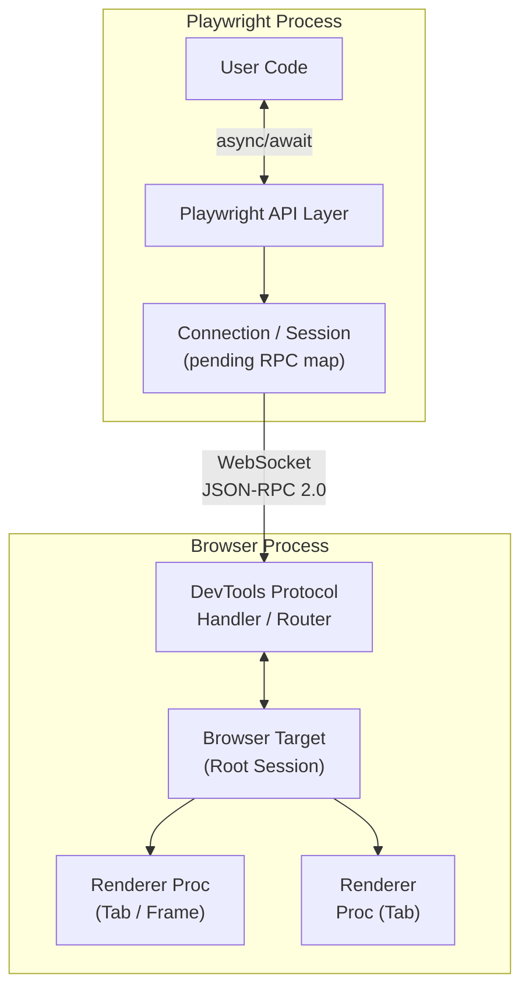

# Lesson 1: Browser Automation Primitives

## 1. First-Principles Intuition & Invariants

Every modern browser is, at its core, a multi-process operating system layered on top of the host OS. It manages memory isolation between tabs through separate renderer processes, enforces a security sandbox around JavaScript execution, coordinates GPU compositing through a dedicated process, and arbitrates network I/O through a privileged broker. When you write a Playwright script, you are not scripting a browser's UI in any superficial sense. You are issuing structured JSON-RPC commands to a debugging protocol that exposes direct, low-level control over all of these subsystems simultaneously. Understanding this architecture at the mechanical level is what separates engineers who write brittle automation scripts from those who build production-grade, deterministic test infrastructure.

The Chrome DevTools Protocol (CDP), which is the substrate beneath Playwright's Chromium channel and the conceptual ancestor of its Firefox and WebKit channels, was designed originally to serve browser DevTools: the inspector panel, the network tab, the memory profiler. Each of these tools in the browser's own UI is itself a CDP client. When you open DevTools in Chrome, the panel opens a WebSocket connection to `localhost` on a port the browser exposes via the `--remote-debugging-port` flag and begins exchanging JSON messages. Playwright does exactly the same thing, except it automates that connection rather than presenting it to a human. This lineage matters because CDP is not an automation API designed for Playwright's use cases—it is a debugging protocol pressed into automation service. Playwright's core engineering contribution is precisely the translation layer that converts CDP's low-level, event-driven, stateful debugging primitives into a high-level, deterministic, concurrent automation model.

The fundamental invariant you must internalize is this: **a browser process is an event-driven state machine, and Playwright is a typed, concurrent controller of that state machine.** The browser does not wait for your script. Navigation events, network responses, JavaScript execution, and DOM mutations all happen asynchronously on the browser's internal event loop, completely independent of your Node.js or Python process. Playwright's job is to impose an ordering discipline on this chaos—to let your imperative script say "navigate to this URL, then wait for the network to be idle, then interact with this element" while the browser's renderer races ahead, fires paint events, executes inline scripts, and parses streaming HTML in its own time. Every API in Playwright that looks synchronous to the caller is secretly a promise that suspends the caller's coroutine until a specific browser-side event confirms that the requested state has been reached. This is not a convenience abstraction. It is a correctness guarantee: without it, every `click()` call would be a data race.

The architectural split between browsers matters here. Playwright does not use CDP uniformly across all three browser engines. For Chromium, it speaks CDP natively over a WebSocket connection to the browser's debugging endpoint. For Firefox, the Playwright team maintains a custom protocol adapter built on top of the Remote Debugging Protocol (RDP) that Firefox exposes, normalizing its behavior to match Chromium's semantics. For WebKit, Playwright ships a custom WebKit build with a bespoke automation endpoint patched into the engine. The result from the caller's perspective is a unified API surface, but the underlying wire protocols differ. This means that certain CDP-specific capabilities—raw CDP session access, Chrome Tracing, Coverage—are only available on the Chromium channel, and writing cross-browser automation requires operating at the abstraction layer Playwright provides rather than reaching through it.

Before writing a single line of automation code, the systems engineer must have a clear mental model of the **five-layer hierarchy** that Playwright exposes: the `BrowserType` (the named engine, e.g. `chromium`), the `Browser` instance (the OS process), the `BrowserContext` (the isolated browsing session), the `Page` (a tab with a main-frame and potentially nested frames), and the `Frame` (the fundamental unit of JavaScript execution context). Each layer has distinct lifecycle semantics and distinct resource ownership. Confusing them—most commonly by conflating `BrowserContext` with `Browser`, or `Page` with `Frame`—is the source of an entire class of automation bugs that are notoriously difficult to diagnose.

---

## 2. Core Architecture & Mechanics

### The CDP Transport and Message Loop

A Playwright test begins with a `BrowserType.launch()` call, which spawns the browser executable as a child process with the `--remote-debugging-port=0` flag (port zero forces the OS to assign a free ephemeral port). Playwright reads the assigned port from the process's standard output, then opens a WebSocket connection to `ws://localhost:{port}/json/version`. The browser responds with a JSON object containing a `webSocketDebuggerUrl`, which is the actual control endpoint. From this point forward, all communication is JSON-RPC 2.0 over that WebSocket.

Each CDP message is a JSON object with an integer `id`, a dot-namespaced `method` string (e.g. `Target.createTarget`, `Page.navigate`, `Runtime.evaluate`), and a `params` object. The browser sends back a response with the matching `id` and a `result` or `error` field. Independently, the browser fires unsolicited event notifications—objects with a `method` field but no `id`—whenever state changes occur: a network request starts, a frame navigates, a JavaScript dialog appears. Playwright's internal connection layer maintains an in-process map of pending request IDs to promise resolvers, so that when a response arrives on the WebSocket, the correct promise is fulfilled and the awaiting coroutine resumes.



A critical structural detail: CDP multiplexes multiple browser targets (tabs, service workers, iframes) over a single WebSocket connection using **sessions**. When a new page is created, Playwright calls `Target.createTarget` and receives a `targetId`. It then calls `Target.attachToTarget` with `flatten: true`, which returns a `sessionId`. All subsequent messages directed at that tab are prefixed with the `sessionId` field, and all events from that tab carry the same field. This flattened session model is what allows a single WebSocket connection to control an arbitrary number of concurrently open pages without multiplying OS-level connections.

### BrowserContext: The Unit of Isolation

The `BrowserContext` is the most architecturally significant abstraction in Playwright, and it maps directly to Chrome's concept of a browser profile. Each context owns its own cookie jar, localStorage, IndexedDB databases, in-memory cache, and permission state. Critically, it owns its own set of network credentials and can carry a custom HTTP proxy configuration. When you create a new context, you are not launching a new browser process. You are partitioning the existing browser process's storage and session state. The renderer processes that the browser spawns for each page within that context share no persistent state with renderers in other contexts in the same browser process.

This isolation model has profound implications for test architecture. A test suite that creates one `BrowserContext` per test can run fifty tests concurrently against a single `Browser` process without any cross-contamination of cookies or authenticated session state. The cost of context creation is milliseconds—it is a bookkeeping operation in the browser process's bookkeeper thread, not a process fork. The cost of browser process creation, by contrast, involves spawning a child process, initializing V8's heap, loading shared libraries, and setting up the GPU compositing pipeline. For a CI pipeline running hundreds of tests, the difference between one browser process with many contexts versus one browser process per test is often the difference between a 30-second run and a 10-minute run.

A `BrowserContext` is also the right boundary for state setup. Playwright's `storageState()` API serializes the entire state of a context—cookies, localStorage entries, session tokens—to a JSON file. `browser.newContext({ storageState: 'auth.json' })` reconstitutes that state into a new context, bootstrapping an authenticated session without replaying a login flow. This is not simply a convenience. It is the mechanically correct approach: since all authentication tokens ultimately reduce to either cookies or localStorage entries, capturing the storage state captures the complete authenticated identity of the session. The login flow itself is a side effect that mutates storage state; once you have that state, re-executing the side effect is redundant.

### Page Navigation Semantics and Commit Points

Navigation in Playwright is a layered process that maps onto the browser's internal document load state machine. When you call `page.goto(url)`, Playwright sends a `Page.navigate` CDP command and then listens for a cascade of events that report the navigation's progress. The key states are defined by the `waitUntil` option: `'commit'` resolves as soon as the navigation commits—meaning the browser has started receiving the response and has committed the new document to the renderer—`'domcontentloaded'` resolves when the browser fires the `DOMContentLoaded` event, `'load'` resolves when the `load` event fires (all synchronous subresources are fetched), and `'networkidle'` resolves when there have been no more than two in-flight network connections for at least 500 milliseconds.

Understanding when to use each `waitUntil` mode is a matter of correctly modeling what you actually need. Single-page applications built on React, Vue, or Angular often fire `load` before any meaningful content is in the DOM, because the initial HTML is a skeleton that JavaScript fills after the page loads. For these applications, `'networkidle'` is often the correct semantic, though it is the most expensive because it must time out a 500ms window of network silence. The alternative—and architecturally superior approach—is to avoid `waitUntil` entirely and instead wait for a specific element that you know represents the application's ready state. `page.waitForSelector('#app-root[data-ready]')` is a contract with the application's DOM, not with the network stack's heuristics.

The navigation model introduces a subtle but consequential invariant: **every navigation destroys the current JavaScript execution environment and replaces it with a new one.** Any JavaScript handle—a reference to a DOM element, a JSHandle to a JavaScript object returned by `evaluate()`—that was valid before the navigation becomes invalid immediately after the navigation commits. Playwright enforces this by tracking the frame's document ID internally and rejecting handle operations if the document ID has changed. Failing to understand this invariant leads to `detached frame` errors that appear non-deterministically in tests with race conditions between user-triggered navigations and subsequent handle evaluations.

### The Execution Model: Coroutines, Event Loops, and Protocol Interleaving

The execution model differs between Playwright's language bindings, and the difference is mechanically significant. The Node.js binding runs your test code in V8's event loop alongside Playwright's internal WebSocket message handler. Every `await` in your test code yields control back to the event loop, which can then process incoming CDP events, resolve pending promises, and flush queued protocol commands. This is native coroutine cooperation: your test and the protocol layer are concurrent actors sharing a single thread through cooperative multitasking.

The Python binding uses a different model. `pytest-playwright` runs each test in a synchronous Python function and uses a dedicated asyncio event loop in a background thread to drive all protocol communication. When your test calls `page.goto(url)`, the synchronous wrapper marshals the call to the background event loop via `asyncio.run_coroutine_threadsafe()`, blocks the test thread on a `concurrent.futures.Future`, and returns the result when the coroutine completes. This design lets Python engineers use Playwright without writing `async/await` everywhere, but it means every Playwright call crosses a thread boundary. The overhead is negligible for typical test code, but it matters if you are building a framework that makes thousands of rapid Playwright calls in tight loops.

The async Python API, `playwright.async_api`, eliminates that thread boundary and runs entirely within your asyncio event loop, making it the correct choice for high-concurrency crawlers and parallelized test runners where you might be managing dozens of concurrent `Page` instances. The following code illustrates a concurrent crawl where multiple pages navigate simultaneously within a single browser context:

```python
import asyncio
from playwright.async_api import async_playwright

async def fetch_page(context, url: str) -> str:
    page = await context.new_page()
    try:
        await page.goto(url, wait_until="domcontentloaded", timeout=15_000)
        title = await page.title()
        return title
    finally:
        await page.close()

async def main():
    targets = [
        "https://example.com",
        "https://example.org",
        "https://example.net",
    ]

    async with async_playwright() as pw:
        browser = await pw.chromium.launch(headless=True)
        context = await browser.new_context(
            ignore_https_errors=False,
            java_script_enabled=True,
            user_agent="Playwright/1.0 CrawlerBot",
        )

        results = await asyncio.gather(
            *[fetch_page(context, url) for url in targets],
            return_exceptions=True,
        )

        for url, result in zip(targets, results):
            if isinstance(result, Exception):
                print(f"[FAIL] {url}: {result}")
            else:
                print(f"[OK]   {url}: {result!r}")

        await context.close()
        await browser.close()

asyncio.run(main())
```

This code creates three pages concurrently within one context. Because all three `page.goto()` calls are gathered, the browser initiates all three navigations in parallel, each in its own renderer process. The asyncio event loop drives all three CDPWebSocket conversations interleaved on a single thread. No locks are needed because asyncio's cooperative scheduler ensures that only one coroutine is executing Python code at any instant, while I/O waits are properly interleaved.

### Frame Trees and Execution Contexts

Every `Page` in Playwright contains a **frame tree** rooted at the main frame. When the page loads an `<iframe>` element, the browser creates a child frame and, critically, a new JavaScript execution context scoped to that frame's origin. CDP models this as a separate `Runtime.ExecutionContext` with its own integer context ID. Playwright wraps this as a `Frame` object accessible via `page.frames` or `page.frame({ url: pattern })`.

The frame tree is not static. Navigating an iframe creates a new execution context and destroys the old one. Cross-origin iframes are hosted in separate renderer processes due to Chrome's Site Isolation policy, which means their JavaScript heaps are physically in different memory address spaces. Playwright abstracts this correctly: `frame.evaluate()` sends a `Runtime.evaluate` CDP command with the correct `contextId` for that frame's current document, regardless of whether the frame is cross-origin or same-origin. The invariant to remember is that **you cannot pass live JavaScript object handles across frame boundaries**—a `JSHandle` created in one frame's execution context has a context-scoped reference ID that is meaningless to another frame's evaluator.

```
Page
└── MainFrame (contextId: 1, origin: https://example.com)
    ├── ChildFrame (contextId: 2, origin: https://example.com)
    │   └── ChildFrame (contextId: 3, origin: https://ads.example.net)
    └── ChildFrame (contextId: 4, origin: https://widget.example.org)
```

Each `contextId` above maps to a distinct `Runtime.ExecutionContext` CDP session object. When Site Isolation is active—which is the default in production Chrome builds and in Playwright's Chromium—contexts 3 and 4 are in separate OS processes from context 1 and 2.

The practical engineering consequence is straightforward: always retrieve a frame reference fresh from the page after any navigation that could have reloaded the frame, and always use `frame.locator()` or `frame.evaluate()` on the frame reference itself rather than constructing page-level locators and hoping they pierce frame boundaries. Playwright's `frameLocator()` API exists precisely to give you a typed selector that is scoped to a particular frame's DOM tree, resolved at evaluation time against that frame's current document.

---

## 3. High-Performance Optimization & Failure Modes

### Context Pool Architecture for CI Throughput

The highest-leverage optimization in any Playwright-based test infrastructure is eliminating browser process startup from the per-test critical path. Browser process initialization—V8 heap setup, GPU process fork, shared library loading—takes between 500ms and 2000ms depending on the host's I/O subsystem and CPU. A test suite with 500 tests that each spawn their own browser wastes between 4 and 16 minutes of wallclock time doing nothing but starting browsers.

The correct architecture uses a **browser instance pool**: a fixed number of `Browser` objects shared across the test runner's worker processes, with each test creating and destroying a `BrowserContext`. The browser processes stay resident for the entire test run. The following implementation shows a minimal but production-correct context-per-test fixture for pytest:

```python
import pytest
import asyncio
from playwright.async_api import async_playwright, Browser, BrowserContext, Page

@pytest.fixture(scope="session")
def event_loop():
    loop = asyncio.new_event_loop()
    yield loop
    loop.close()

@pytest.fixture(scope="session")
async def browser(event_loop):
    async with async_playwright() as pw:
        browser = await pw.chromium.launch(
            headless=True,
            args=[
                "--disable-dev-shm-usage",
                "--no-sandbox",
                "--disable-gpu",
                "--disable-background-networking",
            ],
        )
        yield browser
        await browser.close()

@pytest.fixture(scope="function")
async def context(browser: Browser) -> BrowserContext:
    ctx = await browser.new_context(
        viewport={"width": 1280, "height": 720},
        locale="en-US",
        timezone_id="America/New_York",
    )
    yield ctx
    await ctx.close()

@pytest.fixture(scope="function")
async def page(context: BrowserContext) -> Page:
    p = await context.new_page()
    yield p
    await p.close()
```

The `scope="session"` browser fixture means the browser process is started once per pytest session and shared across all tests. Each test function receives a fresh context and page from the `scope="function"` fixtures, guaranteeing complete state isolation. On a machine with 8 CPU cores running `pytest-xdist` with 8 workers, this architecture launches 8 browser processes at session start and runs all 500 tests in parallel, each test paying only the cost of `new_context()` rather than `launch()`.

### Route Interception and Network Control

One of Playwright's most powerful—and most underused—capabilities is its ability to intercept, inspect, and modify HTTP requests at the protocol level. `page.route(pattern, handler)` registers a request interceptor that fires before the browser sends a matched request to the network. This is not a proxy; it is an in-process interception at the CDP layer, using the `Fetch.enable` and `Fetch.fulfillRequest` CDP commands. The browser pauses the request, fires an event to Playwright, and waits for Playwright to either fulfill, abort, or continue the request. The round-trip is over the local WebSocket connection, so latency is negligible.

```python
async def block_analytics_and_stub_api(page):
    async def route_handler(route):
        url = route.request.url
        if any(domain in url for domain in ["google-analytics.com", "segment.io", "mixpanel.com"]):
            await route.abort()
            return
        if url.endswith("/api/v1/user/profile"):
            await route.fulfill(
                status=200,
                content_type="application/json",
                body='{"id": 42, "name": "Test User", "role": "admin"}',
            )
            return
        await route.continue_()

    await page.route("**/*", route_handler)
```

This handler does two things: it eliminates all outbound requests to known analytics domains (improving test determinism by removing third-party network dependencies), and it intercepts a specific API endpoint and returns a fixture response. The result is a test that is completely independent of backend service availability. For a test that is verifying UI rendering logic given a known user profile, decoupling the test from the actual API is not a shortcut—it is the architecturally correct decomposition of concerns.

### Flakiness Root Causes and Structural Mitigations

Test flakiness in Playwright almost always traces to one of three root causes: **incorrect wait semantics**, **shared mutable state**, or **timer-dependent behavior**.

Incorrect wait semantics is by far the most common. The canonical mistake is replacing `page.waitForSelector()` or Playwright's built-in auto-waiting with an explicit `page.waitForTimeout(1000)`. A fixed sleep is a heuristic bet that 1000ms is longer than whatever the browser needs. It fails non-deterministically on slow CI hosts and wastes time on fast developer machines. Playwright's auto-waiting mechanism on `page.click()`, `page.fill()`, and `page.locator().click()` already polls for the element to be visible, stable, enabled, and not obscured before dispatching the interaction. The correct mental model is that **every Playwright interaction call is implicitly a wait-and-then-act compound operation**. When you need explicit waits, prefer `page.waitForSelector()` with a specific selector that represents application-ready state over any form of time-based delay.

Shared mutable state manifests when tests in a suite share a `BrowserContext`. If test A logs in and sets a cookie, and test B runs in the same context expecting an unauthenticated state, test B's behavior is non-deterministic with respect to test ordering. The fix is strict context-per-test isolation, as shown in the fixture architecture above. If pre-authenticated state is needed, it should be injected via `storageState`, not inherited by context reuse.

Timer-dependent behavior appears in applications that use `setTimeout` or CSS animations to drive state transitions. An element that becomes clickable after a 300ms animation is a source of flakiness if the test checks interactability before the animation completes. The mitigation is to either use `page.emulateMedia({ reducedMotion: 'reduce' })` to disable CSS animations via the `prefers-reduced-motion` media query, or to intercept `setTimeout` and `setInterval` with fake timer implementations injected via `page.addInitScript()`. The latter approach gives you deterministic control over the browser's JavaScript clock:

```python
await page.add_init_script("""
    (() => {
        const OriginalDate = Date;
        let currentTime = new OriginalDate('2024-01-15T10:00:00Z').getTime();

        window.__advanceClock = (ms) => { currentTime += ms; };

        window.Date = class extends OriginalDate {
            constructor(...args) {
                if (args.length === 0) {
                    super(currentTime);
                } else {
                    super(...args);
                }
            }
            static now() { return currentTime; }
        };
    })();
""")
```

This script is injected into every new document that the page loads, before any other script executes. The browser's `Date.now()` calls within the page will return the controlled value, allowing your test to advance the clock at will and verify time-dependent UI behavior without sleeping.

### Tracing, Diagnostics, and Protocol Inspection

Playwright's built-in tracing system captures a complete record of every CDP command issued and every CDP event received during a test, along with screenshots at each action and a network request log. Enabling tracing requires three lines:

```python
await context.tracing.start(screenshots=True, snapshots=True, sources=True)
# ... test actions ...
await context.tracing.stop(path="trace.zip")
```

The resulting `trace.zip` is viewable at `trace.playwright.dev`. It renders an interactive timeline of all Playwright actions, their corresponding network waterfall, DOM snapshots at each action point, and the source code location that triggered each action. For diagnosing flaky tests in CI, a trace captured on failure is typically sufficient to identify the exact action that failed and the browser state at the moment of failure, eliminating the need for video recordings or elaborate logging.

For lower-level protocol inspection—when you need to understand exactly what CDP messages are being exchanged—Playwright exposes the raw CDP session through `page.context().new_cdp_session(page)`. This gives you a `CDPSession` object on which you can call `send(method, params)` for arbitrary CDP commands and register event listeners with `on(event, handler)`. This is the escape hatch into the raw protocol layer, and it is the correct tool for capabilities that Playwright does not yet expose through its high-level API: Performance Timeline streaming, Chrome Tracing (`Tracing.start` / `Tracing.end`), and experimental CDP domains.

```python
async def capture_coverage(page):
    client = await page.context.new_cdp_session(page)

    await client.send("Profiler.enable")
    await client.send("Profiler.startPreciseCoverage", {
        "callCount": True,
        "detailed": True,
    })

    # Execute test actions here
    await page.goto("https://example.com")
    await page.click("h1")

    result = await client.send("Profiler.takePreciseCoverage")
    await client.send("Profiler.stopPreciseCoverage")
    await client.detach()

    return result["result"]
```

This code uses the CDP Profiler domain directly to capture JavaScript coverage data with per-function call counts and byte-level coverage ranges. This data is the foundation of coverage-guided testing strategies where you identify which parts of the application's JavaScript were never exercised by your test suite and prioritize test authoring accordingly.

The mental model to carry forward from this lesson is that Playwright is a typed, concurrent, protocol-level controller of a browser's internal state machine. Its abstractions—`BrowserContext`, `Page`, `Frame`, `Locator`—are not wrappers around a scripting API. They are precise projections of the browser's own internal object model, exposed through a debugging protocol and coordinated through an async runtime that imposes ordering constraints on an otherwise fully concurrent system. Everything in Playwright's design, from context isolation to auto-waiting to route interception, follows directly from that foundational architecture.
