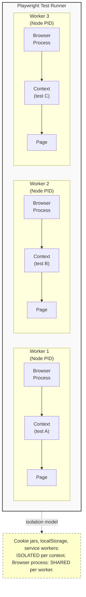

# Lesson 4: Testing Architecture and Patterns

## 1. First-Principles Intuition & Invariants

Every serious end-to-end testing problem reduces, at its core, to a question of state. When a test fails, the most important question is not *what* failed but *whose* state caused it. Was it a cookie from a previous session? A database row modified by a concurrent worker? A WebSocket connection that never closed cleanly? The fundamental challenge in browser automation at scale is not writing assertions—that part is straightforward—but constructing an execution environment where the state each test observes is precisely and exclusively the state that test created. This is the invariant that all of Playwright's architecture is designed to enforce.

The philosophical foundation of Playwright's model is borrowed from the same thinking that made Unix processes powerful: isolation through explicit boundaries. In the Unix model, processes share nothing by default and communicate through deliberate channels. Playwright applies an analogous discipline to browser state. Rather than sharing a single browser instance across tests and manually clearing cookies, localStorage, and in-flight network connections between runs—a strategy that is both fragile and expensive to reason about—Playwright introduces a hierarchy of isolation primitives: browsers, contexts, and pages. Understanding what each layer isolates, and what it deliberately leaves shared, is the theoretical bedrock upon which every architectural decision in a scalable test suite must rest.

A `Browser` is a single operating system process, the Chrome or Firefox binary itself. It is expensive to create and expensive to destroy, so Playwright's execution model keeps browsers alive across multiple tests and reuses them. What two tests sharing a browser *do not* share, however, is a `BrowserContext`. The browser context is Playwright's emulation of a complete user profile: it owns its own cookie jar, its own localStorage and sessionStorage namespaces, its own set of service worker registrations, its own HTTP authentication credentials, and its own network interception layer. Two contexts running within the same browser process are as opaque to each other as two separate browser profiles are to a user. This is not a soft convention—it is enforced by Chromium's internal site isolation and partition key architecture, which keys storage access on the top-level origin and the frame's origin as a compound tuple, making cross-context access structurally impossible without explicit bridging.

A `Page` lives inside a context and corresponds to a single browser tab. Multiple pages can share a context—and therefore its cookies and storage—making the context the right primitive for modeling multi-tab workflows or scenarios where a background page (such as a service worker or extension background page) must interact with a foreground tab. The page itself carries frame state: the main frame, its subframes, and their associated JavaScript heaps. When a page is closed, its JavaScript heap is garbage collected by the browser engine, its network connections are torn down, and any `Page`-scoped event listeners registered from the Node.js side are cleaned up. This deterministic teardown is what makes per-test page creation cheap and safe.

The practical invariant that follows from this hierarchy is: **one context per test, never one context per suite.** This rule deserves to be stated as an architectural law rather than a suggestion because violating it produces a class of intermittent failures that are among the hardest to diagnose in any testing discipline—failures that only appear when tests run in a specific order, that disappear under isolation, and that cause different symptoms in different environments. The underlying cause is always the same: shared mutable state crossing a test boundary. Every test should own its context, create pages from that context, and have those pages destroyed when the context is torn down at the end of the test. The browser remains alive and is reused. The state does not.

Parallelization is the second major invariant. Playwright's native test runner, `@playwright/test`, models parallelism at the *worker process* level, not at the in-process thread level. Each worker is a fully isolated Node.js process with its own module cache, its own imported state, and its own browser instance. This design choice eliminates an entire class of concurrency bugs that plague threading-based parallelism: there is no shared heap between workers, no possibility of one worker's mutation of a module-level singleton racing with another worker's read of the same singleton, and no need for locks around test-local state. The tradeoff is memory—each worker carries the overhead of a Node.js process and a browser binary—but on modern hardware with 16 or more cores, this is almost always the right tradeoff for a test suite that runs in CI against a production-like environment.

The last first-principles invariant concerns assertions. Playwright's `expect` API is not a thin wrapper around Jest's matchers; it is an asynchronous retry engine built on top of a polling loop. When you write `await expect(page.locator('.status')).toHaveText('Ready')`, Playwright does not evaluate the assertion once and fail or pass. It polls the DOM at approximately 100ms intervals for up to the configured `timeout` (5 seconds by default), retrying the assertion until it passes or the timeout expires. This retry semantics is not an optional feature—it is the foundational contract that makes Playwright assertions resilient to the asynchronous nature of modern web applications without requiring manual `waitFor` calls scattered throughout test code. Understanding this model is prerequisite to understanding *why* certain assertion patterns are architecturally superior to others, a topic developed at length in Section 3.

---

## 2. Core Architecture & Mechanics

### The Execution Model: Workers, Contexts, and the Fixture Graph

Playwright's test runner resolves test execution through three interacting systems: a scheduler that assigns test files to worker processes, a fixture dependency graph that provides each test with its required infrastructure, and the browser hierarchy described above. To build maintainable suites at scale, an engineer must understand all three systems and how they compose.

The scheduler reads the `workers` configuration—either a fixed integer or a percentage of logical CPU cores—and maintains a pool of worker processes. Each worker executes tests from a single file at a time by default, though `fullyParallel: true` instructs the scheduler to distribute individual tests across workers regardless of file boundaries. The important mechanical detail is that a worker's browser is created once per worker lifecycle and reused across the tests that worker executes. The context, however, is created fresh for each test via the fixture system. This arrangement gives you browser process reuse (cheap) and context isolation (correct).



Fixtures are the dependency injection system that wires this hierarchy together. Every `test` function receives its fixtures via its first argument, and the runner builds a directed acyclic graph of fixture dependencies before executing any test. Fixtures declare their scope—`'test'`, `'worker'`, or `'project'`—which determines their lifetime. A `'test'`-scoped fixture is created before the test body runs and torn down immediately after, whether the test passes or fails. A `'worker'`-scoped fixture is created once when the worker starts and destroyed when the worker terminates, making it appropriate for state that is expensive to initialize and safe to share across the sequential tests a single worker executes.

The built-in `browser` fixture is `'worker'`-scoped. The built-in `context` and `page` fixtures are `'test'`-scoped. This is precisely the architecture described in the first section, expressed as a fixture graph. The practical consequence is that you can override the `context` fixture to inject application-specific behavior—authentication state, custom permissions, intercepted routes—and that override applies to every test without modifying test bodies.

```typescript
// fixtures/auth.ts
import { test as base, expect, BrowserContext } from '@playwright/test';

type AuthFixtures = {
  authenticatedContext: BrowserContext;
  adminPage: import('@playwright/test').Page;
};

export const test = base.extend<AuthFixtures>({
  authenticatedContext: async ({ browser }, use) => {
    // Restore a previously saved authentication state from disk.
    // storageState contains cookies and localStorage captured after login.
    const context = await browser.newContext({
      storageState: 'playwright/.auth/user.json',
      baseURL: process.env.BASE_URL ?? 'http://localhost:3000',
      // Enforce strict viewport to catch responsive layout regressions.
      viewport: { width: 1280, height: 720 },
    });

    await use(context);

    // Teardown: close all pages, flush network buffers, release context.
    await context.close();
  },

  adminPage: async ({ authenticatedContext }, use) => {
    const page = await authenticatedContext.newPage();
    await page.goto('/admin/dashboard');
    await expect(page.getByRole('heading', { name: 'Admin Dashboard' })).toBeVisible();
    await use(page);
    await page.close();
  },
});

export { expect };
```

This fixture composition pattern has a critical architectural advantage: the authentication state is loaded from a JSON artifact on disk that was produced by a global setup script, not by running a login flow on every test. The global setup script runs once per test suite execution, navigates through the login form, and saves the resulting storage state using `context.storageState({ path: ... })`. Every subsequent test that depends on `authenticatedContext` receives a context pre-populated with valid session cookies, bypassing the login UI entirely. At scale—hundreds of tests—this eliminates an enormous amount of redundant network traffic and dramatically reduces suite runtime.

### The Page Object Model at Architectural Scale

The Page Object Model (POM) is not a Playwright-specific pattern; it predates Playwright by over a decade, originating in the WebDriver ecosystem. What Playwright changes is *how* the pattern should be expressed at scale, because Playwright's composability model is significantly richer than WebDriver's. The naive POM implementation that most engineers carry forward from Selenium experience—a class per page with methods that perform actions and return new page objects—fails at scale for a specific mechanical reason: it tightly couples the selector logic to the page class, making refactoring expensive and creating deep class hierarchies that mirror the navigation graph of the application.

The idiomatic Playwright alternative models the application through *component objects* rather than *page objects*. A component object wraps a `Locator`—Playwright's lazy, re-queryable DOM reference—and exposes semantically meaningful actions and assertions against that component. Because `Locator` objects are composable and chained (a locator can be scoped to a subtree by calling `.locator()` on an existing locator), a component object can be parameterized at construction time with its root locator, making it safe to instantiate multiple times on the same page for components that appear more than once.

```typescript
// components/DataTable.ts
import { Locator, Page, expect } from '@playwright/test';

export class DataTable {
  private readonly root: Locator;

  constructor(rootLocator: Locator) {
    this.root = rootLocator;
  }

  row(index: number): Locator {
    // nth() is 0-indexed. Row 0 is the first tbody row, not the header.
    return this.root.locator('tbody tr').nth(index);
  }

  cell(rowIndex: number, columnName: string): Locator {
    // Derive column index from the header row at query time, not at construction.
    // This decouples the component from column ordering in the DOM.
    const headerIndex = this.root
      .locator('thead th')
      .filter({ hasText: columnName });
    // Playwright does not support dynamic column resolution via chained
    // locator arithmetic, so we use a labeled data attribute convention.
    return this.row(rowIndex).locator(`td[data-column="${columnName}"]`);
  }

  async expectRowCount(count: number): Promise<void> {
    await expect(this.root.locator('tbody tr')).toHaveCount(count);
  }

  async sortByColumn(columnName: string): Promise<void> {
    await this.root
      .locator(`thead th[data-column="${columnName}"]`)
      .click();
    // Wait for the sort indicator to become active before returning,
    // so callers do not need to reason about the transition.
    await expect(
      this.root.locator(`thead th[data-column="${columnName}"][aria-sort]`)
    ).toBeVisible();
  }
}

// pages/OrdersPage.ts
import { Page, expect } from '@playwright/test';
import { DataTable } from '../components/DataTable';

export class OrdersPage {
  readonly table: DataTable;
  private readonly page: Page;

  constructor(page: Page) {
    this.page = page;
    // Scope the DataTable to the specific table on this page by its
    // test-id attribute. The component object is not tied to a URL or
    // a full-page selector—it is tied to its root element.
    this.table = new DataTable(page.getByTestId('orders-table'));
  }

  async navigate(): Promise<void> {
    await this.page.goto('/orders');
    await expect(this.page).toHaveURL(/\/orders/);
  }

  async filterByStatus(status: 'pending' | 'shipped' | 'cancelled'): Promise<void> {
    await this.page.getByRole('combobox', { name: 'Status filter' }).selectOption(status);
    // The table reload is signaled by a loading spinner appearing and then
    // disappearing. Waiting for the spinner to detach is more reliable than
    // waiting for a fixed timeout.
    await expect(this.page.getByTestId('table-loading-spinner')).toBeHidden();
  }
}
```

The architectural decision embedded in `DataTable` using `data-column` attributes rather than positional selectors is not cosmetic. Positional selectors (`td:nth-child(3)`) are brittle under two common refactors: adding a column to the left of the target column, and reordering columns in response to product requirements. By requiring that the application renders `data-column` attributes on cells—a convention agreed upon between the testing and frontend teams—the test suite gains a contract that is explicit, grep-able, and resistant to visual redesign. This is a systems engineering discipline applied to the browser DOM: the attribute is the interface, and the visual position is an implementation detail.

### Parallelization Semantics and Shared Resource Management

When tests run in parallel across multiple workers, they inevitably compete for shared resources: database rows, user accounts, email inboxes, and third-party API rate limits. The correct mental model for managing this contention is the same model used in concurrent systems programming: partition shared state by test identity, prefer immutable fixtures over mutable ones, and push mutation behind an isolation boundary.

The most common form of database contention in parallel E2E test suites arises when multiple tests modify the same records. The standard solution is to use test-local data: each test creates the records it needs at the start of the test and destroys them at the end, never relying on seed data that another test might modify. Playwright's fixture system makes this ergonomic through `'test'`-scoped API client fixtures.

```typescript
// fixtures/api.ts
import { test as base } from '@playwright/test';

type ApiFixtures = {
  apiClient: ReturnType<typeof createApiClient>;
  testUser: { id: string; email: string; password: string };
};

function createApiClient(token: string) {
  const baseURL = process.env.API_BASE_URL ?? 'http://localhost:3001';

  return {
    async createUser(overrides: Partial<{ email: string; role: string }> = {}) {
      const uniqueSuffix = `${Date.now()}-${Math.random().toString(36).slice(2, 7)}`;
      const payload = {
        email: overrides.email ?? `test-${uniqueSuffix}@example.com`,
        role: overrides.role ?? 'viewer',
        password: 'T3st-P@ssword!',
      };
      const res = await fetch(`${baseURL}/api/users`, {
        method: 'POST',
        headers: { 'Content-Type': 'application/json', Authorization: `Bearer ${token}` },
        body: JSON.stringify(payload),
      });
      if (!res.ok) throw new Error(`createUser failed: ${res.status} ${await res.text()}`);
      const user = await res.json();
      return { ...user, password: payload.password };
    },

    async deleteUser(id: string) {
      await fetch(`${baseURL}/api/users/${id}`, {
        method: 'DELETE',
        headers: { Authorization: `Bearer ${token}` },
      });
    },
  };
}

export const test = base.extend<ApiFixtures>({
  apiClient: async ({}, use) => {
    const token = process.env.API_ADMIN_TOKEN;
    if (!token) throw new Error('API_ADMIN_TOKEN environment variable is required');
    await use(createApiClient(token));
  },

  testUser: async ({ apiClient }, use) => {
    // Setup: create a fresh user for this test only.
    const user = await apiClient.createUser();
    await use(user);
    // Teardown: unconditionally delete the user whether the test passed or failed.
    // Playwright runs fixture teardown even when the test body throws.
    await apiClient.deleteUser(user.id);
  },
});
```

The teardown guarantee deserves emphasis. When a Playwright fixture uses the `use()` callback pattern, the code after `await use(...)` is guaranteed to execute even if the test body throws an exception or an assertion fails. This is mechanically equivalent to a `defer` in Go or a `finally` block in Java: the runtime ensures it runs. This guarantee is what makes the test-local data pattern safe—you never leak database records between test runs, even under failure conditions.

For resources that cannot be created per-test—a Stripe sandbox account, a third-party OAuth provider, a hardware-in-the-loop device—the right strategy is `'worker'`-scoped fixtures with strict serialization. Worker-scoped fixtures run once per worker process, so if your suite has four workers, four instances of the fixture are created. If the resource pool has only two slots, you must set `workers: 2` in the project configuration, or implement a semaphore-style locking mechanism in the global setup phase. The simpler architectural choice is almost always to provision enough test infrastructure to match your worker count, rather than building distributed locking into the test runner.

---

## 3. High-Performance Optimization & Failure Modes

### Authentication State as a Build Artifact

The single highest-leverage optimization in a large Playwright suite is treating authenticated browser state as a cached build artifact rather than recomputing it on every test run. The pattern has two parts: a global setup script that performs the login flow once and serializes the resulting cookies and localStorage to disk, and a project-level `storageState` configuration that injects this artifact into every context.

```typescript
// global-setup.ts
import { chromium, FullConfig } from '@playwright/test';
import path from 'path';
import fs from 'fs/promises';

const AUTH_DIR = path.join(process.cwd(), 'playwright/.auth');

async function globalSetup(config: FullConfig): Promise<void> {
  await fs.mkdir(AUTH_DIR, { recursive: true });

  const browser = await chromium.launch();

  // Provision a standard user session.
  await provisionSession(browser, {
    email: process.env.TEST_USER_EMAIL!,
    password: process.env.TEST_USER_PASSWORD!,
    outputPath: path.join(AUTH_DIR, 'user.json'),
  });

  // Provision an admin session separately. Admin tests use a different
  // storageState file, so they receive a context with admin-scoped cookies.
  await provisionSession(browser, {
    email: process.env.TEST_ADMIN_EMAIL!,
    password: process.env.TEST_ADMIN_PASSWORD!,
    outputPath: path.join(AUTH_DIR, 'admin.json'),
  });

  await browser.close();
}

async function provisionSession(
  browser: import('@playwright/test').Browser,
  opts: { email: string; password: string; outputPath: string }
): Promise<void> {
  const context = await browser.newContext();
  const page = await context.newPage();

  await page.goto(process.env.BASE_URL + '/login');
  await page.getByLabel('Email').fill(opts.email);
  await page.getByLabel('Password').fill(opts.password);
  await page.getByRole('button', { name: 'Sign in' }).click();

  // Wait for navigation to a post-login URL as the signal that
  // the session is fully established, including any HttpOnly cookies
  // set by the server during the redirect chain.
  await page.waitForURL(/\/(dashboard|home)/);

  await context.storageState({ path: opts.outputPath });
  await context.close();
}

export default globalSetup;
```

```typescript
// playwright.config.ts
import { defineConfig, devices } from '@playwright/test';

export default defineConfig({
  globalSetup: require.resolve('./global-setup'),
  use: {
    baseURL: process.env.BASE_URL ?? 'http://localhost:3000',
    trace: 'on-first-retry',
    screenshot: 'only-on-failure',
    video: 'retain-on-failure',
  },
  projects: [
    {
      name: 'setup',
      testMatch: /global-setup\.ts/,
    },
    {
      name: 'authenticated-chromium',
      use: {
        ...devices['Desktop Chrome'],
        storageState: 'playwright/.auth/user.json',
      },
      dependencies: ['setup'],
    },
    {
      name: 'admin-chromium',
      use: {
        ...devices['Desktop Chrome'],
        storageState: 'playwright/.auth/admin.json',
      },
      dependencies: ['setup'],
    },
    {
      name: 'unauthenticated',
      use: { ...devices['Desktop Chrome'] },
      // No storageState: tests in this project receive a fresh,
      // empty context appropriate for testing login flows and
      // anonymous user behavior.
    },
  ],
  workers: process.env.CI ? 4 : 2,
  fullyParallel: true,
  retries: process.env.CI ? 2 : 0,
  reporter: [
    ['html', { open: 'never' }],
    ['junit', { outputFile: 'test-results/results.xml' }],
  ],
});
```

The `dependencies` field in the project configuration is a scheduler directive: Playwright will not begin executing tests in `authenticated-chromium` or `admin-chromium` until the `setup` project has completed successfully. This turns the global setup into a proper build graph node rather than a convention, and it makes the dependency explicit in the configuration file rather than implicit in test ordering.

### Assertion Strategy: Structural vs. Behavioral Contracts

The choice of assertion strategy has a greater impact on suite stability than any other single factor. Playwright's auto-retrying assertions are powerful, but they can be misused in ways that mask flakiness rather than eliminating it. The core discipline is to assert behavioral contracts—what the application does in response to a user action—not structural snapshots of intermediate DOM state.

The structural anti-pattern looks like this: `await expect(page.locator('.spinner')).toBeHidden()`. This asserts that a loading indicator is gone, which is a valid precondition for the next action but not a meaningful behavioral assertion in its own right. It is also fragile: if the application designer renames `.spinner` to `.loader`, the assertion fails for a reason completely unrelated to the behavior under test. The behavioral assertion for the same situation is `await expect(page.locator('[data-testid="user-list"]')).toContainText('Alice')`, which asserts that the data loaded correctly, implicitly waiting for the loading state to resolve as a side effect of Playwright's retry semantics.

Network request interception provides the most precise behavioral assertions for API-driven applications. By intercepting the network layer, you can assert both that the application renders the correct response and that it sent the correct request, without depending on a live backend.

```typescript
// tests/orders/create-order.spec.ts
import { test, expect } from '../fixtures/auth';
import { OrdersPage } from '../pages/OrdersPage';

test('submitting the order form sends a POST with correct payload', async ({ adminPage }) => {
  const ordersPage = new OrdersPage(adminPage);
  await ordersPage.navigate();

  // Intercept the POST request before triggering the UI action.
  // route.fulfill() bypasses the network entirely, so the test
  // does not depend on backend availability.
  const requestPayload = await new Promise<Record<string, unknown>>((resolve) => {
    adminPage.route('**/api/orders', async (route) => {
      const request = route.request();
      resolve(request.postDataJSON());
      await route.fulfill({
        status: 201,
        contentType: 'application/json',
        body: JSON.stringify({ id: 'ord_test_123', status: 'pending' }),
      });
    });

    // Trigger the form submission after the route handler is registered.
    adminPage.getByRole('button', { name: 'New Order' }).click();
    adminPage.getByLabel('Customer').fill('Acme Corp');
    adminPage.getByLabel('Amount').fill('1500');
    adminPage.getByRole('button', { name: 'Submit' }).click();
  });

  // Assert the request payload structure.
  expect(requestPayload).toMatchObject({
    customer: 'Acme Corp',
    amount: 1500,
    currency: 'USD',
  });

  // Assert the UI reflects the fulfilled response.
  await expect(adminPage.getByTestId('order-confirmation')).toContainText('ord_test_123');
});
```

The `Promise`-based wrapper around the route handler and the form interaction is a concurrency pattern worth understanding precisely. The `page.route()` registration is synchronous—it registers an intercept handler in Playwright's routing table immediately. The network request will not arrive until the form is submitted, so there is no race condition between registering the handler and triggering the request. The `Promise` captures the request payload asynchronously when the handler fires, and the outer `await` on the `Promise` ensures the test body does not proceed to assertions until the request has been intercepted and its payload has been captured.

### Failure Mode: Selector Rot and Its Structural Prevention

Selector rot—the progressive degradation of test suite reliability as the application's HTML structure evolves—is the dominant failure mode in long-lived E2E suites. It manifests as a slow increase in `locator.click() - waiting for element to become visible` timeout failures that have nothing to do with application correctness. The root cause is selector strategies that couple the test suite to the application's visual structure rather than to its semantic behavior.

Playwright's recommended selector priority is, in descending order of stability: `getByRole`, `getByLabel`, `getByPlaceholder`, `getByText`, `getByAltText`, `getByTitle`, and `getByTestId`. The first five are ARIA-semantic selectors that describe how a screen reader and an accessibility tool would address the element. They are resilient to CSS class renames, element type changes (a `<div>` becoming a `<button>`), and layout restructuring, because they depend on the computed accessibility tree rather than the raw DOM tree. The `getByTestId` family is the escape hatch for cases where no semantic selector is available; it depends on `data-testid` attributes that the team controls and that do not change for visual or styling reasons.

The pathological selector is the CSS class selector: `page.locator('.btn-primary.submit-action')`. CSS class names are styling concerns. A design system migration—Tailwind to Bootstrap, Bootstrap to a custom design system—will rename every class in the application without changing any behavior, and every class-based selector in the test suite will rot simultaneously. The fix is a one-time migration from class selectors to role or test-id selectors combined with a lint rule (enforced via `eslint-plugin-playwright`) that prevents new class-based selectors from entering the codebase.

```jsonc
// .eslintrc.json (excerpt)
{
  "plugins": ["playwright"],
  "rules": {
    "playwright/no-raw-locators": "error",
    "playwright/prefer-web-first-assertions": "error",
    "playwright/no-force-option": "warn",
    "playwright/no-wait-for-timeout": "error"
  }
}
```

`no-wait-for-timeout` is the most important rule in this set. `page.waitForTimeout(2000)` is a fixed-duration sleep that makes the suite deterministically slower by its duration and flaky in every environment where the application runs faster or slower than expected. Every `waitForTimeout` call is a symptom of a missing behavioral assertion; the fix is always to identify what state change the sleep was waiting for and replace it with an auto-retrying assertion against that state.

### Tracing, Artifacts, and Post-Mortem Debugging

When a test fails in CI, the absence of a human observer means that the test must have recorded enough information to reconstruct the failure without re-running it. Playwright's trace files are the primary artifact for this reconstruction. A trace file is a zip archive containing a full recording of all network requests and responses, all DOM snapshots at every action, all console messages, and a timeline of all Playwright API calls with their durations. The `trace: 'on-first-retry'` configuration setting is the correct production default: it avoids the performance overhead of tracing on the first run, but records a complete trace on retry so that intermittent failures (which only appear during retries) are captured.

The trace viewer, accessible via `npx playwright show-trace trace.zip`, renders this archive as a time-scrubbing interface that shows the DOM state at each step, the network waterfall, and the locator that each action targeted. For post-mortem debugging of selector failures, the DOM snapshot is invaluable: you can inspect exactly what the DOM looked like when the locator query was evaluated, which is often different from what you see when you re-run the test locally against a refreshed application state.

For failures that require understanding JavaScript execution context—console errors, unhandled promise rejections, or unexpected `window.location` changes—console and page error listeners attached at the fixture level provide comprehensive coverage.

```typescript
// fixtures/diagnostics.ts
import { test as base } from '@playwright/test';

export const test = base.extend({
  page: async ({ page }, use, testInfo) => {
    const consoleMessages: string[] = [];
    const pageErrors: string[] = [];

    page.on('console', (msg) => {
      if (msg.type() === 'error') {
        consoleMessages.push(`[console.error] ${msg.text()}`);
      }
    });

    page.on('pageerror', (error) => {
      pageErrors.push(`[uncaught] ${error.message}\n${error.stack ?? ''}`);
    });

    await use(page);

    // Attach collected diagnostics to the test report regardless of outcome.
    // TestInfo.attach() writes the content to the HTML report as a named artifact.
    if (consoleMessages.length > 0 || pageErrors.length > 0) {
      await testInfo.attach('browser-errors', {
        body: [...consoleMessages, ...pageErrors].join('\n'),
        contentType: 'text/plain',
      });
    }
  },
});
```

This fixture overrides the built-in `page` fixture—a capability Playwright explicitly supports for exactly this purpose—and augments it with diagnostic collection. Because it uses `base.extend()`, it composes cleanly with authentication fixtures and API fixtures through further chaining: `authTest.extend({ page: diagnosticPage })`. The resulting fixture graph resolves all dependencies in the correct order, and each layer of the stack remains independently testable and replaceable.

The architectural summary of a mature Playwright suite is a fixture graph that handles infrastructure, a component object layer that handles DOM addressing, and test bodies that read like behavioral specifications: navigate here, perform this action, assert this outcome. The test body contains no selector strings, no teardown logic, no sleep calls, and no authentication ceremony. All of that complexity lives in the fixture and component layers where it is written once, tested independently, and reused across the entire suite without duplication.
