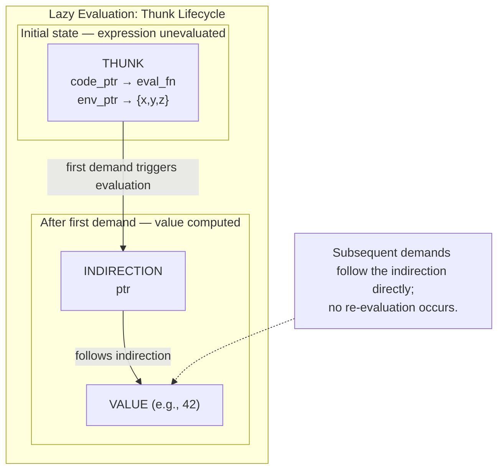

# Lesson 3: Programming Paradigms, Control Flow, Evaluation Strategies

## 1. First-Principles Intuition & Invariants

Every programming language is, at its core, a formal theory of computation made executable. The choice of paradigm is not aesthetic—it is a decision about which mathematical model to use as the operational foundation: Turing machines, lambda calculus, Horn clause logic, or some composite thereof. Understanding paradigms at this depth means recognizing that the syntax and idioms visible to the programmer are surface projections of deep semantic commitments baked into the language's evaluation model, type system, and runtime.

The **imperative paradigm** derives its identity from the Turing machine model: computation as a sequence of state mutations on an addressable memory store. A program is a list of commands that modify registers, stack frames, and heap cells in a prescribed order. The fundamental invariant is that meaning is inseparable from time and sequence—the same statement executed at different points in a program's lifetime may produce different results, because the value of a variable is not its definition but its current binding in the mutable store. C, Fortran, and assembly all operate under this invariant. The programmer reasons about program state as a snapshot that evolves monotonically forward through time.

The **functional paradigm** rejects mutable state as the primary abstraction. It descends directly from Church's lambda calculus, where computation is the reduction of expressions to their normal forms via substitution. The central invariant is **referential transparency**: an expression always evaluates to the same value regardless of when or how many times it is evaluated. This invariant is what makes equational reasoning, memoization, and aggressive compiler optimization safe. Haskell enforces this invariant pervasively; ML and Clojure enforce it by convention and discipline. The practical consequence is that functions become true mathematical functions—mappings from inputs to outputs with no hidden channels—and programs become composable by construction rather than by careful coordination.

The **object-oriented paradigm** is often misunderstood as being primarily about classes and inheritance. At a deeper level, it is about **encapsulating state behind message interfaces**. Alan Kay's original formulation in Smalltalk was inspired by biological cells communicating via chemical signals, not by taxonomic hierarchies. The invariant is that an object's internal state is manipulated only through the object's own methods, and that polymorphism is achieved through late binding: the runtime dispatches to the correct method implementation based on the type of the receiver at the moment of the call. This late binding is what makes object-oriented code extensible but also introduces the hidden coupling that makes large inheritance hierarchies brittle.

The **logic paradigm**, best represented by Prolog, bases computation on first-order predicate logic and unification. A program is a database of facts and rules. Computation is the process of satisfying a query by searching the rule database using **SLD resolution**—a backward-chaining depth-first search that unifies goals against clause heads and recursively satisfies subgoals. The key invariant is that the programmer specifies relationships and constraints rather than control flow; the engine determines the control flow needed to satisfy the specification. This makes logic programming extraordinarily powerful for constraint satisfaction, type inference engines, and query systems, while making it poorly suited for programs where the programmer needs fine-grained control over execution order.

These paradigms are not mutually exclusive categories into which languages fall cleanly. Scala is simultaneously functional and object-oriented. Rust is imperative and systems-level but enforces pure ownership semantics that give it the equational properties of functional systems at the type level. The modern practitioner must hold multiple paradigm models simultaneously and select the right tool per module, per function, and sometimes per expression.

### The Expression–Statement Distinction

A subtlety that separates paradigm-aware engineers from paradigm-naive ones is the **expression versus statement distinction**. A statement is a unit of execution that produces a side effect and returns nothing—it exists for what it does to the world. An expression is a unit of computation that produces a value—it exists for what it returns. In C, `if` is a statement; in Rust and Haskell, `if` is an expression that evaluates to a value. The difference is not cosmetic. When control-flow constructs are expressions, the programmer can compose them directly with other expressions, eliminating a wide class of temporary variables and reducing the surface area over which a mutable value must be tracked.

Consider the following C code:

```c
int result;
if (condition) {
    result = compute_a();
} else {
    result = compute_b();
}
```

The variable `result` exists in a partially-initialized state between its declaration and the closing brace of the else branch. Any code path that fails to assign it—introduced by a later refactor—produces undefined behavior. In Rust, the same logic collapses to:

```rust
let result = if condition { compute_a() } else { compute_b() };
```

The binding is complete at the point of declaration, the value cannot be observed in an uninitialized state, and the compiler enforces that both branches produce a value of the same type. This is not syntactic sugar; it is a structural guarantee that is mechanically verified at compile time. Languages in the ML family, Rust, Kotlin, and Scala all move toward expression orientation precisely because it eliminates whole categories of temporal state bugs and enables richer type inference.

### First-Class Functions and Closures

The notion of **first-class functions** means that functions are values: they can be stored in variables, passed as arguments, returned from other functions, and placed in data structures. This is trivially true in Haskell and Lisp, moderately true in C (via function pointers), and fully true in modern JavaScript, Rust, and Python. The significance of first-class functions is not merely syntactic convenience—it fundamentally changes what abstractions are constructible. When functions are values, you can abstract over behavior rather than just over data, which is the foundational move that makes higher-order programming possible.

A **closure** is the runtime object created when a function value is instantiated in an environment that contains bindings from an enclosing scope. The function value captures those bindings, extending their lifetimes beyond the lexical scope in which they were defined. This creates a tension that every language runtime must resolve: how long does a captured variable live, where does it live (stack or heap), and who owns it?

In languages with garbage collection—Haskell, Go, JavaScript, Python—closures capture references and the GC ensures that captured values remain live as long as any closure referencing them is reachable. The programmer does not manage this. In Rust, closures interact directly with the ownership and borrow checker: a closure that moves a value takes ownership; a closure that borrows a value must not outlive the value's owner. This distinction is formalized by the `Fn`, `FnMut`, and `FnOnce` trait bounds, which describe respectively whether the closure captures by shared reference, by mutable reference, or by move. This mechanical precision is what makes Rust closures zero-cost: the compiler can stack-allocate a closure that only borrows, and it only heap-allocates when the closure must outlive its creation site.

```rust
fn make_adder(x: i64) -> impl Fn(i64) -> i64 {
    move |y| x + y   // `x` is moved into the closure; closure is heap-allocated via `impl Fn`
}

fn main() {
    let add5 = make_adder(5);
    let add10 = make_adder(10);
    println!("{}", add5(3));   // 8
    println!("{}", add10(3));  // 13
}
```

The `move` keyword forces ownership transfer of `x` into the closure. Without `move`, the closure would borrow `x`, but `x` lives on `make_adder`'s stack frame which is destroyed on return—the borrow checker would reject this at compile time. The closure is returned as an opaque `impl Fn` type, which the compiler represents as a heap-allocated fat pointer containing both the function pointer and the captured environment.

### Continuations

A **continuation** is the generalization of a return address. In conventional imperative execution, when a function completes it returns control to its call site. The continuation of a computation at any given point is "everything that will happen next"—the remaining computation expressed as a first-class value. Making continuations explicit and first-class gives the programmer direct control over control flow itself.

Continuation-passing style (CPS) is the transformation where every function takes an extra argument—the continuation—and instead of returning, calls the continuation with its result. CPS is not primarily a programming style that people write by hand; it is the intermediate representation that many compilers (Scheme, Haskell's GHC, MLton, and others) transform code into before optimization and code generation, because CPS makes all control flow—function calls, returns, exceptions, coroutines, and backtracking—uniform and explicit. Every CPS function is a tail call. Every optimization that applies to tail calls applies universally, which makes CPS an ideal substrate for compiling functional programs to efficient machine code without implicit stack growth.

The practical manifestation of continuations visible to working engineers is `call/cc` in Scheme, `shift`/`reset` in delimited continuation systems, and—importantly—the structural backbone of async/await in JavaScript, Rust, and Python. When the compiler desugars an `async` function, it transforms the function body into a state machine where each `await` point is a continuation. The state machine captures all live variables at each suspension point, writes them to a heap-allocated future object, and stores the program counter of the resume point. The `poll` method on that future is the continuation: it resumes execution from where it left off. Understanding async runtimes requires understanding that `async/await` is syntactic sugar over explicit continuation-passing with explicit suspend/resume points.

---

## 2. Core Architecture & Mechanics

### Evaluation Strategies: Eager, Lazy, and Normal Order

The evaluation strategy of a language determines **when** and **how many times** an expression is evaluated. This is one of the most consequential design decisions in a language's semantics, with deep implications for performance, resource usage, termination behavior, and expressibility.

**Eager evaluation** (also called strict or applicative-order evaluation) evaluates all arguments to a function before the function body begins execution. This matches the intuition programmers develop from hardware: load the operands, then execute the instruction. C, Java, Rust, Python, Go, and virtually all mainstream systems languages are strictly eager. The practical advantage is predictability: every expression that appears in the program is evaluated exactly once, at the point it is written, and side effects occur in a well-defined order. The disadvantage is that it is impossible to pass an expression to a function without evaluating it first, which means you cannot build control-flow abstractions as library functions in a purely eager language without resorting to explicit lambda wrapping.

**Lazy evaluation** (normal-order evaluation with sharing, also called call-by-need) defers evaluation of an expression until its value is actually required, and memoizes the result so that subsequent demands for the same thunk return the cached result without re-evaluation. Haskell is the canonical lazy language. The concrete mechanism is the **thunk**: an unevaluated expression is represented at runtime as a heap-allocated closure containing a pointer to the evaluator code and the captured environment. When a value is demanded (by pattern matching, arithmetic, or IO), the runtime enters the thunk, computes the value, overwrites the thunk in place with an **indirection node** pointing to the computed value, and returns it. Subsequent accesses follow the indirection directly.



The power of lazy evaluation is that it makes infinite data structures representable as finite programs, and it enables functions to be short-circuit consumers: a function that only inspects the first element of a list will only force the first thunk. The classic example is an infinite list of primes that the programmer can slice into finite subsequences. The cost is that heap allocation for thunks is pervasive, and the programmer loses predictable control over when computations occur—a critical problem when computations have side effects or consume significant memory, which is why Haskell's IO model must be carefully designed to remain pure even in the presence of deferred evaluation.

**Call-by-name** is a stricter form of lazy evaluation without memoization: every time a formal parameter is used in the function body, the argument expression is re-evaluated from scratch. This is Algol 60's argument passing strategy, rarely used today but historically significant as the mechanism that produced the **double evaluation bug**: passing `i++` by name to a function that uses the parameter twice increments `i` twice, a source of notorious Algol bugs. Modern uses of call-by-name semantics appear in Scala's `by-name parameters`, which defer evaluation without caching, useful for building control structures like retry loops and circuit breakers that intentionally re-evaluate their argument each iteration.

The architectural consequences of evaluation strategy on the call stack are substantial. Under strict evaluation, the call stack grows with the depth of nested function calls and is bounded by the lexical nesting depth of the program plus the recursive depth at runtime. Under lazy evaluation, the call stack profile is determined not by lexical structure but by demand propagation, which can produce deep chains of thunk forcing that erupt from unexpected parts of the program. This is the source of Haskell's notorious **stack overflow on lazy folds**: `foldl (+) 0 [1..1000000]` builds a tower of one million nested thunks before evaluating any of them, consuming heap proportional to the list length before finally collapsing. The fix is `foldl'` from `Data.List`, which forces each accumulator before consing the next thunk.

### Recursion: Structural, Tail, and Mutual

Recursion is the primary mechanism for expressing iteration in functional languages and a central tool in systems programming wherever tree structures, grammars, or divide-and-conquer algorithms appear. The critical distinction at the implementation level is between **general recursion** and **tail recursion**, because tail recursion determines whether the runtime can execute an arbitrarily deep recursive program in constant stack space.

A tail call is a function call that occupies the **tail position** of a function: the call is the last operation performed before the function returns, and its return value is the return value of the calling function without further transformation. When a call is in tail position, the callee's stack frame can **reuse** the caller's stack frame, because the caller's local variables are no longer needed. This transformation—**tail call optimization (TCO)**—converts tail recursion into a loop at the machine level.

Consider a tail-recursive factorial in C compiled with TCO enabled:

```c
#include <stdint.h>

static int64_t factorial_tco(int64_t n, int64_t acc) {
    if (n <= 1) return acc;
    return factorial_tco(n - 1, n * acc);  /* tail position: nothing after return */
}

int64_t factorial(int64_t n) {
    return factorial_tco(n, 1);
}
```

With `-O2`, GCC and Clang will emit this as a simple loop with two registers—no recursive call instruction appears in the generated assembly. The function executes in O(1) stack space regardless of `n`. Compare this to a non-tail-recursive formulation where the multiplication `n * factorial(n-1)` must wait for the recursive call to return before executing—the multiplication is in tail position relative to the frame but the recursive call is not, so each frame must be retained until the base case is reached.

Scheme and Erlang mandate TCO by their language standards; it is not optional. C, Rust (as of Rust 1.x with LLVM's pass), and C++ apply it as an optimization that is not guaranteed. JavaScript historically guaranteed nothing, which is why recursive algorithms in deep call contexts required manual trampolining. The **trampoline** pattern converts recursion into iteration explicitly:

```javascript
// A trampoline executes thunks until a non-function result is produced.
function trampoline(fn) {
    return function(...args) {
        let result = fn(...args);
        while (typeof result === 'function') {
            result = result();
        }
        return result;
    };
}

function factorial_step(n, acc) {
    if (n <= 1) return acc;
    return () => factorial_step(n - 1, n * acc);  // return a thunk instead of calling
}

const factorial = trampoline(factorial_step);
console.log(factorial(100000));  // runs without stack overflow
```

Each recursive step returns a thunk—a zero-argument function—instead of making a direct recursive call. The trampoline loop in the wrapper function drives evaluation, keeping the call stack at constant depth regardless of the number of iterations.

**Mutual recursion** between two functions—where `f` calls `g` and `g` calls `f`—requires the compiler to recognize that the final call in each function to the other is a tail call and optimize accordingly. This is **mutual tail recursion** and is handled by the same TCO mechanism as direct tail recursion, but requires both functions to be in scope simultaneously. In languages without TCO, mutually recursive state machines are common sources of stack overflow in production systems, particularly in hand-written recursive descent parsers processing deeply nested input.

### Control Flow as Data: Continuations and Coroutines

The connection between continuations and coroutines is mechanically direct. A **coroutine** is a function that can suspend its execution at explicit yield points and be resumed later, with its local state preserved across suspensions. Coroutines are continuations with restricted capture: a coroutine captures only its own execution state (locals, instruction pointer) rather than the entire remaining computation of the program.

The standard implementation of coroutines in a systems language uses either OS threads (heavy, with their own kernel-managed stacks) or **stackful coroutines** (green threads with private stacks, as in Go goroutines) or **stackless coroutines** (state machine transformations, as in Rust's async/await and Python generators). The tradeoffs are significant.

A stackful coroutine allocates a full call stack on the heap at creation time—Go starts with 2 KB and grows via stack copying. It can suspend from anywhere in the call stack, including from deep within nested function calls, because the entire stack is preserved. The cost is memory per coroutine and the overhead of stack growth detection and copying.

A stackless coroutine represents only the local variables of the immediately suspended function, not the entire call chain. The Rust `async` transformation illustrates this precisely. Consider:

```rust
use std::future::Future;
use std::pin::Pin;
use std::task::{Context, Poll};

// What the programmer writes:
async fn fetch_and_parse(url: &str) -> Result<String, Box<dyn std::error::Error>> {
    let response = reqwest::get(url).await?;
    let text = response.text().await?;
    Ok(text.to_uppercase())
}

// What the compiler generates (conceptually, not literally):
enum FetchAndParseState<'a> {
    Initial { url: &'a str },
    WaitingForResponse { url: &'a str, future: reqwest::ResponseFuture },
    WaitingForText { text_future: reqwest::TextFuture },
    Done,
}

impl<'a> Future for FetchAndParseState<'a> {
    type Output = Result<String, Box<dyn std::error::Error>>;

    fn poll(self: Pin<&mut Self>, cx: &mut Context<'_>) -> Poll<Self::Output> {
        // Each `await` point becomes a state transition.
        // The executor calls `poll` repeatedly until `Poll::Ready` is returned.
        todo!("state machine dispatch")
    }
}
```

The generated state machine contains one enum variant per suspension point, and the fields of each variant hold exactly the variables that must survive across that suspension. If a variable is not live at any suspension point, it is not stored in the state machine and costs nothing. This is what makes stackless coroutines memory-efficient for systems with millions of concurrent connections, like async network servers, but what prevents them from suspending from deeply nested helper functions without converting the entire call chain to `async`.

---

## 3. High-Performance Optimization & Failure Modes

### Eliminating Abstraction Overhead in Higher-Order Code

The primary performance concern with first-class functions and closures is **indirect dispatch**: calling through a function pointer or a vtable prevents the CPU's branch predictor from predicting the call target, flushes the instruction pipeline, and prevents the compiler from inlining the callee—which in turn blocks constant folding, dead code elimination, and auto-vectorization of the callee's body. This is not a minor concern in hot loops.

In Rust, the distinction between `impl Fn` (static dispatch, monomorphized) and `dyn Fn` (dynamic dispatch, vtable) is the precise mechanism for controlling this. A function parameterized with `impl Fn(T) -> U` is monomorphized at compile time: the compiler generates a separate copy of the function for each concrete closure type, and the closure call is a direct call that can be inlined. A `Box<dyn Fn(T) -> U>` is a fat pointer carrying a data pointer and a vtable pointer; the call cannot be inlined because the target is not known at compile time.

```rust
// Static dispatch: compiler sees the closure type, can inline.
fn apply_twice_static<F: Fn(i64) -> i64>(f: F, x: i64) -> i64 {
    f(f(x))
}

// Dynamic dispatch: compiler cannot inline; vtable lookup at every call site.
fn apply_twice_dynamic(f: &dyn Fn(i64) -> i64, x: i64) -> i64 {
    f(f(x))
}

fn main() {
    let double = |x: i64| x * 2;
    // Static: compiler likely folds this to `x * 4` with the constant `double` closure.
    println!("{}", apply_twice_static(double, 5));  // → 20
    // Dynamic: two indirect calls, no folding.
    println!("{}", apply_twice_dynamic(&double, 5));  // → 20
}
```

For latency-sensitive code paths, prefer `impl Fn` generics and accept the code size increase from monomorphization. Use `dyn Fn` only when you need runtime polymorphism—heterogeneous collections of callbacks, plugin architectures, or object-safe trait objects in `Arc<dyn Trait>`.

In C, the equivalent discipline is to prefer direct function calls over function pointers in inner loops. When a function pointer is unavoidable—sorting with a comparator, for instance—profile whether the pointer can be replaced with a typed macro or an inline function and the sort specialized via template-equivalent techniques using `_Generic` or compiler-specific intrinsics.

### Lazy Evaluation: Space Leaks and Forcing Strategies

The most insidious failure mode in lazy languages is the **space leak**: a lazy computation accumulates unevaluated thunks that reference large portions of the heap, preventing garbage collection, until the thunks are eventually forced at which point the heap usage collapses. Space leaks are notoriously difficult to diagnose because they look like memory growth under ordinary heap profiling—the objects causing the problem are thunks, not the values they will produce, and the thunks are small individual allocations connected by chains of references.

The canonical production diagnosis tool in Haskell is `ghc-prof` with heap profiling enabled. Compiling with `-prof -fprof-auto` and running with `+RTS -h -i0.1 -RTS` produces a time-series of heap residency broken down by cost center or type constructor. A space leak shows up as a steadily growing band of `THUNK` or `AP` (function application) objects in the heap profile graph.

The fix is strategic **forcing**: evaluating sub-computations to weak head normal form (WHNF) or full normal form (NF) at points where lazy accumulation would otherwise build up. The `BangPatterns` extension and `seq` primitive force a value to WHNF. The `NFData` typeclass and `deepseq` library force a value fully. The discipline is to force accumulators in left-fold operations, force values before storing them in long-lived data structures, and use `Data.Map.Strict` and `Data.HashMap.Strict` variants over their lazy counterparts unless laziness in the values is specifically required.

```haskell
import Control.DeepSeq (deepseq)
import qualified Data.Map.Strict as Map

-- Accumulate a frequency count without building a tower of thunks.
-- The strict Map ensures values are forced at each insertion.
wordFrequency :: [String] -> Map.Map String Int
wordFrequency = foldr (\w acc -> Map.insertWith (+) w 1 acc) Map.empty
-- Using foldr with a strict Map is correct here because Map.insertWith
-- uses the strict spine. For large inputs, prefer foldl' with a strict map.
```

### Continuation Abuse: Stack Explosion via Non-Tail CPS

A common failure mode when engineers manually CPS-transform code without understanding tail position is that every continuation invocation becomes a function call that grows the stack. If the continuation is called in non-tail position—because some computation wraps the continuation result—the original problem of stack growth is not solved; it is relocated from the recursive function to the continuation chain.

The canonical incorrect CPS transform of a tree fold accumulates continuations on the stack:

```scheme
; INCORRECT: continuation called in non-tail position due to `+` wrapping
(define (sum-tree/cps tree k)
  (if (number? tree)
      (k tree)
      (sum-tree/cps (car tree)
                    (lambda (left-sum)
                      (sum-tree/cps (cdr tree)
                                    (lambda (right-sum)
                                      (k (+ left-sum right-sum))))))))
```

This is properly tail-recursive in the recursive calls to `sum-tree/cps`, and each step returns immediately via `k`. However, the lambda closures themselves accumulate on the heap as the tree is traversed, forming a chain proportional to the tree's depth. The heap usage is bounded, but the logical continuation stack—the chain of pending lambdas—is O(depth). For balanced trees this is O(log n); for degenerate right-skewed trees this is O(n). This is not a stack overflow but it is a **heap continuation chain** that must be traversed on the way back up. A correct defunctionalized solution using an explicit work stack eliminates this allocation entirely.

### Interaction Between Evaluation Strategy and Concurrency

A subtle failure mode that bites engineers transitioning from eager to lazy languages—or misusing lazy APIs in eager languages—is **evaluation under concurrent access**. In Haskell, thunks are not thread-safe by default. If two threads simultaneously force the same thunk, they may both begin evaluating it, producing duplicate work at best and a data race on the thunk's internal representation at worst. The GHC runtime resolves this through **black-holing**: when a thread begins evaluating a thunk, it atomically writes a black hole—a special value—to the thunk's closure, so that any other thread demanding the same thunk blocks until the evaluating thread writes the result. The overhead of this mechanism is not free, and programs that aggressively share lazy structures across threads may see unexpected serialization.

In Python, the equivalent hazard is lazy iterators—`map`, `filter`, `itertools` pipelines—that are not thread-safe if iterated concurrently. A generator object maintains internal mutable state (instruction pointer, local variables) and must be consumed from a single thread. Sharing a generator across threads without locking is a data race. The correct pattern is to materialize the iterator into a `list` or `tuple` before sharing it across thread or process boundaries, paying the eager cost explicitly in exchange for safety.

The practical rule synthesizing all of this: evaluation strategy determines not just when computations run, but what sharing, caching, and thread-safety properties hold about the runtime values. Engineers must model the evaluation semantics of every abstraction they use—not just the type—to reason correctly about performance and correctness under concurrency.

### Measuring Paradigm Overhead: Profile Before Abstracting

The final, non-negotiable principle for production code is empirical validation. Every abstraction—closures, lazy iterators, continuation chains, monadic pipelines—carries a runtime cost profile that varies by input size, cache behavior, and hardware architecture. The engineer's job is to measure, not assume.

For Rust and C, `perf stat -e instructions,cache-misses,branch-misses` on a representative workload will show immediately whether a hot loop is dominated by branch mispredictions from indirect calls or cache misses from pointer-chasing through thunk chains. For Haskell, GHC's `-ddump-simpl` output shows the Core intermediate representation after all optimizations, revealing whether a higher-order combinator was successfully inlined and specialized or whether it survived as a dictionary-passing polymorphic call. For JVM languages, `async-profiler` with Java Flight Recorder gives allocation-rate and CPU flamegraphs that expose hot lambda allocation sites that the JIT failed to scalar-replace.

The engineering discipline is: write the clearest, most compositionally correct code first—using the paradigm that best fits the problem's mathematical structure. Profile against realistic workloads. Specialize or inline only where the profiler identifies a bottleneck, and document why the specialization was necessary. Premature paradigm-switching in the name of performance is the original sin of systems engineering: it destroys maintainability in exchange for imagined speedups that rarely materialize in the parts of the code that actually dominate runtime.
