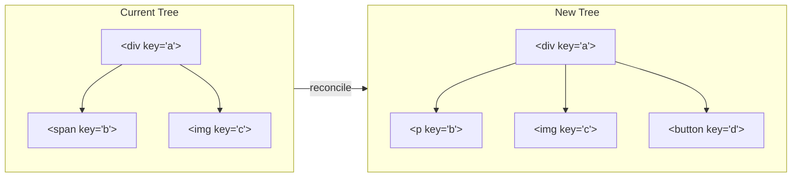

# Lesson 1: Components, JSX, The Rendering Model

## 1. First-Principles Intuition & Invariants

React represents a fundamental shift in how we model user interface construction, moving from imperative DOM manipulation to a declarative component-based architecture grounded in functional composition and immutable data flow. At its core, React solves the temporal coupling problem inherent in classical event-driven UI frameworks where application state, DOM representation, and event handlers form a tightly coupled graph that becomes increasingly difficult to reason about as complexity scales. By establishing a unidirectional data flow and treating UI as a pure function of state, React transforms the intractable problem of synchronizing mutable state across a stateful DOM tree into a tractable problem of computing minimal DOM patches from successive snapshots of application state.

The foundational invariant that governs React's execution model is the declarative rendering contract: given identical props and state, a component must produce identical output. This deterministic property enables React's reconciliation engine to treat components as pure functions that map data to virtual DOM trees, deferring the side-effecting work of actual DOM mutation to a separate phase that can be batched, prioritized, and even interrupted. This separation of concerns mirrors the design philosophy of functional programming languages where referential transparency enables aggressive optimization through memoization, lazy evaluation, and parallelization.

Components in React are not merely organizational units but rather first-class abstractions that encapsulate rendering logic, local state, lifecycle semantics, and composition boundaries. A component accepts an immutable props object as input and returns a tree of React elements—lightweight JavaScript objects that describe what should appear on screen. These elements are not DOM nodes but rather declarative descriptions of DOM nodes, forming an intermediate representation that React's reconciler can diff against previous snapshots to compute minimal update operations. This indirection through a virtual representation is what enables React to target multiple rendering backends: the browser DOM, native mobile components, terminal interfaces, or even headless string serialization for server-side rendering.

The component abstraction establishes clear boundaries for reasoning about UI behavior. Each component maintains its own local state machine, receives immutable props from its parent, and renders a subtree that may contain child components. This hierarchical composition forms a tree structure where data flows downward through props and events bubble upward through callback functions passed as props. The unidirectional flow eliminates the cyclic dependencies and action-at-a-distance mutations that plague two-way data binding systems, trading some syntactic convenience for vastly improved predictability and debuggability.

JSX, the XML-like syntax extension that React popularized, is not a template language but rather a syntactic transformation that compiles to nested function calls. Every JSX element desugars to a call to `React.createElement`, which constructs a plain JavaScript object containing the element type, props, and children. This transformation occurs at build time through Babel or TypeScript, meaning JSX has zero runtime overhead beyond the function calls it represents. The choice to embed UI structure in JavaScript rather than separating it into template files reflects React's philosophy that rendering logic and UI structure are fundamentally coupled and should coexist in the same lexical scope with full access to JavaScript's expressive power.

Understanding the mechanics of JSX transformation is critical for performance optimization and debugging. When the React compiler encounters `<div className="container">{content}</div>`, it produces `React.createElement("div", { className: "container" }, content)`. For custom components, the string literal is replaced with a direct reference to the component function or class: `<UserProfile user={data} />` becomes `React.createElement(UserProfile, { user: data })`. The resulting element object contains a `type` field (the string "div" or function `UserProfile`), a `props` object, and a `key` field used during reconciliation to track element identity across renders.

The rendering model operates in two distinct phases: the render phase, which is pure and can be interrupted, and the commit phase, which is synchronous and performs side effects. During the render phase, React traverses the component tree, calling render functions and constructing a new virtual DOM tree. The reconciler then performs a tree diff against the previous virtual DOM, identifying insertions, deletions, updates, and reorderings. This diff algorithm is heuristic-based rather than optimal—computing the minimal edit distance between arbitrary trees is O(n³)—but React's heuristics reduce complexity to O(n) by assuming that elements with different types produce substantially different trees and that developers provide stable keys for list items.

The commit phase takes the computed list of DOM operations and applies them in a single synchronous pass, batch-updating the actual DOM to match the target virtual DOM state. This two-phase approach enables React to abort and restart render work if higher-priority updates arrive, a capability that became explicit with the Concurrent Mode architecture. The commit phase is intentionally synchronous to ensure that users never observe intermediate inconsistent UI states—either the old state is visible or the new state is visible, with no tearing or partial updates.

React's reconciliation algorithm embodies several critical invariants that developers must understand to write correct and performant code. First, component identity is determined by position in the tree and the `key` prop. If a component's position or key changes, React will unmount the old instance and mount a fresh instance, destroying any local state. Second, components must be pure with respect to their render function—side effects belong in lifecycle methods or the `useEffect` hook, never in the render path. Third, mutating props or state directly violates React's immutability contract and leads to stale closures and missed updates because React uses shallow reference equality checks to detect changes.

The element tree that results from rendering is immutable. When state changes, React does not mutate the existing element tree but rather constructs an entirely new tree and diffs it against the previous one. This immutability enables time-travel debugging, optimistic UI updates, and undo/redo functionality because every historical state is preserved as a distinct tree snapshot. The memory overhead is mitigated by structural sharing—unchanged subtrees are reused by reference rather than copied, making the operation effectively copy-on-write at the subtree level.

## 2. Core Architecture & Mechanics

The transformation from JSX source code to rendered DOM traverses several distinct layers, each with specific responsibilities and performance characteristics. At the highest level, the developer writes components as functions or classes that return JSX expressions. The build-time transpilation step converts these JSX expressions into `React.createElement` calls, which produce element descriptors—plain JavaScript objects conforming to a specific schema. The React renderer consumes these element descriptors, performs reconciliation against the previous tree, and outputs platform-specific mutations.

A typical JSX expression demonstrates the syntactic sugar and its desugaring:

```jsx
function UserCard({ name, email, avatarUrl }) {
  const [expanded, setExpanded] = React.useState(false);
  
  return (
    <article className="user-card" data-testid="user-card">
      
      <div className="user-info">
        <h2>{name}</h2>
        <p>{email}</p>
        {expanded && (
          <section className="details">
            <p>Additional information...</p>
          </section>
        )}
      </div>
      <button onClick={() => setExpanded(!expanded)}>
        {expanded ? 'Collapse' : 'Expand'}
      </button>
    </article>
  );
}
```

The Babel transformation converts this to the canonical function call form:

```javascript
function UserCard({ name, email, avatarUrl }) {
  const [expanded, setExpanded] = React.useState(false);
  
  return React.createElement(
    "article",
    { className: "user-card", "data-testid": "user-card" },
    React.createElement("img", { 
      src: avatarUrl, 
      alt: `${name}'s avatar` 
    }),
    React.createElement(
      "div",
      { className: "user-info" },
      React.createElement("h2", null, name),
      React.createElement("p", null, email),
      expanded && React.createElement(
        "section",
        { className: "details" },
        React.createElement("p", null, "Additional information...")
      )
    ),
    React.createElement(
      "button",
      { onClick: () => setExpanded(!expanded) },
      expanded ? 'Collapse' : 'Expand'
    )
  );
}
```

Modern React (version 17+) introduced an optimized JSX transform that eliminates the need to import React in every file by automatically injecting imports from `react/jsx-runtime`. This new transform calls `_jsx` and `_jsxs` functions instead of `createElement`, enabling the compiler to distinguish between single-child and multi-child elements at build time and perform static optimizations. The new transform also passes a separate `key` parameter rather than including it in props, improving key handling semantics.

The element object returned by `createElement` or `_jsx` conforms to a stable internal schema:

```javascript
{
  $$typeof: Symbol.for('react.element'),
  type: 'article', // or a function/class reference for components
  key: null,
  ref: null,
  props: {
    className: 'user-card',
    'data-testid': 'user-card',
    children: [/* child elements */]
  },
  _owner: null,
  _store: {}
}
```

The `$$typeof` symbol serves as a security mechanism to prevent XSS attacks through deserialized JSON. Since JSON cannot represent symbols, any element object that originated from untrusted JSON parsing will lack this symbol and React will refuse to render it. This defense-in-depth strategy prevents attackers from injecting malicious element objects through server responses or localStorage.

React's reconciliation algorithm operates on two parallel trees: the current fiber tree representing the current committed state, and the work-in-progress fiber tree being constructed during the render phase. A fiber is a JavaScript object representing a unit of work—it tracks the component instance, its current props and state, its position in the tree, and pointers to child, sibling, and parent fibers. This doubly-linked tree structure enables React to pause work on one branch and resume it later, a capability essential for time-slicing and concurrent rendering.

The reconciliation process begins when a component's state changes or new props arrive from a parent. React marks that fiber as dirty and schedules a render pass. During the render pass, React walks the fiber tree, calling render functions for dirty components and their descendants. For each element in the returned tree, React attempts to match it with an existing fiber from the previous render:



The reconciler applies heuristics to minimize DOM operations. Elements with the same type and key are updated in place by applying new props. Elements with different types are completely replaced—the old fiber is marked for deletion, and a new fiber is created and marked for insertion. The `key` prop is critical for list reconciliation because it allows React to detect reorderings rather than treating them as deletions followed by insertions.

Consider the reconciliation of a dynamic list where items can be inserted, removed, or reordered:

```jsx
function TodoList({ todos }) {
  return (
    <ul>
      {todos.map(todo => (
        <li key={todo.id}>
          <TodoItem todo={todo} />
        </li>
      ))}
    </ul>
  );
}
```

Without stable keys, inserting an item at the beginning of the list would cause React to update every subsequent list item rather than recognizing that a single insertion occurred. With proper keys derived from stable identifiers (database IDs, UUIDs), React constructs a key-to-fiber mapping and efficiently computes the minimal set of insertions, deletions, and moves.

The fiber architecture uses a linked list of effects to track side effects that must be applied during the commit phase. As React walks the work-in-progress tree and identifies updates, deletions, and insertions, it builds an effect list—a linear chain of fibers that have pending work. During the commit phase, React walks this effect list rather than the entire tree, dramatically reducing the work required to apply updates.

The commit phase executes in three sub-phases: before mutation, mutation, and layout. The before mutation phase fires `getSnapshotBeforeUpdate` lifecycle methods, allowing components to capture information from the DOM before it changes. The mutation phase applies all DOM updates synchronously, inserting, removing, and updating DOM nodes according to the effect list. The layout phase fires `componentDidMount` and `componentDidUpdate` for class components and runs `useLayoutEffect` hooks, which execute synchronously after DOM mutations but before the browser paints.

After the layout phase, React schedules passive effects—primarily `useEffect` hooks—to run asynchronously after the browser has painted. This deferred execution ensures that effect code does not block the main thread and delay visual updates. The browser's event loop processes the paint and then executes the passive effects in a subsequent task:

```
[Render Phase] → [Commit: Before Mutation] → [Commit: Mutation] → 
[Commit: Layout] → [Browser Paint] → [Passive Effects]
```

This phased approach enables React to provide strong guarantees about timing and consistency. Layout effects run synchronously, enabling measurements and DOM mutations that must be reflected in the current paint. Passive effects run asynchronously, allowing expensive operations like data fetching or analytics to avoid blocking visual updates.

The virtual DOM concept, while central to React's marketing, is somewhat misnamed. React's intermediate representation is not a separate DOM but rather a tree of element descriptors and fiber nodes that encode enough information to compute DOM updates. The "virtual" aspect lies in the indirection—React interposes a reconciliation layer between application logic and the rendering target, enabling optimizations and platform abstractions that direct DOM manipulation cannot achieve.

Understanding the rendering pipeline's control flow clarifies when various operations execute:

```
Component State Update
  ↓
Scheduler enqueues work
  ↓
Render Phase (interruptible)
  - Call render functions
  - Construct new element tree
  - Reconcile against current fiber tree
  - Build effect list
  ↓
Commit Phase (synchronous)
  - Before mutation
  - DOM mutations
  - Layout effects
  ↓
Browser Paint
  ↓
Passive Effects (async)
```

This pipeline architecture enables React's cooperative scheduling model where high-priority updates (user input, animations) can interrupt low-priority updates (data fetching results) to maintain responsiveness. The scheduler assigns priorities based on update sources: discrete user input receives maximum priority, while asynchronous data updates receive lower priority.

## 3. High-Performance Optimization & Failure Modes

React's reconciliation algorithm is heavily optimized but still incurs overhead proportional to the component tree depth and breadth. Understanding performance characteristics requires examining both algorithmic complexity and constant factors that affect real-world performance. The render phase traverses every component that could potentially have changed, calling render functions and constructing element trees. This work scales linearly with component count, but constant factors matter significantly—a render function that constructs thousands of element objects is far more expensive than one that constructs dozens.

The first optimization strategy is minimizing the component tree surface area that React must traverse during updates. React provides several mechanisms to short-circuit reconciliation when components receive identical props. For function components, `React.memo` performs a shallow prop comparison and skips rendering if props have not changed:

```jsx
const ExpensiveComponent = React.memo(function ExpensiveComponent({ data, config }) {
  // Complex rendering logic that should not run on every parent render
  const processedData = useMemo(() => 
    expensiveTransformation(data, config),
    [data, config]
  );
  
  return (
    <div className="expensive">
      {processedData.map(item => (
        <ComplexItem key={item.id} item={item} />
      ))}
    </div>
  );
});
```

The shallow comparison checks reference equality for objects and arrays, meaning that constructing new object literals or array literals on every parent render will defeat memoization. This pattern leads to a common anti-pattern:

```jsx
// BAD: Creates new object on every render
function Parent() {
  return <Child config={{ theme: 'dark', locale: 'en' }} />;
}

// GOOD: Stable reference
const DEFAULT_CONFIG = { theme: 'dark', locale: 'en' };
function Parent() {
  return <Child config={DEFAULT_CONFIG} />;
}
```

For class components, `PureComponent` provides equivalent behavior by implementing `shouldComponentUpdate` with shallow prop and state comparison. Custom `shouldComponentUpdate` implementations enable more sophisticated update logic, such as deep comparison of specific fields or ignoring transient props that do not affect rendering.

The `useMemo` and `useCallback` hooks enable fine-grained memoization within function components. `useMemo` caches the result of an expensive computation, recomputing only when dependencies change:

```jsx
function DataVisualization({ dataset, filters, colorScheme }) {
  const filteredData = useMemo(() => {
    return dataset
      .filter(item => filters.every(f => f(item)))
      .sort((a, b) => a.timestamp - b.timestamp);
  }, [dataset, filters]);
  
  const chartConfig = useMemo(() => {
    return generateChartConfig(filteredData, colorScheme);
  }, [filteredData, colorScheme]);
  
  return <Chart data={filteredData} config={chartConfig} />;
}
```

The dependency array is critical—omitting a dependency causes stale closures, while including too many dependencies defeats memoization. React's exhaustive-deps ESLint rule enforces correct dependency declarations by analyzing variable captures within the memoized function.

`useCallback` is a specialized form of `useMemo` that memoizes function references, preventing child components from re-rendering when they receive callback props:

```jsx
function TodoList({ todos, onToggle, onDelete }) {
  return (
    <ul>
      {todos.map(todo => (
        <TodoItem
          key={todo.id}
          todo={todo}
          onToggle={useCallback(() => onToggle(todo.id), [todo.id, onToggle])}
          onDelete={useCallback(() => onDelete(todo.id), [todo.id, onDelete])}
        />
      ))}
    </ul>
  );
}
```

However, wrapping every callback in `useCallback` is counterproductive because the hook itself incurs overhead. Memoization should target callbacks passed to memoized child components or as effect dependencies, not every inline function in the codebase.

List rendering performance depends critically on key stability and uniqueness. Using array indices as keys is acceptable only for static lists that never reorder. For dynamic lists, stable identifiers prevent unnecessary component remounts:

```jsx
// BAD: Index keys cause remounts on reorder
{items.map((item, index) => <Item key={index} item={item} />)}

// GOOD: Stable unique keys
{items.map(item => <Item key={item.id} item={item} />)}
```

When items lack natural unique identifiers, generating UUIDs during data creation provides stable keys. Generating keys during render is incorrect because the key will change on every render, defeating reconciliation.

Code splitting through dynamic imports and `React.lazy` reduces initial bundle size by deferring component loading until needed:

```jsx
const AdminPanel = React.lazy(() => import('./AdminPanel'));
const UserDashboard = React.lazy(() => import('./UserDashboard'));

function App({ userRole }) {
  return (
    <React.Suspense fallback={<LoadingSpinner />}>
      {userRole === 'admin' ? <AdminPanel /> : <UserDashboard />}
    </React.Suspense>
  );
}
```

`Suspense` boundaries catch promises thrown during render and display fallback content while the async component loads. This mechanism generalizes to data fetching in concurrent mode, enabling declarative loading states without manual loading flags.

Virtualization addresses performance issues in large lists and grids by rendering only visible items. Libraries like `react-window` and `react-virtualized` implement windowing algorithms that maintain a small sliding window of rendered components as the user scrolls:

```jsx
import { FixedSizeList } from 'react-window';

function LargeList({ items }) {
  const Row = ({ index, style }) => (
    <div style={style}>
      <Item item={items[index]} />
    </div>
  );
  
  return (
    <FixedSizeList
      height={600}
      itemCount={items.length}
      itemSize={50}
      width="100%"
    >
      {Row}
    </FixedSizeList>
  );
}
```

Virtualization trades memory for CPU—it maintains minimal DOM nodes but recalculates visible ranges and repositions elements during scroll. The performance win is significant when rendering thousands of items that would otherwise create a massive DOM tree.

React DevTools' profiler enables empirical performance analysis by recording render timings and identifying expensive components. The flame graph visualization shows the call tree with bar widths proportional to render duration, highlighting performance bottlenecks. The ranked chart sorts components by total time spent rendering, revealing which components consume the most resources across the entire profiling session.

Common failure modes in React applications stem from violating the declarative rendering contract or misunderstanding reconciliation semantics. Mutating props or state directly is perhaps the most common error:

```jsx
// BAD: Direct mutation
function addTodo(todo) {
  todos.push(todo); // Mutates array
  setTodos(todos); // Same reference, React won't detect change
}

// GOOD: Immutable update
function addTodo(todo) {
  setTodos([...todos, todo]); // New array reference
}
```

React compares state and props using `Object.is` semantics, which checks reference equality for objects and arrays. Mutations that preserve the reference are invisible to React's change detection, causing missed updates and stale UI.

Stale closures occur when effect or callback functions capture variables from a specific render but continue executing in future renders:

```jsx
function Timer() {
  const [count, setCount] = useState(0);
  
  useEffect(() => {
    // BAD: Captures count from initial render
    const id = setInterval(() => {
      setCount(count + 1); // Always increments from 0
    }, 1000);
    return () => clearInterval(id);
  }, []); // Empty deps, never updates
  
  return <div>{count}</div>;
}
```

The correct pattern uses the functional updater form of setState or includes the captured variable in the dependency array:

```jsx
useEffect(() => {
  const id = setInterval(() => {
    setCount(c => c + 1); // Receives current state
  }, 1000);
  return () => clearInterval(id);
}, []); // Safe with functional update
```

Infinite loops result from effects that trigger state updates without proper dependency management:

```jsx
// BAD: Infinite loop
function UserProfile({ userId }) {
  const [user, setUser] = useState(null);
  
  useEffect(() => {
    fetchUser(userId).then(setUser);
    // Missing userId dependency causes stale closure
    // OR including user in deps causes infinite fetch loop
  });
}
```

The correct pattern includes only external dependencies and excludes state set by the effect itself:

```jsx
useEffect(() => {
  fetchUser(userId).then(setUser);
}, [userId]); // Re-fetch only when userId changes
```

Memory leaks occur when effect cleanup functions are missing or incorrect. Any resource acquired in an effect—timers, subscriptions, event listeners—must be released in the cleanup function:

```jsx
useEffect(() => {
  const subscription = dataSource.subscribe(handleData);
  window.addEventListener('resize', handleResize);
  
  return () => {
    subscription.unsubscribe();
    window.removeEventListener('resize', handleResize);
  };
}, [dataSource, handleData, handleResize]);
```

React calls the cleanup function before running the effect on subsequent renders and when the component unmounts, ensuring resources are properly released even if the component is torn down mid-lifecycle.

Understanding these mechanics, invariants, and failure modes transforms React from a library with seemingly magical behavior into a comprehensible system with predictable performance characteristics and debuggable failure modes. The declarative rendering contract, unidirectional data flow, and reconciliation algorithm form a coherent architecture that scales from trivial applications to massive production systems while maintaining local reasoning and compositional properties.
