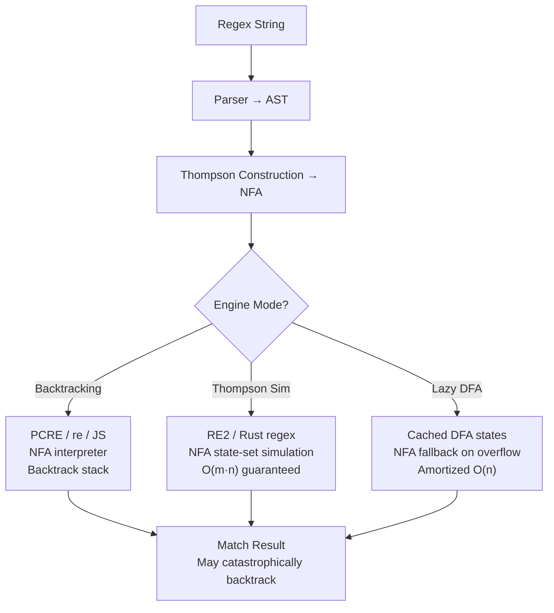

# Lesson 1: Formal Foundations through Finite Automata

## 1. First-Principles Intuition & Invariants

Every regex engine you have ever used—whether PCRE in a Nginx configuration, the `re` module in Python, or the `regex` crate in Rust—is, at its mechanical core, a decision procedure for a formal language. The question it answers is deceptively simple: given a string *w* and a description of a set of strings *L*, does *w* belong to *L*? The power and the limits of regular expressions flow entirely from the class of languages that description can reach, and understanding those limits is not an academic exercise. It is the prerequisite for writing correct, performant matchers, for knowing when you are about to exceed what regex can express, and for diagnosing the catastrophic backtracking failures that have taken production services offline.

The right place to begin is not with syntax—not with `.*` or `(?:...)` or possessive quantifiers—but with the mathematical object that gives regex its semantics: the **regular language**.

### Regular Languages and the Chomsky Hierarchy

Noam Chomsky's 1956 hierarchy stratifies formal languages into four classes by the generative power of their grammars. At the bottom of the hierarchy, Type-3, sit the regular languages, produced by right-linear or left-linear grammars. One level up are the context-free languages (Type-2), which are what parsers for most programming languages consume. Beyond that lie the context-sensitive (Type-1) and recursively enumerable (Type-0) languages, each requiring more computational memory than the last.

What makes the regular languages special is a profound triple equivalence: a language is regular if and only if it can be recognized by a finite automaton, if and only if it can be generated by a regular grammar, and if and only if it can be described by a regular expression. These three formalisms look nothing alike, yet they describe exactly the same class of sets. This equivalence is the central theorem of the field, and its proof is not merely beautiful—it is directly implemented in every regex engine that compiles a pattern into an automaton before matching.

The key intuition behind why regular languages form their own bounded class is the concept of **bounded memory**. A finite automaton processes its input one symbol at a time, moving between a finite number of states, with no additional memory beyond its current state. It cannot count without bound, it cannot match balanced constructs, and it cannot remember an arbitrarily long prefix. These are not limitations of a poor implementation—they are intrinsic to the mathematical model. The moment your pattern requires unbounded counting or recursive structure, you have left the regular languages behind, and no regex syntax—not lookaheads, not backreferences, not conditional patterns—will produce a correct, terminating solution.

### Deterministic Finite Automata: The Execution Model

A **Deterministic Finite Automaton** is a quintuple *(Q, Σ, δ, q₀, F)*, where *Q* is a finite set of states, *Σ* is a finite alphabet, *δ: Q × Σ → Q* is a total transition function, *q₀ ∈ Q* is the start state, and *F ⊆ Q* is the set of accepting states. The word "deterministic" means that for any state and any input symbol, there is exactly one next state. No choices, no ambiguity, no backtracking. The automaton reads *w* left-to-right, applying *δ* at each character, and accepts if and only if it ends in a state in *F*.

The transition function *δ* is the whole machine. For a DFA with *n* states over an alphabet of size *k*, it is a table of *n × k* entries, each holding a state index. In C, the natural representation is a two-dimensional array `uint16_t trans[n][k]`, which for small alphabets and few states fits entirely in L1 cache. This is not an accident of implementation convenience—it is the reason DFA-based matching is O(n) in input length with a constant factor that fits in a few CPU cycles per character, entirely independent of pattern complexity.

Consider the DFA for the language *L = { w ∈ {a,b}* | w ends in `ab` }*. The machine needs to track only three conditions: it has seen no promising suffix, it has seen a trailing `a`, or it has seen a trailing `ab`. That is three states.

```
States: q0 (start), q1 (seen 'a'), q2 (seen 'ab', accept)
Transitions:
  δ(q0, 'a') = q1    δ(q0, 'b') = q0
  δ(q1, 'a') = q1    δ(q1, 'b') = q2
  δ(q2, 'a') = q1    δ(q2, 'b') = q0
```

```mermaid
flowchart LR
    q0(["q0"])
    q1(["q1"])
    q2([["q2"]])

    q0 -->|"a"| q1
    q1 -->|"b"| q2
    q1 -->|"b"| q0
    q2 -->|"a"| q1
    q2 -->|"b"| q0
```

Every string over `{a, b}` that ends in `ab` will land on *q2* after consuming its last character. Every other string will not. No backtracking, no stack, no ambiguity. The automaton consumes each character exactly once.

### Nondeterministic Finite Automata and ε-Transitions

A **Nondeterministic Finite Automaton** (NFA) relaxes the transition function to *δ: Q × (Σ ∪ {ε}) → 𝒫(Q)*. For any state and symbol, the NFA may transition to zero, one, or many states simultaneously. The ε-transition allows the machine to change state without consuming input. An NFA accepts a string if *any* path through its nondeterministic choices leads to an accepting state.

Nondeterminism is what makes NFA construction from a regex syntactically direct. Thompson's 1968 construction algorithm converts a regular expression into an NFA by structural induction on the regex AST, using ε-transitions to glue sub-automata together. The base case for a literal character *a* is a two-state NFA with a single transition. Concatenation joins the accepting state of the left machine to the start state of the right via ε. Alternation (*r|s*) adds a new start state with ε-transitions to both sub-machines and merges their accepting states. Kleene star (*r**) adds a new start/accept state with ε-transitions enabling zero or more iterations.

The critical invariant of Thompson's construction is that the resulting NFA has at most *2n* states for a regex of *n* operators, and each state has at most two outgoing ε-transitions. This linear size bound is what makes the construction practical.

The apparent power of nondeterminism dissolves under **subset construction**, the algorithm that converts an NFA to a DFA. Each state of the DFA corresponds to a *set* of NFA states—the powerset of the NFA's state set. The DFA's transition on symbol *a* from set *S* computes the ε-closure of all states reachable by consuming *a* from any state in *S*. This construction is the proof that DFAs and NFAs recognize exactly the same languages: for every NFA with *n* states, there exists a DFA with at most *2ⁿ* states that accepts the same language.

That exponential blowup is not hypothetical. For the carefully crafted NFA produced by the regex `(a|aa)*b`, subset construction may enumerate a substantial fraction of the full powerset before reaching a fixed point. In practice, most patterns do not trigger worst-case blowup, and **lazy DFA construction**—building DFA states on demand as matching proceeds and caching them—amortizes the cost across many input strings while keeping memory bounded. This is exactly what RE2 and Rust's `regex` crate implement.

### The Myhill-Nerode Theorem and State Minimality

The **Myhill-Nerode theorem** establishes that every regular language has a unique minimal DFA (up to isomorphism), and it characterizes the minimum number of states that DFA must have. Define the **Nerode equivalence relation** ~_L on strings: two strings *x* and *y* are equivalent if for every suffix *z*, *xz ∈ L* exactly when *yz ∈ L*. The strings are indistinguishable by any future input, so they may share a state in the minimal DFA. The index of ~_L—the number of equivalence classes—equals the number of states in the minimal DFA.

For the language of strings ending in `ab` above, the equivalence classes are: strings whose longest suffix in `{ε, a, ab}` is ε (i.e., ends in `b` or is empty), those that end in `a` but not `ab`, and those that end in `ab`. Three classes, three states—the DFA above is already minimal.

Myhill-Nerode is not just a theoretical characterization. It drives **DFA minimization algorithms** (Hopcroft's O(n log n) partition refinement being the standard), which every production regex compiler applies before emitting a matching table. A minimized DFA is faster because fewer states means a smaller transition table, better cache behavior, and fewer branch mispredictions in the inner loop.

### The Pumping Lemma: Proving Languages Non-Regular

The **Pumping Lemma** is the standard tool for proving a language is *not* regular, which in practice means proving a regex cannot correctly solve a given problem. The lemma states: if *L* is regular, then there exists a pumping length *p* (at least the number of states in the minimal DFA for *L*) such that any string *w ∈ L* with *|w| ≥ p* can be decomposed as *w = xyz* where *|xy| ≤ p*, *|y| ≥ 1*, and *xy^i z ∈ L* for all *i ≥ 0*.

The intuition is direct. If a DFA has *p* states and processes a string of length at least *p*, by the pigeonhole principle it must revisit some state. The portion of the string that caused the revisit can be repeated (pumped) any number of times—including zero—and the machine will still follow the same cycle, landing in the same accepting or rejecting state. Any language that lacks this pumping structure cannot be recognized by a DFA.

The canonical example is *L = { aⁿbⁿ | n ≥ 0 }*, the language of equal numbers of *a*s followed by equal numbers of *b*s. Suppose *L* were regular with pumping length *p*. Take *w = aᵖbᵖ*. Any decomposition *xyz* with *|xy| ≤ p* and *|y| ≥ 1* forces *y* to consist entirely of *a*s. Pumping *y* twice gives *xy²z = aᵖ⁺|y|bᵖ*, which has more *a*s than *b*s and thus does not belong to *L*. Contradiction: *L* is not regular.

This result directly explains why no regex can correctly validate that an XML tag's opening and closing names match, or that parentheses are balanced to arbitrary depth. Any pattern that attempts this either rejects valid inputs, accepts invalid ones, or requires a feature like backreferences that breaks the DFA execution model and reintroduces exponential matching costs. The Pumping Lemma is not an abstract theorem—it is the reason you use a parser where engineers unfamiliar with these foundations reach for a regex.

### Closure Properties and What You Can Compose

Regular languages are closed under a rich set of operations: union, concatenation, Kleene star, complement, intersection, difference, reversal, and homomorphism. These closure properties are both theoretically complete (they characterize the regular languages) and practically powerful. If you need to match strings from *L₁* that are not in *L₂*, and both *L₁* and *L₂* are regular, then *L₁ \ L₂ = L₁ ∩ L₂ᶜ* is also regular and can be described by a single regex. This is the basis for compiling multiple filter rules into a single automaton—the technique used in network packet classifiers, log analyzers, and lexer generators.

Closure under intersection is particularly useful for constructing matchers from independent constraints. If you need strings that match pattern *A* **and** pattern *B*, you can compute the product automaton: states are pairs *(qₐ, qᵦ)* from the two DFAs, transitions apply both transition functions in parallel, and accepting states are pairs where both components are accepting. The product automaton recognizes *L(A) ∩ L(B)* exactly, and its size is at most *|A| × |B|* states. Tools like `hyperscan` exploit this to simultaneously match hundreds of patterns with a single linear scan.

The closure properties also define the boundaries of composability. If you find yourself needing a language that *cannot* be expressed as union, concatenation, star, complement, or intersection of patterns you already have—if no finite combination of these operators reaches the language you need—then by definition the language is not regular, and the Pumping Lemma will confirm it.

---

## 2. Core Architecture & Mechanics

### From Regex Syntax to Executable Automaton: The Compilation Pipeline

A production regex engine transforms a pattern string through a sequence of well-defined compilation stages before it touches a single byte of input. Understanding this pipeline is what separates engineers who use regex as a black box from those who can reason about performance, correctness, and resource consumption.

The pipeline has four stages: **parsing**, **NFA construction**, **NFA simulation or DFA construction**, and **matching**. Each stage has a distinct data structure and a distinct failure mode.

**Stage 1: Parsing.** The regex string is parsed into an **Abstract Syntax Tree** (AST) where each node is a regex operator (literal, concatenation, alternation, repetition, group) and leaves are character classes or literals. The parser must enforce the syntax of the regex dialect—POSIX ERE, PCRE, RE2, Rust's `regex`—and reject patterns that are syntactically malformed. The AST is the semantic representation; it makes the recursive structure of the pattern explicit and is the input to NFA construction.

```
Regex: (ab|c)*d

AST:
      Concat
      /      \
    Star       Lit('d')
      |
    Alt
   /   \
Concat  Lit('c')
/    \
Lit('a') Lit('b')
```

**Stage 2: Thompson NFA Construction.** The AST is traversed in a single post-order pass. Each visitor call returns a small NFA fragment—a start state and an accept state with the fragment's internal transitions already wired. Parent nodes connect fragments using ε-transitions according to the rules for concatenation, alternation, and star. The result is an NFA with at most *2n* states for a pattern with *n* operators. Each state carries at most two outgoing transitions (either two ε-transitions for split states, or one character transition and no ε-transitions for literal states).

The concrete data structure for a Thompson NFA is straightforward. Each state is a struct with a type tag (`LITERAL`, `SPLIT`, `ACCEPT`), a character range (for literal states), and two successor pointers. In C:

```c
#include <stdint.h>
#include <stdlib.h>
#include <string.h>
#include <stdio.h>

typedef enum { LITERAL, SPLIT, ACCEPT } StateKind;

typedef struct State {
    StateKind kind;
    int       ch;          /* character to match; -1 for SPLIT/ACCEPT  */
    struct State *out;     /* primary successor                         */
    struct State *out1;    /* secondary successor (SPLIT only)         */
    uint32_t  lastlist;    /* generation stamp for NFA simulation       */
} State;

typedef struct {
    State  *start;
    State **dangling; /* array of unpatched outgoing pointers          */
    int     ndangling;
} Fragment;

State *new_state(StateKind kind, int ch, State *out, State *out1) {
    State *s   = calloc(1, sizeof(State));
    s->kind    = kind;
    s->ch      = ch;
    s->out     = out;
    s->out1    = out1;
    s->lastlist = 0;
    return s;
}
```

The `lastlist` field is the key to efficient NFA simulation. Rather than maintaining a visited set per step, each state is stamped with a generation counter that increments with every input character. A state is in the current set if and only if its `lastlist` equals the current generation, turning set membership into a single integer comparison.

**Stage 3: NFA Simulation vs. DFA Construction.** Here the two major engine architectures diverge. A **backtracking engine** (PCRE's default mode, Python's `re`, JavaScript's native regex) interprets the NFA directly, following one path at a time and backtracking when that path fails. This enables features like backreferences and lookahead/lookbehind assertions that require more than a regular language's worth of memory—but it also enables catastrophic backtracking on adversarial inputs. A **Thompson NFA simulation engine** (RE2, Rust `regex` in its NFA path, Hyperscan) maintains the full set of active NFA states at each step, eliminating backtracking entirely at the cost of losing support for backreferences.

The Thompson simulation maintains two state sets: `current` and `next`. For each input character, it iterates over `current`, follows all matching transitions, computes the ε-closure of the result, and places the reached states into `next`. After consuming the character, it swaps `current` and `next`. The input is accepted if any state in `current` after the final character is an accepting state.

```c
/* Simplified Thompson NFA simulation */

typedef struct { State **s; int n; } StateList;

static uint32_t listgen = 0;

static void add_state(StateList *l, State *s) {
    if (s == NULL || s->lastlist == listgen) return;
    s->lastlist = listgen;
    if (s->kind == SPLIT) {
        add_state(l, s->out);
        add_state(l, s->out1);
        return;  /* SPLIT states are not themselves "active" */
    }
    l->s[l->n++] = s;
}

int nfa_match(State *start, const char *input, int len) {
    State  *buf1[256], *buf2[256];
    StateList cur  = { buf1, 0 };
    StateList next = { buf2, 0 };

    ++listgen;
    add_state(&cur, start);

    for (int i = 0; i < len; i++) {
        int c = (unsigned char)input[i];
        next.n = 0;
        ++listgen;
        for (int j = 0; j < cur.n; j++) {
            State *s = cur.s[j];
            if (s->kind == LITERAL && s->ch == c)
                add_state(&next, s->out);
        }
        StateList tmp = cur; cur = next; next = tmp;
    }

    for (int j = 0; j < cur.n; j++)
        if (cur.s[j]->kind == ACCEPT) return 1;
    return 0;
}
```

This simulation is O(|pattern| × |input|) in time and O(|pattern|) in space—the active state set never exceeds the number of NFA states. This is the core performance guarantee of Thompson-style engines and the reason they cannot be made to exhibit catastrophic backtracking.

A **lazy DFA** goes one step further: it caches the DFA state corresponding to each NFA state-set it encounters during simulation, so that if the same NFA state-set is reached again on a future input (or a future position in the same input), it transitions instantly via a table lookup rather than recomputing ε-closures. The DFA state cache can be bounded in size; if it overflows, the engine falls back to NFA simulation for uncached transitions. This hybrid approach is what gives RE2 and Rust's `regex` crate their practical performance profile—most real inputs cause the lazy DFA to warm up quickly and thereafter run at near-DFA speed.

**Stage 4: Matching.** The matching stage is not simply running the automaton on the input. For substring search (find the first occurrence of a match, rather than testing whether the whole input matches), the engine must simulate starting the NFA at every input position—or equivalently, run the automaton in a mode where it can "restart" at any character. The standard trick is to add a universal start loop: prefix the NFA with a state that can either start the actual pattern NFA or consume one character and loop back to itself, modeling the implicit `.*` prefix of a search rather than a full-string match.



### DFA Transition Table Layout and Cache Mechanics

When a DFA is fully materialized (as opposed to lazily built), the transition table is the most cache-critical data structure in the engine. For a DFA with *S* states over the full byte alphabet (256 symbols), a naive `uint16_t table[S][256]` table occupies *512 × S* bytes. For S = 1000 states, that is 500 KB—too large for L1 (typically 32–64 KB), borderline for L2.

Production DFA engines apply several techniques to reduce working set size. **Alphabet compression** observes that many characters in the input alphabet have identical transition behavior for a given pattern. For example, a pattern matching decimal digits treats the 246 non-digit characters identically. By partitioning *Σ* into equivalence classes (called **character classes** in the DFA sense, distinct from regex character classes), the transition table is `uint16_t table[S][C]` where *C* is the number of distinct classes, often 10–30 for real patterns rather than 256. Rust's `regex` crate implements this as a byte-class mapping: a 256-byte lookup table converts each input byte to its class index before the DFA transition, compressing the table by a factor of 10 or more. The 256-byte class map itself fits in L1 cache permanently.

**Row deduplication** (also called **DFA state sharing**) detects when two DFA states have identical transition rows and merges them, reducing the table's row count. Combined with alphabet compression, production patterns often produce DFA tables that fit entirely in L1 or L2 cache, making each character's matching cost a single cache-resident array lookup.

For multi-pattern matching—where you must simultaneously search for *k* patterns—the product automaton construction from the closure properties discussion becomes central. A product DFA for *k* patterns has states that are tuples of individual DFA states, and its size in the worst case is exponential in *k*. Practical multi-pattern engines (Aho-Corasick, Hyperscan) use different structural exploits: Aho-Corasick builds a trie from all pattern literals and adds failure links that implement the intersection automaton implicitly, while Hyperscan compiles each pattern to an NFA and executes them in parallel using SIMD-accelerated NFA simulation.

### Submatch Extraction and Capture Groups

A pure membership DFA answers only "does *w* belong to *L*?" but most applications need to know *where* in the input a match occurred and what substrings were captured by parenthesized groups. This requires extending the automaton to track **submatch boundaries** alongside the state transition.

The standard approach is **tagged NFA simulation** (used in POSIX matching and RE2's submatch extraction). Each NFA state transition is annotated with the capture-group open and close tags that it corresponds to. The simulation maintains, for each active NFA state, the vector of submatch positions that led to that state being active. When multiple NFA paths lead to the same state, the POSIX leftmost-longest rule selects among them deterministically.

The cost is that tagged simulation is O(|pattern|² × |input|) in the worst case due to the submatch vector maintenance, which is why RE2 and Rust's `regex` crate use a hybrid: the DFA simulation confirms a match and identifies its boundaries in O(|input|) time, then a bounded backward NFA simulation extracts the precise capture group positions, touching only the matched substring rather than the full input.

---

## 3. High-Performance Optimization & Failure Modes

### Catastrophic Backtracking: The ReDoS Attack Surface

Catastrophic backtracking—also called **Regular Expression Denial of Service (ReDoS)**—occurs when a backtracking engine's exploration of an NFA's nondeterministic choices grows exponentially with input length. The attack is not exotic: it has caused production outages at Cloudflare (July 2019), Stack Overflow (2016), and numerous smaller services. The root cause is always the same: a pattern that exhibits ambiguous decomposition of the NFA paths for a string that is *not* in the language.

The canonical catastrophic pattern is `(a+)+b` applied to the string `aaa...a` (without a trailing `b`). The outer `+` and inner `+` can partition the *a*s in an exponential number of ways—the outer group can consist of one inner group consuming all *a*s, two inner groups splitting the *a*s in every possible position, and so on. The backtracking engine must explore all of these partitions before concluding no match exists. For *n* input characters, the work is O(2ⁿ).

The formal condition for catastrophic backtracking is the presence of **polynomial or exponential ambiguity** in the NFA: the existence of two or more distinct accepting paths for some string in *L*, or two or more distinct rejecting paths that the engine must exhaust for strings not in *L*. The pattern `(a|a)*` is ambiguous because for each `a` in the input, two NFA transitions (the left and right alternatives) both match; for a string of *n* characters, there are 2ⁿ NFA paths. The pattern `(a*)*` has the same structure.

**Static ambiguity analysis** can detect these conditions before the pattern is ever run. The algorithm constructs the NFA and checks whether any state can be reached by two different paths from the start state through the same sequence of characters—if so, the NFA is ambiguous and the pattern is a ReDoS risk in backtracking engines. Tools implementing variants of this analysis include `rxxr2`, `vuln-regex-detector`, and the analysis built into `eslint-plugin-regexp`.

The engineering fix has three tiers. First, prefer a Thompson-based engine (RE2, Rust's `regex`, Go's `regexp`) for inputs that arrive from untrusted sources; Thompson simulation cannot catastrophically backtrack by construction. Second, when you must use a backtracking engine (because you need backreferences or lookahead), apply **possessive quantifiers** and **atomic groups** to prune the backtrack tree: `(?>a+)b` forces the inner `a+` to never release characters it has consumed, eliminating the ambiguity. Third, apply input length limits as a defense-in-depth measure—a ReDoS attack requires a long input, and limiting match input to, say, 10 KB eliminates the practical severity even if the pattern is ambiguous.

### DFA State Explosion and Lazy Construction Bounds

The exponential blowup of subset construction—the DFA having up to 2ⁿ states for an NFA with *n* states—is a production concern when patterns contain large character classes intersected with complex alternations. The worst-case DFA for the RE2 paper's pathological example `[ab]{1,n}` has exponentially many states in *n*. RE2 addresses this with a hard state cache limit (default 8 MB) and a fallback to NFA simulation when the cache is full. Rust's `regex` crate similarly caps the DFA cache and signals a cache miss to the matching loop, which then falls back to the bounded NFA simulation.

The implication for performance engineering is that patterns with large quantified repetitions over character sets (`[a-zA-Z0-9]{3,20}`) may prevent the lazy DFA from warming up for long inputs, forcing repeated NFA simulation. The diagnostic is the cache miss rate, which RE2 exposes via its statistics API and which the Rust `regex` crate logs at trace level. If you observe high cache miss rates, the fix is to restructure the pattern to reduce NFA state count—often by extracting a literal prefix or suffix that allows the engine to skip non-matching regions before engaging the full automaton.

### Compilation Latency and Pattern Caching

Compiling a regex is not free. For a pattern of length *m*, Thompson NFA construction is O(m), ε-closure computation during simulation is O(m), and lazy DFA construction amortizes the O(m × |Σ|) table construction cost across matches. For patterns used repeatedly—in a hot request path, an event-processing loop, a lexer inner loop—recompilation on every invocation is a significant and easily avoided cost.

The correct architecture is to compile once and store the compiled automaton in a structure with the same lifetime as the matching context. In Rust, `regex::Regex` is `Send + Sync`, which means you can store it in a `lazy_static!` or `once_cell::sync::Lazy` static and share it across threads without any mutex overhead. In C++ with RE2, `RE2` objects are thread-safe for matching and should live for the lifetime of the matching subsystem.

```rust
use once_cell::sync::Lazy;
use regex::Regex;

// Compiled exactly once, shared across all threads.
static LOG_LINE: Lazy<Regex> = Lazy::new(|| {
    Regex::new(
        r"^(?P<timestamp>\d{4}-\d{2}-\d{2}T\d{2}:\d{2}:\d{2}Z)\s+\
          (?P<level>DEBUG|INFO|WARN|ERROR)\s+\
          (?P<message>.+)$"
    ).expect("LOG_LINE regex is statically valid and must compile")
});

pub fn parse_log_line(line: &str) -> Option<(&str, &str, &str)> {
    let caps = LOG_LINE.captures(line)?;
    // captures() returns None on no match; ? propagates cleanly.
    let ts   = caps.name("timestamp").map(|m| m.as_str())?;
    let lvl  = caps.name("level").map(|m| m.as_str())?;
    let msg  = caps.name("message").map(|m| m.as_str())?;
    Some((ts, lvl, msg))
}
```

The `expect` on `Regex::new` is intentional and correct: a statically written regex that fails to compile is a programmer error, not a runtime condition. Using `expect` rather than `unwrap` documents the invariant and provides a meaningful panic message in the event of a logic bug.

### Benchmarking the Compilation Pipeline: Identifying Real Bottlenecks

Profiling regex performance requires distinguishing compilation cost from matching cost, and within matching cost, distinguishing the DFA transition loop from the ε-closure and state-set management overhead. The correct instrument is a microbenchmark that separates the `compile()` call from the `match()` call, runs both against realistic input distributions, and measures both latency and throughput.

Using Criterion in Rust:

```rust
use criterion::{black_box, criterion_group, criterion_main, BenchmarkId, Criterion, Throughput};
use regex::Regex;

static PATTERN: &str =
    r"^(?:[0-9]{1,3}\.){3}[0-9]{1,3}$";

static INPUTS: &[(&str, bool)] = &[
    ("192.168.1.1",          true),
    ("10.0.0.256",           false),
    ("not.an.ip.address",    false),
    ("255.255.255.255",      true),
    ("0.0.0.0",              true),
];

fn bench_compile(c: &mut Criterion) {
    c.bench_function("regex_compile", |b| {
        b.iter(|| Regex::new(black_box(PATTERN)).unwrap())
    });
}

fn bench_match(c: &mut Criterion) {
    let re = Regex::new(PATTERN).unwrap();
    let mut group = c.benchmark_group("regex_match");
    for (input, _expected) in INPUTS {
        group.throughput(Throughput::Bytes(input.len() as u64));
        group.bench_with_input(
            BenchmarkId::from_parameter(input),
            input,
            |b, s| b.iter(|| re.is_match(black_box(s))),
        );
    }
    group.finish();
}

criterion_group!(benches, bench_compile, bench_match);
criterion_main!(benches);
```

The `Throughput::Bytes` annotation instructs Criterion to report throughput in bytes per second alongside latency, which is the natural unit for a string scanning operation. Typical compiled DFA matching throughput for simple patterns is in the range of 1–4 GB/s on modern hardware; NFA simulation typically reaches 100–500 MB/s; backtracking engines on benign inputs are comparable to NFA simulation but degrade sharply on adversarial inputs.

If `bench_compile` shows compilation taking more than a few hundred microseconds for a simple pattern, the diagnostic steps are: check whether the pattern contains large repetition counts that force the NFA to be large, check whether alternation with many branches is triggering subset construction blowup, and consider whether the pattern can be restructured into a smaller equivalent form. The Myhill-Nerode theorem guarantees the minimal DFA exists; the question is whether the engine's compilation pipeline reaches it.

### Knowing When to Stop: The Practical Boundary Between Regex and Parsing

The Pumping Lemma provides the theoretical boundary; engineering judgment provides the practical one. As a working rule, reach for a parser rather than a regex when any of the following conditions holds. The language requires counting—not bounded repetition (`a{3,10}`), but *equal* counts of two symbols across the string. The language has recursive structure—balanced brackets, nested scopes, recursive data formats. The correctness of the match depends on context from an arbitrarily distant part of the string—not a fixed-width lookbehind, but structural relationships between parts whose relative positions are not bounded.

Backreferences—the PCRE feature `\1` that re-matches whatever the first capture group matched—break the regular language boundary entirely. The language `{ ww | w ∈ Σ* }` (strings of the form *ww* for some *w*) is not context-free, let alone regular, and yet PCRE's `(.+)\1` purports to match it. It does so by converting the DFA problem into a search problem with a stack-like memory, which is why backreferences disable DFA compilation entirely in PCRE and force the backtracking interpreter. The matching cost becomes path-dependent, the ReDoS surface is widened, and correctness depends on the specific backtracking semantics of the engine. The right tool for most problems that reach for backreferences is a small recursive descent parser, which is unambiguous, linear in input length, and straightforward to maintain.

The discipline of knowing what regular languages can and cannot express is what makes the theoretical foundation of this lesson immediately practical. Every line of regex you write is a claim that the language you are trying to match is regular. The Pumping Lemma is the tool for checking that claim rigorously. The Thompson NFA and the DFA compilation pipeline are the machinery that executes it efficiently. Everything in the remaining lessons—lookaheads, possessive quantifiers, Unicode properties, engine-specific optimizations—is an elaboration of the foundations established here.
