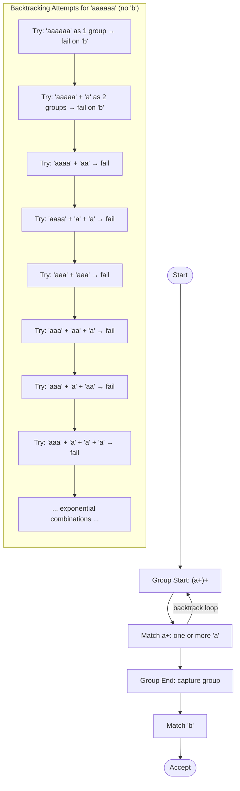

# Lesson 2: Syntax Semantics through Matching Models

## 1. First-Principles Intuition & Invariants

Every regular expression is, at its core, a formal description of a set of strings. This seemingly simple statement conceals a profound machinery. When you write `\d{3}-\d{4}` to match a phone number fragment, you are not writing imperative code that inspects characters one at a time under your direct control. You are declaring a *membership predicate* over an infinite language, and delegating its evaluation to an automaton whose behavior is governed by decades of formal language theory. Senior engineers who treat regex as mere syntactic sugar for string manipulation consistently underestimate both its expressive power and its capacity for catastrophic failure. This lesson dismantles that comfortable ignorance.

The theoretical foundation is Kleene's theorem, which establishes the equivalence between three formalisms: regular expressions, nondeterministic finite automata (NFA), and deterministic finite automata (DFA). Every pattern you write can be mechanically compiled into an NFA, which can in turn be converted into a DFA via subset construction. The DFA guarantees O(n) matching time in the length of the input string, with no backtracking whatsoever. The catch is that the DFA may have exponentially more states than the corresponding NFA, and most production regex engines — PCRE, RE2, Python's `re`, Java's `java.util.regex` — do not use a pure DFA at all. They use an NFA simulation with backtracking, which preserves features like capturing groups and backreferences that are impossible to express in a pure DFA, while introducing the possibility of exponential worst-case time. Understanding this trade-off is not academic. It is the difference between a production system that handles 100,000 requests per second and one that hangs for thirty seconds on a carefully crafted 30-character input.

The core invariant that governs all matching behavior is *leftmost-longest semantics* in POSIX engines, versus *leftmost-first semantics* in Perl-compatible engines. POSIX mandates that among all possible matches anchored at the leftmost position in the string, the engine must return the longest one. PCRE, by contrast, returns the first match found by its NFA simulation during a depth-first traversal of the alternation tree. These two semantics produce different results for patterns like `(a|ab)` against the input `ab`. POSIX returns `ab`; PCRE returns `a`. The practical consequence is that your regex engine's heritage determines observable behavior in ambiguous patterns, and you cannot simply assume one behaves like the other.

The character class is the atomic building block of any pattern. A character class `[...]` defines a set membership test: does the current input character belong to this set? The set itself is specified through literals, ranges, and POSIX shorthand classes. The range `[a-z]` works because character encoding assigns a contiguous block of code points to the lowercase Latin alphabet. `[a-z]` is therefore syntactic sugar for a 26-way alternation, resolved in O(1) through a bitmap lookup in most engine implementations. The negated class `[^...]` inverts the bitmap, testing for non-membership. The critical invariant here is that character classes are *single-character matchers*. `[abc]` never matches a two-character sequence; it matches exactly one character that happens to be `a`, `b`, or `c`. This is obvious in simple cases but trips engineers when dealing with Unicode, where a single logical character (a grapheme cluster) may consist of multiple code points, each of which the character class operates on individually.

Quantifiers express repetition. The three primitive quantifiers are `*` (zero or more), `+` (one or more), and `?` (zero or one). These are composable: `{n}` matches exactly *n* repetitions, `{n,}` matches *n* or more, and `{n,m}` matches between *n* and *m* inclusive. Every quantifier applies to the immediately preceding element, whether that element is a literal character, a character class, or a parenthesized group. The quantifier `a{3}` is functionally identical to `aaa`, but `(ab){3}` is `ababab` — the group extends the scope of the quantifier to the entire subexpression. This scoping rule is the source of a common error: `ab+` matches `a` followed by one or more `b` characters, not one or more repetitions of `ab`. The fix requires a group: `(ab)+`.

Anchors are zero-width assertions. They do not consume input characters; they assert something about the *position* of the match pointer within the input string. `^` asserts that the current position is the beginning of the string (or the beginning of a line in multiline mode). `$` asserts the end of the string or line. `\b` asserts that the current position is on a word boundary — that is, between a `\w` character and a `\W` character (or the start/end of the string). The word boundary assertion is implemented by examining the character to the left and the character to the right of the current position, applying the XOR of their word-character class membership. `\B` is the inverse assertion.

The distinction between `^` behavior in single-line versus multiline mode is a frequent source of bugs in production log-parsing pipelines. In default mode, `^` matches only the absolute start of the input string. With the `re.MULTILINE` flag in Python (or the `m` modifier in PCRE), `^` matches at the start of each logical line, immediately after any `\n` character. A pattern that works correctly on single-line strings quietly mismatches on multiline input if the engineer forgets that `^` has mode-dependent semantics.

## 2. Core Architecture & Mechanics

### The NFA Simulation Engine

The Thompson NFA construction, published in 1968 and still the basis of most production regex engines, translates a regular expression into an NFA through a recursive structural decomposition. Each regex operator generates a small NFA fragment with a single entry state and a single exit state, and fragments are composed via epsilon transitions. The resulting NFA has at most O(m) states and O(m) transitions, where *m* is the length of the pattern. This linearity is the key property: the NFA never grows super-linearly with the pattern length.

The execution model that follows from this construction is *parallel state tracking*. Rather than simulating a single NFA path at a time (which requires backtracking when that path fails), a true Thompson NFA simulation maintains a *set* of active states at each step. For each input character, the engine advances every active state simultaneously and computes the epsilon-closure of the resulting state set. This guarantees O(nm) time — linear in both the input length *n* and the pattern length *m* — with no backtracking. RE2 and Rust's `regex` crate use this model and therefore cannot exhibit catastrophic backtracking by design.

PCRE takes a different architectural path. It uses a recursive backtracking NFA simulation, which performs depth-first search through the NFA's nondeterministic choices. The benefit is that PCRE can support capturing groups, non-greedy quantifiers, lookaheads, lookbehinds, backreferences, and possessive quantifiers — features that are outside the formal definition of regular languages but that engineers have come to rely on. The cost is that the worst-case complexity becomes O(2^n) or worse for certain patterns against adversarial input. This is not a hypothetical concern; it is the mechanism behind ReDoS (Regular Expression Denial of Service) attacks.



The pattern `(a+)+b` applied to a string of *n* `a` characters with no trailing `b` produces 2^(n-1) distinct ways to partition the `a` characters among the outer `+` repetitions. Each partition is explored and fails at the final `b`, resulting in exponential time. This is a textbook catastrophic backtracking example. The pattern is an instance of *nested quantifiers over overlapping character classes*, which is the canonical structure that produces exponential blowup.

### Greedy vs. Lazy Evaluation

Greedy quantifiers attempt to consume as much input as possible before yielding control to the remainder of the pattern. Lazy (non-greedy) quantifiers, written by appending `?` to any quantifier (`*?`, `+?`, `??`, `{n,m}?`), do the opposite: they consume as little as possible. The difference is not merely cosmetic; it determines the order in which the NFA explores state transitions and therefore which match is returned first.

Consider matching an HTML tag attribute with `<.*>` versus `<.*?>` against the input `<a href="x"><b>`. The greedy `<.*>` will initially consume the entire string from `<` to the final `>`, then backtrack leftward until it satisfies the closing `>`. It returns `<a href="x"><b>`. The lazy `<.*?>` will consume the minimum number of characters before attempting to match `>`, returning `<a href="x">`. Neither behavior is universally correct — the right choice depends entirely on the semantics of what you are parsing. The engineer's error is assuming that lazy means "match less text overall"; it means "prefer the shorter match at the leftmost position," which is a constraint on the matching strategy, not a guarantee about the absolute size of the result.

The execution trace makes this concrete. For greedy `a.*b` against `aXbYb`:

```text
Position:  a  X  b  Y  b
           0  1  2  3  4

Greedy .*:
  Consumes: X, b, Y, b  (positions 1-4)
  Tries 'b' at position 5: fails (end of string)
  Backtracks: gives up 'b' at position 4
  Tries 'b' at position 4: succeeds
  Match: "aXbYb" (full string)

Lazy .*?:
  Consumes nothing initially
  Tries 'b' at position 1: 'X' != 'b', fails
  Consumes: X (position 1)
  Tries 'b' at position 2: 'b' == 'b', succeeds
  Match: "aXb" (shortest match)
```

Possessive quantifiers (`*+`, `++`, `?+`, `{n,m}+`) represent a third evaluation strategy available in PCRE and Java's regex engine. A possessive quantifier operates like a greedy quantifier but *never releases* what it has consumed. If the remainder of the pattern fails, the engine does not backtrack into the possessive quantifier's match. This eliminates the exponential blowup in many nested-quantifier patterns at the cost of potentially failing to find a match that a greedy quantifier would find. Atomic groups `(?>...)` provide equivalent semantics for grouping. Rewriting `(a+)+b` as `(a+)++b` or `(?>(a+))+b` cuts the catastrophic backtracking by preventing the outer `+` from repartitioning what the inner `a+` already consumed.

### Capturing Groups and the Group Memory Model

A capturing group `(...)` performs two distinct functions simultaneously. First, it creates a subexpression that can be quantified as a unit. Second, it allocates a *slot* in the match object that records the start and end offsets of the substring matched by the group. Groups are numbered left-to-right by the position of their opening parenthesis, starting at 1. Group 0 is always the entire match.

The memory model for capturing groups interacts with quantifiers in a non-obvious way. When a quantifier is applied to a capturing group, as in `(\d+){3}`, the group's slot is *overwritten* on each iteration of the quantifier. After matching `123456789`, group 1 contains `789` — only the last iteration's match. If you need all three captures, you need three separate groups: `(\d+)(\d+)(\d+)`. This is a property of the PCRE/NFA memory model; Perl 6 (Raku) introduced a different model where repeated captures produce arrays, but this is nonstandard across mainstream engines.

Named capturing groups `(?P<name>...)` in Python's `re`, or `(?<name>...)` in PCRE/Java, provide the same functionality as numbered groups but associate a string key with the slot. This eliminates the fragility of positional group numbering, where inserting a new group in the middle of a pattern renumbers every subsequent group and silently breaks code that references them by index. In any pattern with more than three or four groups, named captures are not a stylistic preference — they are a maintenance requirement.

Non-capturing groups `(?:...)` group a subexpression for quantification without allocating a capture slot. In engines where slot allocation has non-trivial overhead (or where the resulting match object is serialized), using `(?:...)` instead of `(...)` wherever capture semantics are not needed reduces both memory allocation and the size of the match object. In Python, `re.compile` with many capturing groups produces a `Match` object whose internal `regs` tuple grows with group count; on a hot path processing millions of lines, this matters.

```text
Pattern breakdown: (?P<year>\d{4})-(?P<month>0[1-9]|1[0-2])-(?P<day>0[1-9]|[12]\d|3[01])

Group structure:
  Group 0:         Entire match        "2024-03-15"
  Group 'year':    \d{4}               "2024"
  Group 'month':   0[1-9]|1[0-2]       "03"
  Group 'day':     0[1-9]|[12]\d|3[01] "15"

Alternation in 'month':
  0[1-9]  -> months 01-09
  1[0-2]  -> months 10, 11, 12
  (no '|13' branch exists -> 13 never matches)
```

### match vs. search Semantics

The distinction between *match* and *search* semantics is engine-specific and not always obvious from the method names. In Python's `re` module, `re.match(pattern, string)` anchors the pattern to the start of the string — it behaves as if `^` were prepended to the pattern. `re.search(pattern, string)` scans through the string seeking any position where the pattern produces a match, without implicit anchoring. This distinction does not exist in PCRE's command-line `pcre2grep` tool, which always searches, or in JavaScript's `RegExp.test()`, which searches unless anchors are explicitly present.

The practical consequence is that `re.match(r'\d+', 'abc123')` returns `None`, while `re.search(r'\d+', 'abc123')` returns a match object for `123`. An engineer migrating regex code from JavaScript to Python, or from `grep` to Python, will produce silent correctness bugs by not accounting for this semantic difference. The safe practice is to always be explicit: anchor patterns with `^...$` when you want full-string or line-start semantics, and use `re.search` as the default method. Reserve `re.match` for cases where start-of-string anchoring is intentional and documented.

The `re.fullmatch` method introduced in Python 3.4 provides the third distinct semantic: the pattern must match the *entire* string, equivalent to anchoring with both `^` and `$`. For input validation — confirming that a string is entirely a valid ISO date, UUID, or IPv4 address — `re.fullmatch` is the correct tool. Using `re.search` for validation and forgetting to anchor produces a classifier that accepts `"not-a-date-2024-03-15-but-looks-valid"` because the date fragment somewhere in the string satisfies the unanchored search.

## 3. High-Performance Optimization & Failure Modes

### Compiling Patterns and the Cost of Repeated Compilation

Every call to `re.compile(pattern)` (or its implicit equivalent when using module-level `re.match`/`re.search`) parses the pattern string, constructs the NFA, and stores the compiled bytecode. Python's `re` module maintains an LRU cache of 512 compiled patterns at the module level, so repeated calls with the same pattern string do not recompile on every invocation. However, in a multi-threaded server application where patterns are constructed dynamically from user-supplied template fragments, the cache misses in this LRU can become measurable. The correct architecture is to compile all fixed patterns once at module initialization, store the resulting `re.Pattern` objects as module-level constants or class attributes, and call `.match()`, `.search()`, and `.finditer()` on those pre-compiled objects. This eliminates the parsing and NFA construction overhead entirely from the hot path.

```python
import re

# Compiled once at module load, reused for every call
_ISO_DATE = re.compile(
    r'^(?P<year>\d{4})-(?P<month>0[1-9]|1[0-2])-(?P<day>0[1-9]|[12]\d|3[01])$'
)
_LOG_LINE = re.compile(
    r'^(?P<ts>\d{4}-\d{2}-\d{2}T\d{2}:\d{2}:\d{2}(?:\.\d+)?Z)\s+'
    r'(?P<level>DEBUG|INFO|WARN|ERROR|FATAL)\s+'
    r'(?P<msg>.+)$'
)

def parse_log_line(line: str) -> dict | None:
    m = _LOG_LINE.match(line)
    if m is None:
        return None
    return m.groupdict()

def validate_iso_date(s: str) -> bool:
    return _ISO_DATE.fullmatch(s) is not None
```

### ReDoS: Anatomy and Defense

ReDoS is not an exotic attack. It is the direct operational consequence of deploying a backtracking NFA engine against adversarially structured input. The canonical vulnerable pattern structure involves two properties occurring together: nested quantifiers over subexpressions that share overlapping character classes, and a suffix that cannot match the input's tail. The engine exhausts itself exploring every partitioning of the input before concluding failure.

The practical defense operates at three levels. At the *pattern level*, eliminate nested quantifiers wherever possible. `(a+)+` should be `a+`. `(\w+\s*)+` should be `\w+(?:\s+\w+)*`. When nested quantifiers cannot be avoided, convert the inner quantifier to a possessive or atomic group, eliminating backtracking into it. At the *engine level*, switching from PCRE to RE2 or Rust's `regex` crate eliminates the problem at its root by using a Thompson NFA simulation that guarantees linear time. RE2's Python bindings (`google-re2`) expose a compatible API surface. At the *execution level*, impose a timeout on all regex operations that process user-supplied input. Python's `concurrent.futures` thread pool or a signal-based timeout can interrupt a runaway match before it exhausts CPU. For services where input validation occurs on the hot path, a process-level timeout is a mandatory safety layer regardless of how carefully patterns are reviewed.

```python
import re
import signal

class RegexTimeout(Exception):
    pass

def _timeout_handler(signum, frame):
    raise RegexTimeout("Regex exceeded time limit")

def safe_match(pattern: re.Pattern, text: str, timeout_sec: float = 0.1):
    old = signal.signal(signal.SIGALRM, _timeout_handler)
    signal.setitimer(signal.ITIMER_REAL, timeout_sec)
    try:
        return pattern.search(text)
    except RegexTimeout:
        return None
    finally:
        signal.setitimer(signal.ITIMER_REAL, 0)
        signal.signal(signal.SIGALRM, old)
```

This approach works on POSIX systems. For cross-platform environments, a `threading.Timer` with a shared cancellation flag, or running the match in a subprocess with a wall-clock timeout, are the portable alternatives.

### Benchmarking and Profiling Regex Performance

Python's `timeit` module and the `regex` third-party library (which extends `re` with possessive quantifiers, atomic groups, and partial match support) together give engineers an effective profiling workflow.

```python
import timeit
import re
import regex  # pip install regex

SAFE_PATTERN = regex.compile(r'(?:a+)++b')   # possessive, atomic
UNSAFE_PATTERN = re.compile(r'(a+)+b')

adversarial = 'a' * 25  # no trailing 'b'

safe_time = timeit.timeit(
    lambda: SAFE_PATTERN.search(adversarial), number=1000
)
unsafe_time = timeit.timeit(
    lambda: UNSAFE_PATTERN.search(adversarial), number=1
)

print(f"Safe (possessive):  {safe_time:.6f}s for 1000 iterations")
print(f"Unsafe (backtrack): {unsafe_time:.6f}s for 1 iteration")
```

On a modern machine, the safe variant completes 1,000 iterations in under a millisecond. The unsafe variant takes several seconds for a single call with 25 input characters, and becomes impractical at 30. This benchmark, run once against any new pattern that processes external input, is a deployability gate.

### Boundary Edge Cases and Unicode

Unicode introduces failure modes that ASCII-centric engineers miss systematically. The shorthand class `\w` in Python 3's `re` module matches any Unicode word character by default — this includes Latin letters, Cyrillic, Arabic, CJK ideographs, and decimal digits from any script. `\d` matches any Unicode decimal digit, not just `[0-9]`. A validation pattern like `^\d{4}$` will accept `٢٠٢٤` (Arabic-Indic digits) if the engine is Unicode-aware, which may or may not align with the application's intent. When ASCII-only semantics are required, compile with `re.ASCII` (the `re.A` flag), which restricts `\w`, `\d`, `\s`, and `\b` to their ASCII character set interpretations.

The dot metacharacter `.` does not match `\n` by default. A pattern designed to match across line boundaries — for example, extracting a multiline JSON block from a log — must either use `re.DOTALL` (the `re.S` flag) to make `.` match any character including newlines, or replace `.` with `[\s\S]`, which always matches any character. The `re.DOTALL` approach is cleaner; the `[\s\S]` idiom is a JavaScript-era workaround that became a habit.

Case-insensitive matching with `re.IGNORECASE` has a Unicode subtlety: case folding for some characters is not a simple 1-to-1 mapping. The German `ß` (sharp S) case-folds to `SS` in uppercase, meaning a case-insensitive match for `straße` should match `STRASSE`. Python's `re` handles this correctly for a subset of Unicode case folding, but for full Unicode case-folding compliance, the third-party `regex` library with its `regex.FULLCASE` flag is required.

### Pattern Maintainability and Verbose Mode

Long patterns written as single-line strings are unmaintainable. Python's `re.VERBOSE` flag (also written `re.X`) allows whitespace and comments to be embedded in the pattern, with whitespace being ignored and `#` introducing a comment to the end of the line. Literal whitespace is specified as `\s` or `\ ` (escaped space). Verbose mode transforms a production-grade pattern from an archaeologically impenetrable string into documented, reviewable code:

```python
import re

LOG_PATTERN = re.compile(r"""
    ^                               # start of line
    (?P<ts>                         # timestamp group
        \d{4}-\d{2}-\d{2}          #   date portion
        T                           #   ISO 8601 separator
        \d{2}:\d{2}:\d{2}          #   time portion
        (?:\.\d{1,9})?             #   optional subsecond precision
        Z                           #   UTC marker
    )
    \s+                             # whitespace separator
    (?P<level>DEBUG|INFO|WARN|ERROR|FATAL)  # log level
    \s+                             # whitespace separator
    \[(?P<thread>[^\]]+)\]          # thread name in brackets
    \s+                             # whitespace separator
    (?P<msg>.+)                     # message body
    $                               # end of line
""", re.VERBOSE)
```

This pattern is entirely equivalent to its single-line form but can be reviewed, modified, and tested by any engineer on the team without first spending ten minutes reconstructing what each sub-expression means. For patterns that are complex enough to require a comment explaining what they do at the call site, `re.VERBOSE` is the correct refactor. The goal is that the pattern file itself constitutes sufficient documentation.

### The Structural Invariant of Correct Pattern Design

The failure mode that spans every category examined in this lesson — catastrophic backtracking, incorrect Unicode handling, match-vs.-search confusion, overwritten captures — has a common root cause: the engineer wrote a pattern to match the examples they had in front of them rather than reasoning about the *full set of strings the pattern accepts*. A pattern like `.*` accepts every possible string of arbitrary length. A pattern like `(\d+)+` on a string of digits followed by a letter will backtrack exponentially. A pattern without anchors, used for validation, accepts any string that *contains* a valid fragment.

The design discipline is to treat a regex as you would a formal type signature: it must be as specific as necessary to admit exactly the valid inputs and reject exactly the invalid ones, with the simplest structure that achieves that specificity. Add anchors when the entire string must conform. Use negated character classes `[^...]` to exclude delimiters rather than matching everything with `.`. Flatten nested quantifiers. Test not just against valid inputs but against the specific adversarial inputs that expose backtracking — strings that partially match the repeating portion but fail at the final required element. This is the standard of correctness a production system demands, and it is what separates a regex written by an engineer who understands the matching model from one written by an engineer who does not.
