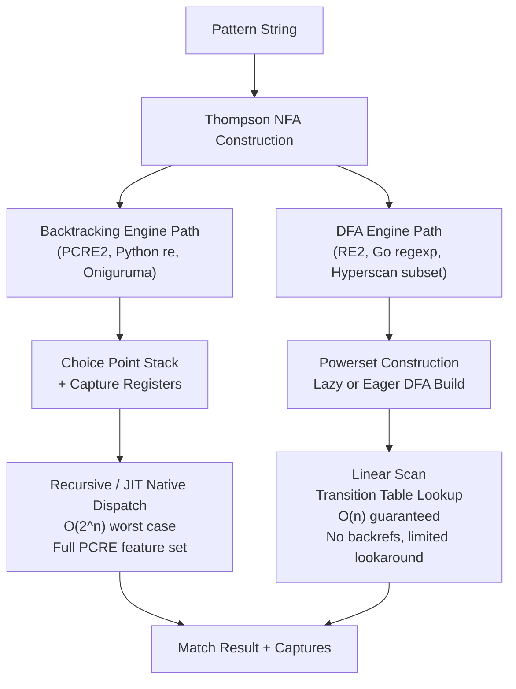

# Lesson 3: Engine Architectures through Flavor Variations

## 1. First-Principles Intuition & Invariants

Every regular expression engine makes a silent contract with the programmer who writes a pattern. That contract specifies which strings match, how long matching takes, what gets captured, and what happens when the input is ambiguous. Most engineers never read the fine print, and that inattention produces three categories of real-world failure: patterns that silently return wrong results on certain inputs, patterns that run in exponential time and bring down production servers, and patterns that behave differently across runtimes despite appearing syntactically identical. Understanding engine architecture is not academic hygiene—it is the prerequisite for writing correct, predictable, and fast matching code.

The theoretical foundation is Kleene's 1951 characterization of regular languages, which proved that any language accepted by a nondeterministic finite automaton (NFA) is also accepted by a deterministic finite automaton (DFA), and that both classes describe exactly the same set of languages: those expressible by regular expressions over some alphabet. This theoretical equivalence is the most important invariant in the field, and it is simultaneously the most dangerous fact to misread. The two automaton models recognize the same *set* of strings, but they do so through fundamentally different computational strategies with radically different time and space complexity profiles. The choice of implementation model is what separates a matching function that runs in `O(n)` time on a string of length `n` from one that runs in `O(2^n)` time on pathologically crafted inputs.

An NFA for a pattern of length `m` has at most `O(m)` states. When run on input of length `n` using the textbook simulation algorithm—tracking the full set of active states simultaneously—it matches in `O(m·n)` time. A DFA for the same pattern has at most `2^m` states in the worst case (because each DFA state corresponds to a *subset* of NFA states), but once built, it matches in `O(n)` time with no dependence on `m` whatsoever. The practical tension between these two extremes has driven every major engine design decision made since Ken Thompson's 1968 paper "Programming Techniques: Regular Expression Search Algorithm," which introduced the approach of compiling a regex into an NFA and simulating it without backtracking.

What complicates everything is that the patterns programmers actually need—backreferences, lookaround assertions, possessive quantifiers, conditional expressions—are not regular in the strict Chomskian sense. A pattern like `(.+)\1` that matches any repeated string is context-free, not regular. No DFA can recognize it. The practical consequence is that every general-purpose regex engine must extend the theoretical model in ways that break the mathematical guarantees. The moment you allow backreferences into the language, you lose the ability to compile to a pure DFA, and the linear-time guarantee evaporates unless the engine is careful to restrict DFA compilation to the subset of patterns that remain truly regular.

This is the central invariant to hold in mind throughout everything that follows: **linear-time matching is achievable if and only if the pattern can be represented as a finite automaton with no unbounded lookahead or reference to previously captured text.** Every flavor and engine architecture represents a different point on the trade-off curve between expressive power and performance guarantees.

---

## 2. Core Architecture & Mechanics

### The NFA-Based Backtracking Engine

The dominant regex engine architecture in production software—used by PCRE, PCRE2, Python's `re` module, Ruby's Oniguruma, the .NET BCL engine, and historically Perl itself—is the recursive backtracking NFA. It compiles the pattern into an NFA, but instead of simulating all active NFA states simultaneously, it pursues one path at a time and retreats to the most recent choice point when a path fails. The data structure that enables this is an implicit or explicit call stack of *choice points*, each of which records the current input position and the alternative NFA branch to try next if the current one fails.

The compilation phase transforms the pattern into a graph of NFA nodes. Thompson construction, the standard algorithm, proceeds compositionally: a literal character `a` becomes two states connected by an `a`-labeled transition; concatenation `AB` connects the final state of `A` to the initial state of `B` via an ε-transition; alternation `A|B` introduces a new start state with two ε-transitions to the starts of `A` and `B`; the Kleene star `A*` adds ε-transitions that allow skipping `A` entirely or looping back after matching `A`. The resulting NFA has exactly `O(m)` states for a pattern of length `m` and contains no ε-transitions in cycles that would require a full subset-construction algorithm to untangle—making it amenable to direct simulation.

The backtracking engine walks this NFA graph depth-first. When it encounters an alternation `A|B`, it pushes a choice point for `B` onto its stack and attempts `A`. When it encounters a quantifier `A*` and the input could match another repetition, it pushes a choice point representing "stop repeating here" and attempts another repetition. If any path leads to failure—a literal character that doesn't match the current input character, an assertion that fails, the end of the NFA without consuming all required input—the engine pops the most recent choice point from the stack, resets the input position to what was saved there, and continues from the alternative branch.

The critical implementation detail is that **captures are part of the state that must be saved and restored at choice points**. When the engine pushes a choice point, it saves not just the input position but the entire capture group register file. This is why backtracking engines can support backreferences (`\1`) at all: the capture register is a concrete string pointer in memory, and the engine can compare it against subsequent input text. The DFA simulation model has no such register and therefore cannot support backreferences.

The following diagram shows the NFA structure for the pattern `a(b|c)*d` and the backtracking execution trace against the string `"abcd"`:

```
NFA Graph for a(b|c)*d:

  [S0] --a--> [S1] --ε--> [S2] --ε--> [S3] --b--> [S4] --ε--> [S5] --ε--> [S2]
                                  |                                          |
                                  |              [S3'] --c--> [S4'] --ε-----|
                                  |                                          |
                                  +--ε------------------------------------> [S6] --d--> [S7:ACCEPT]

Execution trace on "abcd":
  pos=0: S0, match 'a', advance -> S1
  pos=1: S1-ε->S2-ε->S3, try branch 'b', match 'b', -> S4-ε->S5-ε->S2
  pos=2: S2-ε->S3, try branch 'b', no match ('c'), backtrack to try 'c'
  pos=2: S2-ε->S3', try branch 'c', match 'c', -> S4'-ε->S5-ε->S2
  pos=3: S2-ε->S6, try 'd', match 'd', -> S7:ACCEPT
```

The backtracking engine's time complexity in the worst case is `O(2^n)` because the number of choice points on the stack can grow exponentially with the input length. This is not a theoretical curiosity—it is a production failure mode discussed in depth in Section 3.

### The DFA-Based Engine

The DFA engine takes the opposite approach. During compilation, it applies the powerset construction (also known as subset construction) to convert the NFA to a DFA, where each DFA state represents a *set* of NFA states that could be simultaneously active. The resulting automaton has no nondeterminism: at every state, each input character leads to exactly one successor state (or a distinguished dead state that represents permanent failure). Once built, matching requires a single linear scan of the input, consulting a state transition table at each character.

The canonical DFA transition table for a small pattern can be visualized as follows. For the pattern `(a|b)*abb`:

```
DFA States (each is a subset of NFA states):

  State Q0 = {NFA states active before consuming input}
  State Q1 = {NFA states active after 'a'}
  State Q2 = {NFA states active after 'ab'}
  State Q3 = {NFA states active after 'abb'}  <- ACCEPT

Transition Table:
  +--------+-------+-------+
  | State  |  'a'  |  'b'  |
  +--------+-------+-------+
  |  Q0    |  Q1   |  Q0   |
  |  Q1    |  Q1   |  Q2   |
  |  Q2    |  Q1   |  Q3   |
  |  Q3    |  Q1   |  Q0   |
  +--------+-------+-------+
```

Matching `"aabb"` requires four table lookups: `Q0 --a--> Q1 --a--> Q1 --b--> Q2 --b--> Q3`, accepting in exactly `O(n)` time.

The fundamental problem with ahead-of-time DFA construction is state explosion. A pattern with `m` alternation branches or character classes can require `2^m` DFA states in the worst case, making static compilation memory-prohibitive. RE2, Google's production regex library written by Russ Cox, addresses this through *lazy DFA construction* (sometimes called the on-the-fly DFA or just-in-time DFA): it builds DFA states incrementally during the actual matching run, caching transitions in a bounded hash map. When the cache fills, it discards old entries or falls back to NFA simulation. This gives RE2 `O(n)` amortized matching time with bounded memory, at the cost of paying compilation overhead on first encounters with new state paths.

RE2 also handles the absence of capture group support in the DFA model by layering a separate submatch extraction pass. It first uses the DFA to determine the precise byte range of the full match, then uses a selective NFA simulation over just that range to extract capture groups. This two-phase design means RE2 delivers linear-time full-match detection while still exposing a capture API, at the cost of running the input through the engine twice for patterns with groups.

### Hybrid Engines: PCRE2's JIT and the Hyperscan Architecture

Modern production engines rarely implement a pure NFA or pure DFA. PCRE2's JIT compiler, written by Zoltan Herczeg, compiles the pattern directly to native machine code using a custom code generation backend (not LLVM—a hand-rolled assembler that emits x86-64, ARM, and MIPS). The JIT model is effectively a backtracking NFA whose recursive calls have been unrolled into direct control flow in the generated native function, eliminating interpreter dispatch overhead. For patterns that do not trigger catastrophic backtracking, the PCRE2 JIT delivers matching throughput of multiple gigabytes per second on modern hardware by virtue of tight branch prediction, register allocation for the most-used NFA state variables, and SIMD-accelerated literal search using `pcmpestri` and `vpcmpb` instructions on x86 for the leading anchoring prefix of the pattern.

Intel's Hyperscan library, used in network intrusion detection systems (Snort, Suricata), takes a different hybrid approach designed for simultaneous matching of thousands of patterns against streaming data. Hyperscan decomposes each pattern into an NFA graph, identifies components that can be compiled to DFAs without state explosion, and uses a "graph decomposition" algorithm to handle the complex components through specialized NFA simulation accelerated with SIMD. The critical architectural insight is that Hyperscan commits to left-to-right streaming: it cannot report capture groups or the start position of a match in a single pass, only that *some* pattern matched ending at position `n`. This makes it unsuitable for extraction use cases but optimal for signature-matching at line rate.

The following Mermaid diagram illustrates the compilation pipeline differences between the three major engine families:



### The POSIX Leftmost-Longest Semantic Contract

POSIX defines a matching semantic that most engineers encounter through `grep`, `sed`, `awk`, and C's `regcomp`/`regexec` API, and it is subtly but critically different from both PCRE and ECMAScript semantics. POSIX mandates the *leftmost-longest* (also called *greedy leftmost*) match: among all possible matches, the engine must return the one that starts at the earliest position in the string, and among all matches starting at that earliest position, the one that consumes the most characters. For the top-level match extent this is intuitive, but POSIX also applies a recursive variant of leftmost-longest to each capture group, which creates semantics that differ from PCRE in ways that are genuinely surprising.

Consider the pattern `(a*)(a*)` applied to the string `"aaa"`. A PCRE/Perl engine returns `("aaa", "")` for the two groups because greedy quantifiers are possessive-first from left to right: group 1 consumes all three `a`s, leaving nothing for group 2. POSIX mandates that the *overall match* must be as long as possible (all three `a`s), but among all ways to partition those three characters into the two groups, it then applies leftmost-longest recursively, so group 1 still gets all three. In this particular case the results are identical. But for `(a*|b*)*` applied to `"ab"`, POSIX and PCRE diverge because POSIX must track all possible NFA paths simultaneously to find the globally longest match, while PCRE commits to the first successful path found by greedy depth-first search.

Implementing POSIX semantics correctly requires either a full NFA simulation that tracks all active states and their associated capture-interval sets, or a DFA augmented with submatch tracking—the latter being the approach taken by TRE and the Ville Laurikari algorithm. The practical consequence is that true POSIX-compliant engines are substantially slower than PCRE engines on complex patterns because they cannot commit early. Most tools that claim POSIX compliance implement only a subset of the semantic correctly, particularly around nested quantifiers and alternation within groups.

### ECMAScript Semantics and the Unicode Complexity Layer

The ECMAScript regex specification, defined in ECMA-262, specifies a backtracking NFA with explicit ordered alternation (left branch before right, always), greedy quantifiers by default, and a step-by-step operational semantics written in pseudocode that engine implementors must match precisely. The ECMAScript model is closer to Perl than to POSIX, but several deviations matter at the production level.

ECMAScript's `String` type represents text as UTF-16 code units, not Unicode code points. A surrogate pair—the two-code-unit encoding of a Unicode supplementary character above U+FFFF—is treated as two separate code units by default. The `.` metacharacter does not match a surrogate pair as a single unit; it matches one code unit. The pattern `/^.$/.test("𝒜")` returns `false` in ECMAScript because `"𝒜"` (U+1D49C) is encoded as two code units `\uD835\uDC9C`, making `length` equal to 2. The `/u` (unicode) flag introduced in ES2015 changes this: with `/u`, the engine operates on code points rather than code units, `.` matches a full supplementary character, and character class ranges are interpreted over code points. The `/v` (unicodeSets) flag introduced in ES2024 extends this further with set notation (`[\p{Letter}--\p{ASCII}]`), string properties (`\p{RGI_Emoji}`), and intersection/difference/nesting in character classes.

PCRE2's Unicode handling operates at the UTF-8 byte level by default when compiled with Unicode support and when the subject is passed with the `PCRE2_UTF` flag. Character classes like `\p{L}` (letter), `\p{Script=Greek}`, and `\p{Block=Mathematical_Operators}` are resolved against the Unicode Character Database tables compiled into the library at build time. PCRE2's `\X` sequence matches a single Unicode extended grapheme cluster—a character as a human perceives it, including base character plus combining marks, skin tone modifiers, and ZWJ sequences—by implementing the Unicode Standard Annex #29 grapheme cluster boundary algorithm. This is the correct abstraction for user-visible character counting, but it is an NFA-based simulation and therefore has no linear-time guarantee when combined with backtracking quantifiers.

Go's `regexp` package, backed by RE2, normalizes all patterns and subject strings through Unicode-aware byte scanning but operates on bytes internally. The `\p{Lu}` class works, case folding works, but the linear-time guarantee is maintained because Go's `regexp` does not implement lookahead, lookbehind, or backreferences. It enforces this restriction at compile time: `regexp.Compile` returns an error for any pattern that uses these features.

---

## 3. High-Performance Optimization & Failure Modes

### Catastrophic Backtracking: Mechanism, Diagnosis, and Elimination

Catastrophic backtracking is not a bug in the engine—it is the correct behavior of a backtracking NFA confronted with a pattern that has exponentially many ways to fail. The classic example is `(a+)+` applied to a string of `n` `a`s followed by a character that is not `a`. The outer quantifier can match once consuming all `n` characters, twice with any split, three times with any triple split, and so on. When the final character fails to match, the engine must explore every possible partitioning of the input before it can confirm that no match exists. The number of such partitions is `2^(n-1)`, which grows to tens of billions for strings of length thirty or forty characters—the kind of string that trivially appears in user-submitted form input.

The underlying structural cause is *ambiguity under failure*: the same input characters can be consumed by more than one quantifier or alternation branch, so the engine has no way to determine locally that a choice is wrong and must enumerate globally. This manifests in three canonical pattern shapes:

A *nested quantifier* like `(a+)+` or `(a*b*)*` where the inner and outer quantifiers can both match the same characters. A *polynomial alternation* like `(a|a)+` or `(a*|b*)*c` where both branches of an alternation match the same input character. A *possessive conflict* like `.*b` applied to a string with many `a`s and no `b`, where the greedy `.*` consumes everything, fails to match `b`, backs off one character, fails again, and repeats `n` times—this is merely `O(n^2)` rather than `O(2^n)`, but it is still catastrophic at gigabyte scale.

The diagnostic workflow for catastrophic backtracking in a production codebase proceeds as follows. First, instrument the suspect code path with a timeout or step counter. PCRE2 provides `pcre2_match_data` with the `PCRE2_NO_AUTO_POSSESS` and match limit controls:

```c
#include <pcre2.h>
#include <stdio.h>
#include <string.h>

int safe_match(const char *pattern, const char *subject) {
    int errcode;
    PCRE2_SIZE erroffset;
    uint32_t options = PCRE2_UTF;

    pcre2_code *re = pcre2_compile(
        (PCRE2_SPTR)pattern,
        PCRE2_ZERO_TERMINATED,
        options,
        &errcode,
        &erroffset,
        NULL
    );
    if (!re) {
        PCRE2_UCHAR8 errbuf[256];
        pcre2_get_error_message(errcode, errbuf, sizeof(errbuf));
        fprintf(stderr, "Compile error at offset %zu: %s\n", erroffset, errbuf);
        return -1;
    }

    pcre2_match_context *mctx = pcre2_match_context_create(NULL);
    /* Abort after 1,000,000 backtrack steps — tune per SLA */
    pcre2_set_match_limit(mctx, 1000000);
    pcre2_set_depth_limit(mctx, 10000);

    pcre2_match_data *md = pcre2_match_data_create_from_pattern(re, NULL);

    int rc = pcre2_match(
        re,
        (PCRE2_SPTR)subject,
        (PCRE2_SIZE)strlen(subject),
        0,
        0,
        md,
        mctx
    );

    if (rc == PCRE2_ERROR_MATCHLIMIT) {
        fprintf(stderr, "Match limit exceeded — possible ReDoS pattern\n");
    }

    pcre2_match_data_free(md);
    pcre2_match_context_free(mctx);
    pcre2_code_free(re);
    return rc;
}
```

This guard prevents a single malicious or malformed input from blocking a thread indefinitely. The match limit of one million steps allows legitimate complex patterns to complete while reliably aborting pathological cases within microseconds.

For structural analysis rather than runtime mitigation, the tool `vuln-regex-detector` (from Virginia Tech, available on GitHub) and the web tool `regex101.com` with its "regex debugger" mode can visualize the backtracking tree for a pattern/input pair. The Go `regexp` package provides the definitive compile-time check: if your pattern compiles under Go's `regexp.Compile`, it is provably linear-time. Use this as a canary for the patterns you control.

The engineering remediation for catastrophic backtracking follows a small set of structural transformations. *Atomic groups* (available in PCRE2, Java, .NET) prevent backtracking into a subexpression once it has matched: `(?>a+)` matches as many `a`s as possible and refuses to give any back. Converting `(a+)+` to `(?>a+)+` immediately eliminates the ambiguity. *Possessive quantifiers* (`a++`, `a*+`) provide the same guarantee with syntactic sugar. Where the pattern allows it, *anchoring* with `^` or `\G` prevents the engine from attempting the match at every position in the string, which eliminates the linear factor from the already-exponential per-position search. For patterns of the form `.*suffix`, rewriting as `[^x]*suffix` where `x` is the first character of `suffix` eliminates backtracking into the prefix entirely because the character class and the first character of the suffix are mutually exclusive.

### SIMD-Accelerated Literal Search and the Boyer-Moore Pre-filter

Both PCRE2 and RE2 apply a pre-filtering optimization before NFA or DFA simulation: they extract a leading literal string from the pattern—the longest fixed prefix that any match must contain—and search for it using SIMD-accelerated exact string search before engaging the full automaton. PCRE2's JIT uses `pcmpestri` on SSE4.2 and `vpcmpb` on AVX-512 to scan 16 or 64 bytes per cycle. RE2 uses a similar optimization called the "literal search" pass. For a pattern like `\d+\s+ERROR:\s+(.+)`, the string `"ERROR:"` is a required literal, and the engine first finds all occurrences of `"ERROR:"` in the input using SIMD and then runs the NFA only starting from positions near those occurrences. For log-file processing where the subject string is megabytes of text but matches are sparse, this optimization provides orders-of-magnitude speedups.

For patterns without extractable literals, PCRE2's auto-possessification analysis converts quantifiers to possessive form automatically when it can prove through local lookahead analysis that giving characters back to a later subexpression could never lead to a match. The analysis is conservative—it misses cases requiring global reasoning—but it handles the common patterns in production code reliably.

### Benchmarking Engine Choices in Rust

Rust's `regex` crate implements a hybrid engine architecturally similar to RE2: it uses a lazy DFA for linear-time matching, falls back to bounded NFA simulation when the DFA cache would overflow, and explicitly refuses to compile patterns with backreferences (returning a compile-time error). The `fancy-regex` crate extends this by adding a backtracking layer for the features the pure `regex` crate refuses: lookaround and backreferences are handled by a backtracking engine, while the pure-RE2-compatible portions of the pattern are delegated to the linear-time core. This layered approach makes the performance profile of `fancy-regex` transparent: if your pattern uses only features the `regex` crate supports, you get linear-time guarantees; if you add a lookahead, the backreference engine takes over for that component and you must reason about backtracking complexity yourself.

The following Rust program benchmarks the two crates against a known-pathological pattern to make this boundary concrete and observable:

```rust
use std::time::{Duration, Instant};

fn time_match<F: Fn() -> bool>(label: &str, f: F) -> bool {
    let start = Instant::now();
    let result = f();
    let elapsed = start.elapsed();
    println!("{}: {:?} -> {}", label, elapsed, result);
    elapsed < Duration::from_millis(500)
}

fn main() {
    // This pattern is safe in `regex` (linear time) because it has no ambiguity
    // under failure that the NFA simulation tracks simultaneously.
    let safe_re = regex::Regex::new(r"^(a+)+$").unwrap();

    // fancy-regex allows the same surface syntax but runs a backtracking engine.
    let fancy_re = fancy_regex::Regex::new(r"^(a+)+$").unwrap();

    // Benign input: 20 'a's followed by 'b' — forces full failure exploration.
    let evil_input = "aaaaaaaaaaaaaaaaaaab";

    let safe_ok = time_match("regex crate (linear NFA)", || {
        safe_re.is_match(evil_input)
    });

    let fancy_ok = time_match("fancy-regex (backtracking)", || {
        fancy_re.is_match(evil_input).unwrap_or(false)
    });

    if !safe_ok {
        eprintln!("WARN: regex crate took unexpectedly long");
    }
    if !fancy_ok {
        eprintln!("WARN: fancy-regex exceeded 500ms threshold — ReDoS risk");
    }
}
```

Compile and run this with `cargo run --release`. On a modern x86-64 machine, the `regex` crate returns in nanoseconds regardless of input length because the NFA simulation tracks all active states simultaneously and declares failure in one pass. The `fancy-regex` crate may hang for many seconds on inputs of length twenty or more because it pursues each branch sequentially and exhausts the combinatorial space.

### Unicode Normalization as a Matching Invariant

A subtle failure mode that sits at the intersection of Unicode handling and engine architecture is normalization sensitivity. Unicode allows the same visual character to be encoded in multiple ways: the character `é` (e with acute accent) can be encoded as the precomposed code point U+00E9 or as the sequence U+0065 (Latin small e) followed by U+0301 (combining acute accent). Two strings that look identical to a human may compare as unequal byte-for-byte, causing a regex that correctly matches one encoding to silently fail on the other.

No major regex engine normalizes its input before matching by default. PCRE2 operates on raw bytes (or raw UTF-8 code unit sequences with the `PCRE2_UTF` flag) and has no concept of Unicode normalization forms. The correct engineering practice is to normalize both the pattern and the subject string to a canonical form—NFC (Canonical Decomposition followed by Canonical Composition) for most Western text, NFD for round-tripping through macOS HFS+ file names—before passing them to the regex engine. In Rust, the `unicode-normalization` crate provides `nfc()` and `nfd()` iterators. In Python, `unicodedata.normalize("NFC", s)` is the standard call. In Java, `java.text.Normalizer.normalize(s, Normalizer.Form.NFC)` performs the transformation.

Failure to normalize is particularly treacherous in security-sensitive matching. A web application that validates usernames with the pattern `^[a-zA-Z0-9_]+$` expects only ASCII alphanumerics and underscores. If the input is not normalized and the engine operates on raw UTF-8 bytes, a crafted input using combining characters could bypass a blocklist match for a reserved name while still rendering as the reserved name in the UI. The invariant is straightforward: normalize at the trust boundary before matching, and treat the regex engine as operating on normalized byte sequences.

### Choosing the Right Engine for Production Workloads

The decision tree for engine selection resolves to a small set of hard constraints. If your patterns require backreferences or complex lookaround, you must use a backtracking engine and you must impose match limits and timeouts. If your patterns are user-supplied—that is, the pattern itself is an untrusted input from an end user or a configuration file provided by an external party—you must either use RE2/Go `regexp`/Rust `regex` (which give you a compile-time rejection of non-linear patterns) or run the pattern through a static analyzer before accepting it. If your workload is streaming multi-pattern matching at network speeds, Hyperscan is the correct tool and you should not use a backtracking engine at all. If your workload is dominated by fixed-string search with simple affixes, consider whether a regex engine is necessary: `memmem`, Aho-Corasick, or a purpose-built SIMD string search will outperform any regex engine by factors of ten or more because they carry none of the NFA simulation overhead.

The POSIX/PCRE/ECMAScript choice is usually dictated by runtime rather than deliberate selection, but when you have freedom, prefer PCRE2 for feature richness and production maturity, RE2/`regexp` for safety guarantees, and ECMAScript with the `/v` flag for correctness on modern Unicode text in browser or Node.js contexts. Whichever engine you deploy, characterize the worst-case complexity of your patterns against adversarially crafted inputs before those inputs arrive from the network.
