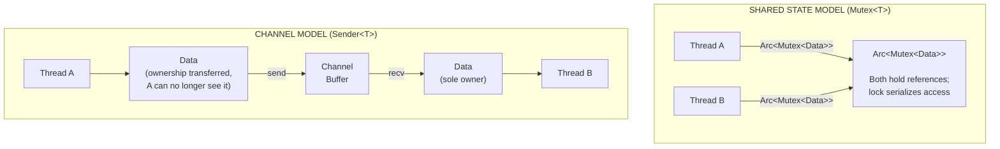

# Lesson 2: Concurrency, Synchronization, and Thread Safety

## 1. First-Principles Intuition & Invariants

Concurrency is the art of making progress on multiple tasks whose execution intervals overlap in time, and it has claimed more production hours, corrupted more data, and spawned more subtle bugs than perhaps any other domain in systems programming. The reason is fundamental: a modern CPU is not a sequential machine in any meaningful sense. It reorders stores and loads for performance, caches memory in per-core L1 and L2 structures that are not coherent by default across cores, and executes instructions speculatively. The programmer's mental model of "thread A writes X, then thread B reads X" is a convenient fiction that the hardware will violate unless you force it not to through explicit synchronization operations that issue memory barriers. Every language that exposes threads must therefore answer the same question: who is responsible for ensuring correctness, and when does the answer change from "the programmer" to "the type system"?

C and C++ answer that question by trusting the programmer entirely. The type system in those languages has no concept of which data is shared across threads, which values are protected by which locks, or whether a pointer handed to a new thread was ever safe to send. The result is that data races — concurrent unsynchronized accesses to the same memory location where at least one is a write — are undefined behavior, but they compile silently. Tools like ThreadSanitizer can catch many of them at runtime, but they are fundamentally a dynamic defense: they only find races that are exercised during a test run. Entire categories of Heisenbugs reach production because a particular interleaving only manifests under a specific workload pattern that no test ever reproduced.

Rust takes a categorically different position. Its ownership and borrowing system, which prevents memory safety violations in single-threaded code, turns out to also be the right foundation for a type-level concurrency proof. The insight is elegant: a data race requires two threads to hold simultaneous access to the same memory, with at least one having mutable access. Rust's borrow checker already prohibits that in a single thread — you cannot hold a `&mut T` and a `&T` to the same value simultaneously. The extension to multiple threads requires only one additional invariant: tracking which values are safe to send between threads, and which are safe to share references to across threads. These two properties are expressed as the marker traits `Send` and `Sync`, and they are the load-bearing pillars of Rust's fearless concurrency guarantee.

A type `T` is `Send` if it is safe to transfer ownership of a value of type `T` from one thread to another. It is `Sync` if it is safe for multiple threads to hold shared references `&T` simultaneously. The relationship between them is precisely stated: `T: Sync` if and only if `&T: Send`. These traits are automatically implemented — derived by the compiler for any composite type whose constituent fields all implement the trait — but they can be deliberately withheld, and that withholding carries real semantic weight. `Rc<T>`, the reference-counted smart pointer, is neither `Send` nor `Sync` because its reference count is maintained with plain integer operations that have no atomicity guarantees. If you moved an `Rc<T>` to another thread and both threads cloned or dropped it simultaneously, the reference count would corrupt. `Arc<T>`, the atomic reference-counted pointer, uses `std::sync::atomic` operations for its count and is therefore `Send + Sync` for any `T` that is itself `Send + Sync`. The type system encodes the distinction; it does not rely on code review to catch the mistake.

The concept of a data race in the C++ memory model, which Rust adopts, is distinct from a race condition. A data race is a formal property of a memory access sequence: two accesses to the same location, in different threads, without any synchronization ordering between them, where at least one is a write. This is undefined behavior and the compiler may assume it cannot happen, optimizing away branches or eliding writes that it believes are unobservable — a catastrophic interaction when the assumption is wrong. A race condition is a broader behavioral problem: the program produces incorrect output because the timing of operations matters and the program doesn't control it. Rust eliminates data races by construction. It does not eliminate race conditions, which are a logical property of the program rather than a formal property of memory accesses, but it forces every sharing operation through synchronization primitives that are visible in the type signatures of the values involved.

This distinction matters because it correctly scopes what Rust's guarantee means in practice. When the Rust team coined the phrase "fearless concurrency," they were making a specific, falsifiable claim: code that compiles with safe Rust cannot contain data races. It may still contain logical errors, deadlocks, or liveness failures. But the class of bugs that corrupt memory silently — the class that makes multithreaded C programs so treacherous — is statically ruled out. For systems programmers who have spent days chasing memory corruption under load, this is not a small promise.

Understanding why these invariants hold requires examining what the compiler actually enforces when you spawn a thread. The standard library's `thread::spawn` has the signature `fn spawn<F, T>(f: F) -> JoinHandle<T> where F: FnOnce() -> T + Send + 'static, T: Send + 'static`. The `Send` bound on `F` means the closure and everything it captures must be safe to move to another thread. The `'static` bound means the closure cannot capture references with lifetimes shorter than the entire program duration, because the spawned thread might outlive the scope where those references are valid. These bounds are not advisory; they are enforced by the borrow checker at the call site. If you try to send a closure that captures an `Rc<T>`, the compiler rejects it with a message telling you exactly which type does not implement `Send`. This is the mechanism by which the type system makes an entire class of threading bugs impossible to introduce silently.

## 2. Core Architecture & Mechanics

### The Send/Sync Trait Lattice and Its Implications

The auto-implementation of `Send` and `Sync` works by structural induction. If every field of a struct is `Send`, the struct is `Send`. If every field is `Sync`, the struct is `Sync`. Raw pointers `*const T` and `*mut T` are neither, by definition, because they carry no ownership or borrowing information. Any type that wraps a raw pointer must therefore explicitly implement `Send` or `Sync` using an `unsafe impl`, which is a declaration to the compiler that the programmer has verified the invariant holds even though the type system cannot prove it automatically. This is precisely what `Arc<T>` and `Mutex<T>` do: they wrap unsafe internals, verify the safety invariant by human reasoning, and then expose a safe API that the rest of the ecosystem can build on.

Consider a custom type that wraps a raw pointer to a region of memory it owns:

```rust
use std::ptr::NonNull;
use std::alloc::{alloc, dealloc, Layout};

pub struct OwnedBuffer {
    ptr: NonNull<u8>,
    len: usize,
    layout: Layout,
}

impl OwnedBuffer {
    pub fn new(len: usize) -> Self {
        let layout = Layout::array::<u8>(len).expect("layout overflow");
        let ptr = unsafe { alloc(layout) };
        let ptr = NonNull::new(ptr).expect("allocation failed");
        Self { ptr, len, layout }
    }

    pub fn as_slice(&self) -> &[u8] {
        unsafe { std::slice::from_raw_parts(self.ptr.as_ptr(), self.len) }
    }

    pub fn as_mut_slice(&mut self) -> &mut [u8] {
        unsafe { std::slice::from_raw_parts_mut(self.ptr.as_ptr(), self.len) }
    }
}

impl Drop for OwnedBuffer {
    fn drop(&mut self) {
        unsafe { dealloc(self.ptr.as_ptr(), self.layout) }
    }
}

unsafe impl Send for OwnedBuffer {}
unsafe impl Sync for OwnedBuffer {}
```

The `unsafe impl Send` declaration is justified because `OwnedBuffer` has exclusive ownership of its allocation — there are no other aliases to the pointer, so moving ownership to another thread is safe by the same reasoning that moving any uniquely-owned value is safe. The `unsafe impl Sync` declaration is justified because `&OwnedBuffer` only permits shared read access through `as_slice`, which is safe from multiple threads simultaneously. The `&mut OwnedBuffer` path that would permit mutation requires exclusive access, and Rust's borrow checker guarantees that only one thread can hold `&mut OwnedBuffer` at a time. If `OwnedBuffer` contained an `UnsafeCell<T>` and exposed interior mutability through a shared reference, the `Sync` impl would no longer be sound without additional synchronization.

`UnsafeCell<T>` is the primitive at the bottom of Rust's interior mutability stack. It is the only mechanism through which the language permits obtaining a `*mut T` from a `&T`, and it opts the containing type out of `Sync` automatically. Everything that provides safe interior mutability — `Cell<T>`, `RefCell<T>`, `Mutex<T>`, `RwLock<T>`, and the atomic types — is built on `UnsafeCell`. The difference between `Cell<T>` (single-threaded only, `!Sync`) and `Mutex<T>` (multi-threaded safe, `Sync`) is precisely that `Mutex<T>` wraps its `UnsafeCell` with a locking protocol that serializes access and re-establishes the invariant that only one thread can mutate at a time.

### Mutex Internals and Lock Poisoning

Rust's `std::sync::Mutex<T>` bundles the protected data inside the lock itself, a design choice that is more principled than it first appears. In C, a mutex and the data it protects are separate: a `pthread_mutex_t` and a `SomeStruct` that you must remember to always lock before accessing. Nothing in the C type system enforces the association. In Rust, `Mutex<T>` holds the `T` inside it, and the only way to access the `T` is through `lock()`, which returns a `MutexGuard<'_, T>`. The guard implements `Deref` and `DerefMut` to `T`, so you can use the data normally, but the moment the guard drops — either explicitly or by going out of scope — the lock releases. This is RAII applied to synchronization, and it makes lock leaks structurally impossible in safe code.

```rust
use std::sync::{Arc, Mutex};
use std::thread;

fn parallel_accumulate(data: Vec<i64>) -> i64 {
    let chunks: Vec<Vec<i64>> = data
        .chunks(data.len() / 4 + 1)
        .map(|s| s.to_vec())
        .collect();

    let total = Arc::new(Mutex::new(0i64));
    let mut handles = Vec::new();

    for chunk in chunks {
        let total = Arc::clone(&total);
        let handle = thread::spawn(move || {
            let local_sum: i64 = chunk.iter().sum();
            let mut guard = total.lock().unwrap();
            *guard += local_sum;
        });
        handles.push(handle);
    }

    for handle in handles {
        handle.join().unwrap();
    }

    let guard = total.lock().unwrap();
    *guard
}

fn main() {
    let data: Vec<i64> = (1..=1000).collect();
    let result = parallel_accumulate(data);
    println!("Sum: {}", result);
}
```

The call to `total.lock()` returns `Result<MutexGuard<'_, i64>, PoisonError<MutexGuard<'_, i64>>>`. The `PoisonError` case arises when a thread panicked while holding the lock, leaving the protected data in a potentially inconsistent state. This is Rust's lock poisoning mechanism: rather than silently allowing other threads to observe corrupted data, the mutex marks itself poisoned, and all subsequent `lock()` calls return `Err`. Calling `.unwrap()` on a poisoned lock propagates the panic, which is usually the right behavior for programs where a panic represents an invariant violation. Applications that want to recover from poisoning can call `.into_inner()` on the `PoisonError` to retrieve the guard and inspect or repair the data.

The underlying implementation of `Mutex<T>` on Linux uses a `futex` (fast userspace mutex). In the uncontended case — the common case — the lock and unlock operations are pure userspace atomic compare-and-swap operations, with no system calls. Only when the lock is contended and a thread must actually wait does a `futex_wait` syscall occur to park the thread in the kernel's wait queue. This makes uncontended `Mutex` extremely fast: typically tens of nanoseconds, comparable to a few cache misses.

### RwLock and Its Tradeoffs

Where `Mutex<T>` serializes all access, read-write lock `RwLock<T>` distinguishes between readers and writers. Any number of threads may hold a read lock simultaneously; a write lock requires exclusive access. The API is `read()` returning `RwLockReadGuard<'_, T>` and `write()` returning `RwLockWriteGuard<'_, T>`. The performance argument for `RwLock` is compelling when reads vastly outnumber writes and the critical section is long enough that lock acquisition time is a significant fraction of total time. For short critical sections protecting small integers, the overhead of the read-write protocol often makes `RwLock` slower than `Mutex` despite the theoretical throughput advantage.

There is also a correctness hazard specific to `RwLock`: writer starvation. If readers continuously acquire the lock without pausing, a waiting writer may never get access. The behavior depends on the platform's scheduling policy for the underlying synchronization primitive. The `std` implementation inherits the policy of the OS — which on Linux is POSIX `pthread_rwlock_t` and can indeed starve writers. For workloads with write latency requirements, this is a critical failure mode that `Mutex` does not have.

### Atomic Operations and the Memory Ordering Model

For simple scalar values, reaching for a `Mutex<u64>` is often excessive. The `std::sync::atomic` module provides types like `AtomicBool`, `AtomicUsize`, `AtomicI64`, and others, backed by CPU instructions that perform read-modify-write operations in a single indivisible step as far as the cache coherence protocol is concerned. These operations are roughly two to ten times faster than a mutex round-trip and avoid the kernel interactions that contended mutexes require.

Every atomic operation takes an `Ordering` argument that specifies the memory ordering guarantee it establishes. Getting this right is one of the most subtle tasks in concurrent programming. Rust exposes the C++11 memory model orderings directly:

`Ordering::Relaxed` imposes no ordering constraints beyond atomicity of the operation itself. Two `Relaxed` stores to different variables in the same thread may be observed in either order by another thread. This is appropriate for counters where only the eventual value matters and no synchronization is needed: a per-thread statistics accumulator, for instance.

`Ordering::Acquire` on a load prevents any memory accesses in the current thread from being reordered before the load. It is the "entering a critical section" operation: once you have loaded a value with `Acquire`, you have a guarantee that all stores by the thread that released the value are visible to you.

`Ordering::Release` on a store prevents any memory accesses in the current thread from being reordered after the store. It is the "leaving a critical section" operation: all your writes are visible to any thread that subsequently loads the value with `Acquire`.

`Ordering::AcqRel` combines both on a read-modify-write operation like `fetch_add` or `compare_exchange`: it has `Acquire` semantics for the read part and `Release` semantics for the write part. This is what you use when an atomic operation must both observe previous writes and publish new ones.

`Ordering::SeqCst` imposes a total sequential order across all `SeqCst` operations in the program. It is the strongest and most expensive ordering, requiring a full memory fence on most architectures. It is the right default when you are unsure, but it has measurable cost on x86 and significant cost on weakly-ordered architectures like ARM.

```rust
use std::sync::atomic::{AtomicUsize, Ordering};
use std::sync::Arc;
use std::thread;

fn concurrent_counter_demo() {
    let counter = Arc::new(AtomicUsize::new(0));
    let mut handles = Vec::new();

    for _ in 0..8 {
        let counter = Arc::clone(&counter);
        let handle = thread::spawn(move || {
            for _ in 0..10_000 {
                counter.fetch_add(1, Ordering::Relaxed);
            }
        });
        handles.push(handle);
    }

    for handle in handles {
        handle.join().unwrap();
    }

    // A single SeqCst load to synchronize and read the final value.
    let final_count = counter.load(Ordering::SeqCst);
    println!("Final count: {} (expected 80000)", final_count);
}

fn main() {
    concurrent_counter_demo();
}
```

The `Relaxed` ordering on `fetch_add` is correct here because the counter represents an aggregate metric: we care only that each increment is atomic and that the final value reflects all increments. We do not need to synchronize any other memory around the increment. The `SeqCst` load at the end after all threads have joined is technically unnecessary — `join()` establishes a happens-before relationship that makes all prior writes visible — but it makes the intent explicit and costs nothing at this call site.

A canonical use of `Acquire`/`Release` ordering is a spinlock or a flag-based one-shot notification:

```rust
use std::sync::atomic::{AtomicBool, Ordering};
use std::sync::Arc;
use std::thread;

fn one_shot_notification() {
    let ready = Arc::new(AtomicBool::new(false));
    let shared_data = Arc::new(std::sync::Mutex::new(Vec::<u64>::new()));

    let ready_producer = Arc::clone(&ready);
    let data_producer = Arc::clone(&shared_data);

    let producer = thread::spawn(move || {
        {
            let mut data = data_producer.lock().unwrap();
            *data = (1..=100).collect();
        }
        // Release: all writes above are visible to the consumer after it
        // observes ready == true with an Acquire load.
        ready_producer.store(true, Ordering::Release);
    });

    let ready_consumer = Arc::clone(&ready);
    let data_consumer = Arc::clone(&shared_data);

    let consumer = thread::spawn(move || {
        // Spin until the flag is set.
        while !ready_consumer.load(Ordering::Acquire) {
            std::hint::spin_loop();
        }
        let data = data_consumer.lock().unwrap();
        println!("Received {} elements, first={}", data.len(), data[0]);
    });

    producer.join().unwrap();
    consumer.join().unwrap();
}

fn main() {
    one_shot_notification();
}
```

The `Release` store and `Acquire` load form a synchronization pair. When the consumer's `Acquire` load observes `true`, it has a formal happens-before relationship with everything that preceded the `Release` store in the producer. This means the consumer is guaranteed to see the fully populated vector. If you used `Relaxed` for both, the CPU and compiler would be free to reorder the vector write after the flag store, and the consumer could observe the flag set while reading an empty vector — a data race through insufficiently ordered atomics, the kind of bug that only manifests on ARM or PowerPC hardware under production load.

### Channel-Based Message Passing

Shared mutable state is not the only concurrency model, and for many problems it is not the best one. Rust's standard library provides multi-producer single-consumer (MPSC) channels through `std::sync::mpsc`, and the ecosystem provides far richer channel primitives through the `crossbeam` crate. The fundamental idea is that threads communicate by transferring ownership of values: rather than sharing a pointer to data and protecting it with a lock, a producer sends a value down a channel and the receiver owns it after receipt. This eliminates the possibility of concurrent access to the same data entirely.

The channel model maps directly onto the `Send` trait: a channel `Sender<T>` requires `T: Send` because sending moves the value across a thread boundary. The type system enforces that only `Send` values can be transmitted, and because the act of sending transfers ownership, the sender can no longer access the value after the send. There is no sharing, only transfer.

```rust
use std::sync::mpsc;
use std::thread;
use std::time::Duration;

#[derive(Debug)]
struct WorkItem {
    id: u64,
    payload: Vec<u8>,
}

#[derive(Debug)]
struct WorkResult {
    id: u64,
    checksum: u64,
}

fn worker_pool_demo() {
    let (tx, rx) = mpsc::channel::<WorkResult>();
    let mut worker_handles = Vec::new();

    for worker_id in 0..4u64 {
        let tx = tx.clone();
        let handle = thread::spawn(move || {
            // Simulate receiving a work item (in a real pipeline this
            // would come from a second channel feeding work into workers).
            let item = WorkItem {
                id: worker_id * 100,
                payload: vec![worker_id as u8; 1024],
            };

            let checksum: u64 = item.payload.iter().map(|&b| b as u64).sum();
            let result = WorkResult { id: item.id, checksum };

            // `item` is consumed above; this send transfers ownership of `result`.
            tx.send(result).expect("receiver dropped");
        });
        worker_handles.push(handle);
    }

    // Drop the original sender so the receiver can detect completion.
    drop(tx);

    for result in rx {
        println!("Result from job {}: checksum={}", result.id, result.checksum);
    }

    for handle in worker_handles {
        handle.join().unwrap();
    }
}

fn main() {
    worker_pool_demo();
}
```

The `for result in rx` loop iterates until all `Sender` handles are dropped. Dropping the original `tx` after cloning it into the workers is essential: without that drop, the receiver would block forever waiting for a sender that the main thread still holds but never uses. This is a common initialization-time mistake with MPSC channels. The pattern of cloning `N` senders and dropping the original establishes the invariant that the channel closes exactly when all workers have finished.

The `std::sync::mpsc` channel comes in two flavors internally. `channel()` creates an asynchronous, unbounded channel: sends never block (until memory is exhausted). `sync_channel(n)` creates a synchronous, bounded channel with a buffer of `n` messages: a send blocks when the buffer is full, applying backpressure to the producer. Bounded channels are almost always preferable in production systems where producers can outrun consumers, because an unbounded channel will silently buffer an unlimited number of messages, consuming heap memory until the process is OOM-killed. The choice between bounded and unbounded is not a performance micro-optimization; it is an architectural decision about how the system behaves under load.

The following diagram illustrates the ownership-transfer model that channels enforce, contrasted with the shared-state model that mutexes enable:



For high-throughput scenarios where `std::sync::mpsc` becomes a bottleneck, the `crossbeam-channel` crate provides multi-producer multi-consumer (MPMC) channels with both bounded and unbounded variants, implemented using lock-free algorithms. It also provides `select!` macro support for simultaneously waiting on multiple channels — the equivalent of `select(2)` for channel operations — which is essential for building responsive pipeline stages that can receive from multiple upstream sources or a cancellation signal.

## 3. High-Performance Optimization & Failure Modes

### False Sharing and Cache Line Contention

One of the most damaging and least obvious performance failure modes in concurrent Rust programs has nothing to do with the language and everything to do with cache architecture. Modern CPUs transfer memory between cache levels and main memory in cache lines of 64 bytes on x86-64. The cache coherence protocol (MESI or a derivative) operates at the cache line granularity: if any core writes to any byte in a cache line, all other cores holding that line in their caches must invalidate their copy and re-fetch it before they can read or write any other byte in that same line.

This creates the false sharing problem: two threads operating on completely independent variables that happen to reside in the same cache line will trigger coherence traffic with every write, even though they are not logically sharing any data. The result can be a tenfold or greater throughput reduction on what should be a perfectly parallel workload.

Consider a parallel reduce where each thread accumulates into its own counter:

```rust
use std::thread;

// Without cache line padding: false sharing likely.
struct NaiveCounters {
    values: [u64; 8],
}

// With cache line padding: each counter on its own line.
#[repr(C, align(64))]
struct PaddedCounter {
    value: u64,
    _pad: [u8; 56], // 64 - 8 = 56 bytes padding
}

struct AlignedCounters {
    counters: [PaddedCounter; 8],
}

impl AlignedCounters {
    fn new() -> Self {
        Self {
            counters: std::array::from_fn(|_| PaddedCounter {
                value: 0,
                _pad: [0u8; 56],
            }),
        }
    }
}

fn demonstrate_false_sharing() {
    let mut aligned = AlignedCounters::new();

    // In a real benchmark you would compare `NaiveCounters` vs `AlignedCounters`
    // under parallel workload and observe the throughput difference.
    // Here we show the structural setup.
    for i in 0..8usize {
        aligned.counters[i].value = (i * 1000) as u64;
    }

    let total: u64 = aligned.counters.iter().map(|c| c.value).sum();
    println!("Total: {}", total);
}

fn main() {
    demonstrate_false_sharing();
}
```

The `#[repr(C, align(64))]` attribute instructs the compiler to align the struct to a 64-byte boundary and to use C layout rules, ensuring each `PaddedCounter` occupies exactly one cache line. Without the padding, eight `u64` values pack into 64 bytes — exactly one cache line — meaning all eight counters share a single cache line. Any write by any thread bounces the line to all other threads. With padding, each counter occupies its own line, and writes by different threads are invisible to the coherence protocol from each other's perspective.

The `crossbeam` crate provides `CachePadded<T>` as a production-grade solution: a wrapper that guarantees `T` is placed on its own cache line without manual padding arithmetic. For lock-free data structures and high-frequency per-thread state, using `CachePadded` is a correctness-adjacent concern, not merely an optimization, because the performance degradation from false sharing can be so severe that the concurrent implementation performs worse than a single-threaded one.

### Deadlock: Structural Prevention and Detection

Rust's type system prevents data races but provides no guarantee against deadlocks. A deadlock arises when two or more threads are each waiting for a resource held by another, forming a cycle in the resource acquisition graph. The canonical example is two threads each holding one mutex and trying to acquire the other. Because `MutexGuard` holds the lock for its lifetime, and lifetimes are not visible to a scheduler, the compiler has no way to detect this.

```rust
use std::sync::{Arc, Mutex};
use std::thread;

fn deadlock_example() {
    let resource_a = Arc::new(Mutex::new(0u64));
    let resource_b = Arc::new(Mutex::new(0u64));

    let a1 = Arc::clone(&resource_a);
    let b1 = Arc::clone(&resource_b);

    let t1 = thread::spawn(move || {
        let _guard_a = a1.lock().unwrap(); // acquires A
        thread::sleep(std::time::Duration::from_millis(10));
        let _guard_b = b1.lock().unwrap(); // waits for B ──► deadlock
        println!("T1 acquired both");
    });

    let a2 = Arc::clone(&resource_a);
    let b2 = Arc::clone(&resource_b);

    let t2 = thread::spawn(move || {
        let _guard_b = b2.lock().unwrap(); // acquires B
        thread::sleep(std::time::Duration::from_millis(10));
        let _guard_a = a2.lock().unwrap(); // waits for A ──► deadlock
        println!("T2 acquired both");
    });

    // Both joins will block forever.
    t1.join().unwrap();
    t2.join().unwrap();
}
```

The classical solution is lock ordering: define a total order over all mutexes in the program and require that every thread acquires them in that order. If both threads acquire A before B, the cycle cannot form. This is an architectural discipline, not a language feature. The `parking_lot` crate, a drop-in replacement for `std::sync` primitives with higher performance and additional features, provides deadlock detection in its debug builds through a cycle-detecting wait graph, which is invaluable during development.

For the most demanding concurrent data structures, Rust's ecosystem has converged on `parking_lot` for most synchronization needs. It offers roughly three to five times faster lock/unlock performance than `std::sync::Mutex` in uncontended benchmarks because it uses a more compact representation (a single byte rather than a full OS mutex handle) and a backoff strategy tuned for real workloads. It also exposes `try_lock()` and timeout variants cleanly, `MutexGuard::map()` for returning a guard scoped to a field rather than the whole value, and `const fn` constructors that allow static initialization without `lazy_static` or `once_cell`.

### Lock-Free Algorithms and the ABA Problem

When profiling shows that a lock is the bottleneck, the temptation is to replace it with a lock-free algorithm using atomic compare-and-exchange. Lock-free data structures are genuinely faster under high contention because they never suspend a thread — progress is guaranteed system-wide even if individual operations retry. But they introduce their own failure mode: the ABA problem.

A compare-and-swap (CAS) operation succeeds if a memory location currently holds the expected value. The problem is that "currently holds the expected value" is not the same as "has not changed since I last read it." A location might have changed from A to B and back to A between the read and the CAS, and the CAS will succeed incorrectly. In a lock-free linked list, this can cause a node that was removed and freed (or reused) to be re-linked, corrupting the structure.

The standard mitigation is a tagged pointer: rather than storing just the pointer, store the pointer and a generation counter in the same atomic word. Each modification increments the counter, so even if the pointer value cycles back to A, the tag A.generation2 differs from A.generation1 and the CAS correctly fails. On 64-bit systems with 48-bit virtual addresses, the high 16 bits of a pointer are available for tagging. The `crossbeam-epoch` crate provides a safe abstraction over tagged pointers and epoch-based reclamation, which is the memory management strategy most lock-free structures require: a node cannot be freed immediately upon removal because other threads may hold references to it; instead, it is deferred until all threads that could possibly have seen it have passed through an epoch boundary.

Building a correct lock-free data structure from scratch requires deep familiarity with the memory model, the hardware architecture, and the reclamation strategy. For production code, the right answer is almost always to use `crossbeam`'s battle-tested `SegQueue` (unbounded MPMC queue), `ArrayQueue` (bounded MPMC queue), or `SkipMap` (concurrent ordered map) rather than implementing your own. The value of Rust's ownership and type system in this space is that unsafe operations required for lock-free structures are contained in the library implementation, and the safe API it exposes prevents misuse.

### Thread Pool Design and Rayon's Work Stealing

Spawning a thread per unit of work is expensive. A thread stack on Linux defaults to 8 MB reserved virtual address space, thread creation involves a clone syscall and OS scheduler registration, and context-switching costs between dozens of threads can consume a significant fraction of CPU time under load. Production concurrent Rust code uses thread pools, and the most ergonomic and performant general-purpose thread pool in the ecosystem is `rayon`.

Rayon implements a work-stealing scheduler. Each worker thread has a double-ended queue of tasks. When a worker exhausts its local queue, it steals tasks from the back of another worker's queue. Work is added to the front of the local queue. This two-sided discipline minimizes contention: the owner operates on the front, and stealers operate on the back, so the common case of a worker consuming its own tasks requires only atomic operations on the front without any contention from other threads. The result is near-linear scaling on CPU-bound parallel workloads with minimal programmer involvement.

```rust
use rayon::prelude::*;

fn parallel_process(data: &mut Vec<f64>) {
    // `par_iter_mut` splits `data` into chunks and distributes them
    // across the global Rayon thread pool using work stealing.
    // Each element is processed independently with no shared mutable
    // state between iterations, satisfying Rayon's `Send` requirements.
    data.par_iter_mut().for_each(|x| {
        *x = x.sqrt() * 2.0 + (*x * 0.001).sin();
    });
}

fn parallel_map_reduce(data: &[f64]) -> f64 {
    data.par_iter()
        .map(|x| x * x)
        .sum()
}

fn parallel_sort_and_filter(data: Vec<i64>) -> Vec<i64> {
    let mut result: Vec<i64> = data
        .into_par_iter()
        .filter(|&x| x % 2 == 0)
        .map(|x| x * 3)
        .collect();
    result.par_sort_unstable();
    result
}

fn main() {
    let mut floats: Vec<f64> = (1..=1_000_000).map(|x| x as f64).collect();
    parallel_process(&mut floats);

    let sum_of_squares = parallel_map_reduce(&floats);
    println!("Sum of squares: {:.2}", sum_of_squares);

    let integers: Vec<i64> = (1..=100).collect();
    let processed = parallel_sort_and_filter(integers);
    println!("Processed count: {}, first: {}", processed.len(), processed[0]);
}
```

Rayon's safety guarantee is the same as Rust's: `par_iter_mut()` requires the closure to implement `Send`, and because each

Rayon's safety guarantee is the same as Rust's: `par_iter_mut()` requires the closure to implement `Send`, and because each iteration receives an exclusive mutable reference to a distinct element, there is no aliasing and no need for interior mutability or synchronization primitives. The type system enforces that parallel operations cannot introduce data races. Work stealing is implemented using a `Stealer<T>` and `Worker<T>` pair, where the worker owns a double-ended queue and pushes/pops from one end while stealers attempt to pop from the other end using atomic operations. When a worker's queue is exhausted, it randomly selects another worker and attempts to steal from the back of that queue, continuing until all work is complete. This design achieves high throughput because workers rarely contend on their own queues, and the randomized stealing strategy balances load without centralized coordination. Rayon's structured concurrency model—where parallel scopes ensure all spawned work completes before the scope exits—prevents the dangling reference bugs that plague unstructured parallelism, making it safe to pass borrowed data into parallel closures without cloning.

The ecosystem's layered approach to concurrency reflects Rust's zero-cost abstraction philosophy: low-level primitives expose the full power and complexity of synchronization (with `unsafe` escape hatches when necessary), while high-level libraries like Tokio and Rayon encapsulate common patterns behind safe, ergonomic APIs. Choosing the right abstraction depends on the problem domain. CPU-bound embarrassingly parallel workloads fit Rayon's data parallelism model. I/O-bound services with thousands of concurrent connections require an async runtime like Tokio. Hybrid workloads may use both: Tokio for network I/O and Rayon for CPU-intensive processing within async tasks via `tokio::task::spawn_blocking`. The key insight is that Rust's ownership and type system provide a foundation for safe concurrency at every level, from raw atomics to actor frameworks, without imposing a single concurrency model. This flexibility, combined with compile-time enforcement of thread safety invariants, enables Rust programs to achieve both safety and performance in concurrent contexts that would require extensive runtime checking or simply be unsafe in other languages.

## Summary & Verification Matrix

| **Invariant / Mechanism** | **Core Rule** | **Type System Enforcement** | **Runtime Consequence** | **Diagnostic Signal** |
|---|---|---|---|---|
| **Ownership & Send/Sync** | `Send` enables transfer across threads; `Sync` enables shared access via `&T`. | Compiler rejects cross-thread use of `!Send` types (e.g., `Rc`) and shared mutation of `!Sync` types (e.g., `Cell`). | Data races impossible; unsynchronized shared mutation blocked at compile time. | Error: "cannot be sent between threads safely" or "cannot be shared between threads safely". |
| **Mutex & Interior Mutability** | `Mutex<T>` grants exclusive access via `lock()`, enforcing single-writer or multiple-reader discipline at runtime. | `MutexGuard<T>` implements `Deref<Target=T>` and `DerefMut`, exposing `&mut T` only to lock holder; guard is `!Send`. | Lock contention serializes access; deadlock possible if locks acquired in inconsistent order; poisoning propagates panic across lock holders. | `.lock().unwrap()` panic indicates poisoned lock; profiling shows high contention latency. |
| **Arc & Reference Counting** | `Arc<T>` enables shared ownership; cloning increments count (atomic); dropping decrements; last drop deallocates. | Requires `T: Send + Sync` for `Arc<T>: Send + Sync`; compiler rejects `Arc<Cell<T>>` shared across threads. | Atomic increment/decrement overhead on clone/drop; cyclic references leak memory (use `Weak` to break cycles). | Leak detected by observing non-decreasing memory usage; `Arc::strong_count()` reveals reference leaks. |
| **Channels & Message Passing** | MPSC: multiple senders, single receiver; ownership transferred via `send()`, preventing aliasing. | `Sender<T>: Clone + Send` requires `T: Send`; receiver cannot be cloned, ensuring exclusive consumption. | Backpressure via bounded channels; unbounded channels risk unbounded memory growth; disconnection signaled by `Err`. | `send()` returns `Err` if receiver dropped; `recv()` returns `Err` if all senders dropped; latency spikes indicate bounded channel saturation. |
| **Async & Cooperative Scheduling** | Futures represent suspended computations; executor polls futures; `.await` yields to runtime. | `Future` requires `Send` for cross-thread scheduling (Tokio's `spawn` requires `Future: Send + 'static`); borrows must outlive `.await` points. | No OS preemption; blocking operations starve runtime (use `spawn_blocking`); work stealing balances load across runtime threads. | Runtime stalls indicate blocking in async context; poor parallelism suggests CPU-bound work in async tasks (use Rayon or `spawn_blocking`). |
| **Rayon & Data Parallelism** | Work-stealing scheduler divides tasks; `par_iter_mut()` grants exclusive access per element; structured scopes ensure completion. | Parallel closures must be `Send`; exclusive references prevent aliasing; scope lifetime bounds prevent dangling references. | Near-linear scaling on CPU-bound workloads; no synchronization overhead within iterations; all work completes before scope exit. | Sublinear scaling indicates insufficient parallelism (small input) or contention (shared mutation); use `.par_chunks()` for coarse-grained parallelism. |
