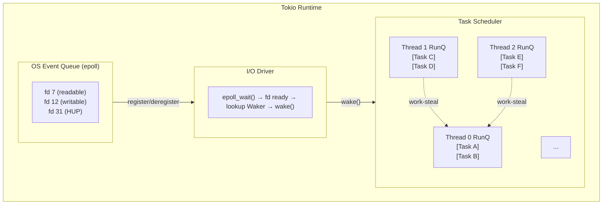

# Lesson 3: Async/Await, Futures, and Runtime Architecture

## 1. First-Principles Intuition & Invariants

Every concurrent system confronts the same physical reality: a CPU core executes exactly one instruction stream at a time, yet real programs must wait for operationally slow events—network round trips, disk I/O, timer expirations—that arrive orders of magnitude more slowly than the CPU can spin. The traditional answer to this was OS threads: block the calling thread inside the kernel while another thread runs. This model is conceptually clean and maps naturally to sequential reasoning, but it carries irreducible cost. Each thread demands a stack (typically 2–8 MB by default on Linux), a kernel task control block, and participation in the scheduler's preemptive bookkeeping. When a production service handles fifty thousand concurrent connections, the arithmetic is unforgiving: fifty thousand threads consume hundreds of gigabytes of stack space before a single byte of application data has been processed.

The alternative lineage—non-blocking I/O with event loops—solves the memory problem but historically destroyed code clarity. Callback-based systems, as popularized by Node.js and libuv, force programmers to invert control. The natural sequential structure of a protocol exchange ("send request, wait for response, parse headers, wait for body") becomes a chain of closures stored in heap-allocated structures, where error propagation is implicit and stack traces are useless. Developers coined the phrase "callback hell" not as hyperbole but as a precise architectural diagnosis.

Rust's async/await system is the resolution of this tension. It provides the sequential, top-down readability of threaded code while generating, under the hood, the compact state-machine representation of an event-driven system. To understand it correctly, you must resist the temptation to think of `async fn` as a function that "runs in the background." It does not. An `async fn` in Rust, when called, immediately returns a value implementing the `Future` trait without executing a single line of the function body. Execution proceeds only when that future is driven by an executor. This lazy evaluation model is the first and most important invariant of Rust's async system.

The `Future` trait itself is defined with striking minimalism in the standard library:

```rust
pub trait Future {
    type Output;
    fn poll(self: Pin<&mut Self>, cx: &mut Context<'_>) -> Poll<Self::Output>;
}

pub enum Poll<T> {
    Ready(T),
    Pending,
}
```

That is the entire contract. A future is a value that can be polled. When polled, it either completes and returns `Poll::Ready(value)`, or declares it cannot yet make progress and returns `Poll::Pending`. The `Context` parameter carries a `Waker`—a handle the future must clone and store before returning `Pending`. When the external event the future was waiting for arrives (a socket becomes readable, a timer fires), something outside the future invokes `waker.wake()`, which signals the executor to schedule another call to `poll`. This waker notification mechanism is the runtime's nervous system: it replaces the kernel's scheduler preemption with a cooperative, demand-driven re-scheduling signal that lives entirely in userspace.

The word "cooperative" deserves emphasis. Unlike preemptive threading where the OS can interrupt a running thread at any instruction boundary, an async task in Rust yields control only at explicit `.await` points. A future that holds the CPU in a tight computational loop without awaiting anything will starve all other tasks on that executor thread for the duration of that loop. This is not a deficiency to be patched; it is the design contract. The practical invariant is that `async` code must never perform long-running CPU-bound work or blocking system calls without either spawning a dedicated thread (`spawn_blocking` in Tokio) or distributing the work to a thread pool, because such work violates the cooperative scheduling assumption on which the entire runtime is built.

The `.await` syntax is surface sugar over `poll`. When you write `let response = client.get(url).send().await?;`, the compiler desugars this into a loop that calls `poll` on the inner future, returning `Poll::Pending` from the enclosing async function's own state machine whenever the inner future is not yet ready. The elegance is that the compiler handles the mechanical transformation automatically, and the programmer perceives a straight-line, sequential control flow that is semantically equivalent to a blocked thread while being physically as cheap as a function return.

---

## 2. Core Architecture & Mechanics

### The State Machine Transformation

The most important thing a Rust compiler does with an `async fn` is not syntactic desugaring—it is a full state machine code generation pass. Consider a simple async function that reads a line from a socket and echoes it back:

```rust
async fn echo_line(mut stream: TcpStream) {
    let mut buf = [0u8; 1024];
    let n = stream.read(&mut buf).await.unwrap();
    stream.write_all(&buf[..n]).await.unwrap();
}
```

The compiler sees two await points and generates an enum with three variants, one per state between awaits plus the initial state:

```text
State 0 (Start):       hold `stream`, `buf`; begin polling `read` future
State 1 (AfterRead):   hold `stream`, `buf`, `n`; begin polling `write_all` future
State 2 (Done):        terminal state
```

This enum is the actual type returned by `echo_line(stream)`. Its memory footprint is the size of its largest variant—critically, it holds only the variables that are live across each await point, not the entire stack frame for the whole function. For a function that processes a large local buffer before an await but then no longer needs it, the compiler's liveness analysis ensures that buffer is not part of the future's allocation after that point. This is structurally superior to a thread stack, which preserves the entire call frame regardless of what is actually needed.

The generated poll implementation is roughly equivalent to:

```rust
impl Future for EchoLineFuture {
    type Output = ();

    fn poll(mut self: Pin<&mut Self>, cx: &mut Context<'_>) -> Poll<()> {
        loop {
            match self.state {
                State::Start => {
                    // set up the read future, store waker, transition
                    let fut = self.stream.read(&mut self.buf);
                    self.inner = Some(fut);
                    self.state = State::AfterRead;
                }
                State::AfterRead => {
                    let n = ready!(self.inner.as_mut().unwrap().poll(cx));
                    self.n = n;
                    let fut = self.stream.write_all(&self.buf[..n]);
                    self.inner = Some(fut);
                    self.state = State::Done;
                }
                State::Done => return Poll::Ready(()),
            }
        }
    }
}
```

The `ready!` macro is a convenience that expands to: if `Poll::Pending`, return `Poll::Pending` immediately; if `Poll::Ready(val)`, unwrap the value and continue. Every `.await` in user code corresponds to exactly this pattern at the machine level.

### Pinning Semantics and Why They Exist

The state machine insight creates an immediate memory safety problem. The `echo_line` future holds a reference into its own `buf` field—the read future borrows `&mut buf` where `buf` lives inside the same struct. If you move the struct after storing that self-referential pointer, the pointer becomes dangling. This is the problem that `Pin<&mut Self>` solves, and it is worth understanding precisely because it is the source of most confusion newcomers encounter in async Rust.

`Pin<P>` is a wrapper around a pointer type `P` that carries a compile-time guarantee: the value behind that pointer will never be moved again, as long as the value's destructor has not run. For a type `T: !Unpin`, the compiler refuses to provide a safe `&mut T` from a `Pin<&mut T>`, because `&mut T` would allow calls to `mem::swap` or other move operations. The type system enforces the no-move invariant that safe async futures require.

In practice, most async code never touches `Pin` directly. The compiler inserts the necessary pinning when transforming `async fn` into state machines. You encounter `Pin` explicitly when implementing `Future` manually, when writing executor code, or when working with `pin_project` crate macros in custom combinator types. The key practitioner knowledge is this: heap-allocated futures via `Box::pin(future)` or `tokio::spawn` are always properly pinned; stack-pinned futures via `pin_mut!` or the standard library's `pin!` macro are correct for local scope; and you should never attempt to implement `Unpin` for a type that contains self-referential borrows across async boundaries.

```rust
use std::pin::pin;
use std::future::Future;

// Stack-pinning a future for manual polling (useful in executor internals and custom combinators)
fn drive_to_completion<F: Future>(f: F) -> F::Output {
    let mut f = pin!(f);
    let waker = noop_waker(); // a waker that does nothing — only valid for single-threaded spin loops
    let mut cx = Context::from_waker(&waker);
    loop {
        match f.as_mut().poll(&mut cx) {
            Poll::Ready(val) => return val,
            Poll::Pending => { /* spin — only correct if the future will become ready on next poll */ }
        }
    }
}
```

This pattern is the skeleton of every executor ever written. Production executors replace the spin loop with a proper I/O event notification system.

### Executor Architecture: The Tokio Runtime

Tokio is the dominant async runtime in production Rust systems, and understanding its architecture is essential to reasoning about performance, task scheduling, and backpressure. Tokio's multi-threaded runtime (the `current_thread` variant departs from this in ways noted below) is built around several layered components.

The I/O driver sits at the foundation. It wraps `epoll` on Linux, `kqueue` on macOS and BSD, and `IOCP` on Windows behind a uniform interface. When a Tokio I/O resource (such as `TcpStream`) wants to register interest in readability, it calls into the I/O driver, which registers the file descriptor with the OS event queue. When `poll` returns `Pending`, the resource stores its waker. When the OS signals the descriptor as ready, the I/O driver's event loop wakes up, retrieves the registered waker, and calls `wake()`.

Above the I/O driver sits the task scheduler. Tokio's multi-threaded runtime implements a work-stealing scheduler with one queue per worker thread. Each spawned task becomes an `Arc`-wrapped heap allocation containing the future and a reference to the scheduler. When a waker fires, it atomically enqueues the task handle into the owning thread's local run queue. If that thread's queue is full or the thread is parked, the task may be migrated to another thread's queue. Worker threads that run out of local work steal from the back of a sibling thread's queue, maintaining load balance without a central lock.



Each spawned task is an independent unit of concurrency. `tokio::spawn` moves a future onto the heap, wraps it in an allocation Tokio calls a `Harness`, and places it in the scheduler. The harness stores the future, an atomic state word (tracking whether the task is currently running, idle, or complete), and a reference count. When the scheduler picks up a task, it pins the future in place and calls `poll` through the harness. If `poll` returns `Pending`, the harness atomically transitions the task back to idle; if `Ready`, it drops the future, runs any `JoinHandle` notification, and deallocates the harness.

The `current_thread` scheduler, activated via `#[tokio::main(flavor = "current_thread")]`, runs all tasks on the calling thread. There is no work-stealing and no parallelism. Its advantage is that tasks need not be `Send`—they may hold `Rc<T>` or `Cell<T>` and similar non-thread-safe types, because there is a compile-time guarantee they will never migrate to another thread. This is the right choice for single-threaded embedded environments, WASM targets, and testing harnesses where determinism and low overhead matter more than parallel throughput.

### Channels, Backpressure, and Task Communication

Spawned tasks communicate through channels, and channel selection is an architectural decision with performance consequences. Tokio provides four channel primitives, each with distinct semantics.

`tokio::sync::mpsc` (multi-producer, single-consumer) is the workhorse for fan-in aggregation. The bounded variant is particularly important: its `send` method is itself an async operation that parks the sender until buffer space is available. This creates natural backpressure—a slow consumer automatically slows producers without dropping messages or spinning. Unbounded channels, by contrast, accept sends synchronously and buffer without limit, which makes them dangerous in systems where producers can outpace consumers: memory grows without bound until the process is killed. Use unbounded channels only when you can prove the producer rate is bounded by an external constraint.

`tokio::sync::broadcast` provides one-to-many fanout with a ring buffer. The key invariant is that slow receivers fall behind and may miss messages when the ring buffer wraps around—`recv()` returns `Err(RecvError::Lagged(n))` to indicate dropped messages. This is the right model for event publication (logs, metrics, state snapshots) where dropping old data under load is acceptable, but not for reliable message delivery.

`tokio::sync::oneshot` is a single-use, single-sender, single-receiver rendezvous. It is the idiomatic way to implement request/response patterns inside a single process, where a task sends work to a worker and waits for a result:

```rust
use tokio::sync::oneshot;

async fn process_request(worker_tx: mpsc::Sender<WorkItem>) -> Result<Response, Error> {
    let (resp_tx, resp_rx) = oneshot::channel();
    worker_tx.send(WorkItem { payload: "data", reply: resp_tx }).await?;
    // The calling task parks here without blocking its thread.
    resp_rx.await.map_err(|_| Error::WorkerDied)
}
```

This pattern—embedding a oneshot sender inside a request struct—is ubiquitous in actor-style architectures where a central task serializes access to a resource and sends results back to callers.

---

## 3. High-Performance Optimization & Failure Modes

### Task Granularity and Spawn Overhead

A common mistake in async Rust is spawning a task for every small unit of work. `tokio::spawn` is not free: each call allocates a harness on the heap (typically 128–256 bytes for a minimal future, more for state machines that hold significant data), enqueues a task handle, and may cause a cache miss on the scheduler's run queue. For workloads that process thousands of small items per second, the allocation and scheduling overhead can dominate.

The correct architecture distinguishes between concurrency and task count. If you need to process a stream of one million small records concurrently, do not spawn one million tasks. Instead, spawn a fixed number of worker tasks (matching core count or a measured optimal), feed them through bounded channels, and let each worker process records in a loop. This keeps task count at O(cores) while maintaining the full concurrency benefit of async I/O within each worker.

For CPU-bound sub-tasks that do need parallelism, `tokio::task::spawn_blocking` moves the work onto a dedicated blocking thread pool (default limit 512 threads in Tokio, configurable) that is explicitly designed to block. The calling async task awaits the `JoinHandle` without stalling the executor:

```rust
async fn compute_hash(data: Vec<u8>) -> [u8; 32] {
    tokio::task::spawn_blocking(move || {
        use sha2::{Sha256, Digest};
        let mut hasher = Sha256::new();
        hasher.update(&data);
        hasher.finalize().into()
    })
    .await
    .expect("blocking task panicked")
}
```

The `move` closure transfers ownership of `data` to the blocking thread. This is the idiomatic pattern: never borrow across the `spawn_blocking` boundary because the blocking thread has no connection to the calling future's lifetime.

### select! Semantics and Cancellation Safety

`tokio::select!` polls multiple futures simultaneously and returns when the first one completes, dropping the others. This is powerful but carries a subtlety that causes real production bugs: when a future is dropped mid-way through execution—as happens to all non-winning branches of a `select!`—any state accumulated in that future's intermediate await points is permanently lost. The technical term is cancellation unsafety.

Consider a future that increments a counter at the beginning of an operation and decrements it at the end. If the future is cancelled at the intermediate await, the decrement never runs, and the counter leaks. The same problem applies to any future that acquires a logical resource early and releases it late: a lock guard dropped by cancellation is actually safe (Rust's Drop ensures it), but a protocol state machine that sends a "begin transaction" message and relies on a later "commit" message to complete faces genuine corruption if cancelled between the two.

Tokio documents each of its async methods for cancellation safety in its API documentation. `AsyncRead::read` is cancellation-safe because dropping the future before the read completes simply means no bytes were consumed—a subsequent call to `read` starts cleanly. `AsyncWriteExt::write_all` is not cancellation-safe because a partial write may have already occurred, leaving the peer in an indeterminate state regarding how many bytes it received.

The mitigation pattern for cancellation-unsafe operations is to run them inside a separate spawned task, which is never cancelled unless you explicitly call `abort()` on its handle. The calling code communicates via channels and awaits a oneshot response:

```rust
async fn safe_write_all(stream: Arc<Mutex<TcpStream>>, data: Bytes) -> io::Result<()> {
    let (tx, rx) = oneshot::channel();
    tokio::spawn(async move {
        let mut s = stream.lock().await;
        let result = s.write_all(&data).await;
        let _ = tx.send(result);
    });
    rx.await.map_err(|_| io::Error::new(io::ErrorKind::BrokenPipe, "writer dropped"))?
}
```

The spawned task runs to completion independent of whether the caller is cancelled. The oneshot channel result simply becomes an ignored send error if no receiver is listening.

### Diagnosing Executor Stalls and Latency Spikes

A latency spike in a Tokio-based service almost always traces to one of three causes: a task blocking the executor thread with a synchronous call, a task holding the CPU too long without yielding, or lock contention on a shared resource that serializes multiple tasks onto a single wakeup path.

Tokio's built-in runtime metrics (available on recent versions with the `rt` and `rt-multi-thread` features) expose queue depths, task poll counts, and the number of tasks currently stealing work. For production diagnosis, the `console-subscriber` crate from the Tokio organization integrates with `tokio-console`, a terminal UI that shows per-task poll durations and wakeup rates in real time:

```toml
# Cargo.toml
[dependencies]
tokio = { version = "1", features = ["full", "tracing"] }
console-subscriber = "0.3"
```

```rust
#[tokio::main]
async fn main() {
    console_subscriber::init();
    // ... rest of application startup
}
```

Running `tokio-console` against the process reveals tasks that poll for unusually long durations—the characteristic signature of a blocking call or a long computation inside async context. Tasks that are perpetually pending but never polled indicate a waker that is not firing, which usually means a future returned `Pending` and either stored the wrong waker or failed to register with the I/O driver correctly.

For custom `Future` implementations, the invariant is strict: before returning `Poll::Pending`, you must guarantee that `cx.waker().clone()` has been stored somewhere that will call `wake()` when the awaited condition becomes true. Failing to do so produces a task that parks forever—the async equivalent of a deadlock. The `std::task::Waker` type is both `Clone` and thread-safe (`Send + Sync`), precisely because I/O drivers and OS callback paths need to store and invoke wakers from outside the async runtime's thread.

### Scaling to Fifty Thousand Concurrent Tasks

The practical ceiling for async Rust tasks is determined by memory, not by scheduler overhead. A minimal `tokio::spawn`ed task—one that simply awaits a channel receive—occupies roughly 300–600 bytes of heap for its harness and state machine. Fifty thousand such tasks consume roughly 30 MB, comfortably within the working set of a modern server process. Compare this to fifty thousand threads consuming 50 GB of stack space at the Linux default, and the magnitude of the difference becomes concrete.

The following complete example spawns ten thousand concurrent TCP echo handlers, each independently managed by the runtime, using bounded channels for backpressure and structured concurrency through `JoinSet`:

```rust
use std::net::SocketAddr;
use tokio::io::{AsyncReadExt, AsyncWriteExt};
use tokio::net::{TcpListener, TcpStream};
use tokio::task::JoinSet;

async fn handle_connection(mut stream: TcpStream, addr: SocketAddr) {
    let mut buf = vec![0u8; 4096];
    loop {
        match stream.read(&mut buf).await {
            Ok(0) => {
                // EOF — peer closed the connection cleanly
                break;
            }
            Ok(n) => {
                if stream.write_all(&buf[..n]).await.is_err() {
                    break;
                }
            }
            Err(_) => break,
        }
    }
    tracing::debug!(%addr, "connection closed");
}

#[tokio::main]
async fn main() -> anyhow::Result<()> {
    tracing_subscriber::fmt::init();

    let listener = TcpListener::bind("0.0.0.0:8080").await?;
    tracing::info!("listening on :8080");

    // JoinSet tracks all spawned tasks and allows structured cleanup.
    let mut set: JoinSet<()> = JoinSet::new();

    loop {
        tokio::select! {
            result = listener.accept() => {
                let (stream, addr) = result?;
                set.spawn(handle_connection(stream, addr));
            }
            // Reap completed tasks to prevent unbounded JoinSet growth.
            Some(result) = set.join_next() => {
                if let Err(e) = result {
                    tracing::warn!("task panicked: {e}");
                }
            }
        }
    }
}
```

Several details in this example represent production best practices. The `JoinSet::join_next()` arm in the `select!` loop reaps completed task handles, preventing the set from growing to hold handles for the lifetime of the process. The inner loop's `Ok(0)` match arm handles clean EOF rather than treating it as an error—a common omission that causes spurious log noise. The buffer is heap-allocated per-connection with `vec![0u8; 4096]` rather than stack-allocated with `[0u8; 4096]`, because large stack arrays inside async state machines increase future size and can cause surprising latency from stack-to-heap spills during polling.

The `tokio::select!` macro itself merits one additional note on fairness. By default, `select!` evaluates branches in a pseudorandom order when multiple are simultaneously ready, preventing starvation of a low-priority branch by a high-throughput one. If you need deterministic priority (always drain the accept queue before reaping completed tasks), you can use `biased;` as the first token in the `select!` body, which causes evaluation in source-code order. This is occasionally useful for protocol state machines where the order of event processing has semantic significance, but should be used sparingly because it reintroduces the starvation risk that the random default was designed to prevent.

The architectural lesson that runs through all of this is that async Rust's performance properties are not emergent—they are the direct consequence of mechanical choices made at the type system level. Cooperative scheduling, state machine code generation, pinning semantics, and the waker notification protocol form a coherent and analyzable system. When a production service behaves unexpectedly under load, the fault will always trace back to a violation of one of these invariants: a blocking call on an executor thread, a cancellation-unsafe operation, a task that never re-registers its waker, or an unbounded data structure that grows without backpressure. Understanding the machinery underneath `async fn` transforms these failures from mysterious regressions into diagnosable, predictable, and preventable engineering problems.
