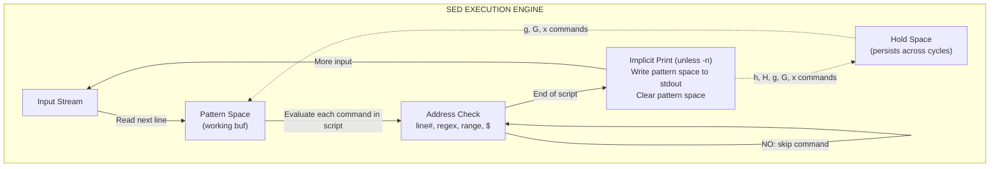

# Lesson 1: Sed Fundamentals — Address Space, Commands, and Execution Model

## 1. First-Principles Intuition & Invariants

The unix philosophy crystallized around a single discipline that most modern tooling has since abandoned: the idea that a program should do one thing and do it well, consuming a byte stream and producing a byte stream, with no state beyond what the current task demands. `sed`, the stream editor written by Lee McMahon at Bell Labs in 1973, is the most rigorous surviving expression of that discipline. Understanding it is not merely a matter of memorizing command syntax; it means internalizing a small but precise virtual machine whose behavior is entirely deterministic given its input stream and its script.

The foundational invariant of `sed` is that it never sees the whole file at once. It operates on one record at a time, where a record is defined as a line delimited by a newline character. This is not a limitation; it is the design. The implication is that every transformation you write must be stateless with respect to any line other than the current one — unless you explicitly move content into the hold space to carry it across cycle boundaries. This constraint forces a programming discipline that scales to arbitrarily large inputs with constant memory, because the input file is never materialized in full. A one-terabyte log file and a ten-line config snippet are processed with identical overhead.

The mental model that most engineers carry into `sed` is wrong in one specific way: they treat it as a find-and-replace tool. It is a Turing-complete (within practical limits) scripting language for stream transformation, with a well-defined instruction set, two general-purpose string registers, an address-based conditional dispatch mechanism, and a branch/label facility. The substitution command `s` is merely the most frequently exercised instruction in that language, not the whole of it.

Before writing a single command, you need to fix the execution contract in your mind. `sed` maintains two string buffers across its lifetime: the **pattern space** and the **hold space**. The pattern space is the working register — the buffer into which the current input line is loaded at the start of each cycle. The hold space is a persistent accumulator, initialized to an empty string and preserved unchanged across cycles unless you explicitly write to it. At the end of each cycle, unless the `-n` flag suppresses it, `sed` prints the contents of the pattern space and clears it, then advances the input pointer to the next line and begins the cycle again. This automatic print-at-end-of-cycle behavior is the **implicit print**. Every command you write either consumes that cycle, modifies the pattern space in place, or exits early — but the implicit print always fires unless you cancel it.

The POSIX specification governs baseline `sed` behavior, and two implementations matter practically: GNU `sed` (the default on Linux) and BSD `sed` (the default on macOS and other BSDs). They are largely compatible for the material covered here, but they diverge on the `-i` in-place flag (GNU requires no space between `-i` and the suffix; BSD requires the suffix as a separate argument), on certain extensions like `\w` in addresses, and on the `R`/`W` commands for single-line file I/O. Where behavior differs, examples in this lesson are written to the POSIX common subset unless GNU extensions are explicitly noted.

---

## 2. Core Architecture & Mechanics

### The Execution Cycle

The `sed` virtual machine executes a fixed algorithm for every line of input. Visualizing this loop precisely is more valuable than any reference card:



A concrete way to verify this model against an implementation is to watch `sed` with no commands at all:

```bash
printf 'alpha\nbeta\ngamma\n' | sed ''
```

This produces the input unchanged. The pattern space is loaded, the script is empty so no commands fire, and the implicit print writes the pattern space to stdout. Three cycles, three prints, three identical lines. If you add `-n`:

```bash
printf 'alpha\nbeta\ngamma\n' | sed -n ''
```

You get silence — the implicit print is globally suppressed, nothing explicitly prints, and the output is empty. These two behaviors are the axis around which all `sed` scripting rotates.

### The Address Space

An address in `sed` is a predicate: a condition that determines whether a command applies to the current cycle. If a command carries no address, it applies to every line unconditionally. If it carries one address, it applies only on the cycle where that address matches. If it carries two addresses (a range), it applies on every cycle from the first match through the second match, inclusive, and then resets.

A **line-number address** is an integer literal that matches exactly when the internal line counter equals that number. Line numbering begins at 1. The special address `$` matches the last line of input, which is determined dynamically as the input is consumed — `sed` does not need to seek to the end of the file to know when it has arrived there, because EOF on the read is the signal. This is why `$` works correctly on pipes and non-seekable streams.

```bash
# Print only the third line
sed -n '3p' /etc/hosts

# Delete the last line
sed '$d' somefile.txt

# Replace 'foo' with 'bar' only on lines 5 through 10
sed '5,10s/foo/bar/g' input.txt
```

A **regex address** is a pattern enclosed in `/` delimiters. It matches any line whose current pattern space content matches the extended or basic regular expression (BRE by default in POSIX; GNU `sed` with `-E` activates ERE). Two regex addresses form a range that activates on the first line matching the opening pattern and deactivates after the first subsequent line matching the closing pattern. This is a stateful range: the engine tracks whether it is currently "inside" the range with an internal boolean flag per range expression.

```bash
# Delete all lines between a line containing 'BEGIN' and one containing 'END', inclusive
sed '/BEGIN/,/END/d' config.txt

# Substitute only inside a function block delimited by braces
sed '/^function foo/,/^}/s/old_var/new_var/g' script.js
```

One critical invariant of regex ranges: once activated, the closing pattern is tested starting from the line *after* the opening match. This means a line cannot simultaneously be both the start and end of a range. If the opening and closing patterns match the same line, the range opens on that line and continues until a subsequent line matches the closing pattern. This catches many engineers off guard when they write ranges like `/pattern/,/pattern/` expecting it to match a single line.

The **negation operator** `!` inverts any address or range, applying the command to all lines that do *not* match:

```bash
# Print every line that does not contain 'DEBUG'
sed -n '/DEBUG/!p' app.log

# Delete every line except the last
sed -n '$!d' file.txt   # This is equivalent but subtle; better expressed differently
```

### The Command Repertoire

`sed`'s command set is small and orthogonal. Each command is a single character, optionally preceded by an address.

The **`s` command** is the workhorse. Its syntax is `s/regexp/replacement/flags`. The delimiter `/` can be replaced by any character that does not appear in the regexp or replacement, which matters when matching paths: `s|/usr/local|/opt|g` is cleaner than escaping every slash. The replacement string treats `&` as the entire matched text and `\1` through `\9` as back-references to parenthesized capture groups. The `g` flag replaces all non-overlapping matches on the line rather than just the first. The `I` flag (GNU extension) makes the match case-insensitive. The `p` flag prints the pattern space after a successful substitution — useful with `-n` to emit only lines that were changed.

```bash
# Extract the HTTP method from an access log line
# Input: 192.168.1.1 - - [01/Jan/2025] "GET /api/v1/users HTTP/1.1" 200 512
sed -n 's/.*"\([A-Z]*\) .*/\1/p' access.log

# Normalize Windows CRLF line endings to Unix LF
sed 's/\r//' windows_file.txt

# Replace the second occurrence of 'token' on each line, not the first
sed 's/token/TOKEN/2' input.txt
```

The **`p` command** prints the pattern space. Under normal (non-`-n`) operation, this causes double-printing: the explicit `p` fires, and then the implicit print fires at end of cycle. Under `-n`, `p` is the only way to produce output, which makes `-n` the standard way to build filters that emit a subset of lines.

The **`d` command** deletes the pattern space and immediately starts the next cycle, skipping the remainder of the script and the implicit print. This is the right tool for filtering out unwanted lines. Its interaction with branch labels is important: `d` does not branch to a label; it unconditionally terminates the current cycle.

The **`q` command** prints the pattern space (unless `-n`) and exits `sed` entirely after processing the addressed line. `Q` (GNU extension) exits without printing. These are valuable for efficiently reading the head of a large file without consuming the entire stream:

```bash
# Print the first 10 lines and stop, without reading the rest
sed '10q' enormous_file.log
```

The **`y` command** performs character transliteration: `y/source/dest/` maps each character in `source` to the corresponding character in `dest`, like `tr`. It is applied to the entire pattern space and cannot be addressed to specific matches within a line the way `s` can.

```bash
# Convert lowercase vowels to uppercase
sed 'y/aeiou/AEIOU/' input.txt
```

The **`a`, `i`, and `c` commands** append text after, insert text before, and replace (change) the entire matched line, respectively. In GNU `sed`, these can be written inline with a backslash continuation or, more readably, with a following argument:

```bash
# Insert a comment header before every line matching a section marker
sed '/^\[section\]/i\# --- section boundary ---' config.ini

# Append a newline and a closing tag after every <item> element
sed '/<item>/a\</item>' malformed.xml

# Replace an entire matched line with new content
sed '/^version =.*/c\version = 2.0.0' Cargo.toml
```

### Pattern Space and Hold Space Operations

The hold space enables the most powerful `sed` programs: multi-line transformations, paragraph-mode processing, and line reordering. Four commands govern the relationship between the two registers.

`h` copies the pattern space into the hold space, overwriting it. `H` appends the pattern space to the hold space with an intervening newline. `g` copies the hold space into the pattern space, overwriting it. `G` appends the hold space to the pattern space with an intervening newline. The fifth relevant command is `x`, which exchanges the two spaces atomically.

A canonical example is reversing the lines of a file. The idiom works by accumulating all lines in the hold space and then printing them in reverse:

```bash
# Reverse line order using hold space accumulation
sed -n '1!G;h;$p' input.txt
```

Tracing this for a three-line file `a`, `b`, `c`:

Cycle 1 (line `a`): The address `1!G` does not match (line 1), so `G` is skipped. `h` copies `a` into the hold space. The `$` does not match (not last line), so `p` is skipped. Hold: `a`. Pattern: `a`.

Cycle 2 (line `b`): `1!G` matches (not line 1), so pattern space becomes `b\na`. `h` copies `b\na` into hold. `$` does not match. Hold: `b\na`. Pattern: `b\na`.

Cycle 3 (line `c`): `1!G` matches, so pattern space becomes `c\nb\na`. `h` copies that into hold. `$` matches, so `p` fires, printing `c\nb\na` — which outputs three lines in reverse order.

This traces the execution model precisely: the hold space acts as an accumulator stack across three independent cycles, and the commands compose through their side effects on the two shared registers.

### Labels and Branching

`sed` supports a `b` branch command and a `t` conditional branch command. `b label` unconditionally jumps to the named label within the script, or to the end of the script if the label is omitted (triggering the implicit print). `t label` branches to the label only if a successful substitution has occurred since the last line was read or since the last `t` test. Labels are defined with `:label`.

This facility enables loops within a single cycle, which is how `sed` can perform operations like collapsing consecutive whitespace:

```bash
# Collapse multiple spaces into a single space
sed ':loop; s/  / /g; t loop' input.txt
```

The loop fires, replaces all double spaces with single spaces, and if any substitution occurred (meaning there were more double spaces remaining), `t` branches back. When a pass produces no substitution, `t` falls through. This is a convergence loop: it iterates until the pattern space reaches a fixed point with respect to the substitution.

---

## 3. High-Performance Optimization & Failure Modes

### Throughput and Compilation

GNU `sed` compiles its script into an internal representation before processing begins. Address patterns are compiled into regex DFAs, and the command list becomes a fixed dispatch table. This means the cost of regex compilation is paid once regardless of input size, and processing throughput is essentially bounded by the speed at which lines can be read from the input buffer and written to the output buffer — typically memory bandwidth and system call overhead on buffered streams, not `sed` itself.

The practical performance implication is that `sed` is faster than most general-purpose tools for single-pass line filtering precisely because it maintains no heap allocations per line. The pattern space is a fixed buffer that grows only on demand. For files whose lines are pathologically long, that buffer will reallocate, but on typical structured text (logs, source files, config files), it reaches a steady state within the first few hundred lines.

When you are composing multiple `sed` operations, running them as a single invocation with multiple `-e` expressions or a script file is always preferable to piping multiple `sed` processes:

```bash
# Suboptimal: three process spawns, three kernel pipe buffers, three read loops
sed 's/foo/bar/g' input.txt | sed '/^#/d' | sed 's/  */ /g'

# Optimal: one process, one read loop, same transformation
sed -e 's/foo/bar/g' -e '/^#/d' -e 's/  */ /g' input.txt
```

The difference in wall-clock time for small inputs is negligible, but for a 500 MB log file on a production system, the difference between three sequential passes over that data and one pass is the difference between acceptable and unacceptable latency.

### Regex Backtracking and Catastrophic Patterns

`sed` uses POSIX BRE or ERE depending on invocation flags. POSIX regexes use a nondeterministic finite automaton (NFA) with backtracking semantics, not a DFA. This means pathological patterns — particularly those involving nested quantifiers or overlapping alternations on long lines — can exhibit exponential backtracking time. The pattern `\(a*\)*b` matching against a string of a hundred `a` characters with no `b` will cause GNU `sed` to stall.

The mitigation is disciplined pattern authoring: anchor patterns with `^` and `$` wherever the match position is known, avoid nested repetitions, and prefer character classes `[...]` over alternations `\(...\|...\)` when matching character sets. For line-level filtering where you are only testing whether a pattern exists anywhere on a line without capture, `grep` will often outperform `sed` for the selection step, and you can pipe into `sed` only for the transformation step.

### In-Place Editing and Atomicity

The `-i` flag edits files in place. GNU `sed` implements this by writing to a temporary file and renaming it over the original — the rename is atomic on POSIX filesystems at the directory level, meaning a reader will see either the old file or the new file, never a partial write. However, the temporary file is created in the same directory as the original, so if that directory is on a filesystem with limited free space, the operation can fail mid-way.

```bash
# In-place substitution with a backup (GNU sed)
sed -i.bak 's/localhost/db.internal/g' database.conf

# In-place substitution with a backup (BSD/macOS sed)
sed -i '.bak' 's/localhost/db.internal/g' database.conf
```

The backup suffix is strongly advisable in scripts. The temptation to use `sed -i ''` (no backup) on a critical config file has caused production incidents. For deterministic rollback in automated tooling, write to a named temp file, verify the output, then rename:

```bash
tmpfile=$(mktemp)
sed 's/old_endpoint/new_endpoint/g' service.conf > "$tmpfile" \
  && mv "$tmpfile" service.conf \
  || rm -f "$tmpfile"
```

This pattern guarantees that `service.conf` is replaced only if `sed` exits successfully, and the original is preserved if anything fails.

### Multi-Line Patterns and the `N` Command

A common failure mode is writing a `sed` script that expects to match content spanning a line boundary, only to discover that `sed`'s regex operates on single lines by default. The `N` command reads the next line and appends it to the pattern space with an embedded newline, allowing the subsequent regex to span what were two separate lines. The `.` metacharacter does not match newlines by default, so multi-line spans require `\n` explicitly in the pattern:

```bash
# Join any line ending with a backslash to the next line
sed ':a; /\\$/ { N; s/\\\n//; ba }' makefile_fragment

# Remove a two-line XML element where the opening and closing tags are on separate lines
sed '/<error>/,/<\/error>/{ /<error>/N; s/<error>[^<]*<\/error>//; }' output.xml
```

The `N` command on the last line of input has historically divergent behavior: POSIX says `sed` should exit without printing when `N` is executed on the last line and there is no next line to read; GNU `sed` prior to 4.3 did exactly this; modern GNU `sed` prints the pattern space instead. Scripts that rely on the POSIX behavior will misfire on GNU `sed` 4.3+. The safe idiom is to guard `N` with a last-line check:

```bash
sed '$!N; s/\n/ /' input.txt
```

This reads the next line into the pattern space on every line except the last, joining pairs of lines. On the last line, `N` is skipped, and the final line prints normally.

### Composing `sed` with the Broader Toolchain

`sed` is not a data extraction tool. When the task involves column extraction, arithmetic, or associative lookups, `awk` owns that work. `sed` is a transformation and filtering engine operating on the character stream level. The boundary between the two is clearest when you find yourself reaching for `sed`'s hold space to perform what is essentially a join or aggregation: that is `awk`'s domain.

For build systems and release automation, `sed` is the canonical tool for bumping version strings in manifests, substituting environment-specific endpoints into config templates, and stripping or inserting comment blocks in source files before packaging. These are single-pass, line-local operations — exactly the class of problems the `sed` execution model is built for. When the transformation requires knowledge of a line's position relative to others in a non-contiguous way, the hold space is your bridge, but the script's complexity grows proportionally. If a `sed` script exceeds roughly fifteen lines of commands, it has likely crossed the boundary where a small Python or Ruby script would be more maintainable, debuggable, and correct.

The execution model described in this lesson — the fixed cycle, the two-register machine, the address predicate dispatching commands against the pattern space — is the complete foundation. Every advanced `sed` idiom, from paragraph-mode processing to in-place multi-file transformation, is a composition of these primitives. Fluency comes from tracing cycles mentally before executing scripts on live data: load, test address, execute command, implicit print, repeat. That discipline, applied to any `sed` script you encounter, will decode it completely.
