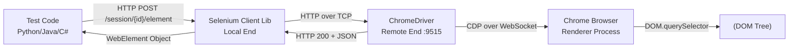

# Lesson 1: WebDriver Architecture, W3C Protocol Semantics

## 1. First-Principles Intuition & Invariants

Browser automation, at its mechanical core, is a problem of exerting programmatic control over a process that was designed for human interaction. A web browser renders pixels to a screen, consumes keyboard and mouse events from an operating system's input queue, and executes JavaScript within a sandboxed execution engine. None of these interfaces were designed to be driven by an external process. The central engineering challenge that WebDriver solves is the construction of a stable, standardized control plane that sits between an automation client and a browser process, translating declarative intent—navigate to this URL, find this element, send these keystrokes—into the native instrumentation hooks of a specific browser implementation.

The fundamental invariant of the WebDriver architecture is its client-server model. Your test code, whether written in Java, Python, C#, or Ruby, is the client. It never speaks directly to the browser. Instead, it speaks HTTP to a driver server process—a separate executable running on the same machine or on a remote host—that itself maintains a long-lived connection to a browser process. This separation is not accidental. It is what allows a test suite written in Python on a macOS laptop to drive a Chrome browser running inside a Docker container on a Linux CI server in a cloud datacenter. The protocol is the contract; the wire format is the lingua franca.

The historical evolution of this protocol is essential context. The original Selenium project, beginning with Selenium RC (Remote Control) around 2004, took an injection-based approach. It injected JavaScript into the browser's loaded page and used that JavaScript as a puppeteer to manipulate the DOM. This approach was fundamentally limited because it operated within the browser's same-origin policy sandbox. It could not reliably drive cross-origin iframes, handle file upload dialogs, or control the browser chrome itself—the navigation bar, the tab bar, the window decorations. It was, in essence, automating the page, not the browser.

WebDriver, conceived by Simon Stewart at Google around 2006, inverted this architecture. Instead of injecting code into the page, it operated from outside the browser, attaching to it through browser-specific extension mechanisms and native instrumentation. In the early days, this meant a Firefox extension for Firefox, a COM-based `IEAutomation` interface for Internet Explorer, and per-build instrumentation for Chrome. Each driver implementation spoke a different protocol. The original inter-driver protocol was the JSON Wire Protocol (JSONWP), a RESTful HTTP protocol that used a custom, non-standardized set of endpoints and a custom status code table. It worked, but it was underspecified. Different drivers interpreted the same commands differently. Capability negotiation—the process of declaring what your test needs from the browser, such as a specific platform or proxy configuration—used `desiredCapabilities` and `requiredCapabilities`, a loose naming scheme with no formal validation.

The W3C WebDriver specification, which reached Recommendation status in 2018, replaced JSONWP with a rigorously defined standard. It formalized the endpoint structure, the capability negotiation model, the error reporting format, and the session lifecycle. Every major browser driver—ChromeDriver, GeckoDriver, SafariDriver, EdgeDriver—now implements the W3C protocol as its primary interface. The specification defines two roles: the local end (the client library that initiates HTTP requests) and the remote end (the driver server that receives those requests and controls the browser). A middleware node, such as a Selenium Grid hub or a Selenoid instance, can sit between them, acting as a reverse proxy that routes commands to the appropriate driver based on session capabilities.

The core invariants of the W3C model are these: every command is an HTTP request with a defined method and path template. Every session is stateful, identified by a UUID, and all commands within a session are serialized—the driver processes one command at a time per session. The protocol uses a strict JSON schema for request and response bodies. Capabilities are negotiated at session creation time and are immutable for the life of the session. Errors are reported via a structured JSON error object with a standard taxonomy of error codes, not via HTTP status codes alone. These invariants are what make the protocol tractable for implementors and predictable for consumers.

## 2. Core Architecture & Mechanics

### The Client-Driver-Browser Signal Path

To understand the architecture mechanically, trace a single command from test code to DOM mutation. A Python test calls `driver.find_element(By.ID, "submit")`. The Selenium Python client library serializes this into an HTTP POST request to the path `/session/{session_id}/element` with a JSON body containing the locator strategy and value. The driver server—let us assume ChromeDriver listening on port 9515—receives this request, parses the session ID from the path, looks up the associated browser connection in its internal session table, and translates the W3C command into a Chrome DevTools Protocol (CDP) call. Specifically, it issues a `DOM.querySelector` or `DOM.getElementById` command over the CDP WebSocket connection that ChromeDriver maintains with the Chrome browser process. Chrome's internal DevTools agent receives the CDP message, executes the DOM lookup within the renderer process, and returns the result (or a failure) back over the WebSocket. ChromeDriver then maps that result into the W3C response format—a JSON object containing the element's opaque reference ID—and returns it as the HTTP response body with a 200 status code.

The element reference returned is not a DOM node. It is an opaque, driver-assigned identifier—a string like `"f6a5b8c3-1d2e-4f5a-9b8c-0a1b2c3d4e5f"` in the W3C model. Subsequent commands that operate on this element, such as `element.click` or `element.sendKeys`, include this reference ID in the URL path: `POST /session/{session_id}/element/{element_id}/click`. The driver maps the reference ID back to its internal handle and issues the corresponding CDP command. This indirection is what allows the client library to treat elements as first-class objects without holding a live pointer into the browser's memory space, which would be meaningless across a process boundary.



The diagram above shows the full signal path for a `findElement` command. The critical architectural insight is that there are two distinct protocol layers in play. The client-to-driver layer uses the W3C WebDriver protocol over HTTP. The driver-to-browser layer uses a browser-native protocol—CDP for Chromium-based browsers, Marionette for Firefox—which is an implementation detail of the driver and is invisible to the test code. This two-layer design is what enables the W3C standard to exist: the specification only governs the outer layer, leaving vendors free to instrument their browsers however they choose internally.

### Session Lifecycle and Capability Negotiation

The session is the fundamental unit of state in the W3C model. A session is created by sending a POST request to `/session` with a JSON body containing a `capabilities` object. The response returns a `sessionId` (a UUID) and the negotiated `capabilities`—the subset of requested capabilities that the driver actually agreed to honor. The session persists until the client sends a DELETE request to `/session/{session_id}`, or until the driver process terminates.

Capability negotiation in the W3C model replaces the JSON Wire Protocol's loose `desiredCapabilities`/`requiredCapabilities` pair with a more precise structure. The `capabilities` object contains two fields: `alwaysMatch` and `firstMatch`. The `alwaysMatch` block specifies capabilities that the driver must satisfy to create the session—if any of them cannot be met, session creation fails with a `session not created` error. The `firstMatch` field is an array of capability objects, where the driver attempts to match each one in order and uses the first that succeeds. This allows the client to express preferences: "I want Chrome on Linux, but I will accept Firefox on any platform as a fallback."

Below is a complete, real HTTP exchange for session creation against a ChromeDriver instance. This is the raw protocol as it appears on the wire:

```http
POST /session HTTP/1.1
Host: localhost:9515
Content-Type: application/json
Content-Length: 412

{
  "capabilities": {
    "alwaysMatch": {
      "browserName": "chrome",
      "platformName": "linux",
      "acceptInsecureCerts": true,
      "goog:chromeOptions": {
        "args": ["--headless=new", "--no-sandbox", "--disable-gpu", "--window-size=1920,1080"],
        "prefs": {
          "download.default_directory": "/tmp/downloads",
          "profile.default_settings.popups": 0
        }
      }
    },
    "firstMatch": [
      {
        "browserVersion": "stable"
      },
      {
        "browserVersion": "beta"
      }
    ]
  }
}
```

The response, upon successful negotiation, is:

```http
HTTP/1.1 200 OK
Content-Type: application/json
Content-Length: 287

{
  "value": {
    "sessionId": "a1b2c3d4-e5f6-7890-abcd-ef1234567890",
    "capabilities": {
      "browserName": "chrome",
      "browserVersion": "120.0.6099.109",
      "platformName": "linux",
      "acceptInsecureCerts": true,
      "goog:chromeOptions": {
        "args": ["--headless=new", "--no-sandbox", "--disable-gpu", "--window-size=1920,1080"]
      },
      "setWindowRect": true
    }
  }
}
```

The `value` wrapper in the response is a W3C invariant. Every successful W3C WebDriver response wraps its payload in a top-level `value` key. In the JSON Wire Protocol, the response structure varied—some responses returned data directly, others used `value`. The W3C specification eliminated this ambiguity: every 200 OK response body is `{"value": <result>}`. The result for session creation is an object containing the `sessionId` and the matched `capabilities`.

Vendor-prefixed capabilities are a critical mechanism. The W3C specification reserves the `browserName`, `platformName`, `browserVersion`, `acceptInsecureCerts`, `pageLoadStrategy`, `proxy`, `setWindowRect`, `timeouts`, `unhandledPromptBehavior`, and `webSocketUrl` keys as standard. Any non-standard capability must use a vendor prefix: `goog:chromeOptions` for ChromeDriver, `moz:debuggerAddress` for GeckoDriver, `ms:edgeOptions` for EdgeDriver. A driver that receives a capability it does not recognize and that lacks a vendor prefix will reject the session with `invalid argument`. This strictness was a deliberate departure from JSONWP, where unknown capabilities were silently ignored.

### Command Routing and the RESTful Endpoint Contract

The W3C specification defines a fixed set of endpoint templates. Each endpoint is a combination of an HTTP method, a path template, and a defined request/response schema. The path templates use `{variable}` placeholders that the driver substitutes at routing time. The following table enumerates the core endpoints that every conforming driver must implement:

| HTTP Method | Path Template | Command |
|---|---|---|
| POST | `/session` | New Session |
| DELETE | `/session/{session_id}` | Delete Session |
| GET | `/session/{session_id}/title` | Get Title |
| POST | `/session/{session_id}/url` | Navigate To |
| GET | `/session/{session_id}/url` | Get Current URL |
| POST | `/session/{session_id}/element` | Find Element |
| POST | `/session/{session_id}/elements` | Find Elements |
| POST | `/session/{session_id}/element/{element_id}/click` | Element Click |
| POST | `/session/{session_id}/element/{element_id}/value` | Element Send Keys |
| GET | `/session/{session_id}/element/{element_id}/text` | Get Element Text |
| POST | `/session/{session_id}/element/{element_id}/clear` | Element Clear |
| POST | `/session/{session_id}/element/{element_id}/submit` | Element Submit (deprecated in W3C, use form submit) |
| GET | `/session/{session_id}/element/{element_id}/attribute/{name}` | Get Element Attribute |
| GET | `/session/{session_id}/element/{element_id}/css/{property_name}` | Get CSS Value |
| GET | `/session/{session_id}/element/{element_id}/displayed` | Is Element Displayed |
| GET | `/session/{session_id}/element/{element_id}/enabled` | Is Element Enabled |
| GET | `/session/{session_id}/element/{element_id}/selected` | Is Element Selected |
| POST | `/session/{session_id}/element/{element_id}/rect` | Get Element Rect |
| GET | `/session/{session_id}/window` | Get Window Handle |
| GET | `/session/{session_id}/window/handles` | Get Window Handles |
| POST | `/session/{session_id}/window` | Switch To Window |
| POST | `/session/{session_id}/frame` | Switch To Frame |
| POST | `/session/{session_id}/frame/parent` | Switch To Parent Frame |
| POST | `/session/{session_id}/window/new` | New Window |
| DELETE | `/session/{session_id}/window` | Close Window |
| POST | `/session/{session_id}/window/rect` | Set Window Rect |
| GET | `/session/{session_id}/window/rect` | Get Window Rect |
| POST | `/session/{session_id}/cookie` | Add Cookie |
| GET | `/session/{session_id}/cookie` | Get All Cookies |
| DELETE | `/session/{session_id}/cookie/{name}` | Delete Cookie |
| GET | `/session/{session_id}/screenshot` | Take Screenshot |
| POST | `/session/{session_id}/actions` | Perform Actions |
| DELETE | `/session/{session_id}/actions` | Release Actions |
| POST | `/session/{session_id}/alert/accept` | Accept Alert |
| POST | `/session/{session_id}/alert/dismiss` | Dismiss Alert |
| GET | `/session/{session_id}/alert/text` | Get Alert Text |
| POST | `/session/{session_id}/alert/text` | Send Alert Text |

The locator strategies accepted by `Find Element` and `Find Elements` are constrained by the W3C specification to a fixed enumeration: `css selector`, `link text`, `partial link text`, `tag name`, and `xpath`. The JSON Wire Protocol supported additional strategies like `class name` and `name`, which in the W3C model are subsumed by CSS selectors (`class name` maps to `.classname`, `name` maps to `[name="value"]`). A driver that receives an unsupported strategy will respond with `invalid selector`.

A complete `Find Element` exchange, as it appears on the wire, looks like this:

```http
POST /session/a1b2c3d4-e5f6-7890-abcd-ef1234567890/element HTTP/1.1
Host: localhost:9515
Content-Type: application/json
Content-Length: 68

{
  "using": "css selector",
  "value": "#login-form > button[type='submit']"
}
```

```http
HTTP/1.1 200 OK
Content-Type: application/json
Content-Length: 64

{
  "value": {
    "element-6066-11e4-a52e-4f735466cecf": "f6a5b8c3-1d2e-4f5a-9b8c-0a1b2c3d4e5f"
  }
}
```

The element reference key `element-6066-11e4-a52e-4f735466cecf` is a UUID defined by the W3C specification itself, not a driver-chosen key. Every W3C-conformant driver must use this exact key name in the response. This was a deliberate choice to eliminate the inconsistency in JSON Wire Protocol where different drivers used different key names for element references. The client library extracts this UUID-string value and uses it in subsequent commands targeting that element.

### Error Reporting: Structured Failure Semantics

The W3C error model replaces HTTP status code ambiguity with a structured JSON error object. When a command fails, the HTTP response uses a status code in the 4xx or 5xx range, but the meaningful diagnostic information is in the response body. Every error response has this shape:

```json
{
  "value": {
    "error": "no such element",
    "message": "no such element: Unable to locate element: {\"method\":\"css selector\",\"selector\":\"#nonexistent\"}",
    "stacktrace": "#0 0x55a3b2c4d5e6 <unknown>..."
  }
}
```

The `error` field is a string drawn from a fixed enumeration defined by the specification. The following are the most common error codes encountered in production:

| Error String | HTTP Status | Meaning |
|---|---|---|
| `element not interactable` | 400 | The element exists in the DOM but is not visible or not enabled for interaction |
| `element click intercepted` | 400 | Another element would receive the click instead of the target |
| `insecure certificate` | 400 | The page presented a TLS certificate that the driver was not configured to accept |
| `invalid argument` | 400 | A parameter value was rejected as invalid |
| `invalid selector` | 400 | The locator strategy or selector string is malformed |
| `no such element` | 404 | The locator did not match any element in the current DOM |
| `no such frame` | 404 | The frame target does not exist |
| `no such window` | 404 | The window handle does not match any open window |
| `no such alert` | 404 | No JavaScript alert, confirm, or prompt is present |
| `stale element reference` | 404 | The element reference is no longer valid—the DOM changed since it was found |
| `session not created` | 500 | The driver could not create a new session (capabilities mismatch, binary not found) |
| `unknown error` | 500 | An unspecified driver-side failure |
| `unsupported operation` | 404 | The endpoint is valid but this driver does not implement it |
| `timeout` | 500 | A command did not complete within the configured timeout |
| `javascript error` | 500 | JavaScript executed via `executeAsyncScript` threw an exception |
| `move target out of bounds` | 400 | The Actions chain tried to move to coordinates outside the viewport |

The `stale element reference` error deserves particular attention because it is the most frequently misunderstood. An element reference obtained via `findElement` is a snapshot binding to a specific DOM node at a specific point in time. If the page is reloaded, or if a JavaScript framework re-renders that portion of the DOM (as React, Vue, or Angular do when state changes), the original DOM node is destroyed and replaced by a new node. The driver's internal mapping from the reference ID to the DOM node becomes invalid. Any subsequent command targeting that reference will return `stale element reference`. The resolution is to re-query the element with a fresh `findElement` call. This is not a bug in the driver; it is a correct reflection of the fact that the DOM node the test was interacting with no longer exists.

### Browser Driver Implementations: ChromeDriver and GeckoDriver

ChromeDriver is a standalone server process built and maintained by the Chromium team. It is a C++ binary that embeds a HTTP server (built on the `mongoose` embedded web server library in older versions, and a custom HTTP server in recent versions) and maintains a WebSocket connection to Chrome's DevTools agent. When ChromeDriver starts, it either launches a new Chrome process with the `--remote-debugging-port` flag set to a random high port, or attaches to an existing Chrome instance via the `debuggerAddress` capability. It reads the DevTools protocol version from the browser and maps each W3C command to the corresponding CDP domain call. For example, the W3C `Navigate To` command maps to `Page.navigate`, `Find Element` maps to `DOM.querySelector` (with `DOM.getDocument` called first to obtain the document node ID), and `Take Screenshot` maps to `Page.captureScreenshot`.

GeckoDriver serves the same role for Firefox. It is a Rust binary that embeds an HTTP server and communicates with Firefox through the Marionette protocol, a JSON-based protocol sent over a TCP socket. Marionette was originally designed as Firefox's internal remote control protocol, predating the W3C standard. GeckoDriver acts as the translation layer between W3C WebDriver commands and Marionette commands. When a W3C `Find Element` request arrives, GeckoDriver sends a `WebDriver:FindElement` Marionette command to the Firefox process, receives the response, and translates it back into the W3C response format.

The following is a complete, production-grade Selenium client setup in Python that demonstrates the full lifecycle: driver service startup, capability negotiation, session creation, command execution, and session teardown. This code is executable against a real ChromeDriver binary:

```python
import http.client
import json
import time
import subprocess
import socket
import sys
from typing import Optional, Dict, Any


class W3CWebDriverClient:
    """
    A minimal W3C WebDriver protocol client that speaks raw HTTP
    to a driver server. No Selenium library dependency. This
    demonstrates the exact wire protocol that Selenium uses internally.
    """

    def __init__(self, host: str = "localhost", port: int = 9515):
        self.host = host
        self.port = port
        self.session_id: Optional[str] = None

    def _send(
        self,
        method: str,
        path: str,
        body: Optional[Dict[str, Any]] = None
    ) -> Dict[str, Any]:
        conn = http.client.HTTPConnection(self.host, self.port, timeout=30)
        payload = json.dumps(body) if body is not None else None
        headers = {"Content-Type": "application/json"} if payload else {}
        conn.request(method, path, body=payload, headers=headers)
        response = conn.getresponse()
        raw = response.read().decode("utf-8")
        conn.close()

        if not raw:
            return {"value": None}

        result = json.loads(raw)

        if response.status >= 400:
            error = result.get("value", {})
            raise WebDriverError(
                error.get("error", "unknown error"),
                error.get("message", ""),
                error.get("stacktrace", ""),
            )

        return result

    def create_session(self, capabilities: Dict[str, Any]) -> Dict[str, Any]:
        response = self._send("POST", "/session", {"capabilities": capabilities})
        self.session_id = response["value"]["sessionId"]
        return response["value"]["capabilities"]

    def delete_session(self) -> None:
        if self.session_id:
            self._send("DELETE", f"/session/{self.session_id}")
            self.session_id = None

    def navigate_to(self, url: str) -> None:
        self._send("POST", f"/session/{self.session_id}/url", {"url": url})

    def get_title(self) -> str:
        result = self._send("GET", f"/session/{self.session_id}/title")
        return result["value"]

    def find_element(self, using: str, value: str) -> str:
        result = self._send(
            "POST",
            f"/session/{self.session_id}/element",
            {"using": using, "value": value},
        )
        element_key = "element-6066-11e4-a52e-4f735466cecf"
        return result["value"][element_key]

    def element_send_keys(self, element_id: str, text: str) -> None:
        self._send(
            "POST",
            f"/session/{self.session_id}/element/{element_id}/value",
            {"text": text},
        )

    def element_click(self, element_id: str) -> None:
        self._send(
            "POST",
            f"/session/{self.session_id}/element/{element_id}/click",
        )

    def get_element_text(self, element_id: str) -> str:
        result = self._send(
            "GET",
            f"/session/{self.session_id}/element/{element_id}/text",
        )
        return result["value"]

    def execute_script(self, script: str, args: list = None) -> Any:
        result = self._send(
            "POST",
            f"/session/{self.session_id}/execute/sync",
            {"script": script, "args": args or []},
        )
        return result["value"]

    def set_page_load_timeout(self, ms: int) -> None:
        self._send(
            "POST",
            f"/session/{self.session_id}/timeouts",
            {"pageLoad": ms},
        )

    def set_implicit_wait_timeout(self, ms: int) -> None:
        self._send(
            "POST",
            f"/session/{self.session_id}/timeouts",
            {"implicit": ms},
        )

    def set_script_timeout(self, ms: int) -> None:
        self._send(
            "POST",
            f"/session/{self.session_id}/timeouts",
            {"script": ms},
        )

    def take_screenshot(self) -> str:
        result = self._send("GET", f"/session/{self.session_id}/screenshot")
        return result["value"]

    def get_window_rect(self) -> Dict[str, int]:
        result = self._send("GET", f"/session/{self.session_id}/window/rect")
        return result["value"]

    def set_window_rect(self, x: int, y: int, width: int, height: int) -> None:
        self._send(
            "POST",
            f"/session/{self.session_id}/window/rect",
            {"x": x, "y": y, "width": width, "height": height},
        )

    def get_cookies(self) -> list:
        result = self._send("GET", f"/session/{self.session_id}/cookie")
        return result["value"]

    def add_cookie(self, cookie: Dict[str, Any]) -> None:
        self._send("POST", f"/session/{self.session_id}/cookie", {"cookie": cookie})


class WebDriverError(Exception):
    def __init__(self, error_code: str, message: str, stacktrace: str = ""):
        self.error_code = error_code
        self.message = message
        self.stacktrace = stacktrace
        super().__init__(f"[{error_code}] {message}")


def wait_for_port(host: str, port: int, timeout: float = 10.0) -> bool:
    deadline = time.time() + timeout
    while time.time() < deadline:
        try:
            sock = socket.socket(socket.AF_INET, socket.SOCK_STREAM)
            sock.settimeout(0.5)
            result = sock.connect_ex((host, port))
            sock.close()
            if result == 0:
                return True
        except socket.error:
            pass
        time.sleep(0.2)
    return False


def main():
    chromedriver_path = "/usr/bin/chromedriver"

    driver_process = subprocess.Popen(
        [chromedriver_path, "--port=9515", "--verbose", "--log-path=/tmp/chromedriver.log"],
        stdout=subprocess.PIPE,
        stderr=subprocess.PIPE,
    )

    try:
        if not wait_for_port("localhost", 9515, timeout=10.0):
            print("ChromeDriver failed to start within 10 seconds")
            sys.exit(1)

        client = W3CWebDriverClient("localhost", 9515)

        capabilities = {
            "alwaysMatch": {
                "browserName": "chrome",
                "platformName": "linux",
                "acceptInsecureCerts": True,
                "goog:chromeOptions": {
                    "args": [
                        "--headless=new",
                        "--no-sandbox",
                        "--disable-gpu",
                        "--disable-dev-shm-usage",
                        "--window-size=1920,1080",
                    ],
                    "prefs": {
                        "download.default_directory": "/tmp/downloads",
                        "profile.default_content_setting_values.notifications": 2,
                    },
                },
            }
        }

        negotiated = client.create_session(capabilities)
        print(f"Session created. Browser: {negotiated.get('browserName')} "
              f"{negotiated.get('browserVersion')}")

        client.set_page_load_timeout(30000)
        client.set_implicit_wait_timeout(5000)

        client.navigate_to("https://www.example.com")
        print(f"Page title: {client.get_title()}")

        heading = client.find_element("css selector", "h1")
        heading_text = client.get_element_text(heading)
        print(f"H1 text: {heading_text}")

        body_text_length = client.execute_script(
            "return document.body.innerText.length;"
        )
        print(f"Body text length: {body_text_length}")

        cookies = client.get_cookies()
        print(f"Cookie count: {len(cookies)}")

        rect = client.get_window_rect()
        print(f"Window rect: {rect}")

        client.add_cookie({
            "name": "test_session_id",
            "value": "abc123def456",
            "path": "/",
            "secure": True,
            "httpOnly": True,
            "sameSite": "Strict",
        })

        screenshot_b64 = client.take_screenshot()
        print(f"Screenshot base64 length: {len(screenshot_b64)}")

    except WebDriverError as e:
        print(f"WebDriver error: {e}")
    finally:
        if client.session_id:
            client.delete_session()
            print("Session deleted.")
        driver_process.terminate()
        driver_process.wait(timeout=5)
        print("ChromeDriver process terminated.")


if __name__ == "__main__":
    main()
```

This client implementation is deliberately built on the standard library's `http.client` module to expose the raw protocol mechanics. The Selenium Python library (`selenium-webdriver` on PyPI) wraps this exact same protocol in higher-level abstractions—the `WebDriver` class, the `WebElement` class, the `By` enum—but the wire format is identical. Understanding the raw protocol is essential for debugging driver-level failures, for building Selenium Grid alternatives, and for understanding why certain operations are slow (they require multiple HTTP roundtrips).

### Actions API: The Input State Machine

The W3C specification introduced the Actions API as a unified model for complex input sequences—mouse movements, key chords, drag-and-drop, touch gestures—that the JSON Wire Protocol handled through ad hoc, inconsistent commands. The Actions API models input as a set of virtual devices, each with its own state. A `POST /session/{session_id}/actions` request carries a `actions` array, where each entry defines a device type (`pointer`, `key`, `wheel`), a device ID, and a sequence of tick-by-tick operations. The driver executes all devices' operations in parallel, advancing one "tick" at a time across all devices.

A complete drag-and-drop action sequence, as it appears in the wire protocol, demonstrates the structure:

```json
{
  "actions": [
    {
      "type": "pointer",
      "id": "mouse1",
      "parameters": {"pointerType": "mouse"},
      "actions": [
        {"type": "pointerMove", "duration": 0, "x": 100, "y": 200},
        {"type": "pointerDown", "button": 0},
        {"type": "pause", "duration": 100},
        {"type": "pointerMove", "duration": 200, "x": 300, "y": 400},
        {"type": "pointerUp", "button": 0}
      ]
    },
    {
      "type": "key",
      "id": "keyboard1",
      "actions": [
        {"type": "pause", "duration": 0},
        {"type": "pause", "duration": 100},
        {"type": "pause", "duration": 200},
        {"type": "pause", "duration": 200}
      ]
    }
  ]
}
```

The `pause` actions in the keyboard device are alignment ticks—they keep the keyboard device in sync with the mouse device so that both devices complete their sequences at the same tick count. The driver processes tick 0 across all devices, then tick 1, and so on, producing a deterministic, parallel execution. This is the mechanism that makes multi-step drag-and-drop, modifier-key-plus-click chords, and complex gesture recordings reproducible.

### Execute Script: The JavaScript Bridge

The `POST /session/{session_id}/execute/sync` endpoint allows the client to execute arbitrary JavaScript within the page's context. The script receives arguments as a JSON array, and element references passed as arguments are automatically unwrapped to their DOM node equivalents by the driver. The script must return a value that is serializable to JSON, or return an element reference (which the driver wraps in the W3C element-key format). Synchronous execution blocks until the script returns. The `execute/async` variant injects a callback function as the last argument; the script must call this callback to signal completion, and the driver waits up to the script timeout duration.

```python
scroll_result = client.execute_script("""
    var element = arguments[0];
    var rect = element.getBoundingClientRect();
    window.scrollTo(rect.left + window.scrollX, rect.top + window.scrollY);
    return {
        scrollTop: window.scrollY,
        scrollLeft: window.scrollX,
        viewportHeight: window.innerHeight,
        elementTop: rect.top,
        elementBottom: rect.bottom
    };
""", [element_id])
```

The `arguments` array is the standard mechanism for passing data into the script. The driver serializes Python/Java objects into JSON, and for element references, it sends the W3C element UUID. When the driver injects the script into the page, it deserializes the element UUID back into the live DOM node, so `arguments[0]` inside the script is an actual `HTMLElement` object. This bidirectional serialization is what makes the execute-script bridge a practical extension mechanism for operations that the W3C endpoint set does not directly cover.

## 3. High-Performance Optimization & Failure Modes

### Session Management at Scale

The most impactful performance characteristic of WebDriver-based automation is the cost of session creation. Starting a new browser session involves the driver process launching a new browser process, initializing the rendering engine, loading any configured extensions, and establishing the instrumentation connection. For Chrome, this takes 1-5 seconds on a warm machine. For Firefox, which has a heavier initialization path, it can take 3-8 seconds. In a test suite of 500 tests, each creating and destroying its own session, session creation alone consumes 8-40 minutes of wall-clock time.

The standard mitigation is session reuse—creating one session per test class or per test module and reusing it across multiple test methods. This is safe when tests are independent (they do not depend on cookies, localStorage, or DOM state from prior tests) and when each test navigates to a fresh URL at its start. The following pattern demonstrates a thread-safe session pool for parallel test execution:

```python
import threading
from queue import Queue
from typing import Optional


class SessionPool:
    """
    A bounded pool of W3C WebDriver sessions for parallel test execution.
    Each session is created once and reused across tests assigned to it.
    Thread-safe via a semaphore + queue combination.
    """

    def __init__(
        self,
        driver_factory,
        pool_size: int = 4,
        capabilities: Optional[dict] = None,
    ):
        self._factory = driver_factory
        self._capabilities = capabilities or {}
        self._pool: Queue[Optional[W3CWebDriverClient]] = Queue(maxsize=pool_size)
        self._pool_size = pool_size
        self._lock = threading.Lock()
        self._created_count = 0

        for _ in range(pool_size):
            self._pool.put(None)

    def acquire(self) -> W3CWebDriverClient:
        client = self._pool.get()
        if client is None or client.session_id is None:
            client = self._factory()
            client.create_session(self._capabilities)
        return client

    def release(self, client: W3CWebDriverClient, healthy: bool = True) -> None:
        if not healthy or client.session_id is None:
            try:
                client.delete_session()
            except Exception:
                pass
            self._pool.put(None)
        else:
            self._pool.put(client)

    def shutdown(self) -> None:
        while not self._pool.empty():
            client = self._pool.get_nowait()
            if client is not None and client.session_id is not None:
                try:
                    client.delete_session()
                except Exception:
                    pass


def run_test_with_pool(pool: SessionPool, test_fn, *args, **kwargs):
    client = pool.acquire()
    healthy = True
    try:
        return test_fn(client, *args, **kwargs)
    except Exception:
        healthy = False
        raise
    finally:
        pool.release(client, healthy=healthy)
```

The pool pre-allocates slots and lazily creates sessions on first acquisition. When a test fails (an exception propagates), the session is marked unhealthy and destroyed on release, so the next test that acquires that slot gets a fresh session. This pattern is the foundation of scalable Selenium Grid usage: the grid manages the driver processes, and the client manages the session lifecycle.

### Implicit vs. Explicit Wait Semantics

The most common source of flaky tests in WebDriver suites is timing: the test attempts to interact with an element before the page has finished loading it. The W3C protocol provides two mechanisms to address this, and conflating them is a frequent error.

The implicit wait timeout, set via `POST /session/{session_id}/timeouts` with the `implicit` key, instructs the driver to poll for elements during `Find Element` and `Find Elements` commands. If the element is not immediately present, the driver retries the lookup at its own discretion until the timeout elapses, then returns `no such element` if it still has not appeared. This timeout applies to every single `findElement` call for the rest of the session. It is a blunt instrument. Setting it to 10 seconds means that a genuinely missing element (a bug in the page, a typo in the selector) costs 10 seconds of test time before the error surfaces.

The explicit wait, implemented client-side, polls a condition function at a short interval and raises a `TimeoutException` only when the overall timeout expires. It is more precise because it can wait for compound conditions—element is present AND visible AND enabled—rather than just presence. The following implementation shows a production-quality explicit wait that works with the raw W3C client:

```python
import time
from typing import Callable, Any


class ConditionTimeout(Exception):
    pass


def explicit_wait(
    client: W3CWebDriverClient,
    condition: Callable[[W3CWebDriverClient], Any],
    timeout_ms: int = 10000,
    poll_interval_ms: int = 200,
) -> Any:
    """
    Poll a condition function until it returns a truthy value or
    the timeout expires. Raises ConditionTimeout on expiry.

    The condition function receives the W3CWebDriverClient and may
    execute any W3C command. WebDriverError exceptions raised by
    'no such element' or 'stale element reference' are caught and
    treated as falsy, allowing the poll to continue.
    """
    deadline = time.time() + (timeout_ms / 1000.0)
    interval = poll_interval_ms / 1000.0

    while time.time() < deadline:
        try:
            result = condition(client)
            if result:
                return result
        except WebDriverError as e:
            if e.error_code not in ("no such element", "stale element reference"):
                raise
        time.sleep(interval)

    raise ConditionTimeout(
        f"Condition not satisfied within {timeout_ms}ms "
        f"(polled every {poll_interval_ms}ms)"
    )


def element_visible_and_enabled(
    client: W3CWebDriverClient,
    using: str,
    value: str,
) -> Optional[str]:
    """Condition: find element, verify it is displayed and enabled."""
    try:
        element_id = client.find_element(using, value)
    except WebDriverError as e:
        if e.error_code == "no such element":
            return None
        raise

    displayed = client._send(
        "GET",
        f"/session/{client.session_id}/element/{element_id}/displayed",
    )["value"]

    enabled = client._send(
        "GET",
        f"/session/{client.session_id}/element/{element_id}/enabled",
    )["value"]

    if displayed and enabled:
        return element_id
    return None
```

A critical rule: never mix implicit and explicit waits in the same session. The W3C specification does not define how they interact, and driver implementations accumulate the timeouts in unpredictable ways. If the implicit wait is 10 seconds and the explicit wait polls a `findElement` that fails, each poll of the explicit wait will itself wait 10 seconds internally before returning `no such element`, multiplying the effective wait time. The safe practice is to set the implicit wait to 0 (the default) and use explicit waits exclusively for all synchronization.

### ChromeDriver-Specific Failure Modes and Diagnostics

ChromeDriver's two-layer architecture (W3C HTTP to CDP WebSocket) introduces failure modes that do not exist in the W3C protocol itself. The most common is the `chrome not reachable` error, which occurs when the Chrome process crashes or the CDP WebSocket connection drops. The driver detects this on the next command and returns `unknown error: Chrome failed to start: chrome not reachable`. The root cause is typically an out-of-memory kill by the OS (Chrome's renderer processes are multi-process and memory-hungry), a missing shared library in a minimal Docker container, or a crash caused by a page that triggers a renderer bug.

The diagnostic procedure starts with ChromeDriver's verbose log, enabled via `--verbose --log-path=/tmp/chromedriver.log`. This log contains every CDP command sent to Chrome and every response received, including error responses that never surface in the W3C layer. The following are the diagnostic commands for a production environment:

```bash
# Start ChromeDriver with verbose logging and a custom port
chromedriver --port=9515 --verbose --log-path=/tmp/chromedriver.log --readable-timestamp

# Check for CDP-level errors in the log
grep -E '\[ERROR\]|chrome not reachable|Target closed|Session not created' /tmp/chromedriver.log

# Verify the Chrome binary exists and is the correct version
google-chrome --version
chromedriver --version

# The Chrome and ChromeDriver major versions must match exactly.
# A version mismatch causes "session not created: Chrome version must be"
# Example: Chrome 120.x requires ChromeDriver 120.x

# Check for missing shared libraries in headless containers
ldd $(which google-chrome) | grep "not found"

# Common missing libraries in minimal Docker images:
#   libnss3, libgbm1, libasound2, libatk-bridge2.0-0, libcups2
# Install on Debian/Ubuntu:
#   apt-get install -y libnss3 libgbm1 libasound2 libatk-bridge2.0-0 libcups2

# Check dmesg for OOM kills of Chrome renderer processes
dmesg | grep -i "killed process" | grep chrome

# Verify /dev/shm size (Chrome uses shared memory for rendering)
# Default Docker /dev/shm is 64MB, which causes crashes on heavy pages
df -h /dev/shm

# Fix: run Docker with --shm-size=2g or use --disable-dev-shm-usage
# (the flag forces Chrome to use /tmp instead of /dev/shm)
```

The `--disable-dev-shm-usage` flag is essential in Docker environments. Chrome uses `/dev/shm` (a tmpfs backed by RAM) for shared memory between its renderer and GPU processes. Docker's default `/dev/shm` allocation is 64MB, which is insufficient for pages with large canvases or heavy DOM manipulation. When Chrome exhausts `/dev/shm`, it crashes silently. The `--disable-dev-shm-usage` flag redirects Chrome to use `/tmp` (backed by disk) instead, at a minor performance cost but with dramatically improved stability. Alternatively, running the container with `--shm-size=2g` allocates 2GB of `/dev/shm` and preserves the performance benefit.

### GeckoDriver and Marionette-Specific Considerations

GeckoDriver's use of the Marionette protocol introduces a different failure profile. Marionette communicates over a TCP socket (default port 2828 internally, though this is not exposed to the client). If the Firefox process is slow to start—a common occurrence on first launch when it must initialize the profile directory—GeckoDriver may time out waiting for the Marionette handshake and return `session not created: Unable to start Marionette`. The diagnostic procedure differs from ChromeDriver:

```bash
# Start GeckoDriver with debug logging
geckodriver --port=4444 --log debug > /tmp/geckodriver.log 2>&1 &

# Check for Marionette connection failures
grep -i "marionette\|connection refused\|timeout" /tmp/geckodriver.log

# Firefox profile corruption can cause startup failures.
# Delete the profile cache to force a clean start:
rm -rf /tmp/rust_mozprofile*

# Verify Firefox binary path (GeckoDriver uses system Firefox by default)
which firefox
firefox --version

# For specific Firefox binary, use moz:firefoxOptions
# in capabilities:
#   "moz:firefoxOptions": {"binary": "/usr/bin/firefox"}

# Check for sandbox issues on Linux (Firefox content sandbox)
# Add to moz:firefoxOptions args:
#   "-no-remote", "-foreground"
```

### Network-Level Failure Modes: Connection Refused and Stale Sessions

When the driver process crashes or is killed by the OS, the HTTP server stops listening on its port. The next W3C command from the client receives a `ConnectionRefusedError` (or `ECONNREFUSED` in Node.js, `ConnectException` in Java). The client library may retry or may propagate the exception immediately. The Selenium Java client, for instance, retries HTTP requests up to a configurable limit (default 2 retries with exponential backoff) before surfacing the error. This retry behavior masks transient driver restarts but can also delay failure detection by several seconds.

A subtler failure is the stale session. If the browser process navigates to a page that hangs (an infinite JavaScript loop, a server that never responds, a page that opens a native dialog), the driver blocks on the CDP or Marionette call and stops responding to W3C commands. The HTTP request from the client times out at the TCP level (after 30 seconds by default in most client libraries). The session is still alive in the driver's session table, but it is unresponsive. The correct recovery is to send a DELETE to destroy the session (which the driver will attempt, possibly timing out again), and if that fails, to kill the driver process and start a new one.

The following production-grade health check and recovery logic handles both failure modes:

```python
import subprocess
import time
import json
import urllib.request
import urllib.error
from typing import Optional


class DriverSupervisor:
    """
    Manages a ChromeDriver process lifecycle with automatic health
    checks and restart-on-crash semantics. Suitable for long-running
    test grids where driver processes must self-heal.
    """

    def __init__(
        self,
        chromedriver_path: str = "/usr/bin/chromedriver",
        port: int = 9515,
        log_path: str = "/tmp/chromedriver.log",
        health_check_interval: float = 30.0,
    ):
        self._path = chromedriver_path
        self._port = port
        self._log_path = log_path
        self._interval = health_check_interval
        self._process: Optional[subprocess.Popen] = None
        self._health_url = f"http://localhost:{port}/status"
        self._running = False

    def start(self) -> None:
        self._process = subprocess.Popen(
            [
                self._path,
                f"--port={self._port}",
                "--verbose",
                f"--log-path={self._log_path}",
                "--readable-timestamp",
            ],
            stdout=subprocess.DEVNULL,
            stderr=subprocess.DEVNULL,
        )
        self._running = True

        if not self._wait_for_health(timeout=15.0):
            raise RuntimeError("ChromeDriver failed health check within 15s")
        print(f"ChromeDriver started on port {self._port}, pid={self._process.pid}")

    def stop(self) -> None:
        self._running = False
        if self._process is not None:
            self._process.terminate()
            try:
                self._process.wait(timeout=5)
            except subprocess.TimeoutExpired:
                self._process.kill()
                self._process.wait(timeout=5)
            self._process = None

    def _wait_for_health(self, timeout: float) -> bool:
        deadline = time.time() + timeout
        while time.time() < deadline:
            try:
                with urllib.request.urlopen(self._health_url, timeout=2) as resp:
                    if resp.status == 200:
                        data = json.loads(resp.read())
                        return data.get("value", {}).get("ready", False)
            except (urllib.error.URLError, ConnectionRefusedError, OSError):
                pass
            time.sleep(0.3)
        return False

    def is_healthy(self) -> bool:
        try:
            with urllib.request.urlopen(self._health_url, timeout=2) as resp:
                if resp.status == 200:
                    data = json.loads(resp.read())
                    return data.get("value", {}).get("ready", False)
        except (urllib.error.URLError, ConnectionRefusedError, OSError):
            return False
        return False

    def ensure_running(self) -> None:
        if self._process is None or self._process.poll() is not None:
            print("ChromeDriver process is not running. Restarting...")
            self.start()
        elif not self.is_healthy():
            print("ChromeDriver health check failed. Restarting...")
            self.stop()
            self.start()

    def run_health_loop(self) -> None:
        while self._running:
            self.ensure_running()
            time.sleep(self._interval)


# Usage in a test runner:
if __name__ == "__main__":
    supervisor = DriverSupervisor(
        chromedriver_path="/usr/bin/chromedriver",
        port=9515,
        log_path="/tmp/chromedriver.log",
        health_check_interval=15.0,
    )

    try:
        supervisor.start()
        client = W3CWebDriverClient("localhost", 9515)
        caps = {
            "alwaysMatch": {
                "browserName": "chrome",
                "goog:chromeOptions": {
                    "args": ["--headless=new", "--no-sandbox", "--disable-dev-shm-usage"],
                },
            }
        }
        negotiated = client.create_session(caps)
        print(f"Session: {client.session_id}")

        client.navigate_to("https://www.example.com")
        print(f"Title: {client.get_title()}")

    finally:
        if client.session_id:
            client.delete_session()
        supervisor.stop()
```

The `/status` endpoint is a W3C-defined endpoint that every driver must implement. It returns a JSON object indicating whether the driver is ready to accept sessions. The `value.ready` field is `true` when the driver has no barriers to creating new sessions (no maximum session limit reached, no initialization in progress). This endpoint is what Selenium Grid hubs use to determine node availability, and it is the correct target for liveness probes in Kubernetes-based test infrastructure.

### Selenium Grid: Distributed Command Routing

Selenium Grid extends the client-driver-browser model by inserting a hub between the client and multiple driver nodes. The client sends W3C commands to the hub's HTTP endpoint (typically port 4444). The hub reads the capability negotiation request from the `POST /session` call, matches it against registered node capabilities, and proxies the entire HTTP exchange to the selected node's driver. Subsequent commands within the session are routed to the same node based on the session ID. The hub maintains a session-to-node routing table in memory.

The Grid's capability matching algorithm evaluates each registered node's advertised capabilities against the `alwaysMatch` and `firstMatch` blocks from the client request. A node matches if it satisfies all capabilities in `alwaysMatch` and at least one entry in `firstMatch`. If multiple nodes match, the hub selects one via a round-robin or least-loaded strategy. This is why capability negotiation is the critical path for Grid reliability: a capability mismatch causes the hub to return `session not created: Unable to match capabilities` even though a suitable browser may be running on a node that failed to register its capabilities correctly.

The Grid 4 architecture (introduced in Selenium 4) replaces the hub-node model with a fully distributed model composed of four components: the Router (receives all client requests), the Distributor (performs capability matching and session assignment), the Session Queue (serializes session creation requests), and the Node (runs the driver and browser). These components communicate via Reactor Netty-based messaging, not HTTP, for internal coordination. The Router is the only externally visible HTTP endpoint. This architecture supports horizontal scaling of both the Router and the Distributor, which was not possible in Grid 3's single-hub model. For production deployments, container orchestration manifests for each component look like this:

```yaml
apiVersion: v1
kind: Service
metadata:
  name: selenium-router
  labels:
    app: selenium-grid
    component: router
spec:
  selector:
    app: selenium-grid
    component: router
  ports:
    - name: http
      port: 4444
      targetPort: 4444
      protocol: TCP
  type: ClusterIP
---
apiVersion: apps/v1
kind: Deployment
metadata:
  name: selenium-router
  labels:
    app: selenium-grid
    component: router
spec:
  replicas: 1
  selector:
    matchLabels:
      app: selenium-grid
      component: router
  template:
    metadata:
      labels:
        app: selenium-grid
        component: router
    spec:
      containers:
        - name: selenium-router
          image: selenium/router:4.21.0
          ports:
            - containerPort: 4444
              name: http
          env:
            - name: SE_ROUTER_HOST
              value: "0.0.0.0"
            - name: SE_ROUTER_PORT
              value: "4444"
            - name: SE_DISTRIBUTOR_HOST
              value: "selenium-distributor"
            - name: SE_DISTRIBUTOR_PORT
              value: "5553"
            - name: SE_SESSIONS_MAP_HOST
              value: "selenium-sessions"
            - name: SE_SESSIONS_MAP_PORT
              value: "5556"
          readinessProbe:
            httpGet:
              path: /status
              port: 4444
            initialDelaySeconds: 10
            periodSeconds: 5
          livenessProbe:
            httpGet:
              path: /status
              port: 4444
            initialDelaySeconds: 30
            periodSeconds: 15
            failureThreshold: 3
---
apiVersion: apps/v1
kind: Deployment
metadata:
  name: selenium-distributor
  labels:
    app: selenium-grid
    component: distributor
spec:
  replicas: 1
  selector:
    matchLabels:
      app: selenium-grid
      component: distributor
  template:
    metadata:
      labels:
        app: selenium-grid
        component: distributor
    spec:
      containers:
        - name: selenium-distributor
          image: selenium/distributor:4.21.0
          ports:
            - containerPort: 5553
              name: grpc
          env:
            - name: SE_DISTRIBUTOR_HOST
              value: "0.0.0.0"
            - name: SE_DISTRIBUTOR_PORT
              value: "5553"
            - name: SE_SESSION_QUEUE_HOST
              value: "selenium-session-queue"
            - name: SE_SESSION_QUEUE_PORT
              value: "5559"
            - name: SE_SESSIONS_MAP_HOST
              value: "selenium-sessions"
            - name: SE_SESSIONS_MAP_PORT
              value: "5556"
---
apiVersion: v1
kind: Service
metadata:
  name: selenium-distributor
  labels:
    app: selenium-grid
    component: distributor
spec:
  selector:
    app: selenium-grid
    component: distributor
  ports:
    - name: grpc
      port: 5553
      targetPort: 5553
      protocol: TCP
  type: ClusterIP
---
apiVersion: apps/v1
kind: Deployment
metadata:
  name: selenium-node-chrome
  labels:
    app: selenium-grid
    component: node-chrome
spec:
  replicas: 4
  selector:
    matchLabels:
      app: selenium-grid
      component: node-chrome
  template:
    metadata:
      labels:
        app: selenium-grid
        component: node-chrome
    spec:
      containers:
        - name: selenium-node-chrome
          image: selenium/node-chrome:4.21.0
          ports:
            - containerPort: 5555
              name: grpc
          env:
            - name: SE_EVENT_BUS_HOST
              value: "selenium-event-bus"
            - name: SE_EVENT_BUS_PUBLISH_PORT
              value: "5557"
            - name: SE_EVENT_BUS_SUBSCRIBE_PORT
              value: "5558"
            - name: SE_NODE_HOST
              value: "0.0.0.0"
            - name: SE_NODE_PORT
              value: "5555"
            - name: SE_NODE_MAX_SESSIONS
              value: "2"
            - name: SE_NODE_SESSION_TIMEOUT
              value: "300"
            - name: SE_NODE_DRAIN_AFTER_SESSION_COUNT
              value: "0"
            - name: SE_VNC_NO_PASSWORD
              value: "true"
            - name: SE_SCREEN_WIDTH
              value: "1920"
            - name: SE_SCREEN_HEIGHT
              value: "1080"
            - name: TZ
              value: "UTC"
          resources:
            requests:
              cpu: "1000m"
              memory: "2Gi"
            limits:
              cpu: "2000m"
              memory: "4Gi"
          volumeMounts:
            - name: dshm
              mountPath: /dev/shm
          securityContext:
            readOnlyRootFilesystem: false
            capabilities:
              add: ["SYS_ADMIN"]
      volumes:
        - name: dshm
          emptyDir:
            medium: Memory
            sizeLimit: 2Gi
```

The `emptyDir` volume with `medium: Memory` mounted at `/dev/shm` replaces the `--disable-dev-shm-usage` flag approach with a direct allocation of 2GB of shared memory per node pod. This is the production-recommended configuration because it preserves Chrome's shared-memory rendering performance while preventing the `/dev/shm` exhaustion crashes. The `SE_NODE_MAX_SESSIONS` environment variable controls how many concurrent browser sessions each node pod will accept. With `replicas: 4` and `maxSessions: 2`, the Grid can run 8 concurrent Chrome sessions, each isolated in its own browser process within the node pod.

The `SE_NODE_DRAIN_AFTER_SESSION_COUNT` setting controls a subtler behavior. When set to a non-zero value, the node will unregister itself from the Grid after completing that many sessions. This is a memory-leak mitigation: Chrome's renderer processes accumulate memory over long-running sessions due to the V8 garbage collector's conservative approach to holding onto compiled JavaScript code. Draining after a fixed session count forces the node pod to restart (when managed by a Kubernetes Deployment with a restart policy), getting a clean process state. Setting it to `0` disables draining, which is appropriate when the node pod itself is ephemeral (as it is in this Deployment, where the pod can be terminated and recreated at any time).

### BiDi Protocol: The Post-W3C Frontier

The W3C specification's HTTP-based command model has a structural limitation: it is strictly request-response. The client must poll for state changes; the driver cannot push events to the client. This makes it impossible to efficiently detect conditions like a page's network activity completing, a JavaScript console message being emitted, or a DOM mutation occurring. The W3C WebDriver BiDi protocol, introduced as a supplement to the base specification, adds a bidirectional WebSocket channel alongside the HTTP channel. The client connects to a WebSocket endpoint (the URL is returned in the session creation response when the `webSocketUrl` capability is set to `true`), and both sides can send and receive messages asynchronously.

The BiDi protocol is what powers modern Selenium 4 features like network interception, DOM mutation observation, and console log capture without polling. A BiDi session is requested by including `"webSocketUrl": true` in the `alwaysMatch` capabilities:

```python
capabilities = {
    "alwaysMatch": {
        "browserName": "chrome",
        "webSocketUrl": True,
        "goog:chromeOptions": {
            "args": ["--headless=new", "--no-sandbox"],
        },
    }
}

response = client._send("POST", "/session", {"capabilities": capabilities})
session_id = response["value"]["sessionId"]
ws_url = response["value"]["capabilities"].get("webSocketUrl")
print(f"BiDi WebSocket URL: {ws_url}")
```

The returned WebSocket URL has the form `ws://localhost:9515/session/{session_id}/bidi`. Once connected, the client sends BiDi commands as JSON messages with a `type` field identifying the command, and receives both responses and unsolicited events. For example, to subscribe to console log events, the client sends:

```json
{
  "id": 1,
  "method": "session.new",
  "params": {}
}
```

Followed by a subscription command:

```json
{
  "id": 2,
  "method": "log.entryAdded",
  "params": {}
}
```

And then receives events as they occur:

```json
{
  "type": "event",
  "method": "log.entryAdded",
  "params": {
    "level": "error",
    "text": "Uncaught TypeError: Cannot read properties of null",
    "timestamp": 1700000000000,
    "stackTrace": {
      "callFrames": [
        {"functionName": "onClick", "lineNumber": 42, "columnNumber": 5, "url": "https://app.example.com/main.js"}
      ]
    }
  }
}
```

This event-driven model eliminates the polling overhead and latency that characterized the HTTP-only era of WebDriver. For high-performance test suites that need to assert on network conditions, console errors, or DOM mutations, the BiDi protocol is the correct tool, and its adoption is the primary architectural evolution in the Selenium ecosystem beyond the base W3C specification covered in this lesson.
