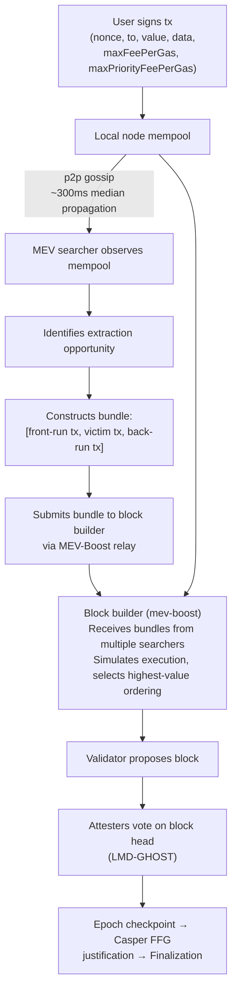

# Lesson 2: Consensus Integration, Finality, Ordering

## 1. First-Principles Intuition & Invariants

Every smart contract developer eventually collides with an uncomfortable truth that the blockchain abstraction works hard to conceal: a transaction is not an event. It is a *claim* — a signed assertion that a state transition should occur — and between the moment that claim leaves your wallet and the moment it crystallizes into canonical history, it passes through a gauntlet of economic incentives, validator discretion, and probabilistic finality that bears almost no resemblance to a database commit. Understanding consensus integration at this level is not academic preparation. It is the prerequisite for writing contracts that behave correctly under adversarial conditions, that price their own execution honestly, and that do not silently lose user funds to ordering attacks that the EVM will never surface as an error.

The foundational invariant of any Byzantine-fault-tolerant distributed ledger is that agreement must be reached among nodes that cannot trust each other, communicating over an asynchronous network, where up to some threshold of participants may behave arbitrarily. The classic result from Fischer, Lynch, and Paterson — the FLP impossibility theorem — proves that no deterministic protocol can guarantee both safety (all nodes agree on the same value) and liveness (the protocol always makes progress) in an asynchronous system where even a single process may fail. Every production consensus mechanism is therefore a carefully engineered compromise: Ethereum's Gasper protocol, for example, achieves safety under honest supermajority conditions and liveness under partial synchrony assumptions, accepting that neither property holds unconditionally.

What this means in practice is that "confirmed" is not a binary state. It is a probability distribution whose mass concentrates over time as more validators attest to a block and as the fork-choice rule makes it progressively more expensive for any coalition to rewrite history. This probabilistic character is what distinguishes blockchain finality from the finality of a serializable database transaction, and it is the root cause of every re-entrancy guard, every commit-reveal scheme, and every withdrawal delay you will encounter in serious smart contract engineering.

Ethereum post-Merge formalizes two distinct finality concepts. *Probabilistic finality* emerges from block confirmation depth: each additional block stacked on top of your transaction's block exponentially increases the economic cost of a reorganization deep enough to exclude it. *Cryptoeconomic finality*, by contrast, is what Gasper's checkpoint mechanism provides. Every 32-slot epoch, the LMD-GHOST fork-choice rule selects a head, and the Casper FFG gadget runs a two-phase commit across the validator set: a block first becomes *justified* when a supermajority of validators (more than two-thirds of staked ETH, by weight) attest to it, and subsequently becomes *finalized* when a supermajority further attest to a block that builds upon it. Once finalized, reverting that checkpoint requires the slashing of at least one-third of all staked ETH — a sum currently exceeding twenty billion dollars — making finality not merely probabilistic but *economically irreversible* under any rational-actor model.

The contract programmer's invariant derived from this architecture is precise: code that depends on a state being permanent should wait for Casper finalization before acting on it. Code that is merely latency-sensitive can act on probabilistic confirmation. These are not interchangeable. An exchange that credits a deposit after six confirmations and a protocol that unlocks a bridge after two epochs are making different security bets, and both are correct for their respective threat models. Conflating them produces bridges that get drained and exchanges that process double-spends.

Transaction ordering introduces a second layer of invariants orthogonal to finality. Within a single block, the EVM executes transactions sequentially in a deterministic order that is chosen by the block proposer. The state visible to transaction N is exactly the state produced by executing transactions 0 through N-1 in sequence. This sequential execution model means that the *position* of a transaction within a block is itself a resource — one that determines whether an arbitrage is profitable, whether a liquidation fires before a price update protects the borrower, and whether a user's slippage tolerance is satisfied or violated. Miners in proof-of-work, and validators in proof-of-stake, have always had the discretion to order transactions within their block however they please, subject only to validity constraints. This discretion is the structural source of Miner Extractable Value — now more precisely termed *Maximal Extractable Value* (MEV) to reflect that the extraction opportunity exists independent of the consensus mechanism.

The core MEV invariant, stated mechanically, is this: any state transition T_1 that creates a profitable opportunity, followed by a state transition T_2 that extracts that profit, can be reordered to (T_2, T_1) if and only if T_2 is valid in the pre-T_1 state. When it is, an adversarial proposer will execute that reordering, capturing the profit that T_1's sender anticipated. When T_2 depends causally on T_1 — as in a sandwich attack, where T_2 is the back-run trade that only profits *because* T_1 moved the market — the proposer inserts T_2 both before and after T_1, extracting value from both directions simultaneously.

---

## 2. Core Architecture & Mechanics

### The Mempool as an Open Order Book

Before a transaction reaches a block, it lives in the mempool — a peer-to-peer gossip network of pending transactions maintained by every full node. The mempool enforces no consensus; it is best-effort replication of unconfirmed state. Each node maintains its own view of the mempool, ordered by effective priority fee, and applies local policies about which transactions to retain and relay. The implication for contract developers is that the mempool is a public broadcast channel. Every transaction you submit, including its calldata, its target address, its value, and its entire execution intent, is visible to every sophisticated MEV actor on the network before it has been included in any block.

The public mempool is therefore not a queue in the computer science sense. It is an adversarial marketplace where your transaction is both a pending state change and a signal — a signal that may trigger front-running, sandwiching, or displacement by a competing transaction with a higher priority fee that invalidates your assumptions before you can execute.

The anatomy of transaction propagation and inclusion follows this sequence:



The separation between *validator* (who proposes and attests) and *builder* (who constructs the execution payload) is the architecture of Proposer-Builder Separation (PBS), which Ethereum has implemented in practice through the MEV-Boost software. Under PBS, validators outsource block construction to a competitive market of builders who bid for the right to have their payload included. The validator simply selects the highest-bid payload whose header they can verify, without needing to know its contents until after they commit to it. This creates a market structure where MEV extraction is professionalized: searchers find opportunities, builders aggregate searcher bundles, and validators passively capture the winning bid. The economic surplus that once accrued entirely to miners now distributes across this stack, but the fundamental extraction mechanics remain unchanged.

### Block Structure and EVM Execution Ordering

Each Ethereum block contains an ordered list of transactions. The EVM processes them sequentially against a shared state trie. The state trie is a Merkle Patricia Trie over all account states, keyed by address. Each account state contains a nonce, a balance, a code hash (for contract accounts), and a storage root (the root of a second Merkle Patricia Trie containing the contract's storage slots).

```text
Block Header
├── parentHash
├── stateRoot       ◄── Root of global state trie after all txs executed
├── transactionsRoot ◄── Root of trie over ordered tx list
├── receiptsRoot    ◄── Root of trie over execution receipts
├── baseFeePerGas   ◄── EIP-1559 base fee (burned, not paid to validator)
└── ...

Block Body
└── Transactions [tx_0, tx_1, ..., tx_n]  ← ORDERED by builder

Execution:
  state_0 ──[tx_0]──▶ state_1 ──[tx_1]──▶ state_2 ── ... ──▶ state_n+1
                                                                     │
                                                              = stateRoot
```

The critical point this diagram makes explicit is that `stateRoot` in the block header is the hash of the state *after* executing all transactions in the given order. Change the order, and you change `state_1` through `state_n`, and therefore change `stateRoot`. Order is not metadata; it is content. Any two blocks with the same transaction set but different orderings are different blocks with different state roots, and the validator's choice of ordering is a first-class consensus parameter.

### Atomicity Across Distributed Validators

Smart contracts execute atomically within a single transaction, but the distributed validator set introduces a subtler atomicity problem: what happens when a contract call spans multiple blocks, or when multiple contracts need to agree on a shared state across an epoch boundary?

Within a single transaction, atomicity is absolute. The EVM runs the entire call tree — including all internal calls, `DELEGATECALL`s, and `CREATE` deployments — and either commits the entire state delta or reverts to the pre-transaction state. The gas mechanism enforces termination, and the call stack is bounded at 1024 frames. This is the EVM's strongest guarantee.

Across transactions within a block, there is no native atomicity. The contract developer must implement it. The standard pattern is the *check-effects-interactions* discipline, which prevents re-entrancy by ensuring all state writes (effects) precede any external calls (interactions) that could recurse back into the contract. The re-entrancy attack on The DAO in 2016 exploited precisely the inversion of this order: an external call to the attacker's contract was made before the internal balance was decremented, allowing the attacker to recursively drain the vault before the balance check ever reflected the previous withdrawal.

```solidity
// UNSAFE: check-interaction-effects (inverted order)
function withdraw(uint256 amount) external {
    require(balances[msg.sender] >= amount, "insufficient");
    // External call before state update — re-entrancy vector
    (bool ok,) = msg.sender.call{value: amount}("");
    require(ok, "transfer failed");
    balances[msg.sender] -= amount;  // Too late: attacker has already re-entered
}

// SAFE: check-effects-interactions
function withdraw(uint256 amount) external {
    require(balances[msg.sender] >= amount, "insufficient");
    balances[msg.sender] -= amount;  // State updated BEFORE external call
    (bool ok,) = msg.sender.call{value: amount}("");
    require(ok, "transfer failed");
}
```

Across blocks, true atomicity is impossible within the EVM's execution model. Cross-block coordination requires protocol-level constructs: timelocks, commit-reveal schemes, and optimistic dispute windows. A commit-reveal scheme, for example, achieves a two-phase atomic operation across blocks by having participants first submit a hash of their action (the commit), then reveal the preimage in a subsequent block. Because the commit is binding but opaque, no observer can front-run a decision they cannot see. The reveal phase executes all revealed commitments against each other simultaneously, eliminating ordering advantage. Sealed-bid auctions, on-chain randomness protocols like RANDAO, and certain AMM designs use variations of this pattern.

### MEV: The Mechanical Taxonomy

MEV extraction manifests in three canonical forms, each exploiting a different ordering invariant.

*Arbitrage* is the simplest form. When the same asset is priced differently across two on-chain markets — say, a Uniswap v3 pool and a Curve pool — a searcher can atomically buy on the cheaper venue and sell on the more expensive one, pocketing the difference. This requires no victim; the searcher simply needs to be the first to include the arbitrage transaction after the price discrepancy appears. Arbitrage is considered "good MEV" in the sense that it tightens spreads and improves price efficiency.

*Liquidation* MEV arises in lending protocols like Aave and Compound. When a borrower's collateral ratio falls below the liquidation threshold — typically due to price oracle updates — their position becomes liquidatable at a discount. Multiple searchers simultaneously detect this and race to submit the liquidation transaction. The winner captures a protocol-defined bonus (commonly 5–10% of the liquidated collateral). Unlike arbitrage, liquidations are zero-sum relative to the borrower: the liquidation premium is extracted from the under-collateralized position.

*Sandwich attacks* are the most economically damaging to ordinary users. The attack requires three transactions that must appear in the order (front-run, victim, back-run). A user submits a large swap on a constant-product AMM with some slippage tolerance. A searcher observes this in the mempool and constructs a bundle: they buy the same asset immediately before the victim (pushing the price up), let the victim's trade execute at the now-worse price, then immediately sell back (profiting from the price impact the victim caused). The victim receives a worse execution price — often at exactly their slippage tolerance limit — while the searcher extracts the difference.

The mechanics of a sandwich attack on a Uniswap v2-style pool follow directly from the constant product invariant `x * y = k`:

```text
Initial state: pool has x=1000 ETH, y=2,000,000 USDC, k=2×10⁹

User intends: swap 10 USDC in, expects ~0.005 ETH out (approximate)
Searcher front-run: buys 50,000 USDC worth of ETH first
  → pool moves to x=975.6 ETH, y=2,050,000 USDC (price of ETH rises ~2.5%)

User tx executes: at the worse price, receives fewer ETH than anticipated
  → slippage check passes only if tolerance was set high enough

Searcher back-run: sells ETH back into the pool at the now-elevated USDC price
  → net profit ≈ price impact caused by user trade × searcher position size
```

The slippage tolerance parameter in AMM calls is therefore not a convenience — it is the primary defense against sandwich attacks, and setting it too high is economically equivalent to leaving money on the table in an adversarial environment.

---

## 3. High-Performance Optimization & Failure Modes

### Hardening Contracts Against Ordering Attacks

The most direct mitigation against sandwich attacks is aggressive slippage enforcement combined with deadline parameters. Every AMM interaction should specify the minimum output amount based on a fresh on-chain price query, and that query should be bounded within the same transaction using the pool's own state. Uniswap v3's router exposes `amountOutMinimum` for exactly this purpose.

```solidity
// SPDX-License-Identifier: MIT
pragma solidity ^0.8.20;

import {ISwapRouter} from "@uniswap/v3-periphery/contracts/interfaces/ISwapRouter.sol";
import {IERC20} from "@openzeppelin/contracts/token/ERC20/IERC20.sol";

contract SlippageHardenedSwapper {
    ISwapRouter public immutable router;
    uint24 public constant FEE_TIER = 3000;

    constructor(address _router) {
        router = ISwapRouter(_router);
    }

    /// @notice Execute a swap with strict slippage and deadline enforcement.
    /// @param tokenIn  Address of input token.
    /// @param tokenOut Address of output token.
    /// @param amountIn Exact input amount.
    /// @param amountOutMinimum Minimum acceptable output; revert if not met.
    ///        Caller MUST compute this from a fresh TWAP or off-chain quote,
    ///        applying no more than 0.5% tolerance for large swaps.
    /// @param deadline Unix timestamp after which the transaction reverts.
    ///        Prevents stuck transactions from executing at stale prices.
    function swap(
        address tokenIn,
        address tokenOut,
        uint256 amountIn,
        uint256 amountOutMinimum,
        uint256 deadline
    ) external returns (uint256 amountOut) {
        IERC20(tokenIn).transferFrom(msg.sender, address(this), amountIn);
        IERC20(tokenIn).approve(address(router), amountIn);

        ISwapRouter.ExactInputSingleParams memory params = ISwapRouter.ExactInputSingleParams({
            tokenIn:           tokenIn,
            tokenOut:          tokenOut,
            fee:               FEE_TIER,
            recipient:         msg.sender,
            deadline:          deadline,
            amountIn:          amountIn,
            amountOutMinimum:  amountOutMinimum,
            sqrtPriceLimitX96: 0
        });

        amountOut = router.exactInputSingle(params);
        // If amountOut < amountOutMinimum, the router itself reverts.
        // No additional check required: the invariant is enforced by the callee.
    }
}
```

The `deadline` parameter is as important as `amountOutMinimum`. Without a deadline, a transaction can sit in the mempool for an arbitrarily long time and execute when the market has moved far from the sender's assumptions — a "stuck transaction" vulnerability where the user's intent is technically satisfied (the swap executes) but the economic outcome is drastically worse than anticipated.

### Commit-Reveal for Front-Run Resistant Auctions

For contract interactions where the value of the action is revealed in the calldata itself — bids, votes, game moves — the commit-reveal pattern eliminates the front-running surface entirely during the commit phase.

```solidity
// SPDX-License-Identifier: MIT
pragma solidity ^0.8.20;

/// @title CommitRevealAuction
/// @notice A sealed-bid first-price auction immune to front-running during the
///         commit phase. Bidders commit a hash of (bidAmount, salt) in phase 1,
///         then reveal the preimage in phase 2 after all commits are locked.
contract CommitRevealAuction {
    enum Phase { Commit, Reveal, Finalized }

    Phase public phase;
    uint256 public immutable commitDeadline;
    uint256 public immutable revealDeadline;
    address public highestBidder;
    uint256 public highestBid;

    // Maps bidder address to their sealed commitment
    mapping(address => bytes32) public commitments;
    // Maps bidder address to their revealed bid amount (for refund logic)
    mapping(address => uint256) public revealedBids;

    event Committed(address indexed bidder);
    event Revealed(address indexed bidder, uint256 amount);
    event AuctionFinalized(address indexed winner, uint256 amount);

    constructor(uint256 _commitDuration, uint256 _revealDuration) {
        commitDeadline = block.timestamp + _commitDuration;
        revealDeadline = commitDeadline + _revealDuration;
        phase = Phase.Commit;
    }

    /// @notice Compute the commitment hash off-chain before calling this.
    ///         commitment = keccak256(abi.encodePacked(bidAmount, salt, msg.sender))
    ///         Including msg.sender in the hash prevents replay by a different address.
    function commit(bytes32 commitment) external {
        require(phase == Phase.Commit, "not in commit phase");
        require(block.timestamp <= commitDeadline, "commit period ended");
        require(commitments[msg.sender] == bytes32(0), "already committed");
        commitments[msg.sender] = commitment;
        emit Committed(msg.sender);
    }

    /// @notice Reveal bid. Must match previously submitted commitment.
    ///         ETH sent must equal bidAmount; excess is refunded.
    function reveal(uint256 bidAmount, bytes32 salt) external payable {
        require(phase == Phase.Reveal || (phase == Phase.Commit && block.timestamp > commitDeadline),
            "not in reveal phase");

        // Transition to reveal phase lazily on first reveal call after deadline
        if (phase == Phase.Commit) {
            phase = Phase.Reveal;
        }

        require(block.timestamp <= revealDeadline, "reveal period ended");

        bytes32 expected = keccak256(abi.encodePacked(bidAmount, salt, msg.sender));
        require(commitments[msg.sender] == expected, "commitment mismatch");
        require(msg.value == bidAmount, "ETH must equal declared bid");
        require(revealedBids[msg.sender] == 0, "already revealed");

        revealedBids[msg.sender] = bidAmount;
        emit Revealed(msg.sender, bidAmount);

        if (bidAmount > highestBid) {
            // Refund previous highest bidder
            if (highestBidder != address(0)) {
                uint256 refund = revealedBids[highestBidder];
                revealedBids[highestBidder] = 0;
                (bool ok,) = highestBidder.call{value: refund}("");
                require(ok, "refund failed");
            }
            highestBid = bidAmount;
            highestBidder = msg.sender;
        } else {
            // Not the winner; refund immediately
            uint256 refund = bidAmount;
            revealedBids[msg.sender] = 0;
            (bool ok,) = msg.sender.call{value: refund}("");
            require(ok, "refund failed");
        }
    }

    function finalize() external {
        require(block.timestamp > revealDeadline, "reveal period not ended");
        require(phase == Phase.Reveal, "not in reveal phase");
        phase = Phase.Finalized;
        emit AuctionFinalized(highestBidder, highestBid);
        // Transfer proceeds to auction beneficiary (omitted: add beneficiary address)
    }
}
```

This implementation eliminates front-running during the commit phase because the commitment hash reveals nothing about the bid amount. An observer in the mempool sees only an opaque 32-byte value. The economic attack surface only reopens during the reveal phase, at which point all bids are locked and no new commitments are accepted, making late-entry manipulation impossible.

### Finality-Aware Cross-Chain Bridges

The most catastrophic class of finality-related failures involves bridges that credit assets on a destination chain before the source chain transaction achieves cryptoeconomic finality. The Ronin bridge hack in 2022, which lost $625 million, was enabled in part by insufficient validation of source chain finality. The architectural invariant is straightforward: a bridge should never mint or release assets on the destination chain until it has verified that the corresponding lock transaction on the source chain has been Casper-finalized.

Implementing finality checking for an Ethereum source chain requires querying the beacon chain's finalized checkpoint. Ethereum's execution layer exposes this through the `eth_getBlockByNumber("finalized")` JSON-RPC method, introduced post-Merge. A bridge relayer should perform this check before submitting a mint proof.

```python
#!/usr/bin/env python3
"""
finality_checker.py

Bridge relayer utility that verifies a source transaction has achieved
Casper FFG finality before triggering a destination-chain mint.

Requires: web3.py >= 6.0
"""

from web3 import Web3
from web3.types import BlockData
import time

CONFIRMATION_POLL_INTERVAL_SECONDS = 12  # ~1 Ethereum slot duration
MAX_WAIT_EPOCHS = 4  # Maximum epochs to wait before declaring finality failure

def get_finalized_block_number(w3: Web3) -> int:
    """
    Fetch the most recently finalized block number from the execution client.
    'finalized' tag is available post-Merge and returns the latest Casper FFG
    finalized checkpoint block, not merely a probabilistically confirmed block.
    """
    finalized_block: BlockData = w3.eth.get_block("finalized")
    return int(finalized_block["number"])

def wait_for_finality(w3: Web3, tx_hash: str, timeout_seconds: int = 1200) -> bool:
    """
    Poll until the block containing tx_hash has been Casper-finalized,
    or until timeout_seconds elapses.

    Returns True if finality was confirmed, False on timeout.

    Security note: a True return guarantees that reverting the source transaction
    now requires slashing >= 1/3 of all staked ETH. Any bridge logic downstream
    of this function can treat the source event as economically permanent.
    """
    receipt = w3.eth.get_transaction_receipt(tx_hash)
    if receipt is None:
        raise ValueError(f"Transaction {tx_hash} not yet mined; cannot check finality.")

    tx_block: int = receipt["blockNumber"]
    start_time = time.time()

    print(f"[finality_checker] Waiting for block {tx_block} to reach Casper finality...")

    while time.time() - start_time < timeout_seconds:
        finalized = get_finalized_block_number(w3)
        if finalized >= tx_block:
            print(f"[finality_checker] Block {tx_block} is finalized. "
                  f"Current finalized head: {finalized}.")
            return True

        blocks_remaining = tx_block - finalized
        estimated_seconds = blocks_remaining * 12  # ~12s per slot, 32 slots per epoch
        print(f"[finality_checker] Finalized head at {finalized}. "
              f"{blocks_remaining} blocks to finality (~{estimated_seconds:.0f}s).")
        time.sleep(CONFIRMATION_POLL_INTERVAL_SECONDS)

    print(f"[finality_checker] TIMEOUT: block {tx_block} did not finalize within "
          f"{timeout_seconds}s. Possible chain issue or long reorganization.")
    return False


if __name__ == "__main__":
    # Example usage against a local execution client
    w3 = Web3(Web3.HTTPProvider("http://localhost:8545"))
    assert w3.is_connected(), "Cannot connect to execution client"

    # Replace with a real transaction hash from your bridge's lock event
    source_tx = "0xabc123..."

    if wait_for_finality(w3, source_tx):
        print("Finality confirmed. Safe to mint on destination chain.")
    else:
        print("Finality not achieved. Do NOT mint. Investigate source chain status.")
```

This relayer pattern enforces the invariant at the infrastructure layer rather than trusting contract-level confirmation counts. The distinction matters because a contract on the destination chain cannot intrinsically verify the finality status of a source chain block; that verification must happen in the off-chain relayer logic before the mint transaction is ever submitted.

### Failure Mode: Block Reorganizations and TOCTOU Vulnerabilities

A reorganization (reorg) occurs when the canonical chain switches from one fork to another, excluding previously included blocks. Under Ethereum's Gasper protocol with Casper FFG finalization, reorgs are bounded: they cannot cross epoch boundaries once a checkpoint is finalized, because doing so would require slashing a supermajority of validators. However, within the finalization window — typically 12 to 15 minutes, covering two epochs — single-slot or multi-slot reorgs remain possible, particularly if the network is partitioned or a validator misbehaves.

For contract developers, the dangerous pattern is reading a state value that was set in a recent, non-finalized block and making an irreversible decision based on it — a time-of-check to time-of-use (TOCTOU) vulnerability across block boundaries. An oracle price written to storage in block N might be absent from the canonical chain if block N is reorged away. Any contract that liquidates positions, settles derivatives, or releases bridge funds based on an oracle reading from a non-finalized block is exposed to this failure mode.

The mitigation is to build a mandatory confirmation delay into the contract's state machine for any action that is irreversible and high-value. Rather than acting immediately on a price update, the contract records the update with a block timestamp and enforces a minimum age before it can be acted upon. If the update block is reorged, the update never reaches the threshold age in the new canonical chain, and the contract state is implicitly protected.

```solidity
// SPDX-License-Identifier: MIT
pragma solidity ^0.8.20;

/// @notice Oracle wrapper that enforces a minimum block confirmation depth
///         before a price update can be consumed by downstream logic.
///         Prevents TOCTOU exploitation from short reorgs in the finalization window.
contract DelayedOracle {
    struct PriceUpdate {
        uint256 price;
        uint256 blockNumber;
        uint256 blockTimestamp;
    }

    uint256 public constant MIN_CONFIRMATION_BLOCKS = 32; // ~6.4 minutes at 12s/block
    // For cross-epoch finality safety, increase to ~75 blocks (~2 epochs).
    // For non-finalized probabilistic safety, 32 blocks is sufficient for most DeFi.

    PriceUpdate public pendingUpdate;
    PriceUpdate public confirmedPrice;
    address public immutable trustedFeed;

    event PriceSubmitted(uint256 price, uint256 blockNumber);
    event PriceConfirmed(uint256 price, uint256 blockNumber);

    constructor(address _feed) {
        trustedFeed = _feed;
    }

    /// @notice Submit a new price. Becomes consumable only after MIN_CONFIRMATION_BLOCKS.
    function submitPrice(uint256 price) external {
        require(msg.sender == trustedFeed, "untrusted feed");
        pendingUpdate = PriceUpdate({
            price:          price,
            blockNumber:    block.number,
            blockTimestamp: block.timestamp
        });
        emit PriceSubmitted(price, block.number);
    }

    /// @notice Promote the pending price to confirmed if it has aged sufficiently.
    ///         Anyone may call this; the check is fully on-chain.
    function confirmPrice() external {
        require(pendingUpdate.blockNumber != 0, "no pending update");
        require(
            block.number >= pendingUpdate.blockNumber + MIN_CONFIRMATION_BLOCKS,
            "insufficient confirmations"
        );
        confirmedPrice = pendingUpdate;
        delete pendingUpdate;
        emit PriceConfirmed(confirmedPrice.price, confirmedPrice.blockNumber);
    }

    /// @notice Returns the latest reorg-resistant price.
    ///         Reverts if no price has been confirmed yet.
    function getPrice() external view returns (uint256) {
        require(confirmedPrice.blockNumber != 0, "no confirmed price");
        return confirmedPrice.price;
    }
}
```

### Failure Mode: Gas Exhaustion and Atomic Composability

The EVM's gas accounting interacts with atomicity in ways that produce subtle failure modes in composable protocols. When contract A calls contract B, which calls contract C, gas is consumed from a single budget shared across the entire call tree. If C exhausts the gas budget, the entire call tree reverts, including A's state changes. A malicious contract C can deliberately consume all available gas to force a revert on A — a *gas griefing* attack.

The mitigation is to forward a bounded gas stipend on external calls rather than forwarding all remaining gas. The `.call{gas: N}` syntax in Solidity allows precise gas forwarding. The challenge is calibrating N correctly: too low, and legitimate callees fail; too high, and the griefing surface reopens. For simple ETH transfers to untrusted addresses, the conventional bound is 2300 gas — the amount forwarded by `transfer()` — which is sufficient for event logging but nothing more. For general external calls, the caller should estimate the callee's legitimate gas requirement and add a fixed buffer, then check the return value rather than relying on the propagated revert.

```solidity
// Forward bounded gas to prevent gas griefing from untrusted recipients.
// 2300 gas is the legacy transfer() stipend: sufficient for a simple receive()
// function that only emits an event, but not for any storage writes.
(bool ok,) = recipient.call{value: amount, gas: 2300}("");

// If the recipient legitimately needs more gas (e.g., it's a multisig),
// the caller should explicitly document and enforce that constraint,
// or use a pull-payment pattern where the recipient claims funds in a
// separate transaction and bears their own gas cost.
```

The pull-payment pattern deserves special emphasis here. Rather than pushing ETH to recipients — which requires the sender's transaction to succeed even if the recipient reverts — well-designed contracts record the amount owed in storage and allow recipients to withdraw it in a separate transaction. This decouples the core protocol logic from the gas and re-entrancy behavior of arbitrary recipient code, eliminating an entire class of denial-of-service and re-entrancy vulnerabilities at the cost of one additional user-initiated transaction.

The convergence of these patterns — slippage enforcement, commit-reveal schemes, finality-aware relayers, confirmation delays, and pull payments — constitutes the defensive vocabulary of serious smart contract engineering. Each pattern exists because the gap between the EVM's abstract execution model and the distributed consensus layer beneath it is real, exploitable, and filled with economically motivated adversaries who have industrialized the extraction of value from developers who underestimated it.
