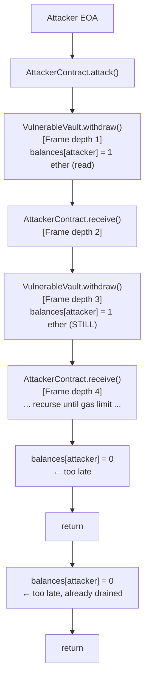
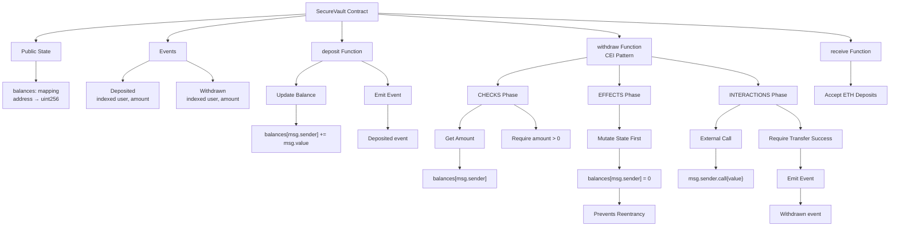
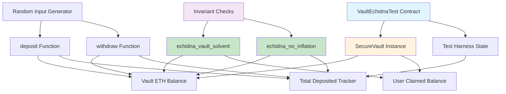

# Lesson 4: Security Invariants, Reentrancy, Formal Verification

## 1. First-Principles Intuition & Invariants

The history of smart contract security is, in its most essential form, a history of invariant violations. An invariant is a predicate over program state that must hold true before and after every externally observable transition. In traditional software, a violated invariant produces a bug report, a core dump, or a rollback. In a deployed EVM contract, a violated invariant produces an irreversible transfer of funds to an attacker. The economic finality of blockchain execution transforms what would be a recoverable software defect into a permanent loss event, which is why the discipline of smart contract security demands a level of formal rigor that most production software engineering has historically reserved for aerospace and medical device firmware.

To understand why invariants are so fragile in the EVM, you need to understand the execution model from first principles. When an externally owned account (EOA) calls a contract, the EVM begins executing bytecode in a fresh call frame. This frame carries a copy of the call data, an isolated stack, a reference to the contract's persistent storage, and critically, a gas counter. When that contract issues a `CALL` opcode to another address, the EVM suspends the current frame, pushes a new call frame onto the call stack, and transfers execution to the callee. The calling contract's state in persistent storage, however, is not frozen during this suspension. The storage slots updated before the external call reflect their modified values. The storage slots not yet updated retain their original values. This asymmetry is the mechanical root cause of reentrancy.

The 2016 DAO exploit made this asymmetry globally infamous, but the underlying vulnerability pattern is not specific to that contract or that era. It emerges from a fundamental mismatch between two implicit assumptions that most engineers carry from conventional programming: first, that an external function call is an atomic, side-effect-contained operation from the caller's perspective, and second, that your own function's execution is uninterruptible. Neither assumption holds in the EVM. An external call to a contract, particularly one that sends ether, hands control to arbitrary code. That code can call back into your contract before your first invocation has finished executing, entering your function again with an internal state that your own code has only partially updated.

The canonical formulation of the correct invariant is called Checks-Effects-Interactions (CEI). Every mutating function must first verify all preconditions (checks), then write all state changes (effects), then perform any external interactions. The order is non-negotiable, and the reason is mechanical: if external interactions occur before effects, the external callee can invoke your function in a state where the effects have not yet been applied, re-entering with the same preconditions still passing. The pattern is not merely stylistic convention; it is a structural enforcement of the happens-before relationship between state mutation and external trust delegation.

Beyond reentrancy, smart contract security rests on three other foundational invariant classes. The first is access control integrity: the predicate that every privileged state transition is reachable only by callers whose identity and role have been cryptographically verified. The second is arithmetic safety: the predicate that every numeric operation on token balances, prices, and counters stays within bounds that preserve economic meaning. The third is oracle and input integrity: the predicate that data flowing in from external sources has been validated against manipulation before it influences critical state transitions. Formal verification, symbolic execution, and fuzzing are the tools by which you establish mechanical confidence that these invariants hold across the entire reachable state space, not merely for the test cases you happened to write.

## 2. Core Architecture & Mechanics

### The Reentrancy Attack Surface

To build a precise mental model of reentrancy, it helps to trace through the EVM call graph at the opcode level. Consider a vault contract that tracks per-user balances and allows withdrawals. The naïve implementation reads the balance, sends ether using a low-level `call`, and then zeros the balance.

```solidity
// SPDX-License-Identifier: MIT
pragma solidity ^0.8.20;

/// @title VulnerableVault - Classic reentrancy demonstration target.
/// @notice DO NOT DEPLOY. This contract is intentionally vulnerable.
contract VulnerableVault {
    mapping(address => uint256) public balances;

    function deposit() external payable {
        balances[msg.sender] += msg.value;
    }

    // VULNERABILITY: External call precedes the state effect.
    // An attacker's fallback can re-enter withdraw() while
    // balances[msg.sender] still reflects the original deposit.
    function withdraw() external {
        uint256 amount = balances[msg.sender];
        require(amount > 0, "nothing to withdraw");

        // ① External call issued BEFORE state update — CEI violated.
        (bool success, ) = msg.sender.call{value: amount}("");
        require(success, "transfer failed");

        // ② State update happens AFTER the external call returns.
        //    The attacker has already drained funds before this executes.
        balances[msg.sender] = 0;
    }

    receive() external payable {}
}
```

The attacker deploys a contract whose `receive` function calls back into `VulnerableVault.withdraw()` before the balance zeroing at step ② has executed. The call graph during the attack looks like this:



Each recursive frame passes the `require(amount > 0)` check because the balance has not been zeroed in any prior frame. The attacker drains the entire vault balance, bounded only by the EVM's call stack depth limit of 1024 frames and the gas cost of each recursive call.

The correct vault applies CEI strictly:



CEI alone is a strong defense, but defense in depth is the correct posture for high-value contracts. The `ReentrancyGuard` from OpenZeppelin encodes the invariant as an explicit mutex in contract storage, ensuring that even a cross-function reentrancy attack—where the attacker re-enters a different function that shares the same storage—cannot succeed.

```solidity
// SPDX-License-Identifier: MIT
pragma solidity ^0.8.20;

/// @title ReentrancyGuard - Mutex pattern for cross-function reentrancy defense.
/// @dev Equivalent to OpenZeppelin's ReentrancyGuard; shown inline for clarity.
abstract contract ReentrancyGuard {
    // Packed into a single storage slot. 1 = not entered, 2 = entered.
    // Using 1 and 2 (rather than 0 and 1) avoids the higher gas cost
    // of writing a zero-to-nonzero vs. nonzero-to-nonzero SSTORE.
    uint256 private _status;

    uint256 private constant _NOT_ENTERED = 1;
    uint256 private constant _ENTERED     = 2;

    error ReentrantCall();

    constructor() {
        _status = _NOT_ENTERED;
    }

    modifier nonReentrant() {
        if (_status == _ENTERED) revert ReentrantCall();
        _status = _ENTERED;
        _;
        _status = _NOT_ENTERED;
    }
}

contract GuardedVault is ReentrancyGuard {
    mapping(address => uint256) public balances;

    event Deposited(address indexed user, uint256 amount);
    event Withdrawn(address indexed user, uint256 amount);

    function deposit() external payable {
        balances[msg.sender] += msg.value;
        emit Deposited(msg.sender, msg.value);
    }

    function withdraw() external nonReentrant {
        uint256 amount = balances[msg.sender];
        require(amount > 0, "GuardedVault: zero balance");

        balances[msg.sender] = 0;

        (bool success, ) = msg.sender.call{value: amount}("");
        require(success, "GuardedVault: ETH transfer failed");

        emit Withdrawn(msg.sender, amount);
    }

    receive() external payable {}
}
```

The `_status` variable occupies storage slot 0. The first execution of the `nonReentrant` modifier writes `_ENTERED` (a nonzero-to-nonzero transition, costing 100 gas under EIP-2929's warm slot pricing). Any reentrant attempt reads `_ENTERED` and reverts before touching any application logic. The modifier restores `_NOT_ENTERED` after the call frame returns, correctly releasing the lock for future calls.

### Access Control Architecture

Access control in production contracts is not simply a matter of `require(msg.sender == owner)`. A well-engineered access control system is a role graph: a directed set of roles, each associated with a set of privileged selectors, with the ability to grant, revoke, and enumerate role members. OpenZeppelin's `AccessControl` implements this as a mapping from a `bytes32` role identifier to a struct containing a `EnumerableSet` of members and a pointer to the role's admin role.

The critical invariant is that role administration itself must be governed by another role rather than a single owner address. A contract that uses `Ownable` for its entire privilege surface has a single point of failure: compromising the owner key compromises the entire system. A contract with a properly structured role graph requires an attacker to compromise multiple independent keys to gain equivalent access.

```solidity
// SPDX-License-Identifier: MIT
pragma solidity ^0.8.20;

import "@openzeppelin/contracts/access/AccessControl.sol";

/// @title RoleGatedTreasury - Multi-role access control with explicit role hierarchy.
contract RoleGatedTreasury is AccessControl {
    bytes32 public constant TREASURER_ROLE = keccak256("TREASURER_ROLE");
    bytes32 public constant AUDITOR_ROLE   = keccak256("AUDITOR_ROLE");
    bytes32 public constant PAUSER_ROLE    = keccak256("PAUSER_ROLE");

    bool public paused;

    error TreasuryPaused();
    error Unauthorized(address caller, bytes32 requiredRole);

    event FundsReleased(address indexed to, uint256 amount);
    event PauseToggled(bool isPaused);

    constructor(address admin) {
        // DEFAULT_ADMIN_ROLE governs all role-grant operations.
        // Assign it to a multisig, never to a single EOA in production.
        _grantRole(DEFAULT_ADMIN_ROLE, admin);

        // The admin role for TREASURER_ROLE is DEFAULT_ADMIN_ROLE by default.
        // Explicitly wiring role admins makes the hierarchy auditable.
        _setRoleAdmin(TREASURER_ROLE, DEFAULT_ADMIN_ROLE);
        _setRoleAdmin(AUDITOR_ROLE,   DEFAULT_ADMIN_ROLE);
        _setRoleAdmin(PAUSER_ROLE,    DEFAULT_ADMIN_ROLE);
    }

    modifier whenNotPaused() {
        if (paused) revert TreasuryPaused();
        _;
    }

    /// @notice Release funds to a recipient. Requires TREASURER_ROLE.
    function releaseFunds(address payable recipient, uint256 amount)
        external
        whenNotPaused
    {
        if (!hasRole(TREASURER_ROLE, msg.sender))
            revert Unauthorized(msg.sender, TREASURER_ROLE);

        require(address(this).balance >= amount, "insufficient balance");
        (bool ok, ) = recipient.call{value: amount}("");
        require(ok, "transfer failed");

        emit FundsReleased(recipient, amount);
    }

    /// @notice Toggle the pause state. Requires PAUSER_ROLE.
    function setPaused(bool _paused) external {
        if (!hasRole(PAUSER_ROLE, msg.sender))
            revert Unauthorized(msg.sender, PAUSER_ROLE);

        paused = _paused;
        emit PauseToggled(_paused);
    }

    receive() external payable {}
}
```

One invariant that audit teams must verify explicitly is the BOLA (Broken Object-Level Authorization) pattern, which in Solidity typically manifests as a function that takes a user address or token ID as a parameter and operates on the associated state without verifying that `msg.sender` owns or is authorized to modify that object. The check `require(positions[positionId].owner == msg.sender)` must appear before any mutation of `positions[positionId]`. Missing this check is the DeFi analog of an IDOR vulnerability in a web API.

### Integer Safety and Arithmetic Invariants

Solidity 0.8.x introduced built-in checked arithmetic, meaning that addition, subtraction, and multiplication revert on overflow or underflow by default. This eliminated the class of vulnerabilities that required manual SafeMath libraries. However, checked arithmetic does not protect against all arithmetic invariant violations.

The first category of surviving arithmetic bugs is precision loss from integer division. Solidity has no floating-point type. When you compute a fee as `(amount * feeBps) / 10000`, the division truncates. For small amounts, the truncation rounds the fee to zero, allowing a user to execute many small transactions that individually pay no fee while cumulatively moving large sums. The correct pattern uses a minimum-fee floor: `max((amount * feeBps) / 10000, minFee)`.

The second category involves deliberate use of `unchecked` blocks for gas optimization in hot paths, such as loop counters that are provably bounded. Every `unchecked` block is a formal obligation: the engineer must supply a proof—as a comment at minimum, as a property test at best—that the unchecked operation cannot overflow given its invariants.

The third category is ERC-20 approval front-running. The standard `approve(spender, newAmount)` function does not atomically replace an allowance; it sets it. If a spender watches the mempool and front-runs a victim's approval change from `100` to `50` by executing a `transferFrom` for `100` before the new approval lands, then executing another `transferFrom` for `50` after, they steal `150` tokens when the user intended to authorize only `50`. The correct pattern uses `increaseAllowance` / `decreaseAllowance` or EIP-2612 permit signatures, which encode the intended allowance delta rather than an absolute value, eliminating the race condition.

```solidity
// SPDX-License-Identifier: MIT
pragma solidity ^0.8.20;

/// @title SafeArithmeticExamples - Demonstrating correct arithmetic invariant patterns.
library FinancialMath {

    /// @notice Compute a pro-rata share with rounding protection.
    /// @dev Uses mulDiv to avoid intermediate overflow for large values.
    ///      Equivalent to (numerator * amount) / denominator, but safe for
    ///      values where numerator * amount would overflow uint256.
    function mulDiv(
        uint256 amount,
        uint256 numerator,
        uint256 denominator
    ) internal pure returns (uint256) {
        require(denominator != 0, "FinancialMath: division by zero");
        // Solidity 0.8 checked arithmetic prevents overflow in the
        // intermediate product here because we are using uint256.
        // For amounts where amount * numerator could exceed 2^256,
        // use a 512-bit intermediate via assembly (Uniswap v3 pattern).
        return (amount * numerator) / denominator;
    }

    /// @notice Compute a fee with a minimum floor to prevent dust-bypass attacks.
    function computeFee(
        uint256 amount,
        uint256 feeBps,
        uint256 minFee
    ) internal pure returns (uint256 fee) {
        fee = (amount * feeBps) / 10_000;
        if (fee < minFee) fee = minFee;
    }

    /// @notice Safe bounded loop increment — unchecked is justified because
    ///         i is always < length, which is a uint256, so i+1 cannot
    ///         overflow before the loop condition halts iteration.
    function sumArray(uint256[] calldata values) internal pure returns (uint256 total) {
        uint256 length = values.length;
        for (uint256 i = 0; i < length; ) {
            total += values[i];
            unchecked { ++i; } // safe: i < length < 2^256
        }
    }
}
```

### Formal Verification with Certora Prover

Certora Prover is the dominant industrial formal verification tool for Solidity contracts. It takes as input a contract and a specification written in CVL (Certora Verification Language), and uses an SMT-solver backend to prove or refute each property across all possible states and call sequences. Unlike unit tests, which establish correctness for a finite set of inputs, formal verification establishes correctness for the entire state space—or returns a counterexample if the property does not hold.

A CVL specification is organized around rules (which assert properties of individual function calls), invariants (which assert properties that must hold after every state transition), and ghosts (which are auxiliary tracking variables that exist only in the specification, used to relate pre-state and post-state values). The workflow is:

1. Install the Certora CLI: `pip install certora-cli`
2. Compile your project with Foundry or Hardhat to populate the build artifacts
3. Write a `.spec` file containing your CVL specification
4. Submit the job: `certoraRun src/SecureVault.sol --verify SecureVault:spec/vault.spec --solc solc-0.8.20`

The following specification encodes the core invariants for `SecureVault`:

```text
// spec/vault.spec — Certora CVL specification for SecureVault

// Ghost variable tracking the sum of all individual balances.
// This must equal address(this).balance at all times.
ghost mathint sumOfBalances {
    init_state axiom sumOfBalances == 0;
}

// Hook: update sumOfBalances whenever the balances mapping is written.
hook Sstore balances[KEY address user] uint256 newValue
    (uint256 oldValue) STORAGE {
    sumOfBalances = sumOfBalances + newValue - oldValue;
}

// Invariant: The contract's ETH balance must equal the sum of all
// individual balance records. Violations indicate either reentrancy
// drain or accounting bugs.
invariant solvency()
    to_mathint(nativeBalances[currentContract]) == sumOfBalances
    filtered { f -> f.selector != sig:receive().selector }

// Rule: A user's balance after withdraw() must be exactly zero.
rule withdrawZerosBalance(address user) {
    env e;
    require e.msg.sender == user;
    require balances(user) > 0;

    withdraw(e);

    assert balances(user) == 0,
        "withdraw must zero the caller balance";
}

// Rule: No call to withdraw() should increase the caller's recorded balance.
rule withdrawCannotIncreaseBalance(address user) {
    env e;
    require e.msg.sender == user;

    uint256 before = balances(user);
    withdraw(e);
    uint256 after_ = balances(user);

    assert after_ <= before,
        "balance must not increase after withdrawal";
}

// Rule: Only the depositor can reduce their own balance via withdraw.
rule onlyDepositorCanWithdraw(address user, address other) {
    env e;
    require e.msg.sender == other;
    require other != user;

    uint256 userBalanceBefore = balances(user);
    withdraw(e);
    uint256 userBalanceAfter = balances(user);

    assert userBalanceAfter == userBalanceBefore,
        "third-party call must not alter another user's balance";
}
```

The solvency invariant is the most powerful of the three. It asserts that the total ETH held by the contract, as measured by the native balance, equals the sum of all recorded per-user balances as measured by the ghost variable. If this invariant holds across all possible call sequences—including reentrancy attacks—then no attacker can drain more ETH than their legitimate deposit entitles them to. Certora will verify this by symbolically executing every public function in every possible state and checking that the predicate is never violated.

### Symbolic Execution with Halmos and Echidna

Certora operates as a hosted SaaS service and requires an API key. For offline symbolic execution and property-based fuzzing within a Foundry workflow, the two principal tools are Halmos (symbolic execution) and Echidna (coverage-guided property fuzzing).

Halmos translates Foundry test functions that use symbolic inputs into SMT queries. Any test function prefixed with `check_` is treated as a property to verify symbolically rather than with concrete values. This is powerful for arithmetic invariants: rather than generating random inputs, Halmos searches exhaustively over the symbolic input domain for a counterexample.

```solidity
// SPDX-License-Identifier: MIT
pragma solidity ^0.8.20;

import "forge-std/Test.sol";
import "halmos-cheatcodes/src/SymTest.sol";
import "../src/SecureVault.sol";

/// @title VaultSymbolicTest - Halmos symbolic property tests for SecureVault.
/// @dev Run with: halmos --contract VaultSymbolicTest --function check_
contract VaultSymbolicTest is Test, SymTest {
    SecureVault vault;
    address attacker;
    address depositor;

    function setUp() public {
        vault     = new SecureVault();
        depositor = address(0xBEEF);
        attacker  = address(0xDEAD);
        vm.deal(depositor, 100 ether);
        vm.deal(attacker,  10 ether);
    }

    /// @notice Verify that after a valid deposit and withdraw cycle,
    ///         the vault balance equals the net of all deposits minus withdrawals.
    ///
    /// Halmos will treat depositAmount as a symbolic variable and attempt
    /// to find any assignment that violates the assertion.
    function check_depositWithdrawSolvency() public {
        uint256 depositAmount = svm.createUint256("depositAmount");
        vm.assume(depositAmount > 0 && depositAmount <= 100 ether);

        vm.prank(depositor);
        vault.deposit{value: depositAmount}();

        uint256 vaultBalanceAfterDeposit = address(vault).balance;

        vm.prank(depositor);
        vault.withdraw();

        // After full withdrawal, vault balance must return to its pre-deposit value.
        assertEq(
            address(vault).balance,
            vaultBalanceAfterDeposit - depositAmount,
            "solvency violated: vault retained or lost excess ETH"
        );

        // The depositor's vault record must be zero.
        assertEq(
            vault.balances(depositor),
            0,
            "balance not zeroed after withdrawal"
        );
    }

    /// @notice Verify that a user cannot withdraw more than they deposited.
    function check_cannotWithdrawMoreThanDeposited() public {
        uint256 depositAmount = svm.createUint256("depositAmount");
        vm.assume(depositAmount > 0 && depositAmount <= 50 ether);

        uint256 depositorEthBefore = depositor.balance;

        vm.prank(depositor);
        vault.deposit{value: depositAmount}();

        vm.prank(depositor);
        vault.withdraw();

        uint256 depositorEthAfter = depositor.balance;

        // The depositor's net ETH position must be zero (withdrew exactly what they put in).
        assertEq(
            depositorEthAfter,
            depositorEthBefore,
            "depositor net position is nonzero: they gained or lost ETH"
        );
    }
}
```

Echidna operates differently: it is a coverage-guided fuzzer that generates sequences of function calls against a contract and checks that user-defined invariant functions—prefixed with `echidna_`—never return false. Where Halmos reasons exhaustively over all inputs through SMT solving, Echidna uses corpus mutation and coverage feedback to find deep call sequences that classical random testing would miss. For stateful protocols with many interacting functions, Echidna's ability to generate multi-transaction attack sequences makes it complementary to symbolic execution.



The `echidna.yaml` configuration controls the fuzzing campaign's parameters, including the number of test sequences, the sequence length, and the initial account balances. For a production audit, sequence lengths of 200 or more call sequences give Echidna sufficient depth to discover multi-step attack paths.

## 3. High-Performance Optimization & Failure Modes

### The Audit Methodology Workflow

Professional smart contract auditing is not a code review pass followed by a findings report. It is a structured methodology that combines manual invariant analysis, automated tooling, and adversarial economic reasoning. A production audit workflow proceeds through five distinct phases, each building on the artifacts of the previous.

The first phase is threat modeling and scope definition. Before reading a single line of Solidity, the auditor maps the protocol's trust boundaries: which addresses can call which functions, which functions move value, what the invariants are that must never be violated, and what the economic incentives are for an attacker. This phase produces a threat model document that every subsequent finding is mapped against. A finding that cannot be mapped to a threat model entry is usually a low-severity code quality issue. A finding that maps directly to a critical invariant violation is a high or critical severity finding.

The second phase is static analysis and automated scanning. Tools like Slither (a Python-based static analyzer from Trail of Bits) and Semgrep with Solidity rules produce a preliminary finding list. These tools detect known vulnerability patterns—reentrancy, unprotected `selfdestruct`, arbitrary `delegatecall`, integer issues, uninitialized storage—with high recall but significant false positive rates. The auditor's job is to triage each finding, eliminate false positives, and promote confirmed findings into the formal report.

Running Slither against a Foundry project is a single command:

```bash
# Install Slither
pip install slither-analyzer

# Run against the full project, outputting a JSON report
slither . \
  --compile-force-framework foundry \
  --json slither-report.json \
  --checklist \
  --print human-summary
```

Slither's output for the vulnerable vault contract will immediately flag the reentrancy in `withdraw()` through its `reentrancy-eth` detector, which identifies the pattern of an ETH transfer followed by a state update in the same function. It will also emit `reentrancy-events` warnings for any event emission following an external call, since those emit-after-call patterns can produce misleading event logs when combined with reentrancy.

The third phase is manual code review with invariant falsification. For each function in scope, the auditor formulates the function's intended post-conditions as explicit predicates and then attempts to falsify each one. The question is never "does this function look correct?"; it is "under what combination of caller-controlled inputs, existing storage state, and block state can this function's post-conditions be violated?" This adversarial framing is what separates a security audit from a code quality review.

The fourth phase is property-based testing and fuzzing. The auditor writes Echidna and Foundry fuzz targets that encode the invariants identified in the threat model, runs them for extended periods (hours to days for high-value protocols), and investigates any counterexamples. The fifth phase is formal verification for the most critical properties—typically solvency and access control integrity—using Certora or Halmos.

### Cross-Contract Reentrancy and Read-Only Reentrancy

The basic CEI pattern and `ReentrancyGuard` protect against single-contract reentrancy. Cross-contract reentrancy is more subtle: it occurs when contract A calls contract B, and B's callback re-enters a *different* contract C that shares state with A. This pattern is not blocked by A's `nonReentrant` modifier, because the reentrant call targets C, not A.

Read-only reentrancy is a particularly dangerous variant that emerged as DeFi composability increased. It occurs when a contract B makes an external call during a state transition, and an observer contract C reads B's storage during the callback, before B's state transition is complete. C reads a stale intermediate state and makes decisions based on it. The cure is to ensure that any contract providing price feeds, exchange rates, or balance snapshots is not in a mid-transition state when read. Protocols that integrate with Curve, Balancer, or other AMMs via their view functions must be aware that those view functions can be called in a mid-reentrant state if the integration contract enters through a Curve callback.

The `nonReentrant` guard in a price-feed contract, combined with a require that checks the guard status of its data sources before accepting their output, is the defense. Some protocols use a "reentrancy lock status oracle" pattern where data consumers explicitly verify that the source protocol's reentrancy lock is not engaged before reading its state.

### Proxy Pattern Pitfalls and Storage Collision

Upgradeable proxies—whether UUPS (EIP-1822) or Transparent (EIP-1967)—introduce a category of invariant violation that is entirely absent from non-upgradeable contracts: storage layout collision. In a proxy deployment, the proxy contract and the implementation contract share the same storage, indexed by slot number. If the implementation is upgraded and the new implementation adds a state variable before an existing one in the declaration order, all subsequent variables shift to higher slot numbers, corrupting the data stored in those slots by the previous implementation.

The EIP-1967 standard addresses proxy admin and implementation address storage by placing them at deterministic pseudo-random storage slots computed as `keccak256("eip1967.proxy.implementation") - 1`, chosen specifically to avoid accidental collision with normal sequential slot allocation. The OpenZeppelin Upgrades plugin enforces storage layout compatibility as part of the upgrade deployment process, refusing to deploy an upgrade that would shift existing slot assignments.

The critical invariant for UUPS proxies is that the `upgradeTo` function in the implementation must itself be access-controlled and must be present in every version of the implementation. If an upgrade deploys an implementation that does not include an `upgradeTo` function (or makes it unreachable), the contract becomes permanently non-upgradeable. This is not a theoretical risk: several production protocols have been permanently locked because a faulty upgrade replaced a UUPS implementation with one that lacked the upgrade mechanism.

### Gas Griefing and Denial-of-Service Vectors

A common failure mode in contracts that iterate over unbounded arrays—processing a list of token holders, distributing rewards to all stakers, executing a batch of orders—is gas-based denial of service. If an attacker can cause the array to grow beyond the block gas limit's iteration budget, the function becomes permanently unexecutable. The correct architecture separates enumeration from execution: the contract never iterates over a full set in a single transaction. Instead, it uses a pull model (each user calls a function to claim their own share) or a pagination model (the caller provides a start index and batch size).

The EVM's `call` opcode forwards `msg.gas * 63/64` to the callee by default under EIP-150's gas reprice. When a contract sends ETH to a list of recipients in a loop using `call`, each recipient's fallback can consume up to 63/64 of the remaining gas. An attacker who controls one recipient address can deploy a fallback that consumes all forwarded gas, halting the distribution loop and permanently locking other recipients' funds if the outer function does not handle failed calls gracefully. The correct pattern is to use a pull-payment architecture where each recipient initiates their own withdrawal, so a single griefing recipient cannot block others.

### Oracle Manipulation and Price Feed Integrity

DeFi protocols that derive value from on-chain price feeds are vulnerable to oracle manipulation if those feeds are based on spot prices from AMM pools. The attack surface is the ability to move a pool's spot price within a single transaction using a flash loan, execute a dependent contract function at the manipulated price, and then restore the pool in the same transaction at zero net cost. The exploit captures the arbitrage between the manipulated price and the true market price.

The invariant is that any price or rate used for a consequential operation must be resistant to intra-block manipulation. Time-weighted average prices (TWAPs) provide this resistance because they average the spot price over a window of blocks, requiring an attacker to sustain a position across multiple blocks—incurring market risk and opportunity cost—to shift the TWAP meaningfully. Uniswap v3's TWAP oracle computes the geometric mean price over a configurable observation window, encoded as cumulative price-seconds in an on-chain ring buffer. Protocols should use TWAP windows of at least 30 minutes for high-value operations, understanding that a wider window provides stronger manipulation resistance at the cost of price staleness.

```solidity
// SPDX-License-Identifier: MIT
pragma solidity ^0.8.20;

import "@uniswap/v3-core/contracts/interfaces/IUniswapV3Pool.sol";
import "@uniswap/v3-core/contracts/libraries/OracleLibrary.sol";

/// @title TWAPOracle - Manipulation-resistant price oracle using Uniswap v3 TWAP.
contract TWAPOracle {
    IUniswapV3Pool public immutable pool;
    uint32  public immutable twapWindow;   // seconds to average over
    address public immutable baseToken;
    address public immutable quoteToken;

    error StaleObservation();
    error InsufficientObservations();

    constructor(
        address _pool,
        uint32  _twapWindow,
        address _baseToken,
        address _quoteToken
    ) {
        pool        = IUniswapV3Pool(_pool);
        twapWindow  = _twapWindow;
        baseToken   = _baseToken;
        quoteToken  = _quoteToken;
    }

    /// @notice Returns the TWAP price: how many quoteToken units equal
    ///         one unit (1e18) of baseToken, averaged over twapWindow seconds.
    function getTWAPPrice() external view returns (uint256 price) {
        uint32[] memory secondsAgos = new uint32[](2);
        secondsAgos[0] = twapWindow;
        secondsAgos[1] = 0;

        // observe() reverts if the pool lacks sufficient history.
        (int56[] memory tickCumulatives, ) = pool.observe(secondsAgos);

        int56  tickCumulativeDelta = tickCumulatives[1] - tickCumulatives[0];
        int24  arithmeticMeanTick = int24(tickCumulativeDelta / int56(uint56(twapWindow)));

        // Adjust for negative rounding to match Uniswap's convention.
        if (tickCumulativeDelta < 0 && (tickCumulativeDelta % int56(uint56(twapWindow)) != 0)) {
            arithmeticMeanTick--;
        }

        // Convert the mean tick to a quote amount for 1e18 base token units.
        price = OracleLibrary.getQuoteAtTick(
            arithmeticMeanTick,
            1e18,
            baseToken,
            quoteToken
        );
    }
}
```

### Putting It All Together: The Invariant-Driven Security Posture

The mental model that unifies everything in this lesson is that a secure smart contract is one whose invariants are explicitly stated, mechanically enforced in code, and formally or probabilistically verified before deployment. Reentrancy is an invariant violation: the solvency invariant breaks because external call sequencing allows state to be read before it reflects all prior effects. Access control failures are invariant violations: the authorization invariant breaks because caller identity is not verified before privileged state mutations. Integer bugs are invariant violations: the balance invariant breaks because arithmetic operations produce values outside the semantically valid range.

The engineering discipline that this lesson argues for is not merely defensive coding—writing `nonReentrant` and `require` as an afterthought. It is invariant-first design: before writing a single function body, state the invariants your contract must maintain, write them as Echidna properties and CVL rules, and treat any violation surfaced by those tools as a correctness failure that blocks deployment. This posture shifts the security conversation from "did we miss any bugs?" to "have we proven our properties hold?"—a fundamentally stronger guarantee, and the standard to which the highest-value production protocols increasingly hold themselves.
