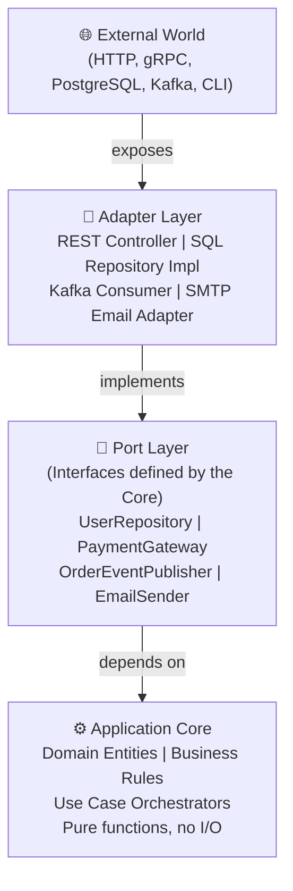

# Lesson 1: Architectural Foundations

## 1. First-Principles Intuition & Invariants

Software architecture is the discipline of making decisions whose cost of reversal grows with time. Every other engineering decision — which data structure to use, how to name a variable, whether to add a cache — can be revisited cheaply. The decision to split a system into services, to couple a core domain to a particular database engine, or to build on a synchronous request-response model instead of an event log: these decisions calcify. They become the geology of a system, shaping everything built on top. Understanding architecture means understanding which decisions belong to that geological layer and why.

The confusion in most engineering teams is that architecture gets conflated with scale. Developers assume that architectural thinking only matters once a system is large enough to warrant diagrams. This is exactly backwards. The earlier a structural decision is made, the more load-bearing it becomes. A monolith built with well-enforced internal module boundaries can be decomposed into services years later with surgical precision. A monolith where every component reaches directly into every other component's data store cannot be decomposed at all — it can only be rewritten. The difference between these two outcomes was not a matter of team size or budget; it was a matter of whether anyone enforced the invariants of module ownership from the first commit.

The most productive way to internalize architectural thinking is to reason from constraints. Every system architecture is a negotiated solution to a specific constraint set, and the constraints come in three categories. Physical constraints are the irreducible facts of the hardware: memory bandwidth, network round-trip latency (bounded below by the speed of light), disk seek time, and CPU pipeline depth. Organizational constraints are the facts of the team: Conway's Law states that any organization that designs a system will produce a design whose structure mirrors the organization's communication structure. This is not a suggestion — it is an observed causal mechanism, because software module ownership follows team ownership, and interface friction follows team communication friction. Business constraints are the domain rules, compliance requirements, SLA obligations, and consistency guarantees that the system must uphold regardless of engineering preference.

A principled architect identifies which category each constraint belongs to, because only physical constraints are truly non-negotiable. Organizational constraints can be changed by restructuring teams, though that has its own costs. Business constraints can be negotiated with product and legal stakeholders. The worst architectural decisions in production systems almost always involve treating organizational constraints as if they were physical ones, and accepting structural debt on the false premise that "this is just how our company works."

### SOLID as a Structural Invariant System

SOLID is typically taught as a checklist of object-oriented good practice, which undersells it badly. SOLID is a set of invariants that, when maintained simultaneously, prevent the most common class of large-scale architectural decay: uncontrolled coupling. Each principle targets a specific coupling failure mode.

The Single Responsibility Principle, originally articulated by Robert Martin as "a module should have one and only one reason to change," is fundamentally about change vectors, not about size. A class that handles both business logic and persistence does not have two responsibilities because it does two things — it has two responsibilities because a change in the database schema and a change in a business rule are orthogonal events that should not force the same module to change. The key insight is that "reason to change" is determined by organizational and domain boundaries, not by line count. This is why a service that owns a complete bounded domain context can legitimately be large, while a utility function that mixes HTTP transport parsing with business validation is architecturally unsound even at ten lines.

The Open/Closed Principle states that software entities should be open for extension but closed for modification. Its practical meaning in a production codebase is that the introduction of a new variant (a new payment method, a new serialization format, a new authentication strategy) should not require touching existing, tested code paths. The mechanism that enables this is abstraction: the existing code depends on an interface, and new behavior is introduced by adding a new implementation of that interface. When this principle is violated, every new feature becomes a modification of existing code, every modification is a regression risk, and test coverage degrades because the branching factor of each function grows unboundedly.

The Liskov Substitution Principle is the most mathematically rigorous of the five. It states that if `S` is a subtype of `T`, then objects of type `T` in a program may be replaced with objects of type `S` without altering any of the correct properties of that program. The practical violation engineers encounter most often is a subclass that overrides a method and adds a precondition stricter than the parent's, or weakens the postcondition. The canonical example is a `ReadOnlyCollection` that extends `Collection` but throws on `add()` — the subtype cannot be substituted everywhere the parent is used, so the inheritance relationship is architecturally dishonest. At scale, LSP violations create hidden fragility: code that believes it is programming to a contract discovers at runtime that the contract has been silently renegotiated.

The Interface Segregation Principle and the Dependency Inversion Principle are complementary mechanisms for managing dependency graphs. ISP prevents the creation of "fat interfaces" that force implementing classes to depend on methods they do not use — an abstract coupling with no functional benefit. DIP states that high-level modules should not depend on low-level modules; both should depend on abstractions. This inverts the natural dependency gravity in a layered system. Without DIP, business logic depends on infrastructure details; a change in the ORM, the message broker, or the HTTP client propagates upward into the domain layer. With DIP, the domain layer defines the abstractions it needs (a `Repository` interface, an `EventPublisher` interface), and infrastructure provides implementations. The domain is now insulated from infrastructure churn.

### DRY and YAGNI as Opposing Forces in Equilibrium

DRY — Don't Repeat Yourself — is frequently misapplied to mean "never write similar code twice," which produces one of the most damaging anti-patterns in large codebases: premature abstraction. The correct reading of DRY, as originally stated in *The Pragmatic Programmer*, is that "every piece of knowledge must have a single, unambiguous, authoritative representation within a system." The word "knowledge" is doing precise work here. Two functions that happen to contain similar lines of code but represent different domain concepts are not violating DRY. Two places in the codebase that hardcode the VAT calculation rate for the UK are violating DRY, because that rate is a single piece of business knowledge that will change once and must therefore live in one place.

The practical consequence is that DRY applies to knowledge and policy, not to code structure. Collapsing two similar-looking code paths into a single abstraction when they represent different domain concepts creates accidental coupling: future divergence of those concepts now requires unpicking the abstraction under time pressure, in production code, with other features waiting. This is the wrong trade-off. The correct question before deduplication is always: "Will these two things change for the same reason, at the same time?" If the answer is yes, deduplication is correct. If the answer is no, deduplication creates a coupling that the domain does not support.

YAGNI — You Aren't Gonna Need It — is the temporal counterpart to this principle. It states that functionality should not be added until it is needed. The violation engineers with architectural ambition fall into most often is building generalization infrastructure for anticipated future requirements that never materialize, or that materialize in a form that the prepared infrastructure cannot accommodate. Every abstraction layer carries maintenance cost, cognitive load, and indirection overhead. When the anticipated use case that justified the abstraction does not arrive, that cost is pure waste. YAGNI is not an argument against good design — it is an argument against speculative design, against building the machinery for a problem you do not yet have evidence will occur.

The productive tension between DRY and YAGNI can be resolved with a simple empirical rule: deduplicate on the third occurrence, not the second. When a pattern appears twice, you do not yet have enough information to know whether the similarity is coincidental or structural. When it appears three times in genuinely parallel contexts, the domain is signaling that an abstraction belongs there, and you now have enough evidence to design it correctly.

---

## 2. Core Architecture & Mechanics

### Architectural Styles as Constraint Solutions

An architectural style is not an aesthetic preference. It is a named solution to a recurring constraint pattern, with known trade-offs. The most consequential styles in production systems are the layered monolith, the hexagonal (ports and adapters) architecture, event-driven architecture, and service-oriented decomposition. Each makes a different set of coupling decisions in exchange for a different set of operational properties.

The layered monolith organizes code into horizontal tiers — presentation, application, domain, and infrastructure — where each layer may only depend on the layer directly below it. The rule is strictly directional: nothing in the domain layer may reference anything in the infrastructure layer, and nothing in the application layer may directly instantiate infrastructure concerns. This architecture's primary virtue is simplicity of reasoning: tracing a request through the system means following a straight vertical line. Its primary failure mode is that strict layering tends to produce anemic domain models, where business logic leaks upward into the application layer because the domain layer is kept too thin to avoid proximity to infrastructure.

The hexagonal architecture, introduced by Alistair Cockburn, inverts the problem. Instead of thinking about layers, it thinks about the application core as a hexagon surrounded by ports — defined interfaces — through which all external communication passes. Each port has one or more adapters: concrete implementations that translate between the external world (HTTP, SQL, message queues, CLI) and the application's internal protocol. The critical structural insight is that the application core knows nothing about its adapters. It defines what it needs (a `UserRepository`, a `PaymentGateway`) through interfaces, and the adapter layer wires in the concrete implementations at startup. This makes the core independently testable with no infrastructure running, which is one of the most underrated operational benefits in production systems.

The dependency flow in hexagonal architecture can be visualized clearly:



The dependency arrows all point inward. The core never depends on anything outside itself. This is DIP applied at architectural scale.

### Bounded Contexts and Module Ownership

The most consequential structural decision in any non-trivial system is where to draw the boundaries between modules. Eric Evans' Domain-Driven Design introduced the bounded context as the unit of boundary definition: a bounded context is a region of the domain model within which a particular ubiquitous language applies consistently. The word "Order" means something specific to the fulfillment team, something different to the billing team, and something different again to the customer service team. These are not the same concept with minor variations — they are different models of different concerns, and conflating them into a single `Order` entity creates a god object that serves no context well.

In a production Rust codebase, bounded context boundaries map naturally to Cargo workspace members. Each bounded context is a separate crate with an explicitly defined public API surface (its `lib.rs` exports). Cross-context communication happens exclusively through that public API, never through direct access to the other crate's internal types. This enforces the boundary at compile time — a property no runtime check can replicate.

```rust
// crates/fulfillment/src/lib.rs
// The fulfillment bounded context owns its own view of an order.
// No dependency on the billing crate's Order type.

pub mod domain {
    /// An order in the fulfillment context carries only fulfillment-relevant state.
    /// It does not know about invoice amounts, payment methods, or billing cycles.
    #[derive(Debug, Clone, PartialEq, Eq)]
    pub struct FulfillmentOrder {
        pub id: OrderId,
        pub warehouse_id: WarehouseId,
        pub line_items: Vec<LineItem>,
        pub status: FulfillmentStatus,
    }

    #[derive(Debug, Clone, PartialEq, Eq, Hash)]
    pub struct OrderId(pub uuid::Uuid);

    #[derive(Debug, Clone, PartialEq, Eq, Hash)]
    pub struct WarehouseId(pub uuid::Uuid);

    #[derive(Debug, Clone, PartialEq, Eq)]
    pub struct LineItem {
        pub sku: String,
        pub quantity: u32,
        pub weight_grams: u32,
    }

    #[derive(Debug, Clone, PartialEq, Eq)]
    pub enum FulfillmentStatus {
        Pending,
        Picking,
        Packed,
        Dispatched { tracking_code: String },
        Delivered,
    }
}

pub mod ports {
    use super::domain::{FulfillmentOrder, OrderId};

    /// The port the fulfillment core requires from storage infrastructure.
    /// Infrastructure provides the adapter; the core owns this definition.
    pub trait FulfillmentOrderRepository: Send + Sync {
        fn find_by_id(&self, id: &OrderId) -> Option<FulfillmentOrder>;
        fn save(&self, order: &FulfillmentOrder) -> Result<(), RepositoryError>;
        fn pending_orders(&self) -> Vec<FulfillmentOrder>;
    }

    #[derive(Debug, thiserror::Error)]
    pub enum RepositoryError {
        #[error("optimistic lock conflict on order {0:?}")]
        ConflictError(OrderId),
        #[error("storage backend unavailable: {0}")]
        StorageUnavailable(String),
    }
}

pub mod use_cases {
    use super::domain::{FulfillmentOrder, FulfillmentStatus, OrderId};
    use super::ports::{FulfillmentOrderRepository, RepositoryError};

    pub struct DispatchOrder<'a> {
        repository: &'a dyn FulfillmentOrderRepository,
    }

    impl<'a> DispatchOrder<'a> {
        pub fn new(repository: &'a dyn FulfillmentOrderRepository) -> Self {
            Self { repository }
        }

        pub fn execute(
            &self,
            order_id: &OrderId,
            tracking_code: String,
        ) -> Result<FulfillmentOrder, DispatchError> {
            let mut order = self
                .repository
                .find_by_id(order_id)
                .ok_or(DispatchError::OrderNotFound(order_id.clone()))?;

            match order.status {
                FulfillmentStatus::Packed => {
                    order.status = FulfillmentStatus::Dispatched { tracking_code };
                    self.repository.save(&order)?;
                    Ok(order)
                }
                ref s => Err(DispatchError::InvalidTransition(format!(
                    "cannot dispatch order in state {:?}",
                    s
                ))),
            }
        }
    }

    #[derive(Debug, thiserror::Error)]
    pub enum DispatchError {
        #[error("order {0:?} not found")]
        OrderNotFound(OrderId),
        #[error("invalid state transition: {0}")]
        InvalidTransition(String),
        #[error(transparent)]
        Repository(#[from] RepositoryError),
    }
}
```

This code is complete and compilable as a Cargo workspace member. It demonstrates the full hexagonal structure: domain types with no infrastructure imports, a port trait defined in the domain crate, and a use case that depends only on the port abstraction. Notice that `DispatchOrder` requires a reference to `dyn FulfillmentOrderRepository` — the actual database adapter is wired in at the binary entrypoint, never inside this crate. The `thiserror` crate provides structured error propagation with the `#[from]` attribute handling transparent wrapping of `RepositoryError` into `DispatchError::Repository`, making the error chain machine-readable without manual boilerplate.

### Analyzing Module Dependency Graphs with `cargo-depgraph`

Production architecture requires making dependency relationships visible. A codebase whose dependency graph no developer can describe from memory is a codebase that has already begun to decay. The `cargo-depgraph` and `cargo-modules` tools generate dependency graphs from actual Rust source, not from aspirational diagrams.

```bash
# Install the dependency graph toolchain
cargo install cargo-modules

# Visualize the module tree and cross-module dependencies for the fulfillment crate
cargo modules structure --package fulfillment

# Generate a full dependency graph in Graphviz DOT format
# for every crate in the workspace, then render it
cargo install cargo-depgraph
cargo depgraph --all-deps | dot -Tsvg > workspace-deps.svg

# Inspect which crates depend on the fulfillment crate (inbound edges)
cargo tree --invert --package fulfillment
```

The output of `cargo modules structure` shows the actual module hierarchy, not what you think it is. Running this command on a codebase that has been under active development for twelve months without architectural review will almost always reveal modules that have drifted from their intended structure: use case orchestrators that import infrastructure types directly, domain modules that transitively depend on HTTP client libraries, or utility modules that have accumulated enough domain logic to constitute an unacknowledged bounded context. This is the architectural X-ray.

For C codebases, the equivalent inspection uses `cflow` and `include-what-you-use`:

```bash
# Generate a call graph from C source to identify coupling paths
cflow --main=main src/**/*.c -o callgraph.txt

# Identify unnecessary header inclusions that create hidden transitive coupling
# (requires a compilation database generated by cmake or bear)
cmake -DCMAKE_EXPORT_COMPILE_COMMANDS=ON .
include-what-you-use -p compile_commands.json src/fulfillment.c
```

Both tools surface the same underlying problem: coupling that exists in the code but is invisible to the developer reading a single file in isolation.

---

## 3. High-Performance Optimization & Failure Modes

### Architectural Failure Mode Taxonomy

The most important skill in architectural review is pattern recognition: identifying which category of failure a problematic design belongs to, because the remediation path follows from the category. Production architectural failures cluster into four patterns that appear repeatedly across different technologies and organizations.

The first is the distributed monolith, which is arguably the worst outcome of a service decomposition effort. A distributed monolith is a system composed of multiple separately deployed services that nonetheless cannot be deployed, scaled, or failed independently because they are coupled through shared databases, synchronous chain calls, or shared in-memory state. The operational costs of microservices (network latency, partial failure, distributed tracing, schema versioning) are paid in full, but the modularity benefits are absent. A system where Service A calls Service B synchronously, Service B calls Service C synchronously, and a failure in Service C causes Service A to return a 500 to the user is not a microservices architecture — it is a monolith with extra latency and a distributed failure mode that is significantly harder to debug than a local stack trace.

The diagnostic test for a distributed monolith is simple: can each service be deployed independently, with no coordination with other service teams? If the answer is no — if deploying Service A requires a simultaneous deploy of Service B because they share a request schema that changed — then the deployment boundary is an illusion, and the coupling it was supposed to eliminate still exists, just expressed through deployment choreography rather than code imports.

The second failure mode is the anemic domain model, the pathological outcome of layered architecture taken too literally. In an anemic model, all domain objects are plain data containers with no behavior, and all business logic lives in a service layer that operates on those containers. This is essentially procedural programming wearing an object-oriented costume. The practical consequence is that the invariants of a domain entity — the rules that must always hold for the entity to be in a valid state — cannot be enforced at the type level, because the type carries no behavior. Any code anywhere in the codebase can reach into an `Order` struct, set its status to `Dispatched` without setting a tracking code, and no compile-time or runtime check will catch this until the broken record propagates downstream.

The correct antidote is to make domain types enforce their own invariants through constructors and state transition methods. In Rust, this is achieved through the type state pattern: representing state machine transitions as compile-time-enforced type constraints rather than runtime-checked enumerations.

```rust
// Type-state pattern: illegal state transitions become compile errors,
// not runtime panics caught in production at 3am.

use std::marker::PhantomData;

// State marker types — these carry zero runtime cost (zero-sized types)
pub struct Pending;
pub struct Packed;
pub struct Dispatched;

pub struct Order<State> {
    id: OrderId,
    line_items: Vec<LineItem>,
    _state: PhantomData<State>,
}

// Only Pending orders can be packed.
// This method does not exist on Order<Dispatched> or Order<Packed>.
impl Order<Pending> {
    pub fn new(id: OrderId, line_items: Vec<LineItem>) -> Self {
        Order {
            id,
            line_items,
            _state: PhantomData,
        }
    }

    pub fn pack(self) -> Order<Packed> {
        Order {
            id: self.id,
            line_items: self.line_items,
            _state: PhantomData,
        }
    }
}

// Only Packed orders can be dispatched.
// A tracking code is required at the type level, not checked at runtime.
impl Order<Packed> {
    pub fn dispatch(self, tracking_code: TrackingCode) -> (Order<Dispatched>, TrackingCode) {
        let dispatched = Order {
            id: self.id,
            line_items: self.line_items,
            _state: PhantomData,
        };
        (dispatched, tracking_code)
    }
}

// The following code does not compile. The error message explains the invariant.
// let order = Order::<Pending>::new(...);
// order.dispatch(tracking_code); // ERROR: method `dispatch` not found for `Order<Pending>`

#[derive(Debug, Clone, PartialEq, Eq, Hash)]
pub struct OrderId(uuid::Uuid);

#[derive(Debug, Clone, PartialEq, Eq)]
pub struct LineItem {
    pub sku: String,
    pub quantity: u32,
}

#[derive(Debug, Clone, PartialEq, Eq)]
pub struct TrackingCode(pub String);
```

`PhantomData<State>` is a zero-sized type marker: it carries the state type information through the type system without any runtime allocation. The compiled binary for `Order<Pending>` and `Order<Dispatched>` is identical in size; the difference exists only at compile time, where the type checker enforces that `dispatch` can never be called on a `Pending` order. This converts a category of runtime bugs — invalid state transitions — into compile-time errors that cannot reach production.

### Decision Frameworks for Architectural Trade-offs

The most practically useful framework for architectural decision-making is the one introduced by Gregor Hohpe and Bobby Woolf in the context of enterprise integration: reason about systems in terms of what they trade consistency for. The CAP theorem establishes that a distributed system can provide at most two of consistency, availability, and partition tolerance simultaneously. Because network partitions are not optional in any physically distributed system, the real trade-off is always between consistency and availability during a partition. This is not an abstract academic concern — it is the specific decision that determines whether your checkout flow processes a payment twice under a split-brain condition or whether it refuses to process at all.

The PACELC extension (by Daniel Abadi) adds the dimension of normal operation: even without a partition, a distributed system must trade off latency against consistency, because achieving strong consistency requires coordination round-trips between nodes. A system that uses synchronous replication to all replicas before acknowledging a write has strong consistency and high write latency. A system that acknowledges writes on a single node and replicates asynchronously has low write latency and eventual consistency. Neither is universally correct. The correct choice follows from the domain: eventual consistency is acceptable for a social media "like" count; it is not acceptable for a bank account balance.

Capturing architectural decisions in a durable, reviewable format is as important as making them correctly. Architecture Decision Records (ADRs) are the standard mechanism. An ADR is a short document — typically 200 to 500 words — that records a single significant architectural decision, the context that made the decision necessary, the alternatives considered, the trade-offs of each, and the rationale for the chosen option. The critical property of an ADR is immutability: once accepted, an ADR is never edited. If the decision is reversed, a new ADR is written that supersedes the old one. This creates a decision log that lets a new team member understand not just what the system does, but why it does it and what alternatives were consciously rejected.

```markdown
# ADR-0012: Use Event Sourcing for Fulfillment Order State

## Status
Accepted — 2024-03-15

## Context
The fulfillment order lifecycle involves 7 state transitions, each of which must be
auditable for regulatory compliance (EU Directive 2019/771 on goods contracts).
State transitions must be replayable for debugging customer-reported delivery issues.
The current approach of updating a single `status` column loses all transition history.

## Decision
Persist fulfillment orders as an append-only event log. The current state of any order
is derived by replaying its event log from the beginning (or from a stored snapshot).
Events are immutable value objects stored in an `order_events` table.

## Alternatives Considered
**Audit log alongside mutable state:** Maintains a separate audit table alongside the
primary orders table. Rejected because the two stores can diverge under partial failure,
creating an inconsistency between the operational state and the audit record.

**Bitemporal table with valid-time and transaction-time columns:** Provides full history
without changing the write model. Rejected because the query complexity for temporal
joins is high and the team's SQL expertise does not currently cover bitemporal modeling.

## Consequences
Positive: Full audit history by construction; event log is the source of truth.
Read models for query APIs are built as projections from the event log, decoupling
read and write optimization independently.
Negative: Read model consistency is eventual unless the projection is computed
synchronously on write, which reintroduces write-path latency. Query patterns
that need current state require a maintained projection, not direct table reads.

## Supersedes
None. Superseded by ADR-0019 if snapshot strategy changes.
```

The ADR format disciplines the decision-making process itself. Writing the "Alternatives Considered" section forces the architect to actually consider alternatives, not simply document the choice already made. Teams that maintain a living ADR registry — stored in the same repository as the code, reviewed in the same pull request process — build a collective architectural memory that survives team turnover. The alternative is a codebase full of inexplicable structural decisions whose original rationale is now archaeology.

### Measuring Coupling in Practice

Coupling is the central measurable quantity in software architecture. Everything else — cohesion, modularity, decomposability — is derivative of coupling. The standard metrics are afferent coupling (Ca: the number of modules that depend on a given module), efferent coupling (Ce: the number of modules a given module depends on), and instability (I = Ce / (Ca + Ce)). A module with high afferent coupling and low efferent coupling is stable and hard to change — it has many dependents and few dependencies. A module with low afferent coupling and high efferent coupling is unstable and easy to change. The architectural principle is that abstract modules should be stable (many things depend on them, they are hard to change, and because they are abstract, the difficulty of changing them is acceptable), while concrete modules should be unstable (few things depend on them, they are easy to change, and because they are concrete, easy changeability is necessary).

Violations of this principle — concrete modules with high afferent coupling, abstract modules with high efferent coupling — are the structural fingerprint of architectural decay. They can be computed from any codebase with static analysis. For Rust workspace crates, the dependency counts can be extracted directly from `Cargo.toml` files and cross-referenced with `cargo tree` output. For large C/C++ codebases, `clang`'s `--analyze` mode and the `cppcheck` tool can extract module-level dependency counts.

The most important practical use of coupling metrics is as a regression test on architecture. Measure the coupling metrics of every module at the beginning of a quarter, write them down, and re-measure them at the end. If a module's afferent coupling has grown by 40% without a corresponding reduction in its responsibility scope, something has coupled to it that should not have. This is the signal to investigate before the coupling becomes structural debt that requires a rewrite to resolve.

The overarching lesson of this foundational lesson is that software architecture is a practice of making explicit what is otherwise implicit. Coupling exists whether or not it is measured. Bounded contexts exist whether or not they are named. Decisions are made whether or not they are recorded. The discipline of architecture consists in bringing these implicit structures into visibility so that they can be reasoned about, negotiated, and when necessary, deliberately changed.
