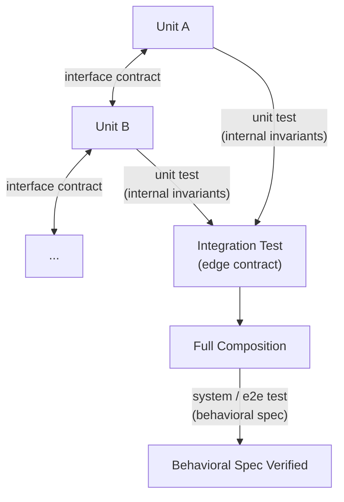
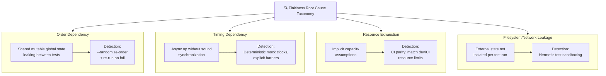
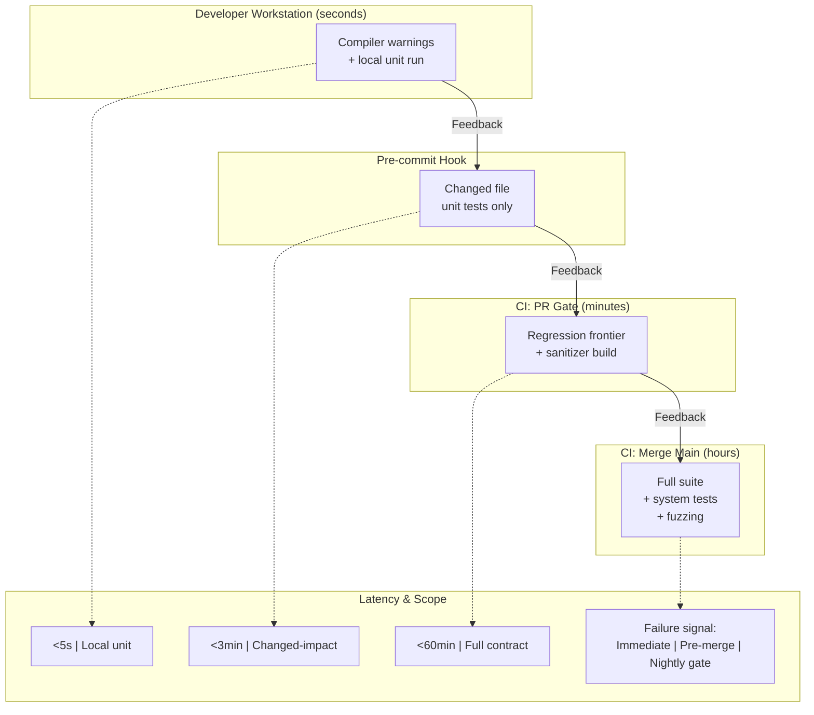

# Lesson 4: Verification Strategies & Process Integration

## 1. First-Principles Intuition & Invariants

Every compiler, runtime, or systems library ships with an implicit contract: given valid input, the system produces correct output within bounded time and resource consumption, and given invalid input, it fails safely and predictably. The word *correct* carries enormous weight here, because correctness is not a single property but a conjunction of invariants — behavioral, temporal, spatial, and compositional — each of which can break independently and each of which demands a distinct verification strategy. The discipline of software testing is, at its core, the science of making those invariants falsifiable before production does it for you.

For senior practitioners working at the systems level, the naive intuition that testing is "writing some unit tests and running them in CI" is both insufficient and potentially dangerous. A parser that passes 10,000 unit tests but fails under adversarial UTF-8 sequences, a memory allocator whose regression suite never exercises concurrent free() on the same pool pointer, a linker whose integration tests run on a single platform but whose output is consumed on five — these are not edge cases. They are the dominant failure mode in production systems software, and they arise from a systematic mismatch between the test level chosen and the invariant being verified.

The architectural invariant underlying all verification strategy is what we might call the **falsifiability gradient**: the closer a test is to isolated, deterministic, in-process unit behavior, the faster and more precise its failure signal, but the smaller the slice of the real contract it covers. Conversely, the closer a test is to full end-to-end system behavior, the larger the slice of the real contract it covers, but the slower, noisier, and more expensive its signal becomes. No single test level occupies both ends of that gradient simultaneously. This is not a limitation of tooling — it is a fundamental consequence of the fact that emergent system behavior cannot be fully predicted from component behavior in isolation, particularly in the presence of scheduling non-determinism, memory layout variance, and I/O timing.

The formal substrate for this intuition comes from property-based testing theory and, at its upper boundary, from model checking and theorem proving. A unit test is an existential witness: it demonstrates that the system behaves correctly on one specific input. A property-based test with a generator is a bounded universal quantification: it demonstrates correctness over a finite random sample of an input space. A formal proof is a true universal quantification over all inputs in a defined domain. These three verification modes are not interchangeable. Each answers a different question, and a mature verification process integrates all three in proportion to the risk profile of the code under test.

The invariants a practitioner must hold in mind when designing a verification strategy are these. First, **test level determines coverage semantics**: unit tests cover logical paths within a single compilation unit; integration tests cover interface contracts between components; system tests cover user-visible behavioral contracts under realistic load and configuration. Second, **regression theory is fundamentally about change impact propagation**: a regression suite exists not merely to detect bugs, but to detect which bugs are *new*, which requires a stable baseline and a sound model of what the change could have affected. Third, **flakiness is not random noise but a signal of non-determinism**: a test that fails non-reproducibly is exposing a timing dependency, a shared mutable resource, or a hidden environmental assumption that production will eventually make visible in a far more expensive way.

Understanding these invariants from first principles changes how you read a test failure. A failing unit test tells you a local invariant is broken. A failing integration test tells you a contract between two components has drifted. A system test failure tells you something about the emergent behavior of the full composition, but it does not, by itself, tell you *where* the invariant was broken. The diagnostic workflow flows downward through the levels: reproduce at the highest level where failure is observed, then isolate to the lowest level where the invariant can be pinned.

---

## 2. Core Architecture & Mechanics

### The Test Level Hierarchy as a Contract Graph

The standard three-tier model — unit, integration, system — maps cleanly onto a contract graph where nodes are software components and edges are interface contracts. A unit test verifies the internal postconditions of a single node given controlled preconditions. An integration test verifies that two adjacent nodes satisfy their shared edge contract. A system test verifies a path through the entire graph against a behavioral specification.



For a compiler engineer, this graph is not abstract. Consider the pipeline of a modern compiler frontend: lexer → parser → AST builder → semantic analyzer → IR lowerer. Each stage exposes a typed interface. The lexer's contract is that it produces a complete, correct token stream from any valid source input and a well-typed error from any invalid one. The parser's contract is that it produces a valid AST from any valid token stream. When you unit-test the lexer, you are verifying its internal state machine transitions in isolation, using a mock or directly constructed input. When you integration-test the lexer-parser boundary, you are verifying that every token stream the lexer can produce is a token stream the parser can correctly consume — including error tokens. When you system-test the compiler, you are verifying that a source file produces the expected object code or diagnostic output, traversing all five stages as a composition.

The architectural implication is that you should not reach for a system test to verify a lexer invariant, because the signal is too far removed from the site of the invariant. And equally, you cannot substitute unit tests for integration tests, because the lexer's internal correctness does not guarantee that its output encoding matches what the parser expects. These are logically independent properties.

### Regression Testing Theory: Change Impact Models

Regression testing is not synonymous with "running all tests after every commit." That conflation is the source of the widespread CI performance problem where test suites that once took two minutes now take forty-five. The theory behind regression testing is a **change impact analysis**: given a set of changed source locations, compute the minimal set of tests whose correctness could have been invalidated by those changes, and execute that set with priority.

The formal model is a bipartite dependency graph $G = (S \cup T, E)$ where $S$ is the set of source units, $T$ is the set of test cases, and an edge $(s, t) \in E$ exists if test $t$ exercises code path $s$. A change to source unit $s$ potentially invalidates exactly the tests $\{t \in T : (s, t) \in E\}$. This set is the **regression frontier** for that change.

```text
┌─────────────────────────────────────────────────────────────────────┐
│                    REGRESSION FRONTIER MODEL                        │
│                                                                     │
│   Source Units             Tests                                    │
│                                                                     │
│   lexer.c ──────────────── test_lexer_identifiers                  │
│      │                 ├── test_lexer_string_escapes                │
│      │                 └── test_integration_lex_parse              │
│      │                                                              │
│   parser.c ─────────────── test_parser_expr_precedence             │
│      │                 ├── test_parser_error_recovery               │
│      │                 └── test_integration_lex_parse  ◄── shared  │
│      │                                                              │
│   ir_lower.c ───────────── test_ir_struct_layout                   │
│                         └── test_system_codegen_x86                │
│                                                                     │
│   Change: lexer.c → Regression Frontier:                           │
│   { test_lexer_identifiers, test_lexer_string_escapes,             │
│     test_integration_lex_parse }                                    │
└─────────────────────────────────────────────────────────────────────┘
```

Building this graph in practice requires instrumentation. The most direct approach is coverage-guided test selection: run the full suite once with line coverage collection enabled, persist the coverage map per test, then at change time compute the intersection of changed lines with each test's coverage set. Tools like `pytest-testmon` for Python and Facebook's `iTest` for large-scale C++ monorepos implement exactly this model. For C and C++ projects, `llvm-cov` with per-test invocation and `--export-lcov` output provides the raw coverage data you need to build this index.

```bash
# Compile with coverage instrumentation (Clang)
clang -fprofile-instr-generate -fcoverage-mapping -O1 -g \
    -o compiler_test_lexer src/lexer.c tests/test_lexer.c

# Run the test binary and emit raw profile
LLVM_PROFILE_FILE="test_lexer.profraw" ./compiler_test_lexer

# Convert to indexed format and export per-test coverage
llvm-profdata merge -sparse test_lexer.profraw -o test_lexer.profdata
llvm-cov export ./compiler_test_lexer \
    -instr-profile=test_lexer.profdata \
    -format=lcov > coverage/test_lexer.lcov
```

The resulting LCOV data, persisted per test name in a coverage database, feeds the change impact query. When a developer modifies `src/lexer.c`, the CI system computes which `.lcov` files have coverage entries for any line in `src/lexer.c` and schedules exactly those tests. The full suite runs nightly or on merge, not on every commit.

### Test Case Prioritization

Even within the regression frontier, not all tests are equally valuable to run first. Test case prioritization imposes an ordering on the frontier to maximize the probability of detecting a fault as early as possible in the test execution window. The classical result from Rothermel et al. is that **additional greedy prioritization** — repeatedly selecting the test that covers the most yet-uncovered code — achieves near-optimal fault detection rate without requiring a known fault set, making it practical for continuous integration.

A simpler but highly effective heuristic for systems codebases is **historical failure rate prioritization**: maintain a persistent record of each test's failure frequency over the past 90 days, and sort the regression frontier by descending failure rate before execution. Tests that have historically caught bugs in the changed component run first, and tests that have never failed run last. This is the approach used in Google's TAP system and Mozilla's CI infrastructure, and it routinely surfaces failures within the first 10% of test execution time.

For a Rust project using `cargo test`, you can implement a simple version of this by wrapping test execution with a timing and failure-tracking harness:

```rust
// build.rs or a custom test runner via libtest-mimic
// File: test_runner/src/main.rs

use libtest_mimic::{Arguments, Trial, run};
use serde::{Deserialize, Serialize};
use std::collections::HashMap;
use std::fs;
use std::time::{Duration, Instant};

#[derive(Serialize, Deserialize, Default)]
struct TestHistory {
    failure_counts: HashMap<String, u32>,
    run_counts: HashMap<String, u32>,
}

impl TestHistory {
    fn load(path: &str) -> Self {
        fs::read_to_string(path)
            .ok()
            .and_then(|s| serde_json::from_str(&s).ok())
            .unwrap_or_default()
    }

    fn save(&self, path: &str) {
        let json = serde_json::to_string_pretty(self).expect("serialization failed");
        fs::write(path, json).expect("failed to write test history");
    }

    fn failure_rate(&self, name: &str) -> f64 {
        let runs = *self.run_counts.get(name).unwrap_or(&1) as f64;
        let failures = *self.failure_counts.get(name).unwrap_or(&0) as f64;
        failures / runs
    }

    fn record(&mut self, name: &str, failed: bool) {
        *self.run_counts.entry(name.to_string()).or_insert(0) += 1;
        if failed {
            *self.failure_counts.entry(name.to_string()).or_insert(0) += 1;
        }
    }
}

fn main() {
    let args = Arguments::from_args();
    let history_path = ".test_history.json";
    let mut history = TestHistory::load(history_path);

    // In a real harness, test cases are discovered and sorted here
    // by descending failure_rate before being handed to the runner.
    // This stub demonstrates the prioritization contract.
    let mut test_names = vec![
        "test_lexer_utf8_boundary",
        "test_parser_recovery",
        "test_ir_phi_node",
    ];

    test_names.sort_by(|a, b| {
        history.failure_rate(b)
            .partial_cmp(&history.failure_rate(a))
            .unwrap()
    });

    let trials: Vec<Trial> = test_names
        .into_iter()
        .map(|name| {
            let name_owned = name.to_string();
            Trial::test(name, move || {
                // Delegate to actual test logic here
                Ok(())
            })
        })
        .collect();

    let conclusion = run(&args, trials);
    history.save(history_path);
}
```

### Flaky Test Mechanics and Diagnosis

A flaky test is not a test that sometimes fails for no reason. That framing is epistemically incorrect and leads engineers to dismiss failure signals that carry real diagnostic value. A flaky test is a test whose outcome is a function of variables the test harness does not control — which means the test is inadvertently verifying a broader contract than its author intended, one that includes environmental or timing state.

The taxonomy of flakiness root causes in systems software is well-characterized. The most common class is **order dependency**: a test passes or fails depending on which tests ran before it, because some mutable global state — a singleton registry, a process-level file descriptor table, an in-memory cache — was modified by a prior test and not reset. The second class is **timing dependency**: a test asserts on the result of an asynchronous operation without a sound synchronization primitive, so it passes when the scheduler happens to complete the operation within the implicit deadline and fails otherwise. The third class is **resource exhaustion dependency**: a test passes on a development machine with 32GB RAM and 16 cores but fails in CI on a 2-core container with 4GB, because it implicitly assumes concurrency or memory capacity that the environment does not provide.



The diagnostic protocol for a flaky test in a C or C++ systems project involves three phases. In the first phase, run the suspect test in isolation 100 times and record the pass/fail distribution. If it never fails in isolation, the root cause is almost certainly order dependency. In the second phase, enable address sanitizer and thread sanitizer simultaneously and re-run:

```bash
# Compile with both sanitizers (Clang; note: TSan and ASan cannot combine on some targets)
# Use TSan first to hunt timing/race flakiness
clang -fsanitize=thread -fno-omit-frame-pointer -g -O1 \
    -o test_parser_threaded tests/test_parser.c src/parser.c src/lexer.c

# Run 50 times and capture stderr for race reports
for i in $(seq 1 50); do
    ./test_parser_threaded 2>>tsan_reports.txt
done

grep -c "DATA RACE" tsan_reports.txt
```

If TSan identifies a data race, the fix is a synchronization primitive — typically a mutex around shared state or the elimination of shared state through test isolation. If TSan reports nothing but the test still flakes, the third phase is timeline tracing: instrument the test with explicit timestamps around each assertion and compare the timelines of passing and failing runs to identify where the actual completion event diverges from the expected completion time.

### Continuous Testing Architecture

Continuous testing is the principle that verification should happen as close to the moment of change as possible, at the finest granularity for which automated verification is tractable. The process integration architecture that makes this real in a modern systems project is a layered feedback pipeline with distinct latency and coverage targets at each layer.



The pre-commit hook is the first gate. It should run in under five seconds, which means it can only run the unit tests for files directly modified in the staged diff. A practical implementation using `git diff` and a build system like CMake with CTest:

```bash
#!/usr/bin/env bash
# .git/hooks/pre-commit

set -euo pipefail

CHANGED_SRCS=$(git diff --cached --name-only --diff-filter=ACM | grep -E '\.(c|cpp|rs)$' || true)

if [[ -z "$CHANGED_SRCS" ]]; then
    exit 0
fi

echo "[pre-commit] Running unit tests for changed files..."

# Build only changed translation units and their direct test targets
cmake --build build --target $(
    echo "$CHANGED_SRCS" | xargs -I{} basename {} | sed 's/\.[^.]*$//' | \
    xargs -I{} echo "test_{}" | tr '\n' ' '
) 2>&1

ctest --test-dir build --label-regex "unit" \
      --output-on-failure \
      --timeout 10 \
      -j$(nproc)

echo "[pre-commit] Unit tests passed."
```

The PR gate runs the regression frontier computed from the change set, adds sanitizer builds, and enforces a hard time limit. The nightly merge-main pipeline runs the full suite including system tests, fuzz corpus regression, and any formal verification checks. This layering ensures that developers receive a signal in seconds rather than minutes for the most common case — a local change that affects a bounded set of tests — while still running the full safety net before code lands.

### Formal Verification Boundaries

Formal verification occupies a precise and bounded role in a production verification strategy. It is not a replacement for testing, and it is not applicable to arbitrary code. It is the appropriate tool when you need a universal quantification over an input domain — that is, when you need to prove that an invariant holds for *all* valid inputs, not merely for the inputs your test generator happened to produce.

The boundary condition for formal verification adoption in systems code is determined by three factors: the precision with which the specification can be stated, the complexity of the state space, and the tolerance for annotation overhead. A parsing function over a formally specified grammar can in principle be verified with a model checker or a proof assistant. The same function's interaction with a real filesystem across 20 possible mount point configurations cannot, because the state space is not finitely representable.

For C systems code, bounded model checking with CBMC (C Bounded Model Checker) occupies the pragmatic space between property-based testing and full theorem proving. CBMC unrolls loops to a fixed bound, encodes the resulting program as a SAT/SMT formula, and determines whether any execution up to that bound can reach an assertion violation. It is particularly effective for verifying memory safety properties — buffer overflows, out-of-bounds pointer arithmetic, integer overflow — in functions with bounded input sizes.

```c
/* File: src/ring_buffer.c — excerpt for CBMC verification */
#include <stdint.h>
#include <stddef.h>
#include <assert.h>

#define RING_CAPACITY 16

typedef struct {
    uint8_t  data[RING_CAPACITY];
    uint32_t head;
    uint32_t tail;
    uint32_t count;
} ring_buffer_t;

void rb_push(ring_buffer_t *rb, uint8_t byte) {
    /* Precondition: caller ensures rb is not full */
    __CPROVER_assume(rb->count < RING_CAPACITY);
    __CPROVER_assume(rb->head < RING_CAPACITY);

    rb->data[rb->head] = byte;
    rb->head = (rb->head + 1) % RING_CAPACITY;
    rb->count++;

    /* Postcondition invariants CBMC will verify exhaustively */
    assert(rb->head < RING_CAPACITY);
    assert(rb->count <= RING_CAPACITY);
}

uint8_t rb_pop(ring_buffer_t *rb) {
    __CPROVER_assume(rb->count > 0);
    __CPROVER_assume(rb->tail < RING_CAPACITY);

    uint8_t val = rb->data[rb->tail];
    rb->tail = (rb->tail + 1) % RING_CAPACITY;
    rb->count--;

    assert(rb->tail < RING_CAPACITY);
    return val;
}
```

```bash
# Run CBMC over the ring buffer with a 32-step unroll bound
cbmc src/ring_buffer.c \
    --function rb_push \
    --unwind 32 \
    --bounds-check \
    --overflow-check \
    --pointer-check \
    --signed-overflow-check \
    --trace
```

CBMC's output on a correct implementation is `VERIFICATION SUCCESSFUL`, which is a machine-checkable proof that no execution path of `rb_push` up to 32 unrolled iterations can violate the stated assertions or trigger undefined behavior through overflow or out-of-bounds access. This is a qualitatively stronger guarantee than any finite test suite, and it is achievable in under a second for a function of this complexity.

For Rust, the ecosystem provides `kani` (the Kani Rust Verifier, developed by AWS), which uses the same CBMC engine but operates on Rust's MIR — the mid-level intermediate representation — and therefore reasons directly about Rust's memory model including ownership and borrowing:

```rust
// File: src/ring_buffer.rs

pub struct RingBuffer {
    data: [u8; 16],
    head: usize,
    tail: usize,
    count: usize,
}

impl RingBuffer {
    pub const CAPACITY: usize = 16;

    pub fn new() -> Self {
        RingBuffer { data: [0u8; 16], head: 0, tail: 0, count: 0 }
    }

    pub fn push(&mut self, byte: u8) {
        debug_assert!(self.count < Self::CAPACITY);
        self.data[self.head] = byte;
        self.head = (self.head + 1) % Self::CAPACITY;
        self.count += 1;
    }

    pub fn pop(&mut self) -> Option<u8> {
        if self.count == 0 {
            return None;
        }
        let val = self.data[self.tail];
        self.tail = (self.tail + 1) % Self::CAPACITY;
        self.count -= 1;
        Some(val)
    }
}

#[cfg(kani)]
mod verification {
    use super::*;

    #[kani::proof]
    #[kani::unwind(17)]
    fn verify_push_head_invariant() {
        let mut rb = RingBuffer::new();
        // Kani generates all possible values for count and head
        let initial_count: usize = kani::any();
        kani::assume(initial_count < RingBuffer::CAPACITY);
        rb.count = initial_count;
        rb.head = kani::any();
        kani::assume(rb.head < RingBuffer::CAPACITY);

        let byte: u8 = kani::any();
        rb.push(byte);

        // Kani verifies this holds for every possible initial state
        assert!(rb.head < RingBuffer::CAPACITY);
        assert!(rb.count <= RingBuffer::CAPACITY);
    }
}
```

```bash
cargo kani --harness verify_push_head_invariant
```

The critical discipline is understanding where formal verification's guarantees end. CBMC and Kani verify properties of an *abstract execution model* of the code. They do not verify compiler backend correctness, linker behavior, hardware memory model effects, or OS scheduler interactions. The boundary of their soundness is the compilation unit's semantics as defined by the language standard. Everything above that boundary — multi-process interactions, network protocols, database consistency — requires a different class of tools, such as TLA+ for distributed protocol verification or Alloy for relational constraint checking.

---

## 3. High-Performance Optimization & Failure Modes

### Test Suite Performance at Scale

The most common failure mode in a mature CI pipeline is not test failures but test suite performance collapse. A suite that starts at two minutes and grows to forty-five over eighteen months does not grow linearly because engineers add tests at a constant rate. It grows superlinearly because integration and system tests are added in proportion to feature count, and those tests are inherently more expensive than unit tests. The architectural response is to enforce a **test budget** per category: unit tests must run in under 30 seconds total, integration tests must run in under five minutes, system tests must run in under thirty minutes. Any test that would breach its category's budget requires either optimization or reclassification.

Parallelization is the first lever. CTest's `-j` flag and Rust's `cargo test -- --test-threads` both enable parallel test execution within a process or across processes. For C/C++ projects, the more powerful tool is distributing test execution across machines using a test sharding strategy:

```bash
# Shard 1 of 4: run 25% of the test suite on this CI node
ctest --test-dir build \
      -I 1,100,4 \          # start=1, end=100, stride=4
      --output-on-failure \
      -j $(nproc)

# Shard 2 of 4 on a second CI node
ctest --test-dir build \
      -I 2,100,4 \
      --output-on-failure \
      -j $(nproc)
```

The second lever is test hermiticity. A hermetic test is one whose execution time is determined entirely by the code under test, not by network latency, filesystem access to shared mutable state, or process-level initialization of global singletons. Non-hermetic tests serialize naturally because they contend for shared resources. Making tests hermetic — by substituting filesystem access with in-memory equivalents, by scoping singletons to test lifetime, by mocking external service calls with deterministic stubs — is usually the highest-ROI performance intervention available.

For integration tests that genuinely require process isolation (a parser test that must fork a child process, a linker test that must write real object files to disk), process pooling via a test fixture that pre-forks workers at suite startup and reuses them across test cases amortizes the fork and exec overhead across the entire suite. The pattern is a test harness that maintains a pool of pre-initialized subprocess environments:

```c
/* File: tests/harness/proc_pool.c */
#include <sys/types.h>
#include <sys/wait.h>
#include <unistd.h>
#include <stdlib.h>
#include <string.h>
#include <assert.h>

#define POOL_SIZE 8

typedef struct {
    pid_t pid;
    int   req_fd;   /* parent writes request to child */
    int   res_fd;   /* parent reads result from child */
} worker_t;

static worker_t pool[POOL_SIZE];

static void worker_loop(int req_fd, int res_fd) {
    char cmd[256];
    ssize_t n;
    while ((n = read(req_fd, cmd, sizeof(cmd) - 1)) > 0) {
        cmd[n] = '\0';
        /* Execute test command and write exit code back */
        int status = system(cmd);
        int exit_code = WEXITSTATUS(status);
        write(res_fd, &exit_code, sizeof(exit_code));
    }
    _exit(0);
}

void pool_init(void) {
    for (int i = 0; i < POOL_SIZE; i++) {
        int req_pipe[2], res_pipe[2];
        assert(pipe(req_pipe) == 0);
        assert(pipe(res_pipe) == 0);
        pid_t pid = fork();
        assert(pid >= 0);
        if (pid == 0) {
            close(req_pipe[1]);
            close(res_pipe[0]);
            worker_loop(req_pipe[0], res_pipe[1]);
        }
        close(req_pipe[0]);
        close(res_pipe[1]);
        pool[i].pid    = pid;
        pool[i].req_fd = req_pipe[1];
        pool[i].res_fd = res_pipe[0];
    }
}

int pool_run(int worker_idx, const char *cmd) {
    assert(worker_idx < POOL_SIZE);
    worker_t *w = &pool[worker_idx];
    write(w->req_fd, cmd, strlen(cmd));
    int exit_code = -1;
    read(w->res_fd, &exit_code, sizeof(exit_code));
    return exit_code;
}

void pool_teardown(void) {
    for (int i = 0; i < POOL_SIZE; i++) {
        close(pool[i].req_fd);
        close(pool[i].res_fd);
        waitpid(pool[i].pid, NULL, 0);
    }
}
```

### Flaky Test Quarantine and Remediation

A flaky test that remains in the main test suite without a quarantine protocol becomes an active liability. Engineers learn to ignore intermittent failures, which trains them to dismiss all CI failures as noise, which is precisely the moment a real regression slips through undetected. The correct process engineering response is a quarantine channel: a labeled subset of the test suite that contains known-flaky tests, runs in a separate CI step, and whose failure does not block merge but does notify the owning team.

The remediation protocol follows a fixed priority ordering. If a test flakes due to order dependency, the fix is mandatory test isolation enforced at the fixture level, not at the individual test level — fixing the test to reset all shared state rather than relying on execution order. If a test flakes due to timing, the fix is replacing wall-clock sleeps and timeouts with explicit synchronization: condition variables, barrier synchronization, or deterministic mock clocks. Never increase a sleep duration to fix a timing flake. That approach works until the CI machine is under load, at which point the sleep is again too short and the flake returns.

```c
/* Anti-pattern: timing flake via sleep */
void test_async_completion_bad(void) {
    async_job_t *job = submit_async_job(compute_primes, 1000);
    usleep(50000); /* hope 50ms is enough — it isn't under load */
    assert(job->status == JOB_COMPLETE);
}

/* Correct pattern: explicit barrier synchronization */
void test_async_completion_good(void) {
    async_job_t *job = submit_async_job(compute_primes, 1000);

    /* Block until the job signals completion or 500ms timeout elapses */
    struct timespec deadline;
    clock_gettime(CLOCK_REALTIME, &deadline);
    deadline.tv_nsec += 500000000L;
    if (deadline.tv_nsec >= 1000000000L) {
        deadline.tv_sec++;
        deadline.tv_nsec -= 1000000000L;
    }

    pthread_mutex_lock(&job->mutex);
    while (job->status != JOB_COMPLETE) {
        int rc = pthread_cond_timedwait(&job->cond, &job->mutex, &deadline);
        if (rc == ETIMEDOUT) {
            pthread_mutex_unlock(&job->mutex);
            fprintf(stderr, "FAIL: async job did not complete within 500ms\n");
            abort();
        }
    }
    pthread_mutex_unlock(&job->mutex);

    assert(job->status == JOB_COMPLETE);
}
```

### Mutation Testing as Coverage Quality Validation

Coverage percentage is a notoriously weak proxy for test quality. A test suite can achieve 100% line coverage while failing to detect the mutation of `>` to `>=` in a boundary condition, the removal of an error-path `return`, or the inversion of a boolean flag. Mutation testing addresses this by introducing small, syntactically valid changes — mutations — to the production source code and verifying that the test suite detects each change. A mutation that the test suite fails to detect is a **surviving mutant**, which identifies a gap in the suite's error-detection capability that no coverage metric would surface.

For C and C++ projects, `mull` is the production mutation testing tool, operating directly on LLVM bitcode to avoid the overhead of re-compilation per mutant:

```bash
# Compile to LLVM bitcode
clang -fembed-bitcode -g -O0 \
    -o test_parser tests/test_parser.c src/parser.c src/lexer.c

# Run mull with a 10-second timeout per mutant
mull-runner \
    --test-framework CustomTestFramework \
    --mutators cxx_remove_negation \
    --mutators cxx_replace_scalar_call \
    --mutators cxx_boundary \
    --timeout 10000 \
    ./test_parser
```

Mull's output reports each surviving mutant with the source location and the specific mutation applied. A surviving mutant at a boundary condition (`< N` mutated to `<= N` without test failure) means you need a test case that exercises the exact boundary value. A surviving mutant at an error-path `return` means your test suite never exercises the condition that triggers that path, which in a parser almost certainly means you have no test for a specific malformed input class.

Mutation testing is expensive and should not run on every commit. The appropriate integration point is the nightly or weekly pipeline, with results reported as a **mutation score** trend over time. A mutation score below 80% in a security-critical or formally specified module (a TLS handshake implementation, a privilege-check path, an allocator boundary) is a process failure, not a minor quality note.

### The Formal Verification Ceiling and Property-Based Testing as the Bridge

Formal verification reaches its practical ceiling when the state space of the system is too large for SAT/SMT solvers to handle within a reasonable time bound, when the specification requires modeling external systems (file I/O, network), or when the code uses idioms that the model checker's abstract execution model cannot faithfully represent. At that ceiling, property-based testing with a coverage-guided generator serves as the bridge between the existential guarantees of classical testing and the universal guarantees of formal methods.

`libFuzzer` integrated into a property-based test harness is the standard tool for this boundary in C/C++ systems code. Unlike standalone fuzzing for security vulnerability discovery, coverage-guided property testing asserts a semantic invariant on every generated input, turning the fuzzer into a property oracle:

```c
/* File: fuzz/fuzz_parser_roundtrip.c
   Build: clang -fsanitize=address,fuzzer -g -O1 \
              fuzz/fuzz_parser_roundtrip.c src/parser.c src/lexer.c \
              -o fuzz_parser_roundtrip
*/
#include <stdint.h>
#include <stddef.h>
#include <string.h>
#include <assert.h>
#include "parser.h"

int LLVMFuzzerTestOneInput(const uint8_t *data, size_t size) {
    if (size == 0 || size > 65536) return 0;

    /* Null-terminate the fuzz input to treat it as a source string */
    char *src = (char *)malloc(size + 1);
    if (!src) return 0;
    memcpy(src, data, size);
    src[size] = '\0';

    parse_result_t result = parse_expression(src, size);

    if (result.ok) {
        /* Roundtrip invariant: re-serializing a valid AST must
           produce a string that re-parses to an identical AST */
        char *reprinted = ast_to_string(result.ast);
        assert(reprinted != NULL);

        parse_result_t reparse = parse_expression(reprinted, strlen(reprinted));
        assert(reparse.ok);
        assert(ast_equal(result.ast, reparse.ast));

        ast_free(reparse.ast);
        free(reprinted);
        ast_free(result.ast);
    } else {
        /* Error invariant: failed parses must not leak memory or
           produce a partially initialized AST node */
        assert(result.ast == NULL);
        assert(result.error_message != NULL);
    }

    free(src);
    return 0;
}
```

This harness encodes two invariants — AST roundtrip stability for valid input, and clean failure with no allocation leaks for invalid input — and hands them to libFuzzer's coverage-guided generator, which will exhaustively explore the input space for violations. The resulting corpus, once built up over hours of fuzzing on a CI machine, becomes a regression asset: re-running the corpus against each new commit takes seconds and provides coverage over inputs that no human would ever hand-write.

The process integration of formal verification, property-based testing, and classical test levels thus forms a complete verification stack. At the bottom, unit tests provide fast, precise, local invariant checking. Integration tests verify interface contracts. System tests verify behavioral specifications. The regression frontier ensures that only change-impacted tests run on every commit. Historical prioritization ensures that the most likely failures surface first. Flaky tests are quarantined and remediated through synchronization discipline rather than schedule inflation. Mutation testing validates that the suite's coverage is semantically meaningful. Property-based fuzzing bridges the gap between finite test suites and universal quantification. And at the top, for functions with bounded, formally specifiable contracts, CBMC or Kani provides the machine-checkable proof that no test suite can substitute.

The practitioner who understands this stack not as a collection of tools but as a coherent theory of falsifiability — each layer answering a different question about correctness with a different strength of guarantee — is the practitioner who ships systems software that remains correct at the boundary conditions no one thought to test.
