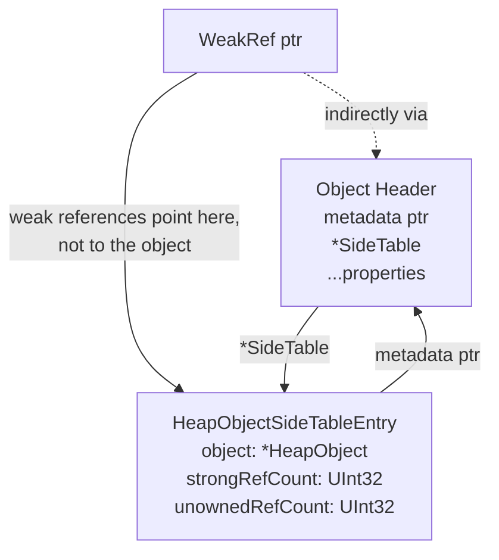

# Lesson 2: Memory Model, Automatic Reference Counting, Ownership Discipline

## 1. First-Principles Intuition & Invariants

Every programming language makes a wager about memory. C and C++ bet on the programmer's discipline, issuing raw `malloc` and `free` and trusting that every allocation finds exactly one deallocation at the right moment. Garbage-collected languages — Java, Go, Python — bet on the runtime's ability to periodically discover unreachable objects and reclaim them in bulk, paying for that convenience with unpredictable pause latencies and a less transparent relationship between source code and heap activity. Swift makes a third wager: that the compiler, given enough static information, can insert the precise sequence of retain and release operations that a careful programmer would write by hand. This strategy is called Automatic Reference Counting, and understanding it demands that you internalize not just its rules but the mechanical reality underneath those rules — the heap layout of a class instance, the atomic increment that guards a reference count, and the exact moment a destructor fires.

The foundational invariant of ARC is deceptively simple: an object remains alive as long as at least one strong reference points to it, and it is destroyed the instant that count falls to zero. There is no background sweep, no stop-the-world collection phase, no nursery. Destruction is synchronous, deterministic, and scoped precisely to the site of the last release. This determinism is not merely aesthetic. It is what makes Swift suitable for tight resource management — file handles, GPU command buffers, network connections — where you need to know *when* a finalizer runs, not just *whether* it eventually will. It is also what makes retain cycles a first-class hazard rather than a minor inefficiency: a cycle prevents any reference count in the loop from ever reaching zero, and the objects trapped inside live forever, their memory silently hemorrhaging from the heap.

To reason about ARC from first principles, you must hold two models simultaneously. The first is the ownership model: every value or object reference carries an implied owner, and ownership transfer follows well-defined rules at assignment, function call, and return. The second is the mechanical model: each class instance begins life with two integers — the strong reference count and the weak reference count — embedded at a fixed negative offset from the pointer the programmer holds. Swift calls this structure the `HeapObject` header, and the two counts live in a single 64-bit word called the `InlineRefCounts` field. The strong count occupies the high bits, the weak count the low bits, and all mutations happen through atomic compare-and-swap operations to preserve correctness in concurrent environments.

Value types — structs and enums — do not participate in ARC at all. When you assign a struct to a new variable or pass it to a function, Swift copies the payload entirely. No heap allocation occurs unless the struct contains a reference-typed field, and no reference count is touched until the struct's storage is released and its contained references are decremented. This means that for pure value types, the Swift memory model is essentially the same as C's stack discipline: perfectly predictable, zero overhead. The complexity enters entirely through classes, closures that capture reference types, and the indirect storage behind certain enum payloads.

The distinction between `strong`, `weak`, and `unowned` is not syntactic decoration. Each keyword encodes a different ownership contract with the compiler and the runtime, and conflating them produces programs that either leak memory silently or crash with spectacular force.

A `strong` reference is an unconditional ownership claim. When you hold a strong reference to an object, that object cannot be destroyed. The compiler emits a `swift_retain` call every time a strong reference is copied and a `swift_release` call every time one goes out of scope. These are the atomic operations that drive the reference count. The contract is symmetric: every retain has exactly one paired release, and the compiler enforces this pairing through the ownership annotations it threads through the intermediate representation.

A `weak` reference is a non-owning, nullable observation. It asserts: "I am interested in this object while it exists, but I make no claim on its lifetime." Weak references require the object type to be `Optional`, because the runtime must be able to zero out the reference when the object is deallocated. The machinery behind this is the side table: when any weak reference to an object is first created, the runtime allocates a small side-table structure on the heap and redirects the weak reference to point at the side table rather than the object directly. The side table holds a back-pointer to the object, its own reference count, and a flag indicating whether the object is still alive. When the strong count reaches zero, the object is destroyed and the side table's flag is set, but the side table itself remains alive until the weak count also reaches zero. This two-phase destruction is what makes it safe to load a `weak` reference — to call `.load()` semantically — in a concurrent environment: you either receive a valid, strongly retained object or you receive `nil`, never a dangling pointer.

An `unowned` reference is a non-owning, non-nullable assertion. It tells the runtime: "I guarantee this object will outlive this reference." There are two variants with meaningfully different tradeoffs. `unowned(safe)`, the default, still burns a reference count slot in the side table (the unowned count) and performs a liveness check on every access, trapping with a diagnostically informative crash if the object has already been deallocated. `unowned(unsafe)` performs no check whatsoever — it is a bare pointer in everything but name, and accessing a deallocated object through it produces undefined behavior identical to a C use-after-free. The safe variant is the right default everywhere except tight inner loops where you have already established the lifetime invariant through other means and profiled the check as a bottleneck.

The Swift ownership model received a formal elaboration with the introduction of the `Ownership Manifesto` and subsequently the `borrow` and `consume` annotations introduced in Swift 5.9. These additions let you express non-copying parameter passing (`borrowing` for read-only, `inout` for mutable) and explicit ownership transfer (`consuming`) at the source level, giving the optimizer stronger static guarantees and eliminating the spurious retain-release pairs it previously had to insert defensively around function call boundaries. For a systems programmer, these annotations are not optional style choices — they are the mechanism by which you recover C-level performance without abandoning Swift's safety guarantees.

---

## 2. Core Architecture & Mechanics

### The HeapObject Layout

Every Swift class instance begins life as a contiguous region of heap memory laid out as follows. The first word (8 bytes on a 64-bit platform) holds a pointer to the class's metadata — its vtable, its type descriptor, its field offsets. The second word holds the `InlineRefCounts` field. Beginning at byte 16, the instance's stored properties are laid out in declaration order, subject to alignment padding. The pointer the programmer holds in source code points to byte 0 of this structure, specifically to the metadata pointer, so dereferencing it immediately yields dispatch information.

```
┌──────────────────────────────────────────────────────────────┐
│  Offset +0  │  Metadata Pointer (8 bytes)                    │
├─────────────────────────────────────────────────────────────-┤
│  Offset +8  │  InlineRefCounts (8 bytes)                     │
│             │  [Strong Count | Unowned Count | Flags]        │
├──────────────────────────────────────────────────────────────┤
│  Offset +16 │  Stored Property 0                            │
├──────────────────────────────────────────────────────────────┤
│  Offset +N  │  Stored Property 1 ... N                      │
└──────────────────────────────────────────────────────────────┘
```

When a weak reference is created, the runtime promotes the object to use a side table. The `InlineRefCounts` word is overwritten with a pointer to the side table (distinguished by a flag in the low bit), and the side table holds the original strong and unowned counts along with a pointer back to the object.



The indirection through the side table is the key mechanism enabling safe weak reference loading. When the strong count hits zero, `swift_deallocObject` is called, which destroys the object's contents (calling `deinit` and releasing all contained references) and then frees the object's heap memory. The side table entry is marked with `IsDeinitialized = true`. Subsequent loads of any `weak` reference go through `swift_weakLoadStrongFromSideTable`, which checks the flag, returns `nil` if set, or performs an atomic increment of the strong count and returns the object if not.

### ARC Insertion and the SIL Pipeline

Swift does not insert retain-release pairs during semantic analysis or even during early IR generation. It inserts them during the SIL (Swift Intermediate Language) pipeline, at the stage where ownership-based data flow is fully resolved. SIL is a static single-assignment form IR that is explicit about ownership: every value has a `@owned`, `@guaranteed`, or `@unowned` convention, and the pipeline enforces that these conventions are met at every use site.

The `RawSIL` phase produces an ownership-correct but unoptimized graph with many redundant retains and releases — particularly around function arguments and return values, where the compiler is conservative. The `SILOptimizer` then runs a sequence of passes, the most significant of which for ARC are the ARC optimizer passes: `ARCSequenceOpts` (which pairs retains with their matching releases and eliminates redundant round-trips), `RetainSinking` (which moves retains as late as possible), and `ReleaseHoisting` (which moves releases as early as possible, freeing memory sooner). The result is typically a substantial reduction in the number of atomic operations in hot paths.

You can inspect the SIL output for any file directly:

```sh
# Emit raw SIL before optimization
swiftc -emit-silgen -O MyFile.swift -o - | swift-demangle | less

# Emit canonical SIL after ARC optimization passes
swiftc -emit-sil -O MyFile.swift -o - | swift-demangle | less
```

Looking at the canonical SIL for a simple class creation and function call will reveal exactly how many `strong_retain` and `strong_release` instructions survive optimization. For tight loops that allocate and release the same object in every iteration, you should see the retain-release pair eliminated entirely through scalar replacement of allocations, reducing the heap allocation itself to a stack promotion.

### Closure Capture Semantics

Closures are heap-allocated objects that conform to the `() -> T` function type. When a closure captures a reference type, the compiler embeds a strong reference to that object in the closure's payload. This is the most common source of accidental retain cycles: a closure owned by an object that also captures the object through `self` creates a cycle where the reference count of `self` can never reach zero.

```swift
class RequestManager {
    var onComplete: (() -> Void)?

    func configure() {
        // This closure captures self strongly. self.onComplete retains
        // the closure, and the closure retains self. Neither can be freed.
        onComplete = {
            print(self.description)
        }
    }
}
```

The standard mitigation is a capture list: `[weak self]` or `[unowned self]`. But the choice between them encodes different lifetime assertions. `[weak self]` is appropriate when the closure may genuinely outlive the object — an asynchronous network callback stored in a global dispatch queue, for instance. `[unowned self]` is appropriate when you can prove the closure cannot outlive the object — a UIView animation completion block that is cancelled when the view's controller is deallocated.

```swift
func configure() {
    // weak: safe when callback may fire after self is gone
    onComplete = { [weak self] in
        guard let self else { return }
        print(self.description)
    }
}

func configureAnimation() {
    // unowned: valid because the animation lifecycle is scoped to self
    UIView.animate(withDuration: 0.3) { [unowned self] in
        self.view.alpha = 0
    }
}
```

The capture list `[weak self]` compiles to a `weak` reference in the closure's capture record and a nil check in the body. `[unowned self]` compiles to either a side-table unowned load with trap (safe variant) or a raw pointer load (unsafe variant, written `[unowned(unsafe) self]`).

Capture lists also apply to value types captured by closures. By default, Swift captures value types by reference when they appear in an escaping closure — the value is boxed in a `heap-allocated` reference-counted `Box<T>` so that mutations inside the closure are visible to the outer scope. If you specify the value type in the capture list (`[value]`), you get a copy taken at the point of closure creation rather than a reference to the original storage.

```swift
var counter = 0
let snapshot = { [counter] in
    // captures the integer value at the time of closure creation, not a reference
    print(counter)
}
counter += 100
snapshot() // prints 0, not 100
```

### Detecting Retain Cycles with Instruments and AddressSanitizer

The primary tool for cycle detection is Instruments' **Memory Graph Debugger**, invoked either from Xcode's Debug menu or from the `leaks` command-line tool. At a process pause point, the memory graph tool walks the heap, identifies all live objects, and builds an object graph. It marks any strongly connected components that are unreachable from the root set as leaks.

```sh
# Analyze a running process by pid for leaked objects
leaks <pid>

# Run a command under leak analysis and report at exit
leaks --atExit -- ./MyApp
```

For heap-use-after-free and other memory safety violations in `unsafe` code, compile with AddressSanitizer:

```sh
swiftc -sanitize=address -g MyFile.swift -o myapp
./myapp
```

ASan instruments every memory access with shadow memory checks and reports the precise allocation and free sites for any use-after-free, out-of-bounds access, or double-free. The output includes a full stack trace at the point of violation, the original allocation site, and — for use-after-free — the deallocation site. This is indispensable when working with `Unmanaged<T>`, raw `UnsafePointer`, or any Swift code that wraps a C library.

---

## 3. High-Performance Optimization & Failure Modes

### Eliminating Spurious Retains in Hot Paths

The single most impactful ARC optimization technique is understanding where the compiler cannot eliminate retains and structuring your code to give it the information it needs. The optimizer cannot eliminate a retain when it cannot prove that no other thread could concurrently release the object through a different reference. This situation, called an *ARC barrier*, occurs most often at escaping closure boundaries, protocol witness calls (because the optimizer cannot see through existentials), and calls to `@objc` methods (because Objective-C's runtime uses the same reference count but through a different call path that the Swift optimizer cannot model).

You can verify which retains survive optimization by examining the LLVM IR or, more practically, by using the `swift-stdlib-tool` output with `--nm` to count `swift_retain`/`swift_release` symbol references in a release build, or by examining the assembly directly:

```sh
# compile with optimizations, emit assembly, search for retain calls
swiftc -O -emit-assembly MyFile.swift -o MyFile.s
grep -c 'swift_retain\|swift_release' MyFile.s
```

The number you see in a debug build versus a `-O` build can differ by an order of magnitude for class-heavy code. If you see retains surviving in a function you expect to be retain-free, the most common culprits are: a parameter that escapes into a stored closure inside the callee; a conditional path the optimizer cannot prove unreachable; or a call through a protocol existential that prevents devirtualization.

Converting protocol-existential parameters to generic constrained parameters is one of the highest-leverage optimizations available. An existential `any Drawable` parameter forces the runtime to dispatch through the protocol witness table and to box the value if it doesn't fit in the existential's three-word inline buffer. A constrained generic `<T: Drawable>` allows the compiler to specialize the function for each concrete type, inline the method bodies, and eliminate the boxing entirely.

```swift
// Existential: dispatch through protocol witness table, possible heap box
func render(shape: any Drawable) { shape.draw() }

// Generic: specialized per concrete type, fully inlineable
func render<T: Drawable>(shape: T) { shape.draw() }
```

The `@_specialize` attribute forces the compiler to emit a specialized version of a generic function for a given type substitution at the callsite's module boundary — useful when the caller is in a different module and whole-module optimization cannot specialize automatically.

### Ownership Annotations for Zero-Copy Argument Passing

Swift 5.9's formal ownership annotations give you direct control over whether a function borrows or consumes its arguments. A `borrowing` parameter receives a non-owning, read-only reference to the caller's value. No retain is emitted at the call site. A `consuming` parameter takes ownership; the caller's variable is consumed and cannot be used after the call without explicit reinitialization. These are the Swift equivalents of Rust's `&T` and `T` parameter conventions.

```swift
// Caller retains ownership; no ARC traffic at call site
func serialize(buffer: borrowing ByteBuffer) -> Data {
    return Data(buffer.bytes)
}

// Caller transfers ownership; value is moved, not copied
func enqueue(task: consuming WorkItem) {
    taskQueue.append(task)
}
```

For value types that contain reference-typed fields, the difference between borrowing and copying is the difference between zero ARC operations and O(n) ARC operations where n is the number of reference fields. At scale, in tight event loops processing thousands of objects per second, this is a measurable throughput difference.

### The Copy-on-Write Discipline

Swift's standard library collections — `Array`, `Dictionary`, `String`, `Set` — implement copy-on-write semantics using a reference-counted buffer as their backing storage. The collection value type itself is a thin wrapper containing a single strong reference to this buffer. When you copy a collection, you copy the wrapper, incrementing the buffer's reference count. When you mutate the copy, the mutating method checks whether the buffer is uniquely referenced via `isKnownUniquelyReferenced(_:)`. If it is, mutation proceeds in place. If the reference count is greater than one, the buffer is copied before mutation, isolating the mutating copy from all observers of the original.

Understanding this mechanic is critical for performance-sensitive code. The implication is that if you pass an `Array` as a `var` parameter (which causes a copy of the wrapper and an incremented reference count on the buffer) and then mutate it, you pay for a full deep copy of the buffer even though the caller may never observe the mutation. The mitigation is to pass mutable collections as `inout` when mutation is intended, which passes a reference to the original without incrementing the reference count and allows mutation to proceed in place without copying.

```swift
// Incurs a copy of the buffer if array is shared
func processItems(_ items: [Item]) -> [Item] {
    var local = items  // RC +1 on buffer; mutation below triggers copy
    local.append(Item())
    return local
}

// No copy: mutates through the caller's reference
func processItemsInPlace(_ items: inout [Item]) {
    items.append(Item()) // unique reference guaranteed by inout exclusivity
}
```

The exclusivity enforcement on `inout` is not just a semantic promise — the Swift runtime enforces the law of exclusivity at runtime in debug builds (and statically in many cases at compile time), trapping if two overlapping `inout` accesses to the same variable are detected. This prevents a class of data races that would otherwise be silent in single-threaded code and catastrophic in concurrent code.

### Interoperability with Manual Memory Management

When calling C APIs or wrapping system libraries, you operate in a zone where ARC does not apply and you are responsible for every allocation and deallocation. The Swift standard library provides three tiers of unsafe pointer access with decreasing abstraction.

`UnsafePointer<T>` and `UnsafeMutablePointer<T>` are typed pointers that perform no ARC operations and no bounds checking. They model pointer arithmetic and dereferencing at the type level. `UnsafeRawPointer` and `UnsafeMutableRawPointer` strip the type information entirely, allowing you to load and store values of any type from an arbitrary byte address — the Swift equivalent of `void *`. `UnsafeBufferPointer<T>` pairs a base pointer with a count, providing a Collection-conformant view over a contiguous block of memory without ownership.

```swift
// Allocate 64 bytes aligned to 16 bytes, manually managed
let buffer = UnsafeMutableRawPointer.allocate(byteCount: 64, alignment: 16)
defer { buffer.deallocate() }

// Store a value at a typed offset
buffer.storeBytes(of: UInt64(0xDEADBEEF), as: UInt64.self)

// Load it back
let value = buffer.load(as: UInt64.self)
```

For Swift class instances that must cross an ARC boundary — passed as an opaque `void *` context pointer to a C callback, for instance — the `Unmanaged<T>` type is the bridge. `Unmanaged.passRetained(_:)` increments the strong reference count and returns an `Unmanaged<T>` that can be converted to a raw pointer via `.toOpaque()`. On the callback side, `Unmanaged<T>.fromOpaque(_:).takeRetainedValue()` decrements the count back and returns the Swift object to ARC management. Using `takeUnretainedValue()` instead returns the object without decrementing the count, which is correct when the callback is invoked multiple times with the same context pointer and you hold the strong reference elsewhere.

```swift
class CallbackContext {
    var onEvent: ((Event) -> Void)?
}

func registerCallback(context: CallbackContext) {
    // +1 retain; we are transferring ownership to the C callback mechanism
    let ptr = Unmanaged.passRetained(context).toOpaque()

    registerNativeCallback(ptr) { rawPtr, event in
        // reclaim the Swift object without decrementing (callback fires repeatedly)
        let ctx = Unmanaged<CallbackContext>.fromOpaque(rawPtr!).takeUnretainedValue()
        ctx.onEvent?(event)
    }
}

func unregisterCallback(rawPtr: UnsafeMutableRawPointer) {
    // balance the +1 from passRetained when we are done
    Unmanaged<CallbackContext>.fromOpaque(rawPtr).release()
}
```

Failing to balance `passRetained` with either `takeRetainedValue()` or an explicit `release()` is a classic leak in Swift-to-C interop. Failing to verify the lifetime of the context object before the callback fires is a classic use-after-free. These two failure modes together account for the majority of memory bugs in real Swift systems code, and they are entirely invisible to ARC because the reference count manipulation has been made explicit and the runtime cannot track the semantic intent encoded in the C callback registration contract. The discipline required here is identical to that of a C programmer managing `refcount_inc` and `refcount_dec` by hand — which is precisely what `Unmanaged` exposes.

### Failure Mode Reference

Three failure modes deserve precise characterization because they manifest differently at runtime and require different diagnostic approaches.

A **retain cycle** produces no crash and no immediate symptom. The first observable effect is monotonically increasing live memory in a long-running process. The diagnostic tool is the memory graph debugger or `leaks`, which will identify the cycle as a set of objects with no path to any root. The fix is always to identify which reference in the cycle represents a non-owning relationship and change it to `weak` or `unowned`.

A **use-after-free through `unowned`** produces an immediate trap in safe builds with the message `"error: attempt to read an unowned reference but object 0x... was already deallocated"`. The trap is deterministic and the message is informative. The fix is to either extend the owner's lifetime or convert to `weak` with a nil check.

A **use-after-free through `Unmanaged` or `UnsafePointer`** produces undefined behavior. In practice this means memory corruption that may manifest immediately as a crash, or silently produce wrong results, or crash much later in unrelated code when the corrupted memory is subsequently interpreted. AddressSanitizer is the correct diagnostic tool here, and you should run it as a matter of course in CI for any code that uses unsafe pointer APIs. The shadow memory overhead (roughly 1.5× memory, 2–3× execution time) is acceptable for correctness validation and entirely unacceptable for production, which is why ASan is a development-time tool.

The discipline that separates production Swift systems code from fragile application code is precisely the habit of reasoning about these three failure modes at every API boundary: asking which side owns the lifetime, what happens when the object is released before the callback fires, and whether the reference count semantics encoded in the C API contract have been faithfully reflected in the Swift wrapper. ARC automates the common case completely. The uncommon cases it cannot see are where the work of a systems programmer begins.
