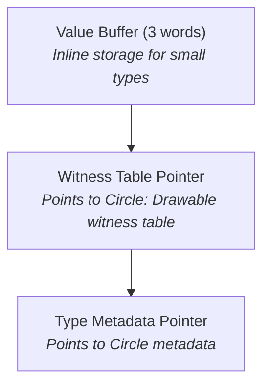

# Lesson 3: Protocol-Oriented Design, Generics, Associated Types

## 1. First-Principles Intuition & Invariants

Swift's type system diverges sharply from the object-oriented heritage of Objective-C and the nominal subtyping hierarchies found in Java or C++. At its core, Swift embraces *protocol-oriented design*, a paradigm in which behavior contracts are defined through protocols, and concrete types witness their conformance by providing implementations that satisfy those contracts. This is not merely syntactic sugar over interfaces; it is a first-class compile-time mechanism backed by witness tables, generic specialization, and a sophisticated constraint-solving type checker that unifies parametric polymorphism with ad-hoc polymorphism through associated types and protocol composition.

The protocol witness table, or PWT, is the runtime dispatch structure analogous to a C++ vtable but specialized for protocol conformance. When a type declares conformance to a protocol, the Swift compiler generates a witness table containing function pointers to the type's implementations of the protocol's requirements. Unlike class inheritance, where a single vtable hierarchy suffices, protocols enable multiple independent conformances, and each conformance yields its own witness table. This design affords Swift the flexibility of duck typing with the performance guarantees of static dispatch when the compiler possesses full type information.

Static dispatch occurs when the concrete type is known at compile time. In such cases, the Swift compiler inlines or directly invokes the concrete method implementation, eliding the witness table entirely. Dynamic dispatch, by contrast, manifests when code operates on an existential type—a boxed, type-erased container that holds both the value and a pointer to its witness table. Existential types enable heterogeneous collections and runtime polymorphism but impose indirection overhead and inhibit optimizations like inlining and devirtualization.

Generics in Swift are not templates in the C++ sense, where instantiation generates distinct code for each concrete type. Instead, Swift employs a hybrid model: generic functions and types are compiled once, and the compiler either specializes them at call sites when full type information is available or falls back to a generic calling convention that passes witness tables and type metadata as implicit parameters. This specialization is aggressive; the Swift Intermediate Language (SIL) optimizer performs whole-module optimization (WMO) to clone and specialize generic functions, converting dynamic dispatch into static dispatch and enabling scalar replacement of aggregates, constant folding, and inlining.

Associated types extend generics with type-level dependencies. Where a generic parameter is a placeholder filled by the caller, an associated type is determined by the conforming type itself. Protocols with associated types (PATs) introduce a form of type-level computation: the compiler must unify associated type constraints across multiple protocol conformances, resolve type inference puzzles, and ensure coherence—the invariant that each type has at most one conformance to any given protocol. This constraint-solving problem is NP-complete in the general case, and the Swift type checker employs heuristics, caching, and iterative refinement to achieve tractable compile times.

Protocol composition permits a type to declare conformance to multiple protocols simultaneously, and Swift's `&` operator constructs existential types representing the intersection of protocol requirements. This composition is structural, not nominal; the compiler synthesizes a witness table bundle at the point of use, enabling expressive type constraints without forcing clients into rigid inheritance hierarchies. The interplay between protocol composition, conditional conformance (where a generic type conforms to a protocol only when its type parameters satisfy certain constraints), and associated type inference forms the backbone of Swift's standard library, powering abstractions like `Collection`, `Sequence`, and `LazySequence`.

The Swift compiler enforces *coherence* by permitting only one conformance of a type to a protocol per module. This restriction prevents ambiguity in witness table selection and enables the compiler to reason locally about dispatch. It also precludes orphan instances—conformances defined outside both the protocol's and the type's defining modules—unless the conformance is declared as a retroactive conformance with explicit disambiguation. Coherence, combined with static dispatch specialization and witness table devirtualization, allows Swift to achieve zero-cost abstractions in the common case while retaining the expressiveness of dynamic polymorphism when required.

## 2. Core Architecture & Mechanics

When a protocol is defined, the Swift compiler constructs a *protocol descriptor* containing metadata about the protocol's requirements: the names, types, and calling conventions of its methods and properties, along with flags indicating whether default implementations exist. This descriptor resides in the read-only data section of the compiled binary and is referenced by witness tables and existential containers at runtime.

A witness table is a compile-time artifact generated for each concrete type-protocol conformance pair. Consider the following protocol and conformance:

```swift
protocol Drawable {
    func draw()
    var color: String { get }
}

struct Circle: Drawable {
    var radius: Double
    
    func draw() {
        print("Drawing circle with radius \(radius)")
    }
    
    var color: String {
        return "blue"
    }
}
```

The compiler generates a witness table for `Circle: Drawable` containing two entries: a function pointer to `Circle.draw()` and a function pointer to the getter for `Circle.color`. When `Circle` is used as an existential `Drawable`, the runtime boxes the `Circle` value and stores a pointer to this witness table alongside it. Invocations on the existential type indirect through the witness table, incurring a single pointer dereference and a function call overhead.

Static dispatch eliminates this indirection. When the compiler knows the concrete type at compile time, it directly invokes the method:

```swift
func renderStatic(circle: Circle) {
    circle.draw()  // Direct call to Circle.draw(), no witness table
}
```

Dynamic dispatch occurs when operating on an existential type:

```swift
func renderDynamic(drawable: Drawable) {
    drawable.draw()  // Witness table indirection
}
```

The existential container for `Drawable` is laid out in memory as follows:



Small types (up to three pointer-sized words) are stored inline in the value buffer. Larger types are heap-allocated, and the value buffer holds a pointer to the heap allocation. This small-value optimization reduces allocation overhead for common cases like integers, small structs, and enums.

Generics introduce a second dispatch mechanism: the generic calling convention. When a generic function cannot be specialized, it receives implicit witness table and type metadata parameters. Consider:

```swift
func render<T: Drawable>(drawable: T) {
    drawable.draw()
}
```

If the compiler cannot determine `T` at compile time, it lowers this to an SIL representation equivalent to:

```text
sil @render : $@convention(thin) <T where T : Drawable> (@in T, @thick T.Type, @in T.Drawable) -> ()
```

The `@in T` parameter passes the value indirectly via pointer, `@thick T.Type` passes the type metadata, and `@in T.Drawable` passes the witness table for `T`'s conformance to `Drawable`. Within the function body, method calls indirect through the witness table. However, when the compiler performs whole-module optimization and observes a concrete call site:

```swift
let circle = Circle(radius: 5.0)
render(drawable: circle)
```

It specializes `render` for `Circle`, generating:

```text
sil @render_specialized_Circle : $@convention(thin) (Circle) -> () {
bb0(%0 : $Circle):
  %1 = function_ref @Circle.draw : $@convention(method) (Circle) -> ()
  apply %1(%0) : $@convention(method) (Circle) -> ()
  return
}
```

The specialized version uses static dispatch, passes the value by register, and enables inlining. The SIL optimizer then folds this into the caller, eliminating function call overhead entirely.

Associated types introduce type-level dependencies resolved during constraint solving. The `Collection` protocol exemplifies this:

```swift
protocol Collection {
    associatedtype Element
    associatedtype Index: Comparable
    
    var startIndex: Index { get }
    var endIndex: Index { get }
    
    subscript(position: Index) -> Element { get }
    func index(after i: Index) -> Index
}
```

A conforming type determines `Element` and `Index` through its implementation:

```swift
struct IntArray: Collection {
    private var storage: [Int]
    
    typealias Element = Int
    typealias Index = Int
    
    var startIndex: Int { return 0 }
    var endIndex: Int { return storage.count }
    
    subscript(position: Int) -> Int {
        return storage[position]
    }
    
    func index(after i: Int) -> Int {
        return i + 1
    }
}
```

The compiler unifies `IntArray.Element` with `Int` and `IntArray.Index` with `Int`. Generic algorithms constrained to `Collection` can reference these associated types:

```swift
func sum<C: Collection>(_ collection: C) -> C.Element where C.Element == Int {
    var total = 0
    for element in collection {
        total += element
    }
    return total
}
```

The `where C.Element == Int` clause constrains the associated type, enabling the function to operate only on collections of integers. The compiler enforces this constraint at call sites, rejecting invocations with collections of incompatible element types.

Protocol composition constructs intersection types. The expression `Drawable & Equatable` denotes a type conforming to both protocols. The existential container for a composed protocol bundles multiple witness tables:

```swift
func compare(a: Drawable & Equatable, b: Drawable & Equatable) -> Bool {
    return a == b  // Uses Equatable witness table
}
```

The existential container now holds two witness table pointers, one for `Drawable` and one for `Equatable`, alongside the type metadata. Conditional conformance extends this further: a generic type may conform to a protocol only when its type parameters satisfy constraints:

```swift
extension Array: Equatable where Element: Equatable {
    static func == (lhs: Array, rhs: Array) -> Bool {
        guard lhs.count == rhs.count else { return false }
        for (l, r) in zip(lhs, rhs) {
            if l != r { return false }
        }
        return true
    }
}
```

`Array` conforms to `Equatable` only when `Element` conforms to `Equatable`. The compiler generates a conditional witness table entry, and the type checker verifies the constraint at use sites.

## 3. High-Performance Optimization & Failure Modes

The Swift compiler's optimization pipeline prioritizes generic specialization and witness table devirtualization to achieve zero-cost abstractions. The SIL optimizer performs interprocedural analysis, cloning generic functions at call sites where concrete type information is available. This specialization converts dynamic dispatch into static dispatch, enabling subsequent optimizations: inlining, constant propagation, dead code elimination, and scalar replacement of aggregates.

Whole-module optimization (WMO) is essential for realizing these gains. WMO analyzes the entire module simultaneously, constructing a global call graph and propagating type information across function boundaries. When compiling with `-O -whole-module-optimization`, the compiler specializes generic functions aggressively, devirtualizes protocol method calls, and inlines witness table lookups. The result is machine code nearly indistinguishable from hand-written monomorphic implementations.

To observe specialization in practice, compile a generic function with optimization enabled and inspect the generated SIL:

```swift
// main.swift
protocol Addable {
    static func + (lhs: Self, rhs: Self) -> Self
}

extension Int: Addable {}

func add<T: Addable>(_ a: T, _ b: T) -> T {
    return a + b
}

let result = add(3, 5)
print(result)
```

Compile with:

```bash
swiftc -O -whole-module-optimization -emit-sil main.swift -o /dev/stdout | grep -A 20 "sil @main"
```

The optimized SIL reveals that the generic `add` function has been specialized for `Int`, and the protocol method call has been devirtualized to a direct invocation of `Int.+`. The inliner then folds the addition into the caller, and constant folding evaluates `3 + 5` at compile time, replacing the entire computation with a constant `8`.

Existential types, while flexible, impose performance costs. The indirection through witness tables inhibits inlining, and the value buffer's small-value optimization triggers heap allocation for large types. To quantify this overhead, consider a microbenchmark comparing static and dynamic dispatch:

```swift
import Foundation

protocol Incrementable {
    mutating func increment()
}

struct Counter: Incrementable {
    var value: Int
    mutating func increment() {
        value += 1
    }
}

func benchmarkStatic(iterations: Int) {
    var counter = Counter(value: 0)
    let start = CFAbsoluteTimeGetCurrent()
    for _ in 0..<iterations {
        counter.increment()
    }
    let elapsed = CFAbsoluteTimeGetCurrent() - start
    print("Static dispatch: \(elapsed)s, value: \(counter.value)")
}

func benchmarkDynamic(iterations: Int) {
    var counter: Incrementable = Counter(value: 0)
    let start = CFAbsoluteTimeGetCurrent()
    for _ in 0..<iterations {
        counter.increment()
    }
    let elapsed = CFAbsoluteTimeGetCurrent() - start
    print("Dynamic dispatch: \(elapsed)s")
}

benchmarkStatic(iterations: 100_000_000)
benchmarkDynamic(iterations: 100_000_000)
```

On a modern x86_64 system with optimization enabled, static dispatch completes an order of magnitude faster. The static version inlines `increment()`, and the loop is optimized to a single increment of a register. The dynamic version indirects through the witness table on every iteration, preventing inlining and forcing memory writes.

To mitigate dynamic dispatch overhead, prefer concrete types over existentials in performance-critical code. When polymorphism is necessary, constrain generics rather than using existentials:

```swift
// Prefer this
func process<T: Drawable>(_ drawable: T) {
    drawable.draw()
}

// Over this
func process(_ drawable: Drawable) {
    drawable.draw()
}
```

The generic version specializes and devirtualizes; the existential version does not. When collecting heterogeneous types, consider type-erased wrappers that encapsulate existential overhead while exposing a generic interface. The standard library's `AnySequence` and `AnyCollection` exemplify this pattern, hiding the existential container behind a generic façade and amortizing indirection across aggregate operations.

Associated type constraints introduce compile-time complexity. The Swift type checker employs a constraint-solving algorithm that unifies type variables, propagates constraints, and prunes the search space through heuristics. Deeply nested generic constraints, recursive protocol requirements, and complex conditional conformances can trigger exponential blowup, manifesting as protracted compile times or type checker timeouts. The compiler imposes limits on constraint solver iterations and recursion depth, surfacing errors when these limits are exceeded.

To diagnose slow type checking, enable compilation statistics:

```bash
swiftc -Xfrontend -debug-time-function-bodies main.swift
```

This outputs the time spent type-checking each function body. Functions exhibiting excessive compile times often contain ambiguous type expressions or deeply nested closures where the type checker explores a combinatorial explosion of possibilities. Explicit type annotations prune the search space, guiding the solver toward the intended solution:

```swift
// Ambiguous, slow to compile
let result = data.map { $0.filter { $1.transform { $2.value } } }

// Explicit, fast to compile
let result: [TransformedValue] = data.map { (item: Item) -> TransformedValue in
    return item.filter { (subitem: Subitem) -> Bool in
        return subitem.transform { (inner: InnerType) -> Bool in
            return inner.value
        }
    }
}
```

Protocol witness tables impose memory overhead proportional to the number of protocol requirements. Each requirement consumes a word in the witness table, and types conforming to many protocols accumulate multiple witness tables. This proliferation increases binary size and cache pressure. Protocol requirements should be minimal, capturing only essential operations. Default implementations in protocol extensions provide behavior without adding witness table entries, as they are resolved statically at compile time rather than through dynamic dispatch.

Retroactive conformance—declaring that an existing type conforms to a protocol—requires care to avoid coherence violations. Swift prohibits retroactive conformances that would create ambiguity, such as declaring the same conformance in multiple modules. When extending foreign types, prefer protocol composition or type-erased wrappers over direct retroactive conformance to maintain module boundaries and coherence guarantees.

Opaque result types, introduced with the `some` keyword, provide a middle ground between existentials and generics. A function returning `some Protocol` commits to returning a single, fixed concrete type without exposing its identity:

```swift
func makeDrawable() -> some Drawable {
    return Circle(radius: 10.0)
}
```

The compiler infers the concrete return type (`Circle`) and specializes call sites accordingly, enabling static dispatch while preserving abstraction. Opaque types avoid the indirection of existentials and the verbosity of generic type parameters, and they compose naturally with protocol constraints and associated types.

Generic specialization interacts with link-time optimization (LTO) to further reduce runtime overhead. When compiling multiple modules with LTO enabled, the linker observes cross-module call sites and specializes generic functions that were not visible during initial compilation. This enables specialization of standard library generics for user-defined types, collapsing abstraction layers into efficient machine code. To leverage LTO, compile with:

```bash
swiftc -O -whole-module-optimization -lto=llvm-full module1.swift module2.swift -o executable
```

The LLVM LTO pass performs cross-translation-unit inlining, devirtualization, and constant propagation, producing a fully optimized binary.

Failure modes in protocol-oriented design often stem from mismatched abstractions. Protocols modeling behavior with side effects or implicit state dependencies hinder reasoning and testing. Pure protocols, where methods are deterministic functions of their arguments and the receiver's value, compose cleanly and enable equational reasoning. When state or side effects are unavoidable, isolate them behind narrow interfaces and document invariants explicitly.

Associated type constraints can over-constrain generic algorithms, reducing reusability. Strive for minimal constraints: require only the operations the algorithm actually uses. The standard library's `Sequence` protocol exemplifies this principle, demanding only a single-pass iterator without imposing indexing or count requirements. Algorithms generic over `Sequence` apply to a vast range of types, from arrays to lazy transformations to asynchronous streams, maximizing code reuse without sacrificing performance.
