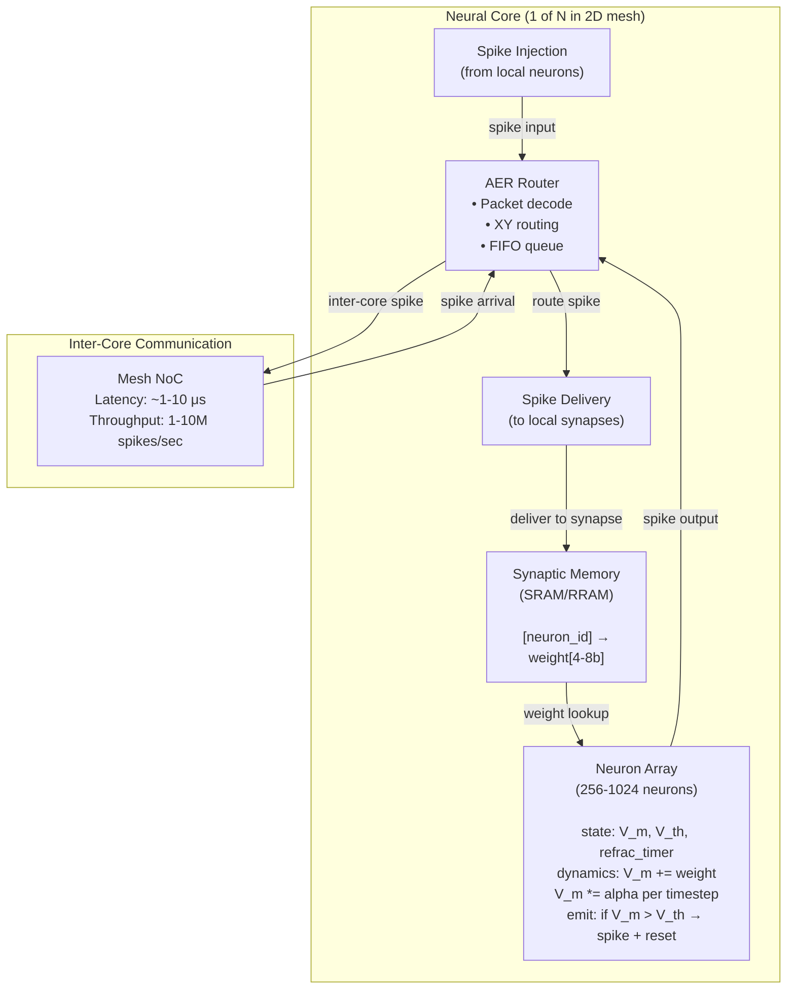

# Lesson 3: Neuromorphic Computing Architectures

## 1. First-Principles Intuition & Invariants

The conventional von Neumann architecture that has dominated computing for over seven decades operates through a rigid separation of memory and computation, shuttling data across buses in clock-synchronized operations that consume energy proportional to data movement rather than meaningful computation. While this deterministic, cycle-accurate execution model has scaled remarkably through Moore's Law and Dennard scaling, it fundamentally mismatches the computational demands of perceptual inference, adaptive learning, and real-time sensorimotor control. Biological neural systems achieve these tasks with six orders of magnitude better energy efficiency, operating at roughly 20 watts for the entire human brain versus kilowatts for equivalent deep learning inference clusters. This efficiency gap stems not from silicon versus carbon chemistry, but from architectural principles: the brain collocates memory with computation in synaptic weights, communicates through sparse asynchronous events rather than dense synchronous data transfers, and implements computation as continuous analog dynamics rather than discrete logical operations.

Neuromorphic computing emerges from these observations as a radical architectural departure. Rather than executing sequential instructions on arrays of homogeneous transistors, neuromorphic systems implement massively parallel networks of simplified neural processing elements that communicate through discrete voltage spikes propagating across configurable synaptic connections. The fundamental computational primitive shifts from the floating-point multiply-accumulate to the integrate-and-fire neuron model, where membrane potential accumulates incoming weighted spikes until crossing a threshold that triggers an output spike. This event-driven execution eliminates the need for continuous clock distribution and allows components to remain in low-power states until stimulated by actual data events, achieving power consumption that scales with computational activity rather than system capacity.

The core invariants that distinguish neuromorphic architectures from conventional neural network accelerators center on temporal coding and asynchronous communication. In artificial neural networks deployed on GPUs or TPUs, neurons exist as mathematical abstractions—scalar activation values computed synchronously in layer-wise sweeps through weight matrices. The temporal dimension collapses into a single forward pass, with time represented only implicitly through recurrent connections or attention windows. Neuromorphic systems restore time as a first-class computational variable, encoding information in the precise timing of discrete spike events measured in microseconds rather than inference batches. A visual edge detector in a neuromorphic vision sensor does not output a scalar edge magnitude every frame; instead, it fires a spike the instant local pixel intensity crosses a threshold, with the spike timing encoding the edge location and the inter-spike interval encoding motion velocity. This temporal precision enables neuromorphic systems to respond to sensory events in sub-millisecond latencies while conventional systems wait for frame accumulation and batch processing.

The energy efficiency advantage derives from the elimination of multiply-accumulate operations in favor of event-driven membrane potential updates. When a presynaptic neuron fires, the spike propagates to all connected postsynaptic neurons where it triggers a simple additive weight lookup and membrane potential increment—a single memory read and integer addition rather than a floating-point multiply. For sparse spike trains where each neuron fires at 10-100 Hz rather than processing dense activation tensors at kilohertz frame rates, the total operation count drops by three to four orders of magnitude. The Intel Loihi 2 neuromorphic processor achieves 15 pJ per synaptic operation compared to 1000 pJ per multiply-accumulate on a contemporary GPU, but this comparison understates the system-level advantage. Neuromorphic systems avoid the memory wall entirely by distributing synaptic weights physically adjacent to neurons in crossbar arrays where spike routing constitutes the only inter-core communication, while conventional accelerators burn 80% of their power budget moving activation tensors through memory hierarchies.

The architectural implications extend beyond hardware to algorithms and programming models. Conventional deep learning trains networks through backpropagation of gradients computed from loss functions evaluated on mini-batches, requiring complete computational graphs and differentiable activation functions. Spiking neural networks trained on neuromorphic hardware must overcome the non-differentiability of the spike generation function and the temporal credit assignment problem—determining which specific spike timings contributed to eventual output errors seconds later. Local learning rules inspired by biological synaptic plasticity provide an alternative to backpropagation, adjusting weights based on the temporal correlation between pre- and postsynaptic spikes without requiring gradient information from downstream layers. Spike-Timing-Dependent Plasticity (STDP) implements Hebbian learning through weight updates proportional to the spike time difference: synapses strengthen when presynaptic spikes consistently precede postsynaptic spikes within a critical time window, implementing a form of temporal causality detection without explicit supervisory signals.

The programming model inversion from synchronous tensor operations to asynchronous event streams requires rethinking software abstractions from first principles. A neuromorphic application does not iterate through layers applying weight matrices; instead, it configures a network topology of neurons and synapses, initializes weights and threshold parameters, then launches the network into autonomous event-driven execution. The developer specifies connectivity patterns, neuron dynamics, and plasticity rules as declarative constraints rather than imperative operations. Input arrives as address-event streams from neuromorphic sensors—silicon retinas that output pixel coordinates and polarities of brightness changes rather than frame buffers—and output emerges as spike trains decoded through temporal integration or population voting. Debugging transitions from inspecting activation tensors and gradient magnitudes to analyzing spike raster plots, membrane potential trajectories, and synaptic weight distributions over time. The temporal abstraction overhead that conventional systems hide behind batching and pipelining becomes explicit and tuneable, exposing latency-accuracy-power tradeoffs that static tensor flow graphs elide.

## 2. Core Architecture & Mechanics

The canonical neuromorphic architecture instantiates as a two-dimensional array of neural cores, each containing hundreds to thousands of simplified neuron circuits with local synaptic memory and an asynchronous router for inter-core spike communication. The neuron model underlying most current systems derives from the Leaky Integrate-and-Fire (LIF) formulation, which captures essential spiking dynamics while remaining implementable in efficient analog or digital circuits. The membrane potential $V_m$ of each neuron evolves according to the differential equation $\tau_m \frac{dV_m}{dt} = -(V_m - V_{rest}) + R_m I_{syn}$, where $\tau_m$ represents the membrane time constant controlling temporal integration, $V_{rest}$ defines the resting potential, $R_m$ scales synaptic current $I_{syn}$, and spike emission occurs when $V_m$ crosses threshold $V_{th}$, immediately resetting to $V_{reset}$. This continuous-time dynamics discretizes straightforwardly for digital implementation through the recurrence relation $V_m[t+1] = \alpha V_m[t] + I_{syn}[t]$ where $\alpha = \exp(-\Delta t/\tau_m)$ implements exponential decay and $I_{syn}$ accumulates weighted input spikes arriving during timestep $\Delta t$.

The synaptic memory architecture distinguishes neuromorphic systems from conventional neural network accelerators through its distributed organization and event-driven access pattern. Rather than storing weights in a monolithic off-chip DRAM array accessed through a memory hierarchy, neuromorphic cores embed synaptic weights in local SRAM or emerging non-volatile memories positioned physically adjacent to neuron circuits. Each neuron maintains a private synaptic table indexed by presynaptic neuron IDs, storing 4-bit to 8-bit integer weights that determine the membrane potential increment triggered by incoming spikes. When a spike arrives at a core's router, the destination neuron ID indexes directly into the synaptic table without cache lookups or TLB translations, reading the corresponding weight and immediately updating the neuron's membrane potential accumulator. This single-cycle synaptic event processing contrasts sharply with the multi-level memory traversals required to fetch activation tensors and weight matrices in conventional accelerators.

The routing infrastructure implements an asynchronous network-on-chip that forwards spikes from source neurons to destination synapses using address-event representation. When a neuron fires, it injects a spike packet containing the neuron's global ID into the local router, which decodes the destination core coordinates and forwards the packet through a mesh or hierarchical interconnect. Routers employ simple XY-dimension-ordered routing to avoid deadlock without virtual channels, buffering spikes in small FIFOs that drain as downstream routers accept packets. The critical performance parameter becomes spike throughput rather than memory bandwidth—a Loihi 2 core handles 4 million synaptic events per second with sub-microsecond average spike delivery latency. This event rate suffices for biological-plausibility spike frequencies around 100 Hz, but imposes architectural constraints on connectivity density. A core with 1024 neurons each firing at 100 Hz generates 100k spikes per second; with an average fanout of 100 synapses per neuron, the router must handle 10M events per second, approaching throughput limits that require careful network topology design to avoid hotspots.

The temporal dynamics of neuromorphic computation emerge from the interplay between membrane time constants, refractory periods, and spike propagation delays. When a neuron fires, it enters an absolute refractory period during which the membrane potential clamps to $V_{reset}$ and incoming spikes have no effect, followed by a relative refractory period where threshold gradually returns to $V_{th}$. These periods, typically 1-5 ms in biological neurons and configurable in silicon implementations, prevent runaway positive feedback and impose natural rate limits on information flow. Spike propagation through the routing network introduces additional delays on the order of microseconds per hop, creating temporal dispersion that affects synchronization across the network. Unlike conventional accelerators where pipeline registers maintain strict temporal alignment of data flowing through computation stages, neuromorphic systems tolerate and exploit timing jitter. Two spikes originating simultaneously but traversing different path lengths arrive at their destination neurons with relative delays that the membrane integration naturally smooths, implementing a form of temporal low-pass filtering that enhances noise robustness.

The address-event representation (AER) protocol underlying spike communication encodes each spike as a tuple (source_neuron_id, timestamp) transmitted as a serialized packet. The timestamp field enables precise temporal coding and allows delayed spike delivery for implementing synaptic delays and temporal windows. Modern neuromorphic chips extend this basic AER format with additional fields for routing metadata, spike payload data encoding analog values or labels, and congestion control flags. The Spinnaker architecture pioneered multicast routing where a single spike packet replicates to multiple destination cores through hardware multicast trees, reducing router load for neurons with high fanout. The routing key encodes both source identity and destination groups, allowing reconfigurable connectivity through programmable routing tables that map keys to output ports without explicit per-synapse addressing.



The programming abstraction for neuromorphic systems departs fundamentally from conventional tensor flow graphs, instead providing APIs for network specification through declarative connectivity patterns and neuron parameter configurations. The NxSDK software development kit for Intel Loihi exposes a hierarchical object model where developers instantiate neuron groups with shared parameters, define synaptic connectivity through sparse weight matrices or algorithmic connection rules, and configure learning rules through compartment prototypes. A typical workflow begins by creating a network object, adding neuron compartments with specified LIF parameters ($\tau_m$, $V_{th}$, $V_{rest}$), then connecting compartments through weighted synaptic connections. The connectivity specification supports dense matrices for fully-connected layers, sparse coordinate lists for convolutional receptive fields, or algorithmic generators for distance-dependent connectivity in spatial maps.

The execution model transitions from imperative control flow to declarative constraint specification. After configuring the network topology and initial weights, the developer submits the network to the chip where it executes autonomously, consuming input spike trains from sensors or host-generated events and producing output spike trains decoded by population readout circuits or host software. The temporal granularity of host-chip interaction differs markedly from conventional accelerators where the host launches kernel invocations for each layer and synchronizes on completion. Neuromorphic execution proceeds continuously at the chip's native timestep (typically 1 μs to 1 ms), with the host injecting input spikes asynchronously and polling for output spikes without blocking on individual neuron updates. This decoupling enables the chip to process sensory streams in real-time while the host performs higher-level decision making or learning updates on accumulated statistics.

The learning rule specification represents synaptic plasticity as local update functions triggered by spike coincidences without requiring gradient backpropagation. Spike-Timing-Dependent Plasticity configures through exponential temporal windows that determine the weight update magnitude as a function of pre-post spike timing difference: $\Delta w = A_+ \exp(-\Delta t/\tau_+)$ for $\Delta t > 0$ (pre before post, potentiation) and $\Delta w = -A_- \exp(\Delta t/\tau_-)$ for $\Delta t < 0$ (post before pre, depression). The hardware implements this through trace variables that exponentially decay with time constants $\tau_+$ and $\tau_-$, incremented by presynaptic and postsynaptic spikes respectively. When both traces are non-zero, indicating recent spike activity on both sides of the synapse, the weight updates according to their product, implementing correlation-based learning without explicit gradient computation. More sophisticated learning rules combine STDP with reward modulation, homeostatic plasticity for stability, or multi-compartment interactions for hierarchical credit assignment.

## 3. High-Performance Optimization & Failure Modes

The optimization landscape for neuromorphic systems inverts conventional deep learning priorities, trading off model capacity for event sparsity, precision for power efficiency, and deterministic accuracy for statistical robustness. The primary performance bottleneck shifts from memory bandwidth to spike routing throughput, requiring careful network topology design to avoid router congestion hotspots. A densely connected network where each neuron projects to thousands of targets generates spike traffic proportional to the product of firing rate and fanout, quickly saturating the routing network even at modest biological spike rates. The architectural solution implements hierarchical connectivity where neurons connect densely within local cores but sparsely across cores, exploiting locality in sensory processing and decision making to contain traffic. Convolutional network topologies map naturally to this constraint, with each feature map distributed across multiple cores sharing local weight patterns but communicating sparse activations to subsequent layers.

The temporal dynamics of spiking networks introduce optimization dimensions absent in conventional neural networks. The membrane time constant $\tau_m$ controls the temporal integration window over which spikes accumulate before decay, trading off temporal precision for noise averaging. Short time constants (1-2 ms) enable rapid response to transient events but require high spike rates to maintain stable membrane potentials, increasing power consumption. Long time constants (10-50 ms) smooth temporal fluctuations and allow lower spike rates but blur fine-grained temporal patterns and increase latency for state changes to propagate through the network. The optimal time constant depends on task requirements—real-time motor control benefits from short integration for low latency, while visual object recognition tolerates longer integration for noise robustness. Many architectures implement multiple time constants across layers, with early sensory layers using short time constants to capture rapid dynamics and higher decision layers using long time constants to integrate evidence over time.

The quantization constraints inherent in neuromorphic hardware demand careful network design and training strategies. Most current systems limit synaptic weights to 4-bit or 8-bit integers rather than 32-bit floating-point, and represent membrane potentials as 16-bit to 24-bit fixed-point values. This coarse quantization amplifies sensitivity to weight initialization and necessitates quantization-aware training where forward passes during backpropagation simulate hardware precision limits. The technique of surrogate gradients addresses the non-differentiability of spike generation by substituting a smooth approximation of the Heaviside step function during backward passes, enabling gradient descent on spiking network parameters. After training, weights undergo post-quantization through rounding or stochastic rounding, with fine-tuning iterations compensating for quantization error. The information bottleneck imposed by low-precision weights often requires increasing network width to maintain task accuracy, trading chip area for precision.

The event-driven execution model introduces race conditions and non-determinism absent in synchronous architectures. When multiple spikes arrive simultaneously at a router, queueing and arbitration policies determine processing order, creating path-dependent execution where neuron firing patterns depend on router microarchitecture details. This non-determinism complicates debugging and reproducibility—two executions of the same network on identical input may produce different spike trains due to timing variations in the routing network. Hardware implementations address this through priority arbitration schemes, temporal discretization that batches spikes into microsecond bins, or deterministic routing orders. Software simulations face the inverse challenge of efficiently simulating continuous-time dynamics on discrete-time processors; event-driven simulation frameworks maintain priority queues of pending spike events, advancing simulation time in variable increments rather than fixed timesteps.

The power efficiency advantage of neuromorphic systems materializes only for sparse event streams; dense activation patterns that drive all neurons at high rates eliminate the activity-proportional power benefit and can exceed conventional accelerator efficiency. This failure mode manifests when encoding dense input data like full-frame camera images directly as spike trains—a 640×480 image at 30 fps encoded with 8-bit precision per pixel requires 73 million spike events per second, overwhelming routing networks designed for biological sparsity. The architectural mitigation employs event-based sensors that output only changes in pixel intensity rather than absolute values, achieving 99% sparsity for natural scenes with moderate motion. Similarly, internal network layers must maintain sparse activations through mechanisms like lateral inhibition where active neurons suppress neighbors, or adaptive thresholds that increase after firing to prevent runaway excitation.

The learning stability challenges in spiking networks stem from the discrete, non-differentiable nature of spike generation and the temporal credit assignment problem. Local learning rules like STDP lack the global error signal that guides backpropagation, leading to weight drift and instability over extended training. The network may converge to silent states where neurons stop firing entirely, or runaway excitation where positive feedback drives saturated activity. Biological neural networks employ multiple homeostatic mechanisms to maintain stability: synaptic scaling that normalizes total synaptic input, intrinsic plasticity that adjusts neuron excitability, and structural plasticity that prunes weak synapses and grows new connections. Neuromorphic implementations incorporate simplified variants—weight normalization that scales synapses to maintain constant mean input, adaptive thresholds that increase with recent firing rate, and weight decay that implements soft pruning of unused connections.

```rust
// Production-grade LIF neuron simulator with STDP learning
// Rust implementation for CPU-based neuromorphic simulation

use std::collections::VecDeque;

#[derive(Clone)]
pub struct LIFNeuron {
    // State variables
    membrane_potential: f32,
    threshold: f32,
    resting_potential: f32,
    reset_potential: f32,
    
    // Dynamics parameters
    tau_membrane: f32,        // Membrane time constant (ms)
    tau_refrac: f32,          // Refractory period (ms)
    refrac_timer: f32,        // Remaining refractory time
    
    // Synaptic traces for STDP
    pre_trace: f32,
    post_trace: f32,
    tau_pre: f32,            // Presynaptic trace decay
    tau_post: f32,           // Postsynaptic trace decay
    
    // Spike history
    last_spike_time: Option<f32>,
}

impl LIFNeuron {
    pub fn new(tau_mem: f32, threshold: f32) -> Self {
        Self {
            membrane_potential: -70.0,
            threshold,
            resting_potential: -70.0,
            reset_potential: -75.0,
            tau_membrane: tau_mem,
            tau_refrac: 2.0,
            refrac_timer: 0.0,
            pre_trace: 0.0,
            post_trace: 0.0,
            tau_pre: 20.0,
            tau_post: 20.0,
            last_spike_time: None,
        }
    }
    
    pub fn step(&mut self, dt: f32, input_current: f32) -> bool {
        // Decay traces exponentially
        self.pre_trace *= (-dt / self.tau_pre).exp();
        self.post_trace *= (-dt / self.tau_post).exp();
        
        // Check refractory period
        if self.refrac_timer > 0.0 {
            self.refrac_timer -= dt;
            return false;
        }
        
        // Membrane dynamics: dV/dt = (V_rest - V + R*I) / tau
        let decay_factor = (-dt / self.tau_membrane).exp();
        self.membrane_potential = 
            self.resting_potential + 
            (self.membrane_potential - self.resting_potential) * decay_factor +
            input_current * (1.0 - decay_factor);
        
        // Spike generation
        if self.membrane_potential >= self.threshold {
            self.membrane_potential = self.reset_potential;
            self.refrac_timer = self.tau_refrac;
            self.post_trace += 1.0;  // Increment postsynaptic trace
            self.last_spike_time = Some(0.0);
            return true;
        }
        
        false
    }
    
    pub fn receive_spike(&mut self, weight: f32) -> f32 {
        // Increment presynaptic trace on incoming spike
        self.pre_trace += 1.0;
        
        // Return STDP weight update: post_trace determines potentiation
        let stdp_update = self.post_trace;  // Simplified STDP
        
        weight
    }
}

pub struct SpikingNetwork {
    neurons: Vec<LIFNeuron>,
    weights: Vec<Vec<f32>>,  // Sparse adjacency matrix
    connectivity: Vec<Vec<usize>>,  // Presynaptic connections per neuron
    
    // Learning parameters
    learning_rate: f32,
    a_plus: f32,   // LTP amplitude
    a_minus: f32,  // LTD amplitude
}

impl SpikingNetwork {
    pub fn new(num_neurons: usize, tau_mem: f32, threshold: f32) -> Self {
        let neurons = (0..num_neurons)
            .map(|_| LIFNeuron::new(tau_mem, threshold))
            .collect();
        
        Self {
            neurons,
            weights: vec![Vec::new(); num_neurons],
            connectivity: vec![Vec::new(); num_neurons],
            learning_rate: 0.001,
            a_plus: 0.01,
            a_minus: 0.01,
        }
    }
    
    pub fn connect(&mut self, pre: usize, post: usize, weight: f32) {
        self.connectivity[post].push(pre);
        if self.weights[post].len() <= pre {
            self.weights[post].resize(pre + 1, 0.0);
        }
        self.weights[post][pre] = weight;
    }
    
    pub fn step(&mut self, dt: f32, input_currents: &[f32]) -> Vec<bool> {
        let mut spike_flags = vec![false; self.neurons.len()];
        
        // Accumulate synaptic input for each neuron
        let mut synaptic_currents = vec![0.0; self.neurons.len()];
        for (post_idx, connections) in self.connectivity.iter().enumerate() {
            for &pre_idx in connections {
                if spike_flags[pre_idx] {
                    synaptic_currents[post_idx] += self.weights[post_idx][pre_idx];
                }
            }
        }
        
        // Update each neuron with input + synaptic current
        for (idx, neuron) in self.neurons.iter_mut().enumerate() {
            let total_current = input_currents.get(idx).copied().unwrap_or(0.0) 
                              + synaptic_currents[idx];
            spike_flags[idx] = neuron.step(dt, total_current);
        }
        
        // STDP weight updates
        self.apply_stdp(&spike_flags);
        
        spike_flags
    }
    
    fn apply_stdp(&mut self, spikes: &[bool]) {
        for (post_idx, &post_spike) in spikes.iter().enumerate() {
            if !post_spike {
                continue;
            }
            
            // Update weights for all presynaptic connections
            for (conn_idx, &pre_idx) in self.connectivity[post_idx].iter().enumerate() {
                let pre_trace = self.neurons[pre_idx].pre_trace;
                let post_trace = self.neurons[post_idx].post_trace;
                
                // LTP: strengthen if pre fired recently before post
                let delta_w = if spikes[pre_idx] {
                    self.a_plus * post_trace
                } else {
                    -self.a_minus * pre_trace
                };
                
                self.weights[post_idx][pre_idx] += self.learning_rate * delta_w;
                
                // Hard bounds on weights
                self.weights[post_idx][pre_idx] = 
                    self.weights[post_idx][pre_idx].clamp(0.0, 10.0);
            }
        }
    }
}

// Example: Edge detection with lateral inhibition
pub fn create_edge_detector(width: usize, height: usize) -> SpikingNetwork {
    let num_pixels = width * height;
    let mut network = SpikingNetwork::new(num_pixels * 2, 10.0, -55.0);
    
    // First layer: input pixels
    // Second layer: edge detectors with lateral inhibition
    for y in 0..height {
        for x in 0..width {
            let pixel_idx = y * width + x;
            let edge_idx = num_pixels + pixel_idx;
            
            // Center excitation
            network.connect(pixel_idx, edge_idx, 8.0);
            
            // Surround inhibition (4-connected neighbors)
            let neighbors = [
                (x.wrapping_sub(1), y),
                (x + 1, y),
                (x, y.wrapping_sub(1)),
                (x, y + 1),
            ];
            
            for (nx, ny) in neighbors {
                if nx < width && ny < height {
                    let neighbor_idx = ny * width + nx;
                    network.connect(neighbor_idx, edge_idx, -2.0);
                }
            }
        }
    }
    
    network
}

#[cfg(test)]
mod tests {
    use super::*;
    
    #[test]
    fn test_lif_spike_generation() {
        let mut neuron = LIFNeuron::new(10.0, -55.0);
        let dt = 0.1;
        
        // Apply constant current above threshold
        for _ in 0..200 {
            if neuron.step(dt, 5.0) {
                assert!(neuron.last_spike_time.is_some());
                break;
            }
        }
    }
    
    #[test]
    fn test_stdp_potentiation() {
        let mut network = SpikingNetwork::new(2, 10.0, -55.0);
        network.connect(0, 1, 1.0);
        
        let initial_weight = network.weights[1][0];
        
        // Trigger pre-before-post spiking pattern
        let mut input = vec![0.0, 0.0];
        for i in 0..100 {
            input[0] = if i % 20 < 2 { 10.0 } else { 0.0 };
            input[1] = if i % 20 > 2 && i % 20 < 4 { 10.0 } else { 0.0 };
            network.step(0.1, &input);
        }
        
        // Weight should increase due to LTP
        assert!(network.weights[1][0] > initial_weight);
    }
}
```

The deployment workflow for neuromorphic applications proceeds through network specification, offline training, weight quantization, chip compilation, and runtime execution. The training phase typically employs surrogate gradient backpropagation on GPU clusters using frameworks like snnTorch or Norse, simulating spiking dynamics with floating-point precision to optimize weights for task accuracy. The trained weights then undergo post-training quantization to match target hardware constraints—4-bit to 8-bit integers for synaptic weights and 16-bit to 24-bit fixed-point for state variables. This quantization introduces accuracy degradation that requires fine-tuning iterations where the network retrains with quantization-in-the-loop to adapt to precision limits. The compilation phase maps the logical network topology to physical core allocations, partitioning neurons across cores to minimize inter-core communication while balancing computational load. The compiler generates routing tables that configure packet steering through the network-on-chip, and initializes on-chip SRAM with quantized weights and neuron parameters.

The runtime execution model decouples the neuromorphic chip from host control flow, allowing the chip to process sensory streams autonomously while the host injects stimuli and decodes outputs. Input injection translates from conventional data formats like image frames or audio samples to spike trains through rate coding or temporal coding schemes. Rate coding maps scalar values to Poisson spike trains where higher values produce higher mean firing rates, sacrificing temporal precision for simplicity. Temporal coding encodes values in precise spike timing—latency coding fires spikes earlier for larger values, while phase coding embeds information in spike timing relative to oscillatory reference signals. The output decoding reverses this process, integrating spike trains from output neurons over temporal windows to reconstruct scalar predictions or classifications.

The performance characterization of neuromorphic systems requires metrics beyond conventional throughput and latency. The spikes-per-second metric quantifies event processing rate, analogous to operations-per-second for conventional accelerators, but depends critically on network sparsity. A vision processing application achieving 95% sparsity operates at 20x lower spike rates than naive dense encoding, translating directly to power reduction. The energy-per-inference metric normalizes power consumption by task throughput, measured in nanojoules per classification or picojoules per synaptic operation. State-of-the-art neuromorphic processors achieve 1-10 nJ per inference for sensory classification tasks, compared to 1-10 μJ for mobile neural network accelerators and 1-10 mJ for server GPUs. The latency distribution requires percentile analysis rather than mean latency, as event-driven execution introduces variable delays depending on routing congestion and membrane integration times.

The failure modes specific to neuromorphic systems demand specialized debugging and monitoring infrastructure. Silent network collapse occurs when learning drives all weights to zero or neurons become permanently quiescent, manifesting as vanishing spike activity across the network. The mitigation employs activity monitors that track per-core spike rates and trigger weight reinitialization or threshold adjustment when rates fall below minimum thresholds. Routing congestion deadlocks emerge when circular dependencies in spike traffic create backpressure that prevents progress, requiring timeout mechanisms and packet dropping policies. The non-determinism of event-driven execution complicates reproducibility—minor timing variations from router arbitration or memory access patterns cause divergent spike trains across runs. The debugging solution records full spike event traces including microsecond-precision timestamps, enabling offline replay and deterministic resimulation for root cause analysis.
