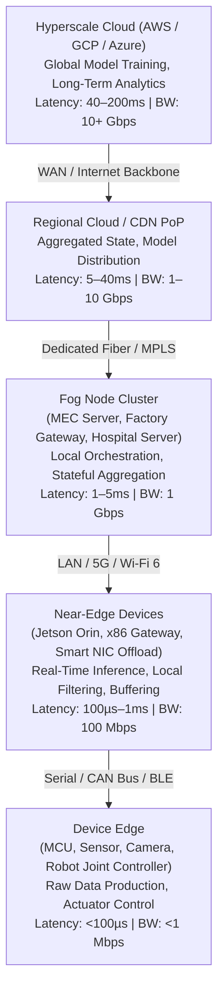
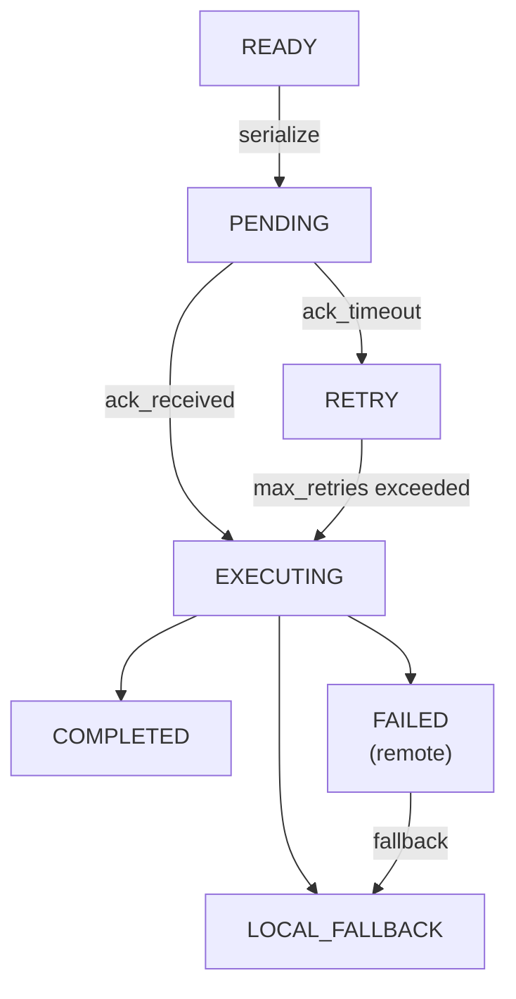

# Lesson 4: Edge and Fog Computing Topology

## 1. First-Principles Intuition & Invariants

The speed of light is not a metaphor. At roughly 299,792 kilometers per second through fiber optic cable — accounting for the refractive index of glass, the actual propagation velocity is closer to 200,000 km/s — a round trip from San Francisco to a data center in Virginia takes a minimum of 40 milliseconds before a single byte of application logic executes. That floor is physics. No amount of horizontal scaling, CDN edge caching, or TCP tuning can breach it. When an autonomous vehicle's collision avoidance system, an industrial robot arm on a factory floor, or a surgical robot under a physician's hands needs a decision in under 10 milliseconds, the centralized cloud model is not slow; it is architecturally impossible.

Edge and fog computing exist precisely to dissolve this invariant by relocating computation toward the data source. The distinction between "edge" and "fog" is not merely marketing vocabulary. Edge computing describes computation occurring at or near the terminal device itself — a camera, a sensor array, a vehicle's onboard ECU, or a 5G base station. Fog computing, a term coined by Cisco and later formalized by the OpenFog Consortium (now absorbed into the IEEE), describes an intermediate orchestration layer between the raw edge device and the centralized cloud. A fog node might be a ruggedized server in a factory's electrical cabinet, a micro-data-center in a cellular tower, or a Kubernetes node cluster deployed inside a hospital wing. The topology is therefore not binary but a gradient: device edge, near edge (fog), far edge, regional cloud, and hyperscale cloud, each tier characterized by distinct latency budgets, power envelopes, storage capacities, and connectivity reliability profiles.

Understanding this topology as a senior systems engineer requires internalizing three invariants that govern every architectural decision.

The first is the **latency-bandwidth asymmetry**. Bandwidth between a fog node and the cloud has grown dramatically over the past decade — a fiber backhaul link today might sustain 10 Gbps. But latency has not improved proportionally, because latency is dominated by propagation delay, queuing delay, and switching overhead, each of which scales with physical distance and infrastructure hop count rather than link capacity. A high-bandwidth, high-latency link is excellent for bulk data transfer but catastrophic for interactive, decision-critical workloads. The architectural implication is that you must partition workloads not by data volume alone but by their latency sensitivity, their tolerance for stale state, and their failure-domain requirements.

The second invariant is **heterogeneous hardware reality**. A cloud data center is a homogeneous environment by design — uniform x86-64 rack servers, uniform networking, uniform power delivery. The edge is the opposite: ARM Cortex-A72 cores in a Raspberry Pi Compute Module, NVIDIA Jetson AGX Orin with dedicated CUDA tensor cores for inference, RISC-V microcontrollers running bare-metal firmware, FPGA acceleration cards in network switches. Each platform has different instruction set architectures (ISAs), different memory hierarchies, different power budgets, and potentially different operating systems or runtime environments. Software compiled for x86 does not execute on ARM without recompilation or emulation. Containerization through Docker and Kubernetes helps at the orchestration layer, but the underlying binaries must still target the correct architecture. This heterogeneity is not an edge case; it is the defining characteristic of the problem space.

The third invariant is **intermittent and unreliable connectivity**. A cloud-to-cloud microservice can assume its network peer is always reachable. An edge node cannot. A delivery drone loses cellular coverage over a rural area. An offshore oil rig's satellite link goes down during a storm. A factory's internal Ethernet segment gets isolated by a network partition during a firmware upgrade. Any software system deployed at the edge must treat network connectivity as an occasional luxury rather than a guaranteed resource. This demands a fundamentally different consistency model — one where local autonomy, conflict-resolution strategies, and eventual consistency replace the strong consistency that distributed systems engineers in cloud environments often take for granted.

These three invariants collectively define the design space. Latency sensitivity determines where a computation must execute. Hardware heterogeneity determines how it can be packaged and deployed. Connectivity unreliability determines what consistency and synchronization guarantees are achievable. Every architecture decision in an edge system is a function of these three forces acting simultaneously.

---

## 2. Core Architecture & Mechanics

### The Tiered Topology Model

Before dissecting individual components, it is useful to establish a concrete reference topology. The following diagram represents the canonical five-tier edge/fog hierarchy that most production deployments approximate, even when they do not name it explicitly.



Each tier boundary represents a contract: a maximum tolerable latency, an expected bandwidth, a power budget, and a set of reliability guarantees. When you partition a workload across tiers, you are essentially writing a distributed systems contract at every boundary crossing.

### Latency-Aware Workload Partitioning

The central engineering challenge in edge system design is deciding which portions of a computational pipeline execute at which tier. This is not a static decision made once at design time; it must be dynamic, responding to network conditions, node load, and the criticality of individual tasks.

Consider a computer vision pipeline for a smart manufacturing line: raw video frames arrive from industrial cameras at 60fps at 4K resolution. The full pipeline involves frame capture, preprocessing (demosaicing, noise reduction), object detection (a YOLO-class neural network), defect classification, PLC signal generation to halt the line, and telemetry upload to the cloud for statistical quality analysis. Each stage has a different latency requirement and a different computational cost.

The PLC signal generation must complete within the mechanical response time of the conveyor belt — perhaps 8 milliseconds from frame capture to output signal. That constraint forces both inference and actuator signaling onto the near-edge device (a Jetson AGX Orin in this case), because the fog node is too far away and the cloud is physically impossible. Preprocessing can be split: a lightweight ISP pipeline runs on the Jetson, while full raw frame archiving happens asynchronously on the fog node. Statistical telemetry — defect rates, throughput metrics, model drift signals — tolerates hours of delay and belongs in the cloud.

This partitioning can be expressed in code. The following Rust program demonstrates a task executor that classifies tasks by their latency tier and routes them to the appropriate execution context. It uses `tokio` for asynchronous dispatch and a `LatencyTier` enum that encodes the deployment contract at the type level.

```rust
use std::time::{Duration, Instant};
use tokio::sync::mpsc;
use tokio::time::timeout;

#[derive(Debug, Clone, PartialEq)]
pub enum LatencyTier {
    // Must complete within single-digit milliseconds; local execution only.
    HardRealTime { deadline_ms: u64 },
    // Can tolerate up to ~100ms; fog node acceptable.
    SoftRealTime { deadline_ms: u64 },
    // Batch or analytical; cloud acceptable.
    BestEffort,
}

#[derive(Debug)]
pub struct WorkUnit {
    pub id: u64,
    pub tier: LatencyTier,
    pub payload: Vec<u8>,
    pub enqueued_at: Instant,
}

#[derive(Debug)]
pub enum ExecutionTarget {
    LocalDevice,
    FogNode { endpoint: String },
    Cloud { endpoint: String },
}

pub struct TierRouter {
    local_tx: mpsc::Sender<WorkUnit>,
    fog_tx: mpsc::Sender<(WorkUnit, String)>,
    cloud_tx: mpsc::Sender<(WorkUnit, String)>,
    fog_endpoint: String,
    cloud_endpoint: String,
}

impl TierRouter {
    pub fn new(
        local_tx: mpsc::Sender<WorkUnit>,
        fog_tx: mpsc::Sender<(WorkUnit, String)>,
        cloud_tx: mpsc::Sender<(WorkUnit, String)>,
        fog_endpoint: impl Into<String>,
        cloud_endpoint: impl Into<String>,
    ) -> Self {
        TierRouter {
            local_tx,
            fog_tx,
            cloud_tx,
            fog_endpoint: fog_endpoint.into(),
            cloud_endpoint: cloud_endpoint.into(),
        }
    }

    pub async fn route(&self, unit: WorkUnit) -> Result<ExecutionTarget, String> {
        let target = match &unit.tier {
            LatencyTier::HardRealTime { deadline_ms } => {
                let elapsed = unit.enqueued_at.elapsed();
                let budget = Duration::from_millis(*deadline_ms);
                if elapsed >= budget {
                    return Err(format!(
                        "Task {} missed hard-real-time deadline of {}ms (elapsed: {}ms)",
                        unit.id,
                        deadline_ms,
                        elapsed.as_millis()
                    ));
                }
                self.local_tx
                    .send(unit)
                    .await
                    .map_err(|e| e.to_string())?;
                ExecutionTarget::LocalDevice
            }
            LatencyTier::SoftRealTime { .. } => {
                let endpoint = self.fog_endpoint.clone();
                self.fog_tx
                    .send((unit, endpoint.clone()))
                    .await
                    .map_err(|e| e.to_string())?;
                ExecutionTarget::FogNode { endpoint }
            }
            LatencyTier::BestEffort => {
                let endpoint = self.cloud_endpoint.clone();
                self.cloud_tx
                    .send((unit, endpoint.clone()))
                    .await
                    .map_err(|e| e.to_string())?;
                ExecutionTarget::Cloud { endpoint }
            }
        };
        Ok(target)
    }
}

#[tokio::main]
async fn main() {
    let (local_tx, mut local_rx) = mpsc::channel::<WorkUnit>(256);
    let (fog_tx, mut fog_rx) = mpsc::channel::<(WorkUnit, String)>(256);
    let (cloud_tx, mut cloud_rx) = mpsc::channel::<(WorkUnit, String)>(256);

    let router = TierRouter::new(
        local_tx,
        fog_tx,
        cloud_tx,
        "http://fog-node-01.local:8080",
        "https://analytics.cloud-region.example.com",
    );

    // Simulate a hard-real-time actuator signal task.
    let actuator_task = WorkUnit {
        id: 1,
        tier: LatencyTier::HardRealTime { deadline_ms: 8 },
        payload: vec![0xDE, 0xAD, 0xBE, 0xEF],
        enqueued_at: Instant::now(),
    };

    // Simulate a soft-real-time inference aggregation task.
    let inference_task = WorkUnit {
        id: 2,
        tier: LatencyTier::SoftRealTime { deadline_ms: 80 },
        payload: vec![0x01, 0x02, 0x03],
        enqueued_at: Instant::now(),
    };

    // Simulate a best-effort telemetry upload.
    let telemetry_task = WorkUnit {
        id: 3,
        tier: LatencyTier::BestEffort,
        payload: vec![0xAA, 0xBB],
        enqueued_at: Instant::now(),
    };

    for task in [actuator_task, inference_task, telemetry_task] {
        match router.route(task).await {
            Ok(target) => println!("Routed to: {:?}", target),
            Err(e) => eprintln!("Routing failure: {}", e),
        }
    }

    // Drain local queue to demonstrate receipt.
    if let Ok(unit) = local_rx.try_recv() {
        println!("Local executor received task id={} payload={:?}", unit.id, unit.payload);
    }
}
```

This program compiles cleanly under `rustc 1.78+` with `tokio = { version = "1", features = ["full"] }` in `Cargo.toml`. The `LatencyTier` enum encodes deadline contracts at the type level, making it impossible to route a `HardRealTime` task to a remote executor without an explicit downgrade path. This is not merely elegant type-system usage — it enforces the architecture invariant that deadline-critical paths must never traverse a network that could be unavailable.

### State Synchronization Across Heterogeneous Nodes

Once computation is partitioned across tiers, the next hard problem is state synchronization. A fog node and the cloud must agree on the state of a machine learning model, a configuration policy, or an inventory count — but they cannot communicate continuously and reliably. The classical distributed systems toolkit offers two principal consistency models for this scenario: **strong consistency** via consensus protocols (Raft, Paxos) and **eventual consistency** via conflict-free replicated data types (CRDTs).

Strong consistency is appropriate when the cost of a stale read or a conflicting write is catastrophic — a drug dosage setting in a medical device, a safety interlock state in an industrial controller. CRDTs are appropriate when mergeability and availability outweigh strict ordering — a telemetry counter, a feature flag update, a local sensor log. The edge engineer's job is to identify which state belongs to which category and apply the appropriate mechanism.

A CRDT's core property is that any two replicas can be merged by a commutative, associative, and idempotent join operation, producing a result that is equivalent regardless of the order in which updates arrived. The simplest CRDT is the G-Counter (grow-only counter), where each node maintains its own counter partition and the merged value is the component-wise maximum. The following C implementation demonstrates a G-Counter suitable for an embedded fog gateway node where dynamic memory allocation may be unavailable:

```c
#include <stdint.h>
#include <string.h>
#include <stdio.h>

#define MAX_NODES 16

typedef struct {
    uint64_t counts[MAX_NODES];
    uint8_t  node_id;
    uint8_t  num_nodes;
} GCounter;

void gcounter_init(GCounter *gc, uint8_t node_id, uint8_t num_nodes) {
    memset(gc->counts, 0, sizeof(gc->counts));
    gc->node_id   = node_id;
    gc->num_nodes = num_nodes;
}

void gcounter_increment(GCounter *gc, uint64_t delta) {
    gc->counts[gc->node_id] += delta;
}

uint64_t gcounter_value(const GCounter *gc) {
    uint64_t total = 0;
    for (uint8_t i = 0; i < gc->num_nodes; i++) {
        total += gc->counts[i];
    }
    return total;
}

/* Merge remote state into local replica.
 * Per the G-Counter CRDT spec: merged[i] = max(local[i], remote[i])
 */
void gcounter_merge(GCounter *local, const GCounter *remote) {
    for (uint8_t i = 0; i < local->num_nodes; i++) {
        if (remote->counts[i] > local->counts[i]) {
            local->counts[i] = remote->counts[i];
        }
    }
}

void gcounter_print(const GCounter *gc, const char *label) {
    printf("[%s] node=%u value=%llu counts=[",
           label, gc->node_id, (unsigned long long)gcounter_value(gc));
    for (uint8_t i = 0; i < gc->num_nodes; i++) {
        printf("%llu", (unsigned long long)gc->counts[i]);
        if (i < gc->num_nodes - 1) printf(",");
    }
    printf("]\n");
}

int main(void) {
    /* Simulate two fog nodes that increment independently and then sync. */
    GCounter node_a, node_b;
    gcounter_init(&node_a, 0, 2);
    gcounter_init(&node_b, 1, 2);

    gcounter_increment(&node_a, 42);   /* Node A records 42 events locally.    */
    gcounter_increment(&node_b, 17);   /* Node B records 17 events locally.     */
    gcounter_increment(&node_a, 10);   /* Node A records 10 more before sync.   */

    gcounter_print(&node_a, "node_a before merge");
    gcounter_print(&node_b, "node_b before merge");

    /* Network partition heals; nodes exchange state vectors. */
    gcounter_merge(&node_a, &node_b);
    gcounter_merge(&node_b, &node_a);

    gcounter_print(&node_a, "node_a after merge");
    gcounter_print(&node_b, "node_b after merge");

    /* Both nodes must now report the same total: 42 + 10 + 17 = 69 */
    return 0;
}
```

Compile and run with `gcc -O2 -o gcounter gcounter.c && ./gcounter`. Both nodes converge to 69 regardless of merge order, which is the CRDT guarantee. This fixed-size, stack-allocated implementation is intentionally suitable for MCUs and embedded fog gateways where `malloc` is unavailable or undesirable.

### Compute Offloading Protocol Mechanics

Compute offloading — migrating a computation from a resource-constrained device to a more capable fog or cloud node — requires a well-defined protocol. Naive implementations that simply ship raw data to a remote endpoint and wait for a result inherit all the failure modes of synchronous RPC across unreliable networks. Production-grade offloading must handle task serialization, acknowledgment, partial failure, and local fallback execution.

The following diagram captures the state machine for a resilient offloading protocol:



The critical path through this state machine is the transition from `PENDING` to `EXECUTING`: the moment the fog node sends an acknowledgment, the device edge can release its local copy of the input payload (freeing memory) while the fog node processes the result. If the acknowledgment never arrives — because the network partitioned — the device retries up to a configured maximum and then falls back to local execution with degraded quality. This fallback path is not optional; it is the invariant that makes edge systems tolerable in the face of infrastructure failures.

---

## 3. High-Performance Optimization & Failure Modes

### Resource Constraint Optimization on Heterogeneous Hardware

Fog and edge nodes operate under resource budgets that cloud engineers rarely encounter in practice. A fog server in a cellular tower might have 16 GB of RAM and 8 ARM cores — substantial by embedded standards but trivially small compared to cloud VMs. A device-edge node may have 256 KB of RAM, a 32-bit MCU running at 120 MHz, and a 50 mW power budget. Optimizing software for these constraints requires techniques that cloud-focused engineers have not needed to develop.

Memory pressure is the dominant constraint at the device edge. Stack allocation is always preferable to heap allocation because it avoids fragmentation and allocator overhead. When heap allocation is unavoidable, a **slab allocator** pre-allocates fixed-size object pools at initialization, eliminating `malloc`/`free` jitter during the critical real-time path. Object pools of this form are standard practice in Linux kernel code (the `kmem_cache` interface) and translate directly to user-space embedded firmware.

On the fog node, the dominant constraint shifts from raw memory to **inference throughput per watt**. When running neural network inference for computer vision or NLP, the choice of numerical precision has an enormous impact. FP32 inference on a CPU is accurate but energy-expensive. INT8 quantization, where model weights and activations are linearly mapped from 32-bit floats to 8-bit integers, typically reduces model size by 4x and increases inference throughput by 2–4x on hardware with SIMD or dedicated integer multiply-accumulate units (the NVIDIA Jetson's DLA, for instance), with accuracy degradation under 1% for most production models when post-training quantization is applied carefully. The key engineering discipline is calibrating the quantization range: running a representative dataset through the model in FP32 and recording per-layer activation histograms to choose the min/max clipping thresholds that minimize quantization error.

Cross-compilation is the foundational toolchain skill for heterogeneous edge deployment. When your development machine is an x86-64 workstation and your fog node is an ARM Cortex-A72, you need a cross-compilation toolchain that targets `aarch64-linux-gnu`. The following sequence establishes a Rust cross-compilation workflow targeting a 64-bit ARM fog node and a bare-metal ARMv7-M device-edge MCU:

```bash
# Install cross-compilation targets.
rustup target add aarch64-unknown-linux-gnu
rustup target add thumbv7em-none-eabihf

# Install the ARM linker (Debian/Ubuntu host).
sudo apt-get install -y gcc-aarch64-linux-gnu gcc-arm-none-eabi

# Configure Cargo to use the correct linkers.
mkdir -p .cargo
cat >> .cargo/config.toml << 'EOF'
[target.aarch64-unknown-linux-gnu]
linker = "aarch64-linux-gnu-gcc"

[target.thumbv7em-none-eabihf]
linker = "arm-none-eabi-gcc"
EOF

# Build the fog node binary (Linux, ARM64).
cargo build --release --target aarch64-unknown-linux-gnu

# Build the MCU firmware (bare-metal, no std).
cargo build --release --target thumbv7em-none-eabihf
```

The `thumbv7em-none-eabihf` target produces a binary for a Cortex-M4/M7 MCU with hardware floating-point, which covers the STM32F4 and STM32H7 families widely deployed in industrial IoT. The `none` in the target triple indicates there is no operating system, requiring `#![no_std]` Rust code that uses only the `core` crate.

For fog-tier containerized workloads, Kubernetes with KubeEdge or K3s provides multi-architecture pod scheduling. The following manifest deploys an inference service that explicitly constrains itself to ARM64 fog nodes and enforces strict resource limits, preventing runaway inference jobs from starving latency-critical system processes:

```yaml
apiVersion: apps/v1
kind: Deployment
metadata:
  name: edge-inference-svc
  namespace: fog-tier
  labels:
    app: edge-inference
    tier: fog
spec:
  replicas: 1
  selector:
    matchLabels:
      app: edge-inference
  template:
    metadata:
      labels:
        app: edge-inference
        tier: fog
    spec:
      nodeSelector:
        kubernetes.io/arch: arm64
        node-role.fogcompute.io/inference: "true"
      tolerations:
        - key: "fogcompute.io/resource-constrained"
          operator: "Equal"
          value: "true"
          effect: "NoSchedule"
      containers:
        - name: inference-runtime
          image: registry.internal.example.com/inference-rt:v2.4.1-arm64
          imagePullPolicy: IfNotPresent
          ports:
            - containerPort: 9090
              protocol: TCP
          resources:
            requests:
              cpu: "1500m"
              memory: "2Gi"
            limits:
              cpu: "2000m"
              memory: "3Gi"
          env:
            - name: INFERENCE_BACKEND
              value: "tensorrt-int8"
            - name: MAX_BATCH_SIZE
              value: "4"
            - name: REQUEST_TIMEOUT_MS
              value: "60"
          readinessProbe:
            httpGet:
              path: /healthz/ready
              port: 9090
            initialDelaySeconds: 10
            periodSeconds: 5
            failureThreshold: 3
          livenessProbe:
            httpGet:
              path: /healthz/live
              port: 9090
            initialDelaySeconds: 20
            periodSeconds: 10
            failureThreshold: 5
          volumeMounts:
            - name: model-store
              mountPath: /models
              readOnly: true
      volumes:
        - name: model-store
          hostPath:
            path: /var/edge/models
            type: Directory
```

The `nodeSelector` and `tolerations` together ensure this pod lands only on nodes that have been explicitly labeled as inference-capable ARM64 fog nodes with the `resource-constrained` taint, preventing the scheduler from placing it on a device-edge node that lacks the RAM to load the TensorRT engine.

### Failure Modes and Their Mitigations

Edge systems fail in ways that are qualitatively different from cloud systems, and engineers conditioned by cloud operations sometimes apply the wrong mental models when diagnosing them.

**Cascading deadline misses** are the edge equivalent of a thundering herd. When a fog node's CPU is overloaded — perhaps because a model reloading operation coincided with a spike in inference requests — the latency of every task on the node increases. Tasks with soft-real-time deadlines start failing, triggering fallback execution on device-edge nodes, which are themselves now overloaded with computation they were not sized to handle. The result is a cascade where increasing load degrades the entire tier simultaneously. The mitigation is **admission control** at the fog node's task queue: refuse new tasks when queue depth exceeds a threshold, forcing callers to execute locally or drop the task, rather than accepting tasks that will inevitably miss their deadlines and waste CPU cycles.

**Split-brain state divergence** occurs when two fog nodes both believe they hold the authoritative copy of a configuration or model, have both accepted conflicting writes during a network partition, and then attempt to reconcile when connectivity is restored. The standard mitigation is a **last-writer-wins** strategy with vector clocks for ordering, or a strict ownership model where a given piece of state has exactly one authoritative writer and all other nodes are read-only replicas. The G-Counter implementation above uses a grow-only semantic precisely to avoid this problem: state can only increase, so there is never a conflicting write.

**Binary incompatibility across ISAs** is a failure mode unique to heterogeneous edge deployments. A CI/CD pipeline that builds only for x86-64 and pushes the resulting container image to a fog node running ARM64 will produce a pod that crashes immediately with `exec format error`. The mitigation is a multi-architecture build pipeline using `docker buildx` with QEMU emulation for cross-platform builds, producing a Docker manifest list that maps each architecture to its native binary. Validating this in CI before deployment to fog nodes eliminates an entire class of production incidents.

**Persistent connectivity loss** — a fog node that is genuinely disconnected from both the cloud and its device-edge peers for an extended period — requires that the node continue operating autonomously with its locally cached state. This demands that every fog node maintain a **local policy cache** with a TTL-based expiration and a **safe default policy** that is applied when cached state expires without a refresh. The safe default must be defined by the application domain: for a factory safety interlock, the safe default is to halt the production line. For a smart traffic light, it might be to cycle through a fixed minimum-green timing pattern. Identifying and implementing safe defaults is not a software engineering task; it is a safety engineering task that must involve domain experts, and it is one of the most consequential design decisions in an edge system.

**Model drift in distributed inference** is a subtler failure mode that becomes visible over days or weeks rather than milliseconds. When a fog node runs an inference model that was trained on data from one geographic region or time period, and the distribution of real-world inputs at that node drifts away from the training distribution, the model's accuracy degrades silently. The standard detection mechanism is to log a sample of inference inputs and their confidence scores to the cloud for comparison against baseline statistics. A statistically significant shift in confidence score distributions — detectable via a Kolmogorov-Smirnov test or a population stability index — triggers a model redeployment from the cloud. This closed-loop feedback between edge inference and cloud model management is the operational definition of MLOps at the edge.

The unifying principle across all these failure modes is that the edge forces you to reason about partial failure, local autonomy, and graceful degradation as first-class design concerns rather than afterthoughts. Cloud systems can often survive a single component failure because the remaining replicas absorb the load across a homogeneous, highly connected infrastructure. An edge system cannot depend on that redundancy. Each node must be capable of independent operation — degraded but functional — because the network connecting it to its peers is not a utility; it is an assumption that the physical world will periodically invalidate.
