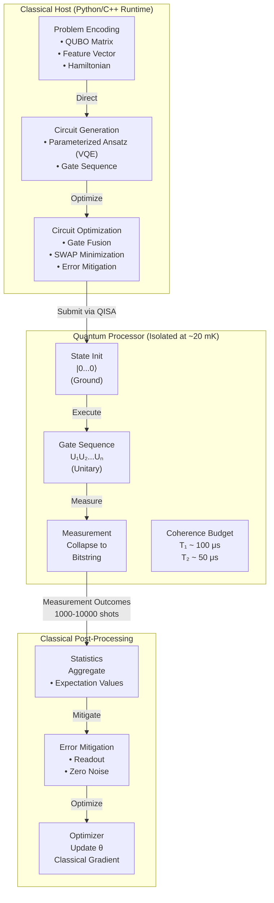
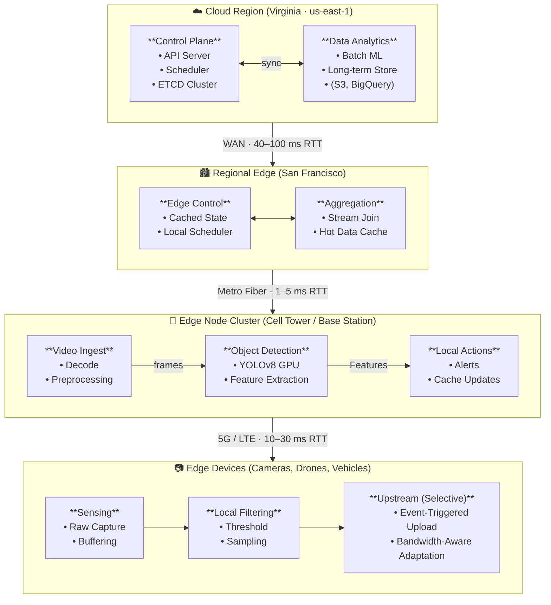

# Lesson 6: Emerging Computing Paradigms Synthesis

## 1. First-Principles Intuition & Invariants

The landscape of computational paradigms stands at an inflection point where classical von Neumann architectures confront fundamental physical and economic limits. Clock frequency scaling stalled near 5 GHz over a decade ago as transistor power density collided with thermodynamic constraints—the infamous "power wall" where leakage current and dynamic switching power scale superlinearly with frequency. Moore's Law itself has decelerated from its historical 18-month doubling cadence to a precarious 30-month cycle, constrained not by lithographic capability but by quantum tunneling effects at sub-7nm feature sizes and the exponential cost escalation of next-generation fabrication plants now exceeding $20 billion per facility.

Into this constraint space emerge three transformative paradigms that fundamentally restructure how we encode, process, and extract value from information: quantum computing systems that exploit superposition and entanglement to explore exponentially large state spaces; neuromorphic architectures that replace synchronous clock-driven arithmetic with asynchronous event-driven spike trains mimicking biological neural dynamics; and distributed edge-cloud continua that decompose monolithic applications into fine-grained computational fragments orchestrated across heterogeneous hardware topologies spanning nanosecond-latency on-device accelerators to millisecond-latency datacenter clusters.

Each paradigm emerges from distinct physical substrates and mathematical formalisms. Quantum systems operate in Hilbert spaces where computational states exist as complex-valued probability amplitude vectors $|\psi\rangle = \alpha|0\rangle + \beta|1\rangle$ constrained by unitarity $|\alpha|^2 + |\beta|^2 = 1$, with measurement causing irreversible wavefunction collapse into classical basis states. Neuromorphic systems ground computation in leaky integrate-and-fire neuron models where membrane potential $V(t)$ evolves according to differential equations $\tau_m \frac{dV}{dt} = -(V - V_{rest}) + R \cdot I_{syn}(t)$, firing discrete spikes when threshold $V_{th}$ is crossed and resetting to $V_{reset}$. Edge-cloud orchestration layers decouple logical service meshes from physical network topologies through control-plane abstractions that continuously reconcile desired state declarative specifications against observed runtime metrics—latency histograms, packet loss rates, thermal throttling events, and energy consumption telemetry.

The synthesis challenge facing senior engineers is not merely understanding isolated paradigms but architecting hybrid systems that extract algorithmic advantage from each substrate while managing impedance mismatches at interface boundaries. A quantum-classical hybrid must serialize qubit state preparation through classical control pulses, execute quantum circuits in coherent isolation from environmental decoherence, then extract measurement statistics through repeated shot sampling—all while the classical host coordinates scheduling, error mitigation, and result post-processing. Neuromorphic-AI convergence requires bridging the semantic gap between continuous-valued tensor operations in deep learning frameworks and discrete temporal spike encodings in spiking neural networks, often necessitating rate coding schemes that map floating-point activations to spike frequencies or temporal coding schemes that encode information in precise spike timing relative to reference oscillations. Edge-cloud orchestration confronts heterogeneity spanning x86 datacenter servers, ARM edge processors, GPU/TPU accelerators, and FPGA reconfigurable fabrics, each exposing distinct memory hierarchies, instruction set architectures, and power-performance operating points.

The invariants governing these paradigms derive from fundamental physics and information theory. Quantum coherence times—the duration qubits maintain superposition before environmental noise induces decoherence—impose strict latency budgets measured in microseconds for superconducting transmon qubits and milliseconds for trapped ion systems. Neuromorphic energy efficiency stems from event-driven sparsity: biological neurons fire at mean rates of 1-10 Hz, meaning 99.9% of timesteps involve zero activity and zero dynamic power dissipation, contrasting sharply with synchronous digital circuits that toggle millions of transistors every clock cycle regardless of computational necessity. Edge-cloud orchestration is bounded by the speed-of-light delay inherent in wide-area networks—approximately 1 millisecond per 100 kilometers of fiber propagation—making round-trip coordination between geographically distributed edge nodes and centralized cloud control planes a non-negotiable latency tax that no amount of bandwidth provisioning can eliminate.

Software practitioners must internalize these physical constraints as hard architectural boundaries rather than implementation details to be abstracted away. A quantum algorithm designer cannot wish away decoherence by writing cleaner code; they must structure circuits to minimize gate depth, leverage error-correcting codes that encode logical qubits across multiple physical qubits with polynomial overhead, and architect hybrid algorithms where quantum subroutines solve specific bottleneck subproblems while classical outer loops handle everything else. A neuromorphic system architect cannot simply port a trained convolutional neural network to spiking hardware and expect automatic energy savings; they must redesign networks to exploit temporal dynamics, replace ReLU activations with spike-generating mechanisms, and carefully tune membrane time constants and synaptic weights to balance accuracy against spike rate and hence energy consumption. An edge-cloud platform engineer cannot treat distributed systems as faster datacenters; they must design for partial failure, network partitions, and heterogeneous hardware capabilities while maintaining end-to-end quality-of-service guarantees across an infrastructure where individual nodes may have 1000× differences in compute capability and 10,000× differences in power budgets.

The synthesis imperative is architectural: designing systems that compose these paradigms into coherent computational pipelines where data flows naturally across paradigm boundaries, errors propagate gracefully through interface layers, and the system as a whole exhibits emergent capabilities exceeding what any single paradigm could achieve in isolation. This requires moving beyond the comfort zone of homogeneous architectures where every processing element speaks the same instruction set and shares a uniform memory model. Instead, we architect heterogeneous computational graphs where nodes represent paradigm-specific processing elements—quantum processing units (QPUs), neuromorphic chips, edge TPUs, cloud CPUs—and edges represent data transformations mapping between paradigm-specific representations: quantum measurement outcomes to classical bitstrings, floating-point tensors to spike trains, edge-computed feature vectors to cloud-based model inference requests.

The trade-offs are multidimensional and application-specific. Quantum algorithms promise exponential speedup for specific problem classes—Shor's algorithm for integer factorization, Grover's search over unstructured databases, quantum simulation of molecular Hamiltonians—but current noisy intermediate-scale quantum (NISQ) devices suffer error rates of 0.1-1% per gate operation, limiting circuit depth to hundreds of gates before noise dominates signal. Neuromorphic systems achieve 1000× energy efficiency for event-driven workloads like vision processing and online learning but struggle with dense matrix operations and algorithms requiring high-precision floating-point arithmetic. Edge computing reduces end-to-end latency by processing data near its source but fragments computational resources across thousands of constrained devices, complicating state management, software deployment, and security policy enforcement.

## 2. Core Architecture & Mechanics

### Quantum-Classical Hybrid Execution Model

The fundamental execution model of a quantum-classical hybrid system decomposes into three tightly coupled phases: classical pre-processing and parameterization, quantum circuit execution under coherent isolation, and classical post-processing of measurement outcomes. This structure emerges not from software design preference but from the physical reality that quantum operations must occur in near-zero temperature environments shielded from electromagnetic interference while classical control systems operate at room temperature, necessitating a latency-inducing interface layer.

Classical pre-processing begins with problem encoding. For optimization problems formulated as quadratic unconstrained binary optimization (QUBO), the classical host constructs a cost Hamiltonian $H = \sum_i h_i Z_i + \sum_{i<j} J_{ij} Z_i Z_j$ where $Z_i$ are Pauli-Z operators acting on qubit $i$, $h_i$ represent linear bias terms, and $J_{ij}$ encode pairwise qubit couplings. For quantum machine learning, the classical host generates training data batches, serializes feature vectors into amplitude-encoded quantum states through controlled rotation gates, and parameterizes ansatz circuits—trial wavefunctions with adjustable angles—that will be optimized through classical gradient descent.

The quantum execution phase receives this parameterization as a sequence of gate instructions: single-qubit rotations $R_x(\theta)$, $R_y(\phi)$, $R_z(\lambda)$ and two-qubit entangling gates like CNOT or controlled-Z. Modern quantum processors expose these operations through quantum instruction set architectures (QISAs) that abstract device-specific pulse sequences. For superconducting qubits, each gate compiles to a microwave pulse envelope shaped by Gaussian or DRAG (Derivative Removal by Adiabatic Gate) profiles and delivered through coaxial lines at millikelvin temperatures. Gate fidelities—the probability that the implemented operation matches the ideal unitary—range from 99.9% for single-qubit gates to 98-99% for two-qubit gates, with the disparity arising from the increased coupling complexity and longer gate durations (20-50 nanoseconds for single-qubit, 100-300 nanoseconds for two-qubit).

Circuit depth becomes the critical performance metric because errors accumulate multiplicatively: a 100-gate circuit with 99% per-gate fidelity yields overall fidelity $(0.99)^{100} \approx 36.6\%$, meaning nearly two-thirds of executions produce garbage results. Quantum algorithm designers combat this through circuit optimization techniques: gate fusion combines consecutive single-qubit rotations $R_z(\alpha) R_x(\beta) R_z(\gamma)$ into a single Euler-decomposed operation; gate cancellation eliminates sequences like CNOT-CNOT that compose to identity; and topology-aware routing minimizes SWAP gate overhead when mapping logical qubit connectivity to physical device topologies.



Measurement extracts classical information from quantum states but at the cost of irreversible collapse. A qubit in superposition $|\psi\rangle = \alpha|0\rangle + \beta|1\rangle$ collapses to $|0\rangle$ with probability $|\alpha|^2$ or $|1\rangle$ with probability $|\beta|^2$, yielding a single classical bit. To reconstruct probability distributions or estimate expectation values $\langle H \rangle = \langle\psi|H|\psi\rangle$, the quantum circuit must be executed thousands of times—a process called shot sampling. The statistical uncertainty scales as $\sigma \sim 1/\sqrt{N_{shots}}$, meaning achieving 1% precision requires 10,000 shots, each necessitating full state reinitialization and circuit re-execution.

Error mitigation strategies operate entirely in classical post-processing to combat the noise inherent in NISQ devices without requiring full fault-tolerant quantum error correction codes. Zero-noise extrapolation executes circuits at multiple artificially amplified noise levels—achieved by inserting gate identity sequences that prolong coherence exposure—then extrapolates measurement statistics back to the hypothetical zero-noise limit. Readout error mitigation constructs a confusion matrix characterizing the probability that a qubit prepared in $|0\rangle$ is mismeasured as $|1\rangle$ and vice versa, then applies matrix inversion to correct observed bitstring histograms. These techniques provide 2-10× improvements in effective fidelity at the cost of additional circuit executions and classical compute overhead.

Software stacks for quantum-classical hybrids expose these mechanics through layered abstractions. At the highest level, domain-specific languages like Qiskit (IBM), Cirq (Google), or Q# (Microsoft) provide gate-level circuit construction APIs with classical control flow—conditionals, loops, variable assignments—enabling algorithms like quantum phase estimation that feed measurement outcomes back into subsequent circuit parameterizations. Intermediate layers compile high-level circuits to device-specific instruction sets, handling qubit routing, gate decomposition to native gate sets (often X, Y, Z rotations plus CNOT for superconducting, or similar primitives for ion traps), and pulse-level optimization. The lowest layer interfaces with quantum control electronics—arbitrary waveform generators, microwave synthesizers, and fast digital feedback loops—translating abstract gate instructions into nanosecond-precision voltage waveforms.

A practical example crystallizes these abstractions: implementing a variational quantum eigensolver (VQE) to estimate the ground state energy of a molecular Hamiltonian. The classical host constructs a parameterized ansatz circuit—typically a hardware-efficient ansatz with layers of single-qubit rotations and entangling gates—and initializes parameters $\vec{\theta}$ randomly. The quantum processor executes the ansatz for fixed $\vec{\theta}$, applies Hamiltonian term measurements (requiring circuit repetition for each Pauli term in $H = \sum_i c_i P_i$), and returns expectation values $\langle P_i \rangle$. The classical host computes the energy estimate $E(\vec{\theta}) = \sum_i c_i \langle P_i \rangle$, calculates gradients (via parameter shift rules or classical automatic differentiation of the measurement statistics), and updates $\vec{\theta}$ via gradient descent. This loop iterates until energy convergence, requiring hundreds to thousands of quantum-classical round trips with each quantum execution consuming 10-100 microseconds of coherence time plus milliseconds of classical communication overhead.

### Neuromorphic-AI Convergence Architecture

Neuromorphic computing architectures replace the synchronous fetch-decode-execute cycle of von Neumann machines with asynchronous event-driven processing where computation occurs only in response to discrete spike events propagating through a network of leaky integrate-and-fire neurons. This event sparsity is the physical mechanism underlying neuromorphic energy efficiency: a neuron consuming 1 picojoule per spike at 10 Hz average firing rate dissipates 10 picowatts mean power, versus conventional digital neurons in artificial neural network accelerators that consume milliwatts per multiply-accumulate operation at gigahertz clock rates even when processing zeros.

The core computational primitive is the neuron membrane dynamics. Each neuron maintains a membrane potential $V(t)$ that evolves according to a differential equation modeling leak current, synaptic input, and spike reset:

$$\tau_m \frac{dV}{dt} = -(V - V_{rest}) + R \sum_i w_i \sum_{t_i^{(k)} < t} K(t - t_i^{(k)})$$

where $\tau_m$ is the membrane time constant (typically 10-20 milliseconds), $V_{rest}$ is the resting potential, $R$ is membrane resistance, $w_i$ are synaptic weights, $t_i^{(k)}$ are spike arrival times from presynaptic neuron $i$, and $K(t)$ is the synaptic kernel—often an exponential decay $K(t) = \exp(-t/\tau_s)$ with synaptic time constant $\tau_s$. When $V(t)$ crosses threshold $V_{th}$, the neuron emits a spike and resets to $V_{reset}$ for a refractory period $\tau_{ref}$ during which it cannot spike again.

Synaptic integration occurs through address-event representation (AER) protocols where each spike is transmitted as a digital packet containing the presynaptic neuron ID and timestamp. Receiving neurons decode these packets, index their synaptic weight memories using the neuron ID, and add the weighted contribution to their membrane potential. This event-driven routing stands in stark contrast to dense matrix operations in conventional neural networks where every weight contributes to every activation regardless of input sparsity.

Modern neuromorphic chips like Intel's Loihi 2 or IBM's TrueNorth implement this architecture through specialized circuit topologies. Each neuron core contains dedicated analog or mixed-signal circuits for membrane potential integration, digital memory for synaptic weights (typically 4-8 bits per weight to balance precision against area efficiency), and spike routing infrastructure with mesh or tree interconnects. Loihi 2 organizes 128 neurons per core with 128,000 synapses, scales to 1 million neurons via 8,000 cores on-die, and exposes programmable learning rules through embedded microcode enabling online spike-timing-dependent plasticity (STDP) where synaptic weights adjust based on the relative timing of pre- and postsynaptic spikes.

Bridging conventional deep learning to spiking neural networks requires encoding schemes that map continuous-valued activations into spike trains. Rate coding encodes activation magnitude as spike frequency: an activation $a = 0.7$ in a normalized range $[0,1]$ might map to 70 Hz firing over a 100 ms inference window, requiring 7 spikes on average. This encoding is robust to noise and biologically plausible but sacrifices temporal resolution. Temporal coding encodes information in precise spike timing: a time-to-first-spike code where higher activations trigger earlier spikes, or phase coding where spike timing relative to a reference oscillation encodes analog values. These schemes achieve lower latency—potentially single-spike inference—but demand tighter timing precision and complicate gradient-based training.

```mermaid
flowchart TD
    A["Input Encoding Layer<br/>Event Camera / Rate Coding"]
    
    A1["Continuous Input<br/>Pixel Intensities<br/>[0.2, 0.8, 0.1, ...]"]
    A2["Spike Train Output<br/>Event Packets<br/>[(ID, t), (ID, t), ...]"]
    A3["Encoding: f_spike = f_max × activation"]
    
    A1 -->|"Rate Coding"| A2
    A3 -.-> A2
    
    A -->|"Spike Events via AER Protocol"| B
    
    B["Spiking Neural Network<br/>Neuromorphic Chip"]
    
    B1["Layer 1<br/>N₁ Neurons<br/>• LIF Model<br/>• Synapses"]
    B2["Layer 2<br/>N₂ Neurons<br/>• LIF Model<br/>• Synapses"]
    BN["Layer N<br/>Softmax Decode"]
    
    B1 -->|Spikes| B2
    B2 -->|Spikes| BN
    
    B1 -.->|V(t) Updates<br/>Only on Spike Events| B1
    B2 -.->|V(t) Updates<br/>Only on Spike Events| B2
    
    B3["Energy: E_spike × spike_count<br/>≪ E_MAC × MAC_count"]
    B3 -.-> B
    
    B -->|"Classification Output<br/>Accumulated Spike Counts"| C
    
    C["Inference Result Post-Processing"]
    
    C1["Spike Count Histogram<br/>[125, 8, 3, ..., 210]"]
    C2["Softmax Normalize"]
    C3["Class Prediction<br/>Class = argmax"]
    
    C1 --> C2
    C2 --> C3
    
    C --> C1
```

Training spiking neural networks confronts the non-differentiability of spike generation. The Heaviside step function defining spike emission—spike if $V \geq V_{th}$, else no spike—has zero gradient almost everywhere, breaking backpropagation. Surrogate gradient methods resolve this by substituting a smooth function approximation during backward passes: replacing the step derivative with a sigmoid, exponential, or piecewise linear function that approximates the spike dynamics while providing non-zero gradients for weight updates. This approach enables end-to-end gradient descent training of deep spiking networks using frameworks like Norse or snnTorch that extend PyTorch's autograd with surrogate gradient implementations.

Alternatively, ANN-to-SNN conversion methods train networks using conventional backpropagation then convert trained weights to spiking equivalents. This process maps ReLU activations to spike rates, batch normalization parameters to threshold adjustments, and trained weights directly to synaptic weights after rescaling. Conversion accuracy depends on inference time: longer windows permit better spike rate approximation of continuous activations but increase latency. State-of-the-art conversion achieves < 1% accuracy loss on ImageNet with 100-millisecond inference windows, translating to 10× lower energy than GPU inference for the same classification task.

The neuromorphic-AI convergence sweet spot targets event-driven sensory processing where input sparsity is intrinsic. Event cameras like the Dynamic Vision Sensor (DVS) output asynchronous pixel-level brightness change events rather than dense frames, producing 1000× fewer events than conventional cameras for natural scenes. Feeding these events directly into spiking networks eliminates frame-based batching overhead and enables microsecond-latency visual processing for applications like drone navigation, robotic manipulation, and automotive collision avoidance. Similarly, audio processing with cochlear-inspired encoders generates sparse spike trains from acoustic input, enabling ultra-low-power keyword spotting and voice activity detection for always-on edge devices.

### Edge-Cloud Orchestration Continuum

Edge-cloud orchestration architectures decompose monolithic applications into microservices distributed across a heterogeneous infrastructure continuum spanning on-device computation (smartphones, IoT sensors), edge aggregation nodes (5G base stations, edge servers), regional edge datacenters, and centralized cloud availability zones. This distribution is not an optional optimization but a fundamental architectural response to physics: speed-of-light propagation delay imposes non-compressible latency bounds of ~1 millisecond per 100 kilometers of fiber, making round-trip communication between a mobile device in San Francisco and a Virginia datacenter consume 80+ milliseconds before any application processing occurs.

The orchestration control plane operates as a distributed state machine continuously reconciling desired state—service placement policies, resource quotas, scaling thresholds—against observed runtime state—node health, network congestion, workload demand. Kubernetes emerged as the de facto standard for this reconciliation model: operators declare desired system state through YAML manifests specifying pod specifications, replica counts, resource requests, and affinity rules, while controller loops watch for discrepancies between desired and observed state, issuing imperative commands to converge the system.

Extending this model to edge-cloud continua introduces challenges absent in homogeneous datacenter deployments. Nodes exhibit 1000× compute heterogeneity (8-core ARM edge CPU versus 128-core x86 cloud server), 10,000× power heterogeneity (5W smartphone versus 300W server), and intermittent connectivity (wireless backhaul with variable bandwidth and periodic disconnection). Standard Kubernetes assumes reliable connectivity to a central API server and homogeneous node capabilities, breaking down at the edge where network partitions are routine and node diversity is the norm.

Federated orchestration architectures address this through hierarchical control planes. A centralized cloud-based control plane manages global policy and state aggregation, while autonomous edge control planes handle local scheduling and failure recovery within their administrative domain. The KubeEdge and OpenYurt projects implement this pattern by deploying lightweight edge agents that cache remote API server state, make local scheduling decisions when disconnected from the cloud, and resynchronize upon connectivity restoration. This eventual consistency model trades strict global coordination for partition tolerance and local autonomy.

Service mesh layers like Istio and Linkerd add fine-grained traffic management atop orchestration by injecting transparent proxy sidecars alongside each application container. These proxies intercept all inbound and outbound traffic, enabling request routing, load balancing, circuit breaking, and observability without application code changes. In edge-cloud scenarios, service mesh policies encode latency-aware routing: directing latency-sensitive requests (interactive UI) to nearby edge replicas while routing batch processing to distant but cost-optimized cloud regions. Policy expression happens through Custom Resource Definitions (CRDs) extending Kubernetes APIs:

```yaml
apiVersion: networking.istio.io/v1beta1
kind: VirtualService
metadata:
  name: video-transcoding
spec:
  hosts:
    - transcoding.example.com
  http:
    - match:
        - headers:
            x-priority:
              exact: "realtime"
      route:
        - destination:
            host: transcoding-edge
            subset: gpu-accelerated
          weight: 100
      timeout: 500ms
    - route:
        - destination:
            host: transcoding-cloud
            subset: spot-instances
          weight: 100
      timeout: 30s
```

This policy routes realtime transcoding requests to edge GPU nodes with 500ms timeout while batch requests flow to cloud spot instances with relaxed 30-second deadlines. The service mesh continuously monitors endpoint health and latency, automatically failing over to alternate destinations when SLOs breach.

Workload placement optimization becomes a multidimensional constraint satisfaction problem. Consider a video analytics pipeline: object detection requires GPU inference (20W per frame at 30 FPS), feature extraction demands memory bandwidth (10 GB/s), and result aggregation needs network capacity (50 Mbps uplink). Placing detection on constrained edge devices drains battery and throttles performance; placing it in the cloud incurs 50+ ms network latency plus bandwidth costs. The optimal placement deploys detection on edge GPUs collocated with camera sources, streams compressed feature vectors (1/10th the bandwidth of raw frames) to regional edge servers for aggregation, and performs bulk analytics on cost-optimized cloud spot instances operating on hourly batches.



Resource management in this continuum requires telemetry aggregation spanning multiple administrative domains. Prometheus and OpenTelemetry provide standardized metric collection where each node exports resource utilization (CPU, memory, GPU, network), application latency histograms, and error rates. A centralized or hierarchical time-series database ingests these metrics, enabling queries like "99th percentile video decode latency across all edge nodes in the past hour" to inform scaling decisions. Autoscaling policies trigger pod replica adjustments when metrics breach thresholds: horizontal pod autoscaling (HPA) adds replicas when CPU exceeds 70%; vertical pod autoscaling (VPA) adjusts resource requests when memory pressure increases.

Edge-specific resource constraints demand custom scheduling policies. The Kubernetes scheduler scores nodes using plugin-based filters and priority functions, but default scoring prioritizes bin-packing for datacenter efficiency. Edge schedulers must incorporate latency topology (prefer nodes < 10ms from data source), energy budgets (avoid oversubscribing solar-powered remote nodes), and connectivity reliability (spread replicas across nodes with independent uplinks). The Volcano scheduler and KEDA (Kubernetes Event-Driven Autoscaling) extend scheduling to consider external metrics—queue depth, event rates, custom application signals—enabling event-driven scale-to-zero for idle services that consume no resources until triggered.

Security in federated edge-cloud systems confronts a vastly expanded attack surface. Traditional datacenter security assumes a trusted network perimeter with centralized policy enforcement; edge deployments expose services across untrusted wireless links and physically accessible hardware. Zero-trust architectures mandate mutual TLS authentication for all service-to-service communication, short-lived certificate rotation (hourly or more frequently), and workload identity verification at every hop. Projects like SPIFFE (Secure Production Identity Framework For Everyone) provide identity attestation where workloads receive cryptographic identities embedded in X.509 certificates tied to their deployment context (namespace, service account, node). Envoy proxies in the service mesh validate these identities on every request, rejecting connections from unverified sources regardless of network origin.

## 3. High-Performance Optimization & Failure Modes

Optimizing quantum-classical hybrid systems demands minimizing coherence budget consumption while maximizing algorithmic fidelity. Circuit compilation becomes the critical optimization lever: transpiling high-level gate sequences to device-native operations while respecting qubit topology constraints. Consider a quantum circuit requiring a CNOT between logical qubits $q_0$ and $q_{15}$ on a device with nearest-neighbor connectivity. Direct implementation is impossible; the compiler must insert SWAP gates to move qubit states along a routing path through intermediate physical qubits. Each SWAP decomposes to three CNOT gates, consuming 300-900 nanoseconds of coherence time and introducing three opportunities for gate errors.

Topology-aware compilation uses graph algorithms to minimize SWAP overhead. The qubit allocation problem maps logical qubits to physical qubits such that frequently interacting logical pairs occupy nearby physical qubits, while the routing problem finds minimal-length SWAP chains for unavoidable distant interactions. SABRE (SWAP-based BidiREctional) heuristic search explores the space of possible SWAP insertions, scoring candidates by their impact on future gate scheduling. Advanced compilers like Qiskit's transpiler combine these with commutation analysis—reordering commuting gates to enable better routing—and Pauli frame tracking to defer certain single-qubit rotations to classical post-processing.

Pulse-level optimization provides further gains by customizing microwave control sequences to individual qubit characteristics. Optimal control theory techniques like GRAPE (Gradient Ascent Pulse Engineering) parameterize pulse envelopes and use automatic differentiation to optimize pulse shapes that maximize gate fidelity subject to hardware bandwidth and amplitude constraints. Google's Sycamore processor applies per-qubit calibrated pulses achieving 99.9%+ single-qubit fidelities by compensating for manufacturing variations in qubit frequencies and anharmonicities.

Error mitigation trades classical computational overhead for improved effective fidelity. Probabilistic error cancellation constructs quasi-probability representations of ideal operations as linear combinations of noisy operations implementable on hardware: $U_{ideal} = \sum_i \eta_i U_i^{noisy}$ where coefficients $\eta_i$ may be negative, requiring Monte Carlo sampling with signed weights. This increases shot count by the sum $\sum_i |\eta_i|$—often 10-100×—but suppresses systematic errors that would otherwise dominate. Clifford data regression benchmarks circuit performance against randomized Clifford circuits whose ideal outcomes are efficiently classically simulable, using the discrepancy to characterize and subtract systematic error from experimental results.

Failure modes in quantum systems arise from decoherence mechanisms inherent to physical qubit implementations. Superconducting transmon qubits suffer energy relaxation characterized by $T_1$ (amplitude damping time, 50-200 μs) where excited states $|1\rangle$ decay to ground $|0\rangle$ through radiative emission into the electromagnetic environment, and dephasing characterized by $T_2$ (phase coherence time, 20-100 μs) where quantum superpositions accumulate random phase noise from fluctuating magnetic fields or charge offsets. The ratio $T_2 / T_1 \lesssim 2$ bounds phase coherence since energy relaxation inherently induces dephasing.

Trapped ion qubits achieve superior coherence—$T_1 > 10$ seconds, $T_2 \sim$ seconds—by encoding qubits in long-lived hyperfine atomic states isolated in ultrahigh vacuum. However, ion systems confront different failure modes: motional heating where background gas collisions or anomalous electric fields excite ion vibration modes, and crosstalk where laser pulses intended for one ion scatter to neighbors. Gate fidelities of 99.9% have been demonstrated but scaling beyond ~50 ions in a single trap confronts exponentially growing motional mode complexity.

Photonic quantum computing encodes qubits in optical photon modes, offering room-temperature operation and natural networking capability via fiber-optic channels. The core challenge is deterministic two-qubit gates: photons do not naturally interact, requiring nonlinear optical effects or measurement-induced gates. PsiQuantum pursues fusion-based architectures where Bell state measurements between photon pairs probabilistically entangle qubits, with success heralded by photon detection. This necessitates multiplexing many physical resource qubits to generate one high-fidelity logical qubit, imposing substantial overhead but leveraging mature silicon photonics fabrication.

Neuromorphic system optimization centers on maximizing spike sparsity while maintaining computational accuracy. Network pruning eliminates low-weight synapses that contribute negligible computation, reducing memory footprint and event routing overhead. Magnitude-based pruning removes weights below a threshold; movement pruning learns a binary mask during training that retains only high-gradient connections. Achieving 90% sparsity (10× fewer synapses) typically degrades accuracy by 1-2 percentage points on vision benchmarks while reducing energy by 8-10× due to eliminated weight fetches and multiply-accumulate operations.

Quantization of synaptic weights from 32-bit floating-point to 4-bit integers delivers another 8× memory compression and eliminates high-precision multipliers. Spiking networks tolerate aggressive quantization better than conventional networks because spike-based communication inherently quantizes time (spike timing precision) and amplitude (spike or no spike), making synaptic weight precision less critical. Loihi 2 uses 6-bit synaptic weights and 9-bit membrane potentials, achieving state-of-the-art accuracy on online learning benchmarks while consuming 100× less energy than GPU implementations.

Temporal precision tuning adjusts membrane time constants and synaptic delays to balance latency against accuracy. Shorter time constants enable faster membrane potential integration and lower latency inference but reduce temporal integration window, degrading performance on tasks requiring long-term dependencies. Audio classification tasks like keyword spotting benefit from 5-10 millisecond time constants matching phoneme durations, while visual object recognition tolerates 50-100 millisecond windows matching fixation durations in biological vision.

Failure modes in neuromorphic systems arise from the mismatch between analog membrane dynamics and discrete digital spike events. Membrane potential integrators suffer from offset errors and nonlinear leakage, requiring periodic calibration. Spike routing networks confront congestion when multiple neurons fire simultaneously, necessitating arbitration logic that serializes events and introduces timing jitter. High fan-out neurons targeting thousands of downstream synapses generate event bursts that saturate routing bandwidth, requiring buffers and priority queues that add latency.

Online learning with STDP confronts instability: positive feedback loops where synapses strengthen in response to correlated activity can cause runaway potentiation saturating weights. Homeostatic mechanisms combat this by normalizing total synaptic input to each neuron, either through synaptic scaling (multiplying all weights by a factor maintaining constant total) or intrinsic plasticity (adjusting neuron thresholds to target fixed average firing rates). These mechanisms introduce additional timescales (hours to days in biological systems) that complicate training convergence.

Edge-cloud orchestration optimization tackles the combinatorial complexity of workload placement across heterogeneous infrastructure. Reinforcement learning approaches model the problem as a Markov Decision Process where the state space encodes node resources and workload demands, actions specify placement and scaling decisions, and rewards encode SLO compliance and cost objectives. DeepRM and similar systems train deep Q-networks or policy gradient agents on historical workload traces, learning placement strategies that generalize to unseen demand patterns.

Graph-based optimization formulates placement as a constrained optimization problem: minimize $\sum_{i,j} c_{ij} x_{ij}$ (communication cost between service $i$ on node $j$) subject to resource capacity constraints $\sum_i x_{ij} r_i \leq C_j$ (aggregate resource $r$ of services on node $j$ below capacity $C_j$) and latency constraints $l_{ij} x_{ij} \leq L_{max}$ (latency from service $i$ on node $j$ below threshold). Integer linear programming (ILP) solvers find optimal solutions for small problem sizes but scale poorly; heuristic approximations like simulated annealing or genetic algorithms provide near-optimal solutions in polynomial time.

Failure modes in edge-cloud systems stem from network partitions and node heterogeneity. Partial failures where edge regions disconnect from the central control plane require local autonomy: edge controllers must continue scheduling, load balancing, and failure recovery using cached state and local heuristics. KubeEdge implements this through edge-side list-watch caching where edge agents subscribe to relevant API resources and maintain local replicas, falling back to cached state during disconnection.

Cascading failures propagate through service dependencies: an overloaded edge gateway drops requests causing upstream retries that amplify load, triggering additional failures. Circuit breakers detect failure rates exceeding thresholds and preemptively fail fast rather than retrying, preventing load amplification. Bulkhead patterns isolate workload types to separate resource pools, limiting the blast radius when one workload exhausts resources. Envoy implements these patterns through configurable circuit breaker thresholds on connection pool size, pending requests, and retry budgets.

State synchronization across edge-cloud boundaries confronts consistency-latency tradeoffs. Strong consistency via distributed transactions (two-phase commit, Paxos) guarantees linearizability but incurs latency proportional to the slowest participant. Eventual consistency via CRDTs (Conflict-free Replicated Data Types) permits local updates with bounded convergence time but complicates application logic to handle transient inconsistencies. The optimal choice depends on application semantics: shopping cart state tolerates eventual consistency; payment authorization requires strong consistency.

Observability at scale demands distributed tracing where requests carry trace contexts (trace ID, span ID, parent span) propagated across service boundaries. OpenTelemetry standardizes trace context propagation via HTTP headers and gRPC metadata, enabling end-to-end request flow reconstruction. Trace sampling controls overhead: head-based sampling decides at request origin whether to trace (1% of requests), biasing toward frequent paths; tail-based sampling buffers traces and retroactively samples based on latency or error status, capturing rare anomalies. Jaeger and Zipkin provide trace storage, query, and visualization, revealing bottlenecks, dependency graphs, and service latency distributions.

Security hardening in edge environments requires defense-in-depth against physical tampering, network interception, and supply chain compromise. Trusted Platform Modules (TPMs) provide hardware root-of-trust for boot integrity verification: secure boot verifies bootloader signatures before execution, and measured boot extends cryptographic hashes of boot components into TPM Platform Configuration Registers (PCRs) enabling remote attestation. Nodes prove their boot integrity to control planes by providing TPM-signed PCR values; compromised nodes with altered firmware produce mismatched hashes and are excluded from scheduling.

Confidential computing via TEEs (Trusted Execution Environments) like Intel SGX or AMD SEV encrypts workload memory pages with keys accessible only to CPU-internal decryption logic, protecting data from privileged software including hypervisors and operating systems. Edge workloads handling PII or cryptographic keys execute inside enclaves, attestable through remote signatures proving code identity and platform trustworthiness. The performance overhead ranges from 10-50% depending on enclave memory size and I/O frequency, acceptable for security-critical but compute-light workloads like key management services.

Cross-paradigm synthesis challenges emerge when bridging quantum and edge systems. Quantum computations require millisecond-latency classical control for parameterized circuit execution and error mitigation feedback loops, incompatible with >50ms cloud round-trip times. Deploying quantum control software to edge servers collocated with quantum hardware reduces latency 10-100×, but edge nodes lack the storage and compute for large-scale error mitigation post-processing. The hybrid solution streams raw measurement data from edge to cloud over high-bandwidth dedicated links (10+ Gbps) while keeping closed-loop control local, minimizing latency for time-critical operations while leveraging cloud capacity for heavy computation.

Neuromorphic-edge integration similarly exploits event sparsity for communication efficiency. Event cameras at the edge generate 1-10 Mbps spike streams versus 100+ Mbps for conventional video, fitting within constrained uplink bandwidth. Edge neuromorphic processors perform low-latency classification (sub-millisecond) triggering immediate actions—collision avoidance, alert generation—while streaming compressed spike summaries to cloud-based continual learning systems that retrain models on aggregated data. This partitioning preserves edge autonomy and responsiveness while centralizing model evolution.

The synthesis of these paradigms—quantum-classical hybrids, neuromorphic-AI convergence, edge-cloud continua—represents not incremental evolution but architectural phase transition. Senior engineers architecting next-generation systems must think in terms of heterogeneous computational graphs where nodes obey distinct physical laws and edges bridge representational gulfs. Success requires fluency in multiple computational models, comfort with constraint-driven design, and willingness to embrace complexity as intrinsic rather than incidental. The systems we build in this emerging landscape will define the computational substrate for the next decade of software innovation.
