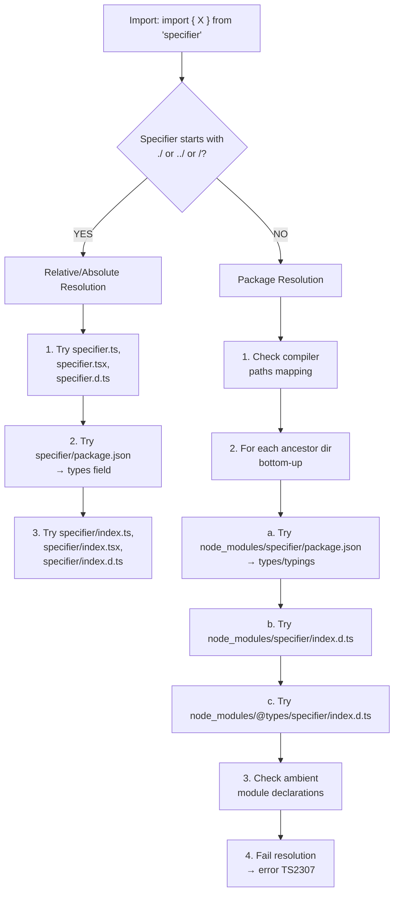

# Lesson 4: Module Resolution, Compilation, Emit Mechanics

## 1. First-Principles Intuition & Invariants

The TypeScript compiler occupies a unique position in the landscape of program translation tools: it must simultaneously satisfy two distinct audiences with competing demands. Source code authors require a powerful type system capable of expressing complex domain invariants, abstract data types, and compile-time guarantees about program behavior. Runtime execution environments—JavaScript engines in browsers, Node.js, Deno, or embedded interpreters—understand only ECMAScript specifications and have zero native awareness of TypeScript's type annotations, interfaces, or generics. This duality forces the compiler to operate as both a sophisticated static analyzer and a faithful transpiler that erases all type information before emission.

At its core, module resolution represents the compiler's strategy for answering a deceptively simple question: when a source file contains an import statement like `import { validateEmail } from "./validators"`, which physical file on disk satisfies that dependency? The answer depends on a complex interaction between compiler configuration, file system layout, package manager conventions, and historical evolution of JavaScript module systems. Unlike languages with centralized package registries and standardized import semantics—where module resolution reduces to database lookups—JavaScript inherited multiple incompatible module formats from its fragmented ecosystem history. CommonJS emerged from Node.js's server-side requirements, AMD addressed browser asynchronous loading, and ES Modules finally provided a standardized syntax in ES2015. TypeScript must navigate this landscape while providing developers with compile-time type checking that crosses module boundaries.

The resolution process begins when the compiler encounters an import declaration. Consider the statement `import * as fs from "fs"`. The compiler must determine whether `fs` refers to an ambient module declaration provided by `@types/node`, a relative file path, a bare specifier resolved through `node_modules`, or a path mapping defined in `tsconfig.json`. This decision tree encodes decades of JavaScript tooling evolution and maintains backward compatibility with legacy codebases while supporting modern standards. The two primary resolution strategies—Classic and Node—represent fundamentally different philosophies about how module identifiers map to file system locations.

Classic resolution emerged from TypeScript's early days before Node.js became the dominant JavaScript runtime. When resolving a relative import like `import { helper } from "./utils"`, Classic resolution performs a straightforward file extension probe: it checks for `./utils.ts`, then `./utils.tsx`, then `./utils.d.ts` in the containing directory. For non-relative imports like `import _ from "lodash"`, Classic resolution walks up the directory hierarchy from the importing file, checking for `lodash.ts`, `lodash.d.ts` at each level until reaching the file system root. This strategy treats non-relative imports as ambient declarations that might exist anywhere in the ancestor chain, reflecting an era when JavaScript lacked a standardized package management convention.

Node resolution strategy mirrors Node.js's CommonJS module loader semantics with TypeScript-specific extensions. The algorithm differentiates sharply between relative imports (starting with `./`, `../`, or `/`) and bare specifiers (package names like `react` or `lodash`). Relative imports resolve through direct file and directory probes: for `import { config } from "./config"`, the compiler checks `./config.ts`, `./config.tsx`, `./config.d.ts`, then attempts directory resolution by probing `./config/package.json` for a `types` or `main` field, finally falling back to `./config/index.ts`, `./config/index.tsx`, `./config/index.d.ts`. Bare specifiers trigger the Node.js `node_modules` resolution algorithm: starting from the importing file's directory, the compiler walks upward checking `node_modules/lodash` at each level, probing for package-relative files according to `package.json` type declarations or falling back to `index` resolution.

The compiler's resolution strategy interacts with module format targets in subtle but consequential ways. When emitting CommonJS output with `module: "commonjs"`, the compiler transforms ES Module `import` and `export` syntax into `require()` calls and `module.exports` assignments. This transformation preserves TypeScript's compile-time type checking while producing code compatible with Node.js's synchronous module loader. When targeting ES Modules with `module: "esnext"` or `module: "es2020"`, the compiler preserves native `import`/`export` syntax, allowing modern JavaScript engines to perform static analysis and tree-shaking optimizations. The choice of module format determines not only emit syntax but also impacts interoperability constraints: CommonJS modules cannot be synchronously imported from ES Modules without dynamic `import()`, while ES Modules can be consumed from CommonJS through Node.js's ES Module wrapper.

Declaration merging represents one of TypeScript's most powerful and least understood features, arising from the compiler's need to model JavaScript's prototypal object system and dynamic property assignment. When multiple declarations share the same name and compatible declaration spaces, TypeScript merges them into a single unified type. Interfaces can merge with other interfaces, namespaces with namespaces, and classes with namespaces, enabling patterns impossible in rigidly structured languages. Consider a library that exports both a constructor function and a namespace containing helper methods:

```typescript
interface RequestHandler {
    (req: Request, res: Response): void;
}

namespace RequestHandler {
    export function middleware(): RequestHandler {
        return (req, res) => { /* ... */ };
    }
}
```

The compiler merges these declarations so that `RequestHandler` simultaneously represents a callable signature and a value with static methods. This pattern directly models JavaScript idioms where functions serve as both callable values and namespace containers for related utilities. Declaration merging extends to module augmentation, where external declaration files can extend existing module interfaces. The `@types/node` package extensively uses module augmentation to extend Node.js's global namespace and built-in module types, allowing third-party libraries to inject additional properties into `process.env` or extend `NodeJS.Global` without modifying core type definitions.

Ambient declarations provide the bridge between TypeScript's static type world and JavaScript's dynamic runtime universe. An ambient declaration introduces type information for entities that exist at runtime but lack TypeScript source code—native browser APIs, Node.js built-ins, or third-party JavaScript libraries without TypeScript definitions. The `declare` keyword signals to the compiler: "Trust that this entity exists at runtime; use this type signature without requiring implementation." Ambient declarations inhabit a parallel type-only universe where implementation details vanish, leaving only type shapes and structural contracts. The global `fetch` API demonstrates this pattern:

```typescript
declare function fetch(
    input: RequestInfo,
    init?: RequestInit
): Promise<Response>;
```

This declaration provides complete type-checking for `fetch` calls throughout a codebase without including any implementation code in emitted JavaScript. The compiler validates argument types and return value usage, but the actual `fetch` implementation comes from the browser or a polyfill library loaded at runtime. Ambient module declarations extend this pattern to entire modules, as seen in the `@types` ecosystem where declaration files describe JavaScript libraries' public APIs without containing implementation code.

Type-only imports and exports, introduced in TypeScript 3.8, solve a critical problem at the intersection of type checking and code generation. When a module imports a type for annotation purposes but never references it in emitted JavaScript, traditional imports create unnecessary runtime dependencies and prevent tree-shaking optimizations. The `import type` syntax explicitly marks imports that exist only for type-checking:

```typescript
import type { User } from "./models";
import { validateUser } from "./validators";

function processUser(user: User): boolean {
    return validateUser(user);
}
```

During compilation, the `User` type import disappears entirely from emitted JavaScript since it only annotates the parameter. The `validateUser` import remains because it's called at runtime. This distinction becomes critical in scenarios involving circular dependencies or when working with frameworks that perform compile-time code transformation. Bundlers like Webpack or Rollup can safely eliminate type-only imports during tree-shaking without analyzing runtime behavior, reducing bundle sizes and preventing accidental inclusion of development-only type packages in production builds.

The compiler's emit process transforms abstract syntax trees (ASTs) into concrete JavaScript output through a multi-stage pipeline that preserves semantic equivalence while stripping type information. This transformation must account for target ECMAScript version, module format, downlevel iteration helpers, and preservation of source structure for debugging. The emit invariant states: regardless of type annotations, decorators, or advanced TypeScript features, the generated JavaScript must execute identically to hand-written equivalent code targeting the same ECMAScript version. Achieving this invariant requires careful handling of TypeScript-specific constructs that lack direct JavaScript equivalents—enums become object literals or const enums inline to call sites, namespaces transform into immediately-invoked function expressions (IIFEs), decorators expand into metadata assignment and wrapper functions.

Source maps establish the bidirectional mapping between generated JavaScript and original TypeScript source, enabling debuggers to display TypeScript line numbers and variable names despite executing transpiled code. The compiler generates a `.js.map` file containing Base64 VLQ-encoded mappings that relate each token in generated JavaScript to its origin in TypeScript source. These mappings consist of segments defining: generated column, source file index, original line, original column, and optional name index. Modern debugging tools—Chrome DevTools, VS Code's debugger, Node.js inspector—consume source maps transparently, presenting developers with TypeScript context while stepping through JavaScript execution. The source map invariant requires that every generated JavaScript token trace back to its TypeScript origin, ensuring that stack traces, breakpoints, and variable inspection remain anchored in the original authored code rather than compiler-generated artifacts.

Declaration file generation represents the compiler's contract mechanism for publishing type definitions separately from implementation code. When building libraries for distribution, enabling `declaration: true` instructs the compiler to emit `.d.ts` files containing type signatures, interfaces, and ambient declarations extracted from source code. These declaration files serve as API contracts that consuming projects use for type checking without accessing implementation details. The declaration generation process walks the compiler's type checker state, extracting public API surfaces while omitting private members, local variables, and implementation bodies. The result forms a pure type-level interface that remains stable across implementation refactorings, enabling semantic versioning at the type layer independent of runtime code changes.

## 2. Core Architecture & Mechanics

Module resolution unfolds through a deterministic state machine that consumes import statements and produces resolved file paths. The compiler maintains a resolution cache keyed by module specifier and containing file path to amortize expensive file system operations across compilation runs. When encountering an import statement during syntax analysis, the compiler extracts the module specifier string and passes it to the resolution subsystem along with contextual metadata: the containing file's path, compiler options (`moduleResolution`, `baseUrl`, `paths`), and ambient module declarations from loaded declaration files.

The resolution algorithm branches immediately based on module specifier format. Relative specifiers (`./`, `../`, `/`) bypass `node_modules` traversal entirely, proceeding directly to file extension probing in the specified directory. Absolute paths (starting with `/`) resolve from the file system root on Unix-like systems or the drive letter on Windows. Bare specifiers without path separators enter the package resolution subsystem, which implements the full Node.js algorithm augmented with TypeScript extensions.



Path mappings in `tsconfig.json` provide an escape hatch from standard resolution logic, enabling project-specific module aliasing and monorepo support. The `paths` configuration maps specifier prefixes to file system locations relative to `baseUrl`. For example:

```json
{
  "compilerOptions": {
    "baseUrl": "./src",
    "paths": {
      "@models/*": ["app/models/*"],
      "@utils/*": ["shared/utils/*"],
      "lodash": ["../node_modules/@types/lodash/index.d.ts"]
    }
  }
}
```

When the compiler resolves `import { User } from "@models/user"`, it pattern-matches the specifier against path mapping keys, finding the `@models/*` rule. Substitution replaces the wildcard with `user`, yielding the candidate path `app/models/user` relative to `src/`. The compiler then applies standard file extension probing to locate the actual file. Path mappings execute before `node_modules` traversal, allowing projects to override package resolution or create logical namespace hierarchies that don't mirror physical directory structure.

The compiler's type checker maintains a symbol table mapping identifiers to their type information, declaration locations, and semantic metadata. During module resolution, the type checker populates this table with exports from resolved modules, creating a dependency graph that drives incremental compilation. When file A imports from file B, the type checker ensures B is fully analyzed before type-checking A's usage of imported symbols. This dependency ordering prevents inconsistent type information and enables parallel compilation of independent module subtrees.

Declaration merging operates through the symbol table's multi-declaration mechanism. Each symbol in the table can reference multiple declaration nodes from the AST, categorized by declaration space: value space (variables, functions, classes), type space (interfaces, type aliases), and namespace space. When the compiler encounters multiple declarations with the same name, it checks compatibility rules:

- Interfaces merge with interfaces: properties and methods combine; incompatible signatures produce type errors
- Namespaces merge with namespaces: exports combine into a unified namespace object
- Classes merge with namespaces: the namespace becomes a companion object for static members
- Interfaces cannot merge with type aliases: structural vs. nominal compatibility semantics conflict

The merging process constructs a synthetic symbol containing all merged declarations, which the type checker uses for subsequent type operations. This mechanism enables patterns like interface augmentation:

```typescript
// library.d.ts
export interface Config {
    apiKey: string;
}

// user-code.ts
import { Config } from "./library";

declare module "./library" {
    interface Config {
        debugMode: boolean;
    }
}

const config: Config = {
    apiKey: "...",
    debugMode: true  // Valid due to augmentation
};
```

The module augmentation syntax `declare module "./library"` instructs the compiler to re-open the module's scope and merge additional declarations with existing exports. This pattern proves essential for extending third-party library types without forking declaration files or using unsafe type assertions.

Ambient module declarations create synthetic modules that exist only in the type system. The syntax `declare module "pkg"` defines a module that may not have corresponding `.ts` files but whose exports are available for import. This enables typing untyped JavaScript libraries:

```typescript
// ambient-declarations.d.ts
declare module "legacy-lib" {
    export function doSomething(x: number): string;
    export const CONFIG: { timeout: number };
}

// consumer.ts
import { doSomething } from "legacy-lib";  // Types available, no .ts file needed
const result = doSomething(42);
```

The compiler treats ambient modules as resolved immediately without file system probes, consulting only the declaration's exported members during type checking. This mechanism underpins the entire `@types` ecosystem: when you install `@types/react`, you're installing ambient declarations that describe React's JavaScript API using TypeScript syntax.

The emit pipeline begins after type checking completes successfully. The compiler constructs a transformation context containing target ECMAScript version, module format, and emit flags from `tsconfig.json`. It then walks each source file's AST, applying transformation passes that progressively lower TypeScript-specific syntax into standard JavaScript:

1. **Namespace transformation**: Convert `namespace` declarations into IIFE patterns that define closure-scoped objects
2. **Enum transformation**: Transform `enum` declarations into object literals or inline constant values
3. **Class field transformation**: Desugar class properties and decorators into constructor assignments and metadata calls
4. **JSX transformation**: Convert JSX elements into `React.createElement` calls or configured factory functions
5. **Module format transformation**: Transform `import`/`export` into target module system syntax (CommonJS `require`, AMD `define`, etc.)
6. **Downlevel iteration**: Inject helpers for spread operators, for-of loops targeting pre-ES2015 environments

Each transformation preserves semantic equivalence by maintaining the invariant that generated JavaScript executes identically to hand-written equivalent code. Consider enum transformation:

```typescript
// Source TypeScript
enum Direction {
    Up = 1,
    Down,
    Left,
    Right
}

// Emitted JavaScript (CommonJS target)
var Direction;
(function (Direction) {
    Direction[Direction["Up"] = 1] = "Up";
    Direction[Direction["Down"] = 2] = "Down";
    Direction[Direction["Left"] = 3] = "Left";
    Direction[Direction["Right"] = 4] = "Right";
})(Direction || (Direction = {}));
```

The emitted IIFE creates a bidirectional mapping where `Direction.Up === 1` and `Direction[1] === "Up"`, enabling both enum-to-value and value-to-enum lookups. The self-initialization pattern `Direction || (Direction = {})` allows enum declarations to merge across multiple files.

Source map generation occurs in parallel with JavaScript emit. As the compiler writes each token to the output file, it records a mapping segment: the generated column offset, the source file index (for projects with multiple input files), the original line and column numbers, and optionally the original identifier name. These segments are encoded using Base64 Variable-Length Quantity (VLQ) encoding, a space-efficient format that stores relative offsets rather than absolute positions:

```
Example Source Map Segment Encoding:
Generated Position: Column 12
Source File: Index 0
Original Position: Line 5, Column 8
Original Name: Index 2

Encoded as: AAUA  (Base64 VLQ representing [12, 0, 5, 8, 2])
```

The compiler aggregates these segments into the `mappings` field of the source map JSON structure, with semicolons separating generated lines and commas separating segments within a line. The resulting `.js.map` file references the original TypeScript sources through the `sources` array and optionally embeds source content via `sourcesContent` for debugging environments that lack access to original files.

Declaration file emission extracts type signatures from the type checker's internal representation rather than directly transforming ASTs. This ensures that emitted declarations reflect the compiler's inferred types, including complex types computed through control flow analysis, type narrowing, and conditional type resolution. The declaration emitter walks exported symbols, outputting:

- Interface and type alias declarations for all exported types
- Function signatures with inferred return types
- Class declarations with public/protected members (private members omitted)
- Const enum members as literal types
- Namespace exports flattened into ambient module declarations

The emitter strips implementation details—function bodies become semicolons, class methods lose their implementations, variable initializers reduce to type annotations. The result forms a pure API contract:

```typescript
// Source: library.ts
export class DataStore<T> {
    private cache = new Map<string, T>();
    
    set(key: string, value: T): void {
        this.cache.set(key, value);
    }
    
    get(key: string): T | undefined {
        return this.cache.get(key);
    }
}

// Emitted: library.d.ts
export declare class DataStore<T> {
    set(key: string, value: T): void;
    get(key: string): T | undefined;
}
```

The declaration file omits the private `cache` field and all implementation logic, exposing only the public API surface. This separation enables library authors to refactor internals without breaking type compatibility for consumers.

## 3. High-Performance Optimization & Failure Modes

Module resolution performance directly impacts compilation speed in large codebases where thousands of import statements trigger file system operations. The compiler's resolution cache mitigates repeated lookups, but cache invalidation becomes critical during watch mode when files change. The `--incremental` flag enables persistent caching across compilation runs by storing resolution results and dependency graphs in `.tsbuildinfo` files. This allows the compiler to skip resolution for unchanged modules, focusing effort on modified files and their transitive dependents.

Path mapping optimization requires careful configuration to avoid performance pitfalls. Overly broad wildcard patterns force the compiler to probe many candidate paths before finding the correct file. Consider:

```json
// Inefficient: Matches every import, triggering many failed probes
{
  "paths": {
    "*": ["src/*", "lib/*", "node_modules/*"]
  }
}

// Efficient: Specific prefixes reduce search space
{
  "paths": {
    "@app/*": ["src/app/*"],
    "@lib/*": ["src/lib/*"]
  }
}
```

The wildcard `*` pattern matches all imports, including package names like `react` or `lodash`, causing the compiler to probe `src/react`, `lib/react` before falling back to `node_modules`. Specific prefixes limit path mapping to imports explicitly using those prefixes, allowing bare specifiers to bypass custom resolution entirely.

Declaration file generation performance scales with the complexity of exported types. Deeply nested generic types, recursive type aliases, and excessive use of conditional types can cause exponential blowup in declaration emit time. The compiler must recursively expand type aliases to produce syntactically valid declarations, which in pathological cases leads to declaration files megabytes in size. Consider:

```typescript
// Problematic: Recursive type expansion
type DeepPartial<T> = {
    [K in keyof T]: T[K] extends object ? DeepPartial<T[K]> : T[K];
};

// Large interface triggers recursive expansion in .d.ts
export interface AppState {
    user: { profile: { settings: { theme: string } } };
    // ... hundreds of nested properties
}

export function updateState(state: DeepPartial<AppState>): void;
```

The emitted declaration file must expand `DeepPartial<AppState>` into concrete structural types, recursively processing each nested object property. For deeply nested structures with many properties, this expansion produces massive declaration files that slow down consumers' type checking. The mitigation involves simplifying exported types, extracting intermediate type aliases, or marking implementation-heavy types as internal to prevent declaration emission.

Module resolution failure modes typically manifest as "Cannot find module" errors (TS2307). Debugging these requires systematic investigation of resolution steps:

1. Verify the import specifier format: relative imports need `.` or `..` prefix
2. Check `tsconfig.json` module resolution strategy matches project structure
3. Inspect path mappings for typos or incorrect wildcard substitutions
4. Ensure `node_modules` contains the referenced package
5. Verify `package.json` in resolved packages contains `types` or `typings` field
6. Check for case sensitivity mismatches (Linux/macOS filesystems differ)

The `--traceResolution` compiler flag provides detailed logging of resolution steps, revealing exactly which paths the compiler probes and why resolution fails:

```bash
$ tsc --traceResolution
======== Resolving module './utils' from '/project/src/app.ts'. ========
Module resolution kind is not specified, using 'NodeJs'.
Loading module as file / folder, candidate module location '/project/src/utils'.
File '/project/src/utils.ts' does not exist.
File '/project/src/utils.tsx' does not exist.
File '/project/src/utils.d.ts' does not exist.
Directory '/project/src/utils' does not exist, skipping all lookups in it.
======== Module name './utils' was not resolved. ========
```

This output immediately identifies the problem: no file named `utils.ts` exists in the expected location. Either the import path is incorrect, or the file is missing.

Circular dependencies between modules create subtle type-checking failures when one module's exports depend on types from another module that imports the first. TypeScript handles circular value dependencies through hoisting, but circular type dependencies can cause the type checker to encounter incomplete type information. The failure mode appears as `error TS2449: Type 'X' has no properties in common with type 'Y'` despite X and Y appearing identical. The solution involves extracting shared types into a separate module that both circular dependencies import, breaking the cycle at the type level:

```typescript
// Problematic circular dependency
// user.ts
import { Post } from "./post";
export interface User {
    posts: Post[];
}

// post.ts
import { User } from "./user";
export interface Post {
    author: User;
}

// Solution: Extract shared types
// types.ts
export interface User {
    posts: Post[];
}
export interface Post {
    author: User;
}

// user.ts and post.ts import from types.ts
```

Type-only imports eliminate runtime circular dependency issues but require discipline to maintain correctness. The compiler enforces that type-only imports are never evaluated, causing errors if you accidentally reference them in value positions:

```typescript
import type { Config } from "./config";

// Error: 'Config' only refers to a type, but is being used as a value here.
const config = new Config();
```

This compile-time enforcement prevents runtime errors from circular dependencies while preserving type-checking capabilities.

Source map generation can fail silently when source files are moved or renamed after compilation. Debuggers loading stale source maps display incorrect line numbers or fail to locate original sources. The `sourceRoot` and `mapRoot` compiler options control the paths embedded in source maps, but misconfigurations cause debuggers to request non-existent URLs:

```json
{
  "compilerOptions": {
    "sourceMap": true,
    "sourceRoot": "/src",        // Absolute path for deployed source maps
    "mapRoot": "/maps",          // Separate directory for map files
    "inlineSourceMap": false     // External .js.map files
  }
}
```

For production deployments where original TypeScript sources are unavailable, enabling `inlineSources: true` embeds source content directly into source maps, allowing debuggers to display original code without accessing separate source files. This increases bundle sizes but ensures debugging works in environments where source file deployment is impractical.

Declaration file compatibility across TypeScript versions can break when the compiler's type inference evolves. A library compiled with TypeScript 4.5 might emit declarations containing syntax unsupported by projects using TypeScript 4.0. The `--downlevelIteration` and `--target` flags control emitted JavaScript syntax, but declaration files always use the latest TypeScript syntax features. The mitigation involves maintaining conservative type definitions or publishing multiple declaration file versions targeting different TypeScript releases. Large library ecosystems like DefinitelyTyped address this through versioned `@types` packages that align with major TypeScript releases.

Tree-shaking effectiveness depends critically on the module format and export patterns used. CommonJS modules use dynamic property assignment that bundlers cannot statically analyze, preventing dead code elimination:

```typescript
// Prevents tree-shaking
exports.utilA = () => { /* ... */ };
exports.utilB = () => { /* ... */ };

// Enables tree-shaking
export const utilA = () => { /* ... */ };
export const utilB = () => { /* ... */ };
```

When targeting ES Modules with `module: "esnext"`, the compiler preserves static `export` declarations that bundlers like Webpack and Rollup can analyze. This enables removal of unused exports, dramatically reducing bundle sizes for applications that import only subsets of large libraries. The pattern extends to side-effect tracking: if a module contains only type definitions and no runtime initialization, marking it as side-effect-free in `package.json` allows bundlers to eliminate it entirely:

```json
{
  "name": "types-only-package",
  "sideEffects": false
}
```

Type-checking performance in watch mode benefits from incremental compilation, but certain patterns defeat incrementality. Exporting computed types that depend on imported types forces the compiler to recheck all consumers whenever the imported module changes:

```typescript
// Defeats incremental compilation
import { Config } from "./config";
export type ComputedConfig = {
    [K in keyof Config]: Config[K] extends string ? `prefixed_${Config[K]}` : Config[K];
};
```

Changes to `Config` invalidate `ComputedConfig`, which propagates to all files importing it. The compiler must recheck the entire transitive dependency tree. Keeping exported types structurally simple and avoiding excessive mapped type transformations maintains incremental compilation effectiveness, preserving sub-second rebuild times in large projects.
