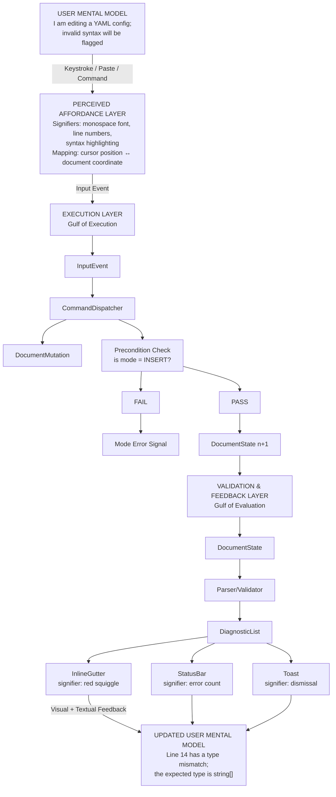

# Lesson 2: Interaction Models, Affordances, Mental Models

## 1. First-Principles Intuition & Invariants

Every interface, whether a command-line shell, a code editor, or a deployment dashboard, is fundamentally a contract between a system and the person operating it. The system embodies a set of capabilities; the human carries a mental model of what those capabilities are and how to invoke them. When those two representations align closely, work feels effortless. When they diverge, errors compound, latency grows, and engineers begin writing workarounds in their heads before they ever touch the keyboard. Understanding this contract from first principles is not an exercise in soft psychology — it is the same discipline you apply when reasoning about an API surface or a type system. The interface is a protocol, and protocols have invariants.

Donald Norman's foundational analysis in *The Design of Everyday Things* introduced two concepts that formalize what happens every time a person attempts to accomplish something with a system. The **Gulf of Execution** is the gap between what a person intends to do and the actions the system makes available. A developer staring at a dense modal dialog, hunting for the right button to trigger a background job, is standing at the edge of this gulf. The **Gulf of Evaluation** is the complementary gap: after the system acts, how well does its output communicate what actually happened? A CLI tool that exits with code zero and produces no stdout has successfully executed, but the engineer cannot evaluate that success without additional investigation. These two gulfs define the shape of every interaction failure you will encounter when building or auditing a software interface.

The practical implication for systems programmers is precise: the Gulf of Execution is a function of *discoverability*, and the Gulf of Evaluation is a function of *feedback fidelity*. A well-designed API or UI minimizes both by exposing its state machine clearly. Consider how a poorly designed deployment UI presents a "Deploy" button that is sometimes disabled without explanation. The developer must infer the preconditions from ambient context — perhaps the branch is not tagged, or a required approval is pending. The system knows exactly why the button is disabled; it simply fails to communicate that knowledge. The gulf is not a hardware limitation or a performance constraint. It is an information-hiding bug.

Affordances sit underneath both gulfs as the most granular unit of interaction design. The term originates in James Gibson's ecological psychology, where it described a relationship between an organism and its environment — a flat rock *affords* sitting to a human but not to a fish. Norman adapted the concept for designed objects, and the distinction he drew between **perceived affordances** and **actual affordances** is the one that matters most to engineers. The *actual affordance* is what the system genuinely supports: a text field can receive keyboard input. The *perceived affordance* is what the user believes it supports based on visual or structural cues. When a developer sees a monospace text area in a configuration panel, they perceive it as accepting freeform text input, and they are probably right. When they see a styled "badge" component in a UI library and try to click it expecting navigation, the mismatch between perceived and actual affordance produces an error — not a runtime exception, but a cognitive one.

Affordances communicate through **signifiers**, which are the perceptible signals that indicate how an affordance should be used. A button's raised shadow is a signifier for pressability. A text cursor blinking in an input field is a signifier for keyboard receptivity. In software interfaces, signifiers often carry more engineering weight than their visual weight suggests. The placeholder text in a search box, the keyboard shortcut displayed in a tooltip, the grayed-out state of a menu item — each of these is a signifier that broadcasts capability or constraint. Where signifiers are absent or misleading, users resort to exploratory behavior: clicking around, reading documentation, or filing bug reports that read "I didn't know I could do that." For systems engineers building internal tooling or developer portals, the absence of good signifiers is not a cosmetic problem. It is a tax paid in support tickets and onboarding time.

**Mappings** describe the spatial and logical relationships between controls and their effects. A well-mapped interface creates a correspondence that feels natural because it mirrors something the user already understands. The relationship between scroll position and document position in an editor is a mapping. The relationship between a slider's left-right position and a numeric value's magnitude is a mapping. When a configuration panel lists infrastructure parameters in an order that matches neither alphabetical sort nor logical dependency order, the mapping is arbitrary, and the developer must hold an external model in working memory to use it correctly. The practical cost is real: cognitive load is a finite resource, and every unit spent on navigating arbitrary mappings is a unit not available for the actual problem.

**Feedback loops** are the mechanisms by which the system communicates the consequences of actions. In the domain of systems software, the analog is familiar: you write a syscall, the kernel returns a value, and your program branches on that value. The feedback is immediate, unambiguous, and machine-readable. UI feedback loops aim for the same properties and fail in characteristic ways. Feedback that arrives too late — a spinner that runs for three seconds before confirming a form submission — creates temporal uncertainty. Feedback that is ambiguous — a toast notification that says "Operation completed" without specifying which operation — fails the precision requirement. Feedback that is invisible — a background job that starts but writes no progress to any surface the developer can observe — creates the worst case: the developer is left guessing at system state, which is the evaluation gulf at its most extreme.

**Conceptual models** are the mental representations users build of how a system works. These models are always incomplete and often wrong in specific ways that are entirely predictable. The job of interface design is not to perfectly convey the system's implementation — no one expects a developer to understand tcache bins to use a text editor — but to provide a conceptual model that is *accurate enough to generate correct predictions*. When a developer learns that "Git staging is a snapshot of the working tree captured by `git add`," they have a conceptual model sufficient to explain why `git commit` does not include changes made after the last `git add`. That model is a simplification, but it is not a lie. It supports correct behavior. When the conceptual model a system promotes is subtly wrong — when a cloud console implies that "stopping" an instance is equivalent to "deallocating" it, when in fact they have different billing implications — the mismatch eventually produces a production incident or an unexpected invoice.

**Mode errors** are the most dangerous failure mode that emerges from conceptual model divergence. A mode error occurs when a user performs an action that would be correct in one system state but is incorrect in the current state, and the system does not make the current state sufficiently visible. The classic example is the vi/vim modal editor: a developer who does not know they are in insert mode and types `:wq` will find those characters inserted into the document rather than interpreted as a command. The root cause is not that the editor is poorly designed for its intended users — vim experts have a stable conceptual model of modal state — but that the mode is not prominently signified to users whose conceptual model assumes a modeless interface. For the systems programmer designing internal tooling, mode errors appear in contexts like deployment pipelines with environment-specific behavior, CLI tools with global flags that change interpretation of subsequent arguments, and state machines where the same action has different consequences depending on undisclosed context.

Fitts's Law and Hick's Law form the quantitative substrate beneath these qualitative principles. Paul Fitts derived his model in 1954 from information theory, and it describes the time required to move a pointing device to a target as a logarithmic function of the ratio between the distance to the target and the width of the target. The formal expression is $T = a + b \log_2\!\left(1 + \frac{D}{W}\right)$, where $T$ is movement time, $D$ is distance from the starting point to the center of the target, $W$ is the width of the target along the axis of movement, and $a$ and $b$ are empirically fitted constants. The practical implication is that large targets close to the user's current cursor position are reached fastest, and that doubling the distance to a target increases acquisition time by a fixed amount while doubling the target width reduces time by a comparable amount. For software interfaces, this means that the most frequently used actions should be the largest and most proximate, not the smallest or deepest in a nested menu hierarchy.

William Edmund Hick's Law, formalized alongside Ray Hyman's parallel work in 1952, states that decision time grows logarithmically with the number of equally probable choices: $T = b \log_2(n + 1)$, where $n$ is the number of options and $b$ is a constant fitted to the decision type. The engineering translation is that every additional option presented in a menu, toolbar, or configuration panel increases the cognitive latency required to select among them. This is not an argument for feature removal — it is an argument for progressive disclosure, where only the options relevant to the current task and context are surfaced at a given time. A context menu that presents fifteen options forces the user through a linear scan and decision process; a context menu that presents four options with a "More..." expander applies Hick's Law in the user's favor for the common case while preserving access to the full option space.

## 2. Core Architecture & Mechanics

Understanding these principles abstractly is necessary but insufficient. The more productive exercise is to trace how they manifest as concrete data structures, state machines, and signal paths in software interfaces. Consider a canonical developer tool: a configuration editor with live validation. This seemingly simple surface contains all of the interaction machinery described above, and analyzing it structurally reveals how the principles compose.

The interaction pipeline for such a component can be modeled as a directed state machine where user inputs are events that drive state transitions, and each transition produces both a new state and a feedback emission. The following diagram shows the signal path:



Each layer in this pipeline maps to a distinct design concern. The perceived affordance layer determines whether the developer understands what kind of input the component accepts. The execution layer determines whether the intended command reaches the right handler in the right mode. The validation and feedback layer determines whether the resulting state is communicated with enough precision to close the evaluation gulf.

The state machine that governs the execution layer deserves closer examination, particularly around mode errors. Consider a simplified React component implementing a form with two mutually exclusive modes: view mode and edit mode.

```tsx
import React, { useReducer, useEffect, useRef } from 'react';

type Mode = 'view' | 'edit';

interface FormState {
  mode: Mode;
  draft: string;
  committed: string;
  error: string | null;
}

type FormAction =
  | { type: 'ENTER_EDIT' }
  | { type: 'UPDATE_DRAFT'; payload: string }
  | { type: 'COMMIT' }
  | { type: 'CANCEL' }
  | { type: 'VALIDATION_ERROR'; payload: string };

function formReducer(state: FormState, action: FormAction): FormState {
  switch (action.type) {
    case 'ENTER_EDIT':
      // Guard: only valid from view mode. Prevents mode error on double-click.
      if (state.mode === 'edit') return state;
      return { ...state, mode: 'edit', draft: state.committed, error: null };

    case 'UPDATE_DRAFT':
      if (state.mode !== 'edit') return state; // Explicit mode guard
      return { ...state, draft: action.payload, error: null };

    case 'COMMIT':
      if (state.mode !== 'edit') return state;
      if (state.draft.trim().length === 0) {
        return { ...state, error: 'Value cannot be empty.' };
      }
      return {
        ...state,
        mode: 'view',
        committed: state.draft,
        draft: '',
        error: null,
      };

    case 'CANCEL':
      return { ...state, mode: 'view', draft: '', error: null };

    case 'VALIDATION_ERROR':
      return { ...state, error: action.payload };

    default:
      return state;
  }
}

interface InlineEditorProps {
  initialValue: string;
  onCommit: (value: string) => Promise<{ ok: boolean; message?: string }>;
}

export function InlineEditor({ initialValue, onCommit }: InlineEditorProps) {
  const [state, dispatch] = useReducer(formReducer, {
    mode: 'view',
    draft: '',
    committed: initialValue,
    error: null,
  });

  const inputRef = useRef<HTMLInputElement>(null);

  // Focus management: signifier for keyboard receptivity on mode transition
  useEffect(() => {
    if (state.mode === 'edit' && inputRef.current) {
      inputRef.current.focus();
      inputRef.current.select();
    }
  }, [state.mode]);

  async function handleCommit() {
    const result = await onCommit(state.draft);
    if (!result.ok) {
      dispatch({ type: 'VALIDATION_ERROR', payload: result.message ?? 'Save failed.' });
    } else {
      dispatch({ type: 'COMMIT' });
    }
  }

  function handleKeyDown(e: React.KeyboardEvent<HTMLInputElement>) {
    if (e.key === 'Enter') {
      e.preventDefault();
      handleCommit();
    }
    if (e.key === 'Escape') {
      dispatch({ type: 'CANCEL' });
    }
  }

  if (state.mode === 'view') {
    return (
      <div
        role="button"
        tabIndex={0}
        aria-label={`Edit value: ${state.committed}`}
        style={{
          cursor: 'pointer',
          padding: '4px 8px',
          borderRadius: 4,
          border: '1px dashed #ccc',  // Signifier: dashed border affords editing
          display: 'inline-block',
          fontFamily: 'monospace',
        }}
        onClick={() => dispatch({ type: 'ENTER_EDIT' })}
        onKeyDown={(e) => { if (e.key === 'Enter' || e.key === ' ') dispatch({ type: 'ENTER_EDIT' }); }}
      >
        {state.committed}
      </div>
    );
  }

  return (
    <div style={{ display: 'inline-flex', flexDirection: 'column', gap: 4 }}>
      <div style={{ display: 'inline-flex', gap: 4, alignItems: 'center' }}>
        <input
          ref={inputRef}
          type="text"
          value={state.draft}
          aria-invalid={state.error !== null}
          aria-describedby={state.error ? 'inline-editor-error' : undefined}
          style={{
            fontFamily: 'monospace',
            padding: '4px 8px',
            border: state.error ? '1px solid #c0392b' : '1px solid #2980b9',
            borderRadius: 4,
            outline: 'none',
          }}
          onChange={(e) => dispatch({ type: 'UPDATE_DRAFT', payload: e.target.value })}
          onKeyDown={handleKeyDown}
        />
        {/* Large commit button: Fitts's Law — primary action is largest, nearest */}
        <button
          onClick={handleCommit}
          style={{
            padding: '4px 12px',
            backgroundColor: '#2980b9',
            color: '#fff',
            border: 'none',
            borderRadius: 4,
            cursor: 'pointer',
            fontWeight: 600,
          }}
        >
          Save
        </button>
        <button
          onClick={() => dispatch({ type: 'CANCEL' })}
          style={{
            padding: '4px 8px',
            backgroundColor: 'transparent',
            border: '1px solid #aaa',
            borderRadius: 4,
            cursor: 'pointer',
          }}
        >
          Cancel
        </button>
      </div>
      {/* Feedback: precise error message closes the evaluation gulf */}
      {state.error && (
        <span
          id="inline-editor-error"
          role="alert"
          style={{ color: '#c0392b', fontSize: '0.8rem', fontFamily: 'monospace' }}
        >
          {state.error}
        </span>
      )}
    </div>
  );
}
```

This implementation is worth reading structurally, not just syntactically. The `formReducer` function enforces mode discipline at the data layer: the `UPDATE_DRAFT` case returns the unchanged state if the mode is not `'edit'`, which means no spurious mutations can occur from events that arrive out of sequence. This is the same defensive programming pattern you would apply to a state machine in a lock-free concurrent queue, and it serves the same purpose: eliminating a class of invalid state transitions at the boundary rather than hunting for their effects downstream.

The focus management in the `useEffect` hook is a signifier mechanism: when the component transitions to edit mode, the input receives focus and its content is selected, communicating immediately that the component is now in a keyboard-receptive state. Without this, the developer would see the input appear but would need to click it again — an unnecessary interaction cost that widens the execution gulf.

The sizing of the Save and Cancel buttons is a deliberate application of Fitts's Law. Save is the primary action and receives the larger visual footprint and higher color contrast. Cancel is secondary: it is styled more modestly and placed to the right of Save, slightly farther from the typical cursor path after the user finishes typing. The spatial arrangement encodes action priority in a way that reduces the probability of destructive selection under time pressure.

Hick's Law governs the button count decision as well. Two visible choices — Save and Cancel — plus an implicit third choice (the Escape keyboard shortcut) represent a minimal decision tree. If the design had presented six buttons — Save, Save & Close, Save & Continue, Revert, Discard, Cancel — the decision time for each interaction would increase measurably, and the probability of mode errors would rise in proportion to the similarity of adjacent options.

## 3. High-Performance Optimization & Failure Modes

The principles in sections one and two describe how interactions should work in the common case. Production interfaces fail under load: when task complexity exceeds the user's working memory, when multiple concurrent feedback signals compete for attention, and when the conceptual model the interface promotes drifts from the system's actual behavior as features accumulate. Each of these failure modes has a characteristic signature and a corresponding mitigation strategy grounded in the same first principles.

**Cognitive load accumulation** is the primary performance failure mode in complex software interfaces. Working memory is bounded — the established estimate from Miller's work is seven plus or minus two chunks, though more recent research by Cowan suggests four as a more reliable limit for active manipulation tasks. When an interface requires the developer to hold more simultaneous variables than this budget allows, errors increase not linearly but sharply, because the user begins to substitute heuristics and guesses for deliberate reasoning. The mitigation is progressive disclosure applied systematically: surface the minimum information necessary for the current decision, and provide structured access to additional context on demand. In a deployment pipeline UI, this means showing the current stage's status, its required inputs, and its exit criteria, while keeping previous and future stages accessible but visually subordinate. The layout is not aesthetic preference; it is working memory management.

A concrete antipattern that engineers building internal dashboards frequently introduce is the **omnibus configuration panel**: a single scrollable form that presents every parameter for a system in a flat, undifferentiated list. The perceived justification is completeness — "all the options are there." The actual effect is a severe Hick's Law penalty on every interaction, because the user must scan the entire option space to locate the control they need. The correct architecture is hierarchical grouping with clear section headings, collapsed by default for sections that apply to infrequent configurations, and a search capability for users who know the parameter name but not its location. This is the same design logic applied to namespace organization in a large codebase: flat namespaces are navigable up to a size threshold and become a liability beyond it.

**Feedback latency and the evaluation gulf** interact in a specific failure mode that is worth quantifying. Research from the 1960s and 1970s by Robert Miller established rough latency thresholds that remain empirically valid: responses within 100 milliseconds feel instantaneous and require no feedback signifier; responses between 100 milliseconds and 1 second feel direct but benefit from a subtle confirmation; responses between 1 and 10 seconds require a progress indicator that communicates both that the system is working and that the user does not need to act; and responses beyond 10 seconds require a feedback mechanism that allows the user to understand progress and optionally redirect attention elsewhere. When a software interface violates these thresholds without compensating feedback, the user's mental model of system state degrades. After a few seconds of ambiguity, the developer is likely to either retry the action — potentially causing duplicate submissions — or navigate away, losing work in progress.

The mitigation architecture for latency-driven evaluation gulf failures involves two components that must be implemented together. The first is **optimistic UI updates**: the interface reflects the user's intended state change immediately, before the server confirms it, and reverts with a precise error message only if the operation fails. Git staging in a modern GUI client typically applies this pattern — the file moves from "unstaged" to "staged" in the visual tree the instant you check it, without waiting for the index write to complete. The conceptual model this promotes — that the action has taken effect — is provisionally correct and is only retracted if reality contradicts it. The second component is **idempotency signaling**: the interface communicates to the user that retrying a failed or ambiguous operation is safe. Without explicit idempotency guarantees surfaced at the UI layer, users are left to infer from context whether a "Save" button press that produced no visible feedback was processed or dropped, and rational risk management pushes them to avoid retrying rather than risk duplication.

**Mode error compounding** is the most insidious failure mode in complex interfaces because it is often not attributed to interface design at all. When a developer makes an error that stems from an incorrect assumption about the system's current mode, the error is frequently logged as a user mistake or a training deficit. The structural cause is that the mode was insufficiently visible. Consider a CI/CD pipeline dashboard that presents a "Re-run" button whose behavior differs depending on whether the pipeline is in a "preview" approval state versus a "triggered" execution state. If the button looks identical in both states and the state indicator is a small status badge in a corner of the panel that the developer's eye has learned to skip, mode errors are not random events — they are a predictable function of the signifier's visibility. The mitigation is to treat mode visibility as a first-class invariant: different modes should produce visually distinguishable surfaces, not merely differently labeled buttons on an otherwise identical layout. The vim approach of displaying `-- INSERT --` in a dedicated, prominent status region is not arbitrary aesthetic convention. It is a correct engineering response to the mode error problem.

**Mapping degradation over time** is a failure mode that emerges from incremental feature additions. An interface that begins with a coherent mapping between control layout and system architecture gradually accumulates controls that reflect organizational decisions, feature request priority, and implementation convenience rather than the user's conceptual model. After several release cycles, the mapping is effectively random from the user's perspective. The correct mitigation is to maintain a **user journey map** as a living engineering artifact, reviewed alongside the system's capability map at each significant feature addition. The user journey map documents the sequence of actions a developer takes to accomplish each canonical task, the information they need at each step, and the feedback they receive. When a proposed feature addition requires inserting a new step into an established journey without a corresponding reduction in an existing step's cost, the design should be challenged in the same review where the implementation is discussed.

Fitts's Law violations accumulate silently in component libraries, particularly when components are composed without attention to spatial relationships between them. A common failure pattern is the **widely separated confirm dialog**: a destructive action button in one part of the viewport triggers a confirmation modal whose "Confirm" button appears at screen center by default, requiring a long pointer movement to reach. The Fitts cost of this movement is non-trivial, but worse, the interruption of motor flow increases the probability of mis-clicking on a close or dismiss control adjacent to the confirm button. The engineering correction is to position confirmation controls near the trigger point whenever the action is destructive and the confirmation dialog is small. When the confirmation requires significant contextual information that justifies a full-panel modal, the Fitts penalty is acceptable, but the layout should still maximize the target size of the primary action.

A complete audit of an existing interface's interaction model can be conducted systematically by walking through the following evaluation procedure. For each canonical user task, trace the signal path from intention to action to feedback: identify whether the available actions are discoverable without documentation, whether the mapping from action to effect matches the user's probable conceptual model, whether the feedback is immediate enough and precise enough to close the evaluation gulf, and whether any modes are active that could cause the action to produce an unexpected result. Document these observations as interface invariants in the same way you would document system invariants in a design spec. This practice transforms UX evaluation from subjective critique into structured engineering analysis, which is the register in which it belongs for systems programmers who build the tools their colleagues depend on daily.

The session, compilation, and deployment tools that senior engineers build for internal platforms carry exactly the same interaction model obligations as consumer-facing products, with less tolerance for failure. A developer using an internal deployment dashboard under incident pressure, with elevated cortisol and reduced working memory capacity, needs the smallest possible execution gulf, the fastest possible evaluation feedback, and zero mode errors. The Norman principles, Fitts's Law, and Hick's Law are not guidelines for making software pleasant. They are specifications for making software correct under the conditions of real use.
