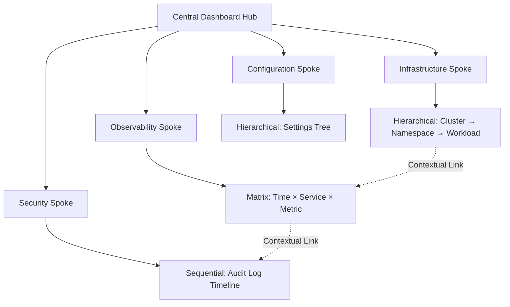

# Lesson 3: Information Architecture, Navigation Structures, Findability

## 1. First-Principles Intuition & Invariants

Information architecture emerges from a fundamental tension in software design: the computational imperative for hierarchical structure clashes perpetually with the cognitive reality that human mental models are associative, networked, and context-dependent. When we architect information systems—whether designing API documentation portals, admin dashboards, configuration management interfaces, or distributed system observability tools—we encode organizational assumptions into navigational structures that either align with user mental models or impose significant cognitive overhead. The craft of information architecture lies in recognizing that every navigation decision represents a forced choice about how users will conceptualize, locate, and traverse the conceptual space your software defines.

At the substrate level, information architecture operates as a graph problem masked by interface conventions. Every software artifact—function, module, configuration parameter, log entry, metric datapoint—exists as a node with multiple potential semantic relationships to other nodes. A Kubernetes pod resource can be understood hierarchically (within a namespace, within a cluster), sequentially (through its lifecycle states: Pending → Running → Succeeded), relationally (connected to services, volumes, config maps), or temporally (through event streams and audit logs). The information architect's task is not to choose the "correct" organizational scheme—no single scheme can satisfy all access patterns—but rather to implement a navigational system that makes the most frequent and critical access patterns nearly effortless while keeping alternative pathways discoverable.

The invariant principle governing findability is what information scientists call the **principle of least effort**: users will consistently choose the path that minimizes their total cognitive and mechanical cost, even if that path produces suboptimal results. This principle explains why search bars dominate modern interfaces despite hierarchical navigation's theoretical superiority for exploration. When a senior engineer debugging a production incident searches "connection timeout redis" rather than navigating through System → Services → Cache → Redis → Metrics → Network, they are not being lazy—they are optimizing for time-to-insight under cognitive load. Information architecture must respect this behavioral reality while still providing structured navigation for users in exploratory or learning modes.

The second invariant concerns **information scent**, a concept borrowed from information foraging theory that models user navigation decisions as analogous to predators tracking prey. Every link, label, menu item, or navigation element emits semantic signals—scent—that users evaluate against their information goal. Strong scent occurs when terminology, visual hierarchy, and contextual placement align precisely with the user's mental model and search intent. Weak scent produces hesitation, backtracking, and systematic exploration of incorrect paths. In software interfaces, information scent manifests through naming consistency, semantic clustering, and progressive disclosure patterns. When an engineer sees "Observability" in a navigation menu but their mental model expects "Monitoring," the scent weakens. When a configuration parameter appears under "Advanced Settings" but is required for basic operation, scent misleads users toward incorrect mental models.

The third foundational concept is the distinction between **taxonomies** (top-down, hierarchical classification schemes imposed by architects) and **folksonomies** (emergent, bottom-up categorization patterns arising from user behavior). Classical information architecture favored taxonomies: designers would create carefully reasoned hierarchical structures based on expert analysis and domain ontologies. Modern practice recognizes that folksonomic signals—observed user search patterns, navigation heatmaps, support ticket clustering—often reveal more actionable truth about actual mental models than theoretical categorization schemes. The most resilient information architectures implement hybrid systems where taxonomic structure provides backbone organization while folksonomic signals continuously inform labeling, grouping, and pathway emphasis.

Consider the canonical example of API documentation architecture. A purely taxonomic approach might organize endpoints by HTTP verb (GET, POST, PUT, DELETE), by resource type (users, sessions, webhooks), or by architectural layer (authentication, core services, integrations). Each scheme is internally coherent but assumes a specific user mental model. Observational data reveals that engineers actually navigate API documentation through multiple intersecting mental models: workflow-based ("how do I implement OAuth?"), troubleshooting-based ("why is this webhook not firing?"), and reference-based ("what parameters does this endpoint accept?"). Effective API documentation architectures therefore implement multiple navigational entry points—quick start guides for workflow patterns, troubleshooting indexes for error-driven search, and comprehensive reference documentation for systematic exploration—rather than forcing users into a single hierarchical taxonomy.

The mathematical structure underlying navigation design can be formalized through graph theory. Let $G = (V, E)$ represent an information space where vertices $V$ represent discrete information objects and edges $E$ represent navigational connections. The design challenge is to construct $E$ such that path length $d(v_i, v_j)$ between any user's current position $v_i$ and their goal state $v_j$ remains within cognitive tolerance limits—typically three to four navigation actions before users abandon the path. However, this optimization problem is constrained by interface real estate limitations: you cannot create edges to all potentially relevant destinations from every source vertex without producing overwhelming cognitive choice paralysis.

This constraint drives the fundamental tradeoff in navigation design between **broad-shallow** and **deep-narrow** hierarchies. A broad-shallow hierarchy presents many options at each level but requires fewer total levels to reach leaf nodes. A deep-narrow hierarchy limits choices at each decision point but requires more navigation steps to reach specific content. Research in human-computer interaction establishes that for software interfaces, broad-shallow hierarchies with seven to twelve options per level typically outperform deep-narrow structures, provided that options are semantically clustered and clearly labeled. This finding contradicts the older "seven plus-or-minus-two" guideline from cognitive psychology, which applied to short-term memory capacity rather than navigation choice under visual presentation conditions.

The principle of **progressive disclosure** reconciles these competing demands by implementing information architectures that adapt depth and breadth dynamically based on user context and demonstrated intent. At the initial interface state, navigation presents broad categorization at low semantic granularity. As users make selections, the interface progressively reveals deeper categorization and more specialized options. This pattern appears throughout mature software systems: IDE code navigation starts with project structure but progressively reveals class hierarchies, method signatures, and finally implementation details as the user drills down. Observability dashboards present service-level metrics initially, then drill down to instance-level metrics, then to trace-level details as the user narrows diagnostic focus.

## 2. Core Architecture & Mechanics

Information architecture patterns in software interfaces resolve into four primary organizational schemes, each optimized for different cognitive access patterns and user mental models. These schemes are not mutually exclusive—sophisticated interfaces layer multiple schemes simultaneously—but understanding each in isolation clarifies their mechanical implementations and appropriate application contexts.

**Hierarchical organization** structures information as a directed acyclic graph (DAG) with a single root node and progressively specialized child nodes. This pattern maps directly to filesystem semantics, making it familiar to technical users and straightforward to implement. Hierarchical schemes excel when information naturally exhibits containment relationships: a distributed system's hierarchy of clusters → namespaces → workloads → pods → containers reflects genuine architectural containment. Implementation requires defining clear parent-child relationships and ensuring that each child node belongs to exactly one parent within the primary navigation structure (though secondary navigation may allow cross-references).

The mechanical implementation of hierarchical navigation in web interfaces typically employs nested unordered lists with progressive expansion mechanisms:

```html
<nav class="hierarchy-nav" role="navigation" aria-label="Primary">
  <ul class="nav-level-1">
    <li class="nav-item expandable" data-state="collapsed">
      <button class="nav-toggle" aria-expanded="false" aria-controls="infrastructure-children">
        <span class="icon-caret"></span>
        Infrastructure
      </button>
      <ul id="infrastructure-children" class="nav-level-2" hidden>
        <li class="nav-item">
          <a href="/infrastructure/compute">Compute Resources</a>
        </li>
        <li class="nav-item expandable" data-state="collapsed">
          <button class="nav-toggle" aria-expanded="false" aria-controls="storage-children">
            <span class="icon-caret"></span>
            Storage
          </button>
          <ul id="storage-children" class="nav-level-3" hidden>
            <li class="nav-item">
              <a href="/infrastructure/storage/block">Block Storage</a>
            </li>
            <li class="nav-item">
              <a href="/infrastructure/storage/object">Object Storage</a>
            </li>
          </ul>
        </li>
      </ul>
    </li>
  </ul>
</nav>
```

This markup embeds critical accessibility semantics through ARIA roles and state attributes. The `aria-expanded` attribute synchronizes with visual state, enabling screen reader users to track navigation hierarchy depth. The `aria-controls` attribute explicitly links toggle buttons to their controlled regions, establishing programmatic relationships that assistive technologies expose to users.

The corresponding interaction state machine manages expansion/collapse behavior while maintaining keyboard navigation consistency:

```javascript
class HierarchicalNav {
  constructor(rootElement) {
    this.root = rootElement;
    this.expandedNodes = new Set();
    this.currentFocus = null;
    this.initializeEventHandlers();
    this.restoreNavigationState();
  }

  initializeEventHandlers() {
    this.root.addEventListener('click', (event) => {
      const toggle = event.target.closest('.nav-toggle');
      if (toggle) {
        event.preventDefault();
        this.toggleNode(toggle);
      }
    });

    this.root.addEventListener('keydown', (event) => {
      this.handleKeyboardNavigation(event);
    });
  }

  toggleNode(toggleButton) {
    const itemId = toggleButton.getAttribute('aria-controls');
    const childList = document.getElementById(itemId);
    const isExpanded = toggleButton.getAttribute('aria-expanded') === 'true';

    if (isExpanded) {
      this.collapseNode(toggleButton, childList);
    } else {
      this.expandNode(toggleButton, childList);
    }

    this.persistNavigationState();
  }

  expandNode(toggleButton, childList) {
    toggleButton.setAttribute('aria-expanded', 'true');
    toggleButton.closest('.nav-item').setAttribute('data-state', 'expanded');
    childList.hidden = false;
    this.expandedNodes.add(childList.id);
  }

  collapseNode(toggleButton, childList) {
    toggleButton.setAttribute('aria-expanded', 'false');
    toggleButton.closest('.nav-item').setAttribute('data-state', 'collapsed');
    childList.hidden = true;
    this.expandedNodes.delete(childList.id);
  }

  handleKeyboardNavigation(event) {
    const currentItem = event.target.closest('.nav-item');
    if (!currentItem) return;

    switch(event.key) {
      case 'ArrowRight':
        if (currentItem.classList.contains('expandable')) {
          const toggle = currentItem.querySelector('.nav-toggle');
          if (toggle.getAttribute('aria-expanded') === 'false') {
            this.expandNode(toggle, document.getElementById(toggle.getAttribute('aria-controls')));
          }
        }
        break;
      case 'ArrowLeft':
        if (currentItem.querySelector('[aria-expanded="true"]')) {
          const toggle = currentItem.querySelector('.nav-toggle');
          this.collapseNode(toggle, document.getElementById(toggle.getAttribute('aria-controls')));
        } else {
          const parentItem = currentItem.closest('.nav-level-2, .nav-level-3')?.closest('.nav-item');
          parentItem?.querySelector('.nav-toggle, a')?.focus();
        }
        break;
      case 'Home':
        event.preventDefault();
        this.root.querySelector('.nav-item a, .nav-item button').focus();
        break;
      case 'End':
        event.preventDefault();
        const allFocusable = Array.from(this.root.querySelectorAll('.nav-item:not([hidden]) a, .nav-item:not([hidden]) button'));
        allFocusable[allFocusable.length - 1]?.focus();
        break;
    }
  }

  persistNavigationState() {
    sessionStorage.setItem('nav-expanded-nodes', JSON.stringify(Array.from(this.expandedNodes)));
  }

  restoreNavigationState() {
    const stored = sessionStorage.getItem('nav-expanded-nodes');
    if (stored) {
      const expandedIds = JSON.parse(stored);
      expandedIds.forEach(id => {
        const childList = document.getElementById(id);
        const toggle = this.root.querySelector(`[aria-controls="${id}"]`);
        if (childList && toggle) {
          this.expandNode(toggle, childList);
        }
      });
    }
  }
}

document.addEventListener('DOMContentLoaded', () => {
  const nav = document.querySelector('.hierarchy-nav');
  if (nav) new HierarchicalNav(nav);
});
```

This implementation maintains navigation state across page loads through `sessionStorage`, preventing the frustrating pattern where users lose their navigational context after following a link and returning. The keyboard navigation handlers implement standard tree widget patterns from the ARIA Authoring Practices Guide, ensuring that arrow keys perform hierarchical traversal predictably.

**Sequential organization** arranges information along temporal or procedural dimensions, optimizing for linear workflows and step-based processes. Setup wizards, multi-stage forms, tutorial sequences, and deployment pipelines naturally map to sequential structures. The mechanical implementation requires explicit state tracking across discrete steps while maintaining clear signaling of current position, completed steps, and remaining work.

Sequential navigation patterns implement a finite state machine with defined transitions:

```javascript
class SequentialNavigator {
  constructor(steps, containerElement) {
    this.steps = steps;
    this.currentIndex = 0;
    this.stepData = new Map();
    this.container = containerElement;
    this.validationRules = new Map();
    this.render();
  }

  registerValidation(stepIndex, validatorFn) {
    this.validationRules.set(stepIndex, validatorFn);
  }

  async canProceed() {
    const validator = this.validationRules.get(this.currentIndex);
    if (!validator) return true;
    
    try {
      const result = await validator(this.getStepData(this.currentIndex));
      return result.valid;
    } catch (error) {
      console.error('Validation error:', error);
      return false;
    }
  }

  async next() {
    if (this.currentIndex >= this.steps.length - 1) return;
    
    const canAdvance = await this.canProceed();
    if (!canAdvance) {
      this.showValidationError();
      return;
    }

    this.currentIndex++;
    this.render();
    this.announceStepChange();
  }

  previous() {
    if (this.currentIndex <= 0) return;
    this.currentIndex--;
    this.render();
    this.announceStepChange();
  }

  jumpTo(targetIndex) {
    if (targetIndex < 0 || targetIndex >= this.steps.length) return;
    if (targetIndex > this.currentIndex && !this.isStepAccessible(targetIndex)) return;
    
    this.currentIndex = targetIndex;
    this.render();
    this.announceStepChange();
  }

  isStepAccessible(stepIndex) {
    for (let i = 0; i < stepIndex; i++) {
      const validator = this.validationRules.get(i);
      if (validator && !this.stepData.has(i)) return false;
    }
    return true;
  }

  setStepData(stepIndex, data) {
    this.stepData.set(stepIndex, data);
  }

  getStepData(stepIndex) {
    return this.stepData.get(stepIndex);
  }

  render() {
    const progressHTML = this.steps.map((step, index) => {
      const status = index < this.currentIndex ? 'completed' : 
                     index === this.currentIndex ? 'current' : 'pending';
      const accessible = this.isStepAccessible(index);
      
      return `
        <li class="step-indicator step-${status}" 
            aria-current="${index === this.currentIndex ? 'step' : 'false'}">
          <button class="step-button" 
                  ${!accessible || index === this.currentIndex ? 'disabled' : ''}
                  onclick="sequentialNav.jumpTo(${index})"
                  aria-label="Step ${index + 1}: ${step.title}${status === 'completed' ? ' (completed)' : ''}">
            <span class="step-number">${index + 1}</span>
            <span class="step-title">${step.title}</span>
          </button>
        </li>
      `;
    }).join('');

    this.container.querySelector('.progress-indicator').innerHTML = `
      <ol class="step-list" role="list">
        ${progressHTML}
      </ol>
    `;

    const currentStep = this.steps[this.currentIndex];
    this.container.querySelector('.step-content').innerHTML = currentStep.renderContent();
    
    this.updateNavigationButtons();
  }

  updateNavigationButtons() {
    const prevBtn = this.container.querySelector('.btn-previous');
    const nextBtn = this.container.querySelector('.btn-next');
    
    prevBtn.disabled = this.currentIndex === 0;
    nextBtn.textContent = this.currentIndex === this.steps.length - 1 ? 'Complete' : 'Next';
  }

  announceStepChange() {
    const currentStep = this.steps[this.currentIndex];
    const announcement = `Step ${this.currentIndex + 1} of ${this.steps.length}: ${currentStep.title}`;
    
    const announcer = document.getElementById('step-announcer') || this.createAnnouncer();
    announcer.textContent = announcement;
  }

  createAnnouncer() {
    const announcer = document.createElement('div');
    announcer.id = 'step-announcer';
    announcer.setAttribute('role', 'status');
    announcer.setAttribute('aria-live', 'polite');
    announcer.setAttribute('aria-atomic', 'true');
    announcer.className = 'sr-only';
    document.body.appendChild(announcer);
    return announcer;
  }
}
```

Sequential architectures must prevent users from skipping required steps while allowing backward navigation for corrections. The `isStepAccessible` method enforces forward progression constraints, while the `jumpTo` method permits navigation to any previously visited step. This pattern balances procedural rigor with user autonomy.

**Matrix organization** presents information along multiple simultaneous axes, allowing users to slice the information space by different facets. Database administration interfaces, monitoring dashboards, and resource management consoles frequently employ matrix schemes where users need to view data filtered by time range, service name, severity level, and geographic region simultaneously. Matrix navigation requires implementing independent filter controls that compose correctly without producing empty result sets.

The implementation challenge in matrix navigation lies in maintaining filter state consistency while providing clear feedback about active filters and result set cardinality:

```javascript
class MatrixNavigator {
  constructor(dataSource, facetDefinitions, resultContainer) {
    this.dataSource = dataSource;
    this.facets = facetDefinitions;
    this.activeFilters = new Map();
    this.resultContainer = resultContainer;
    this.facetCounts = new Map();
    this.renderFacetControls();
  }

  async updateFacetCounts() {
    const currentResults = await this.getFilteredResults();
    
    this.facets.forEach(facet => {
      const counts = new Map();
      currentResults.forEach(item => {
        const value = item[facet.field];
        counts.set(value, (counts.get(value) || 0) + 1);
      });
      this.facetCounts.set(facet.field, counts);
    });
    
    this.renderFacetControls();
  }

  toggleFilter(facetField, value) {
    if (!this.activeFilters.has(facetField)) {
      this.activeFilters.set(facetField, new Set());
    }
    
    const facetFilters = this.activeFilters.get(facetField);
    if (facetFilters.has(value)) {
      facetFilters.delete(value);
      if (facetFilters.size === 0) {
        this.activeFilters.delete(facetField);
      }
    } else {
      facetFilters.add(value);
    }
    
    this.applyFilters();
  }

  async applyFilters() {
    const results = await this.getFilteredResults();
    await this.updateFacetCounts();
    this.renderResults(results);
    this.announceFilterChange(results.length);
  }

  async getFilteredResults() {
    let results = await this.dataSource.getAll();
    
    this.activeFilters.forEach((values, field) => {
      if (values.size > 0) {
        results = results.filter(item => values.has(item[field]));
      }
    });
    
    return results;
  }

  renderFacetControls() {
    const facetsContainer = document.querySelector('.facet-controls');
    
    this.facets.forEach(facet => {
      const facetSection = document.createElement('fieldset');
      facetSection.className = 'facet-section';
      
      const legend = document.createElement('legend');
      legend.textContent = facet.label;
      facetSection.appendChild(legend);
      
      const counts = this.facetCounts.get(facet.field) || new Map();
      const activeValues = this.activeFilters.get(facet.field) || new Set();
      
      facet.options.forEach(option => {
        const count = counts.get(option.value) || 0;
        const isActive = activeValues.has(option.value);
        
        const checkbox = document.createElement('input');
        checkbox.type = 'checkbox';
        checkbox.id = `facet-${facet.field}-${option.value}`;
        checkbox.checked = isActive;
        checkbox.disabled = count === 0 && !isActive;
        checkbox.addEventListener('change', () => {
          this.toggleFilter(facet.field, option.value);
        });
        
        const label = document.createElement('label');
        label.htmlFor = checkbox.id;
        label.innerHTML = `${option.label} <span class="facet-count">(${count})</span>`;
        
        const wrapper = document.createElement('div');
        wrapper.className = 'facet-option';
        wrapper.appendChild(checkbox);
        wrapper.appendChild(label);
        facetSection.appendChild(wrapper);
      });
      
      facetsContainer.appendChild(facetSection);
    });
  }

  renderResults(results) {
    this.resultContainer.innerHTML = results.map(item => 
      this.renderResultItem(item)
    ).join('');
  }

  announceFilterChange(resultCount) {
    const activeFilterSummary = Array.from(this.activeFilters.entries())
      .map(([field, values]) => `${field}: ${Array.from(values).join(', ')}`)
      .join('; ');
    
    const announcement = activeFilterSummary 
      ? `Filters applied: ${activeFilterSummary}. Showing ${resultCount} results.`
      : `All filters cleared. Showing ${resultCount} results.`;
    
    const announcer = document.getElementById('filter-announcer') || this.createAnnouncer();
    announcer.textContent = announcement;
  }
}
```

Matrix navigation excels when users need to explore multidimensional data spaces but requires careful attention to filter composition logic. Disabling facet options that would produce empty results prevents dead-end navigation states, while displaying result counts for each facet value provides information scent that guides exploration.

The architectural pattern underlying effective navigation systems combines these organizational schemes through **hub-and-spoke structures** where a central dashboard or home page serves as the hub and specialized navigation contexts radiate as spokes. Each spoke can implement different organizational logic optimized for its specific domain while the hub provides wayfinding across the entire information space. This pattern appears in mature software platforms like AWS Console, Kubernetes Dashboard, and Grafana, where the top-level navigation provides categorical access to major subsystems (compute, storage, networking) while each subsystem implements navigation patterns tuned to its specific workflows.



Contextual links between spokes create a graph navigation layer that overlays the hub-and-spoke structure, enabling lateral movement between related contexts without returning to the hub. When viewing infrastructure resources, contextual links to related monitoring dashboards, security policies, and configuration files reduce navigation overhead for common cross-cutting workflows.

## 3. High-Performance Optimization & Failure Modes

Navigation performance in software interfaces extends beyond rendering latency to encompass cognitive performance: how quickly can users locate target information and how much mental effort does wayfinding require? Optimizing navigation systems for production environments demands attention to both computational efficiency and cognitive ergonomics, recognizing that navigation delay compounds across every user interaction throughout a session.

The primary optimization target for hierarchical navigation is **perceived responsiveness during expansion operations**. When users click to expand a navigation node, rendering delay above 100 milliseconds produces noticeable lag that disrupts the interaction flow. For navigation hierarchies that load child nodes via network requests, implementing optimistic updates alongside background data fetching maintains interaction fluidity:

```javascript
class OptimizedHierarchyNav {
  constructor(rootElement, dataProvider) {
    this.root = rootElement;
    this.dataProvider = dataProvider;
    this.nodeCache = new Map();
    this.pendingRequests = new Map();
  }

  async expandNode(nodeId) {
    if (this.nodeCache.has(nodeId)) {
      this.renderCachedChildren(nodeId);
      return;
    }

    if (this.pendingRequests.has(nodeId)) {
      return this.pendingRequests.get(nodeId);
    }

    this.renderLoadingState(nodeId);
    
    const dataPromise = this.dataProvider.getChildren(nodeId)
      .then(children => {
        this.nodeCache.set(nodeId, children);
        this.renderChildren(nodeId, children);
        this.pendingRequests.delete(nodeId);
        return children;
      })
      .catch(error => {
        this.renderErrorState(nodeId, error);
        this.pendingRequests.delete(nodeId);
        throw error;
      });

    this.pendingRequests.set(nodeId, dataPromise);
    return dataPromise;
  }

  renderLoadingState(nodeId) {
    const container = document.querySelector(`[data-node="${nodeId}"] .child-container`);
    container.innerHTML = `
      <li class="loading-indicator" role="status">
        <span class="spinner" aria-label="Loading"></span>
        <span>Loading...</span>
      </li>
    `;
  }

  renderCachedChildren(nodeId) {
    const children = this.nodeCache.get(nodeId);
    this.renderChildren(nodeId, children);
  }

  renderChildren(nodeId, children) {
    const container = document.querySelector(`[data-node="${nodeId}"] .child-container`);
    container.innerHTML = children.map(child => this.renderNodeTemplate(child)).join('');
  }

  prefetchSiblings(nodeId) {
    const siblingIds = this.getSiblingNodeIds(nodeId);
    siblingIds.forEach(id => {
      if (!this.nodeCache.has(id) && !this.pendingRequests.has(id)) {
        this.dataProvider.getChildren(id)
          .then(children => this.nodeCache.set(id, children))
          .catch(() => {});
      }
    });
  }
}
```

Prefetching likely navigation targets based on hover events or viewport intersection further reduces perceived latency. When the user hovers over an expandable node for 300 milliseconds without clicking, initiating a background prefetch prepares for potential expansion while avoiding wasteful requests for nodes users merely scan past.

Search-driven navigation systems face different performance constraints centered on query latency and result relevance. For documentation platforms and configuration interfaces with thousands of searchable entities, implementing client-side search indexes eliminates network round-trips for query evaluation:

```javascript
class ClientSideSearchIndex {
  constructor(documents) {
    this.documents = documents;
    this.index = this.buildIndex(documents);
    this.cache = new Map();
  }

  buildIndex(documents) {
    const index = new Map();
    
    documents.forEach((doc, docId) => {
      const tokens = this.tokenize(doc.searchableText);
      tokens.forEach(token => {
        if (!index.has(token)) {
          index.set(token, new Set());
        }
        index.get(token).add(docId);
      });
    });
    
    return index;
  }

  tokenize(text) {
    return text
      .toLowerCase()
      .replace(/[^\w\s]/g, ' ')
      .split(/\s+/)
      .filter(token => token.length > 2);
  }

  search(query, maxResults = 20) {
    const cacheKey = `${query}:${maxResults}`;
    if (this.cache.has(cacheKey)) {
      return this.cache.get(cacheKey);
    }

    const queryTokens = this.tokenize(query);
    if (queryTokens.length === 0) return [];

    const matchingSets = queryTokens.map(token => 
      this.index.get(token) || new Set()
    );

    const intersection = matchingSets.reduce((acc, set) => {
      const result = new Set();
      acc.forEach(docId => {
        if (set.has(docId)) result.add(docId);
      });
      return result;
    });

    const results = Array.from(intersection)
      .map(docId => ({
        document: this.documents[docId],
        score: this.computeRelevanceScore(this.documents[docId], queryTokens)
      }))
      .sort((a, b) => b.score - a.score)
      .slice(0, maxResults)
      .map(result => result.document);

    this.cache.set(cacheKey, results);
    return results;
  }

  computeRelevanceScore(doc, queryTokens) {
    const titleWeight = 3.0;
    const headingWeight = 2.0;
    const bodyWeight = 1.0;

    let score = 0;
    queryTokens.forEach(token => {
      if (doc.title?.toLowerCase().includes(token)) score += titleWeight;
      if (doc.headings?.some(h => h.toLowerCase().includes(token))) score += headingWeight;
      if (doc.body?.toLowerCase().includes(token)) score += bodyWeight;
    });

    return score;
  }

  updateIndex(documentId, newDocument) {
    const oldTokens = this.documents[documentId] 
      ? this.tokenize(this.documents[documentId].searchableText)
      : [];
    
    oldTokens.forEach(token => {
      this.index.get(token)?.delete(documentId);
    });

    this.documents[documentId] = newDocument;
    const newTokens = this.tokenize(newDocument.searchableText);
    
    newTokens.forEach(token => {
      if (!this.index.has(token)) {
        this.index.set(token, new Set());
      }
      this.index.get(token).add(documentId);
    });

    this.cache.clear();
  }
}
```

This implementation trades memory for query latency, maintaining an inverted index that maps tokens to document IDs. For documentation sites with ten thousand documents averaging one kilobyte of searchable text each, the index consumes approximately ten megabytes of memory while reducing search latency from hundreds of milliseconds (for server round-trips) to single-digit milliseconds for query evaluation.

Relevance scoring in production search systems requires domain-specific tuning. Technical documentation benefits from boosting matches in code examples and API signatures, while configuration interfaces should prioritize exact parameter name matches over body text occurrences. Implementing field-weighted scoring with empirically tuned weights produces superior results compared to pure term frequency approaches:

```javascript
class ProductionSearchRanker {
  constructor(config = {}) {
    this.weights = {
      exactTitleMatch: config.exactTitleMatch || 10.0,
      titlePrefix: config.titlePrefix || 5.0,
      titleContains: config.titleContains || 3.0,
      codeExample: config.codeExample || 4.0,
      apiSignature: config.apiSignature || 6.0,
      headingMatch: config.headingMatch || 2.0,
      bodyMatch: config.bodyMatch || 1.0,
      recentlyViewed: config.recentlyViewed || 2.0
    };
    
    this.userHistory = new Map();
  }

  rankResults(documents, query, userId) {
    const normalizedQuery = query.toLowerCase().trim();
    
    return documents
      .map(doc => ({
        document: doc,
        score: this.computeScore(doc, normalizedQuery, userId)
      }))
      .sort((a, b) => b.score - a.score)
      .map(result => result.document);
  }

  computeScore(doc, query, userId) {
    let score = 0;
    const titleLower = doc.title?.toLowerCase() || '';
    
    if (titleLower === query) {
      score += this.weights.exactTitleMatch;
    } else if (titleLower.startsWith(query)) {
      score += this.weights.titlePrefix;
    } else if (titleLower.includes(query)) {
      score += this.weights.titleContains;
    }

    if (doc.codeExamples?.some(code => code.toLowerCase().includes(query))) {
      score += this.weights.codeExample;
    }

    if (doc.apiSignature?.toLowerCase().includes(query)) {
      score += this.weights.apiSignature;
    }

    const headingMatches = doc.headings?.filter(h => 
      h.toLowerCase().includes(query)
    ).length || 0;
    score += headingMatches * this.weights.headingMatch;

    const bodyMatches = (doc.body?.toLowerCase().match(new RegExp(query, 'g')) || []).length;
    score += Math.min(bodyMatches, 5) * this.weights.bodyMatch;

    const userViewHistory = this.userHistory.get(userId) || [];
    if (userViewHistory.includes(doc.id)) {
      score += this.weights.recentlyViewed;
    }

    return score;
  }

  recordView(userId, documentId) {
    if (!this.userHistory.has(userId)) {
      this.userHistory.set(userId, []);
    }
    const history = this.userHistory.get(userId);
    history.unshift(documentId);
    if (history.length > 50) history.pop();
  }
}
```

Personalization through view history improves perceived relevance dramatically in production systems. When an engineer repeatedly accesses Redis configuration documentation, subsequent searches should surface Redis-related results preferentially even when query terms are ambiguous.

The dominant failure mode in information architecture is **semantic drift**, where interface terminology diverges from user mental models over time. This occurs when product evolution introduces new features under legacy naming schemes, when marketing preferences override engineering terminology in user-facing interfaces, or when different teams implement inconsistent labeling for analogous concepts. Semantic drift manifests as weakening information scent: users hesitate at navigation decision points, rely increasingly on search rather than browsing, and generate support tickets requesting locations for features that exist but are mis-labeled.

Detecting semantic drift requires instrumenting navigation systems to track hesitation signals and dead-end paths:

```javascript
class NavigationAnalytics {
  constructor(analyticsEndpoint) {
    this.endpoint = analyticsEndpoint;
    this.sessionId = this.generateSessionId();
    this.navigationSequence = [];
    this.mouseTrackingEnabled = true;
    this.initializeTracking();
  }

  initializeTracking() {
    let hoverStartTime = null;
    let hoveredElement = null;

    document.addEventListener('mouseover', (event) => {
      const navElement = event.target.closest('[data-nav-item]');
      if (navElement && navElement !== hoveredElement) {
        hoveredElement = navElement;
        hoverStartTime = Date.now();
      }
    });

    document.addEventListener('click', (event) => {
      const navElement = event.target.closest('[data-nav-item]');
      if (navElement) {
        const hoverDuration = hoverStartTime 
          ? Date.now() - hoverStartTime 
          : null;
        
        this.recordNavigationEvent({
          type: 'navigation_click',
          target: navElement.getAttribute('data-nav-item'),
          targetLabel: navElement.textContent.trim(),
          hoverDuration,
          sequencePosition: this.navigationSequence.length,
          timestamp: Date.now()
        });

        this.navigationSequence.push(navElement.getAttribute('data-nav-item'));
        hoverStartTime = null;
        hoveredElement = null;
      }
    });

    window.addEventListener('beforeunload', () => {
      this.flushAnalytics();
    });
  }

  recordNavigationEvent(event) {
    const enrichedEvent = {
      ...event,
      sessionId: this.sessionId,
      referrer: document.referrer,
      viewport: {
        width: window.innerWidth,
        height: window.innerHeight
      }
    };

    navigator.sendBeacon(
      this.endpoint,
      JSON.stringify(enrichedEvent)
    );
  }

  recordBacktrackingEvent() {
    if (this.navigationSequence.length < 2) return;
    
    this.recordNavigationEvent({
      type: 'backtracking',
      sequence: this.navigationSequence.slice(),
      timestamp: Date.now()
    });
  }

  generateSessionId() {
    return `${Date.now()}-${Math.random().toString(36).substr(2, 9)}`;
  }

  flushAnalytics() {
    if (this.navigationSequence.length === 0) return;
    
    navigator.sendBeacon(
      this.endpoint,
      JSON.stringify({
        type: 'session_summary',
        sessionId: this.sessionId,
        navigationSequence: this.navigationSequence,
        totalNavigations: this.navigationSequence.length,
        timestamp: Date.now()
      })
    );
  }
}
```

Aggregating navigation analytics reveals architectural problems through statistical patterns. High hover durations before clicks indicate weak information scent—users pause to evaluate whether the navigation target matches their goal. Frequent backtracking sequences where users navigate into a section and immediately return suggest labeling mismatches. Zero-click search sessions where users submit queries but do not select results indicate relevance failures.

The remediation strategy for semantic drift combines terminology audits with incremental relabeling informed by search query logs. When analytics reveal that users search for "webhook configuration" but the interface labels the equivalent section "callback settings," renaming the navigation element to match user terminology eliminates the semantic gap. For ambiguous terms where multiple valid terminologies coexist, implementing **scent layering** that presents both terms or includes clarifying subtitles strengthens information scent without forcing arbitrary terminology standardization.

Another critical failure mode involves **navigation state persistence failures** where users lose context across page loads, authentication refreshes, or error recovery scenarios. Users navigating through deep hierarchies to reach specific configuration parameters experience significant friction when server errors or session timeouts reset navigation state to the root level, forcing complete re-traversal. Production-grade navigation systems must persist and restore navigation state across interruptions:

```javascript
class PersistentNavigationState {
  constructor(storageKey = 'nav_state') {
    this.storageKey = storageKey;
    this.state = this.loadState();
    this.autoSaveEnabled = true;
    this.initializeAutoSave();
  }

  loadState() {
    try {
      const stored = sessionStorage.getItem(this.storageKey);
      if (!stored) return this.getDefaultState();
      
      const parsed = JSON.parse(stored);
      if (this.isStateValid(parsed)) {
        return parsed;
      }
      return this.getDefaultState();
    } catch (error) {
      console.warn('Failed to load navigation state:', error);
      return this.getDefaultState();
    }
  }

  getDefaultState() {
    return {
      expandedNodes: [],
      scrollPosition: 0,
      activeFilters: {},
      searchQuery: '',
      lastVisited: null,
      timestamp: Date.now()
    };
  }

  isStateValid(state) {
    const maxAge = 24 * 60 * 60 * 1000;
    if (!state.timestamp || Date.now() - state.timestamp > maxAge) {
      return false;
    }
    return true;
  }

  updateState(partialState) {
    this.state = {
      ...this.state,
      ...partialState,
      timestamp: Date.now()
    };
    
    if (this.autoSaveEnabled) {
      this.saveState();
    }
  }

  saveState() {
    try {
      sessionStorage.setItem(
        this.storageKey,
        JSON.stringify(this.state)
      );
    } catch (error) {
      if (error.name === 'QuotaExceededError') {
        this.pruneState();
        this.saveState();
      } else {
        console.error('Failed to save navigation state:', error);
      }
    }
  }

  pruneState() {
    if (this.state.expandedNodes.length > 20) {
      this.state.expandedNodes = this.state.expandedNodes.slice(-20);
    }
  }

  restoreNavigationState(navigator) {
    this.state.expandedNodes.forEach(nodeId => {
      navigator.expandNode(nodeId, false);
    });

    if (this.state.scrollPosition) {
      window.scrollTo(0, this.state.scrollPosition);
    }

    if (this.state.activeFilters) {
      Object.entries(this.state.activeFilters).forEach(([field, values]) => {
        values.forEach(value => navigator.applyFilter(field, value));
      });
    }

    if (this.state.searchQuery) {
      navigator.setSearchQuery(this.state.searchQuery);
    }
  }

  initializeAutoSave() {
    window.addEventListener('scroll', () => {
      this.updateState({ scrollPosition: window.scrollY });
    }, { passive: true });

    window.addEventListener('beforeunload', () => {
      this.saveState();
    });
  }

  clearState() {
    sessionStorage.removeItem(this.storageKey);
    this.state = this.getDefaultState();
  }
}
```

Scroll position restoration requires debouncing to avoid excessive storage writes during continuous scrolling while still capturing position before page transitions. Expanding previously-opened navigation nodes on page load prevents disorientation but must avoid initiating expensive data fetches for all expanded nodes simultaneously—lazy expansion that triggers data loading only when nodes become visible optimizes the restore operation.

The final architectural consideration for production navigation systems is **accessibility equivalence**, ensuring that navigation mechanisms function identically for keyboard-only users, screen reader users, and users with motor impairments. Accessibility failures often manifest as navigation features that work perfectly with mouse interaction but become unusable or inaccessible via keyboard. Focus management, ARIA labeling, and keyboard event handling require the same rigor as visual design and interaction logic.

Screen reader users navigate through synthetic accessibility trees rather than visual layouts, making explicit semantic relationships critical. When hierarchical navigation visually groups child nodes under parent nodes through indentation and lines, the accessibility tree must encode the same relationships through proper markup and ARIA attributes:

```html
<nav aria-label="Primary navigation" class="hierarchical-nav">
  <ul role="tree" aria-label="System sections">
    <li role="treeitem" 
        aria-expanded="true" 
        aria-level="1"
        aria-setsize="4"
        aria-posinset="1">
      <span class="tree-node-label">Infrastructure</span>
      <ul role="group">
        <li role="treeitem" 
            aria-expanded="false"
            aria-level="2"
            aria-setsize="3"
            aria-posinset="1">
          <span class="tree-node-label">Compute</span>
        </li>
        <li role="treeitem" 
            aria-expanded="false"
            aria-level="2"
            aria-setsize="3"
            aria-posinset="2">
          <span class="tree-node-label">Storage</span>
        </li>
      </ul>
    </li>
  </ul>
</nav>
```

The `aria-level`, `aria-setsize`, and `aria-posinset` attributes explicitly encode hierarchical structure, sibling relationships, and position information that screen readers announce to users. Without these attributes, screen reader users perceive a flat list rather than a hierarchical tree, losing critical navigational context.

Keyboard navigation through complex navigation structures requires implementing comprehensive keyboard handlers that match ARIA Authoring Practices Guide patterns. Tree widgets must respond to arrow key navigation, Home/End shortcuts, and type-ahead filtering. Tab key navigation must move between major landmarks rather than traversing every tree node individually, while arrow keys provide fine-grained movement within the tree structure. Implementing these patterns correctly makes navigation systems equally efficient for keyboard and mouse users rather than treating keyboard support as a degraded fallback mode.

Production information architectures succeed or fail based on their alignment with actual user workflows, mental models, and access patterns rather than abstract organizational elegance. Continuous instrumentation, user research, and iterative refinement transform navigation from a static structural decision into a dynamic system that adapts to observed behavior while maintaining conceptual coherence across the entire information space.
