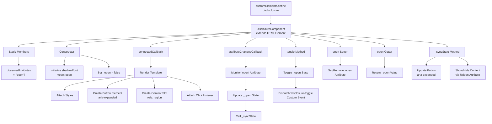

# Lesson 4: Design Systems, Accessibility Foundations, Constraint-Based Design

## 1. First-Principles Intuition & Invariants

Design systems represent a formal contract between human perception, machine rendering, and semantic correctness. Unlike ad-hoc interface construction where each component exists as an isolated artifact, a design system establishes a coherent algebra of visual primitives, behavioral patterns, and accessibility guarantees that compose predictably across arbitrary interaction contexts. This composability mirrors the modular architecture principles familiar to systems programmers: just as the Unix philosophy advocates small, orthogonal tools with well-defined interfaces, design systems decompose user interfaces into atomic, reusable components governed by explicit contracts.

At the foundational level, design systems solve three critical invariants that traditional UI development violates. First, they enforce **visual consistency through tokenization**: instead of hardcoding color values, spacing increments, or typography scales throughout a codebase, design tokens abstract these decisions into semantic variables that propagate changes atomically. When a brand color shifts from `#3B82F6` to `#2563EB`, a token-based system updates thousands of instantiations through a single declaration, eliminating the drift that accumulates in systems where magic numbers proliferate. This parallels the DRY principle in software architecture, but operates at the intersection of visual perception and DOM rendering.

Second, design systems establish **accessibility as a compile-time constraint rather than a runtime afterthought**. The Web Content Accessibility Guidelines (WCAG) codify four principles under the POUR mnemonic: Perceivable, Operable, Understandable, and Robust. Each principle translates into concrete technical requirements that assistive technologies depend upon. Screen readers consume semantic HTML through platform accessibility APIs—ARIA attributes, role taxonomies, and live region announcements form a contractual interface as rigid as any systems ABI. When a button lacks keyboard focus management or a modal traps navigation incorrectly, the failure mode resembles a segmentation fault: assistive technology users encounter undefined behavior, breaking the fundamental usability contract. Design systems bake these constraints into component primitives, ensuring every button, form field, and navigation pattern ships with correct ARIA semantics, focus management, and keyboard navigation by default.

Third, design systems implement **constraint-based layout as a declarative propagation network**. Responsive design historically relied on imperative media queries—brittle breakpoint logic that fractured across viewport dimensions. Modern constraint systems model layout as a bidirectional solver where components declare intrinsic sizing preferences, container contexts impose extrinsic constraints, and a layout engine reconciles these requirements through constraint propagation algorithms analogous to those in SMT solvers. CSS Grid's auto-placement, Flexbox's flex-basis and flex-grow ratios, and Container Queries' element-scoped breakpoints all express layout as constraint satisfaction problems rather than procedural rendering instructions.

The atomic design methodology formalizes this decomposition through five hierarchical layers: atoms, molecules, organisms, templates, and pages. Atoms represent the irreducible primitives—buttons, inputs, labels—that carry no intrinsic semantic meaning beyond their immediate affordance. Molecules combine atoms into functional units: a search form molecule composes a text input atom, a button atom, and a label atom into a cohesive pattern. Organisms assemble molecules into discrete interface sections with standalone semantics: a header organism might integrate a logo molecule, navigation molecule, and search molecule. Templates wire organisms into page-level layouts devoid of real content, establishing the structural skeleton. Pages instantiate templates with concrete data, producing the final rendered artifact users perceive.

This layering reflects a critical insight about interface complexity: human working memory cannot reason about systems exceeding approximately seven discrete chunks. By decomposing interfaces into hierarchical abstractions, design systems compress cognitive load, enabling engineers to reason locally about component contracts while the system enforces global consistency. The design token layer provides the leaf-level variables, atomic components consume tokens to produce visual primitives, molecular assemblies orchestrate atoms into patterns, and organism compositions yield complete interface regions. This architectural stratification mirrors the ISA-microarchitecture-logic gate hierarchy in processor design: each layer presents a stable abstraction boundary that insulates higher layers from lower-level implementation churn.

State management in UI systems introduces the temporal dimension, transforming static visual hierarchies into reactive data flow graphs. Every interactive component maintains internal state—focus indicators, hover effects, selection status—and many components synchronize external application state through unidirectional data flow architectures. The fundamental challenge resembles cache coherence in multiprocessor systems: when multiple components observe and mutate shared state, maintaining consistency requires either centralized coordination (Redux-style single state trees) or distributed consensus protocols (observable streams with deterministic update ordering). Design systems must specify not only the visual representation of each state variant but also the legal state transitions, error boundaries when invariants break, and synchronization contracts when state propagates across component boundaries.

Accessibility amplifies state management complexity because assistive technologies consume a parallel representation of interface state through platform accessibility trees. When a combobox transitions from collapsed to expanded, the visual DOM updates, but the ARIA attributes must synchronize: `aria-expanded` toggles from `false` to `true`, focus shifts to the listbox, and screen readers announce the state transition through live regions. Any desynchronization between visual state and semantic ARIA state manifests as a contract violation, rendering the interface unusable for assistive technology users. Design systems encapsulate these synchronization requirements within component implementations, ensuring state machines drive both visual rendering and accessibility tree updates atomically.


## 2. Core Architecture & Mechanics

Design tokens form the bedrock of the system architecture, implementing a hierarchical symbol table that separates semantic intent from platform-specific rendering. A mature token taxonomy stratifies into three layers: primitive tokens, semantic tokens, and component tokens. Primitive tokens define raw values devoid of contextual meaning—`color.blue.500: #3B82F6`, `spacing.4: 16px`, `font.weight.semibold: 600`. These primitives function as the architectural register file, storing fundamental values that higher layers compose.

Semantic tokens alias primitives with contextual meaning: `color.primary: color.blue.500`, `spacing.stack.default: spacing.4`, `typography.heading.weight: font.weight.semibold`. This indirection enables theming without component refactoring—swapping `color.primary` from blue to green propagates throughout the system without touching component code. Component tokens complete the hierarchy by binding semantic tokens to specific interface elements: `button.background.primary: color.primary`, `button.padding.horizontal: spacing.4`. This three-tier symbol resolution mirrors the scoping rules in programming languages: primitive tokens represent global constants, semantic tokens provide module-scoped aliases, and component tokens enforce lexically scoped bindings.

Token distribution to runtime environments requires a build pipeline that transforms the canonical token representation into platform-specific artifacts. Design systems typically author tokens in a platform-agnostic format like JSON or YAML, then compile these specifications into CSS custom properties for web, XML resources for Android, or Swift enumerations for iOS. This compilation pass performs unit conversions, color space transformations, and platform-specific optimizations. For web targets, tokens compile to CSS custom properties scoped to the `:root` selector, enabling runtime theming through cascading variable inheritance:

```css
:root {
  --color-primitive-blue-500: #3B82F6;
  --color-primary: var(--color-primitive-blue-500);
  --spacing-4: 1rem;
  --button-bg-primary: var(--color-primary);
  --button-padding-x: var(--spacing-4);
}

[data-theme="dark"] {
  --color-primitive-blue-500: #60A5FA;
}
```

Atomic components consume these tokens through CSS variable references, ensuring visual changes propagate without component recompilation. The button atom exemplifies this contract:

```css
.button {
  background-color: var(--button-bg-primary);
  padding-inline: var(--button-padding-x);
  padding-block: var(--spacing-2);
  border-radius: var(--radius-md);
  font-weight: var(--typography-ui-weight);
  color: var(--button-text-primary);
  border: 0;
  cursor: pointer;
  transition: background-color 150ms ease-out;
}

.button:hover {
  background-color: var(--button-bg-primary-hover);
}

.button:focus-visible {
  outline: 2px solid var(--color-focus-ring);
  outline-offset: 2px;
}

.button:disabled {
  background-color: var(--button-bg-disabled);
  color: var(--button-text-disabled);
  cursor: not-allowed;
}
```

The accessibility contract for this button component requires multiple parallel specifications beyond visual styling. The semantic HTML foundation uses the native `<button>` element, inheriting implicit keyboard focus, activation semantics, and platform accessibility mappings. For cases where visual design demands non-button elements styled as buttons, explicit ARIA role attribution restores semantic meaning:

```html
<div role="button" tabindex="0" aria-pressed="false" class="button">
  Toggle Option
</div>
```

The `role="button"` declaration informs assistive technologies that this element functions as a button despite its div implementation. The `tabindex="0"` attribute inserts the element into the natural keyboard navigation order, making it focusable via Tab traversal. The `aria-pressed` attribute indicates toggle button state, which screen readers announce during focus and activation. However, this ARIA-attributed approach introduces implementation burden: the component must manually handle keyboard activation (Space and Enter keys), manage focus states, and synchronize `aria-pressed` with application state. Native HTML buttons provide these guarantees automatically, illustrating why semantic HTML forms the first tier of accessibility implementation—only reach for ARIA attributes when semantic HTML cannot express the required interaction pattern.

Complex components like comboboxes demonstrate the full contract surface between visual state, application state, and assistive technology state. A combobox combines a text input with a filterable listbox, requiring coordination across multiple DOM elements and ARIA attributes:

```html
<div class="combobox-container">
  <label id="combobox-label" for="combobox-input">
    Select Framework
  </label>
  
  <div class="combobox-wrapper">
    <input
      type="text"
      role="combobox"
      id="combobox-input"
      aria-controls="combobox-listbox"
      aria-expanded="false"
      aria-autocomplete="list"
      aria-activedescendant=""
      aria-labelledby="combobox-label"
    />
    
    <ul
      id="combobox-listbox"
      role="listbox"
      aria-labelledby="combobox-label"
      hidden
    >
      <li role="option" id="option-react" aria-selected="false">React</li>
      <li role="option" id="option-vue" aria-selected="false">Vue</li>
      <li role="option" id="option-svelte" aria-selected="false">Svelte</li>
    </ul>
  </div>
</div>
```

The state machine governing this component tracks visual expansion state, keyboard navigation index, filter text, and selection state. When the user types in the input, the component filters options, expands the listbox, and updates `aria-expanded` to `true`. Arrow key navigation updates `aria-activedescendant` to reference the currently highlighted option's ID, which screen readers announce without moving DOM focus. Enter key activation selects the highlighted option, updates `aria-selected`, collapses the listbox, and populates the input with the selected value. Escape key dismisses the listbox without selection. This coordination between visual presentation, DOM manipulation, focus management, and ARIA synchronization represents the irreducible complexity that design systems must encapsulate within reusable component implementations.

Constraint-based layout systems model interface geometry as a satisfaction problem over intrinsic content dimensions and extrinsic container constraints. CSS Grid exemplifies this approach through its track sizing algorithm, which reconciles content-based sizing (`auto`, `min-content`, `max-content`) with fixed constraints (`px`, `rem`) and flexible distributions (`fr` units). Consider a dashboard layout with a sidebar, main content area, and collapsible panel:

```css
.dashboard-grid {
  display: grid;
  grid-template-columns: 
    minmax(200px, 250px)
    1fr
    minmax(0, 300px);
  grid-template-rows: auto 1fr auto;
  gap: var(--spacing-4);
  min-height: 100vh;
}

.sidebar { grid-column: 1; grid-row: 1 / -1; }
.main-content { grid-column: 2; grid-row: 2; }
.panel { grid-column: 3; grid-row: 1 / -1; }
.footer { grid-column: 1 / -1; grid-row: 3; }
```

The `minmax(200px, 250px)` sidebar track establishes a bounded constraint: the sidebar grows with content up to 250px but never shrinks below 200px. The `1fr` main content track consumes remaining space after resolving fixed and bounded tracks. The `minmax(0, 300px)` panel track allows the panel to collapse completely (min 0px) when hidden, but constrains its maximum expansion to 300px. The grid gap applies uniform spacing using the design token spacing scale, maintaining consistent visual rhythm.

Container queries extend constraint-based layout to element-scoped responsive breakpoints, inverting the traditional viewport-centric media query model. Instead of querying global window dimensions, components query their immediate container's size, enabling true modular responsiveness:

```css
.card-container {
  container-type: inline-size;
  container-name: card;
}

.card {
  display: flex;
  flex-direction: column;
  gap: var(--spacing-3);
}

@container card (min-width: 400px) {
  .card {
    flex-direction: row;
    gap: var(--spacing-4);
  }
  
  .card__media {
    flex-basis: 40%;
  }
  
  .card__content {
    flex-basis: 60%;
  }
}
```

The `container-type: inline-size` declaration establishes the container as a containment context for inline axis queries. Child elements can then query this container's width through `@container` rules, adjusting layout independently of global viewport state. This enables a card component to switch from vertical to horizontal layout based on its allocated space within the parent grid, not the browser window size. A three-column grid at wide viewports might allocate 300px per card, triggering vertical card layout, while a single-column grid allocates 800px per card, triggering horizontal layout—all without the component needing global viewport awareness.

State management patterns in design systems span local component state, global application state, and derived computed state. Local state encapsulates ephemeral interaction data—hover states, focus indicators, transient animations—that no other component observes. Global state represents application data multiple components consume—user authentication status, shopping cart contents, notification queues. Derived state computes transformations over global state—filtered lists, sorted tables, aggregated metrics.

For web components and framework-agnostic implementations, the state management contract typically surfaces through property setters, event dispatchers, and state synchronization callbacks. A disclosure widget (collapsible accordion panel) demonstrates this pattern:



This component maintains an internal `_open` boolean representing expansion state. The `open` property setter updates the corresponding HTML attribute, which triggers `attributeChangedCallback`, ensuring attribute and property remain synchronized. The `_syncState` method updates both the visual `hidden` attribute and the `aria-expanded` ARIA attribute atomically, preventing desynchronization between visual and assistive technology state. The component dispatches a custom `disclosure-toggle` event when state changes, enabling parent components to react to expansion state without tight coupling.


## 3. High-Performance Optimization & Failure Modes

Performance optimization in design systems centers on minimizing layout thrash, reducing paint areas, and eliminating forced synchronous layouts that block the rendering pipeline. The browser rendering engine operates through a discrete pipeline: JavaScript execution, style recalculation, layout computation, paint operations, and compositing. Reading layout properties like `offsetWidth` or `getBoundingClientRect()` during the JavaScript execution phase forces a synchronous layout pass before the read completes, stalling the pipeline. Design system components must batch DOM reads and writes, structuring operations to read all layout properties first, then apply all mutations:

```javascript
// Anti-pattern: interleaved reads and writes cause layout thrashing
elements.forEach(el => {
  const width = el.offsetWidth; // Forces layout
  el.style.width = `${width * 1.5}px`; // Invalidates layout
  const height = el.offsetHeight; // Forces layout again
  el.style.height = `${height * 1.5}px`; // Invalidates layout again
});

// Optimized: batch reads, then batch writes
const dimensions = elements.map(el => ({
  width: el.offsetWidth,
  height: el.offsetHeight
}));

elements.forEach((el, i) => {
  el.style.width = `${dimensions[i].width * 1.5}px`;
  el.style.height = `${dimensions[i].height * 1.5}px`;
});
```

Complex components like data tables or virtual scrolling lists must implement viewport culling, rendering only visible rows and recycling DOM nodes as the user scrolls. A naive implementation that renders 10,000 table rows generates 10,000 DOM nodes, overwhelming the layout engine and consuming excessive memory. Virtual scrolling maintains a fixed-size rendering window—typically three viewport heights to accommodate fast scrolling—and translates row data into this window as the scroll position changes:

```javascript
class VirtualList extends HTMLElement {
  constructor() {
    super();
    this.attachShadow({ mode: 'open' });
    this._items = [];
    this._rowHeight = 48;
    this._visibleRows = 0;
    this._scrollTop = 0;
    this._renderBuffer = 5;
  }
  
  connectedCallback() {
    this.shadowRoot.innerHTML = `
      <style>
        :host {
          display: block;
          height: 100%;
          overflow-y: auto;
          position: relative;
        }
        
        .spacer {
          position: absolute;
          top: 0;
          left: 0;
          right: 0;
          pointer-events: none;
        }
        
        .viewport {
          position: relative;
        }
        
        .row {
          height: ${this._rowHeight}px;
          display: flex;
          align-items: center;
          padding: 0 var(--spacing-3);
          border-bottom: 1px solid var(--border-color);
        }
      </style>
      
      <div class="spacer"></div>
      <div class="viewport"></div>
    `;
    
    this.addEventListener('scroll', () => this._handleScroll());
    this._updateVisibleRows();
    this._render();
  }
  
  set items(value) {
    this._items = value;
    this._render();
  }
  
  _handleScroll() {
    this._scrollTop = this.scrollTop;
    this._render();
  }
  
  _updateVisibleRows() {
    this._visibleRows = Math.ceil(this.clientHeight / this._rowHeight);
  }
  
  _render() {
    const spacer = this.shadowRoot.querySelector('.spacer');
    const viewport = this.shadowRoot.querySelector('.viewport');
    
    if (!spacer || !viewport) return;
    
    const totalHeight = this._items.length * this._rowHeight;
    spacer.style.height = `${totalHeight}px`;
    
    const startIndex = Math.max(0, 
      Math.floor(this._scrollTop / this._rowHeight) - this._renderBuffer
    );
    
    const endIndex = Math.min(
      this._items.length,
      startIndex + this._visibleRows + this._renderBuffer * 2
    );
    
    const visibleItems = this._items.slice(startIndex, endIndex);
    
    viewport.style.transform = 
      `translateY(${startIndex * this._rowHeight}px)`;
    
    viewport.innerHTML = visibleItems.map((item, i) => `
      <div class="row" data-index="${startIndex + i}">
        ${this._renderRow(item)}
      </div>
    `).join('');
  }
  
  _renderRow(item) {
    return `<slot name="row" item="${JSON.stringify(item).replace(/"/g, '&quot;')}"></slot>`;
  }
}

customElements.define('virtual-list', VirtualList);
```

The spacer element establishes the full scrollable height (items × row height), while the viewport translates vertically to position visible rows at the correct scroll offset. Only rows within the visible window plus buffer zones actually render, dramatically reducing DOM node count. Scrolling recalculates the visible range and updates viewport translation, recycling existing DOM nodes rather than creating and destroying them continuously.

Accessibility failure modes typically manifest as keyboard navigation traps, missing semantic announcements, or focus management violations. A common trap occurs in modal dialogs when focus escapes the modal boundary, allowing users to tab into background content while the modal remains visually active. Proper focus trapping requires intercepting Tab keypress events, querying focusable elements within the modal, and wrapping focus at boundaries:

```javascript
class ModalDialog extends HTMLElement {
  constructor() {
    super();
    this.attachShadow({ mode: 'open' });
    this._previousFocus = null;
    this._isOpen = false;
  }
  
  connectedCallback() {
    this.shadowRoot.innerHTML = `
      <style>
        .backdrop {
          position: fixed;
          inset: 0;
          background: rgba(0, 0, 0, 0.5);
          display: flex;
          align-items: center;
          justify-content: center;
          z-index: 1000;
        }
        
        .dialog {
          background: var(--surface-bg);
          border-radius: var(--radius-lg);
          padding: var(--spacing-6);
          max-width: 90vw;
          max-height: 90vh;
          overflow: auto;
          box-shadow: var(--shadow-xl);
        }
        
        :host(:not([open])) {
          display: none;
        }
      </style>
      
      <div class="backdrop" role="presentation">
        <div
          class="dialog"
          role="dialog"
          aria-modal="true"
          aria-labelledby="modal-title"
          tabindex="-1"
        >
          <slot></slot>
        </div>
      </div>
    `;
    
    const backdrop = this.shadowRoot.querySelector('.backdrop');
    backdrop.addEventListener('click', (e) => {
      if (e.target === backdrop) this.close();
    });
    
    this.addEventListener('keydown', (e) => this._handleKeydown(e));
  }
  
  static get observedAttributes() {
    return ['open'];
  }
  
  attributeChangedCallback(name, oldValue, newValue) {
    if (name === 'open') {
      this._isOpen = newValue !== null;
      
      if (this._isOpen) {
        this._open();
      } else {
        this._close();
      }
    }
  }
  
  open() {
    this.setAttribute('open', '');
  }
  
  close() {
    this.removeAttribute('open');
  }
  
  _open() {
    this._previousFocus = document.activeElement;
    
    requestAnimationFrame(() => {
      const dialog = this.shadowRoot.querySelector('.dialog');
      dialog?.focus();
    });
    
    document.body.style.overflow = 'hidden';
  }
  
  _close() {
    if (this._previousFocus && typeof this._previousFocus.focus === 'function') {
      this._previousFocus.focus();
    }
    
    document.body.style.overflow = '';
  }
  
  _handleKeydown(e) {
    if (!this._isOpen) return;
    
    if (e.key === 'Escape') {
      e.preventDefault();
      this.close();
      return;
    }
    
    if (e.key === 'Tab') {
      const focusableElements = this._getFocusableElements();
      
      if (focusableElements.length === 0) {
        e.preventDefault();
        return;
      }
      
      const firstElement = focusableElements[0];
      const lastElement = focusableElements[focusableElements.length - 1];
      
      if (e.shiftKey && document.activeElement === firstElement) {
        e.preventDefault();
        lastElement.focus();
      } else if (!e.shiftKey && document.activeElement === lastElement) {
        e.preventDefault();
        firstElement.focus();
      }
    }
  }
  
  _getFocusableElements() {
    const dialog = this.shadowRoot.querySelector('.dialog');
    if (!dialog) return [];
    
    const focusableSelectors = [
      'a[href]',
      'button:not([disabled])',
      'textarea:not([disabled])',
      'input:not([disabled])',
      'select:not([disabled])',
      '[tabindex]:not([tabindex="-1"])'
    ].join(', ');
    
    const slotted = dialog.querySelector('slot')?.assignedElements() || [];
    const focusable = [];
    
    slotted.forEach(el => {
      if (el.matches(focusableSelectors)) {
        focusable.push(el);
      }
      focusable.push(...el.querySelectorAll(focusableSelectors));
    });
    
    return focusable;
  }
}

customElements.define('modal-dialog', ModalDialog);
```

The modal stores the previously focused element before opening, ensuring focus returns correctly on close. The `_handleKeydown` method intercepts Tab navigation, wrapping focus when the user reaches the first or last focusable element within the modal boundary. The `aria-modal="true"` attribute signals to assistive technologies that background content should be hidden from the accessibility tree while the modal is active.

Color contrast represents another critical accessibility invariant that design systems must enforce at the token level. WCAG Level AA requires a 4.5:1 contrast ratio for normal text and 3:1 for large text (18pt or 14pt bold). Level AAA tightens these requirements to 7:1 and 4.5:1 respectively. Design systems can enforce these ratios through automated token validation during the build pipeline:

```javascript
function luminance(r, g, b) {
  const [rs, gs, bs] = [r, g, b].map(c => {
    c = c / 255;
    return c <= 0.03928 ? c / 12.92 : Math.pow((c + 0.055) / 1.055, 2.4);
  });
  
  return 0.2126 * rs + 0.7152 * gs + 0.0722 * bs;
}

function contrastRatio(rgb1, rgb2) {
  const lum1 = luminance(...rgb1);
  const lum2 = luminance(...rgb2);
  
  const lighter = Math.max(lum1, lum2);
  const darker = Math.min(lum1, lum2);
  
  return (lighter + 0.05) / (darker + 0.05);
}

function validateTokenContrast(tokens) {
  const violations = [];
  
  const textOnPrimary = {
    fg: tokens['color.text.on-primary'], // [255, 255, 255]
    bg: tokens['color.primary'],         // [59, 130, 246]
    context: 'Text on primary buttons'
  };
  
  const ratio = contrastRatio(textOnPrimary.fg, textOnPrimary.bg);
  
  if (ratio < 4.5) {
    violations.push({
      context: textOnPrimary.context,
      ratio: ratio.toFixed(2),
      required: 4.5,
      recommendation: 'Increase text luminance or decrease background luminance'
    });
  }
  
  return violations;
}
```

This validation pipeline extracts RGB values from design tokens, computes relative luminance per WCAG specification, calculates contrast ratios, and flags combinations that violate accessibility thresholds. Integrating this validation into continuous integration pipelines prevents inaccessible color pairings from reaching production.

Responsive strategy failures often stem from rigid breakpoint assumptions that collapse under real-world usage patterns. The historical mobile-first progression (320px, 768px, 1024px, 1440px) assumes discrete device classes, but modern devices span a continuous spectrum from foldable phones to ultrawide monitors. Container queries mitigate this brittleness by shifting responsive logic from global breakpoints to component-local constraints, but components must still declare reasonable intrinsic sizing to prevent overflow or excessive wrapping.

The intrinsic sizing model in CSS defines how components behave absent external constraints. A button with `padding: 0.5rem 1rem` and no explicit width establishes intrinsic size based on text content plus padding. When placed in a flexbox container with `flex-wrap: wrap`, buttons wrap to new lines as container width shrinks. This works reliably for simple layouts but breaks down in complex multi-column grids where components must balance between flexible growth and minimum readable sizes.

A robust approach combines logical properties (inline/block instead of left/right/top/bottom) with clamped fluid sizing that scales smoothly across the viewport range:

```css
.card {
  container-type: inline-size;
  padding: clamp(1rem, 3vw, 2rem);
}

.card__title {
  font-size: clamp(1.25rem, 2vw + 0.5rem, 2rem);
  margin-block-end: var(--spacing-3);
}

@container (min-width: 400px) {
  .card {
    display: grid;
    grid-template-columns: 1fr 1fr;
    gap: var(--spacing-4);
  }
}
```

The `clamp(min, preferred, max)` function defines a responsive value that scales with viewport units but never exceeds reasonable bounds. This eliminates the need for multiple breakpoints targeting specific font sizes, reducing CSS complexity while maintaining readability across devices.

State synchronization failures in complex applications often manifest as race conditions where asynchronous operations update component state after unmounting. Design systems must enforce lifecycle-aware state management, canceling pending operations when components disconnect:

```javascript
class AsyncDataComponent extends HTMLElement {
  constructor() {
    super();
    this.attachShadow({ mode: 'open' });
    this._abortController = null;
  }
  
  connectedCallback() {
    this._fetchData();
  }
  
  disconnectedCallback() {
    if (this._abortController) {
      this._abortController.abort();
    }
  }
  
  async _fetchData() {
    this._abortController = new AbortController();
    
    try {
      const response = await fetch('/api/data', {
        signal: this._abortController.signal
      });
      
      const data = await response.json();
      this._render(data);
    } catch (error) {
      if (error.name === 'AbortError') {
        // Component unmounted, ignore error
        return;
      }
      
      this._renderError(error);
    }
  }
  
  _render(data) {
    this.shadowRoot.innerHTML = `
      <div class="content">
        ${data.items.map(item => `<div class="item">${item.name}</div>`).join('')}
      </div>
    `;
  }
  
  _renderError(error) {
    this.shadowRoot.innerHTML = `
      <div class="error" role="alert">
        <strong>Error:</strong> ${error.message}
      </div>
    `;
  }
}

customElements.define('async-data', AsyncDataComponent);
```

The AbortController pattern ensures fetch requests cancel when components unmount, preventing memory leaks and stale state updates. The error handler distinguishes AbortErrors from genuine failures, avoiding spurious error displays for intentional cancellations.

Design system maintenance requires vigilance against pattern proliferation, where each new feature introduces slightly different component variants until the system fragments into an unmanageable taxonomy. Establishing a formal component proposal and review process mitigates this drift. New patterns must justify their existence by demonstrating irreducible semantic or interaction differences from existing patterns, not merely visual styling variations that design tokens could accommodate. A component inventory audit should run quarterly, identifying redundant patterns and consolidating implementations to maintain architectural coherence. This discipline parallels API design principles: a smaller surface area with orthogonal, composable primitives scales better than an expansive library of overlapping special cases.
