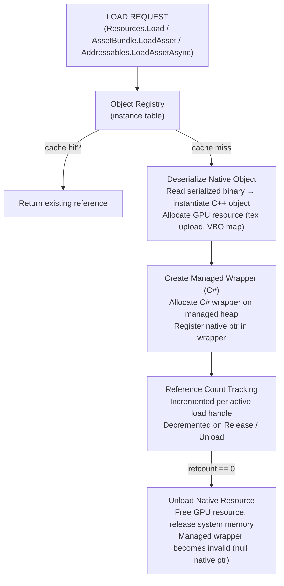

# Lesson 4: Asset Pipeline, Resource Loading, Memory Management

## 1. First-Principles Intuition & Invariants

Every Unity project is, at its mechanical core, a transformation pipeline: human-authored source artifacts — PSD files, FBX meshes, WAV recordings, C# scripts — are ingested, processed, and serialized into a parallel representation that the runtime can load efficiently. The gap between these two worlds, the source asset and the runtime artifact, is where the asset pipeline lives, and misunderstanding how that gap is bridged is the single most common source of both build-time inefficiency and runtime memory pathology in production Unity titles.

To build real intuition here, start with the invariant that Unity never loads your source files at runtime. When you import a PNG into a Unity project, the editor does not embed the PNG bitstream in your build. Instead, it invokes a chain of importers that decode the image, apply platform-specific compression, generate mip maps, and serialize the result into Unity's internal binary format. The file you authored and the file the runtime consumes are distinct objects with a stable identity relationship maintained by the `AssetDatabase`. That relationship is the foundation every other concept in this lesson rests on.

The second invariant is that Unity's asset model is a typed, reference-counted object graph, not a flat file system. Every asset in a project has a globally unique identifier — a 128-bit GUID stored in a `.meta` file alongside the source — and every field that references another asset is a serialized pointer to that GUID. When a mesh references a material and that material references a texture, Unity has recorded those references as GUID links in YAML or binary serialization. At build time, the linker resolves those GUIDs into concrete bundle membership and dependency graphs. At runtime, loading an object means traversing that graph and ensuring every referenced object is resident in memory before the loaded object can be used. Fail to understand this graph structure and you will ship games with multi-hundred-megabyte texture atlases loaded because one prefab had a stale reference to a forgotten material.

The third invariant governs texture compression, and it has hardware roots. Modern mobile GPU architectures — ARM Mali, Qualcomm Adreno, Apple's GPU family — do not sample uncompressed RGBA32 textures from VRAM. They sample from compressed tile formats: ASTC on modern mobile and Apple Silicon, ETC2 on older Android targets, BCn (DXT/BC7) on desktop and console. These formats are designed so that a fixed-size block of pixels (a 4×4 or 8×8 texel block) decodes to an uncompressed sample entirely within the hardware texture unit, without round-tripping to the framebuffer or L2 cache. ASTC 4x4 reduces a 1024×1024 RGBA32 texture from 4 MB to roughly 1 MB while remaining GPU-natively decodable. Using uncompressed or software-decoded formats at runtime is not merely wasteful in storage; it consumes bandwidth on the memory bus that the GPU needs for geometry, shadow maps, and render targets. The Unity importer pipeline's platform-specific override system exists precisely to route each texture class to the correct hardware format.

The fourth invariant defines the boundary between `Resources`, `AssetBundles`, and Addressables: they are three different answers to the same question of how to build the mapping from a logical asset identity to a loaded runtime object, and each answer makes different tradeoffs around build time, memory overhead, determinism, and hot-patching. Understanding where each mechanism is appropriate requires understanding how the runtime loader actually allocates and tracks objects, which the following sections address in mechanical detail.

## 2. Core Architecture & Mechanics

### The AssetDatabase and Import Pipeline

The `AssetDatabase` is Unity's source-of-truth index for the editor. It maps every file under `Assets/` to a GUID, maintains per-importer artifact caches in the `Library/` directory, and invalidates those caches when source content or importer settings change. The import pipeline itself is a staged processor graph that Unity evaluates lazily when you switch to the editor or trigger a manual reimport.

When a source file is detected as new or changed, the pipeline dispatches it to the appropriate `AssetImporter` subclass: `TextureImporter` for image formats, `ModelImporter` for FBX and OBJ, `AudioImporter` for sound, `ShaderImporter` for GLSL/HLSL source, and so on. Each importer reads the source file and the importer settings stored in the `.meta` file, performs its transformation — decompression, mip generation, mesh optimization, audio transcoding — and writes one or more serialized artifacts into `Library/Artifacts/`. Those artifacts are keyed by a hash of the input file content plus the importer settings, so changing any import parameter invalidates the cache entry and triggers a full reimport.

For large teams, this architecture has a critical scaling consequence: `Library/` is local and machine-specific, and in a team of thirty engineers each importing independently, every engineer reimports the same assets from scratch. Unity's Accelerator service solves this by acting as a shared artifact cache: each machine computes the same deterministic hash key and queries the Accelerator before running the importer locally. This can reduce cold-import time on a fresh checkout from hours to minutes in large projects.

Custom importers are implemented by subclassing `ScriptedImporter`, which integrates into the same cache-keyed pipeline. This is the correct extension point for proprietary asset formats — custom voxel data, procedurally-generated atlases, game-specific binary formats — and it matters that the importer's output is deterministic and purely a function of its inputs, because the cache invalidation model assumes no side effects outside the artifact directory.

```csharp
using UnityEditor.AssetImporters;
using UnityEngine;
using System.IO;

[ScriptedImporter(1, "vox")]
public class VoxelImporter : ScriptedImporter
{
    [SerializeField] public float VoxelScale = 0.1f;

    public override void OnImportAsset(AssetImportContext ctx)
    {
        byte[] raw = File.ReadAllBytes(ctx.assetPath);
        Mesh mesh = VoxelMeshBuilder.Build(raw, VoxelScale);
        mesh.name = Path.GetFileNameWithoutExtension(ctx.assetPath);

        MeshFilter filter;
        var go = new GameObject(mesh.name);
        filter = go.AddComponent<MeshFilter>();
        filter.sharedMesh = mesh;
        go.AddComponent<MeshRenderer>();

        ctx.AddObjectToAsset("mesh", mesh);
        ctx.AddObjectToAsset("root", go);
        ctx.SetMainObject(go);
    }
}
```

This importer registers itself for the `.vox` extension via the attribute, processes the binary input, and adds typed sub-assets to the import context. Unity will cache the resulting artifacts under a hash of the `.vox` file content and `VoxelScale`. Changing the scale value in the inspector invalidates the cache and triggers reimport, which is exactly the semantics you want.

### The Runtime Object Model and Memory Architecture

At runtime, Unity manages assets through a two-layer system. The lower layer is the native C++ engine, which owns the actual GPU resources: `D3D11Texture2D` / `MTLTexture` objects, vertex and index buffers, audio PCM buffers. The upper layer is the C# managed heap, which holds wrapper objects — `Texture2D`, `Mesh`, `AudioClip` — that hold a pointer to the native resource and expose the managed API. Memory for a texture, therefore, exists in two places simultaneously: a small managed object on the C# heap, and a potentially large native allocation in GPU or system memory. `Profiler.GetRuntimeMemorySizeLong(obj)` measures the native side. `GC.GetTotalMemory(false)` measures only the managed side. Conflating the two is one of the most common mistakes when reading a Unity memory profile.

The lifecycle of a runtime asset follows the pattern below:



The critical detail here is that Unity's runtime does not use automatic garbage collection to manage native assets. The C# GC collects managed wrappers, but it cannot and does not free GPU textures or audio buffers. Those are freed only by explicit unload calls: `Resources.UnloadAsset`, `AssetBundle.Unload(true)`, or `Addressables.Release`. Missing an unload call leaks native memory, and that leak will not appear in dotMemory or any managed-heap profiler. It appears only in the Unity Profiler's Memory module under "Texture Memory" or in the platform's GPU memory counters.

### AssetBundles: Dependency Graphs and the Manifest

An AssetBundle is a serialized container: a header, a type tree describing the serialization schema, and a payload of serialized Unity objects. When you assign assets to bundles in the editor and call `BuildPipeline.BuildAssetBundles`, the build pipeline performs several steps before writing a single byte to disk.

First, it traverses the dependency graph of every explicitly-assigned asset. If `Prefab_A` in `bundle-a` references `Material_X`, and `Material_X` references `Texture_T`, the pipeline must decide where `Texture_T` lives. If `Texture_T` has not been explicitly assigned to any bundle, the default behavior duplicates it into every bundle that depends on it. In a project with fifty character prefabs sharing a single skin atlas, this duplication will embed the atlas fifty times across fifty bundles, destroying build size and negating any disk or network savings the bundle system was meant to provide. The correct remedy is to explicitly assign the shared texture to its own `shared-textures` bundle and ensure that bundle is loaded before any dependent bundle.

The build pipeline emits a manifest bundle alongside the content bundles. The manifest contains the complete dependency graph: for each bundle, the list of bundles it depends on. At runtime, before loading any bundle, you must load its full transitive dependency closure in dependency order. Failing to do so means loading an object whose referenced assets are not yet resident, which forces Unity to substitute pink error materials for missing material references or zero-initialized meshes for missing meshes — the classic "pink cube" failure mode.

```csharp
using System.Collections;
using System.Collections.Generic;
using UnityEngine;

public sealed class BundleLoader : MonoBehaviour
{
    private static readonly Dictionary<string, AssetBundle> s_loaded =
        new Dictionary<string, AssetBundle>();

    private static AssetBundleManifest s_manifest;

    public static IEnumerator InitializeManifest(string manifestBundlePath)
    {
        AssetBundleCreateRequest req =
            AssetBundle.LoadFromFileAsync(manifestBundlePath);
        yield return req;

        AssetBundle manifestBundle = req.assetBundle;
        s_manifest = manifestBundle.LoadAsset<AssetBundleManifest>(
            "AssetBundleManifest");
        manifestBundle.Unload(false);
    }

    public static IEnumerator LoadWithDependencies(string bundleName,
                                                    string basePath)
    {
        if (s_manifest == null)
        {
            Debug.LogError("Manifest not initialized.");
            yield break;
        }

        string[] deps = s_manifest.GetAllDependencies(bundleName);
        foreach (string dep in deps)
        {
            if (!s_loaded.ContainsKey(dep))
            {
                yield return Load(dep, basePath);
            }
        }

        if (!s_loaded.ContainsKey(bundleName))
        {
            yield return Load(bundleName, basePath);
        }
    }

    private static IEnumerator Load(string name, string basePath)
    {
        string path = System.IO.Path.Combine(basePath, name);
        AssetBundleCreateRequest req = AssetBundle.LoadFromFileAsync(path);
        yield return req;

        if (req.assetBundle != null)
            s_loaded[name] = req.assetBundle;
        else
            Debug.LogError($"Failed to load bundle: {name}");
    }

    public static T LoadAsset<T>(string bundleName, string assetName)
        where T : UnityEngine.Object
    {
        if (s_loaded.TryGetValue(bundleName, out AssetBundle bundle))
            return bundle.LoadAsset<T>(assetName);

        Debug.LogError($"Bundle not loaded: {bundleName}");
        return null;
    }
}
```

This loader pattern captures the invariant: always resolve the full dependency closure before loading any asset from a bundle. The manifest's `GetAllDependencies` returns transitive dependencies, not only direct ones, which is the correct input to this algorithm.

### The Addressables System: Architecture and Handle Lifecycle

The Addressables package is Unity's high-level asset management layer, built atop AssetBundles (and optionally the `Resources` system) but adding a logical addressing layer, an async operation framework, and an explicit reference-counted handle model. Understanding Addressables requires understanding the three concepts it unifies: logical keys, content catalogs, and load handles.

A logical key is any string or `AssetReference` that identifies an asset independently of where it physically lives — which bundle, which path, which build target. The content catalog is a JSON document built at build time (and optionally hot-updated at runtime from a CDN) that maps every logical key to a physical location: a remote URL, a local bundle path, or a `Resources` path. At runtime, when you call `Addressables.LoadAssetAsync<T>(key)`, the system consults the catalog, determines the bundle location, checks if that bundle is already cached, downloads and caches it if not, then deserializes and returns the asset. The entire operation is an async `AsyncOperationHandle<T>`, and the handle is the unit of reference counting.

```csharp
using System.Collections.Generic;
using UnityEngine;
using UnityEngine.AddressableAssets;
using UnityEngine.ResourceManagement.AsyncOperations;
using System.Threading.Tasks;

public sealed class AddressableManager : MonoBehaviour
{
    private readonly List<AsyncOperationHandle> _handles =
        new List<AsyncOperationHandle>();

    public async Task<T> LoadAsync<T>(string key) where T : UnityEngine.Object
    {
        AsyncOperationHandle<T> handle =
            Addressables.LoadAssetAsync<T>(key);
        await handle.Task;

        if (handle.Status == AsyncOperationStatus.Succeeded)
        {
            _handles.Add(handle);
            return handle.Result;
        }

        Debug.LogError(
            $"Addressables load failed for key '{key}': " +
            $"{handle.OperationException?.Message}");
        Addressables.Release(handle);
        return null;
    }

    public async Task<IList<T>> LoadLabelAsync<T>(string label)
        where T : UnityEngine.Object
    {
        AsyncOperationHandle<IList<T>> handle =
            Addressables.LoadAssetsAsync<T>(label, null);
        await handle.Task;

        if (handle.Status == AsyncOperationStatus.Succeeded)
        {
            _handles.Add(handle);
            return handle.Result;
        }

        Debug.LogError($"Label load failed: {label}");
        Addressables.Release(handle);
        return null;
    }

    private void OnDestroy()
    {
        foreach (AsyncOperationHandle h in _handles)
        {
            if (h.IsValid())
                Addressables.Release(h);
        }
        _handles.Clear();
    }
}
```

The architectural invariant to internalize here is that `Addressables.Release(handle)` is not analogous to `free()` in C. It decrements a reference count on the underlying bundle. The bundle unloads from memory only when its reference count reaches zero — that is, when every handle pointing to any asset in that bundle has been released. If your character system holds one handle to a character prefab and your UI system holds a separate handle to a texture that happens to live in the same bundle, releasing the character handle does not unload the bundle. Both handles must be released before the native memory is freed. This is the correct behavior for sharing, but it makes it easy to believe memory has been freed when it has not, particularly when handles are stored in heterogeneous component graphs across a scene.

The Addressables system also introduces the distinction between a `Scene` load and an `Asset` load. `Addressables.LoadSceneAsync` returns a `SceneInstance` handle. Releasing the scene handle calls `SceneManager.UnloadSceneAsync` and decrements the reference count on every asset bundle the scene referenced. If those bundles have no other live handles, they unload. The implication for streaming strategies is discussed in the next section.

## 3. High-Performance Optimization & Failure Modes

### Texture Compression Pipelines and Format Routing

The first production optimization that pays consistent dividends is enforcing platform-specific texture format routing through a build-time importer policy. Unity's default importer behavior — `Automatic` compression — produces acceptable results for prototyping but is incorrect for shipping: it will not automatically route to ASTC 4x4 on modern mobile, will not apply separate quality settings to different texture classes (UI atlases vs. albedo maps vs. normal maps), and will not enforce maximum texture sizes per platform.

The correct architecture is a `TextureImporterPlatformSettings` policy enforced by a custom `AssetPostprocessor`. The postprocessor runs immediately after the importer, reads the asset's path and type, and sets platform overrides programmatically before the artifact is cached. This makes the per-platform format a function of asset classification, not human memory.

```csharp
using UnityEditor;
using UnityEngine;

public sealed class TextureFormatPolicy : AssetPostprocessor
{
    private void OnPreprocessTexture()
    {
        TextureImporter importer = (TextureImporter)assetImporter;

        // Do not override textures that have been manually configured.
        if (importer.importSettingsMissing == false &&
            importer.userData == "manual")
            return;

        string path = assetPath.ToLowerInvariant();
        bool isNormalMap = path.Contains("_n.") || path.Contains("_normal.");
        bool isUIAtlas   = path.Contains("/ui/");
        bool isHDR       = path.Contains("_hdr.") || path.Contains("/hdri/");

        if (isNormalMap)
            importer.textureType = TextureImporterType.NormalMap;

        SetPlatformOverride(importer, "Android",    isNormalMap, isUIAtlas, isHDR);
        SetPlatformOverride(importer, "iPhone",     isNormalMap, isUIAtlas, isHDR);
        SetPlatformOverride(importer, "Standalone", isNormalMap, isUIAtlas, isHDR);
    }

    private static void SetPlatformOverride(TextureImporter importer,
                                             string platform,
                                             bool normalMap,
                                             bool uiAtlas,
                                             bool hdr)
    {
        var settings = new TextureImporterPlatformSettings
        {
            name            = platform,
            overridden      = true,
            maxTextureSize  = uiAtlas ? 2048 : 1024,
            resizeAlgorithm = TextureResizeAlgorithm.Mitchell,
        };

        switch (platform)
        {
            case "Android":
                settings.format = normalMap
                    ? TextureImporterFormat.ASTC_6x6
                    : uiAtlas
                        ? TextureImporterFormat.ASTC_4x4
                        : TextureImporterFormat.ASTC_8x8;
                break;

            case "iPhone":
                settings.format = normalMap
                    ? TextureImporterFormat.ASTC_6x6
                    : hdr
                        ? TextureImporterFormat.ASTC_HDR_6x6
                        : TextureImporterFormat.ASTC_4x4;
                break;

            case "Standalone":
                settings.format = normalMap
                    ? TextureImporterFormat.BC5
                    : hdr
                        ? TextureImporterFormat.BC6H
                        : TextureImporterFormat.BC7;
                break;
        }

        importer.SetPlatformTextureSettings(settings);
    }
}
```

This policy enforces several hardware-grounded decisions simultaneously. ASTC 6x6 for normal maps trades some quality for significant size reduction, acceptable because normal maps are rarely the highest-frequency asset in a scene. BC5 on desktop stores only the red and green channels of a normal map, relying on the shader to reconstruct Z — this is both smaller and more accurate than BC7 for normal data. BC6H is the only GPU-native format for HDR data on desktop; using RGBA16F forces the texture unit to treat the data as uncompressed and wastes bandwidth.

### Streaming Strategies: Scene Streaming and Async Loading

For open-world or large-environment games, the central streaming challenge is ensuring that the camera never observes an asset loading: no pop-in, no frame stall, no hitching during async bundle downloads. The architectural constraint is that `AsyncOperation.isDone` must become true well before the asset enters the camera frustum, which requires a spatial or temporal lookahead model.

The canonical Unity streaming architecture pairs Addressables scene loading with a streaming volume system. Each world region is an Addressable scene and a set of Addressable asset bundles. A streaming manager maintains a prioritized queue of load and unload operations keyed by the player's position and velocity. Bundles further than a configurable radius are released; bundles within the inner radius are loaded. The key implementation detail is that loading and unloading must be separated by a hysteresis band to prevent thrashing at the boundary.

```csharp
using System.Collections.Generic;
using UnityEngine;
using UnityEngine.AddressableAssets;
using UnityEngine.ResourceManagement.AsyncOperations;
using UnityEngine.ResourceManagement.ResourceProviders;
using UnityEngine.SceneManagement;
using System.Threading.Tasks;

[System.Serializable]
public struct StreamingCell
{
    public string SceneKey;
    public Vector3 WorldCenter;
    public float LoadRadius;
    public float UnloadRadius;
}

public sealed class WorldStreamingManager : MonoBehaviour
{
    [SerializeField] private Transform _viewer;
    [SerializeField] private StreamingCell[] _cells;

    private readonly Dictionary<string, AsyncOperationHandle<SceneInstance>>
        _activeLoads = new Dictionary<string, AsyncOperationHandle<SceneInstance>>();

    private readonly HashSet<string> _loading   = new HashSet<string>();
    private readonly HashSet<string> _unloading = new HashSet<string>();

    private void Update()
    {
        Vector3 pos = _viewer.position;

        foreach (StreamingCell cell in _cells)
        {
            float dist = Vector3.Distance(pos, cell.WorldCenter);
            bool loaded   = _activeLoads.ContainsKey(cell.SceneKey);
            bool inFlight = _loading.Contains(cell.SceneKey) ||
                            _unloading.Contains(cell.SceneKey);

            if (!loaded && !inFlight && dist <= cell.LoadRadius)
                _ = LoadCellAsync(cell);
            else if (loaded && !inFlight && dist > cell.UnloadRadius)
                _ = UnloadCellAsync(cell.SceneKey);
        }
    }

    private async Task LoadCellAsync(StreamingCell cell)
    {
        _loading.Add(cell.SceneKey);
        try
        {
            var handle = Addressables.LoadSceneAsync(
                cell.SceneKey, LoadSceneMode.Additive, activateOnLoad: true);
            await handle.Task;

            if (handle.Status == AsyncOperationStatus.Succeeded)
                _activeLoads[cell.SceneKey] = handle;
            else
            {
                Debug.LogError($"Scene load failed: {cell.SceneKey}");
                Addressables.Release(handle);
            }
        }
        finally
        {
            _loading.Remove(cell.SceneKey);
        }
    }

    private async Task UnloadCellAsync(string key)
    {
        if (!_activeLoads.TryGetValue(key, out var handle))
            return;

        _unloading.Add(key);
        try
        {
            await Addressables.UnloadSceneAsync(handle).Task;
            _activeLoads.Remove(key);
        }
        finally
        {
            _unloading.Remove(key);
        }
    }
}
```

The hysteresis invariant — `LoadRadius < UnloadRadius` — is non-negotiable. Without it, a player standing exactly on the boundary triggers a load, which completes, which triggers an unload, which triggers another load, consuming bundle IO and leaking transient native memory on every cycle. The asymmetric radii ensure that once a cell is loaded, it remains loaded until the player moves meaningfully away.

### Diagnosing Memory Leaks with the Unity Memory Profiler

Production memory leaks in Unity follow two archetypes. The first is a leaked native asset: a `Texture2D` or `Mesh` that was loaded via `Resources.Load` or `AssetBundle.LoadAsset` and never explicitly unloaded, while all C# references to its wrapper have been collected by the GC. The object is still alive in native memory but invisible to managed-heap profilers, and `Resources.UnloadUnusedAssets` will eventually collect it — but that call is expensive and nondeterministic.

The second archetype is a leaked Addressables handle: an `AsyncOperationHandle` stored in a component that is destroyed without calling `Addressables.Release`. Because the handle increments the bundle reference count, the bundle never reaches zero and never unloads. This can silently accumulate across level transitions, particularly in systems that load UI assets or audio cues per-screen and forget to release them on teardown.

The Unity Memory Profiler package (distinct from the in-editor Profiler) produces a full heap snapshot including native object retention graphs. The correct diagnostic workflow is to capture a snapshot after a full level cycle — load, play, unload, return to menu — and compare the "Objects" view against a baseline snapshot taken before the cycle. Any `Texture2D`, `Mesh`, `AudioClip`, or `AssetBundle` object present in the post-cycle snapshot but absent in the baseline is a leak candidate.

For build-time bundle dependency analysis, the `Bundle Layout Preview` tool in the Addressables Groups window visualizes which assets are duplicated across bundles. Seeing the same `Texture2D` appear in a dozen bundles is a reliable indicator that it should be promoted to a shared dependencies group and explicitly addressed. The `Build Report` output from `BuildPipeline.BuildAssetBundles` or the Addressables build also contains per-bundle size tables and can be parsed programmatically to enforce size budgets in CI:

```csharp
using UnityEditor;
using UnityEngine;
using System.IO;

public static class BundleSizeCICheck
{
    private const long MaxBundleSizeBytes = 32 * 1024 * 1024; // 32 MB

    [MenuItem("Build/Validate Bundle Sizes")]
    public static void ValidateBundleSizes()
    {
        string outputPath = "Builds/AssetBundles";
        if (!Directory.Exists(outputPath))
        {
            Debug.LogError("No bundle output directory found. Run build first.");
            return;
        }

        bool failed = false;
        foreach (string file in Directory.GetFiles(outputPath))
        {
            // Skip manifest and meta files.
            if (file.EndsWith(".manifest") || file.EndsWith(".meta"))
                continue;

            var info = new FileInfo(file);
            if (info.Length > MaxBundleSizeBytes)
            {
                Debug.LogError(
                    $"Bundle '{info.Name}' exceeds size budget: " +
                    $"{info.Length / (1024 * 1024):F1} MB > " +
                    $"{MaxBundleSizeBytes / (1024 * 1024)} MB");
                failed = true;
            }
        }

        if (!failed)
            Debug.Log("All bundles within size budget.");
        else
            EditorApplication.Exit(1);
    }
}
```

Integrating this check into a CI pipeline gates every content build against size regressions, catching the common case where an artist adds a high-resolution uncompressed texture to a character bundle without realizing the importer policy did not apply because the `.meta` file was out of date.

### Failure Modes: The Pink Cube, the Stall, and the Phantom Leak

Three failure modes appear repeatedly in production Unity projects and each traces to a distinct architectural error. The pink cube — objects rendered with the Unity error material — occurs when a mesh or prefab is loaded from a bundle whose material dependencies were not loaded first. The dependency order invariant was violated. The correct fix is to always drive loading through a manifest-aware dependency resolver, as shown in the `BundleLoader` above, never by directly loading a content bundle by name.

The frame stall occurs when `AssetBundle.LoadAsset` or `Resources.Load` is called synchronously on the main thread for a large asset. Both APIs block the calling thread until deserialization is complete; for a 10 MB compressed mesh or a 4 MB texture, this costs tens of milliseconds and produces a visible frame drop. The correct fix is to route all asset loads through the async variants and ensure no load is initiated for the first time within a frame that also renders content — either preload during a loading screen or use a streaming-volume lookahead that guarantees the asset is resident before it enters the view frustum.

The phantom leak is the most insidious. The game's texture memory counter climbs monotonically across level transitions, the GC reports a healthy managed heap, and no `Resources.Load` call is obvious. The root cause is almost always an Addressables handle stored in a component attached to an object that is `Destroy`ed rather than properly decommissioned — the component's `OnDestroy` does not call `Addressables.Release`, the handle's reference count never reaches zero, and the bundle remains loaded forever. The correct architecture is to treat every `AsyncOperationHandle` with the same discipline as a file descriptor: every acquisition site must have a matching release site, and the release must happen in `OnDestroy` or the equivalent teardown method of the owning system.

The deeper systemic defense against all three failure modes is the same: treat the asset lifecycle as an explicit state machine owned by a dedicated system, not as an implicit side effect of Unity's scene lifecycle. When asset loading and unloading are centralized, deterministic, and auditable, the failure modes become visible at integration time rather than shipping time.
