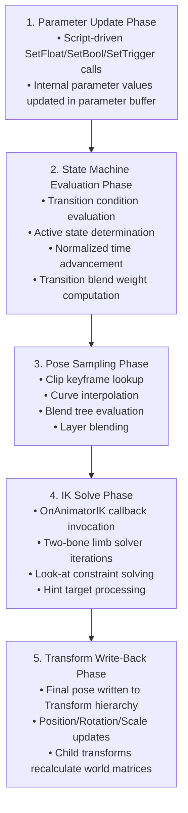

# Lesson 5: Animation Systems, State Machines, Procedural Motion

## 1. First-Principles Intuition & Invariants

Unity's animation system represents one of the most sophisticated real-time pose interpolation and state coordination architectures in production game engines. At its foundation lies a recognition that character animation is fundamentally a problem of continuous pose sampling from discrete keyframe data, coordinated through finite state machines that model behavioral transitions, all while maintaining runtime performance budgets measured in fractions of a millisecond per frame. The Mecanim architecture, introduced in Unity 4 and refined through subsequent releases, embodies a declarative approach to animation orchestration where animators and engineers specify the *what* of motion through state graphs and blend parameters, while the engine handles the *how* through optimized pose evaluation, constraint solving, and skeletal hierarchy traversal.

The core insight driving Mecanim's design is that animation is not merely data playback but rather a dynamic system requiring continuous decision-making. A running character must seamlessly transition to idle when the player releases input, blend between walk and run cycles based on velocity magnitude, layer upper-body aim poses over lower-body locomotion, and react to environmental constraints through inverse kinematics—all without visible discontinuities or perceptible frame drops. Traditional animation systems approached this through imperative scripting: engineers would manually lerp between poses, manage transition timing, and hand-code blending logic. Mecanim inverts this paradigm by treating animation as a reactive dataflow problem where state machines consume input parameters and produce output poses through a directed acyclic graph of transformation nodes.

The fundamental invariant governing all animation evaluation in Unity is the concept of *normalized time*. Every animation clip, regardless of its authored frame rate or duration, maps to a continuous parameter space spanning [0, 1] where 0 represents the clip's first frame and 1 its last. This normalization serves multiple critical purposes: it decouples animation playback from real-world time, enabling time-scaling effects like slow motion or fast-forward without re-authoring content; it provides a unified coordinate system for blending heterogeneous clips of different lengths; and it establishes a canonical reference frame for synchronization points and transition timing. When the runtime evaluates an animation state, it advances normalized time according to the clip's speed multiplier and the global delta time, wrapping at boundaries for looping clips or clamping for one-shot sequences.

Pose representation within Unity's animation runtime centers on the Transform hierarchy—a scene graph where each bone or control point exists as a GameObject with local position, rotation, and scale relative to its parent. Animation clips store keyframe data as discrete samples of these local transforms at specific time points, typically authored at 30 or 60 samples per second. During evaluation, the engine performs piecewise interpolation between keyframes using configurable curve tangents that define the transition profile. For rotation channels, Unity employs quaternion spherical linear interpolation (slerp) to ensure the shortest angular path and avoid gimbal lock, while position and scale channels use standard linear or cubic spline interpolation depending on the curve complexity specified at import time.

The state machine abstraction at Mecanim's heart models animation behavior as a directed graph where nodes represent distinct motion states and edges encode legal transitions with associated conditions. This formalism maps directly to the mathematical concept of finite automata, where the system occupies exactly one state at any given moment and transitions occur only when guard conditions evaluate true. However, Mecanim extends classical FSM theory with two critical enhancements: blended transitions that allow smooth interpolation between states rather than instantaneous switches, and hierarchical state machines (sub-state machines) that enable compositional reasoning about complex behaviors. A humanoid character controller might contain a root-level locomotion state machine with walk, run, and jump states, each of which contains its own sub-machine managing directional variants or speed tiers.

Blend trees introduce continuous interpolation across multiple animation clips simultaneously, addressing scenarios where discrete state transitions prove inadequate. Consider a character capable of moving in any 2D direction with variable speed—modeling this with discrete states (walk forward, walk backward, strafe left, strafe right) produces visible snapping artifacts as the player adjusts input. A blend tree instead treats movement as a continuous 2D vector space where each animation clip occupies a specific coordinate (e.g., walk forward at origin [0, 1], walk right at [1, 0]) and the runtime computes a weighted average of all clips based on the current input vector's proximity to each clip's position. The mathematics underlying this is barycentric interpolation for 2D blend trees or simplex interpolation for 1D trees, ensuring smooth transitions as parameters vary continuously.

Animation layering addresses the compositional challenge of independent motion systems that must coexist without interference. A character might simultaneously execute a full-body locomotion cycle on a base layer, an upper-body weapon-aiming pose on an override layer, and subtle breathing motion on an additive layer. Unity implements layering through a weighted pose accumulation pipeline where higher layers can override or additively modify the pose produced by lower layers. Override blending replaces the base pose's bone transforms entirely, weighted by the layer's alpha value, while additive blending applies delta transformations on top of the base pose. The runtime evaluates layers in stack order, accumulating transformations into a final output pose that represents the composite result of all active layers.

Inverse kinematics (IK) inverts the standard animation pipeline by solving for joint angles that satisfy endpoint constraints. Forward kinematics computes end-effector position from known joint angles (given shoulder, elbow, and wrist rotations, where does the hand end up?), while IK solves the inverse problem (given a desired hand position, what should the joint angles be?). Unity provides built-in IK for humanoid characters through the Animator component's IK callback system, where scripts specify target positions and rotations for hands, feet, head, and body, and the engine solves the inverse problem using a two-bone solver for limbs and look-at solver for head orientation. IK solving is fundamentally an optimization problem, often solved through iterative methods like Cyclic Coordinate Descent (CCD) or Jacobian transpose techniques that converge toward a solution over multiple iterations.

The humanoid avatar system in Unity represents a profound abstraction layer that decouples animation content from specific skeletal hierarchies. Traditional animation pipelines tightly couple clips to bone names and hierarchy structures—a run animation authored for one character model cannot be reused on another without manual retargeting. Unity's humanoid retargeting solves this by defining a canonical reference skeleton with standardized bone names and relationships (hips, spine, chest, shoulders, etc.) and mapping arbitrary skeletal hierarchies onto this template. Animation clips authored for any humanoid avatar can then play on any other humanoid character through runtime retargeting, where the engine computes appropriate local rotations for the target skeleton that produce equivalent global poses. This retargeting operates in muscle space—a normalized representation of joint rotations that abstracts away bone length differences and hierarchy variations.

The Timeline system extends animation from reactive state machines to authored sequential storytelling. Where Animator controllers excel at runtime-responsive behaviors (a character reacting to player input), Timeline provides a non-linear editing paradigm for scripted sequences like cutscenes, attack combos, or environmental events. Timeline tracks operate as parallel channels where animation clips, audio, particle effects, and script callbacks execute in synchronized lockstep according to a global playhead position. The runtime evaluates all active tracks at each frame, blending their outputs according to track priorities and clip blending modes, enabling complex cinematic sequences where camera cuts, character animations, environmental hazards, and narrative triggers coordinate precisely in time.

## 2. Core Architecture & Mechanics

The Animator component serves as the primary runtime interface between Unity's game object hierarchy and the animation evaluation pipeline. When attached to a GameObject, the Animator references an Animator Controller asset—a state machine definition authored in Unity's visual editor—and exposes parameters that drive state transitions and blend tree coordinates. At initialization, Unity constructs an internal evaluation graph representing all reachable states, transitions, and blend nodes, optimizing the structure for cache-coherent traversal. The graph exists in native memory space, minimizing managed-to-native marshalling overhead during the per-frame evaluation cycle that occurs during the animation phase of Unity's main loop, positioned after input processing but before physics simulation.

State machine transitions encode the edges between animation states with configurable conditions and timing parameters. Each transition specifies a source state, destination state, exit time, transition duration, and a list of conditions that gate the transition's activation. Exit time represents the normalized time within the source state at which the transition becomes eligible—a value of 0.8 means the transition can only begin once the source animation has played 80% of its duration, ensuring critical keyframes like foot plants complete before blending to the next motion. Transition duration defines the blending window, during which the runtime linearly interpolates between source and destination poses. A 0.25-second duration produces a smooth 250-millisecond crossfade, where the source state's weight decays from 1 to 0 while the destination state's weight grows from 0 to 1 along a linear ramp.

Conditions attached to transitions evaluate boolean expressions over the Animator's parameter set. Unity supports four parameter types: Float (continuous scalar values), Int (discrete integer values), Bool (binary flags), and Trigger (auto-resetting boolean pulses). Conditions combine multiple parameter checks with implicit AND semantics—all conditions must simultaneously evaluate true for the transition to fire. A run-to-jump transition might require `isGrounded == true AND jumpTrigger == true AND speed > 4.0f`, ensuring the character can only jump while touching the ground, when the player presses jump, and while moving at sufficient velocity. Trigger parameters exhibit special semantics: setting a trigger marks it true for the current evaluation frame, after which Unity automatically resets it to false, preventing unintended repeated activations.

Blend trees provide the computational substrate for continuous pose interpolation across multiple animation clips. The simplest variant, a 1D blend tree, maps a single float parameter to a linear axis along which animation clips reside at specific threshold values. Consider a speed-based locomotion blend tree with clips positioned at thresholds 0.0 (idle), 2.0 (walk), and 5.0 (run). When the speed parameter equals 3.5, the runtime computes normalized distances from each clip's threshold, producing weights that sum to unity: walk receives approximately 0.5 weight, run receives 0.5 weight, and idle contributes nothing. The final pose is the weighted average of the walk and run clip poses at their current normalized times, with each bone's rotation and position computed as `pose = Σ(weight_i × clip_i.pose)`.

Two-dimensional blend trees extend this concept to a planar parameter space, essential for omnidirectional movement or aim-offset systems. Clips occupy 2D coordinates corresponding to their semantic meaning—a strafe-right-walk animation might reside at coordinates (1.0, 2.0) representing full rightward motion at walk speed. Unity employs Delaunay triangulation to partition the 2D space into triangles with clips at vertices, then uses barycentric coordinates to compute weights for the three nearest clips based on the current parameter vector's position within its containing triangle. This ensures smooth interpolation across the entire parameter space without requiring an exponential explosion of clips—eight directional animations suffice for full 360-degree movement rather than requiring dozens of discrete states.

The animation layering system implements pose composition through a sequential evaluation and blending pipeline. The base layer always evaluates first, producing an initial full-body pose that subsequent layers modify. Override layers replace portions of the base pose weighted by their layer alpha and avatar mask—a binary map specifying which bones the layer affects. An upper-body aiming layer with a mask covering spine, shoulders, arms, and head will override those bones' rotations while leaving leg and hip transforms untouched, allowing the character's aim direction to vary independently of its locomotion. Additive layers, by contrast, compute delta transforms relative to a reference pose, then apply those deltas on top of lower layers. A breathing animation might additively rotate the chest bone by ±2 degrees, layering subtle secondary motion atop the primary locomotion without requiring separate walk-breathing, run-breathing, and idle-breathing clip variants.

Unity's humanoid avatar retargeting operates through a multi-stage pipeline that transforms animation data from source skeleton space to target skeleton space via an intermediary muscle representation. When an animation clip authored for a source character plays on a different humanoid avatar, Unity first evaluates the clip's keyframe data in the source skeleton's local rotation space. It then converts these local rotations into muscle curves—normalized scalar values representing joint angles in a canonical humanoid coordinate system where 0 represents neutral pose and ±1 represents joint limits. The hip twist muscle might map to [-180°, +180°] in world space, normalized to [-1, +1] in muscle space. These muscle curves are skeleton-agnostic; they encode motion as abstract joint flexion percentages rather than concrete quaternion rotations. Finally, Unity converts muscle values back to local rotations appropriate for the target skeleton's bone lengths and hierarchy, producing retargeted poses that preserve the animation's semantic intent while adapting to the new skeletal structure.

The IK solving pipeline integrates with Animator evaluation through the `OnAnimatorIK(int layerIndex)` callback, invoked after pose sampling but before transform write-back. Scripts implementing this callback can specify IK goals using methods like `SetIKPositionWeight`, `SetIKPosition`, `SetIKRotationWeight`, and `SetIKRotation` for each of Unity's built-in IK endpoints (LeftFoot, RightFoot, LeftHand, RightHand). Weight parameters enable partial IK influence, allowing a hand to blend between its animated position (weight 0) and the script-specified target (weight 1). Unity's two-bone IK solver handles limbs by treating them as kinematic chains with three joints: shoulder-elbow-wrist for arms, hip-knee-ankle for legs. Given a target position for the end effector (hand or foot), the solver computes elbow and knee rotations that satisfy the constraint while respecting anatomical joint limits, optionally using a hint vector to bias the solver toward a preferred bend direction.

Timeline playback operates through the PlayableGraph API—Unity's low-level animation compositing framework upon which both Animator and Timeline are built. A PlayableGraph is a directed acyclic graph where nodes (Playables) represent animation sources, mixers, or custom logic, and edges define dataflow connections. Timeline constructs a PlayableGraph at runtime with a tree structure: a root mixer combines all tracks, each track contains clip playables representing its sequential content, and custom playables handle behaviors like track activation and clip blending. The graph evaluates bottom-up each frame: leaf playables (animation clips, audio sources) produce output, mixers combine inputs according to their blending logic, and the root node yields the final pose or multi-track output. This architecture enables Timeline to extend beyond animation—script tracks, signal emitters, and control tracks all integrate into the same graph-based evaluation framework, coordinating heterogeneous systems through a unified playback model.

Animator state machine sub-state machines provide compositional hierarchy through a nesting mechanism where individual states can themselves contain entire state machines. A locomotion state in the root-level machine might expand into a sub-machine with walking, running, and sprinting states, each with its own transitions and blend trees. When the root-level machine enters the locomotion state, it immediately transitions into the sub-machine's entry state, and all subsequent state transitions occur within the sub-machine until an exit transition fires. Exit transitions, marked with a special outbound edge leading to an (Exit) pseudo-state, allow the sub-machine to signal completion and return control to the parent machine. This mechanism models hierarchical behavior naturally—a combat state might contain sub-states for light attack, heavy attack, and block, with exit transitions firing when the attack animation completes or the player releases the block button, returning control to the root-level idle/locomotion machine.

Animation events embed discrete callback invocations within animation clips at specific keyframes, enabling synchronization between animation and gameplay logic. An attack animation might define an event at the keyframe where the sword reaches full extension, triggering a collision detection routine that checks for enemy hits. Events carry string identifiers that map to methods on MonoBehaviour scripts attached to the Animator's GameObject, with optional float, int, string, or object reference parameters passed through. Unity invokes event callbacks during the pose sampling phase when the clip's normalized time crosses the event's marked time, ensuring perfect synchronization between visual motion and gameplay effect. Multiple events can fire in a single frame if the animation time delta spans multiple event markers, with Unity invoking callbacks in chronological order according to their clip-local timestamps.

Root motion extraction solves the problem of translating animation-driven movement into physics or transform space. By default, animation clips affect only the local transforms of bones within the character's skeleton, leaving the root GameObject stationary. A walk cycle animates leg movement but does not actually translate the character forward in world space. Root motion changes this by extracting velocity and rotation data from the animated root bone (typically the hips) and applying it to the GameObject's Transform, moving the character according to the animation's authored motion. Unity exposes root motion through the `OnAnimatorMove` callback, invoked after IK solving, where scripts can access `Animator.deltaPosition` and `Animator.deltaRotation` representing the frame's root motion contribution. This allows hybrid approaches where scripts scale or redirect root motion (e.g., projecting forward motion onto a navigation mesh's surface normal) while preserving animation timing and foot placement fidelity.

## 3. High-Performance Optimization & Failure Modes

Animation performance optimization begins with understanding the CPU cost model of the evaluation pipeline. The dominant cost factors are clip keyframe sampling (binary search through keyframe arrays), curve interpolation (slerp for quaternions is expensive), blend tree evaluation (weighted averaging of multiple clip poses scales linearly with clip count), and Transform hierarchy updates (writing animated bone rotations triggers world matrix recalculation for all children). Unity's Job System integration allows parallelizing animation evaluation across multiple characters, but individual Animator evaluation remains largely sequential due to data dependencies in the state machine traversal and pose blending stages. The primary optimization strategy is reducing the number of animated bones and the complexity of state machine graphs, not attempting to parallelize a single character's animation.

Culling and level-of-detail strategies provide the highest-leverage optimization for scenes with many animated characters. Unity's built-in Animator culling system operates in two modes: cull completely (stop evaluating animations entirely when the character is off-screen) and cull update transforms (continue evaluating state machines and advancing normalized time but skip writing to the Transform hierarchy). Complete culling eliminates all CPU cost but causes animations to freeze when off-screen, potentially producing visible pops when the character re-enters the viewport mid-animation. Transform culling retains animation state continuity but still incurs evaluation costs for state machine logic and pose sampling. Custom LOD systems can switch between high-fidelity Animator-driven animation when near the camera, baked procedural animation at medium distances (e.g., simplified four-bone skeletons), and static billboard impostors at long range, amortizing the most expensive skeletal animation costs across only the most visible characters.

State machine complexity directly impacts evaluation performance through transition condition checking and state traversal. Each transition's conditions evaluate every frame while the source state is active, incurring parameter lookup and comparison costs. Minimizing the number of outbound transitions from heavily-used states like idle or locomotion reduces per-frame branching overhead. Any State transitions—special edges that can fire from any state in the machine—are particularly expensive because Unity must check their conditions regardless of the current active state. Use Any State transitions sparingly for truly universal interrupts (e.g., damage reactions, death) rather than as a shortcut to avoid defining explicit transition paths. Sub-state machines add hierarchy depth but do not inherently increase evaluation cost; they primarily affect authoring workflow and conceptual organization rather than runtime performance.

Blend tree optimization focuses on reducing the number of simultaneously evaluated clips and minimizing redundant pose sampling. In a 2D blend tree covering a large parameter space, clips distant from the current parameter values contribute negligible weight yet still incur sampling costs. Unity provides a threshold parameter controlling the minimum weight required for a clip to evaluate—setting this to 0.01 prevents clips with less than 1% contribution from sampling, often eliminating 50-70% of blend tree evaluation costs with imperceptible visual impact. For 1D blend trees, prefer direct blends between adjacent clips over sampling all clips in the tree; Unity's 1D blend tree implementation optimizes this automatically. Avoid deeply nested blend trees (blend trees containing blend trees) when possible, as each nesting level compounds sampling and blending overhead.

Layer mask precision critically affects performance when using override layers. Unity stores avatar masks as bitmasks over the transform hierarchy, with each bit representing a bone's inclusion state. Broad masks (e.g., "entire upper body") require more bones to evaluate during layer blending than narrow masks (e.g., "right arm only"). Define masks at the most specific granularity possible—if an aiming layer only needs to override shoulder, elbow, and wrist rotations, exclude the hand's individual finger bones from the mask. This is especially critical for humanoid rigs with detailed hand skeletons containing 15-20 bones per hand; unnecessarily including these bones in layer masks multiplies blending costs without visual benefit when the fingers remain static during aiming.

Additive layer performance degrades significantly when the reference pose differs substantially from the base layer's pose at application time. Additive layers store delta rotations relative to a reference pose (typically the first frame of the additive clip). When the base pose deviates far from this reference, the additive deltas produce visual artifacts—a breathing animation authored with the character standing upright will distort unnaturally when applied over a crouched pose. This forces artists to author separate additive variants for each base pose family (standing, crouching, prone), increasing memory footprint and runtime asset management complexity. Where possible, prefer override layers with partial masks over additive layers for upper-body variations, as override blending exhibits more robust behavior across diverse base poses.

IK solving costs scale with iteration count and constraint complexity. Unity's built-in two-bone solver converges quickly (typically 1-3 iterations for well-conditioned problems) but degenerates when targets lie outside the limb's reachable space (e.g., requesting a hand position farther than full arm extension allows). In such cases, the solver iterates up to its maximum count (configurable per IK goal) before yielding a best-effort result, wasting CPU cycles on an unsolvable problem. Scripts should validate IK target distances against anatomical limits before submitting goals—clamping target positions to a sphere centered at the shoulder with radius equal to arm length prevents degenerate solve cases. For characters requiring frequent IK updates (e.g., VR hand tracking), consider caching solver state across frames or implementing custom analytical solvers that exploit domain-specific constraints for faster convergence.

Root motion integration with physics controllers introduces subtle failure modes around discrete collision handling. When Unity applies root motion directly to a CharacterController component, the controller's collision detection operates on the motion delta between frames, potentially tunneling through thin obstacles if the animation-driven velocity exceeds the collision system's continuous detection threshold. High-velocity attack lunges or rapid locomotion cycles can produce tunneling artifacts where characters pass through walls or fall through floors. The canonical mitigation is applying root motion through a two-stage process: first check the intended motion delta against the collision geometry using a predictive raycast or swept capsule test, then apply the motion only if the path is clear, clamping the actual movement to the collision contact point if an obstacle would be penetrated.

Timeline playback performance degrades with track count and clip density, particularly when tracks contain high-frequency clip boundaries requiring frequent PlayableGraph updates. A timeline with 50 overlapping activation tracks (each controlling a GameObject's active state) and 100 animation clips creates a dense PlayableGraph requiring continuous mixer weight recalculation as the playhead crosses clip boundaries. Consolidate tracks where possible—using a single Cinemachine track to control multiple camera cuts rather than separate activation tracks per camera reduces graph complexity. For timelines with many short clips, consider baking sequences into longer, pre-composed animation clips that reduce the number of discrete playables in the graph, trading timeline editing flexibility for runtime performance.

Humanoid retargeting introduces subtle failure modes around skeletal proportion mismatches and joint limit violations. When a tall, long-limbed source character's animation retargets to a short, stocky character, IK-heavy animations (e.g., precise hand-reaches to world-space props) may become unreachable because the target character's arm length cannot span the animated distance. Similarly, joint limits defined in the target avatar's muscle space may prevent certain poses from the source animation, producing clamped rotations that distort the motion's intent. The canonical solution is authoring animations with humanoid retargeting in mind: avoid precise world-space IK targets in retargetable clips (use IK at runtime instead), and design motion vocabularies that respect conservative joint range-of-motion limits compatible with diverse body proportions.

Animation memory footprint grows linearly with clip count, keyframe density, and curve count per clip. A 10-second animation sampled at 60 fps with 100 animated bones and full position-rotation-scale curves consumes roughly 600 frames × 100 bones × 10 floats per transform = 600KB of keyframe data before compression. Unity's animation compression applies quaternion quantization and keyframe reduction to minimize storage, but aggressive compression introduces quantization artifacts visible as jitter in slow-motion or precisely-timed sequences. Profile compression settings per-clip: use aggressive compression for background NPC cycles where precision matters little, but preserve high fidelity for hero character facial animations and cinematic sequences where subtle motion nuances carry narrative weight. The import settings panel exposes compression error tolerance thresholds (measured in positional error millimeters and rotational error degrees) that directly trade file size against visual fidelity.

State machine debugging complexity grows super-linearly with graph size and transition count, as emergent behavior arises from unexpected interaction between transition conditions and nested state scopes. The Animator window's realtime state visualization helps, but it shows only the currently active state path, not the full set of reachable states or the reason a particular transition did not fire. Instrumentation through custom editor scripts that log transition evaluations and parameter changes provides deeper visibility—writing a debug overlay that displays active state names, transition progress bars, and per-frame parameter values directly in the game view accelerates iteration when diagnosing unexpected animation behavior. For particularly complex machines, consider generating dot-graph visualizations of the state machine structure and annotating edges with condition expressions to enable offline analysis of reachability and dead-state detection.

Parameter synchronization across networked multiplayer sessions requires careful attention to quantization and delta-compression strategies. Sending float parameters with full 32-bit precision every frame for every networked character produces unsustainable bandwidth consumption. Quantize continuous parameters to the minimum precision the animation system requires—a normalized speed parameter typically needs only 8 bits (0-255 mapped to 0.0-1.0) rather than full floating-point representation. Send parameters only when they change beyond a dead-zone threshold (e.g., speed changed by more than 0.05) to exploit temporal coherence. For state machines, transmit state transition events rather than full state snapshots—sending "transitioned to run state" is cheaper than continuously synchronizing the current state, with periodic full-state snapshots providing error correction against packet loss.

Timeline's deterministic playback behavior depends critically on frame rate stability when authored with frame-locked timing. A cutscene timeline designed at 60 fps with precise 0.0167-second clip boundaries may exhibit synchronization drift at 30 fps or variable frame rates, where discrete frame quantization causes cumulative timing errors. Use Timeline's durationMode set to "Based On Clips" rather than "Fixed Duration" to allow slight timing adjustments that preserve clip-boundary alignment across frame rate variations. For absolutely critical synchronization (e.g., musical rhythm games, dialogue lip-sync), drive Timeline playback from an external audio clock using `PlayableDirector.time` manual updates rather than relying on Unity's delta-time-based auto-advance, ensuring that visual events align precisely with audio samples regardless of frame rate fluctuations.

The interplay between animation and ragdoll physics introduces complex failure modes around kinematic-to-dynamic transitions. When a character dies and transitions from animated to physics-driven, the instantaneous velocity discontinuity can produce visually implausible results—a slowly walking character that suddenly explodes into high-velocity ragdoll tumbling. Smooth this transition by sampling the character's animated velocity just before enabling ragdoll physics, then applying that velocity as initial impulse to the root rigidbody, preserving motion continuity. Conversely, transitioning from ragdoll back to animated (e.g., a get-up animation after being knocked down) requires blending the physics-driven pose into the animation's starting pose over several frames to avoid visible pops, often implemented through a brief IK-heavy transition animation that targets the current ragdoll limb positions before blending into a standard get-up cycle.
