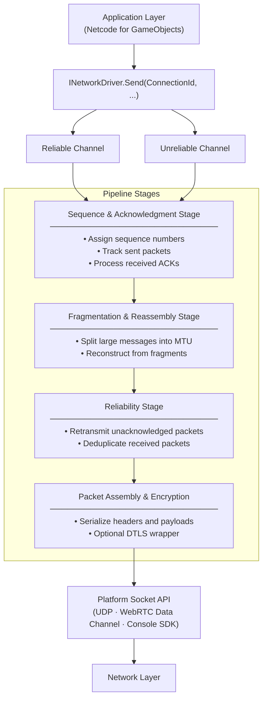

# Lesson 6: Multiplayer Netcode, Build Pipeline, Platform-Specific Compilation

## 1. First-Principles Intuition & Invariants

Multiplayer networked games represent one of the most demanding distributed systems engineering challenges in real-time software. Unlike traditional client-server architectures where latency tolerance measured in hundreds of milliseconds is acceptable, interactive game experiences demand sub-100ms round-trip times while maintaining deterministic physics simulation, fair competitive gameplay, and consistent world state across dozens or hundreds of concurrent clients. The fundamental tension emerges between three irreconcilable constraints: network latency is bounded by the speed of light and routing topology, client input must feel instantaneous to preserve agency and enjoyment, and authoritative simulation state must remain consistent to prevent cheating and divergence. No amount of engineering can eliminate this tension—the architect's task is to choose which invariants to relax, where to accept inconsistency, and how to mask the inevitable compromises through prediction, interpolation, and clever perception management.

The Unity networking stack has evolved through multiple generations, each reflecting different philosophical approaches to this distributed consensus problem. The original UNET system provided a high-level component-driven model where NetworkBehaviour scripts automatically synchronized member variables through attribute markup, abstracting the underlying RPC and state replication machinery. While developer-friendly, this approach coupled game logic tightly to networking concerns and provided insufficient control over bandwidth optimization and tick-rate decoupling. The modern Unity Netcode for GameObjects framework—alongside the lower-level Transport layer and the ECS-native NetCode package for DOTS—adopts a more explicit model where developers maintain clear separation between presentation state and network-synchronized authority, manually define synchronization primitives, and directly control serialization strategies. This shift reflects hard-won industry wisdom: implicit magic leads to inscrutable bugs, bandwidth explosions, and architectures that collapse under real-world packet loss and jitter.

At the protocol level, multiplayer games typically run atop UDP rather than TCP, sacrificing reliability for latency predictability. TCP's congestion control, ordered delivery guarantees, and automatic retransmission create catastrophic head-of-line blocking: a single dropped packet stalls the entire stream until retransmission completes, adding hundreds of milliseconds to effective latency. In contrast, UDP delivers packets as they arrive, allowing the application layer to implement custom reliability semantics tailored to game state—critical information like player spawns and score updates demand guaranteed delivery and can use selective acknowledgment schemes, while transient position updates and animation states can safely drop packets since fresher data arrives milliseconds later. Unity's Transport package exposes this split through reliable and unreliable channels multiplexed over a single UDP socket, with configurable fragmentation and reassembly for payloads exceeding the MTU (typically 1200-1400 bytes after IP and UDP headers to avoid fragmentation at the network layer).

The authoritative server model remains the gold standard for competitive multiplayer, where a single server process maintains the canonical game state and clients act purely as input sources and presentation engines. Clients send input commands—button presses, aim vectors, ability triggers—to the server at high frequency (typically 20-60Hz), the server advances simulation by fixed timesteps in a deterministic tick loop, and the server broadcasts state snapshots back to clients for rendering. This architecture provides a single source of truth, makes cheating extraordinarily difficult since clients never execute trust-critical logic, and allows straightforward reconciliation when network conditions cause temporary divergence. The cost is infrastructure: authoritative servers require persistent compute capacity, regional deployment for latency optimization, matchmaking systems, and operational complexity far exceeding peer-to-peer designs.

Client-side prediction and server reconciliation form the perceptual foundation that makes authoritative networking feel responsive despite round-trip latencies. When a player presses a movement key, waiting for the server to acknowledge the input, simulate the result, and broadcast the new position would introduce 50-150ms of input lag—an eternity in interactive feedback terms. Instead, the client immediately applies the input to a local prediction simulation that mirrors the server's physics and game rules, updating the player's position and animation state instantly. Simultaneously, the client timestamps and queues this input for transmission to the server. When the server's authoritative state snapshot arrives 50-100ms later, the client compares its predicted position against the server's reported position. If they match within a small tolerance, prediction succeeded and no correction is needed. If they diverge—due to server-side collision with another player, ability cooldowns, or simulation differences—the client must reconcile by teleporting the player to the authoritative position or smoothly interpolating over several frames to hide the correction. Poor reconciliation implementations cause the notorious "rubber-banding" effect where players snap backward or forward discontinuously.

Server state snapshots cannot be naively transmitted as full world dumps every tick—bandwidth constraints demand delta compression and relevancy filtering. A 64-player shooter with hundreds of networked objects, each containing position, rotation, velocity, health, and ability state, could easily generate 10KB per snapshot at 20Hz, consuming 200KB/s per client or 12.8MB/s for 64 clients—an unsustainable datarate for both upstream server bandwidth and client downstream capacity. Instead, servers implement delta encoding by maintaining the last acknowledged snapshot for each client and transmitting only the changed fields since that baseline. A player who hasn't moved in five ticks contributes zero bytes to subsequent snapshots. Priority and relevancy systems further reduce bandwidth by updating distant or occluded objects at lower frequencies and omitting entirely objects outside the player's area of interest. Unity Netcode for GameObjects provides `NetworkVariable<T>` primitives that automatically handle delta transmission when values change, abstracting bitpacking, quantization, and acknowledgment tracking.

Interest management and spatial partitioning determine which objects each client receives updates for, critical for scaling to large worlds and player counts. A naive full-broadcast model where every client receives state for every networked object scales quadratically—100 objects and 100 players yields 10,000 update streams, most irrelevant since players only perceive their immediate surroundings. Unity's Scene Management system supports multiple active scenes, enabling spatial division where distant regions load additively only for nearby players. More sophisticated engines implement grid-based or hierarchical spatial indexing (quadtrees, octrees, or R-trees) to dynamically compute visibility sets each tick. A player's interest region typically extends beyond their viewport to preload entities before they become visible, preventing pop-in artifacts. Networked physics adds complexity: objects outside a client's interest region still influence simulation through collision and trigger volumes, requiring the server to maintain full authoritative state even as clients receive filtered subsets.

Lag compensation ensures that hit detection remains fair and intuitive despite heterogeneous client latencies. Consider a competitive shooter where the local player has 30ms latency and sees an opponent running left-to-right. The player aims and fires at the opponent's visually observed position. Without compensation, the server would evaluate the shot against the opponent's current position, which has advanced 60-80ms beyond where the player aimed (30ms for the player's view of past state plus 30ms for input transmission plus server processing). The shot misses despite appearing to land squarely on target from the shooter's perspective. Lag compensation solves this by rewinding server simulation: when processing a shot command, the server rolls back all player positions to their state at the timestamp when the shooter's client rendered the frame, performs hit detection against this historical state, then fast-forwards back to present. This trades absolute consistency for perceptual fairness—players hit what they aimed at. The cost falls on high-latency players, who may die "behind cover" because the shooter's historical view still showed them exposed. Unity does not provide built-in lag compensation; developers must implement history buffers, timestamp synchronization via Network Time System, and custom rewind logic.

Deterministic lockstep represents an alternative networking model where all clients simulate identical game state and exchange only inputs, common in real-time strategy games and fighting games. Each game tick begins only when all clients have received all other clients' inputs for that tick, ensuring perfect determinism—every client runs the same sequence of inputs through the same simulation code and arrives at identical state. This eliminates state synchronization bandwidth, simplifies cheat prevention through hash verification, and enables perfect replay systems. The cost is latency: the slowest client dictates tick rate, and any packet loss or jitter stalls the entire simulation until retransmission completes. Modern implementations add speculative execution where clients predict missing inputs and rollback when actual inputs arrive, but this reintroduces complexity comparable to client-server prediction. Unity's deterministic simulation support is limited—floating-point operations are not deterministic across platforms due to varying FPU implementations, requiring fixed-point math libraries or soft-float emulation for true lockstep.

The build pipeline transforms Unity's high-level C# scripting environment into platform-native executables through the IL2CPP (Intermediate Language to C++) compilation toolchain. Unity originally executed game code through the Mono runtime, a JIT-based virtual machine that compiled C# IL bytecode to machine code at runtime. While flexible and fast to iterate, Mono's JIT posed problems for platforms that prohibit runtime code generation (iOS due to Apple's security model, consoles due to certification requirements) and introduced startup latency and memory overhead. IL2CPP instead performs full ahead-of-time (AOT) compilation: C# source compiles to .NET IL as usual, then IL2CPP transpiles IL to C++, which platform-specific compilers (Clang for iOS/macOS, MSVC for Windows, platform NDKs for consoles) compile to native machine code. The resulting binary eliminates JIT overhead, reduces memory footprint, enables aggressive link-time optimization, and satisfies platform security requirements. The cost is compilation time—large projects can take 30-60 minutes for full IL2CPP builds compared to seconds for Mono.

IL2CPP's C++ intermediate representation enables cross-platform compilation but requires careful management of platform-specific APIs and managed-to-native interop. Unity's Player Settings define scripting backends (Mono or IL2CPP) and API compatibility levels (profiles like .NET Standard 2.1 or .NET Framework 4.x). The IL2CPP toolchain includes a conservative garbage collector derived from Boehm GC, modified for real-time characteristics—incremental collection spreads work across multiple frames to avoid hitches, and write barriers track intergenerational references for generational collection. Platform abstraction layers (PAL) provide unified APIs for threading, file I/O, sockets, and system calls, with platform-specific implementations in Unity's native C++ core. When game code calls `System.IO.File.ReadAllBytes`, the IL2CPP-generated C++ invokes a PAL wrapper that dispatches to POSIX file operations on Unix-like platforms or Win32 file APIs on Windows.

Build optimization for IL2CPP focuses on code stripping, generic type instantiation management, and linker configuration. Unity's managed code stripping analyzes the call graph starting from entry points (scene objects, [RuntimeInitializeOnLoadMethod] attributes) and eliminates unreferenced types and methods, reducing binary size by 30-60%. The Managed Stripping Level setting offers None (no stripping, maximum compatibility), Minimal (safe stripping of unused Unity code), or High (aggressive stripping requiring manual preservation hints via `link.xml` files). Generic type instantiation multiplies binary size: `List<int>` and `List<string>` compile to distinct native implementations in IL2CPP. Heavy use of generics, especially with value types, can explode code size. Unity's Code Size configuration enables optimizations like struct layout padding removal and vtable sharing. The native linker runs with dead code elimination (`--gc-sections` on GCC/Clang, `/OPT:REF` on MSVC) to strip unused native functions. Whole program optimization and link-time code generation (LTCG/LTO) enable cross-translation-unit inlining but extend build times significantly.

Platform-specific compilation targets introduce varying capabilities, constraints, and toolchain integrations. iOS and Android builds require signing certificates, provisioning profiles, and SDK version targeting. The iOS build process generates an Xcode project that developers open in Xcode for final signing and deployment, allowing integration of native plugins, entitlements (camera access, push notifications), and App Store metadata. Android builds produce Gradle projects or APK files directly, with configuration for API level (minimum, target), architecture ABIs (ARMv7, ARM64, x86), and keystore credentials. Console platforms (PlayStation, Xbox, Nintendo Switch) require platform-specific SDKs under NDA and separate Unity platform modules. These builds integrate proprietary APIs for trophy/achievement systems, user authentication, cloud saves, and platform-specific input devices. WebGL targets require special handling: IL2CPP compiles to asm.js or WebAssembly, threads are emulated via web workers (with performance limitations), and streaming asset loading replaces direct file I/O. Memory constraints are severe—mobile browsers limit WASM heap to 2GB, demanding aggressive asset streaming and unloading.

Platform abstraction for rendering backends represents another critical compilation dimension. Unity's scriptable render pipelines (URP, HDRP) generate shader variants for multiple graphics APIs—Direct3D 11/12 on Windows and Xbox, Metal on iOS and macOS, Vulkan on Android and high-end platforms, and OpenGL ES for legacy compatibility. Each API has distinct capabilities: bindless resources in Vulkan and D3D12 enable efficient material batching but require explicit descriptor management, while Metal's unified memory architecture between GPU and CPU simplifies resource sharing on Apple silicon. Unity's shader compiler chain begins with ShaderLab and HLSL source, compiles to an intermediate representation, then targets platform-specific bytecode (DXIL for D3D12, SPIR-V for Vulkan, MSL for Metal). Shader variant combinatorial explosion—permutations of features like lightmapping, shadows, fog, HDR—can generate thousands of variants, bloating build size and load times. Unity's Shader Variant Collection system enables precompilation and stripping of unused variants.

Build pipelines must handle asset processing, bundle generation, and compression strategies tailored to platform storage and loading characteristics. Unity's AssetBundle system packages scenes, prefabs, textures, and audio into compressed archives loaded at runtime, enabling streaming content delivery and reducing initial install size. The build pipeline offers LZ4 (fast decompression, moderate compression ratio, ideal for runtime loading) or LZMA (slower decompression, high compression ratio, suited for initial installation or Wi-Fi downloads). Each platform has distinct storage media—NVMe SSDs on PC and current-gen consoles enable high-throughput streaming, eMMC flash on mobile devices has slower random access, and optical media on legacy consoles imposes seek latency. Addressables, Unity's higher-level asset management system, extends AssetBundles with dependency tracking, automatic bundle packing strategies, and remote content delivery via CDNs. Build scripts use `BuildPipeline` APIs to automate asset processing: texture format conversion (ASTC for mobile, BC7 for PC, platform-specific formats for consoles), audio compression (Vorbis, MP3, platform-native), and mesh optimization (vertex cache optimization, LOD generation).

Continuous integration and automation of Unity builds integrate with industry-standard CI/CD platforms like Jenkins, GitLab CI, or GitHub Actions. Unity Cloud Build offers managed build infrastructure but lacks flexibility for custom toolchain integrations. Local builds invoke Unity in batch mode via command-line arguments: `Unity.exe -quit -batchmode -executeMethod Builder.PerformBuild -logFile build.log`. The builder script uses `BuildPipeline.BuildPlayer` with `BuildPlayerOptions` specifying target platform, scenes, output path, and build options (development build, script debugging, deep profiling). Incremental builds leverage Unity's Library cache—precompiled shaders, imported assets, and metadata persist across builds if source assets haven't changed. The build pipeline stages typically include: source checkout, dependency resolution (NuGet packages, native plugins), asset import and processing, managed code compilation, IL2CPP transpilation if enabled, native compilation and linking, asset bundle generation, and packaging. Parallel builds across multiple platforms require separate Unity processes or cloud build agents since Unity Editor instances cannot safely run concurrent builds of the same project.

Platform-specific profiling and debugging require toolchain integration beyond Unity's built-in Profiler. iOS development uses Xcode Instruments for detailed CPU profiling, Metal frame capture for GPU analysis, and Memory Graph Debugger for leak detection. Android Studio's Profiler provides CPU sampling, memory allocation tracking, and GPU frame timelines via Vulkan or OpenGL ES capture. Console development kits include proprietary profilers with deep hardware integration: access to hardware performance counters, detailed command buffer inspection, and memory bandwidth analysis. Unity's Deep Profile mode instruments every C# function call, enabling precise method-level performance attribution at the cost of 10-20x performance overhead—usable only for targeted profiling of specific systems. For production performance validation, developers build Development Builds with Autoconnect Profiler enabled, allowing the Unity Profiler to connect to running builds on devices and capture frame timelines, memory snapshots, and physics simulation cost.

Cross-compilation challenges include endianness handling, structure padding and alignment, calling conventions, and floating-point consistency. Unity's serialization system is endian-agnostic—data serializes in a canonical format and deserializes with platform-specific byte swapping if needed. Structure layout in IL2CPP follows the C++ ABI of the target platform: Windows x64 uses the Microsoft ABI with different structure packing rules than the Itanium ABI used on Unix-like systems. P/Invoke declarations for native plugins must match calling conventions—`__stdcall` on Windows x86, `__cdecl` as default, platform-specific conventions on ARM. Floating-point non-determinism across platforms stems from FPU differences: x87 uses 80-bit extended precision intermediates, SSE uses 32/64-bit precision, and ARM NEON has slightly different rounding modes. Physics simulations particularly suffer from divergence—Unity's PhysX integration maintains separate fixed and dynamic bodies, but floating-point accumulation can cause networked physics to desync between clients. Deterministic physics requires fixed-point math or soft-float libraries like libm-compat, replacing all float operations with integer-based fixed-point equivalents.

## 2. Core Architecture & Mechanics

The network transport layer forms the lowest abstraction above raw socket I/O, providing unreliable and reliable ordered channels, connection management, and bandwidth shaping. Unity's Transport package implements these primitives via platform-specific backends: UDP sockets on standalone platforms, WebRTC Data Channels for WebGL (to bypass browser socket restrictions), and platform SDKs for consoles. The transport's internal architecture revolves around pipeline stages that transform outbound messages through sequencing, fragmentation, acknowledgment tracking, and packet assembly, then reverse the process for inbound packets.



The reliable channel implements a sliding window protocol similar to TCP but optimized for real-time constraints. Each sent message receives a monotonically increasing sequence number modulo 65536. The sender maintains a send window tracking up to N unacknowledged packets (typical window size: 32-128). When the window fills, further sends block until acknowledgments arrive. Receivers send cumulative acknowledgments indicating the highest sequence number received in order, plus selective acknowledgments (SACKs) for out-of-order packets. Retransmission occurs after a timeout calculated from smoothed round-trip time (SRTT) and variance, typically 1.5x to 2x the estimated RTT. Unity's transport avoids TCP's congestion control backoff since game traffic is real-time—dropping newer frames is preferable to stalling the stream.

Packet structure balances header overhead against flexibility. A minimal unreliable packet header contains 8 bytes: 2-byte connection token (for demultiplexing multiple connections on one socket), 2-byte channel ID, 4-byte sequence number. Reliable packets add 4 bytes for acknowledgment data. Fragmentation adds a 4-byte fragment header per fragment: fragment index and total fragment count. A 4KB reliable message over a 1200-byte MTU produces 4 fragments, each with 16 bytes of transport overhead—1.3% overhead. Encryption via DTLS adds 13-29 bytes per packet depending on cipher suite, plus per-connection state for key exchange. Production games often implement custom lightweight encryption: XOR with a pre-shared key for casual cheat deterrence (insufficient against determined attackers) or AES-GCM for authenticated encryption (26-byte overhead per packet).

Network variables provide high-level state synchronization abstractions atop the transport layer. Unity Netcode for GameObjects defines `NetworkVariable<T>` where T is a serializable type—primitives, structs marked with `INetworkSerializable`, or Unity types with custom serializers. Each NetworkVariable tracks its dirty state: when the value changes, the owning NetworkObject marks the variable dirty and enqueues it for transmission in the next snapshot. Ownership determines authority: server-owned variables replicate to all clients, client-owned variables can write locally and replicate back to server if ownership transfer is allowed. Permission flags control write access: ServerOnly (clients read, server writes), OwnerOnly (owner writes, others read), or Everyone (any client can write, though this is rare outside development).

```csharp
public class PlayerController : NetworkBehaviour
{
    // Server-authoritative health, replicated to all clients
    public NetworkVariable<int> Health = new NetworkVariable<int>(
        100,
        NetworkVariableReadPermission.Everyone,
        NetworkVariableWritePermission.Server);

    // Owner-authoritative input state, replicated to server
    public NetworkVariable<Vector3> MoveInput = new NetworkVariable<Vector3>(
        Vector3.zero,
        NetworkVariableReadPermission.Everyone,
        NetworkVariableWritePermission.Owner);

    // Delta compression for quantized position
    public NetworkVariable<Vector3> NetworkedPosition = new NetworkVariable<Vector3>(
        Vector3.zero,
        NetworkVariableReadPermission.Everyone,
        NetworkVariableWritePermission.Server);

    private void Update()
    {
        if (IsOwner)
        {
            // Client-side prediction: apply input immediately
            Vector3 input = new Vector3(
                Input.GetAxis("Horizontal"),
                0f,
                Input.GetAxis("Vertical"));
            
            transform.position += input * 5f * Time.deltaTime;
            
            // Send input to server for authoritative simulation
            MoveInput.Value = input;
        }
        else if (IsServer)
        {
            // Server applies client's input to authoritative position
            transform.position += MoveInput.Value * 5f * Time.deltaTime;
            NetworkedPosition.Value = transform.position;
        }
        else
        {
            // Other clients interpolate toward server's authoritative position
            transform.position = Vector3.Lerp(
                transform.position,
                NetworkedPosition.Value,
                Time.deltaTime * 10f);
        }
    }

    [ServerRpc]
    public void TakeDamageServerRpc(int damage)
    {
        // Only server can modify health
        Health.Value = Mathf.Max(0, Health.Value - damage);
        
        if (Health.Value == 0)
        {
            // Trigger death logic, despawn, respawn timer, etc.
            DespawnPlayerClientRpc();
        }
    }

    [ClientRpc]
    private void DespawnPlayerClientRpc()
    {
        // Visual effects, UI updates, etc.
        GetComponent<Renderer>().enabled = false;
    }

    public override void OnNetworkSpawn()
    {
        // Subscribe to health changes for UI updates
        if (IsClient)
        {
            Health.OnValueChanged += OnHealthChanged;
        }
    }

    private void OnHealthChanged(int previous, int current)
    {
        // Update health bar, play damage effects, etc.
        Debug.Log($"Health changed: {previous} -> {current}");
    }
}
```

Remote Procedure Calls (RPCs) provide imperative command transmission where NetworkVariables offer declarative state replication. ServerRpc methods (marked with `[ServerRpc]` attribute) can be invoked by clients and execute on the server, while ClientRpc methods execute on all clients when invoked by the server. Under the hood, RPC invocation serializes method parameters into a message buffer, transmits via the reliable channel (by default; unreliable delivery available via parameters), and deserializes on the remote side. The receiving NetworkManager looks up the target NetworkObject by its network ID, finds the NetworkBehaviour component, and invokes the method via generated IL2CPP trampoline code. RPC parameters must be serializable—primitives, arrays, INetworkSerializable structs, or NetworkObjectReferences for passing references to other networked objects.

Client-server time synchronization enables lag compensation and input timestamp validation. Each client maintains an estimated server time by periodically sending ping messages and measuring round-trip latency. The server timestamps its responses, allowing the client to calculate offset: `ServerTime = ClientTime + Offset`. The client smooths this offset estimate over multiple samples using a moving average to filter jitter. Unity's `NetworkTime` system exposes `ServerTime`, `LocalTime`, and interpolation helpers. When the client sends input commands, it timestamps them with estimated server time. The server validates that incoming command timestamps fall within a reasonable window around its current time—commands too far in the past are rejected as stale or potentially replayed, commands from the future suggest clock desync or cheating.

Snapshot interpolation smooths object positions on non-owner clients by rendering entities at a slight delay behind the server's authoritative timeline. The client maintains a buffer of the last N position snapshots (typically 100-200ms worth, or 2-10 snapshots at 20Hz). Rendering occurs at `ServerTime - InterpolationDelay`, interpolating between the two snapshots that bracket this delayed time. This trades latency for smoothness: instead of discrete jumps when new snapshots arrive, entities glide smoothly along interpolated paths. The interpolation delay must exceed typical packet arrival jitter—if set too low, buffer starvation causes stuttering when snapshots arrive late. Hermite or Catmull-Rom splines improve interpolation quality over linear interpolation by considering velocity and maintaining C1 continuity, eliminating visible kinks at snapshot boundaries.

Spawning and despawning networked objects requires coordination between server and clients. When the server instantiates a new NetworkObject (e.g., a projectile or pickup), the NetworkManager assigns a unique network ID, registers the object in its spawn registry, and broadcasts a spawn message to all connected clients containing the prefab identifier, network ID, initial transform, and owner client ID. Each client receives this message, looks up the prefab in its NetworkPrefabsList, instantiates a local copy, assigns the network ID to synchronize with the server's instance, and initializes NetworkBehaviour components. Despawning reverses the process: the server broadcasts a despawn message, clients destroy their local instances. Ownership transfer allows the server to reassign authority over an object from one client to another—common in pass-the-flag mechanics or vehicle entry. The server sends ownership change messages containing the new owner client ID; the previous owner stops predicting, and the new owner begins client-side prediction.

Scene management in multiplayer introduces challenges around asset streaming and synchronization of additively loaded content. Unity Netcode supports Network Scene Manager, which coordinates scene loads across all clients. When the server calls `NetworkManager.SceneManager.LoadScene`, it broadcasts a scene load message to clients. Clients begin loading asynchronously while the server waits for load completion acknowledgments from all clients. Once all clients finish loading, the server sends a scene loaded event that triggers synchronized initialization logic. Additive scene management enables dynamic world streaming: the server tracks each client's region of interest and sends scene load commands for nearby areas, unloading distant scenes to free memory. Networked objects within scenes must be carefully managed—objects instantiated during scene load on both server and clients receive synchronized network IDs through scene object hash matching, while runtime-spawned objects go through the standard spawn message protocol.

The IL2CPP compilation pipeline begins with Unity's C# compiler producing Common Intermediate Language assemblies from source scripts. These assemblies undergo bytecode postprocessing: Unity's code weaver injects NetworkBehaviour synchronization hooks, serialization helpers, and performance instrumentation. The processed IL then feeds into the IL2CPP transpiler, a complex multi-stage compiler written in C# that lives in the Unity Editor. The transpiler performs type analysis, generic instantiation, method table construction, and virtual dispatch resolution before generating C++ source files—one per assembly, containing class definitions, method implementations, and metadata tables.

```text
IL2CPP Compilation Flow:

C# Source Code (Assets/Scripts/*.cs)
         |
         | Unity C# Compiler (Roslyn)
         v
   IL Assemblies (.dll)
   - Assembly-CSharp.dll
   - Unity.Netcode.Runtime.dll
   - Custom plugin assemblies
         |
         | Unity Code Weaver
         | - Inject NetworkBehaviour hooks
         | - Generate serialization code
         | - Insert profiler markers
         v
  Processed IL Assemblies
         |
         | IL2CPP Transpiler
         | Stage 1: IL to Abstract Syntax Tree
         | Stage 2: Generic Instantiation
         | Stage 3: Method Table & VTable Construction
         | Stage 4: C++ Code Generation
         v
  Generated C++ Source Files
  - Il2CppGenerated/Assembly-CSharp_CodeGen.c
  - Il2CppGenerated/Generics.cpp
  - Il2CppGenerated/Metadata.cpp
  - 10,000+ .cpp files for large projects
         |
         | Platform C++ Compiler
         | - Clang (iOS, macOS, Android)
         | - MSVC (Windows)
         | - GCC (Linux, Switch)
         | - Platform-specific (PS5, Xbox)
         v
  Object Files (.o, .obj)
         |
         | Platform Linker
         | - Link Unity Engine runtime (libUnity.a)
         | - Link IL2CPP runtime (libil2cpp.a)
         | - Link platform libraries
         | - Dead code elimination
         | - LTO/LTCG (optional)
         v
  Native Executable or Library
  - iOS: .app bundle with Mach-O executable
  - Android: .so in APK
  - Windows: .exe
  - Consoles: platform-specific format
```

Generic type instantiation in IL2CPP generates distinct C++ template specializations for each used generic type parameter combination. When C# code uses `List<int>`, `List<string>`, and `List<PlayerData>`, IL2CPP emits three separate implementations with specialized memory layouts and method bodies. For value type parameters, specialization is mandatory—int and PlayerData have different sizes and alignment requirements. For reference type parameters, IL2CPP can share implementations since all references are pointer-sized, but still generates distinct type metadata. Generic methods like `GameObject.GetComponent<T>()` similarly instantiate per type parameter. This specialization bloats code size but enables aggressive optimization: no runtime type checks, no boxing overhead, and straightforward inlining. The Unity build log reports generic instantiation count—projects with heavy generic use (especially in UI frameworks or data structures) can see thousands of instantiations, each contributing 1-10KB to the final binary.

Managed-to-native interop via P/Invoke allows C# code to call native plugin functions. Unity's plugin architecture expects plugins as platform-specific libraries: `.dll` on Windows, `.dylib` on macOS, `.so` on Linux and Android, `.a` static libraries on iOS. P/Invoke declarations use `[DllImport("PluginName")]` attributes with function name, calling convention, and marshaling hints. The IL2CPP-generated C++ calls these native functions directly through function pointers resolved at load time. Marshaling handles type conversion: .NET strings marshal to null-terminated char pointers (UTF-8 or UTF-16 depending on attributes), arrays pin in memory to pass pointers, and structs marshal by-value or by-reference based on `LayoutKind` attributes. Callbacks from native to managed code require delegate marshaling: C# delegates convert to function pointers that native code can call. IL2CPP generates managed-to-native thunks (small C functions) that handle the transition, preserving registers, exception boundaries, and GC safety.

```csharp
// Native plugin interface declaration
public static class NativePlugin
{
    #if UNITY_IOS || UNITY_TVOS
        private const string LibName = "__Internal";
    #else
        private const string LibName = "NativePlugin";
    #endif

    [DllImport(LibName, CallingConvention = CallingConvention.Cdecl)]
    public static extern int ComputeHash(byte[] data, int length);

    [DllImport(LibName)]
    public static extern void RegisterCallback(CallbackDelegate callback);

    // Delegate for native callbacks
    [UnmanagedFunctionPointer(CallingConvention.Cdecl)]
    public delegate void CallbackDelegate(int result);
}

// Usage in game code
public class PluginIntegration : MonoBehaviour
{
    private void Start()
    {
        byte[] data = System.Text.Encoding.UTF8.GetBytes("Hello Native");
        int hash = NativePlugin.ComputeHash(data, data.Length);
        Debug.Log($"Hash: {hash}");

        // Register managed callback for native events
        NativePlugin.RegisterCallback(OnNativeEvent);
    }

    [AOT.MonoPInvokeCallback(typeof(NativePlugin.CallbackDelegate))]
    private static void OnNativeEvent(int result)
    {
        Debug.Log($"Native event: {result}");
    }
}
```

The corresponding native plugin implementation in C/C++ must match the exported function signatures exactly, including calling conventions and structure layouts:

```cpp
// NativePlugin.cpp - Platform-specific plugin implementation
#include <cstdint>
#include <cstdlib>

extern "C" {
    // Compute simple hash (example: FNV-1a)
    int32_t ComputeHash(const uint8_t* data, int32_t length) {
        uint32_t hash = 2166136261u;
        for (int32_t i = 0; i < length; ++i) {
            hash ^= data[i];
            hash *= 16777619u;
        }
        return static_cast<int32_t>(hash);
    }

    // Callback function pointer type
    typedef void (*CallbackFunc)(int32_t);
    static CallbackFunc g_Callback = nullptr;

    void RegisterCallback(CallbackFunc callback) {
        g_Callback = callback;
    }

    // Simulated async operation that invokes callback
    void TriggerAsyncOperation() {
        // In real implementation: background thread, platform API, etc.
        if (g_Callback) {
            g_Callback(42);  // Invoke managed callback from native
        }
    }
}
```

Platform-specific build configurations require conditional compilation and target-specific API usage. Unity's scripting defines (`UNITY_IOS`, `UNITY_ANDROID`, `UNITY_STANDALONE_WIN`) enable compile-time branching. Platform APIs often have no cross-platform equivalent—iOS notifications use UNUserNotificationCenter, Android uses NotificationManager, and consoles have proprietary SDK functions. Unity's platform service packages (`com.unity.mobile.notifications`, `com.unity.services.authentication`) provide abstraction layers, but deep integrations demand direct platform API usage. Native plugins handle this through platform-specific source files: `NativePlugin.mm` for iOS Objective-C++, `NativePlugin_Android.cpp` with JNI calls, and `NativePlugin_Win.cpp` for Win32 APIs.

```csharp
// Platform-specific implementation selection
public static class PlatformServices
{
    public static void ShowNotification(string title, string message)
    {
        #if UNITY_IOS
            ShowNotificationIOS(title, message);
        #elif UNITY_ANDROID
            ShowNotificationAndroid(title, message);
        #else
            Debug.Log($"Notification: {title} - {message}");
        #endif
    }

    #if UNITY_IOS
    [DllImport("__Internal")]
    private static extern void ShowNotificationIOS(string title, string message);
    #endif

    #if UNITY_ANDROID
    private static void ShowNotificationAndroid(string title, string message)
    {
        using (AndroidJavaClass unityPlayer = new AndroidJavaClass("com.unity3d.player.UnityPlayer"))
        using (AndroidJavaObject activity = unityPlayer.GetStatic<AndroidJavaObject>("currentActivity"))
        using (AndroidJavaObject context = activity.Call<AndroidJavaObject>("getApplicationContext"))
        {
            // JNI calls to Android notification APIs
            using (AndroidJavaClass notificationClass = new AndroidJavaClass("android.app.Notification"))
            using (AndroidJavaObject notificationBuilder = 
                new AndroidJavaObject("android.app.Notification$Builder", context))
            {
                notificationBuilder.Call<AndroidJavaObject>("setContentTitle", title);
                notificationBuilder.Call<AndroidJavaObject>("setContentText", message);
                // Additional notification configuration...
            }
        }
    }
    #endif
}
```

Build pipeline automation scripts leverage Unity's BuildPipeline and BuildPlayer APIs to define reproducible build processes. A typical build script implements a static method marked with `[MenuItem]` or invoked via command-line batch mode. The script configures BuildPlayerOptions with target platform, scenes to include, output path, and build flags. Advanced pipelines implement IPreprocessBuildWithReport and IPostprocessBuildWithReport callbacks to inject custom logic—asset preprocessing, version stamping, or platform-specific configuration modification.

```csharp
using UnityEditor;
using UnityEditor.Build;
using UnityEditor.Build.Reporting;
using UnityEngine;
using System.IO;

public class BuildAutomation : IPreprocessBuildWithReport, IPostprocessBuildWithReport
{
    public int callbackOrder => 0;

    [MenuItem("Build/Build All Platforms")]
    public static void BuildAllPlatforms()
    {
        BuildWindows();
        BuildMacOS();
        BuildLinux();
        BuildAndroid();
        BuildIOS();
    }

    private static void BuildWindows()
    {
        BuildPlayerOptions options = new BuildPlayerOptions
        {
            scenes = GetScenePaths(),
            locationPathName = "Builds/Windows/Game.exe",
            target = BuildTarget.StandaloneWindows64,
            options = BuildOptions.None
        };

        BuildReport report = BuildPipeline.BuildPlayer(options);
        LogBuildResult(report, "Windows");
    }

    private static void BuildAndroid()
    {
        // Configure Android-specific settings
        PlayerSettings.Android.bundleVersionCode = GetVersionCode();
        PlayerSettings.Android.minSdkVersion = AndroidSdkVersions.AndroidApiLevel24;
        PlayerSettings.Android.targetSdkVersion = AndroidSdkVersions.AndroidApiLevel33;
        EditorUserBuildSettings.buildAppBundle = true;  // AAB instead of APK

        BuildPlayerOptions options = new BuildPlayerOptions
        {
            scenes = GetScenePaths(),
            locationPathName = "Builds/Android/Game.aab",
            target = BuildTarget.Android,
            options = BuildOptions.None
        };

        BuildReport report = BuildPipeline.BuildPlayer(options);
        LogBuildResult(report, "Android");
    }

    private static void BuildIOS()
    {
        // Configure iOS-specific settings
        PlayerSettings.iOS.buildNumber = GetBuildNumber();
        PlayerSettings.iOS.targetDevice = iOSTargetDevice.iPhoneAndiPad;
        PlayerSettings.iOS.targetOSVersionString = "14.0";
        
        BuildPlayerOptions options = new BuildPlayerOptions
        {
            scenes = GetScenePaths(),
            locationPathName = "Builds/iOS",  // Generates Xcode project
            target = BuildTarget.iOS,
            options = BuildOptions.None
        };

        BuildReport report = BuildPipeline.BuildPlayer(options);
        LogBuildResult(report, "iOS");
    }

    // IPreprocessBuildWithReport callback
    public void OnPreprocessBuild(BuildReport report)
    {
        Debug.Log($"Starting build for {report.summary.platform}");
        
        // Version stamping
        string versionFile = "Assets/Resources/version.txt";
        File.WriteAllText(versionFile, GetVersionString());
        AssetDatabase.Refresh();

        // Platform-specific preprocessing
        if (report.summary.platform == BuildTarget.Android)
        {
            // Generate proguard rules, configure keystore, etc.
        }
        else if (report.summary.platform == BuildTarget.iOS)
        {
            // Configure entitlements, provisioning profiles
        }
    }

    // IPostprocessBuildWithReport callback
    public void OnPostprocessBuild(BuildReport report)
    {
        if (report.summary.result == BuildResult.Succeeded)
        {
            Debug.Log($"Build succeeded: {report.summary.outputPath}");
            
            // Post-build processing: upload to distribution, generate release notes
            if (report.summary.platform == BuildTarget.Android)
            {
                CompressAndroidBuild(report.summary.outputPath);
            }
        }
        else
        {
            Debug.LogError($"Build failed: {report.summary.totalErrors} errors");
        }
    }

    private static string[] GetScenePaths()
    {
        return new string[]
        {
            "Assets/Scenes/MainMenu.unity",
            "Assets/Scenes/Gameplay.unity",
            "Assets/Scenes/Multiplayer.unity"
        };
    }

    private static void LogBuildResult(BuildReport report, string platformName)
    {
        BuildSummary summary = report.summary;
        Debug.Log($"{platformName} Build Summary:");
        Debug.Log($"  Result: {summary.result}");
        Debug.Log($"  Size: {summary.totalSize / (1024 * 1024)} MB");
        Debug.Log($"  Time: {summary.totalTime.TotalSeconds:F1}s");
        Debug.Log($"  Warnings: {summary.totalWarnings}");
        Debug.Log($"  Errors: {summary.totalErrors}");
    }

    private static string GetVersionString()
    {
        return $"{Application.version}-{System.DateTime.UtcNow:yyyyMMdd-HHmm}";
    }

    private static int GetVersionCode()
    {
        // Monotonically increasing version code for Android
        return int.Parse(System.DateTime.UtcNow.ToString("yyyyMMdd"));
    }

    private static string GetBuildNumber()
    {
        return System.DateTime.UtcNow.ToString("yyyyMMddHHmm");
    }

    private static void CompressAndroidBuild(string path)
    {
        // Example: zip AAB file for distribution
        string outputZip = path.Replace(".aab", ".zip");
        System.IO.Compression.ZipFile.CreateFromDirectory(
            Path.GetDirectoryName(path), 
            outputZip);
    }
}
```

Asset bundle dependency management and loading strategies require careful architecture to avoid memory bloat and load hitches. AssetBundles form a directed acyclic graph where bundles can depend on shared bundles containing common assets. Unity's Asset Bundle Browser tool visualizes these dependencies—overlapping assets automatically extract to shared bundles during build. At runtime, loading a bundle requires first loading all dependency bundles. The AssetBundle.LoadFromFile API memory-maps the bundle file on platforms with virtual memory, enabling fast random access without loading the entire bundle into RAM. Alternatively, AssetBundle.LoadFromMemory loads the compressed bundle fully into memory before decompression. Asynchronous variants LoadFromFileAsync and LoadFromMemoryAsync avoid main-thread blocking but require coroutine or async/await orchestration.

```csharp
public class AssetBundleManager : MonoBehaviour
{
    private Dictionary<string, AssetBundle> _loadedBundles = new Dictionary<string, AssetBundle>();
    private Dictionary<string, AssetBundleCreateRequest> _bundleRequests = 
        new Dictionary<string, AssetBundleCreateRequest>();

    public IEnumerator LoadAssetBundleWithDependencies(string bundleName)
    {
        // Load manifest to resolve dependencies
        AssetBundle manifestBundle = AssetBundle.LoadFromFile(
            Path.Combine(Application.streamingAssetsPath, "AssetBundles"));
        AssetBundleManifest manifest = 
            manifestBundle.LoadAsset<AssetBundleManifest>("AssetBundleManifest");

        // Recursively load dependencies
        string[] dependencies = manifest.GetAllDependencies(bundleName);
        foreach (string dependency in dependencies)
        {
            yield return LoadAssetBundleAsync(dependency);
        }

        // Load target bundle
        yield return LoadAssetBundleAsync(bundleName);
        
        manifestBundle.Unload(false);
    }

    private IEnumerator LoadAssetBundleAsync(string bundleName)
    {
        if (_loadedBundles.ContainsKey(bundleName))
        {
            yield break;  // Already loaded
        }

        if (_bundleRequests.ContainsKey(bundleName))
        {
            // Wait for in-progress request
            yield return _bundleRequests[bundleName];
            yield break;
        }

        string bundlePath = Path.Combine(Application.streamingAssetsPath, 
                                         "AssetBundles", 
                                         bundleName);
        
        AssetBundleCreateRequest request = AssetBundle.LoadFromFileAsync(bundlePath);
        _bundleRequests[bundleName] = request;
        
        yield return request;

        if (request.assetBundle != null)
        {
            _loadedBundles[bundleName] = request.assetBundle;
            Debug.Log($"Loaded bundle: {bundleName} ({request.assetBundle.GetAllAssetNames().Length} assets)");
        }
        else
        {
            Debug.LogError($"Failed to load bundle: {bundleName}");
        }

        _bundleRequests.Remove(bundleName);
    }

    public T LoadAsset<T>(string bundleName, string assetName) where T : Object
    {
        if (!_loadedBundles.TryGetValue(bundleName, out AssetBundle bundle))
        {
            Debug.LogError($"Bundle not loaded: {bundleName}");
            return null;
        }

        return bundle.LoadAsset<T>(assetName);
    }

    public void UnloadBundle(string bundleName, bool unloadAllLoadedObjects)
    {
        if (_loadedBundles.TryGetValue(bundleName, out AssetBundle bundle))
        {
            bundle.Unload(unloadAllLoadedObjects);
            _loadedBundles.Remove(bundleName);
            Debug.Log($"Unloaded bundle: {bundleName}");
        }
    }

    private void OnDestroy()
    {
        // Cleanup all loaded bundles
        foreach (var bundle in _loadedBundles.Values)
        {
            bundle.Unload(true);
        }
        _loadedBundles.Clear();
    }
}
```

The Addressables system extends AssetBundles with automatic dependency resolution, memory management, and remote content delivery. Addressables uses asset addresses (string keys) instead of bundle names, decoupling game code from packaging decisions. The AddressableAssetSettings asset defines groups (logical collections), build and load paths (local, remote CDN, or StreamingAssets), and compression modes. At runtime, `Addressables.LoadAssetAsync<T>("AssetAddress")` resolves the address to a bundle, downloads if remote, loads dependencies, and instantiates the asset. The Addressables catalog (a JSON or binary file) maps addresses to bundle locations, updated via content update builds that generate delta patches. Remote catalog updates allow live content patches without resubmitting the application—the game checks for catalog updates at launch, downloads new bundles, and hot-swaps content.

```csharp
using UnityEngine;
using UnityEngine.AddressableAssets;
using UnityEngine.ResourceManagement.AsyncOperations;
using System.Collections;

public class AddressablesExample : MonoBehaviour
{
    [SerializeField] private AssetReference _enemyPrefabReference;
    
    private AsyncOperationHandle<GameObject> _loadHandle;

    private IEnumerator Start()
    {
        // Check for catalog updates (for live content patches)
        var checkHandle = Addressables.CheckForCatalogUpdates(false);
        yield return checkHandle;
        
        if (checkHandle.Result.Count > 0)
        {
            Debug.Log("Catalog updates available, downloading...");
            var updateHandle = Addressables.UpdateCatalogs(checkHandle.Result, false);
            yield return updateHandle;
            Addressables.Release(updateHandle);
        }
        Addressables.Release(checkHandle);

        // Load asset by address string
        yield return LoadEnemyByAddress("Prefabs/Enemy");

        // Load asset by AssetReference (drag-and-drop in Inspector)
        yield return LoadEnemyByReference();
    }

    private IEnumerator LoadEnemyByAddress(string address)
    {
        _loadHandle = Addressables.LoadAssetAsync<GameObject>(address);
        yield return _loadHandle;

        if (_loadHandle.Status == AsyncOperationStatus.Succeeded)
        {
            GameObject enemy = Instantiate(_loadHandle.Result);
            enemy.transform.position = new Vector3(0, 0, 0);
            Debug.Log($"Loaded enemy from address: {address}");
        }
        else
        {
            Debug.LogError($"Failed to load {address}: {_loadHandle.OperationException}");
        }
    }

    private IEnumerator LoadEnemyByReference()
    {
        var handle = _enemyPrefabReference.LoadAssetAsync<GameObject>();
        yield return handle;

        if (handle.Status == AsyncOperationStatus.Succeeded)
        {
            GameObject enemy = Instantiate(handle.Result);
            enemy.transform.position = new Vector3(5, 0, 0);
        }

        // Release handle when done (decrements reference count)
        Addressables.Release(handle);
    }

    private void OnDestroy()
    {
        // Release load handle to free memory
        if (_loadHandle.IsValid())
        {
            Addressables.Release(_loadHandle);
        }
    }
}
```

Shader compilation and variant management represent a critical build pipeline bottleneck. Unity compiles shaders during build, generating all possible permutations of shader keywords and platform variants. A single Uber-shader with 10 boolean keywords produces 1024 variants. Multiply by 5 graphics APIs and 3 quality tiers yields 15,360 shader programs. Each variant compiles to platform-specific bytecode: DXBC for D3D11, DXIL for D3D12, SPIR-V for Vulkan, MSL for Metal. Compilation happens at build time to avoid runtime hitches, but large projects can spend 30-60 minutes compiling shaders. The Shader Variant Collection asset allows manual pruning: developers identify which keyword combinations actually occur in gameplay, create a variant collection, and configure the build pipeline to strip unused variants. Unity 2023's Shader Warmup API also provides runtime compilation control.

## 3. High-Performance Optimization & Failure Modes

Network bandwidth optimization for multiplayer games focuses on delta compression, quantization, and priority systems. NetworkVariables automatically transmit only when values change, but frequent updates still consume bandwidth. Quantization reduces floating-point precision: a position synchronized at 32-bit float precision per axis (12 bytes) can quantize to 16-bit fixed-point with 1cm precision, halving bandwidth to 6 bytes. Rotation quaternions with four 32-bit floats (16 bytes) compress to smallest-three encoding (9 bytes) by omitting the largest component and its sign. Unity Netcode does not provide built-in quantization—developers implement custom serializers via `INetworkSerializable` or bitpacking into NetworkVariable value types.

```csharp
public struct QuantizedTransform : INetworkSerializable
{
    // Position: 3x 16-bit fixed-point, range [-500, 500] with 1cm precision
    private short _posX, _posY, _posZ;
    
    // Rotation: smallest-three quaternion compression
    private short _rotA, _rotB, _rotC;
    private byte _rotIndex;  // Which component was omitted (0-3)

    public Vector3 Position
    {
        get => new Vector3(
            _posX * 0.01f,
            _posY * 0.01f,
            _posZ * 0.01f);
        set
        {
            _posX = (short)Mathf.Clamp(value.x * 100f, -32768, 32767);
            _posY = (short)Mathf.Clamp(value.y * 100f, -32768, 32767);
            _posZ = (short)Mathf.Clamp(value.z * 100f, -32768, 32767);
        }
    }

    public Quaternion Rotation
    {
        get
        {
            float a = _rotA * (1.0f / 32767.0f);
            float b = _rotB * (1.0f / 32767.0f);
            float c = _rotC * (1.0f / 32767.0f);
            
            // Reconstruct omitted component
            float d = Mathf.Sqrt(Mathf.Max(0, 1.0f - a*a - b*b - c*c));
            
            switch (_rotIndex)
            {
                case 0: return new Quaternion(d, a, b, c);
                case 1: return new Quaternion(a, d, b, c);
                case 2: return new Quaternion(a, b, d, c);
                default: return new Quaternion(a, b, c, d);
            }
        }
        set
        {
            // Find largest component to omit
            float absX = Mathf.Abs(value.x);
            float absY = Mathf.Abs(value.y);
            float absZ = Mathf.Abs(value.z);
            float absW = Mathf.Abs(value.w);

            if (absX >= absY && absX >= absZ && absX >= absW)
            {
                _rotIndex = 0;
                _rotA = (short)(value.y * 32767f);
                _rotB = (short)(value.z * 32767f);
                _rotC = (short)(value.w * 32767f);
                if (value.x < 0) { _rotA = (short)-_rotA; _rotB = (short)-_rotB; _rotC = (short)-_rotC; }
            }
            else if (absY >= absZ && absY >= absW)
            {
                _rotIndex = 1;
                _rotA = (short)(value.x * 32767f);
                _rotB = (short)(value.z * 32767f);
                _rotC = (short)(value.w * 32767f);
                if (value.y < 0) { _rotA = (short)-_rotA; _rotB = (short)-_rotB; _rotC = (short)-_rotC; }
            }
            else if (absZ >= absW)
            {
                _rotIndex = 2;
                _rotA = (short)(value.x * 32767f);
                _rotB = (short)(value.y * 32767f);
                _rotC = (short)(value.w * 32767f);
                if (value.z < 0) { _rotA = (short)-_rotA; _rotB = (short)-_rotB; _rotC = (short)-_rotC; }
            }
            else
            {
                _rotIndex = 3;
                _rotA = (short)(value.x * 32767f);
                _rotB = (short)(value.y * 32767f);
                _rotC = (short)(value.z * 32767f);
                if (value.w < 0) { _rotA = (short)-_rotA; _rotB = (short)-_rotB; _rotC = (short)-_rotC; }
            }
        }
    }

    public void NetworkSerialize<T>(BufferSerializer<T> serializer) where T : IReaderWriter
    {
        serializer.SerializeValue(ref _posX);
        serializer.SerializeValue(ref _posY);
        serializer.SerializeValue(ref _posZ);
        serializer.SerializeValue(ref _rotA);
        serializer.SerializeValue(ref _rotB);
        serializer.SerializeValue(ref _rotC);
        serializer.SerializeValue(ref _rotIndex);
    }
}

// Usage in NetworkBehaviour
public class NetworkedEntity : NetworkBehaviour
{
    public NetworkVariable<QuantizedTransform> NetTransform = 
        new NetworkVariable<QuantizedTransform>(
            default,
            NetworkVariableReadPermission.Everyone,
            NetworkVariableWritePermission.Server);

    private void FixedUpdate()
    {
        if (IsServer)
        {
            // Update authoritative position
            NetTransform.Value = new QuantizedTransform
            {
                Position = transform.position,
                Rotation = transform.rotation
            };
        }
        else
        {
            // Apply received position on clients
            var netTrans = NetTransform.Value;
            transform.position = netTrans.Position;
            transform.rotation = netTrans.Rotation;
        }
    }
}
```

This quantized transform reduces per-object bandwidth from 28 bytes (3x float position + 4x float quaternion) to 13 bytes—a 54% reduction. For 100 moving objects updated at 20Hz, this saves 30KB/s per client. Further optimization layers predictive encoding on top: transmit velocity instead of absolute position, allowing the receiver to dead-reckon future positions and only correct on deviation. This works well for smoothly moving objects but fails for teleports or rapid direction changes, requiring hybrid approaches with state type flags.

Priority and relevancy systems implement bandwidth budgets by ranking objects by importance and culling low-priority updates. Each NetworkObject receives a relevancy score based on distance to the viewer, visibility, gameplay importance (teammates rank higher than distant enemies), and update frequency. The server maintains a per-client priority queue sorted by these scores and fills outbound snapshot packets until the bandwidth budget exhausts. Low-priority objects defer updates to future ticks. Unity Netcode for GameObjects does not include built-in priority systems—developers implement custom logic in NetworkManager update loops, dynamically adjusting NetworkVariable synchronization intervals based on distance or visibility tests.

Client prediction error detection and reconciliation quality determines how smoothly the game masks inevitable server corrections. Naive reconciliation teleports the player to the server's reported position, causing jarring visual discontinuities. Smoothed reconciliation interpolates over several frames, but this introduces perceived lag when corrections are large. Hybrid reconciliation applies corrections immediately along the movement direction (where they're less noticeable) but smooths perpendicular corrections. For physics-driven characters, reconciliation must reset velocity and angular momentum to match the server, not just position. Advanced implementations maintain a prediction buffer of past input commands with timestamps, allowing the client to replay the last N inputs after applying a server correction—if a correction changes position at time T-50ms, the client rolls back to that state, applies the correction, then re-simulates inputs from T-50ms to present. This gives pixel-perfect reconciliation but requires deterministic local simulation.

```csharp
public class PredictionReconciliation : NetworkBehaviour
{
    private struct InputState
    {
        public uint Tick;
        public Vector3 MoveInput;
        public float Timestamp;
    }

    private Queue<InputState> _inputHistory = new Queue<InputState>();
    private const int MaxHistorySize = 60;  // 1 second at 60 FPS
    
    private Vector3 _serverPosition;
    private uint _lastServerTick;
    
    public NetworkVariable<Vector3> NetPosition = new NetworkVariable<Vector3>();
    public NetworkVariable<uint> NetTick = new NetworkVariable<uint>();

    private void FixedUpdate()
    {
        if (IsOwner)
        {
            // Gather input
            Vector3 input = new Vector3(
                Input.GetAxis("Horizontal"),
                0,
                Input.GetAxis("Vertical"));

            // Store input in history for potential replay
            uint currentTick = NetworkManager.Singleton.NetworkTickSystem.ServerTick.TickValue;
            _inputHistory.Enqueue(new InputState
            {
                Tick = currentTick,
                MoveInput = input,
                Timestamp = Time.time
            });

            // Trim history
            while (_inputHistory.Count > MaxHistorySize)
                _inputHistory.Dequeue();

            // Apply input to predicted position
            ApplyInput(input, Time.fixedDeltaTime);

            // Send input to server
            SendInputServerRpc(currentTick, input);
        }

        if (IsClient && !IsOwner)
        {
            // Other clients interpolate toward networked position
            transform.position = Vector3.Lerp(
                transform.position,
                NetPosition.Value,
                Time.fixedDeltaTime * 10f);
        }
    }

    [ServerRpc]
    private void SendInputServerRpc(uint tick, Vector3 input)
    {
        // Server applies input authoritatively
        ApplyInput(input, Time.fixedDeltaTime);
        
        // Broadcast authoritative state
        NetPosition.Value = transform.position;
        NetTick.Value = tick;
    }

    private void ApplyInput(Vector3 input, float deltaTime)
    {
        // Deterministic movement simulation
        transform.position += input.normalized * 5f * deltaTime;
    }

    public override void OnNetworkSpawn()
    {
        if (IsClient)
        {
            NetPosition.OnValueChanged += OnServerPositionChanged;
        }
    }

    private void OnServerPositionChanged(Vector3 previous, Vector3 current)
    {
        if (!IsOwner) return;

        _serverPosition = current;
        _lastServerTick = NetTick.Value;

        // Calculate prediction error
        float error = Vector3.Distance(transform.position, _serverPosition);
        
        if (error > 0.1f)  // Reconciliation threshold
        {
            Debug.Log($"Reconciliation: error={error:F3}m, tick={_lastServerTick}");

            // Roll back to server position
            transform.position = _serverPosition;

            // Replay inputs after the server tick
            var replayInputs = new List<InputState>();
            foreach (var inputState in _inputHistory)
            {
                if (inputState.Tick > _lastServerTick)
                {
                    replayInputs.Add(inputState);
                }
            }

            // Re-simulate from server state
            foreach (var inputState in replayInputs)
            {
                ApplyInput(inputState.MoveInput, Time.fixedDeltaTime);
            }

            Debug.Log($"Replayed {replayInputs.Count} inputs");
        }
    }
}
```

Server tick rate and client update rate decouple to optimize bandwidth and CPU usage. Authoritative servers often run physics at 20-30Hz (33-50ms ticks) for CPU efficiency, while clients render at 60-144Hz for smooth visuals. Clients extrapolate object positions between server snapshots using velocity or dead reckoning. This introduces prediction errors that interpolation smooths. The tick rate selection balances responsiveness (higher rates reduce input-to-feedback latency) against bandwidth (more snapshots per second) and CPU cost (physics simulation scales linearly with tick rate). Fast-paced competitive games demand 60-128Hz server ticks, while strategy games tolerate 10-20Hz. Unity's Network Time System provides tick-accurate timing with `NetworkManager.ServerTime` and helpers to schedule events at specific server ticks.

IL2CPP build time optimization focuses on incremental compilation and parallelization. The IL2CPP toolchain supports incremental builds by caching generated C++ source files—if C# assemblies haven't changed, previously generated C++ files reuse. However, any change to a C# assembly invalidates all dependent IL2CPP sources, causing full regeneration. Large codebases split into multiple assemblies (Assembly Definition files) to improve incrementality: changing a leaf assembly only regenerates its own C++, leaving other assemblies' cached outputs intact. Unity 2022+ parallelizes IL2CPP generation across CPU cores, but native compilation remains the bottleneck—compiling 50,000 C++ files takes 20-40 minutes even on high-core-count machines. Cloud build farms distribute compilation across dozens of machines, reducing build times to 5-10 minutes through horizontal scaling.

Generic type instantiation bloat mitigation uses shared generic implementations where possible. IL2CPP shares implementations for reference type parameters—`List<PlayerData>` and `List<EnemyData>` use the same native code since both are reference types. However, each struct specialization generates unique code. Refactoring value types to reference types reduces instantiation count at the cost of heap allocations and GC pressure. For deeply generic codebases, manual IL2CPP output inspection reveals instantiation hotspots: compile with detailed logging enabled, search the output for repeated template patterns, and refactor the underlying generic structure. Some teams implement custom IL post-processing to inject type erasure, trading runtime performance (virtual dispatch or casts) for code size.

Platform-specific optimizations leverage native compiler flags and CPU features. Unity's Player Settings expose advanced IL2CPP options: Enable C++ Exceptions (adds exception handling overhead but required for some native plugins), Script Debugging (embeds debug symbols, increases binary size 2-5x), and Faster Runtime Checks (reduces safety checks for performance). Compiler optimization levels range from Od (no optimization, fastest compilation) to O3 (aggressive optimization, 20-40% performance improvement). Target CPU architectures enable instruction set extensions: ARMv8-A with NEON for mobile, x86-64 with AVX2 for desktop. Incorrect architecture targeting causes illegal instruction crashes or performance degradation—selecting ARMv7 on an ARMv8 device misses 64-bit optimizations, while ARMv8 code crashes on ARMv7 hardware. Unity's API Compatibility Level setting chooses .NET Standard 2.1 (smaller subset, better performance) or .NET Framework 4.x (broader APIs, larger binaries).

Memory profiling across platforms reveals platform-specific constraints and failure modes. Mobile devices have limited RAM (2-6GB total, ~1-3GB available to apps) and aggressive OS-level memory pressure handling—iOS terminates apps exceeding jetsam limits without warning. Unity Profiler's Memory module shows native allocations (engine, graphics, audio), managed heap (C# objects), and graphics memory (textures, meshes, render targets). Memory fragmentation in the managed heap causes allocation failures even when total free memory exists—mitigated by reducing GC.Collect frequency and using object pools. Graphics memory overflow manifests as texture load failures, black textures, or crashes. Streaming architectures unload distant assets and stream nearby content, keeping memory usage under platform limits. Console platforms enforce strict memory budgets verified during certification—exceeding limits fails certification.

Build size optimization for mobile platforms involves asset compression, code stripping, and resource management. Texture compression is the primary lever: ASTC formats achieve 4:1 to 8:1 compression ratios with quality preservation, while ETC2 provides broader hardware support. Unity automatically converts textures to platform-optimal formats during build. Mesh compression uses quantization and topology optimization, reducing vertex data by 30-50%. Audio compression with Vorbis or platform-native codecs (AAC on iOS) shrinks audio by 90% compared to uncompressed PCM. Managed code stripping (High level) reduces binary size by 40-60% but requires careful testing—overly aggressive stripping removes types accessed via reflection. The Strip Engine Code option removes unused Unity subsystems (physics, 2D, particle systems) if the project doesn't use them. The final APK or IPA size determines app store listing visibility and user download willingness—staying under 100-150MB avoids Wi-Fi-only download restrictions on mobile networks.

Networking failure modes include packet loss, reordering, duplication, and bandwidth saturation. Packet loss rates vary by connection quality: 0-1% on wired connections, 1-5% on stable Wi-Fi, 5-20% on cellular networks, >20% in hostile environments. Unity's Transport implements automatic retransmission for reliable channels, but excessive retransmission causes latency spikes—200ms RTT with 10% loss and 3-retry limit adds 600ms worst-case delay. Unreliable channels drop packets silently, demanding game logic resilience. Reordering occurs when packets traverse different network paths—the receiver's sequence numbers detect reordering and either reorder in software or discard stale packets. Duplication arises from retransmissions when acknowledgments are lost—sequence numbers enable deduplication. Bandwidth saturation causes queueing delay and increased loss—the server's outbound bandwidth limits the number of concurrent clients. Production servers implement bandwidth pacing: limit per-client bandwidth to N KB/s, drop updates for low-priority objects, and aggressively compress data.

Clock synchronization drift between client and server accumulates over time despite periodic resynchronization. The client's estimated server time drifts due to clock rate differences (client CPU runs slightly faster or slower than server), temperature-induced oscillator drift, and operating system scheduling jitter. Unity's Network Time System implements clock rate adjustment: if the client consistently receives snapshots earlier or later than expected, it slightly speeds up or slows down its local clock to converge toward the server. This prevents unbounded drift but introduces latency variation. Games implement adaptive buffer sizing: the interpolation delay adjusts dynamically based on measured jitter—stable connections use minimal delay (50ms), jittery connections increase delay (100-200ms) to prevent buffer underruns.

Cross-platform shader compilation failures emerge from API differences and driver bugs. A shader compiling successfully for Direct3D may fail on Vulkan due to stricter SPIR-V validation. Metal shader compiler is notoriously strict about uninitialized variables and undefined behavior. Unity's shader compiler logs show per-platform errors, but debugging requires platform-specific graphics debugging tools: RenderDoc for Vulkan/D3D, Xcode GPU Frame Debugger for Metal, Android GPU Inspector for mobile. Shader variant permutation explosions cause build times to balloon—aggressive variant stripping via ShaderVariantCollection eliminates 80-95% of unused combinations. Runtime compilation fallback (Hybrid Renderer V2, URP) compiles missing variants on-demand, trading first-frame hitches for smaller build size.

Platform certification requirements impose additional constraints on build pipelines. Console platforms require compliance testing: no crashes, graceful handling of storage-full conditions, controller disconnect/reconnect handling, user account switching, and proper integration with platform services. Mobile app stores enforce size limits, SDK version targeting, and privacy policy compliance. Steam requires proper handling of Steam API integration, achievements, cloud saves, and controller input. Each platform has distinct submission processes: App Store requires provisioning profile management and entitlements configuration, Google Play uses app bundles (AABs) with dynamic feature delivery, console platforms demand encrypted ROM builds with platform-specific certification tools. Automation integrates with these processes via CLI tools: Xcode command-line tools for iOS (`xcodebuild`), Gradle for Android, proprietary console tools under NDA.

Production multiplayer deployments implement dedicated server infrastructure separate from client builds. Unity supports headless server builds (no graphics, minimal audio, physics-only) optimized for CPU efficiency. Server builds strip rendering code, reduce memory footprint by 50-70%, and run at higher tick rates on server-grade CPUs. Linux servers are standard for cost efficiency—Azure, AWS, and Google Cloud offer preemptible instances for cost optimization. Containerization with Docker enables horizontal scaling: package the server build into a Docker image, deploy to Kubernetes clusters, and auto-scale based on active player count. Matchmaking services (Photon, PlayFab, custom) manage lobby creation, player queueing, and server allocation. Regional server deployment reduces latency: players match to geographically nearby servers, sub-50ms for NA West, 50-100ms cross-continent. Anti-cheat integration (Easy Anti-Cheat, BattlEye) runs server-side validation, client integrity checks, and behavioral analysis—tightly coupled with server authoritative design.
