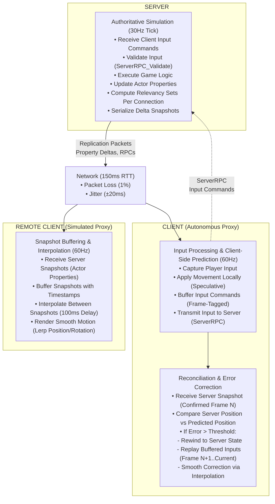

# Lesson 5: Replication Model, Network Authority, Prediction Reconciliation

## 1. First-Principles Intuition & Invariants

Networked multiplayer games present a fundamental computational paradox: deterministic simulation state must remain synchronized across physically distributed machines communicating over networks with unbounded latency, packet loss, and reordering. Unlike database systems where strong consistency protocols like Paxos or Raft can enforce serializable transaction ordering through quorum consensus, real-time games operate under strict perceptual latency budgets—typically 16.67 milliseconds per frame at 60 Hz—that preclude blocking synchronization primitives. A player pressing the fire button expects immediate visual feedback; waiting 150 milliseconds for server confirmation across continental distances would render the experience unplayable.

Unreal Engine resolves this tension through a server-authoritative replication model grounded in four invariant principles. First, the server owns canonical ground truth for all gameplay state. The server simulation advances at a fixed tick rate—commonly 30 Hz for competitive shooters, 60 Hz for esports titles—and produces a monotonically increasing sequence of authoritative world snapshots indexed by frame numbers. Second, clients execute speculative local predictions to mask network latency, running tentative simulations that assume their input commands succeed. When server corrections arrive indicating the prediction diverged from authority, the client must reconcile by rewinding state to the server-confirmed frame and replaying inputs forward. Third, bandwidth optimization through delta compression and relevancy filtering ensures only changed properties for nearby actors propagate to each client. Fourth, Remote Procedure Calls (RPCs) provide explicit imperative control flow across the network boundary, complementing the declarative property replication system.

The theoretical foundation rests on distributed systems concepts adapted for soft real-time constraints. Traditional distributed consensus algorithms prioritize safety—never delivering incorrect results—over liveness—always making progress. Multiplayer games invert this preference: liveness dominates because a frozen or stuttering experience is worse than occasional desynchronization artifacts like rubber-banding or phantom hits. Unreal's replication model implements eventual consistency rather than strong consistency, tolerating transient divergence between client and server worldviews as long as perceptible discrepancies remain bounded and corrections converge rapidly.

Consider the mechanical analogy of a mechanical governor on a steam engine. The governor does not prevent momentary speed fluctuations; instead, it continuously measures deviation from the setpoint and applies corrective force proportional to error magnitude. Similarly, client-side prediction allows the local simulation to race ahead of server confirmation, while the reconciliation system acts as a feedback controller that measures prediction error—the delta between client extrapolation and server ground truth—and applies corrective state adjustments to null the error term. The system exhibits control-theoretic properties: stability requires that prediction error diminishes over time rather than amplifying, and responsiveness depends on the correction bandwidth available within the per-frame computational budget.

Network authority determination follows a capability-based security model. Each `AActor` subclass declares which machine has mutation authority over specific properties and which RPCs it exposes for remote invocation. The `ENetRole` enumeration encodes this hierarchy: `ROLE_Authority` designates the server or the owning client for client-authoritative actors, `ROLE_AutonomousProxy` marks the controlling client's local representation, and `ROLE_SimulatedProxy` denotes remote clients observing replicated state. Authority flows downward—an authoritative actor can invoke RPCs on simulated proxies but not vice versa unless the RPC explicitly carries `WithValidation` semantics that allow the server to reject malformed requests.

This authority model prevents a broad class of exploits by construction. A malicious client cannot directly mutate another player's health variable because that property replicates unidirectionally from server to client. The client can only send input RPCs—move commands, fire weapon requests—which the server validates against authoritative game rules before applying state changes. If a client attempts to send a `ServerSetHealth` RPC claiming infinite hit points, the server either discards the packet if no such RPC exists or executes validation logic that rejects out-of-bounds values. The security invariant holds because the server never trusts client-asserted state; it only trusts client-asserted intent, which the authoritative simulation independently evaluates.

Delta serialization emerges as a bandwidth conservation necessity. A typical multiplayer session might track hundreds of replicated actors each with dozens of properties: transform matrices, physics velocities, animation states, inventory arrays. Naively serializing complete actor state each frame would saturate available bandwidth—a 100 Mbps connection supports approximately 12.5 MB/s, but games often target 128 Kbps per client to support players on asymmetric DSL or cellular links. At 30 Hz tick rate, this constrains each update packet to roughly 533 bytes. Delta compression exploits temporal coherence: most properties remain unchanged between consecutive frames, so the engine transmits only modified fields alongside their unique property identifiers from the reflection system.

Relevancy determination implements spatial and semantic partitioning to further reduce bandwidth consumption. Not every actor needs replication to every client—a player in North America does not require real-time updates about physics debris in an Asian server's distant simulation island. The `AActor::IsNetRelevantFor` virtual method encodes game-specific relevancy heuristics, typically combining distance culling with gameplay logic. For example, a flag carrier in a capture-the-flag mode might remain relevant at extended ranges to enable strategic awareness, while cosmetic particle effects become irrelevant beyond visual range. The server maintains per-client relevancy sets, recomputing membership each tick based on spatial queries and game rules, and only serializes actors in the relevant set for each connection.

## 2. Core Architecture & Mechanics

Unreal's replication system architecture organizes around three principal subsystems: the property replication graph, the RPC dispatch mechanism, and the client-side prediction and reconciliation pipeline. These components integrate with the engine's core object model through the `UObject` reflection system, which provides runtime introspection of class hierarchies, property metadata, and function signatures. The garbage collector and serialization infrastructure depend on this same reflection data, creating a unified metadata foundation.

The property replication graph begins with C++ class declarations annotated with Unreal Header Tool (UHT) macros. A typical replicated actor class structure appears as follows:

```cpp
UCLASS()
class AReplicatedCharacter : public ACharacter
{
    GENERATED_BODY()

public:
    AReplicatedCharacter();

    virtual void GetLifetimeReplicatedProps(TArray<FLifetimeProperty>& OutLifetimeProps) const override;

    UPROPERTY(ReplicatedUsing=OnRep_Health)
    float Health;

    UPROPERTY(Replicated)
    FVector_NetQuantize Velocity;

    UPROPERTY(ReplicatedUsing=OnRep_WeaponState)
    EWeaponState WeaponState;

    UFUNCTION()
    void OnRep_Health();

    UFUNCTION()
    void OnRep_WeaponState();

    UFUNCTION(Server, Reliable, WithValidation)
    void ServerFireWeapon(FVector_NetQuantize MuzzleLocation, FVector_NetQuantizeNormal AimDirection);
    void ServerFireWeapon_Implementation(FVector_NetQuantize MuzzleLocation, FVector_NetQuantizeNormal AimDirection);
    bool ServerFireWeapon_Validate(FVector_NetQuantize MuzzleLocation, FVector_NetQuantizeNormal AimDirection);
};
```

The `GetLifetimeReplicatedProps` override registers properties with the replication system, specifying conditions that govern when updates transmit. The implementation typically invokes the `DOREPLIFETIME` macro family:

```cpp
void AReplicatedCharacter::GetLifetimeReplicatedProps(TArray<FLifetimeProperty>& OutLifetimeProps) const
{
    Super::GetLifetimeReplicatedProps(OutLifetimeProps);

    DOREPLIFETIME(AReplicatedCharacter, Health);
    DOREPLIFETIME(AReplicatedCharacter, WeaponState);
    DOREPLIFETIME_CONDITION(AReplicatedCharacter, Velocity, COND_SimulatedOnly);
}
```

The `COND_SimulatedOnly` condition instructs the engine to replicate `Velocity` exclusively to simulated proxies—remote clients observing the character—but not to the autonomous proxy, which computes its own velocity locally through input processing. This conditional replication reduces redundant bandwidth; the owning client already knows its velocity from local simulation, so transmitting it back from the server wastes bytes.

Property change detection operates through a shadow state mechanism. The replication system maintains a per-connection replica of each actor's last-acknowledged property values. Before serializing an actor for transmission, the engine compares current property values against the shadow state using the property's comparison operator. Only properties exhibiting inequality since the last acknowledged update enter the outgoing bitstream. For complex types like `TArray`, specialized comparison logic detects element insertions, deletions, and modifications, encoding only the delta rather than retransmitting the entire array.

Quantization and compression techniques further optimize serialization. The `FVector_NetQuantize` type truncates floating-point precision from IEEE 754 double precision (64 bits) to integer centimeters, typically encoding each component in 21 bits for a coordinate range of ±1,048,576 centimeters (approximately ±10 kilometers) with 1-centimeter resolution. Direction vectors use `FVector_NetQuantizeNormal`, which exploits unit-length constraints to encode three-dimensional normals in 32 bits through spherical coordinate quantization. Rotators employ fixed-point encoding with configurable precision, commonly 16 bits per axis for 360-degree coverage at 0.0055-degree resolution.

RepNotify callbacks provide imperative hooks triggered when replicated properties change on the receiving client. The `OnRep_Health` function executes after the engine deserializes an updated `Health` value, allowing game code to respond with cosmetic effects or UI updates:

```cpp
void AReplicatedCharacter::OnRep_Health()
{
    if (Health <= 0.0f && !bDead)
    {
        bDead = true;
        PlayDeathMontage();
        DisableCollision();
    }
    UpdateHealthBar(Health);
}
```

RepNotify callbacks run on simulated and autonomous proxies but never on the authoritative actor, since the server or owning client directly modifies the property without serialization round-trips. This asymmetry requires careful design: state transitions must occur both in authoritative gameplay logic and in RepNotify handlers to ensure consistent behavior across network roles.

Remote Procedure Calls implement explicit message passing for imperative commands that do not fit the declarative property model. RPCs declare execution location (`Client`, `Server`, `NetMulticast`), reliability (`Reliable` or `Unreliable`), and optional validation. A server RPC like `ServerFireWeapon` allows the owning client to request a gameplay action:

```cpp
void AReplicatedCharacter::ServerFireWeapon_Implementation(FVector_NetQuantize MuzzleLocation, FVector_NetQuantizeNormal AimDirection)
{
    if (!CanFireWeapon())
    {
        return; // Server-side rejection of invalid fire request
    }

    WeaponState = EWeaponState::Firing;
    FVector TraceEnd = MuzzleLocation + AimDirection * 10000.0f;
    FHitResult HitResult;
    GetWorld()->LineTraceSingleByChannel(HitResult, MuzzleLocation, TraceEnd, ECC_Visibility);

    if (HitResult.bBlockingHit)
    {
        if (AActor* HitActor = HitResult.GetActor())
        {
            ApplyDamage(HitActor, 25.0f);
        }
    }

    MulticastPlayFireEffects(MuzzleLocation, AimDirection);
}

bool AReplicatedCharacter::ServerFireWeapon_Validate(FVector_NetQuantize MuzzleLocation, FVector_NetQuantizeNormal AimDirection)
{
    return !AimDirection.IsNearlyZero() && FMath::Abs(AimDirection.SizeSquared() - 1.0f) < 0.01f;
}
```

The `_Validate` function executes before `_Implementation`, allowing the server to reject malformed requests that might indicate client modification or packet corruption. Returning false from validation triggers a security response, typically disconnecting the offending client. This validation layer is essential for anti-cheat systems; without it, clients could inject arbitrary data into RPC parameters, potentially exploiting server logic vulnerabilities.

Multicast RPCs broadcast events from server to all connected clients, useful for cosmetic effects that require synchronization:

```cpp
UFUNCTION(NetMulticast, Unreliable)
void MulticastPlayFireEffects(FVector_NetQuantize MuzzleLocation, FVector_NetQuantizeNormal AimDirection);

void AReplicatedCharacter::MulticastPlayFireEffects_Implementation(FVector_NetQuantize MuzzleLocation, FVector_NetQuantizeNormal AimDirection)
{
    SpawnMuzzleFlash(MuzzleLocation);
    PlayFireSound(MuzzleLocation);
    SpawnTracerEffect(MuzzleLocation, MuzzleLocation + AimDirection * 10000.0f);
}
```

Marking multicast RPCs as unreliable trades guaranteed delivery for reduced latency and bandwidth overhead. Visual effects tolerate occasional packet loss—a missed tracer particle does not impact gameplay—so reliable transmission would waste bandwidth retransmitting cosmetic data.

Client-side prediction forms the perceptual latency masking layer. When an autonomous proxy processes input, it immediately applies movement logic locally, updating transform and physics state without waiting for server confirmation. Simultaneously, the client queues the input command in a ring buffer annotated with the local frame counter. The server processes client inputs with inherent network delay, then replicates authoritative state back to the client. Upon receiving a server update, the client compares the server's confirmed frame number against its local frame counter, identifying how many speculative frames it executed beyond server knowledge.

The reconciliation algorithm executes a three-phase procedure: rewind, replay, and resimulate. First, the client resets actor state to the last server-confirmed snapshot, discarding all speculative predictions. Second, it replays buffered input commands starting from the confirmed frame, re-executing movement logic deterministically. Third, it compares the replayed state at the current frame against the speculative state that was rendered. If the delta exceeds a tolerance threshold—typically a few centimeters for positional error—the client snaps or smoothly interpolates to the corrected position.

A concrete implementation of the prediction buffer and reconciliation loop appears below:

```cpp
struct FInputCommand
{
    uint32 FrameNumber;
    FVector MoveInput;
    FRotator ViewRotation;
    float DeltaTime;
    bool bJumpPressed;
};

class UPredictedMovementComponent : public UCharacterMovementComponent
{
    TArray<FInputCommand> InputBuffer;
    uint32 LastConfirmedFrame;
    FVector LastConfirmedLocation;
    FVector LastConfirmedVelocity;

    void PerformMovement(float DeltaTime);
    void OnServerPositionUpdate(FVector ServerLocation, FVector ServerVelocity, uint32 ServerFrame);
};

void UPredictedMovementComponent::PerformMovement(float DeltaTime)
{
    FInputCommand Cmd;
    Cmd.FrameNumber = ClientFrameCounter++;
    Cmd.MoveInput = ConsumeInputVector();
    Cmd.ViewRotation = GetControlRotation();
    Cmd.DeltaTime = DeltaTime;
    Cmd.bJumpPressed = bJumpInputPressed;

    InputBuffer.Add(Cmd);

    // Trim buffer to last 64 frames (~2 seconds at 30Hz)
    if (InputBuffer.Num() > 64)
    {
        InputBuffer.RemoveAt(0, InputBuffer.Num() - 64);
    }

    ApplyInputToMovement(Cmd);
    ServerSendMoveCommand(Cmd); // Transmit input to server
}

void UPredictedMovementComponent::OnServerPositionUpdate(FVector ServerLocation, FVector ServerVelocity, uint32 ServerFrame)
{
    LastConfirmedFrame = ServerFrame;
    LastConfirmedLocation = ServerLocation;
    LastConfirmedVelocity = ServerVelocity;

    FVector CurrentLocation = UpdatedComponent->GetComponentLocation();
    float PositionError = FVector::Dist(CurrentLocation, ServerLocation);

    if (PositionError > 5.0f) // 5cm tolerance threshold
    {
        // Rewind to confirmed state
        UpdatedComponent->SetWorldLocation(ServerLocation);
        Velocity = ServerVelocity;

        // Replay unacknowledged inputs
        for (const FInputCommand& Cmd : InputBuffer)
        {
            if (Cmd.FrameNumber > ServerFrame)
            {
                ApplyInputToMovement(Cmd);
            }
        }

        // Remove acknowledged commands from buffer
        InputBuffer.RemoveAll([ServerFrame](const FInputCommand& Cmd)
        {
            return Cmd.FrameNumber <= ServerFrame;
        });
    }
}
```

The movement component maintains a rolling window of input commands, each tagged with the client's local frame number. When the server transmits a position update, it includes the frame number corresponding to the last client input it processed. The client identifies unacknowledged inputs by comparing frame numbers, then replays them atop the server-confirmed state. This replay must execute identically to the original speculative simulation for prediction to succeed; any non-determinism—such as random number generation or floating-point inconsistencies—causes prediction divergence and unnecessary corrections.

Interpolation smoothing applies to simulated proxies observing remote actors. Simulated proxies do not predict; instead, they interpolate between received snapshots to produce smooth motion despite discrete network updates. A typical implementation maintains a fixed interpolation delay—commonly 100 milliseconds—and lerps between buffered snapshots:

```cpp
void USimulatedProxyComponent::TickComponent(float DeltaTime, ELevelTick TickType, FActorComponentTickFunction* ThisTickFunction)
{
    Super::TickComponent(DeltaTime, TickType, ThisTickFunction);

    float RenderTime = GetWorld()->GetTimeSeconds() - InterpolationDelay;

    // Find snapshots bracketing render time
    FSnapshot* Snapshot0 = nullptr;
    FSnapshot* Snapshot1 = nullptr;

    for (int32 i = 0; i < SnapshotBuffer.Num() - 1; ++i)
    {
        if (SnapshotBuffer[i].Timestamp <= RenderTime && SnapshotBuffer[i+1].Timestamp >= RenderTime)
        {
            Snapshot0 = &SnapshotBuffer[i];
            Snapshot1 = &SnapshotBuffer[i+1];
            break;
        }
    }

    if (Snapshot0 && Snapshot1)
    {
        float Alpha = (RenderTime - Snapshot0->Timestamp) / (Snapshot1->Timestamp - Snapshot0->Timestamp);
        FVector InterpolatedLocation = FMath::Lerp(Snapshot0->Location, Snapshot1->Location, Alpha);
        FRotator InterpolatedRotation = FMath::Lerp(Snapshot0->Rotation, Snapshot1->Rotation, Alpha);

        UpdatedComponent->SetWorldLocation(InterpolatedLocation);
        UpdatedComponent->SetWorldRotation(InterpolatedRotation);
    }

    // Prune old snapshots
    SnapshotBuffer.RemoveAll([RenderTime](const FSnapshot& Snap)
    {
        return Snap.Timestamp < RenderTime - 1.0f;
    });
}
```

This interpolation scheme trades latency for smoothness. Simulated proxies render positions 100 milliseconds in the past relative to the server's current state, but this delay remains imperceptible to observers while eliminating jitter from packet arrival variance. The technique exploits the asymmetry in perceptual latency tolerance: local actions demand immediate feedback, but remote actor motion tolerates presentation lag as long as it appears continuous.

The network architecture diagram below illustrates the dataflow between client and server, showing input transmission, authoritative simulation, replication, and reconciliation:



The server operates as the central authority, processing client inputs at its fixed tick rate and broadcasting state updates. Autonomous proxies execute optimistic local predictions to mask latency, reconciling periodically against server corrections. Simulated proxies sacrifice real-time accuracy for smooth interpolation, rendering positions slightly in the past. This three-tier architecture balances responsiveness, consistency, and visual quality under real-world network conditions.

## 3. High-Performance Optimization & Failure Modes

Bandwidth optimization in production multiplayer systems requires meticulous attention to serialization efficiency and relevancy culling. Network profiling tools expose per-actor and per-property bandwidth consumption, enabling targeted optimization. The Unreal Network Profiler visualizes replication costs as flame graphs, identifying bandwidth hotspots. Common inefficiencies include over-replication of cosmetic properties, failure to apply conditional replication, and excessive RPC invocation rates.

Adaptive tick rate scaling adjusts server simulation frequency based on player count and computational load. A dedicated server might run at 60 Hz with ten players but degrade to 30 Hz when the player count exceeds fifty, trading temporal resolution for aggregate throughput. This adaptation requires careful tuning of client interpolation delays and prediction windows to maintain perceptual quality across variable server rates.

Spatial partitioning schemes enhance relevancy determination performance. Naive relevancy checks iterate all actors against all connections, yielding quadratic complexity $O(N \times M)$ for $N$ actors and $M$ clients. Grid-based spatial hashing reduces this to $O(N + M)$ by bucketing actors into cells and querying only nearby cells per client. Hierarchical schemes like octrees further optimize sparse distributions, particularly in open-world environments where actors cluster around player positions.

Delta compression extends beyond individual properties to struct and array members. The Fast Array Serializer system in Unreal provides efficient replication of `TArray` collections by tracking per-element dirty flags. When an element changes, only that element serializes rather than the entire array. The implementation maintains a shadow array per connection, computing deltas through element-wise comparison:

```cpp
USTRUCT()
struct FInventoryItem : public FFastArraySerializerItem
{
    GENERATED_BODY()

    UPROPERTY()
    int32 ItemID;

    UPROPERTY()
    int32 Quantity;
};

USTRUCT()
struct FInventoryList : public FFastArraySerializer
{
    GENERATED_BODY()

    UPROPERTY()
    TArray<FInventoryItem> Items;

    bool NetDeltaSerialize(FNetDeltaSerializeInfo& DeltaParms)
    {
        return FFastArraySerializer::FastArrayDeltaSerialize<FInventoryItem, FInventoryList>(Items, DeltaParms, *this);
    }
};

template<>
struct TStructOpsTypeTraits<FInventoryList> : public TStructOpsTypeTraitsBase2<FInventoryList>
{
    enum { WithNetDeltaSerializer = true };
};
```

This pattern serializes only added, removed, or modified inventory items rather than retransmitting the complete list each frame. For a 100-item inventory with one item changed per second, this reduces bandwidth from 100 items per frame at 30 Hz (3,000 item serializations per second) to approximately 30 item serializations per second, a hundredfold improvement.

Connection quality adaptation implements dynamic bitrate adjustment based on measured packet loss and latency. The Unreal NetDriver tracks per-connection statistics, adjusting serialization fidelity in response to congestion. Under heavy packet loss, the engine can reduce update rates for low-priority actors, increase quantization to shrink packet sizes, or temporarily suspend replication of cosmetic properties. This graceful degradation maintains core gameplay state synchronization even as network conditions deteriorate.

Prediction failure modes manifest as perceptible artifacts when client speculation diverges from server authority. Rubber-banding occurs when prediction error exceeds the correction threshold, forcing a visible discontinuous snap to the server-confirmed position. Phantom objects arise when the client predicts an interaction—such as picking up an item—that the server rejects, requiring the client to undo the speculative action. Minimizing these artifacts demands tight prediction accuracy through deterministic simulation logic and conservative speculation on actions with contested outcomes.

Determinism in prediction replay hinges on eliminating non-deterministic inputs during movement computation. Random number generation, world queries against dynamic objects, and floating-point operations with compiler-dependent rounding modes introduce divergence. A robust prediction system restricts movement logic to purely deterministic calculations, deferring non-deterministic effects to RepNotify callbacks or multicast RPCs that execute consistently on all clients.

Cheat mitigation strategies leverage server authority to enforce invariants impossible for clients to violate. Movement validation computes maximum achievable displacement given the time delta and movement capabilities, rejecting teleportation attempts. Weapon fire validation verifies line-of-sight from the claimed muzzle position to the hit location, preventing clients from reporting hits through walls. Cooldown tracking on the server prevents clients from sending RPCs faster than game rules allow:

```cpp
bool AReplicatedCharacter::ServerFireWeapon_Validate(FVector_NetQuantize MuzzleLocation, FVector_NetQuantizeNormal AimDirection)
{
    // Validate fire rate
    float TimeSinceLastFire = GetWorld()->GetTimeSeconds() - LastFireTime;
    if (TimeSinceLastFire < MinFireInterval)
    {
        return false; // Fire rate too high
    }

    // Validate muzzle location proximity to actual character location
    float MuzzleDistanceError = FVector::Dist(MuzzleLocation, GetActorLocation());
    if (MuzzleDistanceError > 200.0f) // 2m tolerance for animation offset
    {
        return false; // Muzzle too far from character
    }

    // Validate aim direction is normalized
    if (FMath::Abs(AimDirection.SizeSquared() - 1.0f) > 0.01f)
    {
        return false; // Invalid direction vector
    }

    return true;
}
```

Anti-lag compensation techniques reconcile the temporal disparity between client perception and server state. When a client fires at a moving target, the target's server position has advanced beyond where the client rendered it due to interpolation delay and network latency. Server-side rewind systems address this by storing historical snapshots of actor positions, rewinding to the client's perceived time when validating hit detection:

```cpp
void AReplicatedCharacter::ServerFireWeapon_Implementation(FVector_NetQuantize MuzzleLocation, FVector_NetQuantizeNormal AimDirection)
{
    float ClientTime = GetWorld()->GetTimeSeconds() - GetPlayerState()->ExactPing * 0.5f;

    // Rewind world to client's perceived time
    GetWorld()->BeginHistoricalSimulation(ClientTime);

    FVector TraceEnd = MuzzleLocation + AimDirection * 10000.0f;
    FHitResult HitResult;
    GetWorld()->LineTraceSingleByChannel(HitResult, MuzzleLocation, TraceEnd, ECC_Visibility);

    GetWorld()->EndHistoricalSimulation();

    if (HitResult.bBlockingHit)
    {
        ApplyDamage(HitResult.GetActor(), 25.0f);
    }

    MulticastPlayFireEffects(MuzzleLocation, AimDirection);
}
```

This lag compensation ensures that hits register as the client perceived them, compensating for up to 150 milliseconds of round-trip latency. The historical snapshot buffer typically retains 200-300 milliseconds of state, sufficient for most realistic latency scenarios while bounded to prevent memory bloat.

Scalability testing under production conditions requires stress testing with synthetic client loads. Tools like Unreal's Gauntlet framework automate spawning hundreds of simulated clients, measuring server frame time, bandwidth consumption, and memory usage as player count scales. Profiling often reveals unexpected bottlenecks: quadratic collision checks between players, inefficient database queries for persistent state, or garbage collection pauses triggered by actor churn. Addressing these requires systemic refactoring—spatial indexing, database connection pooling, object pooling to reduce allocations—rather than localized optimizations.

Connection handoff and seamless travel enable persistent player state across map transitions in open-world games. The server serializes player actor state, transmits it to the destination server, and destroys the local instance. The receiving server deserializes the state, spawning a new player actor that appears continuous to the client despite transitioning between distinct server processes. This distributed architecture scales massively multiplayer environments by partitioning the world across multiple server instances, each authoritative for a geographic region.

Security auditing of replication code demands adversarial thinking. Every server RPC represents an attack surface where malicious clients inject crafted packets. Validation must assume clients lie about everything: positions, rotations, timestamps, object references. A common vulnerability involves RPC parameters of `AActor*` type allowing clients to reference arbitrary objects:

```cpp
UFUNCTION(Server, Reliable)
void ServerInteractWithActor(AActor* TargetActor);
```

Without validation, a malicious client could pass a pointer to an admin-only actor, exploiting server logic that assumes all interactions originate from legitimate gameplay. Robust validation checks object references against reachability constraints, ensuring clients can only interact with actors in proximity and within their authority domain.

Observability in production multiplayer systems requires real-time metrics collection and anomaly detection. Server-side instrumentation tracks per-connection bandwidth, RPC invocation rates, prediction error magnitudes, and replication list sizes. Outlier detection algorithms flag clients exhibiting suspicious patterns: excessive RPC rates, impossible movement velocities, or zero prediction error indicating disabled reconciliation. These signals feed automated moderation systems that quarantine suspected cheaters or throttle abusive connections before they disrupt the broader player population.

The replication model's complexity demands rigorous testing methodologies combining unit tests, integration tests, and chaos engineering. Unit tests validate individual property serialization, RPC marshaling, and delta compression correctness. Integration tests simulate multi-client scenarios with injected packet loss and latency, verifying prediction reconciliation and interpolation smoothness. Chaos engineering introduces byzantine failures—malicious clients sending malformed packets, corrupted state, or coordinated attacks—ensuring the server remains stable and secure under adversarial conditions. Production-grade multiplayer engines emerge from this iterative refinement, hardened against the probabilistic and adversarial nature of networked game development.
