# Lesson 6: Asset Pipeline, Serialization Framework, Cook-Time Transformations

## 1. First-Principles Intuition & Invariants

Unreal Engine's asset pipeline represents one of the most sophisticated build-time transformation systems in commercial game engine architecture, serving as the critical bridge between artist-authored source content and runtime-optimized binary representations. At its philosophical core, the pipeline embodies a fundamental separation of concerns: content creators work with high-fidelity, editor-friendly representations that prioritize iteration speed and malleability, while shipped products consume platform-specific, stripped, compressed binary packages optimized for minimal load latency and memory footprint. This duality necessitates a complex compile-time transformation layer—the cooking process—that mirrors the role of an optimizing compiler in traditional software engineering, but operating on heterogeneous multimedia assets rather than source code.

The asset pipeline's design emerges from several invariant constraints that shape its architecture. First, the system must maintain referential integrity across thousands of interconnected assets: a material references textures, a blueprint references meshes, an animation montage references skeletal meshes and sound cues. This web of dependencies forms a directed acyclic graph that must be preserved through serialization, validated at load time, and efficiently traversed during streaming operations. Second, the pipeline must support deterministic builds: given identical source assets and cook parameters, the system must produce byte-for-byte identical output packages, enabling distributed build systems and incremental cooking. Third, it must gracefully handle the impedance mismatch between editor workflow (where assets are mutable objects in memory, freely referenceable via soft object paths) and runtime constraints (where assets are immutable read-only pages mapped from disk, referenced by compact integer indices).

The package file itself serves as the fundamental unit of serialization, a self-contained binary archive that encapsulates one or more UObject instances along with their complete transitive dependency closure. Understanding the package format requires recognizing that Unreal's serialization is not a simple struct-to-bytes encoding, but rather a sophisticated virtual machine for reconstructing complex object graphs. Each package begins with a summary header containing critical metadata: the package file version tag (a 32-bit integer encoding engine version, licensee version, and custom version GUID), unversioned property serialization flags, a table of import objects (external references to other packages), a table of export objects (the assets actually contained in this package), and a name table mapping string constants to compressed integer indices. This header layout reflects decades of evolutionary refinement, balancing the competing needs of fast seek-free streaming, efficient memory mapping, and backward compatibility across engine versions.

The serialization framework itself is grounded in Unreal's reflection system, where every UObject-derived class registers its properties and methods through compile-time metaprogramming. When an asset serializes, the system walks this reflected property graph, recursively encoding each field according to its declared type: numeric primitives encode as little-endian fixed-width integers, strings encode as length-prefixed UTF-16 or UTF-8 sequences, object references encode as indices into the import/export tables, and container types (TArray, TMap, TSet) encode element counts followed by element data. Critically, the serializer supports schema evolution through tagged property serialization: each property writes its name hash before its data, allowing the deserializer to skip unknown properties when loading assets saved by newer engine versions. This forward compatibility mechanism comes at a storage cost—typically 20-30% overhead compared to unversioned serialization—but proves essential for teams working across multiple engine branches.

The derived data cache (DDC) introduces a layer of indirection that decouples source asset modification from expensive reprocessing. When you import a 4K texture or compile a blueprint, Unreal generates derived data—compressed texture mipmap chains, bytecode-compiled Kismet graphs, optimized skeletal mesh GPU buffers—and stores these artifacts in a content-addressable cache keyed by a cryptographic hash of the source asset and all relevant cook settings. Subsequent builds skip regeneration if the cache contains a valid entry, transforming cook times from hours to minutes for incremental changes. The DDC employs a tiered storage hierarchy: local disk cache for single-developer workflows, shared network cache for team collaboration, and cloud-backed S3 or similar for distributed build farms. Each tier implements a simple get/put interface over binary blobs identified by 160-bit SHA-1 digests, allowing transparent fallback: a cache miss at the local tier triggers a fetch from the network tier, which itself may hydrate from the cloud tier.

Asset registry indexing provides the metadata layer that enables Unreal's content browser, reference viewer, and dependency analysis tools. Unlike the package files themselves—which require full deserialization to inspect—the asset registry maintains a fast queryable index mapping asset paths to lightweight metadata records: asset class, package file size, import dependencies, searchable tags, and thumbnail references. The registry builds incrementally during editor startup by scanning package summary headers without loading asset payloads, then persists to a single `AssetRegistry.bin` file in the project's `Metadata` directory. This architecture supports O(1) lookup of "what assets reference this texture" or "find all blueprints implementing interface X" queries that would otherwise require deserializing the entire content tree. The registry's dependency graph powers the reference viewer's visualization and the cook-on-the-fly server's hot reload mechanisms, making it an indispensable component for large-scale content management.

Cook-time transformations represent the pipeline's most sophisticated optimization layer, applying platform-specific data layout transformations, compression, and stripping operations that would be infeasible at runtime. For texture assets, cooking selects mipmap generation algorithms (box filter, Kaiser filter, or custom), applies block compression (BC1-BC7 on PC, ASTC on mobile, proprietary formats on consoles), generates streaming mipmap metadata, and may quantize HDR textures from 16-bit float to 11-11-10 packed formats. For skeletal meshes, cooking performs LOD generation, vertex buffer layout optimization (cache-friendly triangle strips, vertex reordering for GPU cache), bone influence culling, and morph target compression. For blueprints, cooking strips editor-only properties (node positions, comments, debug data), inlines constant expressions, performs dead code elimination on unreachable execution paths, and serializes to a compact bytecode format. These transformations are irreversible: cooked packages cannot be edited or inspected in the editor, establishing a one-way membrane between development and production.

Streaming chunk generation partitions cooked content into load-on-demand units aligned with the game's spatial or narrative structure. A typical large game might define chunks corresponding to open-world sectors, dungeon levels, or DLC packs, where each chunk forms a self-contained pak file with its own header and export table. The chunking system respects a strict hierarchy: the base chunk contains engine code and always-resident assets (UI textures, player character), while optional chunks reference but do not duplicate base assets. This deduplication emerges from the import table mechanism: an asset in chunk 2 that references a material in the base chunk encodes that reference as an import entry pointing to the base package's export, not a second copy of the material data. The streaming system then ensures that before chunk 2 loads, all its import dependencies have resolved, maintaining referential integrity across chunk boundaries.

The package file format's binary layout reflects these concerns through a carefully designed structure that enables efficient streaming and memory mapping. After the file header, the package serializes several critical tables in sequence: the name table (sorted for binary search), the gatherable text data table (for localization), the import table (external references), the export table (internal assets), the depends table (dependency metadata), and finally the bulk data payloads (texture pixel data, audio samples, mesh vertex buffers). Export entries encode their serialized data as file offsets and byte lengths, allowing the streaming system to issue a single range read or memory map operation to load an asset without parsing irrelevant data. For large assets exceeding several megabytes, Unreal employs separate bulk data files with the `.ubulk` or `.uptnl` extensions, storing the header and metadata in the main package while bulk payloads live in side-car files that stream independently.

## 2. Core Architecture & Mechanics

The serialization framework's runtime behavior centers on the `FArchive` abstract base class, a bidirectional stream abstraction that unifies loading and saving through operator overloading. Concrete archive implementations—`FArchiveFileReaderGeneric`, `FArchiveFileWriterGeneric`, `FArchiveLoadCompressedProxy`, `FArchiveSaveCompressedProxy`—override virtual methods like `Serialize(void* Data, int64 Length)` to handle actual I/O, while higher-level serialization logic remains implementation-agnostic. When serializing a UObject, the system invokes `Serialize(FArchive& Ar)` methods that chain through the class hierarchy: derived class serializes its members, calls `Super::Serialize(Ar)`, which recurses to the parent, until reaching `UObject::Serialize` which handles universal concerns like outer references and flags.

```mermaid
flowchart TD
    Header["Package File Summary Header<br/>• File Version Tag (Engine + Licensee + Custom GUIDs)<br/>• Total Header Size (byte offset to first export)<br/>• Name Table: Offset + Count<br/>• Gatherable Text Data: Offset + Count<br/>• Import Table: Offset + Count<br/>• Export Table: Offset + Count<br/>• Depends Table: Offset + Count<br/>• Soft Package References: Offset + Count<br/>• Asset Registry Data: Offset + Size<br/>• Bulk Data Start Offset<br/>• World Tile Info (if world partition enabled)<br/>• Package Flags (PKG_ContainsMap, PKG_Cooked, etc.)"]
    
    NameTable["Name Table (Compressed FString array)<br/>• Entry[0]: 'None' (reserved)<br/>• Entry[1]: 'StaticMesh'<br/>• Entry[2]: 'SM_Rock_Large_A'<br/>• ...<br/>• Entry[N]: 'MaterialInstanceConstant'<br/>• (Each entry: uint32 hash, uint32 length, UTF-8 bytes)"]
    
    ImportTable["Import Table (External Object References)<br/>Import[0]:<br/>  - ClassPackage: 'Engine'<br/>  - ClassName: 'StaticMesh'<br/>  - ObjectName: 'SM_Foundation'<br/>  - OuterIndex: 0 (package-level import)<br/>Import[1]:<br/>  - ClassPackage: 'Engine'<br/>  - ClassName: 'Material'<br/>  - ObjectName: 'M_Basic'<br/>  - OuterIndex: 0"]
    
    ExportTable["Export Table (Assets Defined in This Package)<br/>Export[0]:<br/>  - ClassIndex: Import[0] (StaticMesh)<br/>  - SuperIndex: -1 (no super)<br/>  - OuterIndex: 0 (package root)<br/>  - ObjectName: 'SM_Rock_Large_A'<br/>  - SerialSize: 245760 bytes<br/>  - SerialOffset: 0x1A400 (file position)<br/>  - ObjectFlags: RF_Public | RF_Standalone<br/>Export[1]:<br/>  - ClassIndex: Import[1] (Material)<br/>  - ObjectName: 'M_Rock_Diffuse'<br/>  - SerialSize: 8192 bytes<br/>  - SerialOffset: 0x57800"]
    
    DependsTable["Preload Dependency Table (Optional, for streaming)<br/>• Export[0] depends on: [Import[1], Export[1]]<br/>• Export[1] depends on: [Import[1]]"]
    
    SerialData["Serialized Export Data (Actual Asset Payloads)<br/>[Offset 0x1A400]: StaticMesh SM_Rock_Large_A<br/>  - LODData[0]:<br/>    • VertexBuffer (positions, normals, UVs)<br/>    • IndexBuffer (triangle list)<br/>    • SectionInfo (material slots, vertex ranges)<br/>  - LODData[1]: ... (lower detail)<br/>  - Bounds: FBox(Min, Max), FSphere(Center, Radius)<br/>  - Materials: [FObjectImport ref to M_Rock_Diffuse]<br/>[Offset 0x57800]: Material M_Rock_Diffuse<br/>  - Parent: Import[1] (M_Basic)<br/>  - Scalar Parameters: [Roughness=0.8]<br/>  - Texture Parameters: [Diffuse=Import[2]]<br/>  - Compiled Material Resource (shader bytecode)"]
    
    BulkData["Bulk Data Payloads (Large Binary Blobs)<br/>• Texture Mipmap Chains (compressed, e.g., BC7)<br/>• Audio Sample Data (compressed, e.g., Vorbis)<br/>• Skeletal Animation Curve Data<br/>• (May reside in separate .ubulk file for >16MB assets)"]
    
    Header --> NameTable
    NameTable --> ImportTable
    ImportTable --> ExportTable
    ExportTable --> DependsTable
    DependsTable --> SerialData
    SerialData --> BulkData
```

The import and export table mechanism implements a two-tier addressing scheme that resolves external references while maintaining package independence. Import entries encode references to objects defined in other packages, storing the class name, object name, and outer hierarchy as string indices into the name table. At load time, the engine resolves imports lazily: the first access to an imported object triggers package loading if not already resident, walking the object path to locate the referenced asset. Export entries define objects stored in this package, encoding their class (as an import or export index), serialized data location (file offset and byte length), and flags. This indirection enables the streaming system to load objects on-demand: rather than deserializing the entire package, the loader seeks directly to the export's data offset, reads the payload, and instantiates the UObject.

The derived data cache implementation leverages a plugin architecture where different derived data builders register with the DDC system, each implementing a `Build()` method that transforms source data into optimized output. For texture assets, the `FTextureCacheDerivedDataWorker` reads the source image (TGA, PNG, EXR), applies platform-specific compression (BC7 for high-quality color, BC5 for normal maps, ASTC 6x6 for mobile), generates mipmap chains using the selected filter, and serializes the compressed mipmap data along with metadata (format, dimensions, texture group). The builder computes a cache key by hashing the source image file hash, texture import settings (compression quality, mipmap generation mode), and target platform capabilities, ensuring that any change to inputs invalidates the cached result. The DDC stores this derived data as a binary blob, typically 50-80% smaller than the uncompressed source due to block compression.

For blueprint assets, the derived data builder performs bytecode compilation, a multi-pass process that transforms the visual node graph into a linear instruction stream. The first pass resolves node signatures, mapping visual function calls to native C++ UFunctions or other blueprint functions through the reflection system. The second pass performs control flow analysis, identifying unreachable code paths and redundant execution pins. The third pass performs constant folding and dead code elimination: if a Branch node's condition input is a literal true, the compiler eliminates the false path entirely. The fourth pass allocates local variables to a flat array, assigning each unique variable name a stack index. The fifth pass serializes to bytecode: each node emits opcodes like `EX_CallFunction`, `EX_LetBool`, `EX_JumpIfNot`, encoding operands as indices into the import table (for UFunction calls), the local variable array (for temporary storage), or literal constant pools (for numeric values). The resulting bytecode typically consumes 10-15KB per moderately complex blueprint, compared to 50-100KB for the editor-friendly node graph representation.

The cook-on-the-fly server extends the pipeline's architecture to support hot reload during development, enabling rapid iteration without full project recooks. When launched, the server scans the project's content directories, indexes all source assets into the asset registry, and opens a TCP socket listening for client connections. A PIE (Play In Editor) session or standalone game instance connects to this server, sending asset load requests as packages stream in. Upon receiving a request, the server checks if the requested package exists in cooked form (in the project's Saved/Cooked directory); if not, it invokes the cooker to generate the package on-demand, applying platform-specific transformations as if performing a full cook. The server then streams the cooked package bytes over the network socket to the client, which deserializes and instantiates the assets as if loading from local disk. When a source asset modifies (detected via filesystem watch), the server invalidates its cached cooked package and recompiles on the next request, enabling sub-second turnaround for shader or blueprint changes.

Chunk manifest generation occurs during the final stages of cooking, where the system partitions cooked packages into streaming chunks based on project-defined rules. The `DefaultGame.ini` configuration file specifies chunk assignments using asset path patterns: all assets under `/Game/Maps/ForestZone` belong to chunk 1, all assets under `/Game/Maps/DesertZone` belong to chunk 2, and so forth. The chunker walks the asset registry's dependency graph, computing the transitive closure of each chunk's explicit assets to identify all required imports. Assets referenced by multiple chunks promote to a shared chunk or the base chunk (chunk 0), preventing duplication. The chunker then serializes each chunk as a separate pak file, a simple archive format consisting of a header (pak version, index offset, encrypted AES key if applicable), file index (mapping asset paths to offsets and sizes), and contiguous payload data. The resulting pak files enable streaming systems to issue a single file open, seek to the asset's offset, and read the required bytes, minimizing I/O latency.

The package loading pipeline demonstrates these mechanics in concrete form. When gameplay code invokes `LoadObject<UStaticMesh>("/Game/Props/SM_Rock")`, the engine performs several steps:

1. **Asset Registry Lookup**: Query the asset registry to locate the package file path (`/Game/Props/SM_Rock.uasset`) and verify the asset exists. If not found, log a warning and return nullptr.

2. **Package Manager Query**: Check if the package is already loaded in memory. The package manager maintains a global map of loaded packages keyed by name. If found, return the cached UStaticMesh pointer.

3. **Async Load Request**: If not loaded, queue an async load request. The streaming thread opens the package file, memory-maps the header region, and parses the package summary to extract table offsets.

4. **Import Resolution**: Parse the import table, recursively loading any imported packages that aren't resident. For example, if SM_Rock references a material in another package, that material's package must load first to satisfy the dependency.

5. **Export Instantiation**: Seek to the export's serialized data offset, allocate a new UStaticMesh object via the class default object's `CreateDefaultObject()` mechanism, and invoke `Serialize(FArchive& Ar)` to populate the object's properties from the binary stream.

6. **Post-Load Initialization**: After deserialization completes, invoke `PostLoad()` on the newly created object, allowing it to perform one-time initialization (rebuild octrees, register with subsystems, etc.).

7. **Reference Fixup**: Walk the object's properties, resolving any soft object paths (string-based references like "/Game/Materials/M_Rock") to hard object pointers by invoking the same loading pipeline recursively.

This sequence completes in 1-5 milliseconds for small assets on NVMe SSDs, but can extend to 50-100ms for large skeletal meshes or textures with many mipmap levels. The streaming system pipelines multiple loads in parallel, issuing async I/O for dozens of packages simultaneously to saturate disk bandwidth.

## 3. High-Performance Optimization & Failure Modes

Optimizing the asset pipeline for large-scale projects demands attention to both build-time performance and runtime loading efficiency. Build-time optimization centers on minimizing redundant work through aggressive use of the derived data cache and incremental cooking. A full project cook for a AAA game might process 200,000+ assets, taking 6-12 hours on a high-end workstation. However, subsequent cooks with DDC hits complete in under an hour, processing only the small percentage of modified assets. Achieving high DDC hit rates requires careful discipline: any change to cook settings, engine version, or plugin configuration invalidates the entire cache, forcing a complete rebuild. Teams working with distributed build systems employ shared DDC backends (S3 buckets, network file shares) where build agents write derived data that all developers can consume, amortizing expensive operations like lightmap baking or animation compression across the entire team.

The cooking process itself benefits from parallelization, where the cooker spawns worker threads proportional to CPU core count to process independent assets concurrently. However, not all asset types parallelize effectively: blueprint compilation requires global knowledge of the class hierarchy (to resolve function calls and variable types), forcing sequential processing. Texture compression parallelizes near-perfectly: each texture compresses independently, and modern block compressors (ISPCTextureCompressor) leverage SIMD instructions to process 16 pixels per operation. Skeletal mesh optimization shows intermediate parallelism: LOD generation and vertex buffer optimization run per-mesh, but bone influence calculations may require scanning multiple meshes if bones are shared across a skeleton hierarchy.

Memory management during cooking presents unique challenges, as the cooker must load source assets, generate derived data, and serialize cooked packages without exhausting system RAM. Unreal employs several strategies to bound memory usage. First, the cooker processes assets in batches, loading and cooking a subset (typically 1000-5000 assets) before flushing cooked packages to disk and unloading source data. Second, the garbage collector runs between batches, reclaiming memory from unreferenced UObjects. Third, streaming bulk data (texture pixels, audio samples) remains unmapped during cooking: the cooker reads file headers to extract metadata but never loads multi-megabyte payloads into RAM. Despite these optimizations, cooking a large project on a machine with insufficient RAM (less than 32GB for projects with 100K+ assets) risks thrashing to swap or running out of virtual address space on 32-bit systems.

Runtime loading optimization focuses on minimizing stalls caused by synchronous asset loads. The primary technique is async preloading, where the streaming system speculatively loads assets before they're needed based on predicted player movement. For open-world games, the streaming manager divides the world into a spatial grid, associating each cell with a set of required assets (meshes, textures, sounds). As the player moves, the manager preloads assets for cells within a configurable radius (e.g., 200 meters), unloads assets for distant cells, and maintains a hysteresis band to prevent thrashing at cell boundaries. This preloading hides I/O latency: by the time the player enters a new cell, its assets have already loaded in the background. However, preloading introduces memory pressure, as the system must keep multiple cells resident simultaneously. Tuning the preload radius, memory budget, and unload distance forms a key optimization task, balancing streaming stalls against memory footprint.

Package format optimization reduces load times through layout and compression choices. Unreal supports multiple compression algorithms—Zlib, Gzip, Oodle, LZ4—each with different tradeoffs. Zlib achieves moderate compression ratios (40-60% size reduction) with moderate decompression speed (200-400 MB/s single-threaded). Oodle achieves higher compression ratios (50-70%) with faster decompression (800-1200 MB/s using Kraken codec), but requires a commercial license. LZ4 prioritizes speed over ratio, decompressing at 2-4 GB/s but achieving only 30-40% size reduction. For streaming scenarios where decompression occurs on the critical path, LZ4 minimizes CPU overhead. For packaged downloads where size dominates, Oodle maximizes bandwidth savings. The cooker applies compression at the chunk level: entire pak files compress as a single stream, rather than per-asset, improving compression ratios by exposing cross-asset redundancy (repeated string tables, similar vertex buffer layouts).

Reference graph optimization prevents dependency bloat, where high-level assets transitively reference large swaths of content. Consider a UI widget that displays player stats: if the widget references the player character blueprint, and the character blueprint references its skeletal mesh, animations, and materials, then loading the UI widget forces loading the entire character package, inflating memory by megabytes. Best practice refactors such references to use soft object paths (FString-based references resolved at runtime) instead of hard object pointers (UPROPERTY references that force loading). The asset registry's reference viewer visualizes these dependencies, highlighting assets with excessive incoming or outgoing edges. Pruning unnecessary references—converting hard to soft references, splitting monolithic blueprints into smaller components—reduces load times and memory usage.

Cook-time transformation failures manifest as runtime crashes or visual artifacts, often caused by version mismatches or invalid assumptions in builder logic. A common failure mode occurs when texture compression settings change between source asset import and cooking: if an artist imports a texture as BC7 (high-quality color) but cook settings override to BC1 (low-quality color with 1-bit alpha), the visual result may show unexpected transparency or color banding. Similarly, skeletal mesh LOD generation may produce degenerate triangles if the simplification algorithm's parameters are too aggressive, causing cracks or flashing polygons at LOD transitions. Detecting such failures requires validation passes: the cooker can compute mesh bounds before and after LOD generation, flagging cases where bounds shrink unexpectedly (indicating collapsed geometry).

Blueprint compilation failures during cooking stem from several root causes. Type mismatches arise when a blueprint references a function or property that changed signature between editor sessions: the source blueprint expects a function with three integer parameters, but the native C++ code now declares four parameters with a new enum type. The compiler detects this during bytecode generation, emitting an error and halting the cook. Circular dependencies emerge when blueprint A references blueprint B which references A, creating an unresolvable load order. The compiler detects cycles by maintaining a visit stack during dependency traversal, emitting an error with the cycle path (A → B → A). Orphaned nodes occur when a blueprint references a plugin or engine module that isn't enabled for the target platform: the visual graph contains a "Spawn Widget" node that requires the UMG module, but the cook targets a headless server that excludes UMG. The compiler flags these as missing imports, forcing the developer to either enable the required modules or conditionally disable the node path.

Streaming chunk balance represents a critical tuning parameter for open-world or level-based games. Ideally, chunks load and unload rapidly enough that players never stall waiting for content. However, unbalanced chunks create pathological cases: a chunk containing a single high-resolution texture might consume 100MB, while another chunk with dozens of small assets totals 5MB. The streaming system must load both chunks if the player needs content from each, resulting in 100MB of memory overhead despite needing only a fraction of the large chunk's data. Rebalancing chunks—splitting large assets into separate chunks or merging small assets into shared chunks—reduces peak memory usage and improves load times. The cooker's chunk manifest generator exposes size histograms, allowing developers to identify outliers and redistribute assets.

DDC invalidation represents a persistent failure mode where seemingly innocuous changes trigger full cache misses. Consider a project that modifies a base material: since all material instances derive from this parent, the DDC keys for every material instance change, invalidating cached derived data. Recompiling thousands of material instances can add 30-60 minutes to the next cook. Similarly, changing the project's target platform (from Windows to PlayStation) invalidates all platform-specific cached data: texture compression settings differ, shader compilation targets a different GPU architecture, and audio codecs change. Teams mitigate this by maintaining separate DDC namespaces per platform, where each platform's derived data resides in isolated cache buckets, preventing cross-contamination.

Serialization version skew occurs when loading a package saved by a newer engine version than the current runtime. The package summary header encodes the saving engine's version (major.minor.patch plus custom version GUIDs for licensee changes). If the runtime's version predates the package's version, the loader invokes compatibility translation logic: a series of version-specific converters that transform deprecated property encodings to current formats. For example, Unreal 5.0 changed how soft object paths serialize (from FString to FTopLevelAssetPath + FString subobject), requiring a converter that reads the old format and constructs the new representation. These converters accumulate over time, forming a compatibility matrix spanning dozens of engine versions. Missing converters cause deserialization failures: the loader encounters an unknown property tag, cannot skip it (because it doesn't know the property's serialized size), and corrupts the object's memory layout, resulting in crashes or data corruption.

Bulk data alignment and padding optimize memory-mapped I/O, where the operating system maps package file regions directly into the process's virtual address space without copying bytes. For this to work efficiently, bulk data offsets must align to page boundaries (typically 4KB or 64KB on consoles). The serializer inserts padding bytes between the package header and bulk data payloads, ensuring that texture mipmap chains start at aligned offsets. This allows the runtime to invoke `mmap()` (on Unix) or `MapViewOfFile()` (on Windows) to map texture data directly into GPU-accessible memory, bypassing intermediate CPU copies. Misaligned bulk data forces the loader to allocate a separate buffer, read bytes, and copy, doubling memory usage and adding latency. The cooker's alignment settings (adjustable per platform) trade file size for runtime efficiency: aggressive alignment (64KB) wastes up to 63KB per asset but guarantees optimal streaming performance.

Texture streaming mipmap tails demonstrate a sophisticated optimization where the smallest mipmap levels (e.g., 4x4, 2x2, 1x1) pack into a single contiguous block, reducing I/O overhead. A 4K texture (4096x4096) generates 13 mipmap levels: the largest is 16MB, but the smallest dozen levels total less than 64KB. Streaming each level individually would issue 12 separate I/O requests, overwhelming the storage system with small random reads. Instead, the cooker packs the tail levels into a single "mipmap tail" block serialized after the base mip, allowing the streaming system to load the entire tail with one read. The tail size threshold (configurable, typically 64-256KB) balances memory: smaller thresholds reduce wasted memory from unused small mips, but increase I/O requests.

The asset pipeline's ultimate performance ceiling emerges from the interaction of disk bandwidth, CPU decompression throughput, and memory bandwidth. A modern NVMe SSD delivers 3-7 GB/s sequential reads, but random 4KB reads drop to 200-500MB/s. Pakfile layout matters: assets stored in load order (following dependency chains) enable sequential reads, while assets stored arbitrarily force random seeks. The cooker's chunk packager attempts to linearize asset order by performing a topological sort of the dependency graph, placing dependent assets near their dependencies. Compression introduces CPU overhead: decompressing a 100MB chunk at 1 GB/s occupies 100ms of CPU time, during which the streaming thread cannot process other loads. The streaming system pipelines decompression across multiple threads, ensuring that while one thread decompresses chunk A, another reads chunk B from disk, maintaining full bandwidth utilization.
