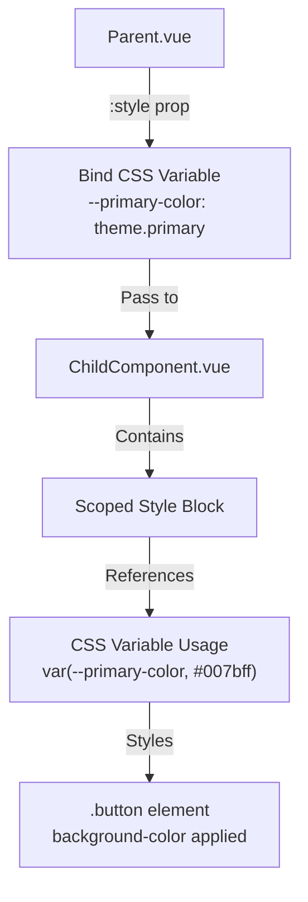

# Lesson 2: Component Architecture, Lifecycle, and Composition

## 1. First-Principles Intuition & Invariants

Vue.js components represent reactive state machines anchored in a unidirectional data flow model, where each component owns a private reactive scope and communicates with ancestors and descendants through an explicit contract layer. At its foundation, a Vue component is a JavaScript object or class specification that the framework compiler transforms into a virtual DOM render function. This render function, when invoked, produces a tree of virtual nodes—lightweight JavaScript objects that describe DOM structure, attributes, event listeners, and child relationships. The Vue runtime then reconciles this virtual tree against the real DOM through a diffing algorithm that computes the minimal set of mutations required to synchronize browser state with application state.

The component model solves three fundamental architectural problems in large-scale user interfaces. First, it provides encapsulation boundaries for template markup, reactive state, computed derivations, and imperative side effects, preventing unstructured global mutation and naming collisions. Second, it establishes a composable unit of reuse: a component can be instantiated multiple times across the application tree, each instance maintaining independent reactive state while sharing the same template and behavior definitions. Third, it enables progressive enhancement of the rendering pipeline through lifecycle hooks—deterministic callback phases where the developer can inject logic at precise moments in the component's creation, mounting, updating, and teardown sequence.

Vue's reactivity system underpins component state through getter/setter proxies. In Vue 3, the framework leverages ES6 Proxies to intercept property access and assignment operations on reactive objects. When a component's render function or computed property reads a reactive dependency, Vue records that dependency edge in a global effect tracking stack. When that dependency subsequently changes, Vue schedules a re-render by queuing the component's update effect in a microtask. This reactive graph forms a directed acyclic structure where components subscribe to state changes and automatically propagate updates down the virtual DOM tree. The scheduler batches and deduplicates updates within the same event loop tick, ensuring that multiple synchronous state mutations trigger only a single render pass.

The component communication contract consists of three primary channels. Props flow data downward from parent to child as immutable references, establishing a unidirectional data flow that simplifies mental models and debugging. Emits represent the inverse channel: child components invoke declared event emitters to signal state changes or user actions back to parents, which may respond by updating their own state and triggering a top-down re-render. The third channel, provide/inject, implements a form of dependency injection where ancestor components can expose reactive values to any depth of descendants without threading props through intermediate layers. This pattern proves essential for cross-cutting concerns like theme configuration, internationalization, or authentication state.

Template compilation transforms declarative markup into optimized render functions through a multi-phase pipeline. The parser constructs an abstract syntax tree from the template string, recognizing directives, bindings, event handlers, and structural elements. The optimizer walks this AST to identify static subtrees—nodes that contain no dynamic bindings and can be hoisted out of the render function to avoid repeated virtual DOM object allocation. The code generator then emits JavaScript function strings that construct virtual DOM nodes through `createVNode` or `createElementVNode` calls, inlining static props and optimizing common patterns like keyed `v-for` loops. In production builds, this compilation occurs ahead-of-time via `vue-loader` or `@vitejs/plugin-vue`, eliminating the runtime compiler and reducing bundle size by approximately 30%.

The Composition API represents a paradigm shift from the Options API's object-oriented component structure to a functional programming model centered on composable logic primitives. Rather than distributing related concerns across `data`, `computed`, `methods`, and lifecycle hooks, the Composition API colocates stateful logic within a single `setup` function through reactive primitives like `ref`, `reactive`, `computed`, and `watch`. This function executes exactly once during component initialization, returning an object of bindings that become available to the template and other component options. The true power emerges when this logic is extracted into reusable composition functions—standalone JavaScript modules that encapsulate reactive state, side effects, and computed derivations. These composables can be imported and invoked within any component's `setup` context, enabling fine-grained code organization along feature boundaries rather than lifecycle method boundaries.

The lifecycle model operates as a deterministic finite state machine with eight primary phases. The component progresses through creation (`beforeCreate`, `created`), mounting (`beforeMount`, `mounted`), updating (`beforeUpdate`, `updated`), and unmounting (`beforeUnmount`, `unmounted`) states, with additional hooks for error boundaries and activation/deactivation of cached components. Each transition occurs in response to framework events: initial instantiation, template dependencies changing, or parent removal. Critically, lifecycle hooks execute in a depth-first traversal order during mounting—parent `beforeMount` fires, then all children mount recursively, then parent `mounted` fires last. This ordering ensures that when a parent's `mounted` hook executes, the entire descendant tree has been inserted into the DOM, making it safe to query child DOM nodes or third-party library integration points.

Scoped slots extend component composition beyond simple prop passing by allowing parents to inject template fragments into designated regions of a child's render output, with the child providing contextual data back to the parent's injected content. This inversion of control pattern enables highly reusable components like data tables, where the parent controls the rendering of individual cells while the child manages the structural layout, pagination, and sorting logic. The child exposes slot props—arbitrary objects passed to the slot invocation—that the parent can destructure and use within its injected template. Under the hood, slots compile to functions that receive these props and return virtual DOM nodes, allowing the child to invoke the slot function with current state and receive renderable content in return.

## 2. Core Architecture & Mechanics

The component definition structure in the Options API organizes configuration into well-defined object properties. The `data` option must be a function returning a fresh object for each component instance, ensuring that multiple instances do not share the same reactive state object reference. The `props` option declares the component's input interface, specifying expected property names, types, default values, and validation functions. Vue validates these contracts at runtime in development mode, logging warnings when parents pass incorrect types or required props are missing. The `computed` option defines derived state as pure functions of reactive dependencies, with Vue caching the result and only re-evaluating when upstream dependencies change. The `methods` object contains imperative behavior and event handlers, which execute with `this` bound to the component instance proxy.

```javascript
export default {
  name: 'UserCard',
  
  props: {
    userId: {
      type: Number,
      required: true,
      validator: (value) => value > 0
    },
    displayMode: {
      type: String,
      default: 'compact',
      validator: (value) => ['compact', 'detailed'].includes(value)
    }
  },
  
  data() {
    return {
      user: null,
      loading: false,
      error: null
    };
  },
  
  computed: {
    fullName() {
      if (!this.user) return '';
      return `${this.user.firstName} ${this.user.lastName}`;
    },
    
    avatarUrl() {
      return this.user?.avatar || '/default-avatar.png';
    }
  },
  
  watch: {
    userId: {
      immediate: true,
      handler(newId, oldId) {
        if (newId !== oldId) {
          this.fetchUser();
        }
      }
    }
  },
  
  methods: {
    async fetchUser() {
      this.loading = true;
      this.error = null;
      
      try {
        const response = await fetch(`/api/users/${this.userId}`);
        if (!response.ok) throw new Error(`HTTP ${response.status}`);
        this.user = await response.json();
      } catch (err) {
        this.error = err.message;
      } finally {
        this.loading = false;
      }
    },
    
    handleClick() {
      this.$emit('user-selected', this.user);
    }
  },
  
  mounted() {
    console.log('UserCard mounted, DOM ref:', this.$el);
  },
  
  beforeUnmount() {
    // Cleanup: cancel pending requests, remove event listeners
  }
};
```

The template for this component references reactive state, computed properties, and event handlers through Vue's directive syntax. The `v-if`, `v-else-if`, and `v-else` directives conditionally render DOM branches based on reactive expressions, compiling to ternary operators in the render function. The `v-bind` directive (abbreviated `:`) establishes one-way data bindings from JavaScript expressions to element attributes or component props. The `v-on` directive (abbreviated `@`) attaches event listeners that invoke component methods or inline expressions when the specified DOM event fires.

```vue
<template>
  <div class="user-card" :class="displayMode">
    <div v-if="loading" class="spinner">Loading...</div>
    
    <div v-else-if="error" class="error">
      Failed to load user: {{ error }}
    </div>
    
    <div v-else-if="user" class="content" @click="handleClick">
      
      
      <div class="info">
        <h3>{{ fullName }}</h3>
        <p v-if="displayMode === 'detailed'">{{ user.email }}</p>
      </div>
    </div>
  </div>
</template>

<style scoped>
.user-card {
  border: 1px solid #ccc;
  border-radius: 8px;
  padding: 16px;
  cursor: pointer;
  transition: box-shadow 0.2s;
}

.user-card:hover {
  box-shadow: 0 4px 12px rgba(0, 0, 0, 0.15);
}

.user-card.compact .avatar {
  width: 40px;
  height: 40px;
}

.user-card.detailed .avatar {
  width: 80px;
  height: 80px;
}
</style>
```

The scoped style block applies CSS transformations at compile time, generating unique attribute selectors that Vue attaches to both the stylesheet rules and the component's root and child elements. This attribute-based scoping prevents style leakage across component boundaries without requiring CSS Modules or runtime style injection. The compiler rewrites `.user-card` to `.user-card[data-v-a1b2c3d4]`, where the hash derives from the component's file path and content. Child components receive their own scoping attributes, and the parent's scoped styles do not cascade into child root elements unless explicitly targeted with the `:deep()` pseudo-class combinator.

The lifecycle hook execution order follows a strict sequence that the developer must internalize for correct side-effect management. The `beforeCreate` hook fires immediately after the instance is initialized but before reactive data and computed properties are configured—attempting to access `this.someData` here returns undefined. The `created` hook executes after reactivity has been established but before the component is mounted to the DOM, making it suitable for initial data fetching or subscription setup. The `beforeMount` hook runs just before the initial render, after the template has been compiled but before the virtual DOM patch. The `mounted` hook fires after the component's DOM has been inserted into the parent, making `this.$el` and `this.$refs` available for imperative DOM queries or third-party library initialization.

```javascript
export default {
  data() {
    return {
      scrollPosition: 0
    };
  },
  
  beforeCreate() {
    // this.scrollPosition is undefined here
    // Reactivity system not yet initialized
  },
  
  created() {
    // this.scrollPosition is 0
    // Can fetch data, but DOM not available
    console.log('Instance created, fetching data...');
  },
  
  beforeMount() {
    // Virtual DOM render function compiled
    // Not yet patched to real DOM
  },
  
  mounted() {
    // this.$el references real DOM element
    // All child components also mounted
    this.scrollListener = () => {
      this.scrollPosition = window.scrollY;
    };
    window.addEventListener('scroll', this.scrollListener);
  },
  
  beforeUpdate() {
    // Reactive dependencies changed
    // About to re-render and patch DOM
  },
  
  updated() {
    // DOM updated with new reactive state
    // Be cautious: changing state here can trigger infinite loop
  },
  
  beforeUnmount() {
    // Component still functional
    // Clean up side effects
    window.removeEventListener('scroll', this.scrollListener);
  },
  
  unmounted() {
    // Component removed from DOM
    // Reactivity and watchers torn down
  }
};
```

Update hooks warrant particular caution because modifying reactive state within `updated` can trigger another update cycle, creating infinite loops if not properly guarded. The pattern of reading the DOM in `updated` and conditionally writing state based on measurements must include circuit breakers—early returns that prevent recursive updates when the measured value stabilizes. More robust solutions defer DOM measurements to `nextTick` callbacks or move such logic into watchers with explicit dependency tracking.

The Composition API refactors this Options-based architecture into a functional paradigm centered on the `setup` function. This function receives two arguments: `props` (a reactive proxy of the component's declared props) and `context` (an object containing `attrs`, `slots`, and `emit`). The `setup` function executes before the component is created, replacing `beforeCreate` and `created` hooks. Reactive state is created through `ref` (for primitive values) or `reactive` (for objects), computed derivations use the `computed` function, and lifecycle hooks are imported as functions prefixed with `on` (`onMounted`, `onBeforeUnmount`, etc.).

```javascript
import { ref, computed, watch, onMounted, onBeforeUnmount } from 'vue';

export default {
  name: 'UserCard',
  
  props: {
    userId: {
      type: Number,
      required: true
    },
    displayMode: {
      type: String,
      default: 'compact'
    }
  },
  
  emits: ['user-selected'],
  
  setup(props, { emit }) {
    const user = ref(null);
    const loading = ref(false);
    const error = ref(null);
    
    const fullName = computed(() => {
      if (!user.value) return '';
      return `${user.value.firstName} ${user.value.lastName}`;
    });
    
    const avatarUrl = computed(() => {
      return user.value?.avatar || '/default-avatar.png';
    });
    
    async function fetchUser() {
      loading.value = true;
      error.value = null;
      
      try {
        const response = await fetch(`/api/users/${props.userId}`);
        if (!response.ok) throw new Error(`HTTP ${response.status}`);
        user.value = await response.json();
      } catch (err) {
        error.value = err.message;
      } finally {
        loading.value = false;
      }
    }
    
    function handleClick() {
      emit('user-selected', user.value);
    }
    
    watch(() => props.userId, (newId, oldId) => {
      if (newId !== oldId) {
        fetchUser();
      }
    }, { immediate: true });
    
    onMounted(() => {
      console.log('UserCard mounted');
    });
    
    onBeforeUnmount(() => {
      // Cleanup
    });
    
    return {
      user,
      loading,
      error,
      fullName,
      avatarUrl,
      handleClick
    };
  }
};
```

The `ref` primitive creates a reactive reference wrapper around a value, exposing it through a `.value` property. This wrapper is necessary because JavaScript primitives are passed by value rather than reference, so Vue cannot intercept assignment operations on bare numbers, strings, or booleans. The `ref` object uses getter and setter interception to track access and trigger reactivity when `.value` is reassigned. In the template, Vue automatically unwraps refs, so `{{ fullName }}` accesses `fullName.value` without requiring explicit `.value` syntax. The `reactive` function, by contrast, applies Proxy-based reactivity directly to objects and arrays, maintaining reference stability while making all nested properties reactive.

Composables extract reusable stateful logic into standalone functions that can be imported across components. A composable function typically accepts input parameters, sets up reactive state and side effects, and returns an object of reactive bindings. The naming convention prefixes these functions with `use`, mirroring React Hooks. Unlike mixins, which merge into the component instance and create implicit naming collisions, composables provide explicit imports and locally scoped return values.

```javascript
// composables/useUserData.js
import { ref, watch, onBeforeUnmount } from 'vue';

export function useUserData(userId) {
  const user = ref(null);
  const loading = ref(false);
  const error = ref(null);
  
  let abortController = null;
  
  async function fetchUser(id) {
    if (abortController) {
      abortController.abort();
    }
    
    abortController = new AbortController();
    loading.value = true;
    error.value = null;
    
    try {
      const response = await fetch(`/api/users/${id}`, {
        signal: abortController.signal
      });
      
      if (!response.ok) throw new Error(`HTTP ${response.status}`);
      user.value = await response.json();
    } catch (err) {
      if (err.name !== 'AbortError') {
        error.value = err.message;
      }
    } finally {
      loading.value = false;
      abortController = null;
    }
  }
  
  watch(userId, (newId) => {
    if (newId) {
      fetchUser(newId);
    }
  }, { immediate: true });
  
  onBeforeUnmount(() => {
    if (abortController) {
      abortController.abort();
    }
  });
  
  return {
    user,
    loading,
    error,
    refetch: () => fetchUser(userId.value)
  };
}
```

This composable encapsulates the entire data fetching lifecycle, including request cancellation via `AbortController` to prevent race conditions when `userId` changes rapidly. The component consumes this logic by destructuring the returned object, gaining access to reactive state and imperative methods without implementing the fetching machinery inline.

```javascript
import { computed } from 'vue';
import { useUserData } from './composables/useUserData';

export default {
  props: {
    userId: {
      type: Number,
      required: true
    }
  },
  
  setup(props, { emit }) {
    const { user, loading, error, refetch } = useUserData(
      computed(() => props.userId)
    );
    
    const fullName = computed(() => {
      if (!user.value) return '';
      return `${user.value.firstName} ${user.value.lastName}`;
    });
    
    function handleClick() {
      emit('user-selected', user.value);
    }
    
    return {
      user,
      loading,
      error,
      fullName,
      handleClick,
      refetch
    };
  }
};
```

Scoped slots enable parent components to inject renderable content into designated regions of a child's template while receiving contextual data from the child. The child declares a slot with `<slot>` tags, optionally binding data to the slot via `v-bind` or shorthand colon syntax. The parent then wraps its injected content in a `<template>` tag with `v-slot` directive (or `#` shorthand), destructuring the slot props.

```mermaid
flowchart TD
    A["DataTable.vue<br/>Component"]
    B["Props"]
    C["columns: Array"]
    D["data: Array"]
    E["Template"]
    F["Table Element"]
    G["Thead Section"]
    H["Column Headers Loop<br/>v-for: column in columns"]
    I["Tbody Section"]
    J["Row Loop<br/>v-for: row in data"]
    K["Cell Loop<br/>v-for: column in columns"]
    L["Slot or<br/>Default Content"]
    M["Script"]
    N["Export Default"]
    
    A --> B
    A --> E
    A --> M
    
    B --> C
    B --> D
    
    E --> F
    F --> G
    F --> I
    
    G --> H
    H -->|generates| G
    
    I --> J
    J --> K
    K --> L
    
    L -->|row[column.key]| K
    
    M --> N
    N --> C
    N --> D
```

The parent consumes this table component by providing scoped slot implementations that customize the rendering of specific columns, receiving `row` and `value` as slot props to inform rendering decisions.

```vue
<template>
  <DataTable :columns="columns" :data="users">
    <template #name="{ row }">
      <strong>{{ row.firstName }} {{ row.lastName }}</strong>
    </template>
    
    <template #status="{ value }">
      <span :class="statusClass(value)">{{ value }}</span>
    </template>
    
    <template #actions="{ row }">
      <button @click="editUser(row)">Edit</button>
      <button @click="deleteUser(row)">Delete</button>
    </template>
  </DataTable>
</template>

<script>
export default {
  data() {
    return {
      columns: [
        { key: 'name', label: 'Name' },
        { key: 'email', label: 'Email' },
        { key: 'status', label: 'Status' },
        { key: 'actions', label: 'Actions' }
      ],
      users: [
        { id: 1, firstName: 'Alice', lastName: 'Chen', email: 'alice@example.com', status: 'active' },
        { id: 2, firstName: 'Bob', lastName: 'Kumar', email: 'bob@example.com', status: 'inactive' }
      ]
    };
  },
  
  methods: {
    statusClass(status) {
      return status === 'active' ? 'badge-success' : 'badge-warning';
    },
    
    editUser(user) {
      console.log('Edit user:', user);
    },
    
    deleteUser(user) {
      console.log('Delete user:', user);
    }
  }
};
</script>
```

This pattern achieves the flexibility of render props in React while maintaining template-based declarative syntax. The child component controls structural concerns like table layout, iteration, and keying, while the parent retains full control over cell rendering logic and event handling. Scoped slots compile to functions that the child invokes with its contextual data, receiving virtual DOM nodes in return.

Template compilation occurs through a three-stage pipeline that transforms markup strings into optimized JavaScript render functions. The parser constructs an abstract syntax tree by tokenizing the template and recognizing Vue-specific directives, interpolations, and structural elements. Each AST node captures element type, attributes, directives, children, and source location metadata. The optimizer performs static analysis to identify subtrees with no dynamic bindings—these nodes are marked with `staticRoot` flags and hoisted into module-level constants during code generation, preventing repeated virtual DOM object allocation during re-renders.

The code generator walks the optimized AST and emits JavaScript function strings that construct virtual DOM nodes through runtime helpers like `_createElementVNode`, `_toDisplayString`, and `_renderList`. Directives compile to specialized logic: `v-if` becomes ternary operators, `v-for` becomes array `map` calls with key extraction, and `v-bind` inlines object properties or spreads dynamic binding objects. Event listeners registered via `v-on` compile to object literals passed to the vnode's `on` property, with modifiers like `.prevent`, `.stop`, and `.capture` transforming into wrapper functions that invoke `event.preventDefault()` or `event.stopPropagation()` before calling the handler.

A compiled render function for a simple component might resemble this structure:

```javascript
import { createElementVNode as _createElementVNode, toDisplayString as _toDisplayString, openBlock as _openBlock, createElementBlock as _createElementBlock } from 'vue';

export function render(_ctx, _cache, $props, $setup, $data, $options) {
  return (_openBlock(), _createElementBlock("div", { class: "greeting" }, [
    _createElementVNode("h1", null, "Hello, " + _toDisplayString($props.name), 1 /* TEXT */),
    _createElementVNode("button", {
      onClick: _cache[0] || (_cache[0] = (...args) => ($options.handleClick && $options.handleClick(...args)))
    }, "Click me")
  ]));
}
```

The block tree optimization introduced in Vue 3 further reduces diff overhead by tracking dynamic nodes in a flat array. When the template compiler identifies a stable structural region with scattered dynamic bindings, it wraps that region in a block that collects dynamic vnodes during render. During updates, the differ can skip static siblings and iterate only the tracked dynamic children, reducing worst-case diff complexity from O(n) to O(m) where m is the count of dynamic nodes.

The `defineComponent` helper provides TypeScript type inference for component options, enabling IDE autocomplete and compile-time type checking for props, emits, and exposed methods. When combined with `<script setup>` syntax, this helper becomes implicit—the compiler automatically wraps the script block's top-level bindings in a `setup` function return object and derives props/emits from type annotations or `defineProps`/`defineEmits` compiler macros.

```vue
<script setup lang="ts">
import { ref, computed } from 'vue';

interface Props {
  userId: number;
  displayMode?: 'compact' | 'detailed';
}

const props = withDefaults(defineProps<Props>(), {
  displayMode: 'compact'
});

const emit = defineEmits<{
  'user-selected': [user: User];
}>();

interface User {
  id: number;
  firstName: string;
  lastName: string;
  email: string;
  avatar?: string;
}

const user = ref<User | null>(null);
const loading = ref(false);

const fullName = computed(() => {
  if (!user.value) return '';
  return `${user.value.firstName} ${user.value.lastName}`;
});

async function fetchUser() {
  loading.value = true;
  try {
    const response = await fetch(`/api/users/${props.userId}`);
    user.value = await response.json();
  } finally {
    loading.value = false;
  }
}

function handleClick() {
  if (user.value) {
    emit('user-selected', user.value);
  }
}

// All bindings are automatically exposed to template
</script>
```

The `<script setup>` syntax eliminates boilerplate by automatically returning all top-level bindings, imports, and functions to the template. Variables are reactive if wrapped in `ref` or `reactive`, and TypeScript infers types throughout the component without explicit runtime declarations.

Component registration occurs in two modes: global and local. Global registration via `app.component('ComponentName', definition)` makes a component available throughout the application without explicit imports, but increases bundle size by preventing tree-shaking of unused components. Local registration imports the component definition and includes it in the parent's `components` option, limiting scope to that parent and its descendants. Build tools like Vite and webpack analyze these static imports to enable code-splitting and lazy loading of component bundles.

Asynchronous components defer loading until the component is actually rendered, splitting the initial bundle and improving time-to-interactive metrics. The `defineAsyncComponent` helper accepts a loader function that returns a dynamic import promise, with optional configuration for loading states, error handling, and timeout behavior.

```javascript
import { defineAsyncComponent } from 'vue';

const AsyncUserCard = defineAsyncComponent({
  loader: () => import('./UserCard.vue'),
  loadingComponent: LoadingSpinner,
  errorComponent: ErrorDisplay,
  delay: 200, // ms before showing loading component
  timeout: 10000 // ms before showing error component
});

export default {
  components: {
    AsyncUserCard
  }
};
```

Vue's reactivity scheduler batches multiple synchronous state updates into a single microtask-queued render pass. When reactive state changes, Vue marks the affected components dirty but does not immediately re-render. Instead, it queues the component update as a microtask using `Promise.resolve().then()`. Multiple synchronous mutations accumulate in the same queue flush, with duplicate updates deduplicated by component instance identity. This batching prevents redundant renders when, for example, a loop updates ten reactive properties—the component renders once after the loop completes, not ten times during iteration.

The `nextTick` function allows developers to defer code execution until after the next DOM update cycle completes. This utility is essential when imperative DOM queries must reflect the latest reactive state. For instance, after setting a reactive property that triggers a re-render, accessing `this.$refs` within the same synchronous context may return stale DOM state. Wrapping the query in `nextTick` ensures the callback executes after the component has patched the DOM.

```javascript
import { nextTick } from 'vue';

export default {
  methods: {
    async scrollToBottom() {
      this.messages.push({ text: 'New message' });
      
      // this.$refs.messagesContainer.scrollHeight might be stale here
      
      await nextTick();
      
      // DOM updated, scrollHeight reflects new message
      const container = this.$refs.messagesContainer;
      container.scrollTop = container.scrollHeight;
    }
  }
};
```

Provide/inject implements ancestor-to-descendant dependency injection without requiring intermediate components to thread props. An ancestor component calls `provide` with a key-value map, and any descendant can call `inject` with the same key to receive the value. In Vue 3, provided values can be reactive refs or reactive objects, allowing descendants to consume live updating state. This pattern proves invaluable for framework-level concerns like routing, internationalization, or theme configuration, where threading props through multiple layers would create brittle coupling.

```javascript
// App.vue - root provider
import { provide, ref } from 'vue';

export default {
  setup() {
    const theme = ref('light');
    
    function toggleTheme() {
      theme.value = theme.value === 'light' ? 'dark' : 'light';
    }
    
    provide('theme', { theme, toggleTheme });
    
    return { theme };
  }
};

// Deeply nested component - consumer
import { inject } from 'vue';

export default {
  setup() {
    const { theme, toggleTheme } = inject('theme');
    
    return { theme, toggleTheme };
  }
};
```

The injected value remains reactive because `theme` is a ref—when the root component toggles theme, all descendants consuming the injected value automatically re-render. Provide/inject establishes a unidirectional data flow from ancestor to descendant while bypassing intermediate layers, maintaining the framework's reactivity graph without prop drilling.

## 3. High-Performance Optimization & Failure Modes

Component performance optimization begins with understanding the reactivity tracking graph and minimizing unnecessary dependency collection. When a component's render function executes, Vue records every reactive property access as a dependency edge. If a render function reads a large reactive object but only displays a single property, subsequent mutations to unused properties still trigger re-renders because Vue tracks at the property level, not the value level. The solution is to derive minimal reactive surfaces through computed properties that extract only the required data, or to mark non-reactive data with `shallowRef` or `markRaw` to exclude it from the dependency graph.

Computed properties cache their results and only re-evaluate when upstream dependencies change. This caching proves essential when expensive transformations occur during rendering. A common anti-pattern is performing array filtering, sorting, or aggregation directly in the template interpolation—these operations execute on every render, even if the source array remains unchanged. Refactoring this logic into computed properties ensures the work happens once per data change rather than once per render cycle.

```javascript
// Anti-pattern: expensive operation in template
<div v-for="user in users.filter(u => u.active).sort((a, b) => a.name.localeCompare(b.name))" :key="user.id">

// Optimized: computation cached in computed property
export default {
  data() {
    return {
      users: []
    };
  },
  
  computed: {
    activeUsersSorted() {
      return this.users
        .filter(u => u.active)
        .sort((a, b) => a.name.localeCompare(b.name));
    }
  }
};

<div v-for="user in activeUsersSorted" :key="user.id">
```

The `v-for` directive requires a unique `key` attribute to enable efficient list reconciliation. When the list order changes or items are inserted or removed, Vue's differ uses keys to match old and new vnodes, preserving DOM elements and component instances that represent the same logical entity. Omitting keys or using non-unique values like array indices forces Vue to use in-place patching, which can corrupt component state when list order changes. The key should be a stable identifier tied to the data entity, such as a database primary key or UUID.

Large lists benefit from virtual scrolling techniques that render only the visible subset of items. Libraries like `vue-virtual-scroller` maintain a scrollable container with calculated height while rendering a sliding window of DOM elements that repositions as the user scrolls. This approach keeps the DOM node count constant regardless of list size, preventing layout thrashing and memory pressure when rendering thousands of rows.

Component update boundaries limit the scope of re-renders when reactive state changes. By default, when a parent component's state changes, the parent re-renders and recursively diffs all child vnodes, even if the children's props have not changed. Wrapping child components with `v-memo` or marking them with `shallowRef` props can short-circuit this cascade. The `v-memo` directive, introduced in Vue 3.2, accepts an array of dependencies and skips re-rendering the subtree if those dependencies remain shallowly equal across updates.

```vue
<template>
  <div v-for="item in list" :key="item.id" v-memo="[item.id, item.value]">
    <ExpensiveChildComponent :item="item" />
  </div>
</template>
```

This directive instructs Vue to skip rendering `ExpensiveChildComponent` if `item.id` and `item.value` have not changed, even if the parent re-renders for other reasons. The equality check is shallow—object identity comparison—so mutating nested properties without replacing the reference does not trigger re-renders.

Asynchronous component loading and route-based code splitting reduce initial JavaScript bundle size and improve time-to-interactive. Each asynchronously loaded component compiles into a separate chunk that the browser fetches on demand. Combining this with route-level splitting ensures that users only download the code necessary for the current view. Vue Router's `component` option accepts dynamic imports, automatically creating split points.

```javascript
import { createRouter, createWebHistory } from 'vue-router';

const router = createRouter({
  history: createWebHistory(),
  routes: [
    {
      path: '/',
      component: () => import('./views/Home.vue')
    },
    {
      path: '/dashboard',
      component: () => import('./views/Dashboard.vue')
    },
    {
      path: '/admin',
      component: () => import('./views/Admin.vue')
    }
  ]
});
```

Production builds analyze these dynamic imports and emit separate JavaScript files (`Dashboard.[hash].js`, `Admin.[hash].js`) that load when the user navigates to the corresponding route. This strategy is particularly effective for administrative interfaces or infrequently accessed features that should not bloat the main bundle.

Lifecycle hook ordering can introduce subtle bugs when components make assumptions about parent or child state. The `mounted` hook fires in child-first order during the initial mount: the deepest descendants mount first, then their parents, finally reaching the root. This ordering ensures that when a parent's `mounted` hook executes, the entire subtree is present in the DOM. However, during updates, the hooks fire in parent-first order: `beforeUpdate` on the parent, then children, then `updated` on children, then parent. If a parent's `updated` hook reads child DOM state and a child's `updated` hook modifies that state, the parent may observe stale values. Structuring components to avoid these read-after-write hazards requires careful consideration of update order and, when necessary, deferring reads to `nextTick`.

Memory leaks commonly arise from failing to clean up side effects in lifecycle hooks. Event listeners registered in `mounted` must be removed in `beforeUnmount`. Timers started with `setInterval` must be cleared. Subscriptions to external observables or WebSocket connections must be closed. Vue's reactivity system automatically tears down watchers and computed properties when the component unmounts, but imperative side effects require manual cleanup.

```javascript
export default {
  data() {
    return {
      currentTime: Date.now()
    };
  },
  
  mounted() {
    this.timer = setInterval(() => {
      this.currentTime = Date.now();
    }, 1000);
    
    this.resizeHandler = () => {
      this.handleResize();
    };
    window.addEventListener('resize', this.resizeHandler);
  },
  
  beforeUnmount() {
    clearInterval(this.timer);
    window.removeEventListener('resize', this.resizeHandler);
  }
};
```

Failing to clear the interval or remove the event listener leaves the component instance referenced by the closure, preventing garbage collection even after the component is removed from the DOM. In large applications with frequent navigation, these leaks accumulate and degrade performance.

Watch callbacks can trigger infinite loops if they modify the same reactive dependencies they observe. Vue provides a `flush` option to control when watchers execute relative to component renders. The default `'pre'` mode runs watchers before the component re-renders, allowing watchers to batch multiple state changes before the render pass. The `'post'` mode defers watcher execution until after the DOM update, ensuring that watchers can safely query updated DOM state. The `'sync'` mode executes watchers immediately when dependencies change, bypassing the scheduler—this mode should be avoided except in rare cases where synchronous updates are required, as it eliminates batching optimizations.

```javascript
import { watch } from 'vue';

export default {
  setup() {
    const count = ref(0);
    
    // Anti-pattern: modifying watched dependency
    watch(count, (newVal) => {
      if (newVal > 100) {
        count.value = 100; // Triggers watcher again
      }
    });
    
    // Corrected: guard to prevent recursion
    watch(count, (newVal) => {
      if (newVal > 100 && newVal !== 100) {
        count.value = 100;
      }
    });
  }
};
```

Props mutation represents a violation of unidirectional data flow and a common source of state management bugs. Child components must treat props as immutable inputs. If a child needs to modify the value, it should emit an event requesting the parent to update its state, or it should copy the prop into local reactive state via `data` or `ref`. Mutating prop objects directly creates hidden coupling where the parent's state changes without explicit data flow, breaking the component boundary and complicating debugging.

```javascript
// Anti-pattern: mutating prop
export default {
  props: {
    user: Object
  },
  
  methods: {
    updateName(newName) {
      this.user.name = newName; // Mutates parent state
    }
  }
};

// Corrected: emit event
export default {
  props: {
    user: Object
  },
  
  emits: ['update-user'],
  
  methods: {
    updateName(newName) {
      this.$emit('update-user', { ...this.user, name: newName });
    }
  }
};

// Or: local mutable copy
export default {
  props: {
    user: Object
  },
  
  data() {
    return {
      localUser: { ...this.user }
    };
  },
  
  watch: {
    user: {
      handler(newUser) {
        this.localUser = { ...newUser };
      },
      deep: true
    }
  }
};
```

Deep watchers and reactive objects with nested properties incur performance overhead because Vue must recursively traverse the object tree to establish reactivity proxies and track dependencies. For large data structures where only shallow properties change, `shallowReactive` and `shallowRef` limit reactivity to the top level, avoiding the cost of deep traversal. For readonly data imported from external sources, `markRaw` explicitly excludes objects from reactivity, preventing Vue from wrapping them in proxies.

```javascript
import { shallowReactive, markRaw } from 'vue';

// Only top-level properties trigger reactivity
const state = shallowReactive({
  user: { name: 'Alice', profile: { bio: '...' } }
});

state.user = { name: 'Bob', profile: { bio: '...' } }; // Triggers update
state.user.profile.bio = 'New bio'; // Does not trigger update

// Exclude large config from reactivity
const appConfig = markRaw({
  routes: [...],
  constants: {...},
  thirdPartyLib: externalLibrary
});
```

Error boundaries capture exceptions during component rendering, lifecycle hooks, and event handlers, preventing a single component failure from crashing the entire application. The `errorCaptured` hook intercepts errors from descendant components, allowing parent components to log the error, display a fallback UI, and prevent propagation. This hook receives the error object, the component instance that threw, and an error information string.

```javascript
export default {
  data() {
    return {
      error: null
    };
  },
  
  errorCaptured(err, instance, info) {
    this.error = {
      message: err.message,
      component: instance.$options.name,
      info
    };
    
    // Log to monitoring service
    console.error('Component error:', err, instance, info);
    
    // Prevent propagation
    return false;
  },
  
  render() {
    if (this.error) {
      return h('div', { class: 'error-boundary' }, [
        h('h2', 'Something went wrong'),
        h('pre', this.error.message)
      ]);
    }
    
    return this.$slots.default();
  }
};
```

Template compilation errors arise from malformed directives, incorrect expression syntax, or missing closing tags. Vue's compiler provides detailed error messages with line numbers and code snippets during development, but these errors surface at build time in production. Running `vue-tsc` or enabling TypeScript checking in `<script setup lang="ts">` blocks catches many template errors through type inference, validating that referenced methods and properties exist on the component instance.

Single-file components with scoped styles can suffer specificity conflicts when third-party component libraries inject global styles. The `:deep()` pseudo-class selector (formerly `>>>` or `/deep/`) allows scoped styles to target child component root elements, but overuse creates tight coupling between parent and child styling contracts. A more maintainable approach uses CSS custom properties (variables) passed via props or provide/inject, allowing children to consume themeable values without parents directly targeting child internals.



This technique inverts the dependency: the parent provides a variable, and the child consumes it, maintaining encapsulation while enabling customization. The fallback value in `var()` ensures the component remains functional even if the variable is not provided.

Debugging reactive state requires understanding the proxy-based reactivity system. Vue DevTools exposes component state, props, and the reactive dependency graph, allowing developers to inspect which properties are reactive and which components subscribe to them. When state updates fail to trigger renders, the cause is often non-reactive assignment—setting a property on a plain object instead of a reactive proxy, or replacing an entire reactive object reference instead of mutating its properties. The `reactive` helper returns a proxy, so reassigning the variable breaks the reactive link unless the reassignment targets a property of a parent reactive object.

```javascript
// Anti-pattern: breaks reactivity
let state = reactive({ count: 0 });
state = reactive({ count: 1 }); // New proxy, template reference stale

// Corrected: mutate properties
const state = reactive({ count: 0 });
state.count = 1; // Reactivity preserved

// Or wrap in ref
const state = ref({ count: 0 });
state.value = { count: 1 }; // Reactivity preserved via ref wrapper
```

Component testing isolates units of behavior by mounting components in a test environment, asserting on rendered output, and simulating user interactions. Vue Test Utils provides the `mount` function to instantiate components with props, slots, and mocked global dependencies. Tests verify that components render expected content, emit correct events in response to interactions, and update reactivity when props or state change.

```javascript
import { mount } from '@vue/test-utils';
import UserCard from './UserCard.vue';

describe('UserCard', () => {
  it('displays user full name', () => {
    const wrapper = mount(UserCard, {
      props: {
        userId: 1
      },
      data() {
        return {
          user: { firstName: 'Alice', lastName: 'Chen', email: 'alice@example.com' }
        };
      }
    });
    
    expect(wrapper.text()).toContain('Alice Chen');
  });
  
  it('emits user-selected event on click', async () => {
    const wrapper = mount(UserCard, {
      props: { userId: 1 },
      data() {
        return {
          user: { id: 1, firstName: 'Alice', lastName: 'Chen', email: 'alice@example.com' }
        };
      }
    });
    
    await wrapper.find('.content').trigger('click');
    
    expect(wrapper.emitted('user-selected')).toBeTruthy();
    expect(wrapper.emitted('user-selected')[0]).toEqual([
      { id: 1, firstName: 'Alice', lastName: 'Chen', email: 'alice@example.com' }
    ]);
  });
});
```

These tests verify the component's contract—its rendered output given specific props and state, and its event emissions in response to interactions—without requiring integration with a full application or backend API. Mocking asynchronous data fetching with test doubles or libraries like MSW (Mock Service Worker) isolates component logic from external dependencies.

The transition between Options API and Composition API within a single codebase requires careful migration planning. Components can mix both paradigms—using Options API structure with a `setup` function for new logic—but maintaining consistency within a component improves readability. Large-scale migrations benefit from incremental refactoring, starting with leaf components and composable extraction, gradually moving toward full Composition API adoption as team familiarity grows. The performance characteristics of both APIs are identical; the choice hinges on code organization preferences and team conventions rather than runtime efficiency.

Understanding Vue's component architecture, lifecycle state machine, and reactivity scheduler empowers developers to build maintainable, performant user interfaces with clear data flow contracts and predictable update semantics. The Options API provides an opinionated structure suitable for straightforward component hierarchies, while the Composition API offers fine-grained control for complex stateful logic and cross-cutting concerns. Mastery of both paradigms, combined with rigorous testing and performance profiling, enables the construction of scalable Vue applications that remain maintainable as complexity grows.
