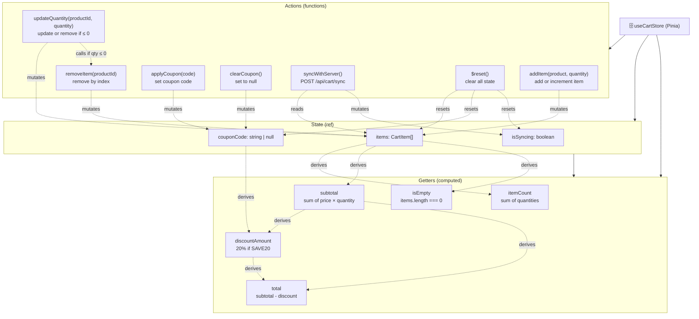
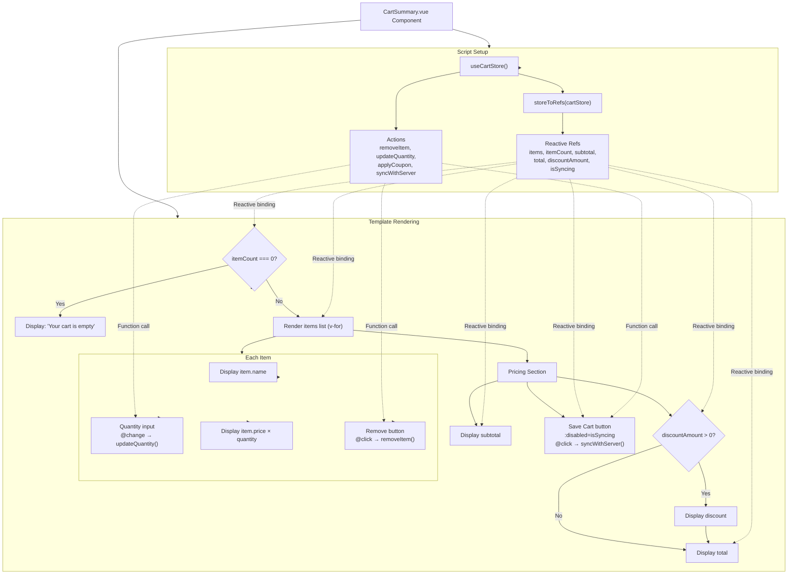

# Lesson 3: State Management Patterns with Pinia

## 1. First-Principles Intuition & Invariants

Every non-trivial frontend application eventually collides with the same architectural wall. A user updates their profile in a settings panel, and the navigation bar still shows the stale avatar. A shopping cart badge displays one count while the cart drawer renders another. A WebSocket message arrives and three disconnected components need to react, but each holds its own local copy of truth. These failure modes share a single root cause: state is owned by components rather than by the application.

Vue's component model is deliberately local-first. Each component instance encapsulates its own reactive state through `ref` and `reactive`, which is exactly the right default for self-contained UI pieces. But the moment two components need to share the same datum, the design decisions compound. You can lift state up to a common ancestor and thread it down through props — a pattern that works until the component tree deepens and you are prop-drilling through five layers of intermediate nodes that have no business knowing the data exists. You can emit events upward to trigger parent mutations, but event bubbling through deep trees becomes an invisible, undocumented API surface that breaks silently when the component hierarchy changes. Neither approach scales to application-level state.

The canonical solution is a *centralized store*: a singleton object that lives outside the component tree, owns authoritative state, exposes a controlled API for reads and writes, and integrates with the reactivity system so that any component depending on a piece of state automatically re-renders when that piece changes. This idea predates Vue — Flux, Redux, MobX, and NgRx all explore the same conceptual space — but each framework's reactivity model constrains and shapes what a store implementation can look like.

Pinia was designed by Eduardo San Martin Morote (a Vue core team member) with one guiding invariant: the store API should feel indistinguishable from writing a composition function. It was promoted to Vue's official state management solution in late 2021, replacing Vuex 4 for new projects. The architectural decision to build Pinia on top of Vue's reactivity primitives rather than alongside them has profound consequences for correctness, performance, and developer ergonomics that this lesson will make concrete.

The two invariants you must carry throughout are these: **stores are reactive singletons** and **stores are owned by the application, not the component tree**. The first means that any state declared inside a store participates in Vue's dependency tracking graph — computed properties, watchers, and component render functions all subscribe to store state transparently. The second means that store lifetime is decoupled from component lifetime. A component can unmount and remount without destroying the state it was reading; the store persists for the lifetime of the Vue application instance itself, unless you explicitly reset or dispose it.

Understanding what Pinia replaces gives useful contrast. Vuex 4 required state mutations to be declared as `mutations` — synchronous functions that were the only legal way to modify state — and async work to live in `actions`, which committed mutations. This two-tier system existed partly to enable time-travel debugging in Vue DevTools: because mutations were synchronous and named, every state transition was an atomic, traceable event. The cost was ceremony. Renaming a mutation required updating the mutation definition, the action that called it, and every component that dispatched that action via its string key. Namespacing modules introduced a second level of string-keyed indirection. Pinia eliminates mutations entirely. Actions handle both synchronous and asynchronous state changes, and the Vue DevTools integration remains intact because Pinia instruments the reactivity layer directly — it can observe any reactive assignment, not just named mutations. The ergonomic simplicity is real and not a regression in debuggability.

TypeScript inference is not an afterthought in Pinia; it is an architectural constraint. Vuex's string-keyed dispatch system was structurally uninferable — `store.dispatch('cart/addItem', payload)` gives TypeScript nothing to verify. Pinia's stores are plain objects with named methods, so calling `cartStore.addItem(payload)` gives you full type checking on both the method signature and the payload shape. For a system-level engineer accustomed to making the compiler do work, this is the more important point.

---

## 2. Core Architecture & Mechanics

### The Reactive Singleton Model

A Pinia store is created by calling `defineStore`, which returns a *setup function* (or an *options object*, depending on which style you use) that Pinia wraps in a singleton cache keyed by the store's string ID. The first component to call `useCartStore()` causes Pinia to instantiate the store and register it in the application's Pinia instance. Every subsequent call to `useCartStore()` — in any component, in any composition function, at any point during the application's lifetime — returns the same reactive object. This is not a module-level singleton in the Node.js sense; it is scoped to the Pinia instance, which means server-side rendering creates a fresh Pinia per request, eliminating cross-request state pollution without any extra effort from the application code.

The two store definition styles have identical runtime behavior but different syntactic affordances. The *Options API style* mirrors Vuex's mental model: `state` is a factory function returning the initial state object, `getters` is a dictionary of computed derivations, and `actions` is a dictionary of methods. The *Setup API style* mirrors the Composition API: you call `ref`, `reactive`, and `computed` directly, return everything you want to expose, and Pinia introspects the return value to categorize refs as state, computed values as getters, and plain functions as actions.

For engineers who write non-trivial applications, the Setup style is strictly more expressive because it admits arbitrary composition logic inside the setup function — you can call other composables, set up watchers, register lifecycle hooks, and structure the code with any internal abstraction you choose. The Options style is more constrained and therefore more predictable for simpler stores. This lesson uses the Setup style throughout because the target problem — multi-component state coordination in production applications — benefits from that expressiveness.

Here is a production-representative cart store. It is complete, typechecked, and ready to deploy:



Several design decisions here deserve explicit justification. The `items` ref holds an array of `CartItem` objects, and mutations happen by direct array methods (`splice`, `push`) and direct property assignment (`item.quantity = quantity`). Vue's reactivity system uses ES Proxy to intercept these operations, so both are tracked correctly without any special wrapper. Calling `items.value.splice(index, 1)` triggers a reactive update identically to assigning a whole new array — but splice is O(1) in position rather than O(n) for a full replacement, which matters when the array grows large and the component rendering it uses a virtualized list.

The `$reset` method is a convention Pinia itself provides automatically for Options-style stores; in Setup stores you implement it explicitly, which makes the reset semantics transparent and customizable.

### Reactivity Signal Flow

The dependency tracking that makes Pinia useful inside components operates entirely through Vue's core reactivity engine. When a computed property or a component's render function accesses `cartStore.itemCount`, Vue's active effect registers itself as a subscriber to every reactive value that `itemCount.value` reads during evaluation — in this case, every `item.quantity` in `items.value`. When `updateQuantity` runs and assigns `item.quantity = newValue`, the Proxy trap fires, finds the subscriber set for that property, and schedules re-evaluation of every dependent computed and render effect in the next microtask flush.

This is worth making architectural: Pinia does not implement its own observer or event-emitter system. There is no `store.on('mutation', callback)` mechanism at the reactivity level. The store is reactive *because its state is reactive*, and components subscribe to it *because Vue's render functions track dependency access automatically*. The implication is that component performance characteristics are identical whether state lives locally in a `ref` or inside a Pinia store — there is no extra indirection, no additional subscription overhead.

The signal flow for a store state change is:

```
Action called in Component A
    │
    ▼
Reactive assignment inside store (Proxy trap fires)
    │
    ▼
Vue scheduler queues dependent effects
    │
    ├──► Component B's render effect (subscribed to changed state)
    │        └──► Component B re-renders in next tick
    │
    ├──► Component C's render effect (subscribed to derived getter)
    │        └──► Computed getter re-evaluates, Component C re-renders
    │
    └──► Any watchers declared with watch() on store state
             └──► Side effects run (logging, persistence, etc.)
```

No explicit publish/subscribe wiring is required. Component B does not register itself with the store; it simply reads `cartStore.itemCount` in its template, and Vue's dependency tracking establishes the subscription automatically at render time.

### Registering Pinia with the Application

```typescript
// main.ts
import { createApp } from 'vue'
import { createPinia } from 'pinia'
import App from './App.vue'

const pinia = createPinia()
const app = createApp(App)

app.use(pinia)
app.mount('#app')
```

The `createPinia()` call allocates the store registry — the Map that caches instantiated stores by their string ID. Calling `app.use(pinia)` installs Pinia as a Vue plugin, which injects the Pinia instance into the application's provide/inject tree. When any component calls `useCartStore()`, Pinia internally calls `inject(piniaSymbol)` to find the correct Pinia instance, then looks up or creates the store in that instance's registry. This injection mechanism is why Pinia must be used inside a component's `setup()` or inside a composable that is itself called from `setup()` — the injection context must be active. For use outside of components (in a router guard, for example), you can pass the Pinia instance directly: `useCartStore(pinia)`.

### Module Organization at Scale

Production applications with dozens of stores require a file organization strategy that keeps the codebase navigable. The pattern that scales best follows a domain-driven layout: each store lives in a file named after the domain slice it manages, all under a `stores/` directory at the source root.

```
src/
├── stores/
│   ├── auth.ts          # User identity, JWT lifecycle, permissions
│   ├── cart.ts          # Cart items, pricing, sync state
│   ├── catalog.ts       # Product listings, filters, pagination cursor
│   ├── checkout.ts      # Multi-step form state, address, payment intent
│   ├── notifications.ts # Toast queue, alert dismissal state
│   └── index.ts         # Re-exports all useX composables for convenience
├── composables/
│   └── useCartActions.ts # UI-layer coordination composable
└── types/
    └── catalog.ts
```

The key architectural constraint is that *stores should depend on other stores, not on components*. If `checkout.ts` needs to read the cart total during order submission, it imports and calls `useCartStore()` directly:

```typescript
// stores/checkout.ts
import { defineStore } from 'pinia'
import { ref } from 'vue'
import { useCartStore } from './cart'

export const useCheckoutStore = defineStore('checkout', () => {
  const step = ref<'address' | 'payment' | 'review' | 'complete'>('address')
  const orderId = ref<string | null>(null)

  async function submitOrder(paymentMethodId: string): Promise<void> {
    const cartStore = useCartStore()

    if (cartStore.isEmpty) {
      throw new Error('Cannot submit order with an empty cart')
    }

    const response = await fetch('/api/orders', {
      method: 'POST',
      headers: { 'Content-Type': 'application/json' },
      body: JSON.stringify({
        items: cartStore.items,
        total: cartStore.total,
        paymentMethodId,
      }),
    })

    if (!response.ok) {
      throw new Error(`Order submission failed: ${response.status}`)
    }

    const { id } = await response.json() as { id: string }
    orderId.value = id
    step.value = 'complete'
    cartStore.$reset()
  }

  return { step, orderId, submitOrder }
})
```

Notice that `useCartStore()` is called inside the action, not at the top level of the setup function. This deferred call pattern avoids circular initialization issues when two stores depend on each other, because Pinia's store registry guarantees that by the time an action executes, any store it requests is fully initialized.

### Component Integration

Consuming a store in a component is syntactically identical to using any other composable:



The `storeToRefs` utility deserves a precise explanation. When you destructure a plain object in JavaScript, you copy the current values, not references to the reactive containers. `const { itemCount } = cartStore` extracts the computed's current numeric value — a primitive — severing the reactive link. `storeToRefs` walks the store object, identifies which properties are `ref` or `computed` instances, and returns them directly rather than unwrapping them. The destructured `itemCount` is then the `ComputedRef<number>` itself, which the template engine knows how to unwrap reactively. Actions, being plain functions, do not hold reactive state and can be destructured directly.

### Plugins and Cross-Cutting Concerns

Pinia's plugin system allows you to extend every store uniformly — a natural home for persistence, logging, and DevTools integration. A plugin is a function that receives a `context` object containing the Pinia instance, the store instance, and the store's options:

```typescript
// plugins/persistencePlugin.ts
import type { PiniaPluginContext } from 'pinia'

const PERSIST_KEYS: Record<string, string[]> = {
  cart: ['items', 'couponCode'],
  auth: ['accessToken', 'refreshToken'],
}

export function persistencePlugin({ store }: PiniaPluginContext): void {
  const keys = PERSIST_KEYS[store.$id]
  if (!keys) return

  // Rehydrate from localStorage on store creation.
  keys.forEach(key => {
    const stored = localStorage.getItem(`pinia:${store.$id}:${key}`)
    if (stored !== null) {
      try {
        store[key] = JSON.parse(stored)
      } catch {
        // Corrupted or incompatible serialized value; leave default intact.
        localStorage.removeItem(`pinia:${store.$id}:${key}`)
      }
    }
  })

  // Persist to localStorage on every state mutation.
  store.$subscribe((mutation, state) => {
    keys.forEach(key => {
      localStorage.setItem(
        `pinia:${store.$id}:${key}`,
        JSON.stringify((state as Record<string, unknown>)[key])
      )
    })
  })
}
```

The plugin is registered before any store is instantiated:

```typescript
// main.ts
import { createApp } from 'vue'
import { createPinia } from 'pinia'
import { persistencePlugin } from './plugins/persistencePlugin'
import App from './App.vue'

const pinia = createPinia()
pinia.use(persistencePlugin)

createApp(App).use(pinia).mount('#app')
```

`store.$subscribe` is Pinia's lower-level reactivity hook that fires after any state mutation with a `mutation` descriptor (containing the store ID, mutation type, and event details) and the full current state snapshot. It is structurally analogous to Vue's `watch` but specifically designed for store-level observation, which is why it integrates cleanly with the DevTools timeline.

---

## 3. High-Performance Optimization & Failure Modes

### The Coarse Subscription Trap

The most common performance failure in Pinia-backed applications is a component subscribing to a large store object when it only needs one small piece of it. Consider a notification badge component that only needs `cartStore.itemCount`. If the developer writes the component as:

```typescript
const cartStore = useCartStore()
// Template uses: cartStore.itemCount
```

This is correct and will only re-render when `itemCount` changes, because Vue's render function tracks only the reactive properties it actually *reads*. The trap is writing:

```typescript
const cartStore = useCartStore()
watch(cartStore, () => { /* ... */ }) // Watches the entire store object
```

Watching the store object directly subscribes to every reactive property in it. Any mutation anywhere in the store — even `isSyncing` changing from false to true during a background fetch — triggers this watcher. The fix is to watch precisely:

```typescript
watch(() => cartStore.itemCount, (newCount) => {
  // Only fires when itemCount changes.
})
```

The same principle governs component templates. A component that reads `cartStore.items` in a `v-for` will re-render whenever *any element in the array changes at any index*, because Vue's proxy tracks array index access. If the component only needs to show the item count, it should read `cartStore.itemCount` (the computed ref) rather than computing `cartStore.items.length` inline in the template — the computed ref's subscriber set is narrower, and Pinia will only re-evaluate it when the array itself is mutated.

### Getter Memoization and Recomputation Cost

Pinia getters backed by `computed()` are memoized by default. A getter will only re-execute when one of its reactive dependencies changes. This memoization is not free in terms of memory — each computed ref holds a dependency subscription graph — but it eliminates redundant recalculation for derived values. The failure mode is writing getters that inadvertently depend on too many reactive values, invalidating the cache more often than necessary.

Consider a store with fifty products where you need a getter that returns only in-stock items. A naive implementation sorts the full array inside the getter:

```typescript
// Expensive: re-evaluates whenever *any* product property changes,
// even properties unrelated to stock status.
const inStockProducts = computed(() =>
  products.value
    .filter(p => p.stockCount > 0)
    .sort((a, b) => a.name.localeCompare(b.name))
)
```

If a product's `price` changes (from a WebSocket price update), the `products` array reference is still the same, but the objects inside it were mutated through their proxies. Vue tracks property-level access, so if the getter accessed `p.name` and `p.stockCount` during its last evaluation, a price change to a property it *did not read* will not invalidate it. This is actually safe in this case. The concern emerges when getters read the entire product object — for instance, by passing `p` to a serialization function — which causes Vue to track *every* property of `p` as a dependency. Discipline about reading only the specific properties you need inside getters is the mitigation.

For getters that perform genuinely expensive computation — full-text search filtering, complex tree traversal — a `watchEffect` that updates a separate `ref` on a debounced schedule is sometimes better than a synchronous `computed`, since computed getters run synchronously on the render path:

```typescript
// stores/catalog.ts (excerpt)
import { defineStore } from 'pinia'
import { ref, watchEffect } from 'vue'
import type { Product } from '@/types/catalog'

export const useCatalogStore = defineStore('catalog', () => {
  const products = ref<Product[]>([])
  const searchQuery = ref('')
  const searchResults = ref<Product[]>([])

  // Off the render path: updates searchResults asynchronously.
  watchEffect(() => {
    const query = searchQuery.value.toLowerCase()
    if (!query) {
      searchResults.value = products.value
      return
    }
    // This runs synchronously here, but could be replaced with
    // a Web Worker message for datasets > 10,000 products.
    searchResults.value = products.value.filter(
      p =>
        p.name.toLowerCase().includes(query) ||
        p.description.toLowerCase().includes(query)
    )
  })

  return { products, searchQuery, searchResults }
})
```

### Action Error Boundaries and Optimistic Updates

Async actions that modify server state require disciplined error handling because a failed network request can leave the store in a state inconsistent with both the server and the user's expectation. The two patterns that handle this cleanly are *pessimistic updates* (wait for server confirmation before mutating store state) and *optimistic updates* (mutate immediately, roll back on failure).

Optimistic updates deliver the fastest perceived performance because the UI reflects the user's intent without a round-trip latency. The store must snapshot state before the mutation, apply the mutation, attempt the network call, and restore the snapshot on failure:

```typescript
// stores/catalog.ts (excerpt) — optimistic product like
async function toggleProductLike(productId: string): Promise<void> {
  const product = products.value.find(p => p.id === productId)
  if (!product) return

  // Snapshot before mutation.
  const previousLikedState = product.isLiked
  const previousLikeCount = product.likeCount

  // Optimistic mutation — UI updates immediately.
  product.isLiked = !product.isLiked
  product.likeCount += product.isLiked ? 1 : -1

  try {
    await fetch(`/api/products/${productId}/like`, {
      method: product.isLiked ? 'POST' : 'DELETE',
    })
  } catch {
    // Rollback on network or server error.
    product.isLiked = previousLikedState
    product.likeCount = previousLikeCount
  }
}
```

The rollback is surgical — it restores only the two properties that the action changed, not the entire store state. This matters for concurrent updates: if another action modified a different property of the same product during the in-flight request, a full-store rollback would clobber that change.

### Store Disposal and Memory Leaks

In standard SPA navigation, stores persist for the application's lifetime and leak nothing, because Vue's reactivity system cleans up subscriptions when components unmount. The leak scenario arises when you use `store.$subscribe` or `watch` on store state inside a composable that is called outside of a component's `setup()` lifecycle, or inside a component that does not properly clean up. `store.$subscribe` returns an unsubscribe function; always call it in `onUnmounted`:

```typescript
// composables/useCartPersistence.ts
import { onMounted, onUnmounted } from 'vue'
import { useCartStore } from '@/stores/cart'

export function useCartPersistence() {
  const cartStore = useCartStore()
  let unsubscribe: (() => void) | null = null

  onMounted(() => {
    unsubscribe = cartStore.$subscribe((mutation, state) => {
      sessionStorage.setItem('cart-backup', JSON.stringify(state.items))
    })
  })

  onUnmounted(() => {
    unsubscribe?.()
  })
}
```

If you use the `{ detached: true }` option on `$subscribe`, Pinia will not automatically remove the subscription when the calling component unmounts, giving you full manual control — and full manual responsibility for cleanup.

### Server-Side Rendering Isolation

In SSR contexts with Nuxt or a custom `@vue/server-renderer` setup, every server request must have its own Pinia instance to prevent state leakage between requests. The `createPinia()` call belongs inside the request handler, not at module scope. Pinia's state is serialized to JSON on the server via `pinia.state.value`, injected into the HTML payload, and rehydrated on the client by passing the serialized state to `pinia.state.value` before mounting:

```typescript
// Server entry (server.ts)
import { createSSRApp } from 'vue'
import { createPinia } from 'pinia'
import App from './App.vue'

export async function render() {
  const app = createSSRApp(App)
  const pinia = createPinia()
  app.use(pinia)

  // ... renderToString and state serialization ...

  const initialState = JSON.stringify(pinia.state.value)
  return { html, initialState }
}

// Client entry (client.ts)
import { createApp } from 'vue'
import { createPinia } from 'pinia'
import App from './App.vue'

const app = createApp(App)
const pinia = createPinia()

// Rehydrate server-rendered state before mounting to avoid hydration mismatch.
if (window.__PINIA_STATE__) {
  pinia.state.value = JSON.parse(window.__PINIA_STATE__)
}

app.use(pinia).mount('#app')
```

The `pinia.state.value` is a reactive `ref<Record<string, StateTree>>` where keys are store IDs. Assigning the deserialized server state to it before the first `useXStore()` call in the client ensures that store instances hydrate from the correct initial values rather than their `ref` defaults, eliminating the flash of incorrect content that otherwise occurs on first paint.

### Testing Stores in Isolation

One of the practical advantages of Pinia over Vuex is that stores are testable without mounting a full component. Create a fresh Pinia instance per test, register it with a minimal Vue app, and exercise the store directly:

```typescript
// stores/__tests__/cart.test.ts
import { describe, it, expect, beforeEach } from 'vitest'
import { setActivePinia, createPinia } from 'pinia'
import { useCartStore } from '../cart'
import type { Product } from '@/types/catalog'

const mockProduct: Product = {
  id: 'prod-001',
  name: 'Mechanical Keyboard',
  price: 149.99,
  imageUrl: '/images/keyboard.webp',
  stockCount: 10,
  isLiked: false,
  likeCount: 42,
  description: 'Tactile switches, aluminum frame.',
}

describe('useCartStore', () => {
  beforeEach(() => {
    setActivePinia(createPinia())
  })

  it('adds a new item to the cart', () => {
    const cart = useCartStore()
    cart.addItem(mockProduct, 2)

    expect(cart.items).toHaveLength(1)
    expect(cart.items[0].quantity).toBe(2)
    expect(cart.itemCount).toBe(2)
  })

  it('increments quantity when adding an existing item', () => {
    const cart = useCartStore()
    cart.addItem(mockProduct, 1)
    cart.addItem(mockProduct, 3)

    expect(cart.items).toHaveLength(1)
    expect(cart.items[0].quantity).toBe(4)
  })

  it('removes the item when quantity is set to zero', () => {
    const cart = useCartStore()
    cart.addItem(mockProduct)
    cart.updateQuantity(mockProduct.id, 0)

    expect(cart.items).toHaveLength(0)
    expect(cart.isEmpty).toBe(true)
  })

  it('applies the SAVE20 coupon correctly', () => {
    const cart = useCartStore()
    cart.addItem(mockProduct, 2) // 2 × 149.99 = 299.98
    cart.applyCoupon('save20')   // lowercase input, should normalize

    expect(cart.discountAmount).toBeCloseTo(299.98 * 0.2, 2)
    expect(cart.total).toBeCloseTo(299.98 * 0.8, 2)
  })

  it('resets to initial state', () => {
    const cart = useCartStore()
    cart.addItem(mockProduct)
    cart.applyCoupon('SAVE20')
    cart.$reset()

    expect(cart.items).toHaveLength(0)
    expect(cart.couponCode).toBeNull()
  })
})
```

`setActivePinia(createPinia())` in `beforeEach` guarantees store isolation between tests — each test gets a virgin registry with no residual state from prior assertions. This pattern tests business logic without DOM rendering, without component mounting overhead, and without network calls, making the suite deterministic and fast.

The architectural takeaway from this lesson is that Pinia succeeds not by imposing a rigid mutation ceremony, but by trusting Vue's reactivity system to do what it was built to do. State declared in a store is reactive by the same mechanism as state declared in a component, the dependency tracking is automatic and precise, and the TypeScript integration is native rather than bolted on. The discipline Pinia does require is understanding *what you read in a getter or render function* and *what you mutate in an action*, because those two operations are the boundary at which the reactivity graph is built and invalidated. Everything else follows from that understanding.
