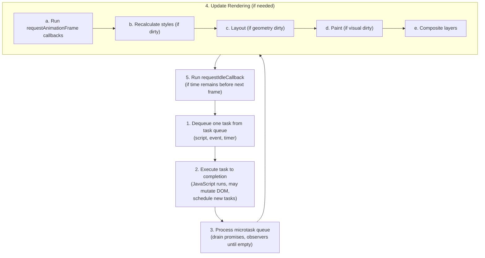

# Lesson 2: DOM, Rendering Engines, Browser APIs

## 1. First-Principles Intuition & Invariants

The browser rendering engine sits at the convergence of parsers, abstract syntax trees, layout geometry, compositing pipelines, and asynchronous event dispatch—a real-time operating system for interactive documents. Where traditional compilers transform source text into static machine code through a unidirectional pipeline, rendering engines maintain live bidirectional mappings between hierarchical document models and pixel grids, continuously reconciling programmer mutations, user interactions, network latency, and hardware vsync intervals measured in 16.67-millisecond quanta at 60 Hz.

The Document Object Model emerged from a pragmatic engineering problem: Netscape Navigator and Internet Explorer in the mid-1990s exposed incompatible JavaScript interfaces to modify running documents, fracturing the nascent web application ecosystem. The W3C standardized the DOM as a language-neutral, platform-independent API contract where HTML and XML documents manifest as mutable tree structures—nodes owning typed interfaces (`Element`, `Text`, `Comment`, `Document`) with standardized traversal, mutation, and query semantics. This abstraction decouples declarative markup from imperative script manipulation, enabling the same document to drive visual browsers, screen readers, search indexers, and headless automation tools through a unified programmatic surface.

Rendering engines like Blink (Chromium, Edge), WebKit (Safari), and Gecko (Firefox) share a canonical pipeline architecture grounded in three invariants. First, the DOM tree and CSSOM tree remain logically distinct until layout computation, preserving separation between content structure and presentational rules. Second, layout algorithms operate on an immutable snapshot called the render tree, a culled projection excluding `display: none` subtrees and decorating visible nodes with computed style cascades. Third, the critical rendering path enforces strict phase ordering—parsing yields trees, style resolution decorates nodes, layout computes geometry, paint records drawing commands, and compositing submits GPU textures—because later stages depend on stable outputs from predecessors. Violating this dependency chain through JavaScript mutations mid-frame triggers reflow or repaint, expensive synchronous recalculations that block the main thread and jank animations.

The DOM as a data structure mirrors compiler intermediate representations: a typed abstract syntax tree annotated with source positions, parent pointers for upward traversal, and sibling links for efficient iteration. Each node occupies heap memory with overhead for V8 object headers, hidden classes for property lookup, and bidirectional bindings between C++ Blink objects and JavaScript wrappers mediated by V8's garbage collector. A modest 10,000-node document consumes megabytes of resident memory before accounting for layout boxes, style structs, or texture atlases. This memory topology matters because DOM mutations propagate through invalidation flags: touching a node's `className` dirties style caches up to the nearest shadow boundary, triggering incremental recalculation scoped by CSS selector complexity.

Event propagation formalizes how user inputs and programmatic dispatches flow through the tree hierarchy. The model descends from Netscape's capturing phase and Microsoft's bubbling phase, unified by the DOM Level 2 Events specification into a three-phase protocol. Capture flows from `window` toward the target, bubbling returns to the root, and the target phase fires listeners registered on the event's immediate recipient. This allows parent containers to intercept child events through delegation patterns, reducing listener overhead and simplifying dynamic UI construction. Stopping propagation or preventing default behavior introduces control flow branches that complicate framework event systems—React's synthetic event pooling and delegation to the root node, for instance, must faithfully emulate native behavior while batching state updates across a single browser task.

Browser APIs extend beyond the DOM into asynchronous I/O, concurrency, storage, and hardware access. The Fetch API replaced XMLHttpRequest with promise-based network requests exposing HTTP/2 semantics, while Service Workers introduced programmable network proxies enabling offline-first architectures through Cache API persistence. Web Workers provide true parallel execution contexts isolated from the main thread, communicating via structured clone message passing to bypass shared-memory data races. IndexedDB offers transactional object storage with compound indexes, trading SQL expressiveness for NoSQL scalability and origin-partitioned sandboxing. The Intersection Observer API decouples scroll-based visibility detection from layout thrashing by batching queries against the compositor thread, eliminating polling loops that historically caused 30% CPU overhead in infinite-scroll implementations.

The critical rendering path from server bytes to painted pixels obeys strict causality. Network packets carrying HTML trigger speculative parsing as bytes arrive, constructing DOM nodes incrementally without blocking on stylesheets or scripts—except when the parser encounters `<script>` tags without `async` or `defer`, forcing synchronous JavaScript execution that can query the partial DOM but must wait for pending stylesheets to ensure computed style access returns consistent values. CSS parsing yields the CSSOM, a separate tree of style rules indexed by selectors, which the style resolution pass merges with the DOM via selector matching algorithms optimized for right-to-left traversal (Bloom filters reject impossible matches early). Layout transforms the styled render tree into a coordinate space of boxes—block, inline, flex, grid—solving constraint systems where parent dimensions depend on children (intrinsic sizing) and children depend on parents (extrinsic sizing), requiring iterative passes for cases like percentage heights against auto-height containers. Paint records draw commands into display lists, layering text, borders, shadows, and images according to stacking context rules derived from CSS2.1's appendix E. Compositing promotes layers with 3D transforms, filters, or `will-change` hints to GPU textures, enabling independent rasterization and hardware-accelerated animation without repainting ancestor layers.

Understanding this pipeline mechanically—not as black-box behavior but as graph algorithms, memory-mapped buffers, and thread synchronization primitives—transforms performance debugging from guesswork into hypothesis-driven engineering. The browser is not opaque magic; it is a concurrent system balancing deterministic computation with real-time user experience, exposing profiler interfaces, performance APIs, and source-level debugging to engineers willing to map abstractions onto silicon.

## 2. Core Architecture & Mechanics

The rendering engine organizes around the fundamental transformation from serial character streams into spatial pixel grids, mediated by intermediate tree structures that preserve semantic relationships while enabling efficient invalidation and recomputation. Blink and WebKit share architectural lineage from KHTML, diverging in threading models and layer promotion heuristics but converging on core data structures.

Parsing HTML proceeds through a tokenizer and tree builder, two cooperating state machines that recover from malformed markup according to WHATWG HTML5 parsing rules—a 100-page specification formalizing error correction heuristics reverse-engineered from legacy browser behavior. The tokenizer scans bytes (UTF-8 decoded, BOM-aware) into start tags, end tags, text, comments, and doctypes, handling escape sequences (`&lt;`, `&#x3C;`, `&#60;`) and character references. The tree builder maintains an insertion mode stack mirroring HTML's context-dependent syntax: a `<td>` inside `<table>` implicitly generates missing `<tbody>` and `<tr>` ancestors through foster parenting rules, while `<script>` tags pause tree construction to execute code that might call `document.write()`, injecting retroactive markup into the input stream. Modern browsers mitigate `document.write()` risks by refusing injection on slow networks, logging console warnings to nudge developers toward declarative patterns.

The DOM tree emerges as a class hierarchy rooted at `Node`, specialized into `Document`, `Element`, `Attr`, `Text`, `Comment`, `ProcessingInstruction`, and `DocumentFragment` subclasses. Each `Element` stores tag names in interned atoms (pointer-sized identifiers into a global string table), attributes in sparse maps or packed arrays depending on count, and child pointers as vectors of raw pointers or, in WebKit, smart pointers with intrusive reference counting. The `ParentNode` mixin provides `querySelector[All]` and `children` iterators, while `ChildNode` exposes `before`, `after`, `replaceWith`, and `remove` mutation convenience methods. Shadow DOM introduces `ShadowRoot` nodes hosting encapsulated subtrees with scoped styles and slotted content distribution, enabling web components to hide internal implementation details from parent document scripts—a lexical closure for markup.

CSS parsing constructs the CSSOM as a map from selectors to declaration blocks, indexed for fast rule matching during style resolution. Selectors decompose into combinator sequences: descendant (` `), child (`>`), adjacent sibling (`+`), general sibling (`~`), keyed by rightmost compound selector for Bloom filter indexing. The cascade algorithm sorts applicable rules by origin (user-agent, author, user), importance (`!important`), specificity (ID count, class count, type count), and source order, yielding a computed style struct per element caching font, color, dimensions, and layout mode. Inheritance propagates properties like `color` and `font-family` from parent to child, while non-inherited properties like `margin` reset at element boundaries. The resolved cascade feeds into layout, but first the engine culls hidden nodes: `display: none` subtrees vanish from the render tree, `visibility: hidden` occupies layout space but skips paint, and `opacity: 0` paints but remains interactive.

Layout algorithms vary by display mode, each solving distinct geometric constraints. Block layout stacks boxes vertically, computing widths from parent constraints and heights from child content, handling margin collapse where adjacent margins overlap rather than sum. Inline layout flows text and inline-block boxes horizontally, fragmenting across line boxes with bidirectional Unicode support (UAX #9), hyphenation, and justification. Flexbox layout distributes space along a main axis according to flex-grow/shrink ratios and cross-axis alignment, requiring iterative passes when intrinsic sizes conflict with available space—flexbox's specification includes 12-step resolution algorithms handling degenerate cases like flex containers with indefinite sizes containing percentage-based children. Grid layout positions items into explicit tracks defined by `grid-template-rows/columns`, auto-placing remaining items into implicit tracks, supporting layered overlapping regions impossible in traditional flow layout. Subgrid, a recent addition, propagates parent grid track sizing into nested grids, solving the decades-old problem of aligning nested table cells across independent subtrees.

The layout tree (render tree in older terminology) mirrors the DOM but prunes hidden nodes and injects anonymous boxes for layout invariants: block containers wrapping sequences of inline children, or inline wrappers around block-in-inline violations. Each layout box stores a `LayoutRect` (x, y, width, height) in device-independent pixels, plus overflow rectangles, baseline offsets, and pointers to associated DOM nodes. Layout proceeds top-down in a single pass for simple flow content, but percentage heights, absolutely positioned descendants, and flexbox require multi-pass iterative solving. Incremental layout narrows recomputation to dirty subtrees, tracking clean boundaries through versioned layout roots—adding a child to a 10,000-node document typically reflows only the affected container, not the entire tree, reducing 100ms operations to sub-millisecond updates.

Paint walks the layout tree depth-first, emitting drawing operations into a display list: fill rectangles, stroke paths, composite images, render glyphs. Stacking contexts partition the display list into layers according to z-index, positioning (absolute, fixed), transforms, opacity, filters, and blending modes. Each stacking context paints in phases: background, borders, floats, block descendants, inline content, positioned descendants—a deterministic ordering that resolves overlapping elements into a flattened Z-order. Paint invalidation tracks dirty regions at pixel granularity, coalescing adjacent rects to minimize overdraw. Text rendering delegates to platform-specific font rasterizers (DirectWrite on Windows, Core Text on macOS, FreeType on Linux), applying subpixel antialiasing, hinting, and OpenType feature shaping (ligatures, kerning) before caching glyph atlases in GPU textures.

Compositing promotes paint layers to GPU textures (compositor layers) when hardware acceleration provides measurable benefit: 3D transforms, CSS animations of transform/opacity, video, canvas, scrollable overflow regions. The compositor thread rasterizes these layers independently of the main thread, enabling smooth scrolling and animations even while JavaScript executes or layout blocks. Layer promotion incurs memory overhead—each layer allocates backing stores sized to visible viewport extents plus modest overscroll buffers—so engines employ heuristics balancing smoothness against VRAM exhaustion. The `will-change` CSS property provides developer hints for promotion, while the Layers panel in DevTools exposes the layer tree, texture sizes, and repaint counts for debugging janky animations caused by excessive layer churn or missing promotions.

Event dispatch implements the DOM Events specification with meticulous attention to re-entrancy and mutation safety. When a user clicks, the browser's input pipeline routes hardware events through platform window managers into the compositor process, hit-testing GPU layer quads to identify the target pixel, then performing geometric hit-testing on the main thread's layout tree to resolve the deepest DOM node containing the pointer. The engine constructs a `MouseEvent` object with client coordinates, screen coordinates, button states, and modifier keys, then walks the ancestor chain from `window` to the target (capture phase), invoking registered listeners with `useCapture: true`. At the target node, listeners without capture flags fire. Bubbling reverses the traversal, invoking remaining listeners on each ancestor until reaching `window` or a listener calls `stopPropagation()`. Event listeners can mutate the DOM mid-dispatch—removing the current target or future ancestors—so the engine snapshots the propagation path before dispatch begins, protecting against iterator invalidation.

The event loop orchestrates task scheduling across rendering, JavaScript execution, network callbacks, and timer expiration. Defined by the HTML specification rather than ECMAScript, the loop structures computation into tasks (macrotasks: script tags, user events, network responses) and microtasks (promise reactions, `MutationObserver` callbacks). Each task runs to completion, drains the microtask queue, optionally updates rendering (coalescing multiple script-triggered mutations into a single frame), then yields to the OS scheduler. `requestAnimationFrame` callbacks fire during the rendering update, receiving high-resolution timestamps synchronized to vsync intervals, ideal for animation loops that avoid timer drift and unnecessary reflows. `requestIdleCallback` schedules background work during idle periods, receiving deadlines indicating remaining time before the next frame or input event—a cooperative scheduling primitive for non-urgent analytics, metrics, or prerendering without degrading responsiveness.

Browser APIs extend the platform beyond document manipulation into storage, networking, concurrency, and hardware access. The Fetch API exposes HTTP semantics through promise-returning functions, supporting streaming request bodies via `ReadableStream`, CORS preflight negotiation, and credentials policies. Responses arrive as streams, enabling incremental JSON parsing or progressive image decoding without buffering entire payloads into memory—critical for mobile networks where 10 MB responses over 3G require seconds to transfer. Service Workers intercept fetch events, injecting programmable proxies between web apps and the network. A registered service worker boots in a separate thread upon navigation, claiming clients via `clients.claim()`, and routing fetch events to cache-first, network-first, or stale-while-revalidate strategies implemented in JavaScript. The Cache API provides transactional storage for request/response pairs keyed by URL, persisting across sessions and enabling full offline functionality for progressive web apps.

Web Workers instantiate isolated JavaScript contexts with their own event loops, sharing no memory with the main thread. Communication proceeds via `postMessage`, serializing payloads through structured clone—a deep copy algorithm supporting circular references, typed arrays, and transferable objects like `ArrayBuffer` (ownership moves without copying bytes, enabling zero-copy handoff of large datasets). Workers suit CPU-intensive tasks like image processing, physics simulation, or cryptographic operations, offloading the main thread to preserve frame rate responsiveness. Shared Workers allow multiple tabs from the same origin to connect to a single worker instance, coordinating state via message ports—useful for singleton background sync or shared WebSocket connections. Service Workers combine worker isolation with lifecycle management (install, activate, fetch) and storage APIs (Cache, IndexedDB) to implement full application shells that boot instantly from local caches.

IndexedDB provides transactional NoSQL storage in the browser, exposing object stores (analogous to tables) indexed by key paths or generated keys. Transactions guarantee atomicity across multiple operations, supporting read-only or read-write modes with optimistic concurrency. Compound indexes enable efficient queries on multiple properties without full scans, though the absence of joins or aggregations requires careful denormalization. Storage quotas vary by browser and storage pressure: Chrome on desktop grants gigabytes per origin, mobile browsers impose stricter limits, and eviction policies clear least-recently-used data under storage pressure. The Storage API surfaces quota estimates and persistent storage requests (requiring user permission) to protect critical app data from automatic eviction.

The Intersection Observer API decouples visibility detection from scroll event polling by delegating computation to the compositor thread. Observers track target elements against root containers, invoking callbacks when intersection ratios cross thresholds (0%, 25%, 50%, 100%). This enables lazy image loading (load when 50% visible), infinite scroll (append data when sentinel nears viewport), and viewability tracking (bill ads when 100% visible for 1s) without triggering layout thrashing from repeated `getBoundingClientRect()` calls inside scroll handlers—a pattern responsible for janky scrolling across the pre-observer web.

Mutation Observers replace deprecated mutation events with a performant batched API for monitoring DOM changes. Observers receive arrays of mutation records describing attribute changes, child additions/removals, and character data modifications, coalesced across synchronous script execution and delivered during microtask checkpoints. This enables framework reactivity systems to track document mutations for diffing algorithms or synchronize model state with imperative view updates. The microtask delivery timing ensures mutations reflect stable intermediate states—multiple sequential attribute sets on the same element yield a single mutation record capturing the net change.

The Performance API exposes high-resolution monotonic timestamps (`performance.now()`) immune to system clock adjustments, plus resource timing entries capturing network waterfall data for every fetched asset: DNS lookup, TCP handshake, TLS negotiation, time to first byte, transfer duration. Navigation timing marks key milestones: `domContentLoaded`, `loadComplete`, `firstContentfulPaint`, `largestContentfulPaint`. These metrics ground performance optimization in measurable data, distinguishing network-bound from compute-bound bottlenecks. User Timing allows custom marks and measures, wrapping code sections with precise instrumentation: `performance.mark('start'); doWork(); performance.mark('end'); performance.measure('work', 'start', 'end')`.

## 3. High-Performance Optimization & Failure Modes

Rendering performance collapses when JavaScript mutations trigger synchronous layout recalculation mid-frame, a failure mode called forced synchronous layout or layout thrashing. Reading geometric properties like `offsetWidth`, `clientHeight`, or `getBoundingClientRect()` after modifying styles or DOM structure forces the engine to flush pending layout computations immediately, blocking script execution for milliseconds while recalculating boxes. This manifests when updating a collection of elements in a loop that alternates between DOM mutations and geometry queries—each query flushes layout, yielding quadratic complexity where N elements incur N layout passes instead of one. The fix separates reads from writes: batch all geometry queries first (storing results in variables), then apply all DOM mutations in a second pass. This preserves the browser's natural pipeline, deferring layout until the next rendering update where the engine processes all mutations in a single coalesced pass.

CSS selector complexity directly impacts style resolution latency. Descendant combinators (`.container .item`) require walking ancestor chains for every candidate element, while child combinators (`.container > .item`) test only immediate parents. Attribute selectors (`[data-active]`) scan all elements lacking Bloom filter optimizations unless combined with tag or class selectors that narrow candidates early. Universal selectors (`*`) match every node, defeating fast-path rejections. Right-to-left matching—reading `.a .b .c` as "find `.c`, check parent is `.b`, check ancestor is `.a`"—optimizes rejection by filtering largest sets first, but deeply nested rules with many combinators still scale poorly. Modern engines memoize matched rules per element, invalidating caches only when mutations affect selector applicability (class changes, subtree insertions), but initial page load pays the full matching cost. Prefer flat selector hierarchies, avoid universal selectors in combinators, and leverage specificity to minimize rule count evaluated per element.

Layer promotion trades memory for compositing throughput. Promoting an element to a GPU layer enables independent rasterization and transform animation without repainting ancestors, but each layer allocates backing textures sized to the layer's bounds. A 1920×1080 viewport requires 8 MB for a single RGBA8 layer; promoting 10 large elements consumes 80 MB of VRAM. Mobile devices with 1–2 GB shared memory across GPU and system RAM exhaust texture budgets quickly, forcing evictions that crash tabs. The browser's compositor thread employs heuristics to promote layers with 3D transforms, `will-change: transform`, CSS animations, or video elements, but developers sometimes over-optimize by marking every animating element with `will-change`, causing memory bloat without performance gains. The Layers panel in DevTools visualizes the layer tree, exposing texture sizes and repaint counts. Optimal layer strategies promote only elements animating concurrently—if five cards animate sequentially, one layer suffices by reusing the texture across frames.

Reflow versus repaint distinguishes geometric from visual invalidation. Reflow recalculates layout boxes when element dimensions, positions, or structure change—modifying `width`, `margin`, adding children. Repaint updates pixels without changing geometry—altering `color`, `background`, `box-shadow`. Reflow is strictly more expensive, requiring layout tree traversal and constraint solving before painting. Some properties trigger neither: `transform` and `opacity` when applied to compositor layers update GPU textures directly, bypassing main-thread paint. The CSS Triggers reference catalogs every property's invalidation behavior across browsers. High-performance animations exclusively target `transform` and `opacity`, relegating layout-affecting properties like `width` or `top` to infrequent transitions or one-time loads.

Event delegation exploits bubbling to reduce listener overhead. Attaching listeners to every row in a 10,000-row table allocates 10,000 closures, increases memory pressure, and slows DOM mutations that must patch listener registries. Attaching a single listener to the table container and inspecting `event.target` during bubbling achieves identical functionality with constant overhead. Delegation particularly suits dynamically generated content where rows appear and disappear without listener bookkeeping. The tradeoff involves dispatch latency—every click bubbles through the ancestor chain, invoking the delegated listener even for unrelated targets, so handlers must guard with early returns or target checks. Frameworks like React codify delegation by routing all events through a root listener, though this introduces subtle behavioral differences from native capture/bubble ordering when interoperating with third-party libraries that expect per-element listeners.

Virtual scrolling addresses rendering performance for unbounded lists by instantiating only visible DOM nodes, recycling elements as the viewport scrolls. A 100,000-item list would traditionally create 100,000 DOM nodes, consuming gigabytes of memory and seconds of layout time. Virtual scrolling renders 20–50 items (viewport height divided by item height, plus overscroll buffer), absolutely positioning them within a container sized to the total list height. Scroll events translate the viewport offset into a data slice, updating recycled elements with new content. This reduces initial render from seconds to milliseconds and memory from gigabytes to megabytes, enabling arbitrarily large datasets with constant overhead. Challenges include variable-height items (requiring item height caches or estimation heuristics), focus management (ensuring focusable elements exist in the DOM), and accessibility (screen readers expect all items to exist for navigation). Libraries like `react-window` and `tanstack-virtual` encapsulate these concerns with production-hardened implementations.

Web Workers require careful data transfer planning because structured clone serializes entire object graphs, copying megabytes of data across thread boundaries. A 10 MB array copied bidirectionally every frame saturates 20 MB/s of serialization bandwidth, dominating workload costs. Transferable objects—`ArrayBuffer`, `MessagePort`, `ImageBitmap`, `OffscreenCanvas`—move ownership without copying by neutering the source reference and recreating on the destination thread. Transferring a 10 MB `ArrayBuffer` executes in microseconds regardless of size, enabling zero-copy data pipelines. Workload design should partition data into immutable inputs (transfer once to worker), mutable working sets (retain in worker), and outputs (transfer back to main thread), minimizing round-trip serialization. SharedArrayBuffer enables shared memory concurrency, but cross-origin isolation (COOP/COEP headers) and Atomics for synchronization complicate adoption.

Cache invalidation for service workers requires versioning strategies because aggressive caching causes stale code deployment. A naive cache-first strategy serves cached responses indefinitely, never updating the application until the user clears storage. Version-stamped caches—`cache-v1`, `cache-v2`—allow install events to populate new caches while leaving old versions intact, activating the new cache atomically after installation succeeds. The service worker lifecycle stages install, activate, and fetch events, but activation waits until all tabs using the old worker close unless `skipWaiting()` forces immediate takeover. Stale-while-revalidate strategies serve cached responses immediately while fetching updates in the background, updating the cache for the next request—balancing instant loads with eventual freshness. Workbox abstracts these patterns into declarative routing configurations, handling edge cases like partial cache corruption or quota exceeded errors.

IndexedDB transactions serialize conflicting read-write operations, introducing contention under heavy load. Opening a read-write transaction locks the entire object store, blocking concurrent transactions until commit or abort. Long-running transactions delay queued operations, manifesting as UI freezes when interactive features await database access. Partitioning data across multiple object stores reduces contention by allowing independent locking, while read-only transactions admit concurrent readers without blocking. Batching mutations into fewer transactions amortizes commit overhead but risks rollback complexity if partial updates succeed before errors. The API's promise-based error propagation requires careful handling—unhandled transaction errors abort transactions silently, losing uncommitted writes. Wrapping transactions in try-catch blocks with explicit error handlers ensures deterministic rollback and retry logic.

Memory leaks accumulate from retained DOM references, event listeners, and closure captures. Detached DOM trees—nodes removed from the document but still referenced by JavaScript variables—occupy memory indefinitely, including their entire descendant subtrees. Event listeners on long-lived objects that capture large closures prevent garbage collection of enclosed scopes. The Detached DOM Nodes view in DevTools identifies leaked trees, while heap snapshots expose retaining paths from GC roots to leaked objects. Modern frameworks mitigate leaks through component lifecycle hooks (React `useEffect` cleanup, Vue `onBeforeUnmount`) that dispose listeners and cancel timers, but manual DOM manipulation or third-party library integration reintroduces leak vectors. WeakMap and WeakRef enable auxiliary data structures that don't prevent garbage collection, suitable for metadata annotations on DOM nodes or cached computations keyed by object identity.

Critical rendering path optimization minimizes time to first meaningful paint by inlining critical CSS, deferring non-essential scripts, and prioritizing above-the-fold content. Render-blocking resources—stylesheets in `<head>`, synchronous scripts—delay initial paint because the browser refuses to render unstyled content (flash of unstyled content avoidance) and must evaluate scripts that might call `document.write()`. Inlining critical CSS (styles for above-the-fold layout) into `<style>` tags eliminates the stylesheet network round-trip, while loading full stylesheets asynchronously via `<link rel="preload">` or media queries (`media="print" onload="this.media='all'"`). Scripts marked `async` download in parallel and execute opportunistically, breaking document order dependencies; `defer` executes in order after parsing completes but before `DOMContentLoaded`. Resource hints—`dns-prefetch`, `preconnect`, `prefetch`, `preload`—warm network stacks and fill caches before requests fire, shaving hundreds of milliseconds from critical paths on high-latency mobile networks.

Font loading introduces layout shifts when web fonts replace fallback system fonts mid-render. The `font-display` descriptor controls swap behavior: `swap` renders text immediately in fallback fonts, swapping to web fonts when available (causing flashes of unstyled text); `optional` skips web fonts if not cached, preferring layout stability over typography; `block` hides text briefly while loading fonts, risking invisible text during slow loads. The Font Loading API (`document.fonts.load()`) enables programmatic font preloading and fine-grained swap timing, while variable fonts reduce file sizes by encoding multiple weights and styles in a single file, amortizing load costs across an entire type family.

Image optimization balances quality, file size, and format capabilities. JPEG suits photographic content with high compression ratios but lacks transparency and efficient handling of text or sharp edges. PNG provides lossless compression and alpha transparency but balloons for photographs. WebP combines JPEG compression efficiency with PNG transparency, reducing file sizes 25–35% versus JPEG at equivalent quality. AVIF improves further with 50% smaller files than JPEG, but encoding times and browser support lag. Responsive images via `<picture>` and `srcset` serve resolution-appropriate assets—1x for standard displays, 2x for Retina—and art-direct different crops per breakpoint. Lazy loading (`loading="lazy"`) defers offscreen images until scroll nears their positions, prioritizing bandwidth for above-the-fold content. Modern bundlers generate image pipelines that transcode sources into multiple formats, resize for responsive breakpoints, and inject markup with optimal fallback chains.

JavaScript bundle size directly impacts parse and compile time, not just transfer duration. A 1 MB gzipped bundle decompresses to 4–6 MB of source, requiring V8 to parse and compile megabytes of syntax before executing the first line. Parse time scales superlinearly with size due to scope chain resolution and generator desugaring. Code splitting partitions bundles into route-specific chunks loaded on demand, deferring non-critical code until needed. Dynamic `import()` returns promises that load chunks asynchronously, integrating with React `lazy()` or Vue `defineAsyncComponent()` for component-level splitting. Tree shaking eliminates unused exports during bundling, but relies on static ES module imports—CommonJS `require()` defeats analysis by allowing runtime-computed paths. Module concatenation (scope hoisting) inlines small modules into parent scopes, reducing function call overhead and enabling further minification.

The main thread's singular responsibility for DOM, layout, paint, and JavaScript execution creates inherent contention. Long-running JavaScript blocks rendering, causing dropped frames and janky scrolling. The solution distributes computation across frames via scheduler primitives: `requestIdleCallback` for background work, `requestAnimationFrame` for visual updates, and Web Workers for parallel CPU tasks. Breaking expensive operations into time-sliced chunks—processing 100 items per frame across 10 frames instead of 1,000 items instantly—maintains responsiveness at the cost of implementation complexity. React Concurrent Mode formalizes this pattern with interruptible rendering and priority-based scheduling, but requires framework support and careful state management to avoid tearing (displaying inconsistent UI slices from partially applied updates).

Rendering engines expose profiling interfaces that surface internal metrics: paint flashing highlights repainted regions, layer borders visualize compositor layers, frame rendering stats show time spent in layout/paint/composite. The Performance panel records frame-by-frame timelines, flame graphs of JavaScript execution, and waterfall charts of network activity. Recording while reproducing jank isolates slow frames, drilling into stack traces to identify blocking functions. Layout Shift tracking quantifies visual stability, penalizing unexpected movements that degrade user experience. Core Web Vitals—Largest Contentful Paint (LCP), First Input Delay (FID), Cumulative Layout Shift (CLS)—codify performance into measurable objectives, but optimization requires understanding the rendering pipeline mechanically to translate metrics into actionable refactorings.

The browser rendering engine, scrutinized through the lens of its data structures, pipeline stages, and concurrency models, reveals itself as a sophisticated real-time system balancing determinism with responsiveness. Mastery emerges not from memorizing API surfaces but from internalizing how mutations propagate through tree structures, how layout algorithms resolve constraints, and how threading boundaries partition computation. The path from markup to pixels is neither magic nor mystery—it is a compiler, a layout engine, a compositor, and an operating system, engineered to deliver interactive documents at 60 frames per second across a billion heterogeneous devices.
