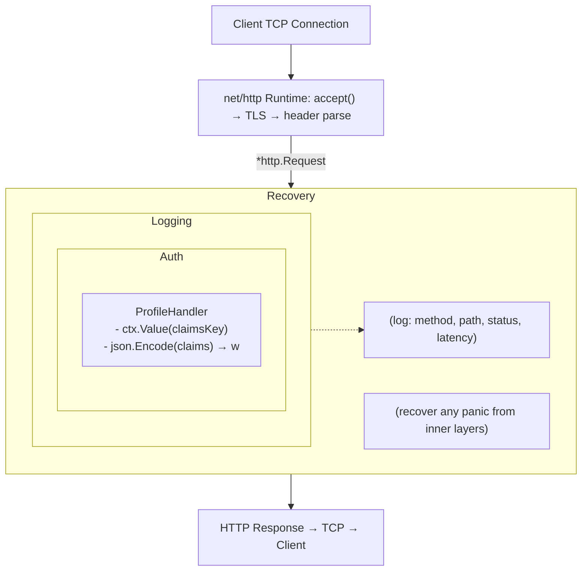

# Lesson 4: Server Patterns, Middleware, Data Persistence

## 1. First-Principles Intuition & Invariants

Every HTTP server, regardless of whether it is written in Go, Rust, Node.js, or Java, is ultimately a function from an immutable request value to a mutable response value. The elegance of that formulation hides an enormous amount of machinery: connection acceptance, TLS negotiation, header parsing, body buffering, authentication, authorization, logging, tracing, compression, database round-trips, serialization, and error propagation must all compose cleanly before the first byte of a response body reaches the client. The central engineering problem of server-side web development is not any single one of these concerns in isolation—it is their ordered composition.

The classical solution is the middleware pipeline. Borrowed conceptually from Unix pipes and functional composition, a middleware is a function that accepts the next handler as an argument and returns a new handler that wraps it. This recursive nesting forms a call stack whose depth equals the number of middleware stages. Each stage can inspect or mutate the request before forwarding it inward, and inspect or mutate the response as it unwinds back outward. This bidirectionality is not incidental—it is what makes cross-cutting concerns like logging, timing, and panic recovery expressible as single, cohesive units rather than scattered conditional blocks.

Understanding why this matters at a systems level requires examining what happens to a TCP connection when a request arrives. The operating system's `accept(2)` syscall returns a file descriptor representing the socket. The HTTP server runtime reads bytes off that descriptor into a kernel-managed receive buffer, parses the request line and headers according to RFC 9112, and constructs an in-memory representation of the request. In Go, this is `*http.Request`; in Rust with Axum, it is a type-erased `Request<Body>` from the `http` crate. The lifecycle from raw bytes to structured request is the responsibility of the server runtime, and the lifecycle from structured request to structured response is the responsibility of your middleware pipeline and route handlers. That boundary—between the runtime's concern and the application's concern—is the first invariant you must internalize.

The second invariant is separation of concerns through layered architecture. Web applications that conflate database access, business logic, input validation, and serialization in a single handler function are nearly impossible to test, reason about, or evolve safely. The classical three-layer model—presentation, domain, and persistence—solves this by enforcing directionality: the presentation layer (HTTP handlers) may call the domain layer (service objects or use-case functions), which may call the persistence layer (repository objects or data-access functions), but no layer may reach backward across the dependency arrow. This is not an aesthetic preference; it is a structural invariant that determines whether your system remains coherent as it scales. Repositories abstract the storage medium behind an interface, services abstract business logic behind a behavior contract, and handlers translate HTTP semantics into domain calls and back. Each layer is independently testable precisely because the arrows only point inward.

The third invariant governs state. HTTP is stateless by definition—each request carries no memory of prior requests. Session management is the mechanism by which applications impose a stateful abstraction over a stateless protocol. The two dominant strategies are server-side sessions, where state is stored in a backend (memory, Redis, a relational database) and the client carries only an opaque session identifier in a cookie, and client-side sessions, where state is serialized, signed (and optionally encrypted), and stored entirely in the cookie itself. The former requires a session store with its own consistency and availability characteristics; the latter shifts storage cost to the client and verification cost to the server on every request. Neither is universally superior—the choice depends on the size of session data, latency sensitivity, and your trust model for client-stored tokens.

Database integration patterns form the fourth invariant. A web application's interaction with a relational database is not simply a matter of sending SQL strings over a socket. It involves connection pooling, transaction management, N+1 query prevention, optimistic versus pessimistic locking, and the impedance mismatch between relational rows and object graphs. Each of these problems has well-understood solutions, but those solutions only work correctly when you understand the underlying mechanics: how a connection pool recycles idle connections under load, what a database transaction's isolation level actually guarantees about concurrent reads, and how an ORM's lazy-loading strategy can silently generate hundreds of queries per request.

---

## 2. Core Architecture & Mechanics

### The Middleware Pipeline

The middleware pattern has a canonical implementation in every major server framework. In Go's `net/http`, it is expressed as a function that accepts and returns an `http.Handler`. In Express.js, middleware is a function with the signature `(req, res, next) => void`. In Rust's Axum, it is the `tower::Layer` / `tower::Service` trait pair. Despite the syntactic variation, the structure is identical: a chain of wrapping functions that form a call stack at request time.

Consider a Go server with authentication, logging, and panic recovery middleware. The registration order determines the execution order: the outermost middleware executes first on the way in and last on the way out.

```go
package main

import (
    "context"
    "encoding/json"
    "errors"
    "fmt"
    "log/slog"
    "net/http"
    "os"
    "runtime/debug"
    "strings"
    "time"
)

// contextKey is an unexported type for context keys in this package,
// preventing collisions with keys defined in other packages.
type contextKey string

const claimsKey contextKey = "claims"

// Claims represents a parsed, validated JWT payload.
type Claims struct {
    Subject string
    Role    string
}

// ---------------------------------------------------------
// Middleware: Recovery
// Catches panics in downstream handlers, logs the stack trace,
// and returns a 500 response rather than crashing the server.
// ---------------------------------------------------------
func RecoveryMiddleware(next http.Handler) http.Handler {
    return http.HandlerFunc(func(w http.ResponseWriter, r *http.Request) {
        defer func() {
            if val := recover(); val != nil {
                slog.Error("panic recovered",
                    "error", fmt.Sprintf("%v", val),
                    "stack", string(debug.Stack()),
                )
                http.Error(w, `{"error":"internal server error"}`, http.StatusInternalServerError)
            }
        }()
        next.ServeHTTP(w, r)
    })
}

// ---------------------------------------------------------
// Middleware: Structured Request Logging
// Records method, path, status code, and latency using
// a response writer wrapper that captures the status code.
// ---------------------------------------------------------
type statusCapture struct {
    http.ResponseWriter
    status int
}

func (sc *statusCapture) WriteHeader(code int) {
    sc.status = code
    sc.ResponseWriter.WriteHeader(code)
}

func LoggingMiddleware(logger *slog.Logger) func(http.Handler) http.Handler {
    return func(next http.Handler) http.Handler {
        return http.HandlerFunc(func(w http.ResponseWriter, r *http.Request) {
            start := time.Now()
            sc := &statusCapture{ResponseWriter: w, status: http.StatusOK}
            next.ServeHTTP(sc, r)
            logger.Info("request",
                "method", r.Method,
                "path",   r.URL.Path,
                "status", sc.status,
                "latency_ms", time.Since(start).Milliseconds(),
            )
        })
    }
}

// ---------------------------------------------------------
// Middleware: JWT Bearer Authentication
// Parses the Authorization header, validates the token,
// and injects Claims into the request context.
// In production, replace parseAndValidateJWT with a real
// library such as github.com/golang-jwt/jwt/v5.
// ---------------------------------------------------------
func AuthMiddleware(next http.Handler) http.Handler {
    return http.HandlerFunc(func(w http.ResponseWriter, r *http.Request) {
        header := r.Header.Get("Authorization")
        if !strings.HasPrefix(header, "Bearer ") {
            http.Error(w, `{"error":"missing bearer token"}`, http.StatusUnauthorized)
            return
        }
        token := strings.TrimPrefix(header, "Bearer ")
        claims, err := parseAndValidateJWT(token)
        if err != nil {
            http.Error(w, `{"error":"invalid token"}`, http.StatusUnauthorized)
            return
        }
        ctx := context.WithValue(r.Context(), claimsKey, claims)
        next.ServeHTTP(w, r.WithContext(ctx))
    })
}

func parseAndValidateJWT(token string) (*Claims, error) {
    // Stub: replace with real HMAC-SHA256 / RS256 validation.
    if token == "valid-token" {
        return &Claims{Subject: "user-42", Role: "admin"}, nil
    }
    return nil, errors.New("invalid")
}

// ---------------------------------------------------------
// Handler: returns the claims injected by AuthMiddleware.
// ---------------------------------------------------------
func ProfileHandler(w http.ResponseWriter, r *http.Request) {
    claims, ok := r.Context().Value(claimsKey).(*Claims)
    if !ok {
        http.Error(w, `{"error":"no claims in context"}`, http.StatusInternalServerError)
        return
    }
    w.Header().Set("Content-Type", "application/json")
    json.NewEncoder(w).Encode(claims)
}

func main() {
    logger := slog.New(slog.NewJSONHandler(os.Stdout, nil))

    mux := http.NewServeMux()
    mux.HandleFunc("GET /profile", ProfileHandler)

    // Compose the pipeline. Execution order on request ingress:
    // RecoveryMiddleware → LoggingMiddleware → AuthMiddleware → ProfileHandler
    // Execution order on response egress (unwinding):
    // ProfileHandler → AuthMiddleware → LoggingMiddleware → RecoveryMiddleware
    handler := RecoveryMiddleware(
        LoggingMiddleware(logger)(
            AuthMiddleware(
                http.HandlerFunc(ProfileHandler),
            ),
        ),
    )
    mux.Handle("GET /profile", handler)

    srv := &http.Server{
        Addr:         ":8080",
        Handler:      mux,
        ReadTimeout:  5 * time.Second,
        WriteTimeout: 10 * time.Second,
        IdleTimeout:  120 * time.Second,
    }
    logger.Info("server starting", "addr", srv.Addr)
    if err := srv.ListenAndServe(); err != nil && !errors.Is(err, http.ErrServerClosed) {
        logger.Error("server error", "err", err)
        os.Exit(1)
    }
}
```

The `statusCapture` wrapper deserves attention. Go's `http.ResponseWriter` does not expose the written status code after the fact, because `WriteHeader` is a one-way operation—once called, the headers are flushed to the network buffer. By intercepting `WriteHeader`, the logging middleware captures the code into its own field before forwarding the call to the underlying writer. This pattern appears in virtually every Go logging middleware implementation in production.

### Pipeline Signal Flow

The following diagram represents the execution path of a single authenticated request through the pipeline defined above.



### Routing Architecture

Modern Go (1.22+) ships with enhanced pattern matching in `net/http.ServeMux`, supporting method-qualified patterns (`GET /users/{id}`) and wildcard segments. For routing-heavy APIs, purpose-built routers like `chi` or `gorilla/mux` provide parameter extraction, middleware scoping per sub-router, and named route reversal. The critical implementation detail is that router parameter extraction must not allocate per-request in a hot path—both `chi` and the standard library achieve this by storing path parameters in the request context using a pre-allocated slot, avoiding heap pressure under high concurrency.

```go
package main

import (
    "encoding/json"
    "net/http"
    "strconv"

    "github.com/go-chi/chi/v5"
    "github.com/go-chi/chi/v5/middleware"
)

type UserService interface {
    GetByID(id int64) (*User, error)
    Create(req CreateUserRequest) (*User, error)
}

type User struct {
    ID    int64  `json:"id"`
    Email string `json:"email"`
    Role  string `json:"role"`
}

type CreateUserRequest struct {
    Email string `json:"email"`
    Role  string `json:"role"`
}

type UserHandler struct {
    svc UserService
}

func (h *UserHandler) GetUser(w http.ResponseWriter, r *http.Request) {
    rawID := chi.URLParam(r, "id")
    id, err := strconv.ParseInt(rawID, 10, 64)
    if err != nil {
        writeJSON(w, http.StatusBadRequest, map[string]string{"error": "invalid id"})
        return
    }
    user, err := h.svc.GetByID(id)
    if err != nil {
        writeJSON(w, http.StatusNotFound, map[string]string{"error": "user not found"})
        return
    }
    writeJSON(w, http.StatusOK, user)
}

func (h *UserHandler) CreateUser(w http.ResponseWriter, r *http.Request) {
    var req CreateUserRequest
    if err := json.NewDecoder(r.Body).Decode(&req); err != nil {
        writeJSON(w, http.StatusBadRequest, map[string]string{"error": "malformed body"})
        return
    }
    if req.Email == "" {
        writeJSON(w, http.StatusUnprocessableEntity, map[string]string{"error": "email required"})
        return
    }
    user, err := h.svc.Create(req)
    if err != nil {
        writeJSON(w, http.StatusInternalServerError, map[string]string{"error": "creation failed"})
        return
    }
    writeJSON(w, http.StatusCreated, user)
}

func writeJSON(w http.ResponseWriter, status int, v any) {
    w.Header().Set("Content-Type", "application/json")
    w.WriteHeader(status)
    json.NewEncoder(w).Encode(v)
}

func BuildRouter(userSvc UserService) http.Handler {
    r := chi.NewRouter()
    r.Use(middleware.RequestID)
    r.Use(middleware.RealIP)
    r.Use(middleware.Recoverer)

    uh := &UserHandler{svc: userSvc}

    // /api/v1 sub-router inherits parent middleware and adds auth.
    r.Route("/api/v1", func(r chi.Router) {
        r.Use(AuthMiddleware) // defined in prior example
        r.Get("/users/{id}", uh.GetUser)
        r.Post("/users", uh.CreateUser)
    })

    return r
}
```

The `UserHandler` demonstrates the handler layer's sole responsibility: translate HTTP semantics into domain calls. It parses path parameters, decodes request bodies, calls the `UserService` interface (not any concrete implementation), and serializes the result. It has no SQL, no business logic, no session management. That separation makes this handler testable with a mock `UserService` in isolation, without a live database.

### Layered Architecture: Domain → Persistence

The service and repository layers implement the dependency inversion the handler layer depends on. The repository pattern places an interface between the service and the database, ensuring that swapping PostgreSQL for an in-memory store requires no changes above the repository boundary.

```go
package users

import (
    "context"
    "database/sql"
    "errors"
    "fmt"
    "time"
)

// ErrNotFound is a domain-layer sentinel error. It carries no SQL semantics.
var ErrNotFound = errors.New("user not found")

// User is the domain model. It is not a database row struct.
type User struct {
    ID        int64
    Email     string
    Role      string
    CreatedAt time.Time
}

// Repository is the persistence interface. The service layer depends on this
// abstraction, not on *sql.DB or any ORM type.
type Repository interface {
    FindByID(ctx context.Context, id int64) (*User, error)
    Insert(ctx context.Context, email, role string) (*User, error)
}

// postgresRepository is the production implementation backed by PostgreSQL.
type postgresRepository struct {
    db *sql.DB
}

func NewPostgresRepository(db *sql.DB) Repository {
    return &postgresRepository{db: db}
}

func (r *postgresRepository) FindByID(ctx context.Context, id int64) (*User, error) {
    const q = `
        SELECT id, email, role, created_at
        FROM users
        WHERE id = $1 AND deleted_at IS NULL`

    var u User
    err := r.db.QueryRowContext(ctx, q, id).Scan(
        &u.ID, &u.Email, &u.Role, &u.CreatedAt,
    )
    if errors.Is(err, sql.ErrNoRows) {
        return nil, ErrNotFound
    }
    if err != nil {
        return nil, fmt.Errorf("users.FindByID: %w", err)
    }
    return &u, nil
}

func (r *postgresRepository) Insert(ctx context.Context, email, role string) (*User, error) {
    const q = `
        INSERT INTO users (email, role, created_at)
        VALUES ($1, $2, NOW())
        RETURNING id, email, role, created_at`

    var u User
    err := r.db.QueryRowContext(ctx, q, email, role).Scan(
        &u.ID, &u.Email, &u.Role, &u.CreatedAt,
    )
    if err != nil {
        return nil, fmt.Errorf("users.Insert: %w", err)
    }
    return &u, nil
}

// Service implements the application-level use cases.
// It depends on Repository, not on *sql.DB.
type Service struct {
    repo Repository
}

func NewService(repo Repository) *Service {
    return &Service{repo: repo}
}

func (s *Service) GetByID(ctx context.Context, id int64) (*User, error) {
    if id <= 0 {
        return nil, fmt.Errorf("invalid id %d", id)
    }
    return s.repo.FindByID(ctx, id)
}

func (s *Service) Create(ctx context.Context, email, role string) (*User, error) {
    if email == "" {
        return nil, fmt.Errorf("email is required")
    }
    if role == "" {
        role = "member"
    }
    return s.repo.Insert(ctx, email, role)
}
```

The error wrapping strategy here—`fmt.Errorf("users.FindByID: %w", err)`—creates an error chain that preserves the original cause while adding location context. At the HTTP handler layer, `errors.Is(err, users.ErrNotFound)` unwraps that chain and maps the domain error to `404 Not Found` without the handler ever seeing a `sql.ErrNoRows` sentinel. The persistence layer's vocabulary stays inside the persistence layer.

### Session Management

For server-side sessions, a Redis-backed implementation with HMAC-signed session IDs represents production best practice. The session ID stored in the client cookie must be opaque, cryptographically random (at least 128 bits from `crypto/rand`), and stored in an `HttpOnly`, `Secure`, `SameSite=Lax` cookie. The HMAC signature prevents an attacker who intercepts a session ID from forging a different valid ID.

```go
package session

import (
    "context"
    "crypto/hmac"
    "crypto/rand"
    "crypto/sha256"
    "encoding/hex"
    "encoding/json"
    "errors"
    "fmt"
    "net/http"
    "time"

    "github.com/redis/go-redis/v9"
)

const (
    cookieName = "sid"
    sessionTTL = 24 * time.Hour
)

var ErrSessionNotFound = errors.New("session not found")

type Store struct {
    rdb    *redis.Client
    secret []byte
}

func NewStore(rdb *redis.Client, secret []byte) *Store {
    return &Store{rdb: rdb, secret: secret}
}

// Data holds arbitrary session values. In production, type this more strictly.
type Data map[string]any

func (s *Store) sign(id string) string {
    mac := hmac.New(sha256.New, s.secret)
    mac.Write([]byte(id))
    return id + "." + hex.EncodeToString(mac.Sum(nil))
}

func (s *Store) verify(signed string) (string, error) {
    if len(signed) < 65 {
        return "", errors.New("malformed session token")
    }
    // Last 64 hex chars are the HMAC-SHA256 (32 bytes → 64 hex chars).
    split := len(signed) - 65 // 1 for '.'
    id, sig := signed[:split], signed[split+1:]
    expected := s.sign(id)
    // Constant-time comparison prevents timing attacks.
    if !hmac.Equal([]byte(expected[split+1:]), []byte(sig)) {
        return "", errors.New("invalid session signature")
    }
    return id, nil
}

func (s *Store) Create(ctx context.Context, w http.ResponseWriter, data Data) error {
    raw := make([]byte, 16)
    if _, err := rand.Read(raw); err != nil {
        return fmt.Errorf("session.Create: rand: %w", err)
    }
    id := hex.EncodeToString(raw)

    payload, err := json.Marshal(data)
    if err != nil {
        return fmt.Errorf("session.Create: marshal: %w", err)
    }

    key := "session:" + id
    if err := s.rdb.Set(ctx, key, payload, sessionTTL).Err(); err != nil {
        return fmt.Errorf("session.Create: redis: %w", err)
    }

    http.SetCookie(w, &http.Cookie{
        Name:     cookieName,
        Value:    s.sign(id),
        Path:     "/",
        MaxAge:   int(sessionTTL.Seconds()),
        HttpOnly: true,
        Secure:   true,
        SameSite: http.SameSiteLaxMode,
    })
    return nil
}

func (s *Store) Get(ctx context.Context, r *http.Request) (Data, error) {
    cookie, err := r.Cookie(cookieName)
    if err != nil {
        return nil, ErrSessionNotFound
    }

    id, err := s.verify(cookie.Value)
    if err != nil {
        return nil, fmt.Errorf("session.Get: %w", err)
    }

    key := "session:" + id
    raw, err := s.rdb.Get(ctx, key).Bytes()
    if errors.Is(err, redis.Nil) {
        return nil, ErrSessionNotFound
    }
    if err != nil {
        return nil, fmt.Errorf("session.Get: redis: %w", err)
    }

    var data Data
    if err := json.Unmarshal(raw, &data); err != nil {
        return nil, fmt.Errorf("session.Get: unmarshal: %w", err)
    }
    return data, nil
}

func (s *Store) Destroy(ctx context.Context, r *http.Request, w http.ResponseWriter) error {
    cookie, err := r.Cookie(cookieName)
    if err != nil {
        return nil // already absent, idempotent
    }
    id, err := s.verify(cookie.Value)
    if err != nil {
        return nil
    }
    s.rdb.Del(ctx, "session:"+id)
    http.SetCookie(w, &http.Cookie{
        Name:    cookieName,
        Value:   "",
        Path:    "/",
        MaxAge:  -1,
        Expires: time.Unix(0, 0),
    })
    return nil
}
```

### Connection Pooling and Transaction Management

The `database/sql` package manages a pool of physical TCP connections to PostgreSQL. `sql.DB` is safe for concurrent use by goroutines because it serializes connection acquisition internally. The two critical tuning parameters are `SetMaxOpenConns` and `SetMaxIdleConns`. Misconfiguring these is a common cause of production database exhaustion: if `MaxOpenConns` is unset, Go will open one connection per concurrent goroutine, quickly overwhelming PostgreSQL's `max_connections` limit.

Transactions must be managed through explicit rollback-on-error patterns. A deferred rollback that checks whether the transaction was already committed is the idiomatic Go pattern and is safe against both panic and error paths.

```go
package persistence

import (
    "context"
    "database/sql"
    "fmt"
    "time"

    _ "github.com/lib/pq"
)

func NewDB(dsn string) (*sql.DB, error) {
    db, err := sql.Open("postgres", dsn)
    if err != nil {
        return nil, fmt.Errorf("sql.Open: %w", err)
    }

    // These values are starting points; tune against your workload and
    // the max_connections setting of your PostgreSQL instance.
    db.SetMaxOpenConns(25)
    db.SetMaxIdleConns(10)
    db.SetConnMaxLifetime(30 * time.Minute)
    db.SetConnMaxIdleTime(5 * time.Minute)

    if err := db.PingContext(context.Background()); err != nil {
        return nil, fmt.Errorf("db.Ping: %w", err)
    }
    return db, nil
}

// TransferCredits moves credits between two accounts atomically.
// It demonstrates explicit transaction management with deferred rollback.
func TransferCredits(ctx context.Context, db *sql.DB, fromID, toID int64, amount int64) error {
    tx, err := db.BeginTx(ctx, &sql.TxOptions{Isolation: sql.LevelSerializable})
    if err != nil {
        return fmt.Errorf("begin tx: %w", err)
    }

    // Deferred rollback is a no-op if Commit() succeeds first,
    // because subsequent Rollback() on a committed transaction returns sql.ErrTxDone.
    defer tx.Rollback()

    var fromBalance int64
    err = tx.QueryRowContext(ctx,
        `SELECT balance FROM accounts WHERE id = $1 FOR UPDATE`, fromID,
    ).Scan(&fromBalance)
    if err != nil {
        return fmt.Errorf("lock source account: %w", err)
    }

    if fromBalance < amount {
        return fmt.Errorf("insufficient balance: have %d, need %d", fromBalance, amount)
    }

    if _, err = tx.ExecContext(ctx,
        `UPDATE accounts SET balance = balance - $1 WHERE id = $2`, amount, fromID,
    ); err != nil {
        return fmt.Errorf("debit source: %w", err)
    }

    if _, err = tx.ExecContext(ctx,
        `UPDATE accounts SET balance = balance + $1 WHERE id = $2`, amount, toID,
    ); err != nil {
        return fmt.Errorf("credit dest: %w", err)
    }

    if err = tx.Commit(); err != nil {
        return fmt.Errorf("commit: %w", err)
    }
    return nil
}
```

The `FOR UPDATE` clause on the balance read acquires a row-level exclusive lock in PostgreSQL, preventing concurrent transactions from reading a stale balance until this transaction commits or rolls back. Combined with `LevelSerializable` isolation, this guarantees that no phantom reads or write skew can produce a double-spend. Using `LevelReadCommitted` instead would be a correctness error for a financial transfer.

---

## 3. High-Performance Optimization & Failure Modes

### The N+1 Query Problem

No performance failure mode is more pervasive or more insidious than the N+1 query. It manifests whenever a handler fetches a list of N records and then issues one additional query per record to fetch associated data. A page listing 50 orders with their line items generates 51 queries—one to fetch the orders, one per order to fetch its lines. At 100 concurrent requests, that is 5,100 database round-trips where 100 would suffice.

The solution at the SQL level is to use a JOIN or a secondary IN-clause batch query. Neither approach is universally superior. JOINs that multiply rows across a one-to-many relationship require deduplication in the application layer, which adds allocation cost. The two-query approach—fetch all orders, then fetch all line items WHERE order_id IN (...)—returns flat result sets that are easy to scan and group.

```go
package orders

import (
    "context"
    "database/sql"
    "fmt"
)

type LineItem struct {
    ID        int64
    OrderID   int64
    SKU       string
    Quantity  int
    UnitPrice int64
}

type Order struct {
    ID        int64
    CustomerID int64
    LineItems []LineItem
}

// ListOrdersWithItems fetches orders and their line items using two
// targeted queries rather than N+1 per-order queries.
func ListOrdersWithItems(ctx context.Context, db *sql.DB, customerID int64) ([]*Order, error) {
    const orderQ = `
        SELECT id, customer_id FROM orders
        WHERE customer_id = $1
        ORDER BY id DESC
        LIMIT 50`

    rows, err := db.QueryContext(ctx, orderQ, customerID)
    if err != nil {
        return nil, fmt.Errorf("list orders: %w", err)
    }
    defer rows.Close()

    var orders []*Order
    orderIdx := map[int64]*Order{}
    orderIDs := make([]int64, 0, 50)

    for rows.Next() {
        o := &Order{}
        if err := rows.Scan(&o.ID, &o.CustomerID); err != nil {
            return nil, fmt.Errorf("scan order: %w", err)
        }
        orders = append(orders, o)
        orderIdx[o.ID] = o
        orderIDs = append(orderIDs, o.ID)
    }
    if err := rows.Err(); err != nil {
        return nil, fmt.Errorf("orders rows: %w", err)
    }
    if len(orders) == 0 {
        return orders, nil
    }

    // Build a parameterized IN-list query. Each parameter is $1, $2, ... $N.
    // This avoids string interpolation and prevents SQL injection.
    args := make([]any, len(orderIDs))
    params := make([]string, len(orderIDs))
    for i, id := range orderIDs {
        args[i] = id
        params[i] = fmt.Sprintf("$%d", i+1)
    }
    itemQ := fmt.Sprintf(
        `SELECT id, order_id, sku, quantity, unit_price FROM line_items WHERE order_id IN (%s)`,
        joinStrings(params, ","),
    )

    itemRows, err := db.QueryContext(ctx, itemQ, args...)
    if err != nil {
        return nil, fmt.Errorf("list items: %w", err)
    }
    defer itemRows.Close()

    for itemRows.Next() {
        var li LineItem
        if err := itemRows.Scan(&li.ID, &li.OrderID, &li.SKU, &li.Quantity, &li.UnitPrice); err != nil {
            return nil, fmt.Errorf("scan item: %w", err)
        }
        if o, ok := orderIdx[li.OrderID]; ok {
            o.LineItems = append(o.LineItems, li)
        }
    }
    if err := itemRows.Err(); err != nil {
        return nil, fmt.Errorf("item rows: %w", err)
    }

    return orders, nil
}

func joinStrings(ss []string, sep string) string {
    out := ""
    for i, s := range ss {
        if i > 0 {
            out += sep
        }
        out += s
    }
    return out
}
```

### Connection Pool Exhaustion

Connection pool exhaustion is a failure cascade that presents as sudden 502/503 errors with no apparent application bug. The sequence is: request volume spikes, goroutines block on `db.QueryRowContext` waiting for a connection from the pool, the HTTP server's read timeout expires on those goroutines, the client retries, and the retry storm amplifies the pool pressure until the entire server stalls. The correct mitigation is a combination of pool sizing (set `MaxOpenConns` conservatively against `PG max_connections`), per-request context deadlines that propagate cancellation into blocking database calls, and circuit breakers that fast-fail requests when the pool is saturated rather than queuing them indefinitely.

Passing a `context.Context` with a deadline through every database call is not optional plumbing—it is what prevents a slow query from pinning a goroutine and a connection for the duration of the client's wait. When the context deadline fires, `database/sql` cancels the in-flight query over the wire (using PostgreSQL's cancellation protocol) and returns the connection to the pool.

```go
package middleware

import (
    "context"
    "net/http"
    "time"
)

// RequestTimeout wraps every handler in a context with a fixed deadline.
// Downstream database calls that accept a context.Context will be cancelled
// automatically if the deadline expires before they complete.
func RequestTimeout(timeout time.Duration) func(http.Handler) http.Handler {
    return func(next http.Handler) http.Handler {
        return http.HandlerFunc(func(w http.ResponseWriter, r *http.Request) {
            ctx, cancel := context.WithTimeout(r.Context(), timeout)
            defer cancel()
            next.ServeHTTP(w, r.WithContext(ctx))
        })
    }
}
```

### Idempotency and Distributed State

POST endpoints that create resources are not idempotent by default—a client retry after a network timeout can create duplicate records. The standard mitigation is an idempotency key: the client generates a UUID, includes it as an `Idempotency-Key` header, and the server records (key, response) in a Redis hash with a TTL equal to the client's retry window. On subsequent requests with the same key, the server returns the cached response without re-executing the creation logic. This pattern is used by Stripe, Braintree, and virtually every payments API for exactly this reason.

```go
package idempotency

import (
    "context"
    "encoding/json"
    "errors"
    "net/http"
    "time"

    "github.com/redis/go-redis/v9"
)

const idempotencyTTL = 24 * time.Hour

type cachedResponse struct {
    Status int    `json:"status"`
    Body   []byte `json:"body"`
}

type Guard struct {
    rdb *redis.Client
}

func NewGuard(rdb *redis.Client) *Guard {
    return &Guard{rdb: rdb}
}

// Middleware returns a handler that enforces idempotency for POST requests.
func (g *Guard) Middleware(next http.Handler) http.Handler {
    return http.HandlerFunc(func(w http.ResponseWriter, r *http.Request) {
        if r.Method != http.MethodPost {
            next.ServeHTTP(w, r)
            return
        }

        key := r.Header.Get("Idempotency-Key")
        if key == "" {
            next.ServeHTTP(w, r)
            return
        }

        redisKey := "idem:" + key
        ctx := r.Context()

        raw, err := g.rdb.Get(ctx, redisKey).Bytes()
        if err == nil {
            // Cache hit: replay the stored response.
            var cached cachedResponse
            if json.Unmarshal(raw, &cached) == nil {
                w.Header().Set("Content-Type", "application/json")
                w.Header().Set("X-Idempotent-Replayed", "true")
                w.WriteHeader(cached.Status)
                w.Write(cached.Body)
                return
            }
        }
        if !errors.Is(err, redis.Nil) {
            // Redis failure: allow the request through rather than block.
            next.ServeHTTP(w, r)
            return
        }

        // Cache miss: execute the handler with a capturing writer.
        cap := &bodyCapture{ResponseWriter: w, status: http.StatusOK}
        next.ServeHTTP(cap, r)

        // Store the response for replay.
        entry, _ := json.Marshal(cachedResponse{Status: cap.status, Body: cap.body})
        g.rdb.Set(context.Background(), redisKey, entry, idempotencyTTL)
    })
}

type bodyCapture struct {
    http.ResponseWriter
    status int
    body   []byte
}

func (b *bodyCapture) WriteHeader(code int) {
    b.status = code
    b.ResponseWriter.WriteHeader(code)
}

func (b *bodyCapture) Write(p []byte) (int, error) {
    b.body = append(b.body, p...)
    return b.ResponseWriter.Write(p)
}
```

### Graceful Shutdown and Drain

When a container orchestrator (Kubernetes, ECS) sends `SIGTERM` to a running server, there is a window—typically the `terminationGracePeriodSeconds` minus a few seconds of safety margin—during which in-flight requests must complete before the process exits. A server that calls `os.Exit` immediately on `SIGTERM` drops those requests. The correct pattern is to call `srv.Shutdown(ctx)` with a deadline, which stops the listener from accepting new connections while allowing existing handlers to finish.

```go
package main

import (
    "context"
    "errors"
    "log/slog"
    "net/http"
    "os"
    "os/signal"
    "syscall"
    "time"
)

func runServer(handler http.Handler, logger *slog.Logger) {
    srv := &http.Server{
        Addr:         ":8080",
        Handler:      handler,
        ReadTimeout:  5 * time.Second,
        WriteTimeout: 15 * time.Second,
        IdleTimeout:  120 * time.Second,
    }

    // Start the server in a goroutine so the main goroutine can block on signal.
    go func() {
        logger.Info("server listening", "addr", srv.Addr)
        if err := srv.ListenAndServe(); !errors.Is(err, http.ErrServerClosed) {
            logger.Error("listen error", "err", err)
            os.Exit(1)
        }
    }()

    quit := make(chan os.Signal, 1)
    signal.Notify(quit, syscall.SIGTERM, syscall.SIGINT)
    sig := <-quit
    logger.Info("shutdown signal received", "signal", sig)

    // 20-second deadline matches a typical Kubernetes terminationGracePeriodSeconds of 30,
    // leaving 10 seconds for the kubelet's preStop hook and pod eviction bookkeeping.
    ctx, cancel := context.WithTimeout(context.Background(), 20*time.Second)
    defer cancel()

    if err := srv.Shutdown(ctx); err != nil {
        logger.Error("shutdown error", "err", err)
        os.Exit(1)
    }
    logger.Info("server exited cleanly")
}
```

The layered architecture, the middleware pipeline, the repository pattern, session management, connection pooling, idempotency guards, and graceful shutdown are not independent topics. They are a single coherent system. The middleware pipeline enforces cross-cutting concerns before a request reaches the domain. The domain layer enforces business invariants before data reaches the persistence layer. The persistence layer isolates SQL mechanics behind an interface that the domain never crosses in reverse. Session state flows through the middleware layer without touching business logic. Timeouts and cancellation propagate from the HTTP layer through contexts into every database call. Each piece constrains exactly the layer it belongs to, and the whole composes without unexpected coupling. That is what it means to build a server.
