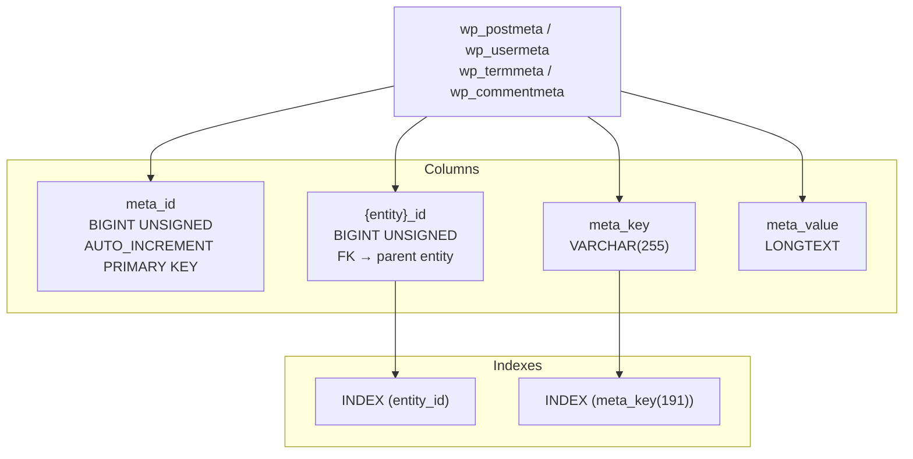

# Lesson 2: Content Model, Post Types, Taxonomies, Meta Systems

## 1. First-Principles Intuition & Invariants

WordPress emerged from a lineage of PHP-driven content management systems, but its architecture reveals a sophisticated database-centric state machine built atop MySQL's InnoDB transactional engine. At its core, WordPress implements a flexible entity-attribute-value (EAV) pattern layered over a normalized relational schema, enabling extensibility without schema migrations while sacrificing some degree of query performance. Understanding this design decision is critical: WordPress prioritizes developer velocity and plugin ecosystem compatibility over raw database efficiency, a tradeoff that permeates every architectural choice we examine in this lesson.

The fundamental abstraction in WordPress is the **post**—a polymorphic content entity that represents everything from blog articles to pages, media attachments, navigation menu items, and custom domain objects. This conceptual unification allows WordPress to reuse storage, retrieval, and permission systems across wildly different content types. The `wp_posts` table serves as the canonical source of truth for all content, with a `post_type` discriminator column enabling type-specific behavior through runtime dispatch rather than compile-time type safety. This approach mirrors prototype-based inheritance patterns in JavaScript rather than classical object-oriented hierarchies, granting flexibility at the cost of static analysis and type guarantees.

Three invariants govern the WordPress content model. First, every post possesses a unique auto-incrementing integer identifier (`ID`) that serves as the primary key and foreign key reference throughout the system. Second, posts exist in a strict lifecycle state machine defined by the `post_status` column, with transitions enforced through capability checks and action hooks. Third, relationships between posts and taxonomy terms are modeled through a many-to-many junction table (`wp_term_relationships`), enabling a post to belong to multiple categories, tags, or custom taxonomies simultaneously. These invariants must never be violated—corrupting the `ID` space, bypassing status transitions, or creating orphaned term relationships will cascade into data integrity failures throughout the application.

The meta system extends the rigid post schema with arbitrary key-value pairs stored in parallel tables (`wp_postmeta`, `wp_usermeta`, `wp_termmeta`, `wp_commentmeta`). This pattern implements the open-closed principle from software design: the core schema remains stable and closed to modification, while the meta tables stay open for extension. Each meta row references its parent entity through a foreign key (`post_id`, `user_id`, etc.) and stores data as serialized PHP strings in a `meta_value` longtext column. This serialization strategy permits storing complex nested data structures—arrays, objects, hierarchies—without requiring additional tables, though it introduces query optimization challenges we will address in detail.

WordPress taxonomies provide a hierarchical classification system inspired by biological taxonomy and library science. Unlike tags, which form a flat namespace, categories and custom hierarchical taxonomies implement parent-child relationships through a self-referential `parent` column in the `wp_terms` table. This design enables unlimited depth nesting, supporting complex organizational schemes like geographic hierarchies (Continent → Country → Region → City) or product catalogs (Department → Category → Subcategory → Item Type). The taxonomy system separates term storage (`wp_terms`), term metadata (`wp_termmeta`), and term-to-post associations (`wp_term_relationships` and `wp_term_taxonomy`), creating a normalized schema that prevents data duplication while enabling efficient many-to-many relationships.

## 2. Core Architecture & Mechanics

The `wp_posts` table schema reveals WordPress's strategic use of denormalization for read optimization. Rather than normalizing author information into a separate junction table, the `post_author` column stores a direct foreign key to `wp_users.ID`. This denormalization accelerates the common query pattern "retrieve all posts by a specific author" at the cost of complicating author reassignment operations. Similarly, the `post_parent` column enables self-referential hierarchies for pages and hierarchical custom post types, storing the parent post's ID directly rather than using a separate parent-child mapping table.

The complete schema structure follows this pattern:

```
wp_posts
├── ID                  BIGINT UNSIGNED AUTO_INCREMENT PRIMARY KEY
├── post_author         BIGINT UNSIGNED (FK → wp_users.ID)
├── post_date           DATETIME
├── post_date_gmt       DATETIME
├── post_content        LONGTEXT
├── post_title          TEXT
├── post_excerpt        TEXT
├── post_status         VARCHAR(20) DEFAULT 'publish'
├── comment_status      VARCHAR(20) DEFAULT 'open'
├── ping_status         VARCHAR(20) DEFAULT 'open'
├── post_password       VARCHAR(255)
├── post_name           VARCHAR(200) (URL slug)
├── to_ping             TEXT
├── pinged              TEXT
├── post_modified       DATETIME
├── post_modified_gmt   DATETIME
├── post_content_filtered LONGTEXT
├── post_parent         BIGINT UNSIGNED DEFAULT 0
├── guid                VARCHAR(255) (Globally Unique Identifier)
├── menu_order          INT DEFAULT 0
├── post_type           VARCHAR(20) DEFAULT 'post'
├── post_mime_type      VARCHAR(100)
└── comment_count       BIGINT DEFAULT 0
```

The dual datetime columns (`post_date` and `post_date_gmt`) reflect WordPress's early architecture when timezone conversion happened at the application layer. Modern WordPress installations should normalize to UTC at the database layer and perform timezone conversion at the presentation tier, but the schema maintains backward compatibility with legacy sites. The `guid` column stores the post's original permalink, intended as a permanent identifier even if the post slug changes—though in practice, WordPress often updates the `guid` when posts are imported or migrated, violating its intended immutability.

Custom post type registration occurs through the `register_post_type()` function, which accepts a post type slug and an array of configuration arguments. The registration does not modify database schema; instead, it updates WordPress's internal runtime registry, informing the query system, routing layer, and admin interface how to handle the new type. A production-grade custom post type registration demonstrates the full argument surface:

```php
<?php
function register_product_post_type() {
    $labels = array(
        'name'                  => _x('Products', 'Post type general name', 'textdomain'),
        'singular_name'         => _x('Product', 'Post type singular name', 'textdomain'),
        'menu_name'             => _x('Products', 'Admin Menu text', 'textdomain'),
        'name_admin_bar'        => _x('Product', 'Add New on Toolbar', 'textdomain'),
        'add_new'               => __('Add New', 'textdomain'),
        'add_new_item'          => __('Add New Product', 'textdomain'),
        'new_item'              => __('New Product', 'textdomain'),
        'edit_item'             => __('Edit Product', 'textdomain'),
        'view_item'             => __('View Product', 'textdomain'),
        'all_items'             => __('All Products', 'textdomain'),
        'search_items'          => __('Search Products', 'textdomain'),
        'parent_item_colon'     => __('Parent Products:', 'textdomain'),
        'not_found'             => __('No products found.', 'textdomain'),
        'not_found_in_trash'    => __('No products found in Trash.', 'textdomain'),
        'featured_image'        => _x('Product Cover Image', 'Overrides featured image', 'textdomain'),
        'set_featured_image'    => _x('Set cover image', 'Overrides set featured image', 'textdomain'),
        'remove_featured_image' => _x('Remove cover image', 'Overrides remove featured image', 'textdomain'),
        'use_featured_image'    => _x('Use as cover image', 'Overrides use featured image', 'textdomain'),
        'archives'              => _x('Product archives', 'The post type archive label', 'textdomain'),
        'insert_into_item'      => _x('Insert into product', 'Overrides insert into item', 'textdomain'),
        'uploaded_to_this_item' => _x('Uploaded to this product', 'Overrides uploaded to this item', 'textdomain'),
        'filter_items_list'     => _x('Filter products list', 'Screen reader text', 'textdomain'),
        'items_list_navigation' => _x('Products list navigation', 'Screen reader text', 'textdomain'),
        'items_list'            => _x('Products list', 'Screen reader text', 'textdomain'),
    );

    $args = array(
        'labels'             => $labels,
        'public'             => true,
        'publicly_queryable' => true,
        'show_ui'            => true,
        'show_in_menu'       => true,
        'query_var'          => true,
        'rewrite'            => array('slug' => 'products', 'with_front' => false),
        'capability_type'    => 'post',
        'has_archive'        => true,
        'hierarchical'       => false,
        'menu_position'      => 20,
        'menu_icon'          => 'dashicons-products',
        'show_in_rest'       => true,
        'rest_base'          => 'products',
        'rest_controller_class' => 'WP_REST_Posts_Controller',
        'supports'           => array('title', 'editor', 'thumbnail', 'excerpt', 'custom-fields', 'revisions'),
        'taxonomies'         => array('product_category', 'product_tag'),
        'can_export'         => true,
        'delete_with_user'   => false,
    );

    register_post_type('product', $args);
}
add_action('init', 'register_product_post_type');
```

The `hierarchical` parameter controls whether the post type supports parent-child relationships like pages or remains flat like blog posts. Setting `show_in_rest` to true enables Gutenberg block editor support and exposes the post type through WordPress's REST API with endpoints matching the `rest_base` parameter. The `supports` array determines which metaboxes and features appear in the admin editor—omitting `'editor'` would remove the main content field, while including `'page-attributes'` enables menu order and parent selection for hierarchical types. The `capability_type` parameter maps to WordPress's capability system, allowing granular permission control through custom capabilities like `'edit_product'`, `'publish_products'`, `'delete_others_products'`.

Taxonomy registration follows a parallel structure through `register_taxonomy()`, which establishes the classification system and associates it with one or more post types. The critical distinction between hierarchical and flat taxonomies manifests in query performance and UI behavior. Hierarchical taxonomies (categories) use nested checkboxes in the admin interface and support parent-child term relationships, while flat taxonomies (tags) use AJAX-powered tag input fields and cannot nest. This distinction propagates through the entire system: hierarchical taxonomy queries can traverse parent chains, while flat taxonomies optimize for fast tag cloud generation and intersection queries.

```php
<?php
function register_product_taxonomies() {
    // Hierarchical taxonomy (like categories)
    $category_labels = array(
        'name'              => _x('Product Categories', 'taxonomy general name', 'textdomain'),
        'singular_name'     => _x('Product Category', 'taxonomy singular name', 'textdomain'),
        'search_items'      => __('Search Categories', 'textdomain'),
        'all_items'         => __('All Categories', 'textdomain'),
        'parent_item'       => __('Parent Category', 'textdomain'),
        'parent_item_colon' => __('Parent Category:', 'textdomain'),
        'edit_item'         => __('Edit Category', 'textdomain'),
        'update_item'       => __('Update Category', 'textdomain'),
        'add_new_item'      => __('Add New Category', 'textdomain'),
        'new_item_name'     => __('New Category Name', 'textdomain'),
        'menu_name'         => __('Categories', 'textdomain'),
    );

    $category_args = array(
        'hierarchical'      => true,
        'labels'            => $category_labels,
        'show_ui'           => true,
        'show_admin_column' => true,
        'query_var'         => true,
        'rewrite'           => array('slug' => 'product-category', 'with_front' => false, 'hierarchical' => true),
        'show_in_rest'      => true,
        'rest_base'         => 'product-categories',
        'rest_controller_class' => 'WP_REST_Terms_Controller',
    );

    register_taxonomy('product_category', array('product'), $category_args);

    // Flat taxonomy (like tags)
    $tag_labels = array(
        'name'                       => _x('Product Tags', 'taxonomy general name', 'textdomain'),
        'singular_name'              => _x('Product Tag', 'taxonomy singular name', 'textdomain'),
        'search_items'               => __('Search Tags', 'textdomain'),
        'popular_items'              => __('Popular Tags', 'textdomain'),
        'all_items'                  => __('All Tags', 'textdomain'),
        'edit_item'                  => __('Edit Tag', 'textdomain'),
        'update_item'                => __('Update Tag', 'textdomain'),
        'add_new_item'               => __('Add New Tag', 'textdomain'),
        'new_item_name'              => __('New Tag Name', 'textdomain'),
        'separate_items_with_commas' => __('Separate tags with commas', 'textdomain'),
        'add_or_remove_items'        => __('Add or remove tags', 'textdomain'),
        'choose_from_most_used'      => __('Choose from the most used tags', 'textdomain'),
        'menu_name'                  => __('Tags', 'textdomain'),
    );

    $tag_args = array(
        'hierarchical'          => false,
        'labels'                => $tag_labels,
        'show_ui'               => true,
        'show_admin_column'     => true,
        'update_count_callback' => '_update_post_term_count',
        'query_var'             => true,
        'rewrite'               => array('slug' => 'product-tag', 'with_front' => false),
        'show_in_rest'          => true,
        'rest_base'             => 'product-tags',
        'rest_controller_class' => 'WP_REST_Terms_Controller',
    );

    register_taxonomy('product_tag', array('product'), $tag_args);
}
add_action('init', 'register_product_taxonomies');
```

The taxonomy relationship tables form a three-table normalized structure that prevents duplication while enabling efficient querying. The `wp_terms` table stores the term name and slug, the `wp_term_taxonomy` table adds the taxonomy type and term metadata, and the `wp_term_relationships` table creates the many-to-many mapping between posts and term-taxonomy pairs. This separation allows the same term (e.g., "Blue") to exist in multiple taxonomies (product colors, category colors, tag colors) with different parent relationships and descriptions in each context.

```
wp_terms
├── term_id       BIGINT UNSIGNED AUTO_INCREMENT PRIMARY KEY
├── name          VARCHAR(200)
├── slug          VARCHAR(200) UNIQUE
└── term_group    BIGINT (legacy, rarely used)

wp_term_taxonomy
├── term_taxonomy_id BIGINT UNSIGNED AUTO_INCREMENT PRIMARY KEY
├── term_id          BIGINT UNSIGNED (FK → wp_terms.term_id)
├── taxonomy         VARCHAR(32)
├── description      LONGTEXT
├── parent           BIGINT UNSIGNED DEFAULT 0
└── count            BIGINT DEFAULT 0

wp_term_relationships
├── object_id        BIGINT UNSIGNED (FK → wp_posts.ID)
├── term_taxonomy_id BIGINT UNSIGNED (FK → wp_term_taxonomy.term_taxonomy_id)
└── term_order       INT DEFAULT 0
    PRIMARY KEY (object_id, term_taxonomy_id)
```

The `count` column in `wp_term_taxonomy` implements a denormalized cache of how many posts are associated with each term, accelerating tag cloud generation and category list displays. WordPress updates this count through the `_update_post_term_count()` callback whenever term relationships change, though race conditions during concurrent writes can cause drift. The `term_order` column in `wp_term_relationships` provides manual ordering within a taxonomy, primarily used for hierarchical taxonomies where term display order matters.

The meta system architecture implements vertical partitioning across multiple tables sharing an identical schema pattern. Each meta table follows this structure:



The `meta_key` index uses a 191-character prefix rather than the full 255 characters due to MySQL's index length limitations with utf8mb4 encoding, where each character consumes four bytes. The InnoDB maximum index key length is 767 bytes for compact row format and 3072 bytes for dynamic row format, so a 191-character utf8mb4 string fits within the 764-byte threshold (191 × 4 = 764). This indexing strategy enables efficient lookups by meta key but fails to optimize composite queries filtering on both key and value simultaneously.

Meta manipulation occurs through a family of functions (`add_post_meta()`, `update_post_meta()`, `get_post_meta()`, `delete_post_meta()`) that abstract the underlying SQL operations and maintain cache coherence. These functions handle serialization automatically—passing an array or object to `update_post_meta()` triggers PHP's `maybe_serialize()`, which converts the data structure into a serialized string representation. Retrieval through `get_post_meta()` with the third parameter set to `true` returns a single value, while omitting it or passing `false` returns an array of all values for that key, since the meta system allows duplicate keys per entity.

```php
<?php
// Single value meta (most common pattern)
update_post_meta($post_id, '_product_price', 29.99);
$price = get_post_meta($post_id, '_product_price', true);

// Multiple values for same key (rare but supported)
add_post_meta($post_id, '_related_product', 42);
add_post_meta($post_id, '_related_product', 108);
add_post_meta($post_id, '_related_product', 256);
$related_ids = get_post_meta($post_id, '_related_product', false);

// Complex data structures (arrays and objects)
$product_data = array(
    'sku' => 'PROD-001',
    'dimensions' => array(
        'length' => 10.5,
        'width' => 8.25,
        'height' => 3.0,
        'unit' => 'inches',
    ),
    'inventory' => array(
        'quantity' => 150,
        'warehouse' => 'NYC-01',
        'reserved' => 12,
    ),
);
update_post_meta($post_id, '_product_data', $product_data);
$retrieved_data = get_post_meta($post_id, '_product_data', true);

// Conditional updates with previous value check
update_post_meta($post_id, '_view_count', 0);
$current_count = get_post_meta($post_id, '_view_count', true);
update_post_meta($post_id, '_view_count', $current_count + 1, $current_count);

// Deletion patterns
delete_post_meta($post_id, '_temporary_flag');
delete_post_meta($post_id, '_related_product', 108); // Delete specific value only
```

The underscore prefix convention (`_product_price` vs `product_price`) signals private metadata that should not appear in custom field dropdowns in the admin interface. WordPress core enforces this convention by filtering out underscore-prefixed keys from the custom fields metabox, though the keys remain queryable and visible through direct database access or API calls. This naming convention emerged organically in the WordPress community and was later codified into core behavior, demonstrating how emergent practices can crystallize into architectural patterns.

The `WP_Query` class serves as the primary interface for retrieving posts from the database, accepting a declarative argument array and translating it into optimized SQL with joins, conditions, and ordering clauses. Understanding `WP_Query` internals requires examining its query construction process, which occurs through a series of filter hooks that modify the SQL components before execution. A sophisticated query demonstrates the full argument surface:

```php
<?php
$args = array(
    'post_type'      => 'product',
    'post_status'    => 'publish',
    'posts_per_page' => 20,
    'paged'          => get_query_var('paged') ?: 1,
    'orderby'        => array(
        'meta_value_num' => 'DESC',
        'date'           => 'DESC',
    ),
    'meta_key'       => '_product_price',
    'meta_query'     => array(
        'relation' => 'AND',
        array(
            'key'     => '_product_price',
            'value'   => array(10.00, 100.00),
            'compare' => 'BETWEEN',
            'type'    => 'NUMERIC',
        ),
        array(
            'key'     => '_in_stock',
            'value'   => '1',
            'compare' => '=',
        ),
        array(
            'relation' => 'OR',
            array(
                'key'     => '_featured',
                'value'   => '1',
                'compare' => '=',
            ),
            array(
                'key'     => '_on_sale',
                'value'   => '1',
                'compare' => '=',
            ),
        ),
    ),
    'tax_query'      => array(
        'relation' => 'AND',
        array(
            'taxonomy' => 'product_category',
            'field'    => 'slug',
            'terms'    => array('electronics', 'computers'),
            'operator' => 'IN',
        ),
        array(
            'taxonomy' => 'product_tag',
            'field'    => 'slug',
            'terms'    => 'sale',
            'operator' => 'IN',
        ),
        array(
            'taxonomy' => 'product_category',
            'field'    => 'term_id',
            'terms'    => 15,
            'operator' => 'NOT IN',
            'include_children' => false,
        ),
    ),
    'date_query'     => array(
        array(
            'after'     => '2024-01-01',
            'before'    => '2024-12-31',
            'inclusive' => true,
        ),
    ),
    's'              => 'laptop wireless',
    'author__in'     => array(1, 5, 12),
    'fields'         => 'ids',
    'no_found_rows'  => false,
    'update_post_meta_cache' => true,
    'update_post_term_cache' => true,
    'cache_results'  => true,
);

$query = new WP_Query($args);

if ($query->have_posts()) {
    while ($query->have_posts()) {
        $query->the_post();
        
        $price = get_post_meta(get_the_ID(), '_product_price', true);
        $categories = get_the_terms(get_the_ID(), 'product_category');
        
        printf(
            '<article><h2>%s</h2><p>Price: $%.2f</p></article>',
            esc_html(get_the_title()),
            floatval($price)
        );
    }
    
    wp_reset_postdata();
} else {
    echo '<p>No products found matching your criteria.</p>';
}

echo '<div class="pagination">';
echo paginate_links(array(
    'total'   => $query->max_num_pages,
    'current' => max(1, get_query_var('paged')),
));
echo '</div>';
```

The `meta_query` parameter constructs a complex tree of meta conditions with AND/OR relations at each level. Each condition specifies a key, comparison operator, value, and data type—critical for numeric comparisons where string comparison would produce incorrect results (`'100' < '20'` as strings but `100 > 20` numerically). The `tax_query` parameter follows the same nested structure for taxonomy conditions, with the `include_children` flag controlling whether hierarchical taxonomy queries should recursively match child terms or only exact matches.

The `fields` parameter controls what data WordPress retrieves from the database, with `'ids'` returning only post IDs instead of full post objects. This optimization reduces memory consumption and query execution time when you only need identifiers for subsequent processing. Setting `no_found_rows` to `true` omits the `SQL_CALC_FOUND_ROWS` directive and subsequent `SELECT FOUND_ROWS()` query, improving performance when you do not need pagination data. The cache control parameters (`update_post_meta_cache`, `update_post_term_cache`, `cache_results`) fine-tune object caching behavior, allowing you to disable cache population when building administrative queries that will not benefit from caching.

## 3. High-Performance Optimization & Failure Modes

Query performance in WordPress degrades predictably as content volume scales, with meta queries and taxonomy joins representing the primary bottlenecks. The fundamental issue stems from the EAV meta pattern: filtering on meta values requires full table scans of `wp_postmeta` even with proper indexing, since MySQL cannot efficiently use composite indexes spanning multiple meta keys. A query filtering on three meta conditions triggers three separate joins to `wp_postmeta`, one per condition, with the query planner determining join order based on cardinality estimates that may be stale or inaccurate.

The most effective meta query optimization involves promoting frequently queried meta fields into the `wp_posts` table itself, sacrificing the flexibility of the EAV pattern for predictable query performance. This approach requires careful analysis of access patterns—identify the three to five meta keys that appear in the majority of queries, then add corresponding columns to `wp_posts` through a database migration. Populate these columns through `save_post` hooks that synchronize the denormalized columns with their corresponding meta entries, maintaining consistency through triggers or application-layer logic.

```php
<?php
function optimize_product_schema() {
    global $wpdb;
    
    // Add denormalized columns to wp_posts for high-frequency meta queries
    $wpdb->query("
        ALTER TABLE {$wpdb->posts}
        ADD COLUMN product_price DECIMAL(10,2) DEFAULT NULL AFTER comment_count,
        ADD COLUMN product_stock_status VARCHAR(20) DEFAULT NULL AFTER product_price,
        ADD COLUMN product_featured TINYINT(1) DEFAULT 0 AFTER product_stock_status,
        ADD INDEX idx_product_price (post_type, product_price),
        ADD INDEX idx_product_stock (post_type, product_stock_status),
        ADD INDEX idx_product_featured (post_type, product_featured)
    ");
}

function sync_product_columns_on_save($post_id, $post, $update) {
    if ($post->post_type !== 'product' || wp_is_post_autosave($post_id) || wp_is_post_revision($post_id)) {
        return;
    }
    
    global $wpdb;
    
    $price = get_post_meta($post_id, '_product_price', true);
    $stock_status = get_post_meta($post_id, '_stock_status', true);
    $featured = get_post_meta($post_id, '_featured', true);
    
    $wpdb->update(
        $wpdb->posts,
        array(
            'product_price'        => $price ? floatval($price) : null,
            'product_stock_status' => $stock_status ?: null,
            'product_featured'     => $featured ? 1 : 0,
        ),
        array('ID' => $post_id),
        array('%f', '%s', '%d'),
        array('%d')
    );
}
add_action('save_post', 'sync_product_columns_on_save', 10, 3);

function query_products_optimized() {
    global $wpdb;
    
    // Direct SQL query bypassing WP_Query for maximum performance
    $results = $wpdb->get_results($wpdb->prepare("
        SELECT p.ID, p.post_title, p.product_price, p.product_stock_status
        FROM {$wpdb->posts} p
        WHERE p.post_type = %s
        AND p.post_status = %s
        AND p.product_price BETWEEN %f AND %f
        AND p.product_stock_status = %s
        AND p.product_featured = 1
        ORDER BY p.product_price DESC, p.post_date DESC
        LIMIT %d OFFSET %d
    ", 'product', 'publish', 10.00, 100.00, 'instock', 20, 0));
    
    return $results;
}
```

For taxonomy queries, performance scales with term count and hierarchy depth. Hierarchical taxonomy queries with `include_children` enabled trigger recursive common table expression (CTE) queries that traverse parent chains, which MySQL 8.0+ handles efficiently but older versions struggle with. If supporting legacy MySQL 5.7, implement term hierarchy caching through a denormalized ancestor table that precomputes all parent-child relationships during term creation and deletion.

```php
<?php
function create_term_ancestor_cache_table() {
    global $wpdb;
    
    $wpdb->query("
        CREATE TABLE IF NOT EXISTS {$wpdb->prefix}term_ancestors (
            term_id BIGINT UNSIGNED NOT NULL,
            ancestor_id BIGINT UNSIGNED NOT NULL,
            distance INT UNSIGNED NOT NULL,
            PRIMARY KEY (term_id, ancestor_id),
            INDEX idx_ancestor (ancestor_id, distance)
        ) ENGINE=InnoDB DEFAULT CHARSET=utf8mb4 COLLATE=utf8mb4_unicode_ci
    ");
}

function rebuild_term_ancestor_cache($taxonomy) {
    global $wpdb;
    
    $wpdb->query($wpdb->prepare("
        DELETE a
        FROM {$wpdb->prefix}term_ancestors a
        INNER JOIN {$wpdb->term_taxonomy} tt ON a.term_id = tt.term_id
        WHERE tt.taxonomy = %s
    ", $taxonomy));
    
    $terms = get_terms(array(
        'taxonomy'   => $taxonomy,
        'hide_empty' => false,
    ));
    
    foreach ($terms as $term) {
        $ancestors = get_ancestors($term->term_id, $taxonomy, 'taxonomy');
        
        foreach ($ancestors as $distance => $ancestor_id) {
            $wpdb->insert(
                $wpdb->prefix . 'term_ancestors',
                array(
                    'term_id'     => $term->term_id,
                    'ancestor_id' => $ancestor_id,
                    'distance'    => $distance + 1,
                ),
                array('%d', '%d', '%d')
            );
        }
    }
}

function query_posts_with_descendant_terms($parent_term_id, $taxonomy, $args = array()) {
    global $wpdb;
    
    // Retrieve all descendant term IDs using the ancestor cache
    $descendant_ids = $wpdb->get_col($wpdb->prepare("
        SELECT term_id
        FROM {$wpdb->prefix}term_ancestors
        WHERE ancestor_id = %d
        UNION
        SELECT %d
    ", $parent_term_id, $parent_term_id));
    
    $args['tax_query'] = array(
        array(
            'taxonomy'         => $taxonomy,
            'field'            => 'term_id',
            'terms'            => $descendant_ids,
            'operator'         => 'IN',
            'include_children' => false, // Already expanded manually
        ),
    );
    
    return new WP_Query($args);
}
```

The object cache layer represents WordPress's second line of defense against database overload. WordPress Core implements a transient API for persistent caching and an object cache API for runtime caching, with external object cache backends like Redis or Memcached providing cross-request persistence. Query results, term relationships, and meta values automatically populate the object cache through `WP_Query` and meta functions, with cache keys derived from query arguments and entity identifiers. This caching strategy accelerates repeated queries within a single request but provides limited benefit across requests without an external cache backend.

Implementing selective cache bypass for administrative queries prevents cache pollution from one-off queries that will never be repeated. The `cache_results` parameter in `WP_Query` disables automatic cache population, while the `$force` parameter in `get_post_meta()` skips cache lookup and forces a direct database read. Use these flags in admin interfaces, background jobs, and data imports where cache warming provides no downstream benefit.

```php
<?php
function export_products_no_cache() {
    $paged = 1;
    $per_page = 100;
    $products = array();
    
    do {
        $query = new WP_Query(array(
            'post_type'              => 'product',
            'post_status'            => 'any',
            'posts_per_page'         => $per_page,
            'paged'                  => $paged,
            'fields'                 => 'ids',
            'no_found_rows'          => true,
            'cache_results'          => false,
            'update_post_meta_cache' => false,
            'update_post_term_cache' => false,
        ));
        
        foreach ($query->posts as $product_id) {
            // Force meta reads to bypass cache
            $product_data = array(
                'id'    => $product_id,
                'title' => get_the_title($product_id),
                'price' => get_post_meta($product_id, '_product_price', true),
                'sku'   => get_post_meta($product_id, '_product_sku', true),
            );
            
            $products[] = $product_data;
        }
        
        $paged++;
        
        // Explicit memory management for long-running processes
        wp_cache_flush();
        
    } while ($query->have_posts());
    
    return $products;
}
```

Database index strategy requires balancing query acceleration against write overhead. Every additional index slows INSERT and UPDATE operations, as MySQL must maintain index consistency. The default WordPress indexes cover basic queries—post type and status lookups, author filtering, parent relationships—but fail to optimize complex meta and taxonomy queries. Add composite indexes targeting your most frequent query patterns, prioritizing indexes on columns that appear in WHERE clauses and JOIN conditions.

```sql
-- Optimize post queries by type and status
CREATE INDEX idx_post_type_status_date ON wp_posts(post_type, post_status, post_date);

-- Optimize author queries for published posts
CREATE INDEX idx_author_type_status ON wp_posts(post_author, post_type, post_status);

-- Optimize parent-child traversal for hierarchical post types
CREATE INDEX idx_parent_type_status ON wp_posts(post_parent, post_type, post_status);

-- Optimize postmeta queries by key
CREATE INDEX idx_meta_key_value ON wp_postmeta(meta_key(191), meta_value(50));

-- Optimize term relationship queries
CREATE INDEX idx_term_post ON wp_term_relationships(term_taxonomy_id, object_id);
```

Meta serialization introduces a subtle failure mode: direct SQL queries against `meta_value` fail for serialized data, as MySQL cannot deserialize PHP serialization format. Queries filtering on nested array values or object properties require application-layer deserialization followed by filtering, eliminating the possibility of database-level optimization. This limitation becomes critical at scale—a meta table containing millions of rows with serialized values becomes effectively unsearchable without full table scans and PHP processing.

The solution involves flattening nested structures into multiple meta rows with composite keys. Rather than storing a single serialized array under `_product_data`, decompose it into individual meta entries: `_product_sku`, `_product_length`, `_product_width`, `_product_warehouse`. This approach sacrifices atomicity—updating related fields requires multiple meta operations—but enables efficient database querying and indexing. For truly atomic operations requiring transactional consistency, move the data into a custom table with proper schema and foreign key constraints.

Term count drift represents a common data integrity failure. The `count` column in `wp_term_taxonomy` should reflect the number of published posts associated with each term, but concurrent updates, failed transactions, and programmatic term manipulation can cause drift. WordPress provides `wp_update_term_count()` and `wp_update_term_count_now()` functions for corrective maintenance, which should run periodically through WP-Cron or external scheduling.

```php
<?php
function repair_term_counts_for_taxonomy($taxonomy) {
    global $wpdb;
    
    $term_taxonomy_ids = $wpdb->get_col($wpdb->prepare("
        SELECT term_taxonomy_id
        FROM {$wpdb->term_taxonomy}
        WHERE taxonomy = %s
    ", $taxonomy));
    
    if (empty($term_taxonomy_ids)) {
        return;
    }
    
    // Recount terms in batches to avoid memory exhaustion
    $batch_size = 100;
    $batches = array_chunk($term_taxonomy_ids, $batch_size);
    
    foreach ($batches as $batch) {
        wp_update_term_count_now($batch, $taxonomy);
    }
    
    WP_CLI::success("Repaired term counts for taxonomy: {$taxonomy}");
}

function schedule_term_count_maintenance() {
    if (!wp_next_scheduled('repair_term_counts_hook')) {
        wp_schedule_event(time(), 'daily', 'repair_term_counts_hook');
    }
}
add_action('init', 'schedule_term_count_maintenance');

function run_term_count_repair() {
    $taxonomies = get_taxonomies(array('_builtin' => false));
    
    foreach ($taxonomies as $taxonomy) {
        repair_term_counts_for_taxonomy($taxonomy);
    }
}
add_action('repair_term_counts_hook', 'run_term_count_repair');
```

Pagination performance degrades with high page numbers due to MySQL's LIMIT/OFFSET implementation, which retrieves and discards all preceding rows before returning the requested page. A query with `LIMIT 20 OFFSET 10000` forces MySQL to scan 10,020 rows and return only the final 20. For deep pagination, implement cursor-based pagination using a WHERE clause on the primary key or an indexed column.

```php
<?php
function cursor_based_product_pagination($last_seen_id = 0, $per_page = 20) {
    global $wpdb;
    
    $results = $wpdb->get_results($wpdb->prepare("
        SELECT ID, post_title, post_date
        FROM {$wpdb->posts}
        WHERE post_type = %s
        AND post_status = %s
        AND ID > %d
        ORDER BY ID ASC
        LIMIT %d
    ", 'product', 'publish', $last_seen_id, $per_page));
    
    if (!empty($results)) {
        $last_id = end($results)->ID;
        
        return array(
            'results'      => $results,
            'next_cursor'  => $last_id,
            'has_more'     => count($results) === $per_page,
        );
    }
    
    return array(
        'results'     => array(),
        'next_cursor' => null,
        'has_more'    => false,
    );
}

// API endpoint implementation
function api_get_products(WP_REST_Request $request) {
    $cursor = $request->get_param('cursor') ?: 0;
    $per_page = min($request->get_param('per_page') ?: 20, 100);
    
    $data = cursor_based_product_pagination($cursor, $per_page);
    
    $response = new WP_REST_Response($data['results']);
    $response->header('X-WP-Next-Cursor', $data['next_cursor']);
    $response->header('X-WP-Has-More', $data['has_more'] ? 'true' : 'false');
    
    return $response;
}
```

The WordPress content model achieves remarkable flexibility through deliberate architectural compromises—embracing EAV patterns, accepting denormalization, and prioritizing developer experience over raw performance. Production systems must instrument these tradeoffs through query profiling, cache hit rate monitoring, and index analysis, then selectively optimize hotspots through schema evolution, query rewriting, and external caching. The platform's longevity demonstrates that architectural pragmatism—choosing adaptability over theoretical purity—can yield systems that scale through community innovation rather than rigid design.
