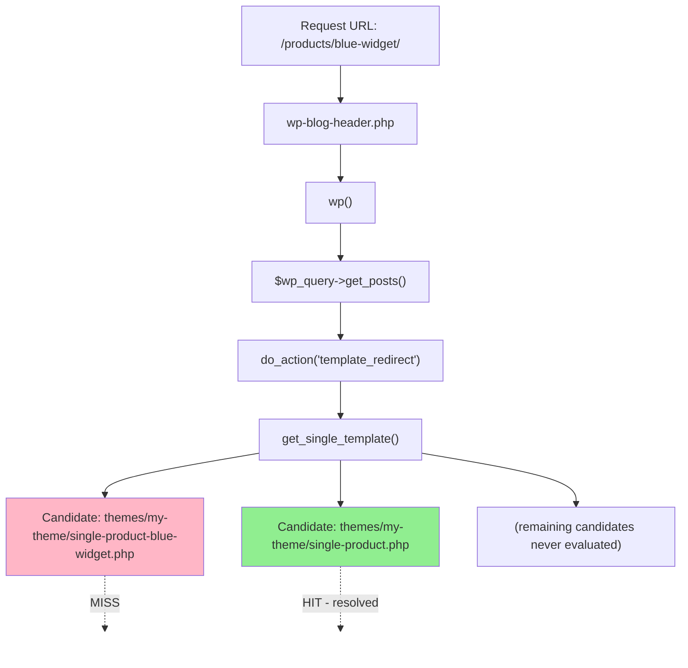
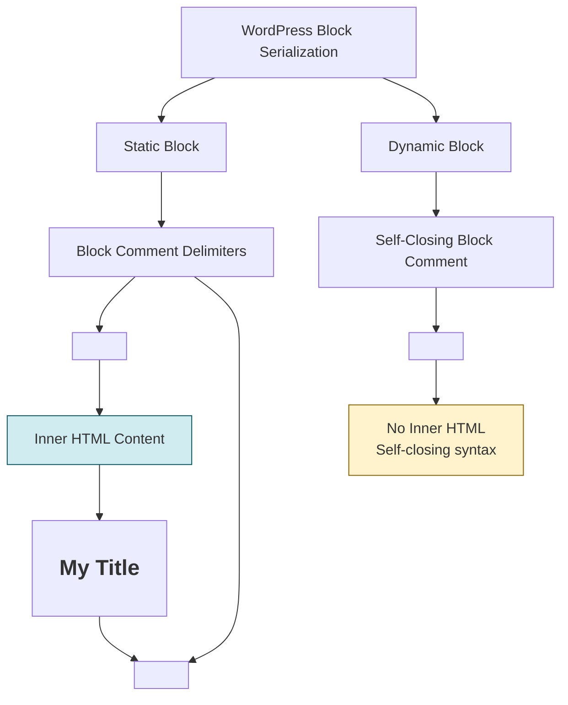

# Lesson 3: Template Hierarchy, Theme System, Block Editor Architecture

## 1. First-Principles Intuition & Invariants

WordPress began its life as a blog engine where every URL corresponded to a MySQL query and every query demanded a PHP template. That tight coupling between URL semantics and file system resolution—baked in around version 1.5 when the concept of "themes" arrived—has remained one of the most consequential architectural decisions in the platform's history. Twenty years later, understanding it precisely still determines whether a senior engineer builds themes that compose cleanly or ones that collapse under customization pressure.

The invariant at the core of everything is this: WordPress does not route requests to controllers in the MVC sense. It routes them to files. The request lifecycle begins in `index.php`, bootstraps the WordPress environment via `wp-load.php`, executes the main query in `wp-blog-header.php`, and then hands control to the **Template Loader**, a function called `template_redirect` backed by `get_template_part()` and the `WP_Query` state object. At the moment `template_redirect` fires, the query object already holds the resolved post type, taxonomy, term, author, date, and search parameters. The template loader interrogates that object through a cascade of `is_*()` conditional functions—`is_singular()`, `is_archive()`, `is_home()`, `is_404()`—and walks a predefined resolution chain until it finds a matching file on disk.

This resolution chain is not arbitrary. It is a strict algorithm with deterministic precedence. The formal invariant is: *the most specific template always wins*. A file named `single-product-blue-widget.php` in the active theme wins over `single-product.php`, which wins over `single.php`, which wins over `singular.php`, which wins over `index.php`. The fallback to `index.php` is guaranteed by the spec—it is the universal catch-all, and every theme must provide it. Everything else is optional specificity.

This architecture reflects a philosophy of progressive disclosure: a theme author can ship a minimal theme containing only `index.php`, `style.css`, and `functions.php` and WordPress will render every page type through that single template. Complexity is introduced only when differentiation is required, and that differentiation is expressed through naming conventions rather than configuration files. The file system is the routing table.

The template system is also a trust boundary. Because template files are raw PHP executed in the context of a fully bootstrapped WordPress environment, they have unrestricted access to the global `$post`, `$wp_query`, and `$wpdb` objects. This is simultaneously the system's greatest strength—it is trivially easy to extend—and its most significant security surface. A theme is not sandboxed. `functions.php` is loaded on every request, before most plugins, and executes with the same PHP process privileges as the WordPress core itself. Senior engineers treat `functions.php` as application bootstrap code, not a dumping ground, because every line of logic added there runs unconditionally on every page load.

Gutenberg, introduced in WordPress 5.0 and iteratively extended through the Full Site Editing initiative, introduced a parallel architectural layer that does not replace the template system but coexists with it through a carefully managed abstraction boundary. The block editor represents a shift from PHP-rendered template files to a block graph serialized as annotated HTML comments stored in `post_content`. The fundamental tension in modern WordPress development is understanding precisely where the boundary between these two systems falls, how data flows across it, and when each paradigm is the correct tool.

## 2. Core Architecture & Mechanics

### The Template Resolution Algorithm

The template loader walks a prioritized candidate list for each query type. For a singular post of type `product` with slug `blue-widget`, the loader checks for candidates in this order:

```text
single-product-blue-widget.php
single-product.php
single.php
singular.php
index.php
```

This candidate list is constructed by `get_query_template()`, which calls the appropriate template-type function such as `get_single_template()`. Each of these functions builds an array of candidate paths, passes them through the `"{type}_template_hierarchy"` filter (allowing plugins and themes to inject additional candidates), and then calls `locate_template()` to perform the actual file system walk.



The `locate_template()` function checks the **child theme directory** first, then the **parent theme directory**, and finally the stylesheet directory. This three-tier lookup is what makes child themes work without file duplication: the child theme shadows any file from the parent by providing its own copy, and the parent provides the base implementation for everything the child does not override. The resolution is purely file-system based—there is no manifest, no registry, no compiled routing table. The first file found on disk wins.

### Child Themes and the Inheritance Model

A child theme is defined by a single declaration in its `style.css` header:

```css
/*
Theme Name: My Child Theme
Template:   twentytwentyfour
Version:    1.0.0
*/
```

The `Template` field instructs WordPress to load the parent theme's `functions.php` automatically before the child's `functions.php`. This load order is critical: parent first, child second. The implication is that the child can override parent function behavior only through hooks, because by the time the child's `functions.php` runs, the parent has already registered its hooks and defined its functions. You cannot redefine a function that the parent declared—PHP will throw a fatal error. The correct pattern is to hook into the action or filter that the parent's function is attached to, remove the parent's callback if necessary using `remove_action()` or `remove_filter()`, and attach your own.

This is a source of significant confusion in the WordPress ecosystem. Engineers expecting class-based inheritance—where a child method automatically overrides a parent method—encounter a system built on procedural hook composition instead. The `add_action` / `add_filter` system is not inheritance; it is a publish-subscribe event bus where multiple callbacks at the same priority execute in registration order, and priority integers determine sequencing. The correct mental model is a priority queue of closures, not a class hierarchy.

```php
// Parent theme functions.php — registers a nav menu
add_action( 'after_setup_theme', function() {
    register_nav_menus( [ 'primary' => __( 'Primary Menu' ) ] );
}, 10 );

// Child theme functions.php — adds a footer menu without touching the parent
add_action( 'after_setup_theme', function() {
    register_nav_menus( [ 'footer' => __( 'Footer Menu' ) ] );
}, 11 ); // priority 11 fires after parent's priority 10
```

### The Role of functions.php

`functions.php` is not a configuration file. It is an application bootstrap module that runs on every request in the context of a partially-initialized WordPress environment. Its load point sits after core files and active plugins but before the template is selected, which means it is the correct place to register theme support features, enqueue assets, declare custom post types, and wire hook callbacks—but a catastrophic place to perform database queries, make HTTP requests, or run expensive computations unconditionally.

Theme support declarations are the idiomatic way to communicate capability contracts between a theme and WordPress core:

```php
add_action( 'after_setup_theme', function() {
    add_theme_support( 'post-thumbnails' );
    add_theme_support( 'title-tag' );
    add_theme_support( 'html5', [ 'search-form', 'comment-form', 'gallery' ] );
    add_theme_support( 'responsive-embeds' );
    add_theme_support( 'wp-block-styles' );
    add_theme_support( 'editor-styles' );
    add_editor_style( 'editor-style.css' );
} );
```

Each `add_theme_support()` call sets a flag in an internal registry that core and plugins consult via `current_theme_supports()`. The `title-tag` support, for example, tells WordPress to manage the `<title>` element itself rather than requiring the theme to echo it in `header.php`. Missing this declaration in a theme is a classic gotcha that produces duplicate or missing page titles.

Asset enqueueing follows a similar hook-based pattern. The wrong approach—including `<script>` or `<link>` tags directly in template files—breaks plugin deduplication, dependency ordering, and conditional loading. The correct approach uses `wp_enqueue_scripts` for frontend assets and `enqueue_block_editor_assets` for editor-specific scripts:

```php
add_action( 'wp_enqueue_scripts', function() {
    wp_enqueue_style(
        'my-theme-style',
        get_stylesheet_uri(),
        [],
        wp_get_theme()->get( 'Version' )
    );

    wp_enqueue_script(
        'my-theme-main',
        get_theme_file_uri( 'assets/js/main.js' ),
        [ 'jquery' ],
        '1.0.0',
        true // load in footer
    );
} );
```

The dependency array `[ 'jquery' ]` instructs the asset loader to output jQuery before this script regardless of their registration order. WordPress's asset loader maintains a directed acyclic graph of dependencies and performs a topological sort before writing `<script>` tags to the page. This is the mechanism that makes it safe for plugins and themes to enqueue assets independently without coordinating output order manually.

### Template Parts and Modularity

Template parts are reusable sub-templates loaded via `get_template_part( $slug, $name )`. The function performs the same child-before-parent file resolution as the main template loader, so a child theme can override a specific template part—say, `template-parts/header/site-branding.php`—without duplicating the entire parent header template. The resolution follows the pattern `{slug}-{name}.php` → `{slug}.php`, mirroring the main hierarchy logic.

```text
get_template_part( 'template-parts/content', get_post_type() )

Resolves to (for post type 'product'):
  1. template-parts/content-product.php   ← checked first
  2. template-parts/content.php           ← fallback
```

WordPress 5.5 introduced `get_template_part()` context passing as a third argument, allowing data to flow into template parts without abusing globals:

```php
get_template_part( 'template-parts/card', 'product', [
    'product_id' => get_the_ID(),
    'show_price' => true,
] );
```

Inside `template-parts/card-product.php`, the data is accessible via `$args`:

```php
<?php
$product_id = $args['product_id'] ?? 0;
$show_price = $args['show_price'] ?? false;
?>
<div class="product-card" data-id="<?php echo esc_attr( $product_id ); ?>">
    <?php the_title( '<h2>', '</h2>' ); ?>
    <?php if ( $show_price ) : ?>
        <span class="price"><?php echo esc_html( get_post_meta( $product_id, '_price', true ) ); ?></span>
    <?php endif; ?>
</div>
```

This pattern replaces the fragile practice of setting global variables before calling `get_template_part()` and reading them back inside—an approach that is non-reentrant and breaks when template parts are called from within loops or nested contexts.

### Gutenberg Block Registration and block.json

The Gutenberg editor represents each piece of content as a node in a block tree. When a post is saved, that tree is serialized into the `post_content` field as HTML annotated with HTML comment delimiters:

```html
<!-- wp:paragraph {"align":"center"} -->
<p class="has-text-align-center">Hello world.</p>
<!-- /wp:paragraph -->

<!-- wp:my-plugin/product-card {"productId":42,"showPrice":true} -->
<div class="wp-block-my-plugin-product-card">...</div>
<!-- /wp:my-plugin/product-card -->
```

The comment delimiters are the block grammar's node boundaries. Everything between `<!-- wp:namespace/block-name {attrs} -->` and `<!-- /wp:namespace/block-name -->` is the block's serialized HTML output. The JSON object in the opening delimiter is the block's attribute map, stored alongside the HTML so that the editor can reconstruct the full block tree from raw `post_content` without a separate database table.

Block registration is the process of declaring a block type to both the JavaScript editor runtime and the PHP rendering pipeline. The canonical mechanism since WordPress 5.8 is the `block.json` manifest file, which serves as the single source of truth consumed by both runtimes:

```json
{
    "$schema": "https://schemas.wp.org/trunk/block.json",
    "apiVersion": 3,
    "name": "my-plugin/product-card",
    "version": "1.0.0",
    "title": "Product Card",
    "category": "widgets",
    "description": "Displays a product with optional pricing.",
    "supports": {
        "html": false,
        "align": ["wide", "full"],
        "color": {
            "background": true,
            "text": true
        }
    },
    "attributes": {
        "productId": {
            "type": "integer",
            "default": 0
        },
        "showPrice": {
            "type": "boolean",
            "default": true
        }
    },
    "editorScript": "file:./index.js",
    "editorStyle": "file:./index.css",
    "style": "file:./style.css",
    "render": "file:./render.php"
}
```

PHP registration calls `register_block_type()` with the path to the directory containing `block.json`, and WordPress reads the manifest automatically:

```php
add_action( 'init', function() {
    register_block_type( __DIR__ . '/blocks/product-card' );
} );
```

This call registers the block in the PHP block type registry (`WP_Block_Type_Registry`), enqueues the declared scripts and styles with proper dependency resolution, and wires up the server-side render callback if a `render` file or `render_callback` is specified. The JavaScript side picks up the same `block.json` via `@wordpress/blocks`'s `registerBlockType()` function, which the build toolchain imports automatically when you use `@wordpress/scripts`.

### Static vs. Dynamic Blocks

The architectural distinction between static and dynamic blocks has direct performance and correctness implications. A static block serializes its complete rendered HTML into `post_content` at save time. When WordPress renders the page, it parses the block comment delimiters, extracts the inner HTML, and outputs it verbatim—no PHP execution required beyond the parsing step. This makes static blocks fast but stale: if the data the block was rendered from changes after the post was saved, the stored HTML reflects the old state.

A dynamic block stores only its attribute JSON in the comment delimiter and contains no inner HTML. At render time, WordPress invokes the registered PHP callback with the block's attributes, and the callback generates fresh HTML on every request:



The render callback (or `render.php` file declared in `block.json`) receives the attributes array and the block context object:

```php
<?php
// render.php — receives $attributes and $block

$product_id = absint( $attributes['productId'] ?? 0 );
$show_price = (bool) ( $attributes['showPrice'] ?? true );

if ( ! $product_id ) {
    return '';
}

$product = get_post( $product_id );
if ( ! $product || 'product' !== $product->post_type ) {
    return '';
}

$price = get_post_meta( $product_id, '_price', true );

$wrapper_attributes = get_block_wrapper_attributes( [
    'class' => 'product-card',
] );

ob_start();
?>
<div <?php echo $wrapper_attributes; // already escaped by get_block_wrapper_attributes ?>>
    <h2><?php echo esc_html( $product->post_title ); ?></h2>
    <?php if ( $show_price && $price ) : ?>
        <span class="price"><?php echo esc_html( wc_price( $price ) ); ?></span>
    <?php endif; ?>
</div>
<?php
return ob_get_clean();
```

`get_block_wrapper_attributes()` is a critical function that merges your custom classes with the CSS classes that WordPress automatically generates from block supports (color, spacing, typography)—the ones declared under `"supports"` in `block.json`. Bypassing it and writing your own `<div class="...">` means your block silently ignores all support-based styling that users configure in the editor.

### theme.json: The Design System Contract

`theme.json` is a JSON configuration file placed in the theme root that defines the global design system: color palettes, font sizes, spacing scales, layout constraints, and block-level style overrides. Its significance is architectural: it replaces the patchwork of PHP `add_theme_support()` calls, ad-hoc `editor-style.css` files, and inline style injections that characterized pre-Gutenberg theme development with a single declarative specification consumed by both the editor and the frontend renderer.

```json
{
    "$schema": "https://schemas.wp.org/wp/6.5/theme.json",
    "version": 3,
    "settings": {
        "color": {
            "palette": [
                {
                    "slug": "primary",
                    "color": "#1a1a2e",
                    "name": "Primary"
                },
                {
                    "slug": "accent",
                    "color": "#e94560",
                    "name": "Accent"
                }
            ],
            "custom": false,
            "customGradient": false
        },
        "typography": {
            "fontFamilies": [
                {
                    "fontFamily": "Inter, sans-serif",
                    "slug": "inter",
                    "name": "Inter"
                }
            ],
            "fontSizes": [
                { "slug": "sm",   "size": "0.875rem", "name": "Small" },
                { "slug": "base", "size": "1rem",     "name": "Base" },
                { "slug": "lg",   "size": "1.25rem",  "name": "Large" },
                { "slug": "xl",   "size": "1.5rem",   "name": "XL" },
                { "slug": "2xl",  "size": "2rem",     "name": "2XL" }
            ],
            "customFontSize": false
        },
        "layout": {
            "contentSize": "720px",
            "wideSize": "1200px"
        },
        "spacing": {
            "spacingScale": {
                "steps": 7,
                "mediumStep": 1.5,
                "unit": "rem",
                "operator": "*",
                "increment": 1.5,
                "type": "fluid"
            },
            "customSpacingSize": false
        }
    },
    "styles": {
        "color": {
            "background": "var(--wp--preset--color--white)",
            "text": "var(--wp--preset--color--primary)"
        },
        "typography": {
            "fontFamily": "var(--wp--preset--font-family--inter)",
            "fontSize": "var(--wp--preset--font-size--base)",
            "lineHeight": "1.6"
        },
        "blocks": {
            "core/heading": {
                "typography": {
                    "fontWeight": "700",
                    "lineHeight": "1.2"
                }
            },
            "core/button": {
                "color": {
                    "background": "var(--wp--preset--color--accent)",
                    "text": "#ffffff"
                }
            }
        }
    }
}
```

WordPress processes `theme.json` through the `WP_Theme_JSON` class, which merges the theme's declarations with WordPress core defaults and any user customizations saved via the Site Editor. The merge algorithm follows a specificity ladder: core defaults at the base, theme declarations in the middle, user customizations on top. This three-layer merge is computed at request time (with object caching) and materialized as a `<style>` block injected into `<head>` containing CSS custom properties:

```css
:root {
    --wp--preset--color--primary: #1a1a2e;
    --wp--preset--color--accent: #e94560;
    --wp--preset--font-family--inter: Inter, sans-serif;
    --wp--preset--font-size--base: 1rem;
    --wp--preset--font-size--lg: 1.25rem;
    --wp--preset--spacing--50: 1.5rem;
    /* ... */
}
```

This CSS custom property generation is what makes block style declarations in `theme.json` available across both the editor iframe and the frontend without duplicating declarations. When a block's color support resolves to `var(--wp--preset--color--accent)`, that string is both what the editor applies in its preview canvas and what appears in the page's stylesheet—the same token, the same value, guaranteed consistent.

## 3. High-Performance Optimization & Failure Modes

### Template Resolution Overhead and Object Caching

The template resolution walk hits the file system on every request unless the result is cached. In high-traffic environments, `locate_template()` calling `file_exists()` for each candidate path produces measurable stat syscall overhead, particularly on network-mounted filesystems or container environments where `inotify` caching is not in play. The mitigation is to ensure that `WP_Cache` and a persistent object cache backend (Redis via `wp-redis` or `Memcached` via `wp-object-cache`) are configured. WordPress does not cache template resolution results natively, but full-page caching at the reverse proxy layer (Nginx `fastcgi_cache`, Varnish, or CloudFront with Lambda@Edge) eliminates the PHP execution path entirely for cacheable page types.

A subtler failure mode occurs when `get_template_part()` is called inside a `WP_Query` loop without resetting the global query state. The global `$post` object is modified by `the_post()` during loop iteration, and if a template part internally calls `WP_Query` without using `wp_reset_postdata()` after its own loop, the outer loop's `$post` context is corrupted. The correct pattern is defensive:

```php
$related = new WP_Query( [
    'post_type'      => 'product',
    'posts_per_page' => 4,
    'post__not_in'   => [ get_the_ID() ],
] );

if ( $related->have_posts() ) {
    while ( $related->have_posts() ) {
        $related->the_post();
        get_template_part( 'template-parts/card', 'product' );
    }
    wp_reset_postdata(); // MANDATORY — restores global $post
}
```

Omitting `wp_reset_postdata()` after a secondary query is one of the most common sources of subtle rendering bugs in WordPress, where breadcrumbs, SEO metadata, or Open Graph tags output data from the last post in a secondary query rather than the page's primary content.

### Block Render Performance and Server-Side Caching

Dynamic blocks trade render-time freshness for CPU cost. A page containing dozens of dynamic blocks—each executing `WP_Query`, calling `get_post_meta()`, or running WooCommerce pricing calculations—can generate hundreds of database queries per request. The diagnostic command for quantifying this is the `Query Monitor` plugin's database panel, which reports query count, slow queries, and duplicate queries. For production diagnosis without a plugin, `WP_DEBUG_LOG` combined with a `wpdb::$show_all_queries` flag exposes the full query log.

The mitigation architecture has two tiers. The first tier is transient caching within the render callback itself, using `get_transient()` / `set_transient()` with a cache key that incorporates all attributes affecting the output:

```php
function render_product_card( array $attributes ): string {
    $cache_key = 'product_card_' . md5( serialize( $attributes ) );
    $cached    = get_transient( $cache_key );

    if ( false !== $cached ) {
        return $cached;
    }

    $html = build_product_card_html( $attributes );

    set_transient( $cache_key, $html, HOUR_IN_SECONDS );

    return $html;
}
```

The second tier is invalidating these transients selectively when the underlying data changes, using `save_post` and `updated_post_meta` hooks to delete the relevant transient keys. A naive implementation that never invalidates transients produces stale prices and sold-out products remaining visually available—a correctness failure with real commercial consequence.

### theme.json Merge Conflicts and Specificity Wars

The three-layer `theme.json` merge (core → theme → user) creates a specificity resolution problem when a block's styles are set at multiple layers simultaneously. A common failure mode is a theme declaring a button background color in `theme.json`'s `styles.blocks.core/button` while also enqueuing a stylesheet that targets `.wp-block-button__link` with a hardcoded color. The CSS specificity of the enqueued stylesheet's selector typically wins over the custom property reference generated by `theme.json`, but only on the frontend—the editor's canvas applies the `theme.json` token. The result is a visual discrepancy between the editor preview and the published page, which is the exact problem `theme.json` was designed to eliminate.

The correct discipline is to treat `theme.json` as the authoritative source for all design tokens and block-level defaults, and to restrict custom stylesheets to layout primitives, component compositions, and animations that the `theme.json` specification cannot express. Never hardcode a color hex in a stylesheet if that color is also declared as a `theme.json` palette entry—always reference `var(--wp--preset--color--{slug})`.

### Child Theme Inheritance Failures

The most dangerous failure pattern in child theme development is overriding a parent template file that the parent's other template parts depend on implicitly. Because `locate_template()` resolves child-before-parent, overriding `header.php` in the child theme means the child's `header.php` runs even when parent template parts call `get_header()`. If the child's `header.php` omits a container element that parent template parts expect to close, the resulting DOM structure is malformed in ways that manifest only on specific page types. The mitigation is to use a child theme's `functions.php` for behavioral overrides and reserve file-level overrides for cases where the entire template logic must change, not just one element within it.

The `add_filter( 'template_include', $callback )` hook provides a powerful escape hatch when the standard file-system resolution is insufficient. By returning a different file path from this filter, you can reroute any request to any template file programmatically:

```php
add_filter( 'template_include', function( string $template ): string {
    if ( is_singular( 'product' ) && has_term( 'featured', 'product_category' ) ) {
        $override = locate_template( 'single-product-featured.php' );
        if ( $override ) {
            return $override;
        }
    }
    return $template;
} );
```

This pattern is preferable to creating a proliferation of narrowly-named template files when the selection logic is data-dependent rather than type-dependent, because the naming convention system cannot express conditions like "this post has a specific taxonomy term and a filled custom meta field."

### Block Registration Race Conditions

Block registration timing is a persistent source of hard-to-diagnose failures. `register_block_type()` must be called on the `init` hook at priority 10 or higher—the same hook that initializes the block type registry. Calling it on `after_setup_theme` or in the global scope of a plugin file causes it to fire before the registry is instantiated, producing a PHP warning and silently failing to register the block. The editor will show no error; the block simply does not appear in the inserter. The diagnostic is to call `WP_Block_Type_Registry::get_instance()->get_registered( 'my-plugin/product-card' )` in a `shutdown` hook and check for `null`.

Asset enqueueing for blocks follows different conventions than theme assets. Block editor scripts declared in `block.json` via `editorScript` are automatically enqueued only in the editor context. Frontend scripts declared via `script` are enqueued on pages that contain the block. This context-sensitive enqueueing happens inside `register_block_type()` and is conditional on the block actually appearing in the rendered page's block tree—which means your frontend JavaScript is not loaded on pages that do not contain your block, a meaningful performance win that is lost if you enqueue block assets unconditionally via `wp_enqueue_scripts`.

The full-page architecture that emerges from these systems—template hierarchy driving PHP rendering, `block.json` defining block contracts, `theme.json` materializing a coherent design token system, and the hook bus composing behavior across theme and plugin layers—is an incrementally-acquired, historically-layered system rather than a clean upfront design. Senior engineers working in this ecosystem succeed by understanding the resolution algorithms precisely, respecting the load-order invariants, and treating the hook system as the composition primitive it was always intended to be rather than fighting it with global state and direct template manipulation.
