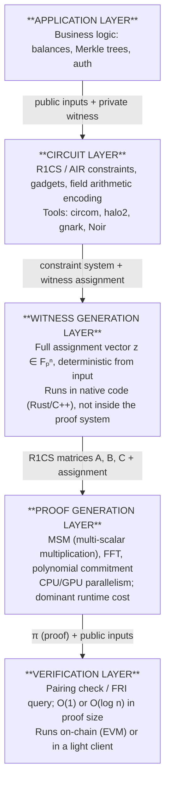
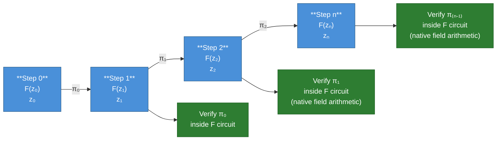
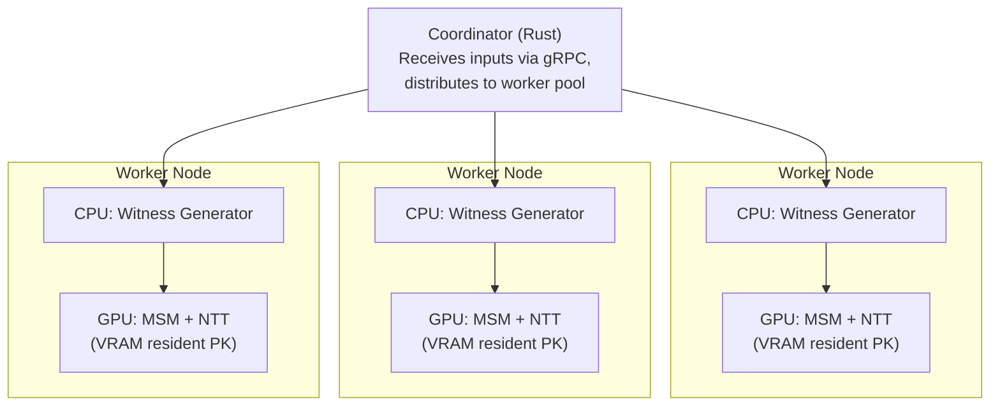

# Lesson 4: Systems Design with Zero Knowledge Proofs

## 1. First-Principles Intuition & Invariants

The engineering problem that zero-knowledge proofs solve is deceptively simple to state: how does one party convince another that a statement is true without revealing any information beyond the truth of that statement itself? The practical consequences of that question are anything but simple. When you build a system around this primitive, you are not merely adding a cryptographic subroutine to an existing architecture. You are restructuring the trust model of the system entirely, moving from a regime where correctness is guaranteed by access control and data visibility to one where it is guaranteed by mathematical proof.

To reason from first principles, consider what it means for a computation to be *verifiable*. In a conventional distributed system, a client trusts a server's response either because the server is an authenticated authority or because the client can re-execute the computation and check the result. Both approaches leak information or waste computation. A ZK proof introduces a third option: the server executes the computation once, generates a succinct cryptographic certificate of correct execution, and the client verifies that certificate in time and space that is sublinear in the original computation. The certificate is the proof, and its soundness rests not on institutional trust but on the hardness of a mathematical problem, typically the discrete logarithm problem over an elliptic curve group, or the collision resistance of a hash function in the random oracle model.

The invariants that govern every ZK system worth building in production are three. The first is **completeness**: an honest prover who knows a valid witness will always be able to generate a proof that an honest verifier accepts. The second is **soundness**: a dishonest prover who does not know a valid witness cannot generate an accepting proof except with negligible probability bounded by a security parameter λ. The third is **zero-knowledge**: the verifier learns nothing about the witness beyond the fact that one exists. These three properties hold simultaneously, and any engineering decision that weakens one will propagate through the entire system.

The witness is the pivotal concept systems engineers must internalize before writing a single line of circuit code. In ZK terminology, the witness is the private data that satisfies the relation being proven. When you prove that you know the preimage of a hash, the preimage is the witness. When you prove that a Merkle path is valid, the sibling hashes and the leaf value together form the witness. When you prove that an account balance after a state transition is non-negative, the balance and the transaction delta are the witness. Everything in a ZK system design flows from the question: what is the witness, and what is the relation it must satisfy?

The relation itself is encoded as an **arithmetic circuit** over a finite field $\mathbb{F}_p$, where $p$ is a large prime characteristic of the proof system's native field. A circuit is a directed acyclic graph whose nodes are arithmetic gates (addition and multiplication over $\mathbb{F}_p$) and whose edges carry field elements. The circuit's input wires carry the public statement and the private witness; the output wire carries a single field element that must be zero when the witness satisfies the relation. This representation is called a **Rank-1 Constraint System (R1CS)**, which expresses the circuit as a system of equations of the form $\langle \mathbf{a}_i, \mathbf{z} \rangle \cdot \langle \mathbf{b}_i, \mathbf{z} \rangle = \langle \mathbf{c}_i, \mathbf{z} \rangle$ for each gate $i$, where $\mathbf{z}$ is the assignment vector holding all wire values and $\mathbf{a}_i, \mathbf{b}_i, \mathbf{c}_i$ are selector vectors.

Modern proof systems such as Groth16, PLONK, and STARKs transform this constraint system into a problem about polynomials. The core insight, due to Schwartz-Zippel, is that two distinct polynomials of degree at most $d$ over a field of size $p \gg d$ agree on at most $d$ points. So the prover commits to a polynomial encoding of the witness, the verifier sends a random challenge point, and the prover evaluates the polynomial at that point. The probability that a dishonest prover guesses correctly is bounded by $d/p$, which is negligible for cryptographic field sizes. This polynomial IOP (interactive oracle proof) is then compiled into a non-interactive proof using the Fiat-Shamir heuristic, which replaces the verifier's random challenges with a hash of the transcript so far, eliminating interaction and enabling offline verification.

The engineering consequence of this mathematical structure is that the dominant performance cost of a ZK system is not the application logic itself but the overhead of encoding that logic in the proof system's native language. A single 32-bit integer multiplication in your business logic might require dozens of field operations in the circuit, because the native field is 254 bits wide (for BN254 or BLS12-381 curves) and you must decompose the operation into range checks and bit-level constraints. This impedance mismatch between the proof system's native operations and the application's natural operations is the central engineering challenge of ZK systems design.

---

## 2. Core Architecture & Mechanics

A production ZK system has four distinct layers that must be engineered independently and composed carefully: the **circuit layer**, the **witness generation layer**, the **proof generation layer**, and the **verification layer**. Each layer has its own data structures, performance characteristics, and failure modes.



### The Circuit Layer: Gadgets and Constraint Composition

The circuit layer is where systems architects make decisions with the most irreversible consequences. A circuit is compiled once, its proving key can be gigabytes in size, and changing the circuit invalidates all previously generated keys and proofs. The basic unit of circuit design is the **gadget**: a reusable sub-circuit that encodes a standard primitive such as a Pedersen hash, a SHA-256 compression round, a range check, or an ECDSA signature verification.

Gadgets compose by wiring their input and output signals together. In `circom`, the most widely deployed circuit language, this looks structurally like a hardware description language. Consider a Merkle path verification circuit, which is the backbone of nearly every ZK application that needs to prove set membership without revealing the element:

```circom
pragma circom 2.1.6;

include "node_modules/circomlib/circuits/poseidon.circom";
include "node_modules/circomlib/circuits/switcher.circom";
include "node_modules/circomlib/circuits/bitify.circom";

// Verifies a Merkle inclusion proof of depth DEPTH.
// Public:  root
// Private: leaf, pathElements[DEPTH], pathIndices[DEPTH]
template MerkleTreeChecker(DEPTH) {
    signal input leaf;
    signal input root;
    signal input pathElements[DEPTH];
    signal input pathIndices[DEPTH];

    component hashers[DEPTH];
    component switchers[DEPTH];

    signal levelHashes[DEPTH + 1];
    levelHashes[0] <== leaf;

    for (var i = 0; i < DEPTH; i++) {
        pathIndices[i] * (pathIndices[i] - 1) === 0;

        switchers[i] = Switcher();
        switchers[i].sel <== pathIndices[i];
        switchers[i].L   <== levelHashes[i];
        switchers[i].R   <== pathElements[i];

        hashers[i] = Poseidon(2);
        hashers[i].inputs[0] <== switchers[i].outL;
        hashers[i].inputs[1] <== switchers[i].outR;

        levelHashes[i + 1] <== hashers[i].out;
    }

    root === levelHashes[DEPTH];
}

component main { public [root] } = MerkleTreeChecker(20);
```

Several invariants deserve close attention in this circuit. The constraint `pathIndices[i] * (pathIndices[i] - 1) === 0` enforces that each path index is a boolean field element (either 0 or 1) rather than an arbitrary field element, because an unconstrained signal can hold any value in $\mathbb{F}_p$, and an adversarial prover could exploit that freedom to forge a valid path proof. This is the most common class of circuit bug: **under-constrained signals**. The circuit compiles and the witness generator runs, but the proof system accepts proofs for witnesses that violate the intended relation because the constraint polynomial vanishes on points it should not.

The choice of hash function in a ZK circuit is a consequential decision that has no analogue in conventional software. SHA-256, which has 2 TB of practical deployment behind it, is catastrophically expensive inside a circuit: each compression round requires roughly 25,000 R1CS constraints because the bitwise operations (XOR, AND, bit rotations) must be decomposed into field arithmetic, which is native to the proof system but alien to Boolean logic. Poseidon, a sponge hash designed natively for $\mathbb{F}_p$, requires only about 240 constraints for a 254-bit hash because it operates in the field directly. This 100x gap in constraint count translates directly into proving time, memory consumption, and circuit compilation time. Every time your application logic requires a hash, the choice between SHA-256 and Poseidon is a systems engineering decision, not a cryptographic preference.

### The Proving Key and R1CS Matrices

After `circom --r1cs --wasm --sym` compiles the circuit, the output is an `.r1cs` file containing the three sparse matrices $A$, $B$, $C \in \mathbb{F}_p^{m \times n}$ where $m$ is the number of constraints and $n$ is the number of wires (variables). For the depth-20 Merkle circuit above, $m$ is approximately 4,800 constraints (20 Poseidon hashes at ~240 constraints each) and $n$ is proportionally larger. These matrices participate in the trusted setup ceremony for Groth16 or are used directly for PLONK-based systems.

The trusted setup for Groth16 is a **structured reference string (SRS)** that encodes powers of a secret toxic waste value $\tau$ in the exponents of elliptic curve group elements: $\{[\tau^0]_1, [\tau^1]_1, \ldots, [\tau^{d-1}]_1\}$ for the prover's key and a small set for the verifier's key. If $\tau$ is ever learned, the system's soundness collapses: an adversary can forge proofs for false statements. This is why Groth16 setups require multi-party computation ceremonies (like Hermez's Perpetual Powers of Tau) where each participant contributes randomness and then destroys their contribution. The ceremony is secure as long as at least one participant is honest.

PLONK and its descendants (Halo2, UltraPlonk) use a **universal SRS**: a single Powers of Tau that works for circuits up to a maximum degree, so circuit changes do not require a new ceremony. This is the central architectural advantage that has driven PLONK adoption in production zkRollup systems over Groth16 despite PLONK's larger proof sizes. The tradeoff is real: a Groth16 proof is 192 bytes and verifies with two pairing operations, while a PLONK proof is roughly 800 bytes and requires more verifier computation, but the circuit agility it provides at the systems level outweighs the on-chain gas cost for most applications.

### Witness Generation: The Hidden Bottleneck

Proof generation gets most of the performance attention, but witness generation is the first bottleneck in a production pipeline and the most common source of non-obvious bugs. Witness generation is the process of computing a full assignment for every signal in the circuit, given the public inputs and private witness data. This runs outside the proof system in native code, and its correctness is entirely the engineer's responsibility: the proof system will generate a valid proof for whatever assignment you give it, even one that violates your intended semantics, if the constraints happen to be satisfied.

The `circom` compiler emits a WebAssembly witness generator that runs in Node.js. For circuits with tens of millions of constraints, this is unacceptably slow. Production systems at zkSync, Polygon zkEVM, and Scroll use custom Rust witness generators that implement the same logic as the circuit but in native code with SIMD acceleration and parallel Rayon threads. The key invariant is that the native witness generator and the circuit constraints must be **semantically equivalent**: every signal value computed by the native generator must satisfy all circuit constraints. Maintaining this equivalence as both evolve under separate engineering teams is the central operational challenge of ZK systems maintenance.

```rust
use ark_bn254::Fr;
use ark_ff::{Field, PrimeField};
use std::collections::HashMap;

// Minimal witness generator for the depth-20 Merkle circuit above.
// Produces the full signal assignment map keyed by signal name.
pub struct MerkleWitnessGenerator {
    pub depth: usize,
}

impl MerkleWitnessGenerator {
    // poseidon_hash is a native Rust implementation of the Poseidon
    // permutation over BN254's scalar field Fr. It must match the
    // circomlib Poseidon gadget parameters exactly (t=3, RF=8, RP=57).
    fn poseidon_hash(&self, left: Fr, right: Fr) -> Fr {
        poseidon_bn254::hash_two(left, right)
    }

    pub fn generate(
        &self,
        leaf: Fr,
        path_elements: &[Fr],
        path_indices: &[bool],
    ) -> HashMap<String, Fr> {
        assert_eq!(path_elements.len(), self.depth);
        assert_eq!(path_indices.len(), self.depth);

        let mut signals: HashMap<String, Fr> = HashMap::new();
        signals.insert("leaf".to_string(), leaf);

        let mut current = leaf;
        for i in 0..self.depth {
            let sibling = path_elements[i];
            let (left, right) = if path_indices[i] {
                (sibling, current)
            } else {
                (current, sibling)
            };

            signals.insert(format!("pathElements[{}]", i), sibling);
            signals.insert(
                format!("pathIndices[{}]", i),
                if path_indices[i] { Fr::one() } else { Fr::zero() },
            );
            signals.insert(format!("switchers[{}].outL", i), left);
            signals.insert(format!("switchers[{}].outR", i), right);

            current = self.poseidon_hash(left, right);
            signals.insert(format!("levelHashes[{}]", i + 1), current);
            signals.insert(format!("hashers[{}].out", i), current);
        }

        signals.insert("root".to_string(), current);
        signals
    }
}
```

This Rust generator computes the same path traversal as the circuit's constraint loop. The `poseidon_bn254::hash_two` call must invoke a Poseidon implementation with parameters identical to those embedded in the circomlib gadget: $t = 3$, $R_F = 8$ full rounds, $R_P = 57$ partial rounds, and the BN254-specific round constants and MDS matrix. A parameter mismatch produces an assignment vector that fails the constraint check, surfacing as an obscure "constraints not satisfied" error from snarkjs at the worst possible time.

### Proof Generation: Multi-Scalar Multiplication and FFT

The proof generation layer is dominated by two operations: **multi-scalar multiplication (MSM)** and the **number-theoretic transform (NTT)**. MSM computes $\sum_{i=1}^n k_i G_i$ where $G_i$ are fixed elliptic curve points from the proving key and $k_i$ are field elements from the witness assignment. For a circuit with one million constraints, this is a sum of one million elliptic curve scalar multiplications, each costing roughly 256 point doublings and additions. The standard algorithm is Pippenger's bucket method, which achieves a cost of $O(n / \log n)$ group operations rather than $O(n)$, but even with this optimization, MSM over BN254 at one million constraints takes approximately 10 seconds on a modern CPU.

The NTT is the finite-field analogue of the FFT and is used to evaluate and interpolate polynomials over the domain of constraint indices. For a circuit of size $2^k$, the NTT runs in $O(k \cdot 2^k)$ field multiplications. At $k = 20$ (one million constraints), this is roughly 20 million field multiplications, which is fast relative to MSM but non-trivial. GPU acceleration using CUDA kernels (via libraries like `bellman-cuda` or `icicle`) reduces MSM and NTT time by 10x to 50x by exploiting the massive parallelism of these operations, reducing a 60-second CPU proof to under 5 seconds on an A100.

```rust
use ark_groth16::{Groth16, ProvingKey, Proof};
use ark_bn254::{Bn254, Fr};
use ark_relations::r1cs::{ConstraintSynthesizer, ConstraintSystemRef, SynthesisError};
use ark_ff::Field;

// Implements the ConstraintSynthesizer trait to let ark-groth16
// drive proving. The synthesize() method mirrors the circuit structure
// and must match the witness assignment exactly.
pub struct MerkleCircuit {
    pub leaf: Option<Fr>,
    pub root: Fr,
    pub path_elements: Vec<Option<Fr>>,
    pub path_indices: Vec<Option<bool>>,
}

impl ConstraintSynthesizer<Fr> for MerkleCircuit {
    fn generate_constraints(
        self,
        cs: ConstraintSystemRef<Fr>,
    ) -> Result<(), SynthesisError> {
        use ark_r1cs_std::prelude::*;
        use ark_r1cs_std::fields::fp::FpVar;

        let leaf_var = FpVar::new_witness(cs.clone(), || {
            self.leaf.ok_or(SynthesisError::AssignmentMissing)
        })?;

        let root_var = FpVar::new_input(cs.clone(), || Ok(self.root))?;

        let mut current = leaf_var;

        for i in 0..self.path_elements.len() {
            let sibling = FpVar::new_witness(cs.clone(), || {
                self.path_elements[i].ok_or(SynthesisError::AssignmentMissing)
            })?;

            let index_bit = Boolean::new_witness(cs.clone(), || {
                self.path_indices[i].ok_or(SynthesisError::AssignmentMissing)
            })?;

            // Conditionally swap: if index == 1, right = current, left = sibling.
            let left  = index_bit.select(&sibling, &current)?;
            let right = index_bit.select(&current, &sibling)?;

            // Native Poseidon gadget over ark-r1cs-std.
            current = poseidon_ark::constraints::hash_two(cs.clone(), &left, &right)?;
        }

        // Enforce root equality as a linear constraint.
        root_var.enforce_equal(&current)?;
        Ok(())
    }
}

pub fn prove(
    pk: &ProvingKey<Bn254>,
    circuit: MerkleCircuit,
) -> Result<Proof<Bn254>, SynthesisError> {
    use rand::SeedableRng;
    let mut rng = rand::rngs::StdRng::from_entropy();
    Groth16::<Bn254>::prove(pk, circuit, &mut rng)
}
```

### Recursive Proof Composition: IVC and Proof Aggregation

Recursive proof composition is the architectural primitive that makes zkRollup scaling work. The idea is that a verifier circuit can be embedded inside a prover circuit, so that proof $\pi_{n+1}$ attests to both the current computation step and the correctness of $\pi_n$. This is **Incrementally Verifiable Computation (IVC)**, introduced by Valiant in 2008, and it underlies every modern ZK scaling system.

The engineering challenge is that verifying a Groth16 proof inside a Groth16 circuit is extremely expensive. A Groth16 verifier performs two pairing operations over BN254, and encoding a pairing in an arithmetic circuit requires tens of thousands of constraints for the Miller loop and final exponentiation. The technique used to make this practical is **cycle of curves**: choose two elliptic curves $E_1$ and $E_2$ such that the scalar field of $E_1$ is the base field of $E_2$ and vice versa. The Pasta curves (Pallas and Vesta) form such a cycle. When you verify an $E_2$-based proof inside an $E_1$-based circuit, the base field arithmetic of the verifier (which is over the $E_2$ base field, equal to the $E_1$ scalar field) is native to the prover's constraint system. This eliminates the catastrophic overhead of non-native field arithmetic.

The Halo2 proof system, used by the zkEVM in the Scroll and Taiko implementations, exploits this cycle with **accumulator-based recursion**: rather than verifying each proof completely, the verifier accumulates a linear combination of group elements that is checked once at the end of the recursive chain. This defers the expensive pairing check and reduces the per-step recursive overhead to a few hundred native constraints.



The public output of each step is the hash of the accumulated state, binding each step's proof to the entire history. The final verifier only checks $\pi_n$ once, and that check certifies the entire computation chain. This is how zkSync Era and Polygon zkEVM can process thousands of transactions in a single on-chain proof: each transaction is a step in an IVC chain, and the chain's root proof is what gets posted to Ethereum.

### On-Chain Verification and EVM Integration

The Groth16 verifier contract on Ethereum executes the pairing equation:

$$e(A, B) = e(\alpha, \beta) \cdot e(C_{vk}, \gamma) \cdot e(C, \delta)$$

where $e$ is the optimal Ate pairing over BN254, $A$ and $B$ are proof elements, $\alpha, \beta, \gamma, \delta$ are verifying key constants, and $C_{vk}$ is a linear combination of verifying key points with the public inputs. The EVM precompile at address `0x08` implements this pairing check natively at a gas cost of $34000 + 45000k$ where $k$ is the number of pairing pairs. For a single Groth16 proof this costs roughly 213,000 gas (approximately $5 at 30 Gwei ETH), and the verification is $O(1)$ in the number of constraints, independent of circuit complexity.

```solidity
// SPDX-License-Identifier: MIT
pragma solidity ^0.8.24;

/// @title MerkleGroth16Verifier
/// @notice On-chain verifier for the depth-20 Merkle inclusion circuit.
///         Verifying key constants are generated by snarkjs exportSolidityCalldata.
contract MerkleGroth16Verifier {
    uint256 constant PRIME_Q =
        21888242871839275222246405745257275088548364400416034343698204186575808495617;

    struct VerifyingKey {
        uint256[2] alpha1;
        uint256[4] beta2;
        uint256[4] gamma2;
        uint256[4] delta2;
        uint256[2][] IC;      // IC[0] + sum_i(publicInputs[i-1] * IC[i])
    }

    struct Proof {
        uint256[2] A;
        uint256[4] B;
        uint256[2] C;
    }

    VerifyingKey internal vk;

    constructor(
        uint256[2]  memory _alpha1,
        uint256[4]  memory _beta2,
        uint256[4]  memory _gamma2,
        uint256[4]  memory _delta2,
        uint256[2][] memory _IC
    ) {
        vk.alpha1 = _alpha1;
        vk.beta2  = _beta2;
        vk.gamma2 = _gamma2;
        vk.delta2 = _delta2;
        vk.IC     = _IC;
    }

    function verify(
        uint256[2]  calldata proofA,
        uint256[4]  calldata proofB,
        uint256[2]  calldata proofC,
        uint256[]   calldata pubInputs
    ) external view returns (bool) {
        require(pubInputs.length + 1 == vk.IC.length, "Bad input count");

        // Compute vkX = IC[0] + sum_i(pubInputs[i] * IC[i+1]) using EC addition.
        uint256[3] memory vkX;
        vkX[0] = vk.IC[0][0];
        vkX[1] = vk.IC[0][1];
        vkX[2] = 1; // affine to Jacobian

        for (uint256 i = 0; i < pubInputs.length; i++) {
            require(pubInputs[i] < PRIME_Q, "Input out of field");
            (uint256 rx, uint256 ry) = _ecMul(vk.IC[i + 1][0], vk.IC[i + 1][1], pubInputs[i]);
            (vkX[0], vkX[1]) = _ecAdd(vkX[0], vkX[1], rx, ry);
        }

        // Pairing check: e(A, B) == e(alpha, beta) * e(vkX, gamma) * e(C, delta).
        return _pairingCheck(
            proofA[0], proofA[1],
            proofB[0], proofB[1], proofB[2], proofB[3],
            vkX[0], vkX[1],
            vk.gamma2[0], vk.gamma2[1], vk.gamma2[2], vk.gamma2[3],
            proofC[0], proofC[1],
            vk.delta2[0], vk.delta2[1], vk.delta2[2], vk.delta2[3],
            vk.alpha1[0], vk.alpha1[1],
            vk.beta2[0], vk.beta2[1], vk.beta2[2], vk.beta2[3]
        );
    }

    function _ecAdd(uint256 ax, uint256 ay, uint256 bx, uint256 by)
        internal view returns (uint256 rx, uint256 ry)
    {
        (bool ok, bytes memory result) = address(0x06).staticcall(
            abi.encode(ax, ay, bx, by)
        );
        require(ok, "ecAdd failed");
        (rx, ry) = abi.decode(result, (uint256, uint256));
    }

    function _ecMul(uint256 px, uint256 py, uint256 scalar)
        internal view returns (uint256 rx, uint256 ry)
    {
        (bool ok, bytes memory result) = address(0x07).staticcall(
            abi.encode(px, py, scalar)
        );
        require(ok, "ecMul failed");
        (rx, ry) = abi.decode(result, (uint256, uint256));
    }

    function _pairingCheck(
        uint256 ax, uint256 ay,
        uint256 bxx, uint256 bxy, uint256 byx, uint256 byy,
        uint256 cx, uint256 cy,
        uint256 gxx, uint256 gxy, uint256 gyx, uint256 gyy,
        uint256 dx, uint256 dy,
        uint256 dxx, uint256 dxy, uint256 dyx, uint256 dyy,
        uint256 ex, uint256 ey,
        uint256 fxx, uint256 fxy, uint256 fyx, uint256 fyy
    ) internal view returns (bool) {
        uint256[24] memory input = [
            ax, ay, bxx, bxy, byx, byy,
            cx, cy, gxx, gxy, gyx, gyy,
            dx, dy, dxx, dxy, dyx, dyy,
            ex, ey, fxx, fxy, fyx, fyy
        ];
        (bool ok, bytes memory result) = address(0x08).staticcall(
            abi.encodePacked(input)
        );
        require(ok, "Pairing failed");
        return abi.decode(result, (uint256)) == 1;
    }
}
```

The verifier is deterministic and stateless, which makes it composable with any application logic. The pattern used in production zkRollups is to call `verify()` as a gate on state transition: the rollup contract accepts a new state root only if the proof of the batch's execution is valid. This turns on-chain trust from "I trust the sequencer" to "the mathematics guarantees correctness."

---

## 3. High-Performance Optimization & Failure Modes

### Constraint Minimization: The Dominant Optimization

The number of constraints in a circuit is the single most consequential performance variable. Proving time scales roughly linearly with constraint count (more precisely, it scales as $O(n \log n)$ due to FFT phases, but MSM dominates at constant factor). The first principle of circuit optimization is therefore to minimize constraints, and several techniques achieve dramatic reductions.

**Lookup arguments** are the most powerful recent development in constraint reduction. The Plookup protocol, now standard in UltraHONK and Halo2, allows a circuit to assert that a value belongs to a precomputed table in $O(1)$ constraints, rather than decomposing a range check into $k$ boolean constraints. A range check proving $x \in [0, 2^{16})$ costs 16 boolean constraints naively, but a single lookup into a 65,536-row table costs one constraint. For circuits that perform many range checks (which every arithmetic circuit does, because field elements must be range-constrained to represent integers), this 16x reduction compounds across the entire circuit.

**Custom gates** in PLONK-based systems (available in Halo2 as "regions" and "selectors") allow you to define new gate types that evaluate arbitrary degree-$d$ polynomials over consecutive rows of the witness table. A 5-wire fan-in gate over 5 columns can compute a Poseidon round in a single row of the PLONK trace rather than 10 rows of R1CS. This is how Halo2 Poseidon achieves 60 constraints per hash compared to 240 in circom's R1CS encoding.

Concretely, the optimization workflow on a production circuit looks like this. First, compile the circuit with `circom --r1cs` and inspect the constraint count with `snarkjs r1cs info`. Then use `snarkjs r1cs print` to identify which gadgets contribute the most constraints. Next, replace expensive gadgets with Plookup-accelerated equivalents (Halo2 provides lookup tables through its `assign_lookup` API). Finally, profile the witness generator with `cargo flamegraph` targeting the witness generation binary to find CPU hotspots in the native code that mirror the circuit's heavy gadgets.

### Proving Time Profiling and Parallelism

GPU-accelerated proving deserves a careful systems analysis because throwing hardware at the problem without understanding the memory transfer bottleneck produces disappointing results. The MSM for a one-million-constraint circuit requires loading approximately 128 MB of elliptic curve points (the proving key) and 8 MB of scalar witness values into GPU VRAM. If the proving key fits in VRAM (an A100 has 80 GB), subsequent proof generations amortize the transfer cost. If it does not, the PCI-e bandwidth (64 GB/s on PCIe 5.0) becomes the bottleneck, and you are paying for a GPU to wait for memory.

The practical architecture for a ZK proving service is therefore a fleet of GPU instances with the proving key pre-loaded into VRAM at startup, accepting witness assignments via a local socket and streaming proofs back. The witness generator runs on the CPU (it is sequential and memory-bound in a different way) and hands off the assignment to the GPU prover. This architecture is used by Ulvetanna (now Irreducible), Ingonyama, and the in-house proving infrastructure at Polygon.



### Failure Modes: Under-Constrained Circuits and Soundness Bugs

The most catastrophic failure mode in a ZK system is a soundness bug: a flaw in the circuit that allows a prover to generate valid proofs for false statements. The on-chain verifier will accept these proofs, and if the ZK system is a rollup, an attacker can steal funds or corrupt state without detection. Unlike conventional software bugs, ZK soundness bugs produce no observable error at proof generation time: the proof generates successfully, the verifier accepts, and the system operates normally until the attack materializes.

The Tornado Cash bug discovered in 2022 (and not exploited in production) is an instructive case. The circuit omitted a boolean constraint on a signal that was intended to be 0 or 1. An adversarial prover could set this signal to an arbitrary field element, allowing double-spending of a nullifier. The fix was a single constraint line, but discovering the vulnerability required formal analysis because the circuit compiled and all tests passed with honest witness values.

The engineering discipline that guards against under-constrained signals is **constraint testing with adversarial witnesses**: generate witness assignments that satisfy the constraints but violate the intended semantic invariant, and verify that the proof system rejects them. The `arkworks` constraint system provides a `ConstraintSystemRef::is_satisfied()` method that checks all constraints against an assignment without running the full prover, enabling fast fuzzing of the constraint system.

```rust
#[cfg(test)]
mod constraint_tests {
    use super::*;
    use ark_relations::r1cs::ConstraintSystem;
    use ark_bn254::Fr;
    use ark_ff::UniformRand;

    #[test]
    fn reject_invalid_path_index() {
        let cs = ConstraintSystem::<Fr>::new_ref();
        let mut rng = rand::thread_rng();

        // Build a circuit with a path index set to an arbitrary field element
        // rather than a boolean. The boolean constraint should catch this.
        let arbitrary_index = Fr::rand(&mut rng);
        // Ensure it's not accidentally 0 or 1.
        let arbitrary_index = arbitrary_index + Fr::from(2u64);

        let circuit = MerkleCircuit {
            leaf: Some(Fr::rand(&mut rng)),
            root: Fr::rand(&mut rng),   // Intentionally wrong root.
            path_elements: (0..20).map(|_| Some(Fr::rand(&mut rng))).collect(),
            path_indices: (0..20).map(|_| Some(false)).collect(),
        };

        circuit.generate_constraints(cs.clone()).unwrap();
        // The constraints must not be satisfied with an adversarial assignment.
        assert!(
            !cs.is_satisfied().unwrap(),
            "Circuit accepted an invalid witness — soundness bug"
        );
    }
}
```

**Incompleteness bugs** are the complement: the circuit rejects witnesses that should be valid. These surface as "constraints not satisfied" panics in the prover, most commonly caused by a mismatch between the witness generator's field arithmetic and the circuit's constraints. The typical root cause is integer overflow: native Rust code computes `a + b` as a `u64` with wrap-around semantics, while the circuit computes `a + b` modulo $p$. For small values they agree, but when the sum crosses $2^{64}$ they diverge. Every arithmetic operation in the native witness generator that corresponds to a field constraint must be performed with explicit modular arithmetic using `Fr::from(a) + Fr::from(b)`.

### Deployment Patterns: Off-Chain Proving with On-Chain Verification

The canonical production deployment pattern for a ZK application separates proving from verification by trust boundary. The prover is off-chain, potentially untrusted, and can be a user's browser (using `snarkjs` with WebAssembly provers for small circuits) or a dedicated cloud GPU fleet for large circuits. The verifier is on-chain, trusted by all parties because it is a deterministic Solidity function. This separation is the source of ZK's scalability: expensive proving is pushed to the edge, while cheap verification remains on-chain.

Privacy-preserving applications add a second constraint on this architecture: the witness must never leave the prover's machine. In a credential verification system (proving that a government-issued ID is valid without revealing the ID), the prover runs entirely in the user's browser, the proof is a few hundred bytes, and the verifier contract checks it on-chain. The user's private data, encoded as the witness, is never transmitted anywhere. This is architecturally different from a rollup, where the prover is a sequencer that *does* know the transaction data but proves it to avoid requiring all validators to re-execute it.

The engineering checklist for a production ZK deployment covers the following ground. The circuit must be formally audited for under-constrained signals by a firm specializing in ZK audits (Veridise, Trail of Bits, and Least Authority have published methodologies). The trusted setup ceremony, if using Groth16, must use a multi-party computation with public attestation. The verifier contract must handle the case where public inputs are out of the field range (attackers can submit $p + 1$ as a public input, which the EVM interprets as a 256-bit integer; the verifier must reject values $\geq p$ explicitly). The proof generation pipeline must have a circuit version registry, because a proving key mismatch between prover and verifier produces proof rejection with no error message beyond "pairing check failed." And the witness generator must be tested with both valid witnesses (completeness) and adversarially constructed invalid witnesses (soundness) before any circuit revision ships to production.

The systems design of a ZK application is ultimately an exercise in managing the boundary between the mathematical world of the proof system, where every variable is a field element and every constraint is a polynomial equation, and the operational world of software, where integers overflow, hash parameters diverge across library versions, and adversaries submit malformed inputs. The proof system enforces its invariants with mathematical certainty within that boundary. Everything outside it is your responsibility.
