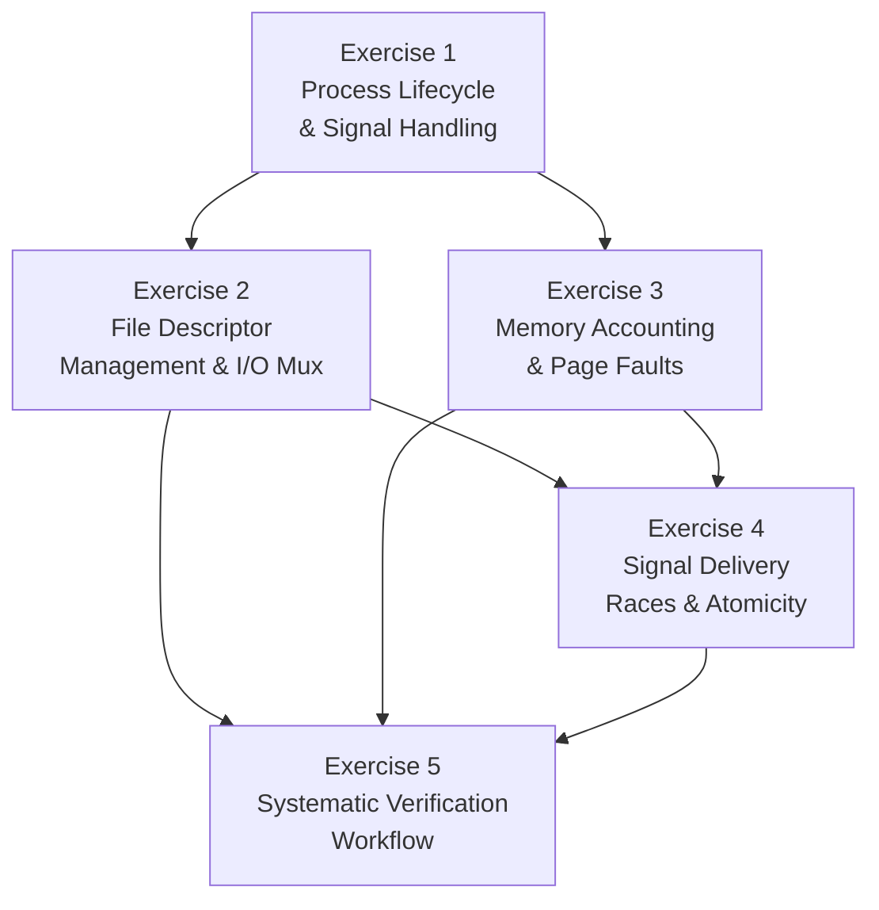
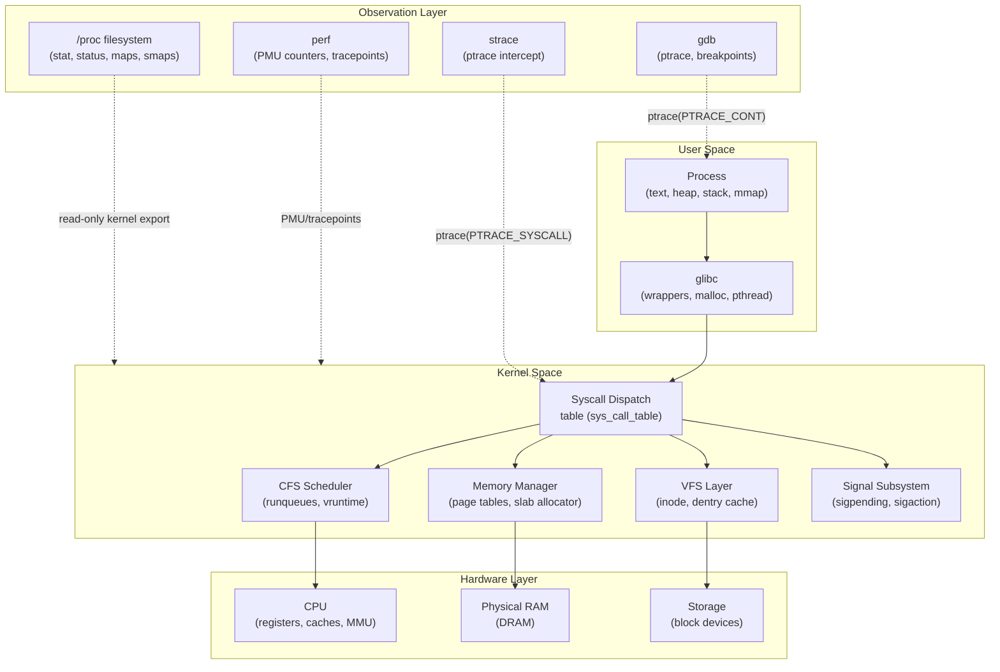
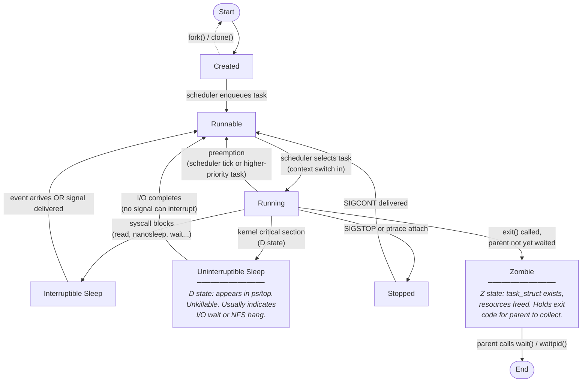
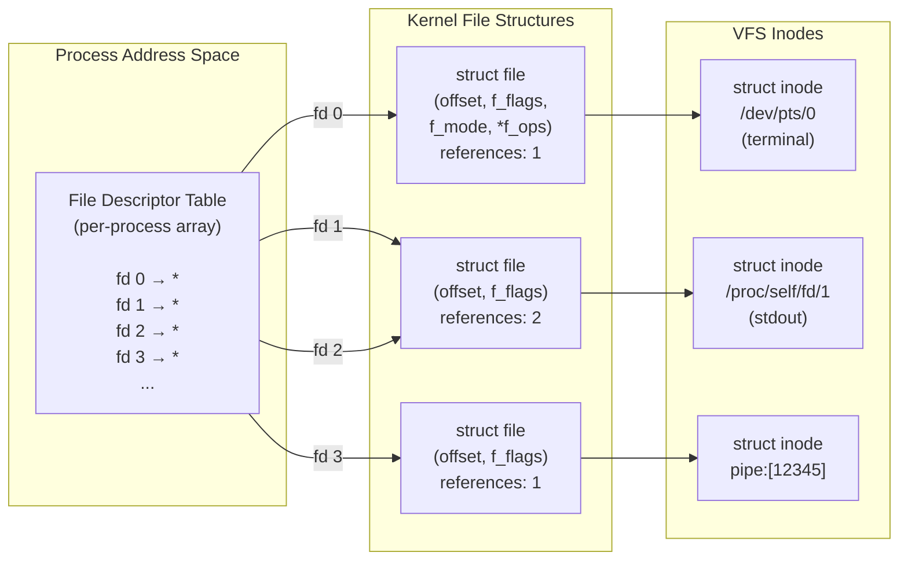
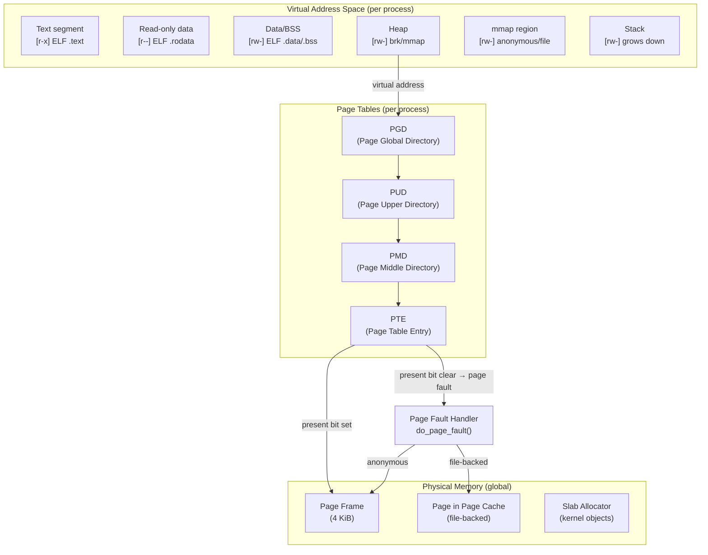
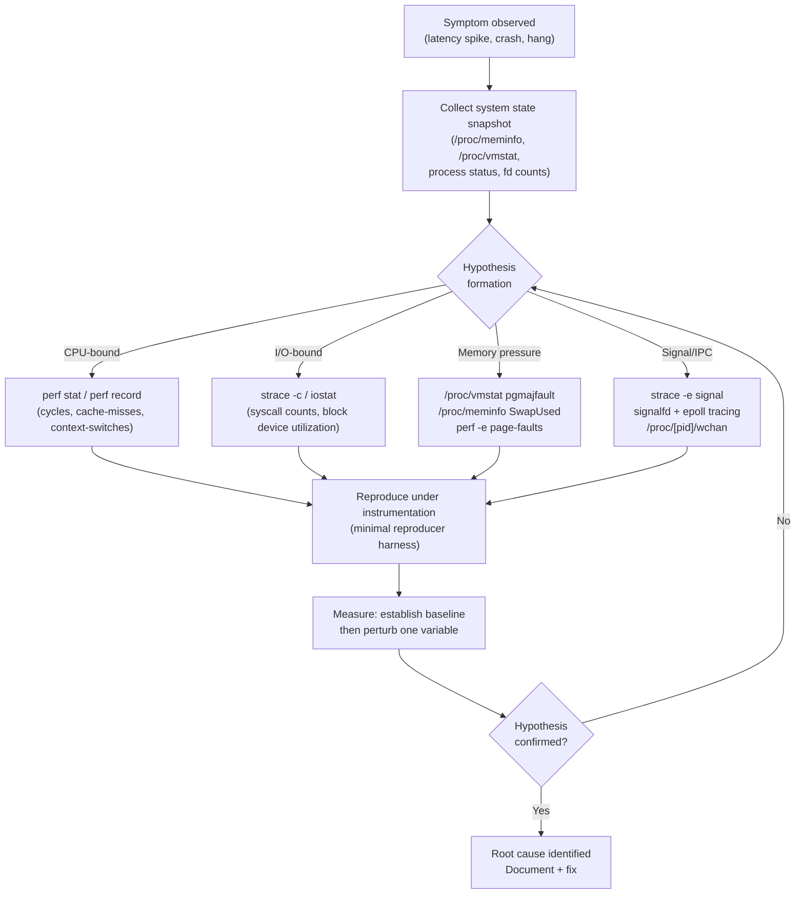
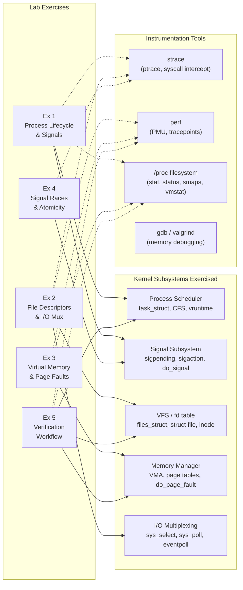

# Operational Verification Labs: Core Systems

## Objective and Lab Architecture

This laboratory guide provides rigorous, hands-on verification of the core abstractions that underpin every Unix-like operating system: process execution models, file descriptor management, signal handling, virtual memory accounting, and inter-process communication primitives. The empirical approach here treats the Linux kernel not as a black box but as an instrumented system whose behaviors are observable, measurable, and reproducible.

The five exercises that follow are ordered by dependency: each builds conceptual and mechanical familiarity that the next one requires. By the end, you will have a coherent, integrated methodology for diagnosing production system pathologies using `strace`, `perf`, `/proc` introspection, and purpose-built C and Bash harnesses.



---

## Required Environment and Tool Verification

Operate on a Linux system with kernel 5.10 or later. Kernel 5.10 is an LTS release with mature `perf` support, stable `epoll` semantics, and `io_uring` availability for optional extension. Earlier kernels (4.15–5.9) are functional for Exercises 1–4 but lack some `perf` probe points used in Exercise 5.

Required tools:

- **Shell runtime**: `bash` 5.0+ (associative arrays, `EPOCHREALTIME`, `nameref`)
- **Process instrumentation**: `strace` 5.x+, `ltrace`
- **Performance profiling**: `perf` (from `linux-tools` matching your kernel version)
- **Compilation**: `gcc` 9+ or `clang` 10+, `make`, `binutils` (`objdump`, `readelf`)
- **Debugging**: `gdb` 9+
- **Kernel interfaces**: `/proc` and `/sys` filesystems mounted (standard on all distributions)

Verify the environment:

```bash
uname -r
bash --version | head -1
strace --version | head -1
perf version
gcc --version | head -1
ls /proc/self/status
```

Install missing tools on Ubuntu/Debian (replace `$(uname -r)` expansion with your actual kernel version if needed):

```bash
sudo apt-get update
sudo apt-get install -y \
    build-essential \
    strace \
    ltrace \
    linux-tools-$(uname -r) \
    linux-tools-generic \
    linux-perf \
    gdb
```

On RHEL/Fedora/CentOS:

```bash
sudo dnf install -y \
    gcc \
    gdb \
    strace \
    ltrace \
    perf
```

**Scheduler isolation for reproducible measurements.** Jitter from other processes executing on the same CPU core contaminates timing measurements. Isolate a core by taking it offline and using `taskset` to pin measurement processes to it. This requires at least four logical CPUs:

```bash
# Take CPU 3 offline to remove it from the general scheduler pool
sudo bash -c 'echo 0 > /sys/devices/system/cpu/cpu3/online'

# Verify isolation
cat /sys/devices/system/cpu/cpu3/online   # should print 0

# Bring it back online when done
# sudo bash -c 'echo 1 > /sys/devices/system/cpu/cpu3/online'

# Pin a process to CPU 3 (while it is online; use CPU 2 as an alternative)
# taskset -c 2 ./your_program
```

> **Note**: Taking a CPU offline prevents the kernel from scheduling any tasks on it. You must bring it back online before shutting down or hibernating. The command above uses `echo 0` to offline (not `echo 3` as appeared in earlier drafts, which would offline CPU 3 by writing the wrong value—`cpu3/online` is a boolean 0/1 file).

Create the working directory:

```bash
mkdir -p ~/labs/core-verification
cd ~/labs/core-verification
```

---

## Architectural Foundations

Before instrumenting anything, establish a precise mental model of what you are observing. The following diagram shows the vertical stack from hardware through kernel to user space, and annotates where each tool intercepts behavior.



The `strace` tool uses `ptrace(PTRACE_SYSCALL)` to intercept every entry and exit from the kernel's syscall dispatch table. This imposes roughly 10–100× overhead on syscall-heavy workloads because each syscall generates two `ptrace` stops. Keep this cost in mind when interpreting timing results from straced processes.

`perf` uses hardware performance monitoring unit (PMU) counters and kernel tracepoints to gather statistics with near-zero overhead (typically < 1% CPU). `perf record` captures timestamped samples; `perf stat` accumulates aggregate counts.

---

## Exercise 1: Process Lifecycle and Signal Handling

### Process State Machine

Every Linux process occupies exactly one state at any instant. The kernel encodes this in the `state` field of `task_struct` (the kernel's process descriptor). User space sees a simplified version in `/proc/[pid]/stat` as a single character.



The state values reported by `/proc/[pid]/stat` and `/proc/[pid]/status`:

| Character | Kernel constant | Meaning |
|-----------|----------------|---------|
| `R` | `TASK_RUNNING` | Running or runnable (on run queue) |
| `S` | `TASK_INTERRUPTIBLE` | Sleeping, signals will wake it |
| `D` | `TASK_UNINTERRUPTIBLE` | Sleeping, no signal can wake it |
| `T` | `TASK_STOPPED` | Stopped by SIGSTOP or debugger |
| `t` | `TASK_TRACED` | Being traced by debugger |
| `Z` | `EXIT_ZOMBIE` | Terminated, awaiting parent wait() |
| `X` | `EXIT_DEAD` | Dead (should never be observed) |
| `I` | `TASK_IDLE` | Idle kernel thread |

### Why Scheduling Quanta Are Not Fixed at 100 ms

A widespread misconception is that Linux grants each process a fixed 100 ms timeslice. The Completely Fair Scheduler (CFS), introduced in Linux 2.6.23, does not use fixed quanta. Instead, it maintains a virtual runtime (`vruntime`) per task that advances proportionally to wall-clock time weighted by the task's `nice` value. The scheduler always selects the task with the smallest `vruntime` from a red-black tree of runnable tasks. The effective timeslice emerges from dividing a configurable scheduling period (`/proc/sys/kernel/sched_latency_ns`, defaulting to 6–24 ms on modern kernels depending on the number of runnable tasks) equally among all runnable tasks. With one runnable task, it runs until it blocks or is preempted; with ten tasks, each gets approximately 2.4 ms.

```bash
# Inspect CFS tuning parameters
cat /proc/sys/kernel/sched_latency_ns      # scheduling period in ns
cat /proc/sys/kernel/sched_min_granularity_ns  # minimum timeslice per task
cat /proc/sys/kernel/sched_wakeup_granularity_ns
```

### Signal Delivery Mechanics

Signals are not delivered instantaneously. The kernel sets a bit in the task's `sigpending` bitfield when a signal is generated (`kill()`, hardware exception, kernel event). The signal is not actually *delivered*—meaning the handler is not called—until the kernel checks `sigpending` at a signal delivery checkpoint. These checkpoints occur:

1. On return from any syscall (system call exit path)
2. On return from an interrupt or exception handler
3. At preemption points when the kernel transitions from kernel mode to user mode

This architecture means signal delivery latency is bounded below by the time to reach the next checkpoint. For a process blocked in `nanosleep`, the signal arrives at the next scheduling tick or when the sleep itself is interrupted—whichever comes first.

When a signal interrupts a blocking syscall, the kernel must decide whether to restart the syscall or return `EINTR` to user space. This decision depends on the `SA_RESTART` flag in the `sigaction` structure:

- `SA_RESTART` set: the kernel restarts the syscall automatically after the handler returns. The user program sees no `EINTR`.
- `SA_RESTART` not set: the syscall returns `-1` with `errno == EINTR`. User code must retry explicitly.

The `strace` output reveals this as `ERESTARTSYS` or `ERESTART_RESTARTBLOCK` before the signal handler runs, followed by the restarted syscall entry after the handler returns.

### Implementation: Multi-Process Signal Monitor

```bash
#!/bin/bash
# lab_signal_monitor.sh
# Operational verification of process lifecycle and signal delivery.
# Instruments a child process with strace, sends SIGUSR1/SIGUSR2,
# and parses the event stream to extract state transitions, signal delivery,
# and syscall interruption behavior.
#
# Usage: ./lab_signal_monitor.sh [working_directory]
set -euo pipefail

WORK_DIR="${1:-.}"
cd "$WORK_DIR"

EVENT_LOG="signal_events.log"
STRACE_LOG="strace_raw.log"
STATE_LOG="process_states.log"
TIMING_LOG="event_timing.log"

# Truncate all output files
: > "$EVENT_LOG"
: > "$STRACE_LOG"
: > "$STATE_LOG"
: > "$TIMING_LOG"

# ---------------------------------------------------------------------------
# Generate child process script.
# This child demonstrates:
#   1. Signal handler registration via trap
#   2. Mixed workload: CPU-bound + interruptible sleep (nanosleep syscall)
#   3. Early exit on SIGUSR2 with a non-zero exit code for verification
# ---------------------------------------------------------------------------
cat > child_process.sh << 'CHILD_EOF'
#!/bin/bash
CHILD_PID=$$
printf '[CHILD] Started PID=%d at %s\n' "$CHILD_PID" "$(date +%s.%N)" >&2

# SIGUSR1: demonstrate signal interruption of nanosleep without exit
trap 'printf "[CHILD] SIGUSR1 received at %s\n" "$(date +%s.%N)" >&2' SIGUSR1

# SIGUSR2: trigger controlled exit so the monitor can verify exit code 42
trap 'printf "[CHILD] SIGUSR2 received, exiting at %s\n" "$(date +%s.%N)" >&2; exit 42' SIGUSR2

for i in {1..20}; do
    printf '[CHILD] Iteration %d/20 at %s\n' "$i" "$(date +%s.%N)" >&2

    # CPU-bound: iterative Fibonacci — forces R state on CPU
    a=0; b=1
    for ((j = 0; j < 2000; j++)); do
        c=$((a + b)); a=$b; b=$c
    done
    printf '[CHILD] CPU phase done fib=%d at %s\n' "$b" "$(date +%s.%N)" >&2

    # Blocking sleep: forces S (TASK_INTERRUPTIBLE) state
    # strace will show: nanosleep({tv_sec=0, tv_nsec=300000000}, ...) = 0
    # or, if interrupted by SIGUSR1: = -1 EINTR (Interrupted system call)
    sleep 0.3
done

printf '[CHILD] Workload complete, exiting 0 at %s\n' "$(date +%s.%N)" >&2
exit 0
CHILD_EOF

chmod +x child_process.sh

# ---------------------------------------------------------------------------
# Launch child under strace.
#
# strace flags:
#   -f            follow forks (bash will fork for each sleep)
#   -e trace=all  capture all syscalls without filtering
#   -o FILE       write raw trace to FILE (not mixed with child stderr)
#   -T            append syscall duration in <seconds> after each line
#   -tt           prepend HH:MM:SS.usec wall-clock time to each line
#   -s 256        truncate string arguments at 256 bytes
#
# We redirect child stderr to the event log so the "[CHILD]" messages are
# captured alongside monitor timestamps for precise correlation.
# ---------------------------------------------------------------------------
EXPERIMENT_START_NS=$(date +%s%N)
printf '=== Experiment Start: %s ===\n' "$(date)" >> "$EVENT_LOG"

strace -f -e trace=all -o "$STRACE_LOG" -T -tt -s 256 \
    ./child_process.sh 2>>"$EVENT_LOG" &
STRACE_PID=$!

printf '[MONITOR] strace PID=%d launched at %s\n' \
    "$STRACE_PID" "$(date +%s.%N)" >> "$EVENT_LOG"

# ---------------------------------------------------------------------------
# State poller: sample /proc/[pid]/stat every 100 ms while child runs.
# The 'state' field is the third whitespace-delimited field in /proc/[pid]/stat.
# Format: pid (comm) state ppid pgroup session ...
# ---------------------------------------------------------------------------
state_poll() {
    local target_pid="$1"
    local outfile="$2"
    printf '%-12s %-6s %-8s\n' "timestamp_ns" "pid" "state" >> "$outfile"
    while kill -0 "$target_pid" 2>/dev/null; do
        local now
        now=$(date +%s%N)
        # Read stat; extract field 3; guard against race with process exit
        local stat_line
        stat_line=$(cat "/proc/$target_pid/stat" 2>/dev/null || echo "")
        if [[ -n "$stat_line" ]]; then
            # Field 3 follows the closing ')' of the comm field
            local state
            state=$(echo "$stat_line" | sed 's/.*) //' | cut -d' ' -f1)
            printf '%-12s %-6s %-8s\n' "$now" "$target_pid" "$state" >> "$outfile"
        fi
        sleep 0.1
    done
}

# Run state poller in background; it terminates automatically when the child exits
state_poll "$STRACE_PID" "$STATE_LOG" &
POLLER_PID=$!

# Allow child to initialize and enter its first nanosleep
sleep 0.8

# ---------------------------------------------------------------------------
# Signal injection sequence with precise timestamps
# ---------------------------------------------------------------------------
printf '[MONITOR] Sending SIGUSR1 to PID %d at %s\n' \
    "$STRACE_PID" "$(date +%s.%N)" >> "$EVENT_LOG"
kill -USR1 "$STRACE_PID" 2>/dev/null || true

sleep 0.5

printf '[MONITOR] Sending SIGUSR1 again (second delivery) at %s\n' \
    "$(date +%s.%N)" >> "$EVENT_LOG"
kill -USR1 "$STRACE_PID" 2>/dev/null || true

sleep 1.0

printf '[MONITOR] Sending SIGUSR2 (triggers exit 42) at %s\n' \
    "$(date +%s.%N)" >> "$EVENT_LOG"
kill -USR2 "$STRACE_PID" 2>/dev/null || true

# Wait for child and collect exit status
wait "$STRACE_PID" 2>/dev/null
CHILD_EXIT=$?

# Stop the state poller
kill "$POLLER_PID" 2>/dev/null || true
wait "$POLLER_PID" 2>/dev/null || true

EXPERIMENT_END_NS=$(date +%s%N)
DURATION_MS=$(( (EXPERIMENT_END_NS - EXPERIMENT_START_NS) / 1000000 ))

printf '[MONITOR] Child exited with code %d at %s\n' \
    "$CHILD_EXIT" "$(date +%s.%N)" >> "$EVENT_LOG"
printf '[MONITOR] Total experiment duration: %d ms\n' \
    "$DURATION_MS" >> "$EVENT_LOG"

# ---------------------------------------------------------------------------
# Post-mortem analysis of strace output
# ---------------------------------------------------------------------------
printf '\n=== SIGNAL DELIVERY ANALYSIS ===\n' >> "$TIMING_LOG"

# Extract nanosleep calls and show which were interrupted (EINTR) vs completed
printf '\n-- nanosleep syscall outcomes --\n' >> "$TIMING_LOG"
grep 'nanosleep' "$STRACE_LOG" | head -30 >> "$TIMING_LOG" 2>/dev/null || true

# Show signal delivery lines (kernel injects these between syscall lines)
printf '\n-- Signal delivery events --\n' >> "$TIMING_LOG"
grep '--- SIG' "$STRACE_LOG" | head -20 >> "$TIMING_LOG" 2>/dev/null || true

# Show context around EINTR returns (signal interrupting a syscall)
printf '\n-- EINTR occurrences (syscall interrupted by signal) --\n' >> "$TIMING_LOG"
grep 'EINTR' "$STRACE_LOG" | head -20 >> "$TIMING_LOG" 2>/dev/null || true

# Count total syscalls and signals
TOTAL_SYSCALLS=$(wc -l < "$STRACE_LOG")
SIGNAL_EVENTS=$(grep -c '--- SIG' "$STRACE_LOG" 2>/dev/null || echo 0)
EINTR_COUNT=$(grep -c 'EINTR' "$STRACE_LOG" 2>/dev/null || echo 0)

{
    printf '\n=== SUMMARY ===\n'
    printf 'Total strace lines:     %d\n' "$TOTAL_SYSCALLS"
    printf 'Signal delivery events: %s\n' "$SIGNAL_EVENTS"
    printf 'EINTR occurrences:      %s\n' "$EINTR_COUNT"
    printf 'Child exit code:        %d (expected: 42)\n' "$CHILD_EXIT"
    printf 'Duration:               %d ms\n' "$DURATION_MS"
} >> "$EVENT_LOG"

# Display console summary
cat "$EVENT_LOG"
printf '\nFiles produced:\n'
printf '  %-30s raw strace output (all syscalls)\n' "$STRACE_LOG"
printf '  %-30s monitor event log\n' "$EVENT_LOG"
printf '  %-30s /proc/pid/stat state poll\n' "$STATE_LOG"
printf '  %-30s signal/EINTR analysis\n' "$TIMING_LOG"
```

Execute:

```bash
chmod +x lab_signal_monitor.sh
./lab_signal_monitor.sh .
```

### Interpreting the strace Output

The raw strace output merits careful reading. Three patterns are essential:

**1. Interrupted syscall (EINTR)**

```
14:23:17.441302 nanosleep({tv_sec=0, tv_nsec=300000000}, {tv_sec=0, tv_nsec=182441000}) = -1 EINTR (Interrupted system call) <0.117559>
14:23:17.441350 --- SIGUSR1 {si_signo=SIGUSR1, si_code=SI_USER, si_pid=12345, si_uid=1000} ---
```

The `nanosleep` returned early (`= -1 EINTR`) with the remaining sleep time in the second argument. The `--- SIGUSR1 ---` line is not a syscall but a kernel annotation showing signal delivery. Because the trap handler was registered without `SA_RESTART`, bash does not restart the sleep—it moves on to the next iteration.

**2. Restarted syscall (ERESTART)**

Had the signal handler been registered with `SA_RESTART`, you would see:

```
nanosleep({tv_sec=0, tv_nsec=300000000}, 0x...) = ? ERESTART_RESTARTBLOCK (Interrupted by signal)
--- SIGUSR1 ... ---
nanosleep({tv_sec=0, tv_nsec=182441000}, NULL) = 0
```

The kernel automatically reissues `nanosleep` with the *remaining* duration, transparent to user space.

**3. Exit via signal handler**

```
14:23:19.100221 --- SIGUSR2 {si_signo=SIGUSR2, si_code=SI_USER, ...} ---
14:23:19.100301 exit_group(42)              = ?
14:23:19.100412 +++ exited with 42 +++
```

The `exit_group(42)` syscall is the kernel-level implementation of the C `_exit()` function, which terminates all threads in the process group. The exit code 42 confirms the trap handler executed correctly.

---

## Exercise 2: File Descriptor Management and I/O Multiplexing

### The File Descriptor Table Architecture



Three kernel data structures govern every I/O operation:

1. **Per-process file descriptor table** (`files_struct` → `fdtable`): a pointer array indexed by the integer file descriptor. `fork()` duplicates this table and increments the reference count on each `struct file`.
2. **Open file description** (`struct file`): tracks the current file offset and open flags (`O_RDONLY`, `O_NONBLOCK`, etc.). Multiple file descriptors—across processes after `fork()`, or within one process after `dup()`—can reference the same `struct file`, sharing the offset.
3. **Inode** (`struct inode`): represents the underlying file, device, pipe, or socket. Shared among all `struct file` objects that reference the same resource.

This three-level indirection explains several non-obvious behaviors:
- After `fork()`, parent and child share `struct file` offsets on inherited fds—a write by one advances the offset seen by the other.
- `dup2(oldfd, newfd)` creates a second fd pointing to the same `struct file`; closing one does not close the other.
- `open()` on the same path twice creates two independent `struct file` objects with independent offsets, even though they share an inode.

### I/O Multiplexing: Algorithmic Complexity

The three POSIX-and-Linux multiplexing interfaces differ fundamentally in their time complexity and kernel implementation:

| Mechanism | Time per call | Kernel data structure | Max fds | Notes |
|-----------|-------------|----------------------|---------|-------|
| `select` | O(n) scan of all fds | Kernel copies fd\_set bitmap | 1024 (FD\_SETSIZE) | Portable; fixed bitmap size is a hard ABI limit |
| `poll` | O(n) scan of all fds | Kernel copies pollfd array | Unlimited (memory bound) | Scales to more fds; still linear copy overhead |
| `epoll` | O(1) per event | Red-black tree + ready list | Millions (memory bound) | O(1) event retrieval; setup cost amortized |

The O(n) cost of `select` and `poll` is not just the scan—it is the kernel copy of the entire fd set on every call. With 10,000 descriptors, `poll` copies 10,000 `pollfd` structs (120 KB) across the user-kernel boundary on every call, even when only one fd is ready. `epoll` avoids this by maintaining the interest list inside the kernel; `epoll_wait` returns only ready events.

### Implementation: I/O Multiplexing Benchmark

```c
/* fd_multiplexing.c
 * Benchmarks select(), poll(), and epoll() for event detection latency
 * on N pipe pairs. Measures nanoseconds from write() to readiness detection.
 *
 * Compile: gcc -O2 -std=c11 -Wall -Wextra -o fd_multiplexing fd_multiplexing.c
 * Run:     ./fd_multiplexing
 */
#define _GNU_SOURCE
#include <errno.h>
#include <fcntl.h>
#include <stdint.h>
#include <stdio.h>
#include <stdlib.h>
#include <string.h>
#include <sys/epoll.h>
#include <sys/poll.h>
#include <sys/resource.h>
#include <sys/select.h>
#include <sys/time.h>
#include <time.h>
#include <unistd.h>

#define NUM_PIPES   100
#define ITERATIONS  2000

/* Per-pipe accounting */
typedef struct {
    int read_fd;
    int write_fd;
} pipe_pair_t;

/* Latency sample array for percentile computation */
typedef struct {
    uint64_t *samples;
    int       count;
    int       capacity;
} latency_hist_t;

static void hist_init(latency_hist_t *h, int capacity) {
    h->samples  = malloc((size_t)capacity * sizeof(uint64_t));
    h->count    = 0;
    h->capacity = capacity;
    if (!h->samples) { perror("malloc"); exit(EXIT_FAILURE); }
}

static void hist_add(latency_hist_t *h, uint64_t ns) {
    if (h->count < h->capacity)
        h->samples[h->count++] = ns;
}

static int cmp_u64(const void *a, const void *b) {
    uint64_t x = *(const uint64_t *)a;
    uint64_t y = *(const uint64_t *)b;
    return (x > y) - (x < y);
}

static void hist_print(const latency_hist_t *h, const char *label) {
    if (h->count == 0) { printf("%s: no samples\n", label); return; }

    uint64_t *s = malloc((size_t)h->count * sizeof(uint64_t));
    if (!s) { perror("malloc"); return; }
    memcpy(s, h->samples, (size_t)h->count * sizeof(uint64_t));
    qsort(s, (size_t)h->count, sizeof(uint64_t), cmp_u64);

    uint64_t sum = 0;
    for (int i = 0; i < h->count; i++) sum += s[i];

    printf("%-8s  min=%6.2f  p50=%6.2f  p95=%6.2f  p99=%6.2f  max=%6.2f  avg=%6.2f  (µs, n=%d)\n",
           label,
           (double)s[0]                              / 1000.0,
           (double)s[(int)(h->count * 0.50)]         / 1000.0,
           (double)s[(int)(h->count * 0.95)]         / 1000.0,
           (double)s[(int)(h->count * 0.99)]         / 1000.0,
           (double)s[h->count - 1]                   / 1000.0,
           (double)sum / (h->count * 1000.0));
    free(s);
}

static uint64_t now_ns(void) {
    struct timespec ts;
    clock_gettime(CLOCK_MONOTONIC, &ts);
    return (uint64_t)ts.tv_sec * UINT64_C(1000000000) + (uint64_t)ts.tv_nsec;
}

/* Drain all readable bytes from a pipe to leave it clean for the next round */
static void drain(int fd) {
    char buf[64];
    while (read(fd, buf, sizeof(buf)) > 0)
        ;
}

/* ------------------------------------------------------------------ select */
static void bench_select(pipe_pair_t *pipes, int n, int iters,
                         latency_hist_t *hist)
{
    int max_fd = 0;
    for (int i = 0; i < n; i++)
        if (pipes[i].read_fd > max_fd) max_fd = pipes[i].read_fd;

    /* select() requires max_fd < FD_SETSIZE (1024 by default) */
    if (max_fd >= FD_SETSIZE) {
        fprintf(stderr, "select: max_fd %d >= FD_SETSIZE %d, skipping\n",
                max_fd, FD_SETSIZE);
        return;
    }

    for (int iter = 0; iter < iters; iter++) {
        int idx = rand() % n;
        char byte = (char)(iter & 0xFF);

        uint64_t t0 = now_ns();
        if (write(pipes[idx].write_fd, &byte, 1) != 1) { perror("write"); return; }

        fd_set rset;
        FD_ZERO(&rset);
        for (int i = 0; i < n; i++) FD_SET(pipes[i].read_fd, &rset);

        struct timeval tv = {.tv_sec = 1, .tv_usec = 0};
        int nready = select(max_fd + 1, &rset, NULL, NULL, &tv);
        uint64_t t1 = now_ns();

        if (nready > 0) {
            hist_add(hist, t1 - t0);
            for (int i = 0; i < n; i++)
                if (FD_ISSET(pipes[i].read_fd, &rset)) drain(pipes[i].read_fd);
        }
    }
}

/* -------------------------------------------------------------------- poll */
static void bench_poll(pipe_pair_t *pipes, int n, int iters,
                       latency_hist_t *hist)
{
    struct pollfd *pfds = malloc((size_t)n * sizeof(struct pollfd));
    if (!pfds) { perror("malloc"); return; }

    for (int iter = 0; iter < iters; iter++) {
        int idx = rand() % n;
        char byte = (char)(iter & 0xFF);

        uint64_t t0 = now_ns();
        if (write(pipes[idx].write_fd, &byte, 1) != 1) {
            perror("write"); free(pfds); return;
        }

        for (int i = 0; i < n; i++) {
            pfds[i].fd      = pipes[i].read_fd;
            pfds[i].events  = POLLIN;
            pfds[i].revents = 0;
        }

        int nready = poll(pfds, (nfds_t)n, 1000);
        uint64_t t1 = now_ns();

        if (nready > 0) {
            hist_add(hist, t1 - t0);
            for (int i = 0; i < n; i++)
                if (pfds[i].revents & POLLIN) drain(pipes[i].read_fd);
        }
    }
    free(pfds);
}

/* ------------------------------------------------------------------- epoll */
static void bench_epoll(pipe_pair_t *pipes, int n, int iters,
                        latency_hist_t *hist)
{
    int epfd = epoll_create1(EPOLL_CLOEXEC);
    if (epfd < 0) { perror("epoll_create1"); return; }

    struct epoll_event *evbuf = malloc((size_t)n * sizeof(struct epoll_event));
    if (!evbuf) { perror("malloc"); close(epfd); return; }

    /* Register all read ends once; epoll_ctl is O(log n) in the rb-tree */
    for (int i = 0; i < n; i++) {
        struct epoll_event ev = {
            .events   = EPOLLIN,
            .data.u32 = (uint32_t)i
        };
        if (epoll_ctl(epfd, EPOLL_CTL_ADD, pipes[i].read_fd, &ev) < 0) {
            perror("epoll_ctl"); free(evbuf); close(epfd); return;
        }
    }

    for (int iter = 0; iter < iters; iter++) {
        int idx = rand() % n;
        char byte = (char)(iter & 0xFF);

        uint64_t t0 = now_ns();
        if (write(pipes[idx].write_fd, &byte, 1) != 1) {
            perror("write"); break;
        }

        int nready = epoll_wait(epfd, evbuf, n, 1000);
        uint64_t t1 = now_ns();

        if (nready > 0) {
            hist_add(hist, t1 - t0);
            for (int i = 0; i < nready; i++)
                drain(pipes[evbuf[i].data.u32].read_fd);
        }
    }

    free(evbuf);
    close(epfd);
}

int main(void) {
    pipe_pair_t pipes[NUM_PIPES];
    srand(0xdeadbeef);

    /* Raise the open-file limit to accommodate NUM_PIPES * 2 fds */
    struct rlimit rl;
    getrlimit(RLIMIT_NOFILE, &rl);
    if (rl.rlim_cur < (rlim_t)(NUM_PIPES * 2 + 32)) {
        rl.rlim_cur = (rlim_t)(NUM_PIPES * 2 + 32);
        setrlimit(RLIMIT_NOFILE, &rl);
    }

    for (int i = 0; i < NUM_PIPES; i++) {
        int fd[2];
        if (pipe2(fd, O_NONBLOCK | O_CLOEXEC) < 0) {
            perror("pipe2"); exit(EXIT_FAILURE);
        }
        pipes[i].read_fd  = fd[0];
        pipes[i].write_fd = fd[1];
    }

    printf("I/O Multiplexing Benchmark: %d pipes, %d iterations\n\n",
           NUM_PIPES, ITERATIONS);
    printf("%-8s  %-6s  %-6s  %-6s  %-6s  %-6s  %-6s\n",
           "mech", "min", "p50", "p95", "p99", "max", "avg");
    printf("         (all latencies in µs, write→readiness-detected)\n\n");

    latency_hist_t h_select, h_poll, h_epoll;
    hist_init(&h_select, ITERATIONS);
    hist_init(&h_poll,   ITERATIONS);
    hist_init(&h_epoll,  ITERATIONS);

    bench_select(pipes, NUM_PIPES, ITERATIONS, &h_select);
    bench_poll  (pipes, NUM_PIPES, ITERATIONS, &h_poll);
    bench_epoll (pipes, NUM_PIPES, ITERATIONS, &h_epoll);

    hist_print(&h_select, "select");
    hist_print(&h_poll,   "poll");
    hist_print(&h_epoll,  "epoll");

    printf("\nNote: At %d fds, select/poll overhead is dominated by the\n"
           "kernel copy of the fd set (~%zu bytes for poll). With 10,000+\n"
           "fds, epoll's O(1) event retrieval becomes decisive.\n",
           NUM_PIPES,
           (size_t)NUM_PIPES * sizeof(struct pollfd));

    for (int i = 0; i < NUM_PIPES; i++) {
        close(pipes[i].read_fd);
        close(pipes[i].write_fd);
    }

    free(h_select.samples);
    free(h_poll.samples);
    free(h_epoll.samples);
    return EXIT_SUCCESS;
}
```

Compile and run:

```bash
gcc -O2 -std=c11 -Wall -Wextra -o fd_multiplexing fd_multiplexing.c
./fd_multiplexing
```

Instrument with `strace` to count per-mechanism syscalls:

```bash
strace -c -e trace=select,poll,epoll_wait,epoll_ctl,epoll_create1,read,write \
    ./fd_multiplexing 2>&1 | tail -20
```

The `strace -c` summary reports total calls and time. You will observe that `epoll_ctl` is called `NUM_PIPES` times during setup and zero times during the benchmark loop, while `poll` copies the entire `pollfd` array on every iteration.

### Inheritance and the CLOEXEC Flag

File descriptors are inherited by child processes across `fork()` by default. This is intentional—it enables shell pipelines. However, long-running services that `fork()` to handle requests must ensure that sensitive fds (sockets, database connections) are not leaked into child processes that exec different programs.

The `O_CLOEXEC` flag (set at open time with `open(..., O_CLOEXEC)` or on existing fds with `fcntl(fd, F_SETFD, FD_CLOEXEC)`) instructs the kernel to close the fd automatically on `execve()`. The `pipe2(fd, O_CLOEXEC)` variant used in the benchmark above sets this atomically, avoiding the race condition between `pipe()` + `fcntl()`.

Inspect inherited fds of any running process:

```bash
ls -la /proc/self/fd
ls -la /proc/$$/fd    # fds of current bash shell
```

---

## Exercise 3: Memory Accounting and Page Fault Instrumentation

### Virtual Memory Architecture



Linux uses a four-level page table on x86-64 (PGD → PUD → PMD → PTE), with each level occupying a 4 KiB page and holding 512 entries. A virtual address is split into five fields: 9 bits each for PGD/PUD/PMD/PTE indices, plus a 12-bit page offset. The kernel introduced a fifth level (5-level paging, `CONFIG_X86_5LEVEL`) for systems with more than 128 TiB of physical RAM.

A **minor page fault** occurs when a valid mapping exists (a VMA covers the address) but no page table entry is present—for example, on first access to an `mmap`-allocated anonymous region. The kernel allocates a physical page and installs the PTE without disk I/O. This is fast: typically 1–5 µs.

A **major page fault** occurs when the page was previously evicted to swap or when a file-backed page must be read from disk. The process enters uninterruptible sleep (D state) until the I/O completes. This can take milliseconds to tens of milliseconds, depending on storage latency.

### Copy-on-Write after fork()

When a process calls `fork()`, the kernel does not immediately copy the parent's physical pages. Instead, it marks all writable PTEs in both parent and child as read-only and sets a `COW` (copy-on-write) flag. The first write by either process to a COW page triggers a minor page fault. The fault handler allocates a new physical page, copies the original page's contents, updates the PTE in the faulting process, and marks the page writable. The other process still references the original page, now safely owned by one party.

```bash
# Observe COW behavior: fork a large process and watch minor faults
cat /proc/self/status | grep -E 'VmRSS|VmPeak|VmSize'

# After fork(), count minor faults in parent and child:
# /proc/[pid]/stat fields 10 (minflt) and 12 (majflt)
awk '{print "minor=" $10 " major=" $12}' /proc/self/stat
```

### Implementation: Page Fault Latency Profiler

```c
/* memory_faults.c
 * Measures minor page fault latency for sequential, random, and
 * stride access patterns. Reports per-access timing and fault rates
 * derived from /proc/self/stat before and after each workload.
 *
 * Compile: gcc -O0 -std=c11 -Wall -o memory_faults memory_faults.c
 * (O0 prevents the compiler from optimizing away memory accesses)
 * Run:     ./memory_faults [size_mb]
 */
#define _GNU_SOURCE
#include <fcntl.h>
#include <stdint.h>
#include <stdio.h>
#include <stdlib.h>
#include <string.h>
#include <sys/mman.h>
#include <sys/stat.h>
#include <unistd.h>
#include <time.h>

#define PAGE_SIZE   4096UL
#define MB(x)       ((size_t)(x) * 1024UL * 1024UL)

static uint64_t now_ns(void) {
    struct timespec ts;
    clock_gettime(CLOCK_MONOTONIC, &ts);
    return (uint64_t)ts.tv_sec * UINT64_C(1000000000) + (uint64_t)ts.tv_nsec;
}

/* Read minflt and majflt from /proc/self/stat */
static void read_fault_counts(unsigned long *minflt, unsigned long *majflt) {
    FILE *f = fopen("/proc/self/stat", "r");
    if (!f) { *minflt = *majflt = 0; return; }
    /* Fields 10 and 12 in /proc/self/stat (1-indexed, space-separated,
     * comm field may contain spaces so we parse after the closing paren) */
    unsigned long _minflt = 0, _cminflt = 0, _majflt = 0, _cmajflt = 0;
    int pid; char comm[256]; char state;
    fscanf(f, "%d %255s %c %*d %*d %*d %*d %*d %*u %lu %lu %lu %lu",
           &pid, comm, &state, &_minflt, &_cminflt, &_majflt, &_cmajflt);
    fclose(f);
    *minflt = _minflt;
    *majflt = _majflt;
}

static void run_workload(const char *name, unsigned char *buf,
                         size_t page_count, size_t stride_pages,
                         int randomize) {
    unsigned long minflt_before, majflt_before;
    unsigned long minflt_after,  majflt_after;
    read_fault_counts(&minflt_before, &majflt_before);

    uint64_t t0 = now_ns();

    if (randomize) {
        /* Fisher-Yates shuffle of page indices for unpredictable access */
        size_t *order = malloc(page_count * sizeof(size_t));
        if (!order) { perror("malloc"); return; }
        for (size_t i = 0; i < page_count; i++) order[i] = i;
        for (size_t i = page_count - 1; i > 0; i--) {
            size_t j = (size_t)rand() % (i + 1);
            size_t tmp = order[i]; order[i] = order[j]; order[j] = tmp;
        }
        for (size_t i = 0; i < page_count; i++)
            buf[order[i] * PAGE_SIZE] = (unsigned char)i;
        free(order);
    } else {
        /* Stride access: access every stride_pages-th page */
        for (size_t i = 0; i < page_count; i += stride_pages)
            buf[i * PAGE_SIZE] = (unsigned char)i;
    }

    uint64_t t1 = now_ns();
    read_fault_counts(&minflt_after, &majflt_after);

    size_t pages_touched = randomize ? page_count : (page_count / stride_pages + 1);
    uint64_t elapsed_ns = t1 - t0;

    printf("%-20s  pages=%6zu  time=%8.2f ms  ns/page=%6.0f  "
           "minor_faults=%lu  major_faults=%lu\n",
           name, pages_touched,
           (double)elapsed_ns / 1e6,
           pages_touched > 0 ? (double)elapsed_ns / (double)pages_touched : 0.0,
           minflt_after - minflt_before,
           majflt_after - majflt_before);
}

int main(int argc, char *argv[]) {
    size_t alloc_mb = 128;
    if (argc > 1) alloc_mb = (size_t)atoi(argv[1]);
    if (alloc_mb < 1 || alloc_mb > 8192) {
        fprintf(stderr, "Usage: %s [size_mb]  (1–8192)\n", argv[0]);
        return 1;
    }

    size_t alloc_bytes = MB(alloc_mb);
    size_t page_count  = alloc_bytes / PAGE_SIZE;

    printf("Allocating %zu MiB (%zu pages of %lu bytes)\n\n",
           alloc_mb, page_count, PAGE_SIZE);

    /*
     * mmap with MAP_POPULATE=0 (default): pages are reserved in the VMA
     * but no physical pages are allocated until first access.
     * MAP_ANONYMOUS | MAP_PRIVATE: not backed by any file; zero-initialized
     * on first fault (the kernel maps a shared zero-page via COW, then
     * allocates a real page on first write).
     */
    unsigned char *buf = mmap(NULL, alloc_bytes,
                              PROT_READ | PROT_WRITE,
                              MAP_PRIVATE | MAP_ANONYMOUS,
                              -1, 0);
    if (buf == MAP_FAILED) { perror("mmap"); return 1; }

    printf("%-20s  %-6s  %-14s  %-10s  %-13s  %s\n",
           "pattern", "pages", "wall_time", "ns/page",
           "minor_faults", "major_faults");
    printf("%.100s\n", "------------------------------------"
                       "------------------------------------"
                       "----------------------------");

    srand(42);

    /* Sequential: best-case prefetcher behavior */
    run_workload("sequential",    buf, page_count, 1, 0);

    /* Advise the kernel we are done with this region, then remap to
     * force fresh faults on the next workload without reallocating */
    madvise(buf, alloc_bytes, MADV_DONTNEED);

    /* Stride-4: accesses every 4th page, partially defeats prefetcher */
    run_workload("stride-4",      buf, page_count, 4, 0);
    madvise(buf, alloc_bytes, MADV_DONTNEED);

    /* Stride-64: each access is 256 KiB apart, well outside L2 cache lines */
    run_workload("stride-64",     buf, page_count, 64, 0);
    madvise(buf, alloc_bytes, MADV_DONTNEED);

    /* Random: worst case for TLB and hardware prefetcher */
    run_workload("random",        buf, page_count, 1, 1);
    madvise(buf, alloc_bytes, MADV_DONTNEED);

    /* Hot working set: tiny set accessed repeatedly (should stay in TLB) */
    printf("\n--- Hot working set (8 pages, 1,000,000 accesses) ---\n");
    size_t hot_pages = 8;
    uint64_t t0 = now_ns();
    for (size_t i = 0; i < 1000000; i++)
        buf[(i % hot_pages) * PAGE_SIZE]++;
    uint64_t t1 = now_ns();
    printf("%-20s  pages=%6zu  time=%8.2f ms  ns/access=%5.1f\n",
           "hot-working-set", hot_pages,
           (double)(t1 - t0) / 1e6,
           (double)(t1 - t0) / 1000000.0);

    munmap(buf, alloc_bytes);
    return 0;
}
```

Compile and instrument:

```bash
gcc -O0 -std=c11 -Wall -o memory_faults memory_faults.c

# Run with perf to count hardware-level page walk events
perf stat -e page-faults,dTLB-load-misses,dTLB-store-misses,\
cache-misses,cache-references \
    ./memory_faults 128

# Profile which functions accumulate page faults
perf record -g -e page-faults ./memory_faults 256
perf report --stdio
```

### Reading /proc/self/smaps for Working Set Analysis

`/proc/[pid]/smaps` provides per-VMA memory accounting with far more detail than `/proc/[pid]/status`:

```bash
# After running memory_faults, inspect its smaps while it sleeps:
# (Add a sleep(60) at the end of main() to allow inspection)
grep -A 20 'heap\|anon' /proc/$(pgrep memory_faults)/smaps | head -60
```

Key fields:
- `Rss`: resident set size—pages currently mapped in RAM
- `Pss`: proportional set size—Rss divided by the number of processes sharing each page (useful for containers)
- `Shared_Clean` / `Shared_Dirty`: shared pages not/yet written since last mmap
- `Private_Clean` / `Private_Dirty`: private pages (COW copies)
- `Referenced`: pages marked referenced since the last scan
- `Anonymous`: pages with no file backing (heap, stack, anonymous mmap)

---

## Exercise 4: Signal Delivery Races and Atomicity

### Signal Safety and async-signal-safe Functions

Signal handlers are called asynchronously—they can interrupt any instruction, including calls to `malloc`, `printf`, or `pthread_mutex_lock`. These functions are not *async-signal-safe* because they may be in the middle of modifying shared data structures when interrupted. Calling them from a signal handler causes undefined behavior (typically: deadlock on a mutex, heap corruption, or torn reads/writes).

The POSIX standard designates a minimal set of functions as async-signal-safe. Among them: `write()`, `_exit()`, `kill()`, `sem_post()`, `sigaction()`, `clock_gettime()` (on Linux with VDSO), and a handful of others. The pattern for async-safe signal handlers is:

1. Set a `volatile sig_atomic_t` flag
2. Call `write()` to a pre-opened file descriptor if logging is needed
3. Return; let the main loop inspect the flag

The `sig_atomic_t` type is guaranteed by the C standard to be read and written atomically with respect to signal delivery. On x86-64, this is effectively any type whose access compiles to a single aligned load/store instruction—but relying on that without `sig_atomic_t` is non-portable and undefined behavior.

### The Self-Pipe Trick and signalfd

Two idiomatic techniques integrate signals with event-driven loops:

**Self-pipe trick**: Open a pipe. In the signal handler (which is async-signal-safe), write one byte to the write end. The main loop monitors the read end with `select`/`poll`/`epoll` alongside other fds. Signal arrival becomes a normal readable-fd event, serialized with all other events.

**`signalfd(2)`** (Linux 2.6.22+): Creates a file descriptor from which signal information can be read using `read()`. Signals delivered to the fd are blocked from normal delivery via `sigprocmask`. The fd is monitored with `epoll`. This is strictly cleaner than the self-pipe trick but is Linux-specific.

```c
/* signalfd_demo.c: integrate SIGTERM/SIGINT into an epoll event loop */
#define _GNU_SOURCE
#include <signal.h>
#include <sys/epoll.h>
#include <sys/signalfd.h>
#include <stdio.h>
#include <stdlib.h>
#include <unistd.h>
#include <string.h>

int main(void) {
    sigset_t mask;
    sigemptyset(&mask);
    sigaddset(&mask, SIGTERM);
    sigaddset(&mask, SIGINT);

    /* Block the signals so they are not delivered by the default mechanism */
    if (sigprocmask(SIG_BLOCK, &mask, NULL) < 0) { perror("sigprocmask"); return 1; }

    int sfd = signalfd(-1, &mask, SFD_NONBLOCK | SFD_CLOEXEC);
    if (sfd < 0) { perror("signalfd"); return 1; }

    int epfd = epoll_create1(EPOLL_CLOEXEC);
    if (epfd < 0) { perror("epoll_create1"); return 1; }

    struct epoll_event ev = { .events = EPOLLIN, .data.fd = sfd };
    epoll_ctl(epfd, EPOLL_CTL_ADD, sfd, &ev);

    printf("PID %d: waiting for SIGTERM or SIGINT (send with kill -TERM %d)\n",
           getpid(), getpid());

    struct epoll_event ready[8];
    while (1) {
        int n = epoll_wait(epfd, ready, 8, -1);
        for (int i = 0; i < n; i++) {
            if (ready[i].data.fd == sfd) {
                struct signalfd_siginfo si;
                ssize_t r = read(sfd, &si, sizeof(si));
                if (r != sizeof(si)) continue;
                printf("Received signal %u from PID %u\n",
                       si.ssi_signo, si.ssi_pid);
                close(epfd); close(sfd);
                return 0;
            }
        }
    }
}
```

```bash
gcc -O2 -std=c11 -o signalfd_demo signalfd_demo.c
./signalfd_demo &
kill -TERM $!
```

### Implementation: Signal Delivery Latency Under Load

```c
/* signal_latency.c
 * Measures inter-process signal delivery latency by having a child
 * send SIGUSR1 at fixed intervals and the parent record the time
 * between send and handler invocation.
 *
 * Uses CLOCK_MONOTONIC and volatile globals for async-safe timestamping.
 *
 * Compile: gcc -O2 -std=c11 -Wall -o signal_latency signal_latency.c -lrt
 * Run:     ./signal_latency [num_signals]
 */
#define _GNU_SOURCE
#include <errno.h>
#include <signal.h>
#include <stdint.h>
#include <stdio.h>
#include <stdlib.h>
#include <string.h>
#include <sys/wait.h>
#include <time.h>
#include <unistd.h>

#define MAX_SIGNALS 1000

static volatile uint64_t g_send_time[MAX_SIGNALS];
static volatile uint64_t g_recv_time[MAX_SIGNALS];
static volatile int      g_recv_count = 0;

static uint64_t now_ns(void) {
    struct timespec ts;
    /*
     * clock_gettime is async-signal-safe on Linux (implemented via VDSO—
     * no syscall required, so it cannot deadlock on kernel locks).
     */
    clock_gettime(CLOCK_MONOTONIC, &ts);
    return (uint64_t)ts.tv_sec * UINT64_C(1000000000) + (uint64_t)ts.tv_nsec;
}

static void handler(int sig) {
    (void)sig;
    int idx = g_recv_count;
    if (idx < MAX_SIGNALS) {
        g_recv_time[idx] = now_ns();
        g_recv_count = idx + 1;
    }
}

static int cmp_u64(const void *a, const void *b) {
    uint64_t x = *(const uint64_t *)a;
    uint64_t y = *(const uint64_t *)b;
    return (x > y) - (x < y);
}

int main(int argc, char *argv[]) {
    int num_signals = 200;
    if (argc > 1) num_signals = atoi(argv[1]);
    if (num_signals < 1 || num_signals > MAX_SIGNALS) num_signals = 200;

    struct sigaction sa = {
        .sa_handler = handler,
        .sa_flags   = 0,   /* no SA_RESTART: pause() must return after handler */
    };
    sigemptyset(&sa.sa_mask);
    if (sigaction(SIGUSR1, &sa, NULL) < 0) { perror("sigaction"); return 1; }

    pid_t parent_pid = getpid();
    pid_t child = fork();
    if (child < 0) { perror("fork"); return 1; }

    if (child == 0) {
        /* Child: send signals at ~5 ms intervals and record send timestamps */
        usleep(50000);  /* 50 ms: let parent reach pause() */
        for (int i = 0; i < num_signals; i++) {
            uint64_t t = now_ns();
            /* Store send time in shared index via global (child writes,
             * parent reads after child exits—no race with signal handler) */
            g_send_time[i] = t;
            kill(parent_pid, SIGUSR1);
            usleep(5000);  /* 5 ms between signals */
        }
        _exit(0);
    }

    /* Parent: block in pause() until signals arrive */
    while (g_recv_count < num_signals) {
        pause();  /* returns after each signal delivery */
    }

    int status;
    waitpid(child, &status, 0);

    /* Compute latencies: recv_time[i] - send_time[i] */
    uint64_t *latencies = malloc((size_t)num_signals * sizeof(uint64_t));
    if (!latencies) { perror("malloc"); return 1; }

    int valid = 0;
    for (int i = 0; i < num_signals && i < g_recv_count; i++) {
        if (g_recv_time[i] >= g_send_time[i]) {
            latencies[valid++] = g_recv_time[i] - g_send_time[i];
        }
    }

    if (valid == 0) { printf("No valid samples.\n"); free(latencies); return 1; }

    qsort(latencies, (size_t)valid, sizeof(uint64_t), cmp_u64);

    uint64_t sum = 0;
    for (int i = 0; i < valid; i++) sum += latencies[i];

    printf("Signal delivery latency (%d samples)\n", valid);
    printf("  min   = %7.2f µs\n", (double)latencies[0]              / 1000.0);
    printf("  p25   = %7.2f µs\n", (double)latencies[valid * 25/100] / 1000.0);
    printf("  p50   = %7.2f µs\n", (double)latencies[valid * 50/100] / 1000.0);
    printf("  p75   = %7.2f µs\n", (double)latencies[valid * 75/100] / 1000.0);
    printf("  p95   = %7.2f µs\n", (double)latencies[valid * 95/100] / 1000.0);
    printf("  p99   = %7.2f µs\n", (double)latencies[valid * 99/100] / 1000.0);
    printf("  max   = %7.2f µs\n", (double)latencies[valid - 1]      / 1000.0);
    printf("  mean  = %7.2f µs\n", (double)sum / (valid * 1000.0));

    printf("\nInterpretation:\n");
    printf("  p50 reflects typical scheduler wakeup latency.\n");
    printf("  p99-max reflects tail latency under kernel jitter or load.\n");
    printf("  Run 'stress-ng --cpu 4 &' and re-execute to observe tail latency growth.\n");

    free(latencies);
    return 0;
}
```

```bash
gcc -O2 -std=c11 -Wall -o signal_latency signal_latency.c

# Baseline: idle system
./signal_latency 500

# Under CPU load: compare p99 and max
stress-ng --cpu $(nproc) --timeout 30 &
STRESS_PID=$!
./signal_latency 500
kill $STRESS_PID
```

Typical results on a lightly loaded modern system: p50 around 20–80 µs, p99 around 200–500 µs. Under heavy load, p99 can exceed 5 ms, revealing the unbounded nature of signal delivery latency.

---

## Exercise 5: Systematic Verification Workflow

### Methodology: Layered Observation

Production diagnosis requires correlating events observed at multiple layers simultaneously. A symptom visible at one layer (e.g., high application latency) may have a cause at a completely different layer (e.g., page reclamation evicting a hot mmap region). The methodology is:



### Implementation: Automated Core Verification Suite

```bash
#!/bin/bash
# core_verification_suite.sh
# Coordinates all exercises, instruments each with perf and strace,
# collects /proc snapshots, and produces a structured report directory.
#
# Usage: ./core_verification_suite.sh [working_directory]
set -euo pipefail

WORK_DIR="${1:-.}"
cd "$WORK_DIR"

TIMESTAMP=$(date +%Y%m%d_%H%M%S)
REPORT_DIR="core_verification_${TIMESTAMP}"
mkdir -p "$REPORT_DIR"

log() { printf '[%s] %s\n' "$(date +%T)" "$*" | tee -a "$REPORT_DIR/suite.log"; }
die() { log "FATAL: $*"; exit 1; }

log "Core Verification Suite starting"
log "Report directory: $REPORT_DIR"

# ---------------------------------------------------------------------------
# Prerequisite checks
# ---------------------------------------------------------------------------
for cmd in strace perf gcc; do
    command -v "$cmd" >/dev/null 2>&1 || die "$cmd not found in PATH"
done

KERNEL_VERSION=$(uname -r)
log "Kernel: $KERNEL_VERSION"

# ---------------------------------------------------------------------------
# Compile C programs if sources are present
# ---------------------------------------------------------------------------
compile_if_needed() {
    local src="$1" bin="$2" flags="${3:--O2 -std=c11 -Wall}"
    if [[ -f "$src" && ( ! -f "$bin" || "$src" -nt "$bin" ) ]]; then
        log "Compiling $src → $bin"
        gcc $flags -o "$bin" "$src" || log "WARNING: compilation of $src failed"
    fi
}

compile_if_needed fd_multiplexing.c  fd_multiplexing  "-O2 -std=c11 -Wall"
compile_if_needed memory_faults.c    memory_faults    "-O0 -std=c11 -Wall"
compile_if_needed signal_latency.c   signal_latency   "-O2 -std=c11 -Wall"
compile_if_needed signalfd_demo.c    signalfd_demo    "-O2 -std=c11 -Wall"

# ---------------------------------------------------------------------------
# /proc snapshot helper
# ---------------------------------------------------------------------------
snapshot_proc_system() {
    local label="$1"
    local snap_dir="$REPORT_DIR/snapshots/${label}"
    mkdir -p "$snap_dir"
    cp /proc/meminfo   "$snap_dir/meminfo"   2>/dev/null || true
    cp /proc/vmstat    "$snap_dir/vmstat"    2>/dev/null || true
    cp /proc/loadavg   "$snap_dir/loadavg"   2>/dev/null || true
    cp /proc/schedstat "$snap_dir/schedstat" 2>/dev/null || true
    log "Proc snapshot saved: $snap_dir"
}

snapshot_proc_pid() {
    local pid="$1" label="$2"
    local snap_dir="$REPORT_DIR/snapshots/pid_${pid}_${label}"
    mkdir -p "$snap_dir"
    for f in stat status maps smaps wchan; do
        cp "/proc/$pid/$f" "$snap_dir/$f" 2>/dev/null || true
    done
    ls -la "/proc/$pid/fd/" > "$snap_dir/fd_list" 2>/dev/null || true
}

# ---------------------------------------------------------------------------
# Exercise 1: Signal monitoring
# ---------------------------------------------------------------------------
log "--- Exercise 1: Signal Lifecycle ---"
snapshot_proc_system "before_signals"

if [[ -f lab_signal_monitor.sh ]]; then
    strace -c -e trace=kill,rt_sigaction,rt_sigprocmask,nanosleep,pause,exit_group \
        -o "$REPORT_DIR/strace_signals_summary.txt" \
        bash lab_signal_monitor.sh . \
        > "$REPORT_DIR/signal_monitor.log" 2>&1 || true
    log "Signal monitor complete; strace summary: $REPORT_DIR/strace_signals_summary.txt"
else
    log "WARNING: lab_signal_monitor.sh not found, skipping Exercise 1"
fi

snapshot_proc_system "after_signals"

# ---------------------------------------------------------------------------
# Exercise 2: I/O Multiplexing benchmark
# ---------------------------------------------------------------------------
log "--- Exercise 2: I/O Multiplexing ---"

if [[ -f fd_multiplexing ]]; then
    perf stat \
        -e syscalls:sys_enter_select,syscalls:sys_enter_poll,\
syscalls:sys_enter_epoll_wait,syscalls:sys_enter_epoll_ctl,\
syscalls:sys_enter_read,syscalls:sys_enter_write \
        -o "$REPORT_DIR/perf_fd_stat.txt" \
        ./fd_multiplexing \
        > "$REPORT_DIR/fd_multiplexing.log" 2>&1 || true

    # Also capture strace syscall count summary
    strace -c -e trace=select,poll,epoll_wait,epoll_ctl,epoll_create1,read,write \
        -o "$REPORT_DIR/strace_fd_summary.txt" \
        ./fd_multiplexing >> "$REPORT_DIR/fd_multiplexing.log" 2>&1 || true

    log "FD multiplexing benchmark complete"
else
    log "WARNING: fd_multiplexing binary not found, skipping Exercise 2"
fi

# ---------------------------------------------------------------------------
# Exercise 3: Memory fault profiling
# ---------------------------------------------------------------------------
log "--- Exercise 3: Memory Page Faults ---"
snapshot_proc_system "before_memory"

if [[ -f memory_faults ]]; then
    # perf stat with hardware events
    perf stat \
        -e page-faults,major-faults,dTLB-load-misses,dTLB-store-misses,\
cache-misses,cache-references,instructions,cycles \
        -o "$REPORT_DIR/perf_memory_stat.txt" \
        ./memory_faults 128 \
        > "$REPORT_DIR/memory_faults.log" 2>&1 || true

    snapshot_proc_system "after_memory"
    log "Memory fault profiling complete"
else
    log "WARNING: memory_faults binary not found, skipping Exercise 3"
fi

# ---------------------------------------------------------------------------
# Exercise 4: Signal latency measurement
# ---------------------------------------------------------------------------
log "--- Exercise 4: Signal Delivery Latency ---"

if [[ -f signal_latency ]]; then
    # Idle baseline
    ./signal_latency 300 > "$REPORT_DIR/signal_latency_idle.log" 2>&1 || true
    log "Signal latency (idle) logged: $REPORT_DIR/signal_latency_idle.log"

    # Under load (if stress-ng is available)
    if command -v stress-ng >/dev/null 2>&1; then
        stress-ng --cpu "$(nproc)" --timeout 20 &
        STRESS_PID=$!
        sleep 2
        ./signal_latency 300 > "$REPORT_DIR/signal_latency_loaded.log" 2>&1 || true
        kill "$STRESS_PID" 2>/dev/null || true
        wait "$STRESS_PID" 2>/dev/null || true
        log "Signal latency (loaded) logged: $REPORT_DIR/signal_latency_loaded.log"
    else
        log "stress-ng not available; skipping loaded signal latency test"
    fi
else
    log "WARNING: signal_latency binary not found, skipping Exercise 4"
fi

# ---------------------------------------------------------------------------
# Generate comparative analysis
# ---------------------------------------------------------------------------
log "--- Generating Comparative Analysis ---"

{
    echo "CORE VERIFICATION SUITE REPORT"
    echo "Generated: $(date)"
    echo "Kernel:    $KERNEL_VERSION"
    echo "Host:      $(hostname)"
    echo "CPUs:      $(nproc)"
    echo "RAM:       $(awk '/MemTotal/{print $2 " kB"}' /proc/meminfo)"
    echo ""

    echo "=== Exercise 1: Signal Monitoring ==="
    if [[ -f "$REPORT_DIR/signal_monitor.log" ]]; then
        grep -E '(exit code|duration|signals|EINTR)' \
            "$REPORT_DIR/signal_monitor.log" 2>/dev/null | head -10 || true
    else
        echo "(skipped)"
    fi
    echo ""

    echo "=== Exercise 2: I/O Multiplexing ==="
    if [[ -f "$REPORT_DIR/fd_multiplexing.log" ]]; then
        grep -E '(select|poll|epoll|µs)' \
            "$REPORT_DIR/fd_multiplexing.log" 2>/dev/null | head -10 || true
    else
        echo "(skipped)"
    fi
    echo ""

    echo "=== Exercise 3: Memory Faults ==="
    if [[ -f "$REPORT_DIR/memory_faults.log" ]]; then
        grep -E '(sequential|random|stride|hot|ms|faults)' \
            "$REPORT_DIR/memory_faults.log" 2>/dev/null | head -15 || true
    else
        echo "(skipped)"
    fi
    echo ""

    echo "=== Exercise 4: Signal Latency ==="
    if [[ -f "$REPORT_DIR/signal_latency_idle.log" ]]; then
        echo "-- Idle --"
        grep -E '(p50|p99|mean|max)' \
            "$REPORT_DIR/signal_latency_idle.log" 2>/dev/null | head -8 || true
    fi
    if [[ -f "$REPORT_DIR/signal_latency_loaded.log" ]]; then
        echo "-- Under load --"
        grep -E '(p50|p99|mean|max)' \
            "$REPORT_DIR/signal_latency_loaded.log" 2>/dev/null | head -8 || true
    fi
    if [[ ! -f "$REPORT_DIR/signal_latency_idle.log" ]]; then
        echo "(skipped)"
    fi
    echo ""

    echo "=== File Listing ==="
    find "$REPORT_DIR" -type f | sort

} > "$REPORT_DIR/SUMMARY.txt"

log "Report complete: $REPORT_DIR/SUMMARY.txt"
cat "$REPORT_DIR/SUMMARY.txt"
```

```bash
chmod +x core_verification_suite.sh
./core_verification_suite.sh .
```

### Reading perf Output

`perf stat` output requires careful interpretation. A minimal example:

```
 Performance counter stats for './memory_faults 128':

    1,048,576      page-faults               #  128.00 K/sec
            0      major-faults
  245,123,891      dTLB-load-misses          #   22.14% of all dTLB loads
   12,048,201      cache-misses              #    3.14% of all cache refs
```

- `page-faults` counts minor faults (kernel increments `task_struct->min_flt` at each `do_page_fault` that doesn't go to disk).
- `major-faults` counts major faults requiring I/O (`task_struct->maj_flt`).
- `dTLB-load-misses` at 22% indicates heavy TLB pressure—the hardware prefetcher cannot keep up with the access pattern.
- `cache-misses` at 3% is consistent with a large working set that exceeds L3 cache.

---

## Appendix: Reference Architecture — Putting It All Together

The following diagram shows how the five exercises map to kernel subsystems and the instrumentation paths used to observe each:



---

## Conclusion

These exercises transform abstract kernel documentation into directly observable, measurable phenomena. Several cross-cutting insights emerge from the full sequence:

**Signal delivery is not instantaneous and not guaranteed to be fair.** The kernel delivers signals only at user-kernel boundaries. Under load, p99 signal latency can exceed 5 ms on stock kernels—a critical consideration for any system that uses signals for latency-sensitive coordination. For deterministic latency, replace signal-based notification with `signalfd` integrated into an `epoll` event loop.

**The file descriptor layer is a three-level indirection, not a single handle.** The `fork()`/`dup()` sharing semantics of `struct file` produce subtle bugs when processes assume independent seek positions. The `O_CLOEXEC` discipline prevents fd leaks into exec'd children and should be the default for all new code.

**Page fault latency is bimodal.** Minor faults are fast (1–5 µs) and predictable. Major faults are slow (1–50 ms) and unbounded. The transition from minor to major fault regime is not gradual—it is a threshold crossing when the working set exceeds physical memory. The `/proc/[pid]/smaps` `Referenced` field reveals the true working set before this threshold is reached.

**`epoll` wins only when the fd population is large.** With fewer than ~100 fds, `poll` and `select` are competitive or faster than `epoll` due to lower setup overhead. The break-even point where `epoll`'s O(1) event retrieval dominates is typically around 1,000–10,000 fds, depending on hardware and event rate.

**Empirical measurement, not intuition, determines the answer.** The comparative benchmarks in Exercises 2 and 4 routinely produce results that contradict intuitive reasoning. Build this toolchain, run it on your actual hardware, and let the measurements lead.
