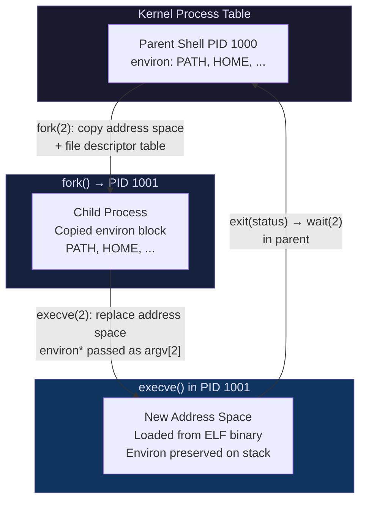
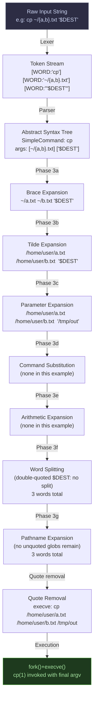
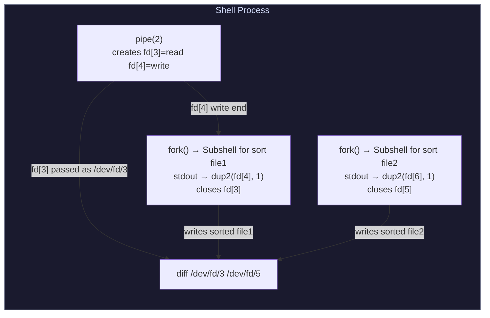
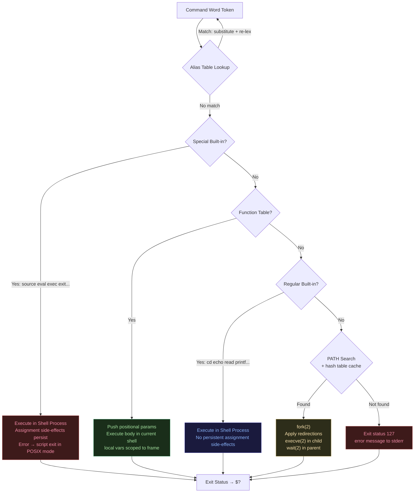

# Lesson 1: Execution Model, Parsing, and Command Types

## 1. First-Principles Intuition and Invariants

The Bourne Again Shell (Bash) is a command interpreter that mediates between human intent and the POSIX process execution model. Architecturally, it is a recursive descent parser coupled to a process orchestration engine that transforms textual input into a process graph. Every command triggers a deterministic, multi-phase transformation pipeline: raw character streams pass through lexical tokenization, syntactic parsing, semantic expansion, and finally into `fork(2)` and `execve(2)` system calls that instantiate processes in the kernel's process table.

Several inviolable invariants govern this model. Bash inherits its process environment from its parent at initialization, receiving an environment block—a null-terminated array of `KEY=value` strings located in the initial stack frame of the process image—and three open file descriptors: stdin (fd 0), stdout (fd 1), and stderr (fd 2). Every command executes within an environment that may be modified by variable assignments, redirections, and subshell invocations, but these modifications follow strict scoping rules that preserve isolation between invocations. The shell maintains a deterministic transformation order that eliminates ambiguity: tokenization precedes expansion, expansion precedes word splitting, word splitting precedes pathname globbing. This ordering is not arbitrary convention; it reflects the semantic requirement that the input to each phase is fully resolved before the next phase begins, preventing category errors like a glob pattern matching before variables are substituted.

### Shell Initialization Modes

When Bash starts, it enters one of four initialization modes determined by invocation flags and the nature of the parent process:

A **login shell** (invoked via `bash -l`, via `/bin/login`, or when `argv[0][0] == '-'`) sources `/etc/profile` followed by the first file found in the ordered search `~/.bash_profile`, `~/.bash_login`, `~/.profile`. This path establishes the user's complete session environment, including `PATH`, `MANPATH`, and system-wide `ulimit` policies defined in `/etc/profile.d/`.

A **non-login interactive shell** (the typical terminal emulator session) sources `/etc/bash.bashrc` (Debian/Ubuntu) or `/etc/bashrc` (Red Hat/CentOS) and then `~/.bashrc`. This path loads aliases, prompt configuration, and interactive conveniences without re-running expensive login-time initialization.

A **non-interactive shell** executing a script via `bash script.sh` bypasses all profile and rc files. No environment augmentation occurs; the script executes with whatever environment it inherits from its parent process. The variable `$-` will not contain `i` in this mode.

A **remote shell** invoked via `sshd` runs `~/.bashrc` even without a tty if the shell was started as a non-login shell and `sshd` did not allocate a pseudo-terminal. This behavior is controlled by the `SSH_CONNECTION` environment variable; Bash detects this condition and sources `~/.bashrc` to give remote commands a usable environment.

These initialization paths ensure that system-wide policies in `/etc` establish baseline security and resource limits before user customizations take effect, following the layered policy model common across Unix configuration systems.

### The Exit Code as a Control Primitive

The mathematical invariant governing command composition is the exit code: an 8-bit unsigned integer in the range `[0, 255]` returned by every process to its parent via the `wait(2)` family of system calls. By POSIX convention, `0` signifies success and any non-zero value indicates failure. The de facto standards for specific values follow `sysexits.h` from BSD: `64` for usage error (EX_USAGE), `65` for data format error (EX_DATAERR), `66` for no input (EX_NOINPUT), `126` for a command found but not executable (permission denied), `127` for command not found, and `130` for termination by SIGINT (128 + signal number 2). Bash preserves the most recent exit code in the special parameter `$?`.

Compound commands introduce aggregation rules over exit codes:

- **Pipelines** report the exit status of the rightmost command by default. With `set -o pipefail`, the pipeline returns the exit status of the rightmost command that failed non-zero, or zero if all commands succeed.
- **Logical AND** (`&&`) short-circuits on the first non-zero exit, executing subsequent commands only while the chain remains successful.
- **Logical OR** (`||`) short-circuits on the first zero exit, executing subsequent commands only while the chain continues to fail.
- **Negation** (`!`) inverts the exit status: zero becomes one and any non-zero becomes zero.

These rules transform the exit code from a simple integer into a first-class control flow primitive, enabling declarative error handling without explicit `if` statements.

### Variable Scope and the Environment Block

The execution environment is a layered construct with two distinct namespaces. Shell variables exist in the shell's internal symbol table—a hash table maintained in the shell's heap—and are accessible only within the current shell process and its subshells. Environment variables, promoted via `export`, are marshaled into the environment block passed to child processes as the third argument to `execve(2)`. This block is a contiguous region of `KEY=value\0` strings terminated by a null pointer, copied into the new process's initial stack frame.

This distinction is architecturally significant: child processes inherit a snapshot of the environment at the moment of `fork(2)`, not a live reference. Modifying an environment variable in a child process mutates only that process's private copy of the environment block. The parent is unaffected, as are sibling processes, because there is no shared memory between unrelated processes outside of explicit shared memory segments. This copy-on-fork semantic explains the most common Bash confusion: `export VAR=value` in a script does not persist after the script exits, because the assignment modifies the script's private address space, which the kernel reclaims when the process terminates.



---

## 2. Core Architecture: The Seven-Phase Parsing Pipeline

The parsing engine at Bash's core operates as a multi-phase compiler. Raw input text passes through seven distinct transformations before execution. The phases are strictly sequential; the output of each phase is the complete input to the next. This determinism is what makes Bash's behavior predictable: you can reason about any command by mentally applying each phase in order.

### Phase 1 — Tokenization (Lexical Analysis)

The lexer reads the input stream character by character, splitting it into tokens based on metacharacter boundaries. The metacharacters are: whitespace (space, tab, newline), and the operator characters `|`, `&`, `;`, `(`, `)`, `<`, `>`. The lexer maintains a quoting state machine with three states: unquoted, single-quoted, and double-quoted.

- **Single quotes**: Every character between `'` delimiters is literal. The backslash has no special meaning inside single quotes. There is no mechanism to include a literal single quote inside single-quoted text.
- **Double quotes**: Only `$`, `` ` ``, `\`, `"`, and newline retain special meaning. The backslash escapes these five characters and is otherwise literal.
- **Backslash (unquoted)**: Escapes the immediately following character, suppressing its metacharacter status. A backslash-newline pair is treated as a line continuation and removed entirely from the token stream.

Each token carries a type annotation—`WORD`, `ASSIGNMENT_WORD`, `IO_NUMBER`, or one of the operator types—and source position metadata for error reporting. The tokenizer is also responsible for detecting here-document markers (`<<`, `<<-`) and switching the lexer into a mode that reads subsequent lines as the document body until the delimiter is found.

### Phase 2 — Parsing (Syntactic Analysis)

The parser constructs an Abstract Syntax Tree (AST) from the token stream using a recursive descent strategy. The grammar is defined in POSIX Shell Command Language specification and extended by Bash. Key structural nodes:

- **Simple command**: A leaf node containing a command name, an argument list, and a list of redirect operations. Variable assignments prefixing the command (`VAR=val cmd`) are stored separately and applied to the command's environment only.
- **Pipeline**: A binary sequence where each node passes its stdout through a `pipe(2)` to the next node's stdin. The `|&` operator (Bash extension) pipes both stdout and stderr.
- **List**: A sequence of pipelines joined by `;` (sequential), `&` (asynchronous), `&&` (conditional-and), or `||` (conditional-or).
- **Compound commands**: `if`, `while`, `until`, `for`, `select`, `case`, `(( ))`, `[[ ]]`, and group commands `{ }`. These are subtrees with the keyword as root and body commands as children.
- **Coprocess**: A Bash 4.0 extension (`coproc name { cmd; }`) creating a background process with two-way communication pipes attached to array `name[0]` (read) and `name[1]` (write).

The AST faithfully represents the input's control flow structure before any expansion occurs, which is why Bash can parse the entire compound command before executing any part of it.

### Phase 3 — Expansion (Semantic Analysis)

Expansion is performed on each `WORD` token of a simple command after the AST is constructed. The seven sub-phases occur in a strict order mandated by the POSIX specification:

**3a. Brace Expansion** (Bash extension, not POSIX): Transforms `{a,b,c}` into the words `a b c` through combinatorial enumeration. Ranges like `{1..10}` and `{a..z}` are supported. Brace expansion occurs before all other expansions, so the results are not themselves subject to further brace expansion but are subject to all subsequent phases.

**3b. Tilde Expansion**: A leading `~` is replaced with `$HOME`. `~user` is replaced with the home directory of `user` as found in `/etc/passwd` via `getpwnam(3)`. The `~+` and `~-` forms expand to the values of `$PWD` and `$OLDPWD` respectively.

**3c. Parameter Expansion**: Substitutes variable references. The simple form `$VAR` or `${VAR}` performs a lookup in the symbol table. The extended forms implement a mini-language:

| Syntax | Semantics |
|---|---|
| `${VAR:-default}` | Expand to `default` if `VAR` is unset or empty |
| `${VAR:+alternate}` | Expand to `alternate` if `VAR` is set and non-empty |
| `${VAR:=default}` | Assign `default` to `VAR` if unset or empty, then expand |
| `${VAR:?message}` | Print `message` and exit if `VAR` is unset or empty |
| `${#VAR}` | String length of `VAR`'s value |
| `${VAR#pattern}` | Remove shortest prefix matching `pattern` |
| `${VAR##pattern}` | Remove longest prefix matching `pattern` |
| `${VAR%pattern}` | Remove shortest suffix matching `pattern` |
| `${VAR%%pattern}` | Remove longest suffix matching `pattern` |
| `${VAR/pat/repl}` | Replace first match of `pat` with `repl` |
| `${VAR//pat/repl}` | Replace all matches of `pat` with `repl` |
| `${VAR:offset:length}` | Substring extraction |
| `${!prefix*}` | Names of variables matching prefix |
| `${VAR@Q}` | Value quoted for reuse as shell input (Bash 4.4+) |
| `${VAR@A}` | Assignment statement that recreates the variable (Bash 4.4+) |

**3d. Command Substitution**: `$(command)` or the legacy `` `command` `` form forks a subshell, executes `command`, captures its stdout, strips trailing newlines, and substitutes the result. The `$(...)` form nests correctly without escaping; `` `...` `` requires backslash escaping for nested invocations.

**3e. Arithmetic Expansion**: `$(( expression ))` evaluates a C-style integer expression in base 10 (or in the base specified by `base#digits` notation). Supported operators include the full C arithmetic, bitwise (`&`, `|`, `^`, `~`, `<<`, `>>`), comparison (`<`, `>`, `<=`, `>=`, `==`, `!=`), logical (`&&`, `||`, `!`), ternary (`? :`), and assignment (`=`, `+=`, `-=`, etc.). The result is a decimal string. Integer overflow wraps silently at 64-bit signed boundaries on 64-bit platforms.

**3f. Word Splitting**: Expansion results (from phases 3c, 3d, 3e) that are not enclosed in double quotes are split on characters in `$IFS` (Internal Field Separator). The default IFS is space-tab-newline. IFS splitting has non-obvious behavior: leading and trailing IFS whitespace characters are suppressed (they do not create empty fields), and multiple consecutive IFS whitespace characters are treated as a single separator. Non-whitespace IFS characters each create a split point, including when adjacent to whitespace, and can produce empty fields. Setting `IFS=` (empty) disables word splitting entirely.

**3g. Pathname Expansion (Globbing)**: Each word remaining after splitting is treated as a glob pattern if it contains unquoted `*`, `?`, or `[`. Bash uses `glob(3)` semantics: `*` matches any sequence of characters except `/`, `?` matches any single character except `/`, and `[...]` matches a character class. With `globstar` enabled (`shopt -s globstar`), `**` matches any sequence of characters including `/`, enabling recursive globbing. If no files match and `nullglob` is not set, the pattern is left unchanged. If `failglob` is set, an unmatched pattern produces an error. If `nullglob` is set, unmatched patterns expand to nothing (zero words).

After all expansions, **Quote Removal** strips the remaining quoting characters (`'`, `"`, `\`) that have not already been consumed by the expansion phases. These characters protected their contents during expansion but have no meaning to the executed command.



### Phase 4 — Execution

The execution phase dispatches commands based on their classified type (covered in depth in Section 3). For external commands, the sequence is:

1. `fork(2)`: The kernel creates a copy of the shell process. File descriptor tables are duplicated. The child and parent share the same code, data, and stack pages with copy-on-write semantics until either modifies them.
2. Redirection: The child process applies all redirect operations in left-to-right order using `open(2)`, `dup2(2)`, and `close(2)`, wiring up the file descriptor table before the new executable starts.
3. `execve(2)`: The child replaces its address space with the target executable. The kernel reads the ELF header, maps the `.text` and `.data` segments, invokes the dynamic linker `ld.so` to resolve shared library dependencies, and transfers control to the entry point. The environment block and argument vector are preserved across `execve`.
4. `wait(2)` / `waitpid(2)`: The parent blocks until the child changes state, collecting the exit status encoded in the `wstatus` integer via the `WEXITSTATUS`, `WIFSIGNALED`, and related macros.

For pipelines, Bash creates all required pipes before forking any processes, then forks each stage in sequence. Each child inherits the appropriate pipe ends and closes all unused file descriptors to ensure clean EOF propagation. The parent closes its copies of all pipe ends and waits for all stages to complete.

---

## 3. Redirection: File Descriptor Mechanics

Redirection operators transform the file descriptor table of the target process before `execve`. They execute in left-to-right order, and this ordering is semantically significant.

The canonical example illustrating the left-to-right rule is `2>&1 > file` versus `> file 2>&1`:

```bash
# Wrong order: stderr still goes to the original stdout (the terminal)
cmd 2>&1 > file

# Correct order: stdout redirected to file first, then stderr duplicated to
# the now-file-pointing stdout
cmd > file 2>&1
```

In the first form, `2>&1` duplicates the current stdout (the terminal) into fd 2 before stdout is redirected to `file`. In the second form, stdout is first redirected to `file`, and then fd 2 is duplicated from the now-file-pointing fd 1. The file descriptor table is stateful; each operation reads and modifies it in sequence.

The full set of redirect operators:

| Operator | Semantics | Underlying Syscall |
|---|---|---|
| `< file` | Open `file` for reading on stdin | `open(file, O_RDONLY)` + `dup2(fd,0)` |
| `> file` | Create/truncate `file` on stdout | `open(file, O_WRONLY\|O_CREAT\|O_TRUNC, 0666)` |
| `>> file` | Append to `file` on stdout | `open(file, O_WRONLY\|O_CREAT\|O_APPEND, 0666)` |
| `>& file` | Redirect stdout and stderr | Opens `file`, dups to 1 and 2 |
| `N> file` | Redirect fd `N` to `file` | `open` + `dup2(fd, N)` |
| `N>&M` | Duplicate fd `M` to fd `N` | `dup2(M, N)` |
| `N>&-` | Close fd `N` | `close(N)` |
| `<< DELIM` | Here-document: stdin from embedded text | `pipe(2)` + write body to write end |
| `<<- DELIM` | Here-document with leading tab stripping | Same as above |
| `<<< word` | Here-string: stdin from expanded word | Temporary file or pipe |
| `<> file` | Open `file` for reading and writing on stdin | `open(file, O_RDWR\|O_CREAT, 0666)` |

**Here-documents** are implemented by writing the document body to a temporary file (or pipe), then opening that file and duplicating the read end onto stdin before the child executes. The delimiter word is not subject to expansion if any part of it is quoted; if unquoted, parameter expansion, command substitution, and arithmetic expansion occur within the document body.

**Process substitution** (`<(cmd)` and `>(cmd)`) is a Bash extension with no POSIX equivalent. On Linux, it is implemented using `/dev/fd/N` paths backed by anonymous pipes. Bash forks a subshell to run `cmd`, wires the appropriate pipe end to a known file descriptor number, and substitutes the string `/dev/fd/N` into the command line. The receiving command opens this path and receives data from (or sends data to) the subshell through the kernel pipe buffer. On macOS, the same mechanism uses named FIFOs in `/tmp` on older systems, or `/dev/fd` on newer ones.



---

## 4. Command Types and Dispatch Mechanics

Bash recognizes five fundamental command types. The classification of a command determines whether it can modify the current shell's state, how it interacts with the process table, and how its exit status propagates through compound structures.

### 4.1 Special Built-in Commands (POSIX)

POSIX designates a subset of built-ins as "special" because their integration with shell control flow is too tight for them to be external utilities. Special built-ins are: `. (source)`, `break`, `:`, `continue`, `eval`, `exec`, `exit`, `export`, `readonly`, `return`, `set`, `shift`, `times`, `trap`, `unset`.

Their special status has two consequences. First, in POSIX strict mode (`set -o posix`), a failed special built-in causes the script to terminate immediately, even without `set -e`. Second, variable assignments prefixing a special built-in persist in the current shell environment after the command completes, while assignments prefixing a regular built-in or external command are scoped to that command's execution only.

```bash
# Assignment scoped to the command (POSIX behavior for regular commands)
FOO=bar env | grep FOO   # FOO visible inside env, not after

# Assignment persists (POSIX behavior for special built-ins)
FOO=bar export BAR=baz   # FOO remains set in shell after this line
```

The `eval` special built-in deserves particular attention. It concatenates its arguments with spaces and re-submits the result as input to the shell, beginning again at the tokenization phase. This makes `eval` a complete second pass through the parsing pipeline, with all associated security risks: untrusted input passed to `eval` can execute arbitrary commands. The only legitimate use cases for `eval` are dynamic variable name access (largely superseded by `${!varname}` indirect expansion and `declare`/`nameref` in Bash 4.3+) and constructing commands from components that cannot be pre-determined at parse time.

### 4.2 Regular Built-in Commands

Regular built-ins execute within the shell process but do not carry the special error semantics. This category includes `alias`, `bg`, `bind`, `builtin`, `caller`, `cd`, `command`, `compgen`, `complete`, `compopt`, `declare`, `dirs`, `disown`, `echo`, `enable`, `false`, `fc`, `fg`, `getopts`, `hash`, `help`, `history`, `jobs`, `kill`, `let`, `local`, `logout`, `mapfile` (`readarray`), `popd`, `printf`, `pushd`, `pwd`, `read`, `source`, `test` (`[`), `true`, `type`, `typeset`, `ulimit`, `umask`, `unalias`, `wait`.

The critical built-ins that *must* be built-in due to their state-modification semantics are `cd` (calls `chdir(2)` in the shell process), `export` and `unset` (modify the symbol table), `source`/`.` (executes a file in the current context), `read` (reads from the shell's stdin into the symbol table), and `umask` (calls `umask(2)` in the shell process).

The `declare` built-in (aliased as `typeset`) is more powerful than it appears. It creates variables with type attributes:

```bash
declare -i counter=0        # Integer: arithmetic context, no need for $(( ))
declare -r CONST="immutable" # Readonly
declare -a arr=(a b c)      # Indexed array
declare -A map               # Associative array (hash map), Bash 4.0+
declare -n ref=other_var    # Nameref: alias to another variable, Bash 4.3+
declare -x VAR              # Export (equivalent to export VAR)
declare -f func_name        # Print function definition
declare -p var_name         # Print variable with declare syntax (useful for serialization)
```

The `declare -n` nameref is the correct modern solution for indirect variable references, replacing most `eval` uses:

```bash
# Modern: nameref for indirect reference
function set_var() {
    local -n _target="$1"   # _target is an alias for the variable named in $1
    _target="$2"
}
set_var MY_VAR "hello"
echo "$MY_VAR"  # prints: hello

# Old pattern requiring eval (avoid this)
function set_var_old() {
    eval "$1=\"\$2\""
}
```

### 4.3 Shell Functions

Functions are user-defined compound commands stored in the shell's function table. They are defined with two equivalent syntaxes:

```bash
function name {    # Bash extension
    body
}

name() {           # POSIX-compatible
    body
}
```

When invoked, Bash pushes a new frame for positional parameters, binding `$0` to the function name (or the script name if `$0` is not set), `$1`..`$N` to the arguments, and `$#` to the argument count. The function body executes in the calling shell's scope: functions share and can modify the caller's shell variables unless `local` is used. `local` creates a lexically-scoped binding that shadows the outer variable and is destroyed on function return.

A subtle but important invariant: functions do **not** create a subshell. They run in the current shell process. This is what makes them useful for state modification. Placing a function call in a pipeline *does* create a subshell for that pipeline stage:

```bash
count=0
increment() { count=$((count + 1)); }

increment             # count is now 1 — runs in current shell
increment | cat       # count remains 1 — the pipeline creates a subshell for increment
```

The `FUNCNAME` array tracks the call stack: `${FUNCNAME[0]}` is the current function, `${FUNCNAME[1]}` is its caller, and so on. Combined with `${BASH_SOURCE[N]}` and `${BASH_LINENO[N]}`, this enables precise stack trace generation in error handlers.

### 4.4 External Commands

External commands are executables found by searching `$PATH`, a colon-delimited ordered list of directories. When Bash encounters a command name matching no alias, special built-in, function, or regular built-in, it iterates through `PATH` entries, testing each `directory/name` combination for executability via `access(2)` with `X_OK`. The first match wins.

The `PATH` lookup result is cached in a hash table (viewable via `hash -l`). Cache invalidation occurs automatically when `PATH` is modified or explicitly via `hash -r` (flush all) or `hash -d name` (flush one entry). This cache avoids repeated filesystem traversals for frequently used commands.

After finding the executable path, the execution sequence is:

1. `fork(2)` creates a child process with a copy of the shell's file descriptor table and environment block.
2. In the child, redirections are applied via `open(2)`, `dup2(2)`, and `close(2)`.
3. `execve(2)` is called with `(path, argv, envp)`. The kernel reads the ELF header, validates the architecture and ABI, maps program headers into virtual memory, and invokes the program interpreter specified in the `PT_INTERP` segment (typically `/lib64/ld-linux-x86-64.so.2`).
4. The dynamic linker resolves `DT_NEEDED` shared library dependencies, applies relocations, and calls each library's `DT_INIT` functions before transferring control to `_start`, which calls `main()`.
5. The parent calls `waitpid(2)` with the child's PID, blocking until the child exits or is killed by a signal.

For scripts (files with a `#!` shebang line), the kernel's `binfmt` handler reads the interpreter path from the first line, invokes that interpreter (`/bin/bash`, `/usr/bin/python3`, etc.) as the external command, and passes the script file path as the first argument. The script interpreter itself is loaded via the ELF mechanism above. For scripts without a shebang, Bash invokes itself as a subshell interpreter, treating the file as a Bash script regardless of content.

### 4.5 Aliases

Aliases are textual substitutions performed during tokenization, before any parsing or expansion occurs. They are defined with `alias name='replacement text'`. When the first word of a simple command matches a defined alias, Bash replaces it with the alias value and re-processes the resulting token stream. If the alias value ends with a space or tab, the word following the alias is also checked for alias substitution, enabling chaining like `alias sudo='sudo '` to allow alias expansion after `sudo`.

Alias expansion is suppressed when:
- The shell is not interactive and `expand_aliases` has not been explicitly set with `shopt -s expand_aliases`.
- The command word is quoted in any way.
- The `builtin` or `command` built-in precedes the name.

Because alias expansion occurs at parse time—not at execution time—aliases defined within a function body are not visible to code that called the function unless that code was parsed after the alias was defined. This makes aliases unreliable for use in scripts. Functions are the correct mechanism for command wrapping in scripts.

### 4.6 Compound Commands

Compound commands aggregate simple commands into control flow structures. They are first-class command objects: they produce an exit status, support I/O redirection on the compound structure as a whole, and can appear in pipelines and logical lists.

The `[[ ]]` construct (Bash extension) is a compound command that evaluates conditional expressions. It differs critically from `[ ]` (`test`): within `[[ ]]`, word splitting and pathname expansion are suppressed on the right-hand side of comparisons, the `=~` operator performs regex matching (capturing groups available in `${BASH_REMATCH[@]}`), and `&&`/`||` are parsed as logical operators rather than list operators.

```bash
# [[ ]] advantages over [ ]
file="/path/to/my file.txt"
[[ -f $file ]] && echo "exists"    # No quoting needed: no word splitting inside [[ ]]
[[ $file = *.txt ]] && echo "text" # Glob match without pathname expansion
[[ $file =~ ^/path/to/(.*) ]] && echo "captured: ${BASH_REMATCH[1]}"
```

The `(( ))` compound command evaluates an arithmetic expression and returns exit status 0 if the result is non-zero, 1 if zero—analogous to C's truthiness convention. This makes it natural for loop counters and numeric tests:

```bash
for (( i = 0; i < 10; i++ )); do
    echo "$i"
done

(( count > 0 )) || { echo "empty" >&2; exit 1; }
```



---

## 5. Pipeline Internals and Concurrency

A pipeline `cmd1 | cmd2 | cmd3` is not a sequential structure; all stages run concurrently as separate processes. Bash creates `N-1` pipes for `N` pipeline stages before forking any child, ensuring all pipe file descriptors exist before they need to be inherited.

For the three-stage pipeline above, the sequence is:

1. Create pipe P1: `pipe(P1)` → `P1[0]` (read), `P1[1]` (write).
2. Create pipe P2: `pipe(P2)` → `P2[0]` (read), `P2[1]` (write).
3. Fork child 1 (cmd1): `dup2(P1[1], 1)`, close `P1[0]`, `P1[1]`, `P2[0]`, `P2[1]`, then `execve(cmd1)`.
4. Fork child 2 (cmd2): `dup2(P1[0], 0)`, `dup2(P2[1], 1)`, close all pipe fds, then `execve(cmd2)`.
5. Fork child 3 (cmd3): `dup2(P2[0], 0)`, close all pipe fds, then `execve(cmd3)`.
6. Parent closes all pipe fds (critical: triggers EOF in readers when writers exit).
7. Parent calls `waitpid` for all three children.

The pipe buffer on Linux is 65,536 bytes (64 KiB) by default, configurable up to 1 MiB via `fcntl(F_SETPIPE_SZ)`. When a writer fills the buffer, the kernel suspends it via `write(2)` returning `EAGAIN` (non-blocking) or blocking until the reader drains data. This automatic flow control prevents unbounded memory consumption and is the mechanism that makes pipelines safe for arbitrarily large data streams.

**Pipeline subshell implication**: because each stage is a separate process, variable assignments in any pipeline stage are invisible to the parent shell and to sibling stages after they complete. This is the most common source of Bash bugs in beginner scripts:

```bash
# Bug: 'total' is modified in a subshell created by the pipeline
total=0
grep "ERROR" logfile.txt | while IFS= read -r line; do
    total=$((total + 1))
done
echo "Found $total errors"  # Always prints 0

# Fix: use process substitution so 'while' runs in the current shell
total=0
while IFS= read -r line; do
    total=$((total + 1))
done < <(grep "ERROR" logfile.txt)
echo "Found $total errors"  # Correct count
```

The `< <(cmd)` construct feeds the while loop from a process substitution. The `while` loop is not in a pipeline; it receives data through a file descriptor that happens to be backed by a pipe, running entirely in the current shell's process context.

---

## 6. Practical Synthesis: Production-Grade Patterns

The following patterns represent canonical solutions to problems that appear repeatedly in production shell scripting. Each exploits specific properties of the execution model described above.

### Robust Script Header

Every production script should begin with a consistent set of safety options:

```bash
#!/usr/bin/env bash
# Abort on error, unset variable access, and pipeline failures
set -euo pipefail
# Prevent glob patterns from silently expand to themselves when no match
shopt -s failglob
# Inherit ERR trap into functions and subshells
set -E

# Custom PS4 for debug tracing with timestamps and source location
export PS4='+ [${BASH_SOURCE[0]##*/}:${LINENO}] '
```

The interactions between these options matter:

- `set -e` aborts the script when any simple command returns non-zero, with exceptions: commands in `if` conditions, after `!`, in `&&`/`||` lists, or in a `while`/`until` test are not subject to `set -e`.
- `set -u` treats unset variable expansion (other than `$*`, `$@`, `$#`) as an error. Use `${VAR:-}` or `${VAR:-default}` to provide defaults where emptiness is acceptable.
- `set -o pipefail` makes the pipeline exit status the value of the last failed stage. Combine with `set -e` to abort on pipeline failures.
- `set -E` (uppercase) causes `ERR` traps to be inherited by functions and subshells, making error traps reliable in complex scripts.

### Signal Handling and Cleanup

```bash
#!/usr/bin/env bash
set -euo pipefail

# Associative array of temporary resources for cleanup
declare -A TEMP_FILES=()
declare -A TEMP_DIRS=()

cleanup() {
    local exit_code=$?
    # Remove all registered temporary files
    for key in "${!TEMP_FILES[@]}"; do
        [[ -f "${TEMP_FILES[$key]}" ]] && rm -f -- "${TEMP_FILES[$key]}"
    done
    # Remove all registered temporary directories
    for key in "${!TEMP_DIRS[@]}"; do
        [[ -d "${TEMP_DIRS[$key]}" ]] && rm -rf -- "${TEMP_DIRS[$key]}"
    done
    exit "$exit_code"
}

# Register cleanup for all exit conditions
trap cleanup EXIT

# Register SIGINT and SIGTERM to perform cleanup then re-raise signal
# so the parent process receives the correct termination signal
trap 'trap - INT; kill -INT $$' INT
trap 'trap - TERM; kill -TERM $$' TERM

# Register a temporary file and ensure it is cleaned up
make_tempfile() {
    local -n _result_ref="$1"       # nameref to caller's variable
    local tmpfile
    tmpfile="$(mktemp --suffix=".$$")"
    TEMP_FILES["$tmpfile"]="$tmpfile"
    _result_ref="$tmpfile"
}

make_tempfile WORK_FILE
echo "working in $WORK_FILE"
```

The `trap 'trap - INT; kill -INT $$' INT` pattern is correct signal re-raising: it first removes the trap (preventing infinite recursion), then sends the signal to the current process. The shell's default action for SIGINT (128+2=130) will then apply, and the parent process receives a killed-by-signal notification rather than a clean exit, allowing proper `pipefail` and exit status handling in callers.

### Efficient String Processing Without Subprocesses

Parameter expansion eliminates most common string processing needs without spawning external processes:

```bash
#!/usr/bin/env bash
set -euo pipefail

# --- Path manipulation ---
filepath="/var/log/app/service.log.gz"

filename="${filepath##*/}"        # service.log.gz  (strip longest prefix up to /)
dirname="${filepath%/*}"          # /var/log/app    (strip shortest suffix from /)
extension="${filename##*.}"       # gz              (strip longest prefix up to .)
basename="${filename%.*}"         # service.log     (strip shortest suffix from .)
stem="${filename%%.*}"            # service         (strip longest suffix from .)

# --- Case conversion (Bash 4.0+) ---
upper="${filename^^}"             # SERVICE.LOG.GZ
lower="${filename,,}"             # service.log.gz
capitalize="${filename^}"         # Service.log.gz
toggle="${filename~~}"            # Toggles each character's case

# --- Substring operations ---
str="Hello, World!"
echo "${str:7:5}"                 # World  (offset 7, length 5)
echo "${str: -6}"                 # World! (negative offset from end)
echo "${#str}"                    # 13     (string length)

# --- Pattern replacement ---
csv="one,two,three,four"
echo "${csv//,/ }"                # one two three four
echo "${csv/,/:}"                 # one:two,three,four (first match only)

# --- Benchmarking the difference ---
# This loop takes ~25 seconds with sed, ~0.1 seconds with parameter expansion
time (
    for i in {1..10000}; do
        s="prefix_${i}_suffix"
        # Slow path (do not use):
        # result=$(echo "$s" | sed 's/^prefix_//' | sed 's/_suffix$//')

        # Fast path: two parameter expansions, zero forks
        result="${s#prefix_}"
        result="${result%_suffix}"
    done
)
```

### Associative Arrays for Structured Data

Bash 4.0 associative arrays (`declare -A`) provide hash-map semantics and eliminate many use cases for `awk` or Python glue scripts:

```bash
#!/usr/bin/env bash
set -euo pipefail
declare -A config

# Load a simple KEY=VALUE config file into an associative array
load_config() {
    local config_file="$1"
    local -n _config_ref="$2"   # nameref to the associative array
    local key value line

    while IFS='=' read -r key value || [[ -n "$key" ]]; do
        # Strip comments and blank lines
        [[ "$key" =~ ^[[:space:]]*# ]] && continue
        [[ -z "${key// }" ]] && continue
        # Strip leading/trailing whitespace from key and value
        key="${key#"${key%%[![:space:]]*}"}"
        key="${key%"${key##*[![:space:]]}"}"
        value="${value#"${value%%[![:space:]]*}"}"
        value="${value%"${value##*[![:space:]]}"}"
        _config_ref["$key"]="$value"
    done < "$config_file"
}

load_config "/etc/myapp/config" config

# Access and default handling
db_host="${config[DB_HOST]:-localhost}"
db_port="${config[DB_PORT]:-5432}"

# Iterate over all keys
for key in "${!config[@]}"; do
    printf '%s = %s\n' "$key" "${config[$key]}"
done | sort
```

### Parallel Execution with Job Control

```bash
#!/usr/bin/env bash
set -euo pipefail

# Process a list of items in parallel, bounded to MAX_JOBS concurrent workers
MAX_JOBS=8
declare -a pids=()

process_item() {
    local item="$1"
    # Simulate work
    sleep "$((RANDOM % 3 + 1))"
    echo "Processed: $item"
}

wait_for_slot() {
    # Block until the number of running jobs drops below MAX_JOBS
    while (( ${#pids[@]} >= MAX_JOBS )); do
        local new_pids=()
        for pid in "${pids[@]}"; do
            if kill -0 "$pid" 2>/dev/null; then
                new_pids+=("$pid")
            else
                wait "$pid" || {
                    echo "Job $pid failed with status $?" >&2
                }
            fi
        done
        pids=("${new_pids[@]+"${new_pids[@]}"}")
        (( ${#pids[@]} >= MAX_JOBS )) && sleep 0.1
    done
}

items=(apple banana cherry date elderberry fig grape honeydew
       imbe jackfruit kiwi lemon mango nectarine orange papaya)

for item in "${items[@]}"; do
    wait_for_slot
    process_item "$item" &
    pids+=($!)
done

# Wait for all remaining jobs
for pid in "${pids[@]+"${pids[@]}"}"; do
    wait "$pid" || echo "Job $pid failed" >&2
done

echo "All items processed"
```

### Defensive Argument Parsing with getopts

```bash
#!/usr/bin/env bash
set -euo pipefail

PROGRAM="${0##*/}"

usage() {
    cat >&2 <<EOF
Usage: $PROGRAM [OPTIONS] <input_file>

Options:
  -o <output>   Output file (default: stdout)
  -v            Verbose mode
  -n <count>    Process at most <count> lines (default: unlimited)
  -h            Show this help

EOF
    exit "${1:-1}"
}

OUTPUT=""
VERBOSE=0
MAX_LINES=0

while getopts ":o:vn:h" opt; do
    case "$opt" in
        o) OUTPUT="$OPTARG" ;;
        v) VERBOSE=1 ;;
        n)
            [[ "$OPTARG" =~ ^[0-9]+$ ]] || {
                echo "$PROGRAM: -n requires a non-negative integer, got: $OPTARG" >&2
                usage 64   # EX_USAGE from sysexits.h
            }
            MAX_LINES="$OPTARG"
            ;;
        h) usage 0 ;;
        :) echo "$PROGRAM: option -$OPTARG requires an argument" >&2; usage ;;
        \?) echo "$PROGRAM: unknown option -$OPTARG" >&2; usage ;;
    esac
done
shift $((OPTIND - 1))

(( $# == 1 )) || { echo "$PROGRAM: exactly one input file required" >&2; usage; }
INPUT_FILE="$1"
[[ -f "$INPUT_FILE" && -r "$INPUT_FILE" ]] || {
    echo "$PROGRAM: cannot read file: $INPUT_FILE" >&2
    exit 66   # EX_NOINPUT
}

(( VERBOSE )) && printf '[%s] Processing %s → %s\n' \
    "$(date -Iseconds)" "$INPUT_FILE" "${OUTPUT:-stdout}" >&2
```

### Logging with Severity Levels

```bash
#!/usr/bin/env bash

# Logging infrastructure with severity, timestamps, and optional color
declare -A LOG_LEVELS=([DEBUG]=0 [INFO]=1 [WARN]=2 [ERROR]=3 [FATAL]=4)
LOG_LEVEL="${LOG_LEVEL:-INFO}"
LOG_COLOR="${LOG_COLOR:-auto}"

_log() {
    local level="$1"; shift
    local message="$*"
    local timestamp
    timestamp="$(date '+%Y-%m-%dT%H:%M:%S%z')"

    # Check if this level should be emitted
    (( ${LOG_LEVELS[$level]:-0} >= ${LOG_LEVELS[$LOG_LEVEL]:-1} )) || return 0

    # Determine color based on LOG_COLOR setting and tty detection
    local color="" reset=""
    if [[ "$LOG_COLOR" == "always" ]] || \
       [[ "$LOG_COLOR" == "auto" && -t 2 ]]; then
        case "$level" in
            DEBUG) color='\033[0;37m' ;;    # Gray
            INFO)  color='\033[0;32m' ;;    # Green
            WARN)  color='\033[0;33m' ;;    # Yellow
            ERROR) color='\033[0;31m' ;;    # Red
            FATAL) color='\033[1;31m' ;;    # Bold Red
        esac
        reset='\033[0m'
    fi

    printf "${color}%s [%-5s] [%s:%s] %s${reset}\n" \
        "$timestamp" \
        "$level" \
        "${BASH_SOURCE[2]##*/}" \
        "${BASH_LINENO[1]}" \
        "$message" >&2
}

log_debug() { _log DEBUG "$@"; }
log_info()  { _log INFO  "$@"; }
log_warn()  { _log WARN  "$@"; }
log_error() { _log ERROR "$@"; }
log_fatal() { _log FATAL "$@"; exit 1; }

# Usage:
# LOG_LEVEL=DEBUG LOG_COLOR=always ./script.sh
```

### Line-by-Line File Processing: The Canonical Form

The `while read` idiom is the idiomatic way to process a file or command output line-by-line. The correct form handles all edge cases:

```bash
#!/usr/bin/env bash
set -euo pipefail

process_file() {
    local input_file="$1"
    local line_number=0

    # IFS='' prevents leading/trailing whitespace stripping
    # -r prevents backslash interpretation
    # || [[ -n "$line" ]] handles files without a final newline
    while IFS='' read -r line || [[ -n "$line" ]]; do
        (( ++line_number ))
        # Process $line here
        printf '%6d: %s\n' "$line_number" "$line"
    done < "$input_file"
}

# Process output of a command while keeping variable state in current shell
declare -i total_size=0
while IFS='' read -r filepath; do
    [[ -f "$filepath" ]] || continue
    size=$(stat -c '%s' -- "$filepath")
    total_size+=$size
done < <(find /var/log -name '*.log' -type f)

echo "Total log size: $total_size bytes"
```

The three elements of the canonical form serve distinct purposes:
- `IFS=''`: empty IFS prevents `read` from stripping leading and trailing whitespace characters from the line.
- `-r`: prevents `read` from treating backslashes as escape sequences.
- `|| [[ -n "$line" ]]`: handles the case where the last line of a file does not end with a newline. Without this, the final line is silently discarded because `read` returns non-zero at EOF even when it has read partial content.

---

## 7. Debugging and Introspection

Bash provides a rich set of introspection facilities that enable production-quality debugging without external tools.

### Execution Tracing

```bash
# Enable xtrace with rich context
export PS4='+ ${BASH_SOURCE[0]##*/}:${BASH_LINENO[0]}:${FUNCNAME[0]:+${FUNCNAME[0]}(): }'
set -x

# Selectively trace a section
{
    set -x
    critical_function "$arg"
    set +x
} 2> trace.log
```

The `PS4` variable defines the prompt printed before each traced command. Using `${BASH_SOURCE[0]##*/}` (script basename), `${BASH_LINENO[0]}` (current line), and `${FUNCNAME[0]}` (current function) provides enough context to locate any traced line in the source without an external debugger.

### Call Stack Introspection

```bash
print_stack_trace() {
    local frame=0
    echo "Stack trace:" >&2
    while caller "$frame" >/dev/null 2>&1; do
        local line file func
        read -r line func file <<< "$(caller "$frame")"
        printf '  #%d  %s() at %s:%d\n' "$frame" "$func" "${file##*/}" "$line" >&2
        (( frame++ ))
    done
}

# Install as ERR trap for automatic stack traces on failure
trap 'print_stack_trace' ERR
```

The `caller` built-in returns the line number, function name, and source file of the specified call frame, enabling full stack traces identical in structure to those from compiled languages.

### Performance Profiling

```bash
# Measure wall-clock time for a section of code
# Using $EPOCHREALTIME (Bash 5.0+) for sub-second precision
profile_start() {
    declare -g "_PROFILE_START_${1}=${EPOCHREALTIME}"
}

profile_end() {
    local name="$1"
    local start_var="_PROFILE_START_${name}"
    local start="${!start_var}"
    local elapsed
    elapsed=$(awk "BEGIN { printf \"%.6f\", ${EPOCHREALTIME} - ${start} }")
    printf '[PERF] %s: %.6fs\n' "$name" "$elapsed" >&2
}

profile_start "db_query"
run_expensive_operation
profile_end "db_query"
```

`$EPOCHREALTIME` (Bash 5.0+) provides microsecond-resolution wall-clock time as a floating-point number. For coarser timing on older Bash, `$SECONDS` provides elapsed integer seconds since shell startup.

---

## 8. Command Precedence, PATH Security, and Trust Hierarchy

The command dispatch precedence is:

1. Aliases (tokenization phase, interactive shells only by default)
2. Special built-ins (POSIX-designated, cannot be overridden)
3. Functions
4. Regular built-ins
5. External commands via `PATH`

This hierarchy has direct security implications. Because functions shadow external commands at step 3, an attacker who can inject function definitions into the shell's environment—the Shellshock vulnerability (CVE-2014-6271) exploited precisely this vector by encoding function definitions in environment variable values—can hijack any external command. The fix (Bash 4.3 patch) restricts function import from the environment to names matching `BASH_FUNC_name%%` encoding.

`PATH` ordering is a persistent attack surface. If `PATH` includes `.` (current directory) or empty components (caused by leading/trailing/double colons in `PATH`), a malicious executable in the current directory can shadow system commands. Production scripts should always sanitize `PATH`:

```bash
# Establish a minimal, known-good PATH at the start of security-sensitive scripts
export PATH='/usr/local/sbin:/usr/local/bin:/usr/sbin:/usr/bin:/sbin:/bin'
```

The `command` built-in bypasses function and alias lookup, executing the named regular built-in or external command directly:

```bash
# Explicitly invoke the external 'ls', not a user-defined 'ls' function
command ls -la

# Check if a command exists as an external executable or built-in,
# without running it (more reliable than 'which' in scripts)
command -v git >/dev/null 2>&1 || { echo "git required but not found" >&2; exit 127; }
```

The `builtin` built-in similarly restricts lookup to built-ins only, bypassing functions:

```bash
# Call the real 'cd' even if a function named 'cd' exists in scope
builtin cd /tmp
```

---

## Conceptual Summary

Bash's execution model is not incidental complexity; it is a faithful implementation of Unix process semantics layered with a convenience language. Every design decision traces to kernel primitives: the fork-exec-wait model, copy-on-fork address spaces, file descriptor inheritance, and pipe-based IPC. The seven-phase parsing pipeline transforms text into process graphs deterministically. The command type hierarchy balances performance (built-ins avoid fork overhead), extensibility (functions and aliases), and composability (external commands as independent processes). Mastery of this model enables the transition from writing scripts that happen to work to writing scripts that work because their structure matches the underlying system semantics.
