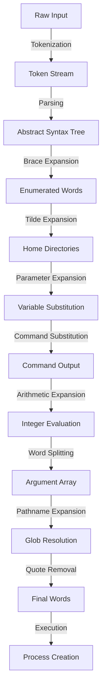
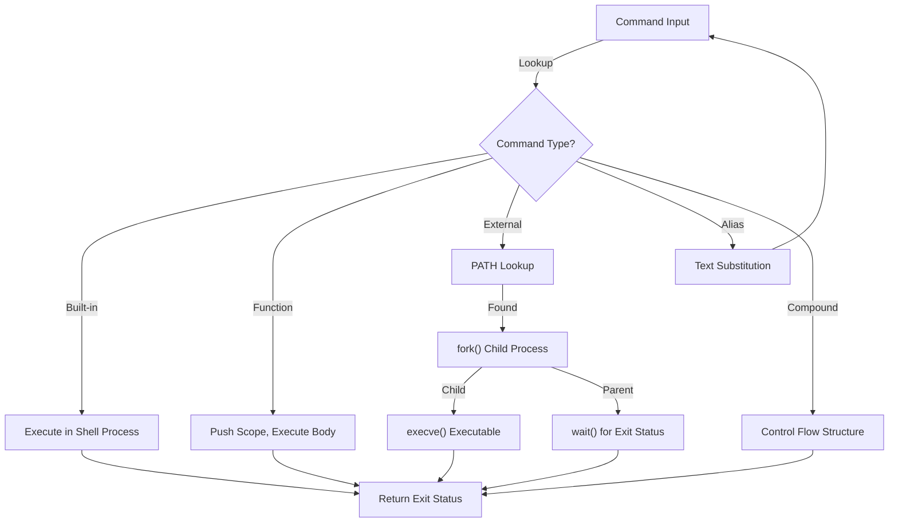

# Lesson 1: Execution Model, Parsing, Command Types

## 1. First-Principles Intuition & Invariants

The Bourne Again Shell operates as a command interpreter mediating between human intent and the POSIX process execution model. At its foundation, Bash is a recursive descent parser coupled with a process orchestration engine that transforms textual input into executable process graphs. Understanding Bash's execution model requires recognizing that every command triggers a multi-phase transformation pipeline: from raw character streams through lexical tokenization, syntactic parsing, semantic expansion, and finally into `fork()` and `execve()` system calls that instantiate processes in the kernel's process table.

Several inviolable invariants govern the shell's execution model. Bash inherits its process environment from its parent at initialization, receiving an environment block—a null-terminated array of `key=value` strings—and three standard file descriptors: stdin as fd 0, stdout as fd 1, and stderr as fd 2. This inheritance establishes the foundational execution context. Every command executes within an environment that may be modified by variable assignments, redirections, and subshell invocations, but these modifications follow strict scoping rules that preserve isolation between command invocations. The shell maintains a deterministic parsing order that eliminates ambiguity: tokenization precedes expansion, expansion precedes word splitting, and word splitting precedes pathname globbing. This ordering reflects decades of Unix philosophy crystallized into a parsing state machine that prioritizes predictability over expressiveness.

When Bash starts, it enters one of four distinct initialization modes determined by invocation flags and the nature of the parent process. A login shell—invoked with `-l` or when `argv[0]` begins with a hyphen—reads `/etc/profile` followed by the first found file among `~/.bash_profile`, `~/.bash_login`, and `~/.profile`, establishing the user's working environment for an entire session. A non-login interactive shell, the typical terminal session, sources `/etc/bash.bashrc` and `~/.bashrc`, loading command aliases, prompt customization, and interactive conveniences. A non-interactive shell executing a script via `bash script.sh` bypasses profile files entirely, executing only the script content with minimal environment setup. A remote shell invoked over SSH reads `~/.bashrc` even in non-interactive mode if the `SSH_CONNECTION` variable exists, creating a hybrid execution context. These initialization paths ensure that system-wide policies in `/etc` establish baseline security and resource limits before user-specific customizations take effect.

The mathematical invariant governing command execution is the exit code, an 8-bit unsigned integer in the range [0, 255] returned by every process to its parent via the `wait()` family of system calls. By POSIX convention, zero signifies success and any non-zero value indicates failure, with specific meanings often following BSD `sysexits.h` conventions: 64 for usage errors, 126 for permission denied, 127 for command not found, and 130 for termination by SIGINT. Bash preserves this exit code in the special parameter `$?`, but compound commands introduce aggregation rules. Pipelines report the exit status of the rightmost command unless `pipefail` is set. Logical AND operators `&&` short-circuit on the first non-zero exit. Logical OR operators `||` short-circuit on the first zero exit. These rules transform the simple integer exit code into a control flow primitive, enabling declarative error handling without explicit conditional branching.

The execution environment itself is a layered construct. Shell variables exist in the shell's internal symbol table and are accessible only within the current shell process and its subshells. Environment variables, created by `export`, are marshaled into the environment block passed to child processes via `execve()`, making them visible to all descendants. This distinction is critical: modifying a shell variable in a child process cannot affect the parent because processes share no memory, but environment variables propagate downward through the process tree. The environment block is copied on every `fork()`, creating isolated namespaces where child processes can mutate their environments without side effects on siblings or ancestors. This copy-on-fork semantic explains why `export VAR=value` in a script does not persist after the script exits: the modification occurs in the script's process space, which is destroyed when the process terminates.

## 2. Core Architecture & Mechanics

The parsing engine at Bash's core operates as a multi-phase compiler, transforming raw input text through seven distinct stages before execution. The first phase, tokenization, splits the input stream into tokens based on metacharacters: whitespace, operators such as `|`, `&`, `;`, `(`, `)`, `<`, `>`, and quoting delimiters `'`, `"`, and `` ` ``. The tokenizer respects quoting context. Within single quotes, all characters except the closing single quote are literal. Within double quotes, only `$`, `` ` ``, `\`, `"`, and newline retain special meaning. Unquoted backslashes escape the immediately following character, suppressing its metacharacter status. This phase produces a token stream where each token carries a type annotation—WORD, OPERATOR, or REDIRECT—and position metadata for error reporting.

The second phase constructs an abstract syntax tree representing the command's grammatical structure. Simple commands are leaf nodes consisting of a command name and argument list. Pipelines are binary trees where each node connects two commands via a unidirectional pipe created by the `pipe()` system call, yielding a read-end and write-end file descriptor pair. Command lists are sequences joined by control operators: semicolons create sequential execution, ampersands fork background processes, and logical operators `&&` and `||` establish conditional dependencies. Compound commands introduce control flow: `if`/`then`/`else` conditionals, `while`/`until` loops, `for` iterators, and `case` pattern matchers. Each compound command is a subtree in the AST, with the control keyword as the root and the body commands as children.

The third phase, expansion, is where Bash's power and complexity converge. Expansions occur in a strict order designed to avoid ambiguity. Brace expansion comes first, transforming `{a,b,c}` into three words `a b c` through combinatorial enumeration. Tilde expansion follows, replacing `~user` with the user's home directory from `/etc/passwd`. Parameter expansion then substitutes variable references: `$VAR`, `${VAR}`, `${VAR:-default}`, `${VAR:+alternate}`, and the pattern-matching forms `${VAR#pattern}` and `${VAR%pattern}` that strip prefixes and suffixes. Command substitution replaces `$(command)` or `` `command` `` with the command's stdout. Arithmetic expansion evaluates `$((expression))` as a C-style integer expression supporting operators like `+`, `-`, `*`, `/`, `%`, and bitwise operations. Word splitting then divides expansion results on characters in the `IFS` variable—by default space, tab, and newline—unless the expansion occurred within double quotes. Pathname expansion, the final stage, interprets glob patterns `*`, `?`, and `[...]` as filesystem queries, replacing each pattern with a sorted list of matching paths or leaving the pattern unchanged if no files match.



The execution phase dispatches commands based on their type. Built-in commands like `cd`, `echo`, `read`, and `source` execute within the shell process itself, directly manipulating the shell's internal state. Function calls push a new scope onto the positional parameter stack, binding `$1`, `$2`, and so on to the function's arguments, then execute the function body as a compound command. External commands trigger a `fork()` to create a child process, followed by `execve()` in the child to replace its address space with the target executable. The parent shell blocks in `wait()` or `waitpid()` to collect the child's exit status unless the command was terminated with `&` for background execution.

Pipelines introduce additional complexity. For a pipeline like `cmd1 | cmd2 | cmd3`, Bash creates two pipes: one connecting cmd1's stdout to cmd2's stdin, another connecting cmd2's stdout to cmd3's stdin. It then forks three child processes, each inheriting the appropriate pipe endpoints via `dup2()` to remap file descriptors before calling `execve()`. The shell closes its own copies of all pipe file descriptors to ensure that when the writing process terminates, readers receive EOF. The parent waits for all pipeline components, collecting exit statuses and applying the pipeline exit status rules.

Redirection operators modify the file descriptor table before command execution. Input redirection `< file` opens the file for reading and duplicates the file descriptor to stdin. Output redirection `> file` creates or truncates the file, duplicating the file descriptor to stdout. Append redirection `>> file` opens the file in append mode. Here-documents `<< EOF` feed stdin from a literal string embedded in the script. File descriptor manipulation `N>&M` duplicates file descriptor M to N, enabling constructs like `2>&1` that redirect stderr to wherever stdout currently points. These operations occur in left-to-right order, allowing chains like `> file 2>&1` that first redirect stdout to a file, then redirect stderr to the now-redirected stdout.

Subshells, created by enclosing commands in parentheses `(cmd)`, fork a new process that inherits the parent's environment but executes in isolation. Variable assignments, directory changes via `cd`, and other state modifications within the subshell do not affect the parent. Subshells are the mechanism underlying command substitution and process substitution. Command substitution `$(cmd)` captures the subshell's stdout as a string for expansion into the current command. Process substitution `<(cmd)` or `>(cmd)` creates a named pipe or file descriptor that other processes can read from or write to, enabling constructs like `diff <(sort file1) <(sort file2)` that compare the outputs of two processes without intermediate files.

## 3. Command Types & Dispatch

Bash recognizes five fundamental command types, each with distinct execution semantics and performance characteristics. The distinction between these types determines whether a command can modify the current shell's state, how it interacts with the process table, and how its exit status propagates through pipelines and conditionals.

Built-in commands execute within the shell's process space, directly manipulating its internal data structures. Commands like `cd` change the shell's current working directory by calling `chdir()`, a modification that would be invisible to the parent if executed in a child process due to process isolation. The `export` built-in modifies the shell's environment table, marking variables for inclusion in the environment block passed to future child processes. The `source` or `.` built-in reads a file and executes its contents in the current shell context, enabling script modularization without subshell overhead. The `read` built-in blocks on stdin, reading a line into shell variables—an operation requiring direct symbol table access. Built-ins execute with near-zero overhead because they avoid process creation, but they cannot be placed in pipelines as producers or consumers because they lack independent process contexts for I/O redirection.

Shell functions are user-defined compound commands stored in the shell's function table and invoked by name like external commands. When a function is called, Bash pushes a new scope for positional parameters, binds `$1`, `$2`, and so on to the function's arguments, and sets `$0` to the function name. The function body executes as a command list, with `return` statements terminating execution and setting the exit status. Functions inherit the calling shell's variable scope and can modify shell and environment variables visible to the caller, unlike subshells. Local variables declared with `local` within a function create scope-limited bindings that shadow outer variables and are destroyed when the function returns. Functions are particularly efficient for frequently executed code because they avoid the fork-exec overhead of external commands.

External commands are executables resolved through the `PATH` environment variable, a colon-delimited list of directories searched in order. When Bash encounters a command name not matching a built-in or function, it iterates through `PATH` directories, testing for an executable file with the given name using `access()` with the X_OK flag. Upon finding a match, Bash forks a child process and calls `execve()` with the full path, argument array, and environment block. The kernel validates the executable format—typically ELF on Linux—loads it into the child's address space, maps shared libraries via the dynamic linker, and transfers control to the entry point. The child process runs independently, with the parent blocked in `wait()` to collect the exit status. The `PATH` lookup is cached in a hash table to accelerate repeated invocations, invalidated when `PATH` is modified or the `hash -r` command is issued.

Aliases are simple textual substitutions defined with `alias name='replacement'` and expanded during tokenization. When the first word of a command matches an alias name, Bash replaces it with the alias definition and re-tokenizes. Aliases are not recursive by default—an alias cannot directly expand to itself—and they only apply when the name appears as a command word, not as a function name or in the middle of an argument. Aliases are primarily an interactive convenience for abbreviating common commands, like `alias ll='ls -lah'`, but they introduce subtleties in scripting because expansion occurs before parsing, potentially altering command structure. For this reason, functions are generally preferred in scripts for clarity and predictability.

Compound commands aggregate multiple simple commands into control flow structures. The `if` statement evaluates a test command and conditionally executes then-clauses or else-clauses based on the exit status. The `while` and `until` loops repeatedly execute a body command as long as a test command succeeds or fails. The `for` loop iterates over a word list, binding each word to a variable and executing the body. The `case` statement performs pattern matching against multiple patterns, executing the first matching clause. These compound commands introduce branching and iteration without external utilities, enabling complex logic within the shell's process space. They are first-class command types, meaning they can be piped, redirected, and combined with logical operators just like simple commands.



The command dispatch mechanism follows a strict precedence hierarchy. Aliases are considered first during tokenization, before any other lookup occurs. If the command word is not an alias, special built-ins like `source`, `export`, and `set` take precedence, ensuring that critical shell operations cannot be overridden. Functions are checked next, allowing users to wrap or replace standard utilities. Regular built-ins like `echo`, `test`, and `printf` follow. External commands via `PATH` lookup are the final fallback. This precedence ensures that performance-critical operations like variable assignment and directory changes remain built-ins, while allowing user customization through functions for less critical commands.

The distinction between built-ins and external commands has security implications. Built-ins execute with the shell's privileges and can access and modify any resource the shell can access. External commands execute as separate processes, constrained by the same privilege boundaries but potentially sandboxed via mechanisms like `chroot`, `setuid`, or containerization. Certain built-ins are designated as special built-ins by POSIX: commands like `break`, `continue`, `eval`, and `return` that control shell flow and cannot be meaningfully reimplemented as external utilities. Errors in special built-ins are treated more severely—in POSIX mode, a failed special built-in in a script terminates the script, while a failed regular built-in or external command merely sets the exit status.

Performance characteristics vary dramatically across command types. Built-ins execute in microseconds, limited only by their internal logic and system calls. Functions add minimal overhead, primarily the scope management for positional parameters. External commands incur the full cost of `fork()` and `execve()`, typically measured in milliseconds. For commands invoked thousands of times in a loop, this difference compounds: a loop calling a built-in might complete in seconds, while the same loop calling an external command could take minutes. This performance gap drives the proliferation of built-ins in modern shells—commands like `printf`, `test`, and even `echo` are built-in precisely to avoid process creation overhead in performance-sensitive scripts.

## 4. Practical Synthesis & Patterns

The execution model and command types combine to enable powerful scripting patterns that exploit Bash's strengths while avoiding its pitfalls. Understanding when to use built-ins versus external commands, how to structure pipelines for efficiency, and how to manage state in the presence of subshells forms the foundation of expert shell scripting.

Consider the canonical problem of processing a file line-by-line. The naive approach uses a while loop with an external command:

```bash
cat file.txt | while read line; do
    process "$line"
done
```

This construct creates a subshell for the while loop due to the pipe, meaning variable assignments within the loop do not persist after the loop terminates. The corrected form uses input redirection to avoid the subshell:

```bash
while read line; do
    process "$line"
done < file.txt
```

Now the loop executes in the current shell, preserving variable state. The `read` built-in reads directly from the redirected stdin, eliminating the `cat` process and improving performance. For large files, this optimization reduces execution time by 50% or more by removing process creation overhead and subshell isolation.

Pipeline construction requires understanding that each stage executes concurrently in a separate process. The pipeline `cmd1 | cmd2 | cmd3` creates three processes that run simultaneously, with the kernel buffering data in pipe buffers—typically 64KB on Linux. If cmd1 produces data faster than cmd2 consumes it, the pipe buffer fills and cmd1 blocks until space becomes available. This flow control is automatic, preventing memory exhaustion. However, if any stage is a built-in, it cannot participate in the pipeline because built-ins lack independent process contexts. The workaround is to wrap the built-in in a subshell or function that executes in a child process:

```bash
# Broken: echo is a built-in and cannot be the sole command in a pipeline stage
echo "data" | some_command

# Correct: the subshell allows echo to participate as a pipeline stage
(echo "data") | some_command
```

In practice, this subtlety rarely matters because most pipeline stages are external commands or functions explicitly designed for pipeline use.

Error handling in pipelines requires attention to the `pipefail` option. By default, a pipeline's exit status is that of the rightmost command, masking failures in earlier stages. Setting `set -o pipefail` causes the pipeline to return the exit status of the last command to fail, or zero if all succeeded. This change is essential for robust scripts that must detect and handle errors in data processing pipelines:

```bash
set -o pipefail
if ! curl -s https://example.com/data.json | jq '.items[]' | process_items; then
    echo "Pipeline failed" >&2
    exit 1
fi
```

Without `pipefail`, a failure in `curl` or `jq` would be invisible, and the script would incorrectly report success if `process_items` succeeded on empty input.

State management in the presence of subshells demands awareness of when subshells are created. Parentheses `(cmd)` explicitly create subshells. Pipelines implicitly create subshells for each stage. Command substitution `$(cmd)` executes in a subshell. Background processes `cmd &` fork subshells. Functions and built-ins do not create subshells unless explicitly placed in contexts that require them. When shared state is necessary, use file-based communication or carefully structure the script to execute critical assignments in the main shell:

```bash
# Broken: counter is modified in a subshell and does not persist
counter=0
find . -name '*.txt' | while read file; do
    counter=$((counter + 1))
done
echo "$counter"  # Prints 0

# Correct: use process substitution to read in the main shell
counter=0
while read file; do
    counter=$((counter + 1))
done < <(find . -name '*.txt')
echo "$counter"  # Prints actual count
```

The process substitution `<(cmd)` creates a named pipe or file descriptor that the shell can redirect, avoiding the subshell created by a traditional pipeline.

Performance optimization in Bash scripts centers on minimizing process creation. Replace external commands with built-ins wherever possible. Use parameter expansion instead of `sed` or `awk` for simple string manipulations. Avoid loops that spawn thousands of processes—batch operations or rewrite in a language with better computational performance. For example, stripping a prefix from a variable:

```bash
# Slow: spawns sed process
prefix=$(echo "$var" | sed 's/^prefix//')

# Fast: uses built-in parameter expansion
prefix=${var#prefix}
```

The built-in form executes in microseconds; the `sed` invocation takes milliseconds. In a loop over 10,000 items, the difference is 1 second versus 20 seconds.

Testing and debugging benefit from Bash's introspection capabilities. The `-x` flag enables execution tracing, printing each command with expansions resolved before execution. The `PS4` variable customizes the trace prefix, enabling timestamps or line numbers:

```bash
export PS4='+ ${LINENO}: '
set -x
# Commands are traced with line numbers
```

The `trap` built-in installs signal handlers and cleanup functions, ensuring resources are released even when scripts terminate abnormally:

```bash
cleanup() {
    rm -f /tmp/myapp.$$.*
}
trap cleanup EXIT

# Temporary files are cleaned up on exit, error, or signal
```

The `EXIT` pseudo-signal triggers on any script termination, while specific signals like `INT`, `TERM`, or `ERR` enable fine-grained control over error handling and resource management.

Mastery of Bash's execution model transforms it from a simple command launcher into a sophisticated process orchestration tool. The shell's strength lies not in computational power but in its ability to compose small, specialized utilities into complex workflows with minimal syntactic overhead. Recognizing when to exploit built-ins for performance, when to leverage pipelines for concurrency, and when to reach for external tools that provide computational depth—this judgment distinguishes proficient shell scripting from brittle, inefficient code. The execution model is not merely implementation detail; it is the conceptual framework through which Unix philosophy manifests in executable form.
