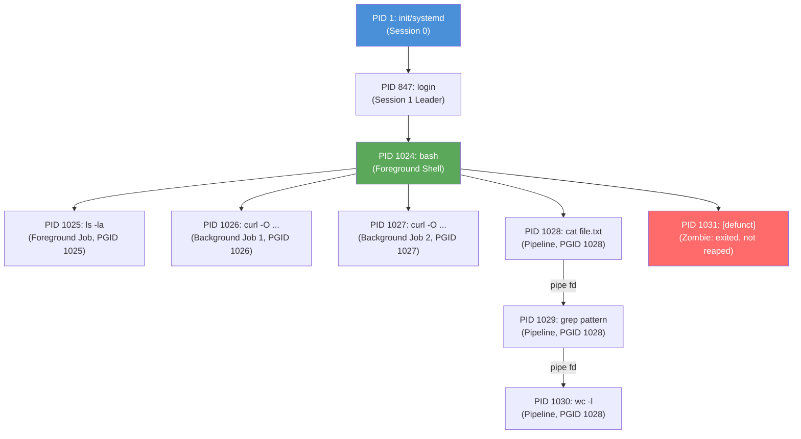
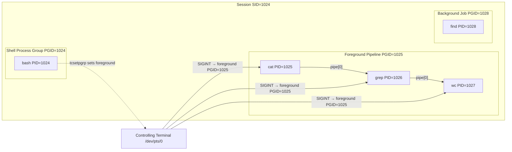
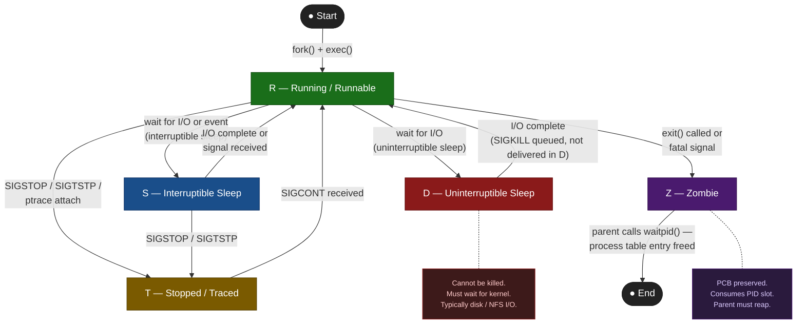
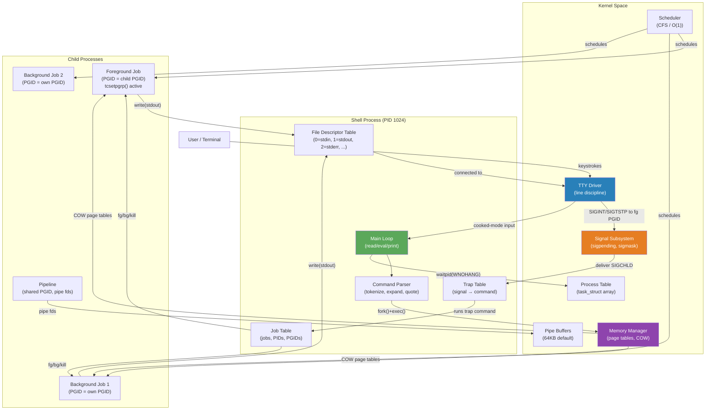

# Lesson 2: Process Control, Job Management, Signals

## 1. First-Principles Intuition & Invariants

The Unix philosophy rests on a deceptively simple foundation: processes are isolated execution contexts, and the shell is itself a process orchestrator. To understand process control in Bash is to understand how the operating system mediates creation, lifecycle, and termination of concurrent work units. This lesson explores the mechanisms that make multitasking tractable and examines why signal handling—far from being a peripheral concern—is the central nervous system of robust shell programming.

Every process occupies a unique position within a tree rooted at the kernel's init process (PID 1). When you invoke a command in your shell, the kernel does not magically spawn a new interpreter instance. Instead, the shell process calls the `fork()` system call, which duplicates its own process image—copying the process descriptor, page tables, file descriptor table, and signal masks—into a new child process. The return value of `fork()` itself is the only point of divergence: in the parent, it returns the child's PID; in the child, it returns zero. This single datum allows the two processes to diverge: the parent can await the child's termination via `wait()`, while the child typically invokes `exec()` to replace its own memory image with a new program.

This fork-exec model, standardized across all POSIX-conforming systems, creates a profound separation of concerns. The shell does not need to understand the internal structure of every command it executes. Instead, it delegates responsibility to the program image itself, loaded by the kernel's ELF loader (on Linux) and initialized by the C runtime (libc). The shell's role is purely coordinative: create a process, set up its environment (working directory, file descriptors, signal masks, resource limits), then either wait for completion or return control to the terminal.

Why must this be explicit? Why not have the shell call a command as a function? The answer is process isolation and fault containment. Each process has its own virtual address space, protected by the Memory Management Unit (MMU) and enforced by per-process page tables in the kernel. When a process crashes—due to a segmentation fault, division by zero, or stack overflow—that failure cannot propagate to the shell. The process is quarantined at the hardware level. Furthermore, the kernel measures resource consumption per process: CPU time (via `RLIMIT_CPU`), memory footprint (via `RLIMIT_AS`), open file descriptors (via `RLIMIT_NOFILE`), and maximum file size (via `RLIMIT_FSIZE`). A runaway child consuming all available memory does not bring down the shell. This isolation is enforced by the hardware and OS, not merely by convention.

The shell's job control system extends this isolation into a model of foreground and background execution. When you type a command and press Enter, that process runs in the foreground: its standard input is connected to the controlling terminal, its output appears on your screen, and the shell blocks awaiting the process's exit. Appending `&` causes the shell to launch the process in the background: the child runs concurrently, the shell prints a job number and PID, and immediately returns a prompt. This shift from synchronous to asynchronous execution enables pipeline parallelism and allows long-running tasks to proceed while you continue interactive work.

Background processes introduce a fundamental coordination problem. How does the shell track multiple children? The kernel sends a `SIGCHLD` signal to the parent whenever a child's state changes (exits, stops, or continues). The shell's `SIGCHLD` handler calls `waitpid()` with the `WNOHANG` flag to reap any terminated children without blocking, then updates its internal job table. Without this asynchronous notification mechanism, the shell would need to poll repeatedly or block indefinitely. The kernel guarantees delivery of `SIGCHLD` the moment a child transitions state, enabling near-real-time synchronization.

Signals are software interrupts—a lightweight form of asynchronous notification delivered by the kernel to a process. When you press Ctrl+C, the terminal driver sends `SIGINT` to the foreground process group. By default this terminates the process, but a process can install a custom signal handler to catch `SIGINT`, perform cleanup, and exit gracefully. Two signals are exceptions: `SIGKILL` (9) and `SIGSTOP` (19) cannot be caught, blocked, or ignored, because the kernel must retain the ability to forcibly terminate or suspend any process. The signal model is a contract between kernel and process: the kernel promises reliable delivery, and processes promise bounded handling time.

The process tree is a strict forest of directed trees, each rooted at PID 1 (or at a session leader). Parent-child relationships are established at `fork()` time and are immutable for the duration of a process's life. When a child exits but its parent has not yet called `wait()`, the child enters the zombie state: its process descriptor remains in the kernel's process table, holding the exit status and accumulated resource usage statistics, until the parent retrieves them. The kernel has a finite number of process table slots (controlled by `/proc/sys/kernel/pid_max` on Linux, default 32768 on older kernels, up to 4194304 on modern systems). Zombie accumulation is a real production failure mode. If a parent forks continuously without reaping, the process table fills, `fork()` returns `EAGAIN`, and the system cannot create new processes.



---

## 2. Core Architecture & Mechanics

### 2.1 The Fork-Exec Model in Depth

When you type `ls -la /tmp` and press Enter, the following sequence occurs at the system call level:

1. The shell receives the command line from the terminal driver and parses it into an argument vector: `["ls", "-la", "/tmp", NULL]`. It resolves the executable by iterating through `PATH` entries, using `access(2)` or `stat(2)` to test for execute permission, eventually finding `/usr/bin/ls`.

2. The shell calls `fork(2)`. The kernel allocates a new process descriptor (`task_struct` in Linux), copies the parent's page directory, marks all writable pages in both parent and child as copy-on-write (COW), duplicates the file descriptor table, inherits the parent's signal mask, and returns the new PID to the parent and 0 to the child. On a modern x86-64 Linux system, `fork()` is implemented via the `clone(2)` syscall with specific flags.

3. The child process detects `fork()` returned 0, performs setup (redirections, `setpgid(2)`, `setsid(2)` if needed, closing file descriptors marked `FD_CLOEXEC`), then calls `execve(2)` with the resolved path, argument vector, and environment. `execve()` replaces the process's memory image entirely: the kernel loads the ELF binary, maps its segments into virtual address space, initializes the stack with `argc`, `argv`, and `envp`, and transfers control to the ELF interpreter (`ld-linux.so`) or directly to `_start`. The PID is preserved; the program changes.

4. The parent receives the child's PID from `fork()`. In a foreground context, it calls `waitpid(child_pid, &status, 0)`, which blocks until the child exits. When `ls` calls `exit(3)` (or returns from `main()`), the kernel sends `SIGCHLD` to the parent and transitions the child to zombie state. The blocked `waitpid()` returns, and the shell decodes the status with `WIFEXITED(status)`, `WEXITSTATUS(status)`, or `WIFSIGNALED(status)`.

The COW optimization makes `fork()` cheap for the common case of an immediately-following `exec()`. The child never dirtys any inherited page, so no physical copying occurs. The overhead is only the kernel data structures (process descriptor, page tables, file descriptor table)—typically a few microseconds on modern hardware.

File descriptors are inherited across `fork()` unless marked `FD_CLOEXEC` (or `O_CLOEXEC` at open time), which causes them to be automatically closed in the child when `execve()` is called. This is the correct default for file descriptors the child should not inherit (sockets, log files, etc.) and the mechanism by which the shell sets up redirections: it opens the target file, duplicates it onto stdout using `dup2(2)`, then `exec()`s the command. The new program inherits the redirected stdout without knowing about it.

Signal handlers installed by the parent are reset to `SIG_DFL` in the child after `execve()`, because the handler function pointers point into the old program's address space, which no longer exists. Signal masks, however, are inherited across both `fork()` and `exec()`. This means if a parent has blocked `SIGTERM`, the child also blocks `SIGTERM` after `exec()`. Programs that might be launched with an unexpected signal mask should call `sigprocmask(2)` early in `main()` to reset it. This is a subtle and frequently overlooked source of bugs.

The following C program demonstrates the fork-exec sequence at the system call level, illustrating the control flow both parent and child execute:

```c
/*
 * fork_exec_demo.c — illustrates the fork-exec-wait sequence
 * Compile: gcc -Wall -Wextra -o fork_exec_demo fork_exec_demo.c
 */
#define _POSIX_C_SOURCE 200809L
#include <stdio.h>
#include <stdlib.h>
#include <string.h>
#include <unistd.h>
#include <sys/types.h>
#include <sys/wait.h>
#include <errno.h>

static void decode_status(pid_t pid, int status) {
    if (WIFEXITED(status)) {
        printf("[parent] child PID %d exited normally with status %d\n",
               pid, WEXITSTATUS(status));
    } else if (WIFSIGNALED(status)) {
        printf("[parent] child PID %d killed by signal %d (%s)%s\n",
               pid, WTERMSIG(status), strsignal(WTERMSIG(status)),
               WCOREDUMP(status) ? " (core dumped)" : "");
    } else if (WIFSTOPPED(status)) {
        printf("[parent] child PID %d stopped by signal %d\n",
               pid, WSTOPSIG(status));
    }
}

int main(void) {
    char *const argv[] = { "ls", "-la", "/tmp", NULL };
    char *const envp[] = { NULL };  /* minimal environment */

    printf("[parent] shell PID = %d, calling fork()\n", getpid());

    pid_t child = fork();
    if (child < 0) {
        perror("fork");
        return EXIT_FAILURE;
    }

    if (child == 0) {
        /*
         * Child path.
         * PID unchanged, but we are now a distinct process.
         * Set up the process group so the child is its own leader.
         */
        printf("[child]  PID = %d, PPID = %d, calling execve()\n",
               getpid(), getppid());

        if (setpgid(0, 0) < 0) {         /* become process group leader */
            perror("setpgid");
            _exit(EXIT_FAILURE);          /* _exit, not exit: avoid flushing parent's stdio buffers */
        }

        execve("/usr/bin/ls", argv, envp);
        /*
         * execve() only returns on error. Use _exit() here, not exit(),
         * to avoid running atexit() handlers registered by the parent.
         */
        perror("execve");
        _exit(127);                       /* 127 = "command not found" convention */
    }

    /*
     * Parent path.
     * child holds the new process's PID.
     */
    printf("[parent] forked child PID = %d, calling waitpid()\n", child);

    int status;
    pid_t reaped;
    do {
        reaped = waitpid(child, &status, 0);
    } while (reaped < 0 && errno == EINTR);  /* retry on signal interruption */

    if (reaped < 0) {
        perror("waitpid");
        return EXIT_FAILURE;
    }

    decode_status(reaped, status);
    return EXIT_SUCCESS;
}
```

The key detail above is `_exit()` vs `exit()` in the child. After `fork()`, the child inherits the parent's stdio buffers. If the child calls `exit()`, it flushes those buffers, potentially writing the parent's buffered output twice. `_exit()` terminates without flushing, which is correct in a child that will `exec()` or immediately terminate.

```mermaid
sequenceDiagram
    participant T as Terminal Driver
    participant SH as Shell (PID 1024)
    participant K as Kernel
    participant CH as Child (PID 1025)

    T->>SH: "ls -la /tmp\n" (read(2) returns)
    SH->>SH: parse tokens; resolve /usr/bin/ls via PATH
    SH->>K: fork()
    K-->>SH: returns 1025 (child PID)
    K-->>CH: returns 0 (child path)
    CH->>K: setpgid(0,0)
    CH->>K: execve("/usr/bin/ls", [...], [...])
    K-->>CH: maps ELF, transfers control to _start
    SH->>K: waitpid(1025, &status, 0) — blocks
    CH->>K: exit(0)
    K->>K: child → TASK_ZOMBIE; sends SIGCHLD to PID 1024
    K-->>SH: waitpid returns, status = 0
    SH->>SH: WEXITSTATUS(status) = 0; print prompt
```

### 2.2 Job Control, Process Groups, and Sessions

Job control is built on three kernel abstractions: **process groups**, **sessions**, and the **controlling terminal**.

A **session** is a collection of process groups created by a single login. The session is identified by a session ID (SID), which equals the PID of the session leader—the first process to call `setsid(2)`. Each session has at most one controlling terminal. The shell process is the session leader for interactive logins.

A **process group** is a set of processes that share a process group ID (PGID). Every process belongs to exactly one process group. Process groups are the unit of terminal signal delivery: `SIGINT` from Ctrl+C is sent to the **foreground process group** of the controlling terminal, not to a single PID.

When the shell creates a pipeline `cmd1 | cmd2 | cmd3`, it forks three children and calls `setpgid(child_pid, first_child_pid)` for each, placing all three in the same new process group (whose PGID equals the PID of `cmd1`). The shell then calls `tcsetpgrp(2)` to make this new process group the foreground process group of the terminal. Now, Ctrl+C sends `SIGINT` to all three pipeline members simultaneously, ensuring the pipeline terminates atomically.



Background jobs are launched without calling `tcsetpgrp()`—the shell retains the terminal's foreground process group. The background process group receives no terminal-generated signals. If a background process attempts to `read(2)` from the terminal, the kernel sends it `SIGTTIN`, which by default stops the process. Similarly, background writes to the terminal generate `SIGTTOU` if the terminal's `TOSTOP` flag is set (it usually is not by default, so background writes typically succeed).

The `jobs` builtin reports the shell's internal job table. The `fg %n` and `bg %n` builtins move jobs between foreground and background by calling `tcsetpgrp()` and `kill(-pgid, SIGCONT)`. The `-n` syntax refers to job number; `%n` is a job specification. Additional specifications include `%string` (job whose command begins with `string`), `%?string` (job containing `string`), `%%` or `%+` (current job), and `%-` (previous job).

### 2.3 Signals: Architecture and POSIX Semantics

A signal is a small integer notification sent by the kernel to a process (or process group). Signals are defined in `<signal.h>` and standardized by POSIX. Each signal has a default disposition: terminate, core dump, stop, continue, or ignore. A process can override the disposition for most signals using `sigaction(2)`, which is the POSIX-correct replacement for the older and less reliable `signal(2)`.

The table below lists signals essential to shell programming, with their standard numbers on Linux x86-64:

| Signal | Number | Default Action | Catchable | Description |
|--------|--------|---------------|-----------|-------------|
| `SIGHUP` | 1 | Terminate | Yes | Controlling terminal closed; daemon reload convention |
| `SIGINT` | 2 | Terminate | Yes | Keyboard interrupt (Ctrl+C) |
| `SIGQUIT` | 3 | Core dump | Yes | Keyboard quit (Ctrl+\\) |
| `SIGILL` | 4 | Core dump | Yes | Illegal instruction |
| `SIGTRAP` | 5 | Core dump | Yes | Trace/breakpoint trap |
| `SIGABRT` | 6 | Core dump | Yes | `abort(3)` called |
| `SIGFPE` | 8 | Core dump | Yes | Floating-point exception |
| `SIGKILL` | 9 | Terminate | **No** | Unconditional kill |
| `SIGSEGV` | 11 | Core dump | Yes | Segmentation violation |
| `SIGPIPE` | 13 | Terminate | Yes | Broken pipe (write to closed reader) |
| `SIGALRM` | 14 | Terminate | Yes | `alarm(2)` timer expired |
| `SIGTERM` | 15 | Terminate | Yes | Polite termination request |
| `SIGCHLD` | 17 | Ignore | Yes | Child state changed |
| `SIGCONT` | 18 | Continue | Yes | Continue if stopped |
| `SIGSTOP` | 19 | Stop | **No** | Unconditional stop |
| `SIGTSTP` | 20 | Stop | Yes | Keyboard stop (Ctrl+Z) |
| `SIGTTIN` | 21 | Stop | Yes | Background read from terminal |
| `SIGTTOU` | 22 | Stop | Yes | Background write to terminal |
| `SIGURG` | 23 | Ignore | Yes | Urgent data on socket |
| `SIGUSR1` | 10 | Terminate | Yes | User-defined signal 1 |
| `SIGUSR2` | 12 | Terminate | Yes | User-defined signal 2 |
| `SIGWINCH` | 28 | Ignore | Yes | Terminal window size changed |

**Signal numbers are architecture-dependent.** The table above is for Linux x86-64. On Linux ARM64, `SIGCHLD`=17 and `SIGCONT`=18 happen to be the same, but `SIGSTKFLT` (16) and others differ. On macOS (Darwin), `SIGUSR1`=30, `SIGUSR2`=31, and `SIGCHLD`=20. Never hardcode signal numbers; use the symbolic names.

The kernel maintains per-process signal state in two 64-bit bitmasks (on Linux): a **pending set** (`sigpending`) and a **blocked set** (the signal mask, `sigmask`). When a signal is generated, the kernel sets the corresponding bit in `sigpending`. When delivering signals, the kernel checks `sigpending & ~sigmask`; any set bit represents a signal to deliver. Standard (non-real-time) signals are not queued—if the same signal arrives twice while blocked, only one delivery occurs when the mask is cleared. POSIX real-time signals (`SIGRTMIN` through `SIGRTMAX`) are queued.

Signal handlers in C must only call **async-signal-safe** functions—a subset of the POSIX interface that is safe to call from a signal handler even if the main program was interrupted mid-library-call. The definitive list is in `signal-safety(7)`. Notably absent from the safe list: `printf`, `malloc`, `free`, `fopen`, `syslog`. Present: `write(2)`, `read(2)`, `kill(2)`, `_exit(2)`, `sem_post(3)`. The canonical technique for communicating from a signal handler to the main program is writing a single byte to a **self-pipe** (a pipe created by the process, with the read end monitored by `select`/`poll`/`epoll`) or setting a `volatile sig_atomic_t` flag that the main loop checks.

```c
/*
 * self_pipe_signal.c — async-safe signal notification via self-pipe trick
 * Compile: gcc -Wall -Wextra -o self_pipe_signal self_pipe_signal.c
 */
#define _POSIX_C_SOURCE 200809L
#include <signal.h>
#include <unistd.h>
#include <stdlib.h>
#include <stdio.h>
#include <string.h>
#include <poll.h>
#include <errno.h>
#include <fcntl.h>

static int signal_pipe[2];  /* [0]=read end, [1]=write end */

/*
 * Signal handler: only write(2) is called — async-signal-safe per POSIX.
 * The single byte written is the signal number for disambiguation.
 */
static void signal_handler(int signo) {
    unsigned char byte = (unsigned char)signo;
    ssize_t n;
    do {
        n = write(signal_pipe[1], &byte, 1);
    } while (n < 0 && errno == EINTR);
    /* Silently drop if pipe is full — ring buffer in main loop handles this */
}

static void set_nonblocking(int fd) {
    int flags = fcntl(fd, F_GETFL, 0);
    if (flags < 0) { perror("fcntl F_GETFL"); exit(EXIT_FAILURE); }
    if (fcntl(fd, F_SETFL, flags | O_NONBLOCK) < 0) {
        perror("fcntl F_SETFL"); exit(EXIT_FAILURE);
    }
}

int main(void) {
    if (pipe(signal_pipe) < 0) { perror("pipe"); return EXIT_FAILURE; }
    set_nonblocking(signal_pipe[0]);
    set_nonblocking(signal_pipe[1]);

    struct sigaction sa;
    memset(&sa, 0, sizeof sa);
    sa.sa_handler = signal_handler;
    sigemptyset(&sa.sa_mask);
    sa.sa_flags = SA_RESTART;  /* restart interrupted syscalls where possible */

    sigaction(SIGINT,  &sa, NULL);
    sigaction(SIGTERM, &sa, NULL);
    sigaction(SIGUSR1, &sa, NULL);

    printf("PID %d: waiting for signals (send SIGUSR1, SIGINT, or SIGTERM)\n",
           getpid());

    struct pollfd pfd = { .fd = signal_pipe[0], .events = POLLIN };

    for (;;) {
        int ret = poll(&pfd, 1, 5000);  /* 5-second timeout */
        if (ret < 0) {
            if (errno == EINTR) continue;
            perror("poll"); break;
        }
        if (ret == 0) {
            printf("(heartbeat — no signals in 5s)\n");
            continue;
        }

        unsigned char signo;
        ssize_t n = read(signal_pipe[0], &signo, 1);
        if (n < 0 && errno == EAGAIN) continue;
        if (n <= 0) break;

        printf("Received signal %d (%s)\n", signo, strsignal(signo));
        if (signo == SIGTERM || signo == SIGINT) {
            printf("Exiting gracefully.\n");
            break;
        }
    }

    close(signal_pipe[0]);
    close(signal_pipe[1]);
    return EXIT_SUCCESS;
}
```

In Bash, `trap` provides a simplified signal model. The shell runs trap commands synchronously between commands (not asynchronously mid-execution), so they are inherently safe to use arbitrary shell constructs:

```bash
trap 'echo "Caught SIGINT"; exit 1' INT
trap 'echo "Caught SIGTERM"; exit 1' TERM
trap 'echo "Caught SIGCHLD"' CHLD
```

Note: Bash uses signal names without the `SIG` prefix in `trap` arguments. Both forms work (`SIGINT` and `INT`), but the short form is conventional.

### 2.4 Process Substitution and Named Pipes

Process substitution (`<(cmd)` and `>(cmd)`) is a Bash/ksh/zsh extension; it is not in POSIX `sh`. It works through one of two mechanisms depending on the system:

On Linux, Bash uses `/dev/fd/N` paths backed by anonymous pipes (not named FIFOs). It creates a pipe with `pipe(2)`, forks a subshell, connects the subshell's stdout (for `<(cmd)`) or stdin (for `>(cmd)`) to one end of the pipe, and returns the string `/dev/fd/N` where `N` is the file descriptor number of the other end. This is an anonymous pipe (exists only in the kernel's file descriptor table), not a persistent named FIFO.

On macOS and older systems without `/dev/fd`, Bash falls back to actual named FIFOs created in `/tmp` or `/var/tmp`. The behavioral difference is subtle but matters for programs that call `stat(2)` on the path: on Linux, `stat("/dev/fd/63")` returns a stat for a pipe; on macOS with real FIFOs, it returns a stat for a FIFO (`S_ISFIFO`).

```bash
# On Linux: /dev/fd/63 is a symlink to a pipe
$ ls -la /dev/fd/
lrwx------ 1 user user 64 ... 63 -> pipe:[12345678]

# The expansion:
$ echo <(cat /dev/null)
/dev/fd/63
```

The deadlock risk with FIFOs is real and deserves precise description. A FIFO write blocks when the buffer is full (default 65536 bytes on Linux, since kernel 2.6.11; was 4096 previously, configurable via `fcntl(F_SETPIPE_SZ)`). A deadlock occurs when two processes each block waiting for the other to drain their respective FIFOs. This cannot happen with a single process substitution because only one FIFO is in play. It can happen with nested process substitutions or with `>(cmd)` on the write side if the reader blocks before the writer finishes.

```bash
# SAFE: parallel readers, independent FIFOs
diff <(sort file1.txt) <(sort file2.txt)

# POTENTIAL ISSUE: deeply nested, single writer chain
# Avoid; use explicit temp files for >100MB data sets
diff <(sort <(cat file1.txt | tr a-z A-Z)) <(sort file2.txt)
```

The `>(cmd)` form (process substitution for input) is less commonly used but powerful for tee-like patterns:

```bash
# Write to two sinks simultaneously
tee >(gzip > archive.gz) >(wc -l > line_count.txt) > /dev/null < input.txt
```

### 2.5 Process State Machine

A process transitions through a well-defined set of kernel states. On Linux, these are defined in `include/linux/sched.h` as `task_state_array`. The states visible via `ps` are:

```
R — TASK_RUNNING: on a CPU or on the run queue, ready to run
S — TASK_INTERRUPTIBLE: sleeping, woken by signal or event
D — TASK_UNINTERRUPTIBLE: sleeping in uninterruptible I/O (cannot be killed with SIGKILL)
T — TASK_STOPPED: stopped by SIGSTOP or SIGTSTP, or by a debugger via ptrace
t — TASK_TRACED (Linux): stopped by debugger (ptrace)
Z — TASK_ZOMBIE (EXIT_ZOMBIE): exited, waiting for parent waitpid()
X — EXIT_DEAD: being removed from process table (transient, rarely seen)
I — TASK_IDLE: idle kernel thread (Linux 4.14+)
```

The `D` state deserves special attention: a process in `D` state cannot be killed because it is in the middle of a kernel operation that must complete (typically a synchronous disk I/O). `SIGKILL` is queued but not delivered until the process exits the `D` state. If a disk is unreachable (NFS timeout, failing hardware), a process can be stuck in `D` state indefinitely. This is a hardware-level issue; no amount of signaling resolves it.



---

## 3. Practical Patterns and Idioms

### 3.1 Waiting for Multiple Background Jobs

The basic pattern for parallel execution with barrier synchronization:

```bash
#!/usr/bin/env bash
set -euo pipefail

# Download multiple files in parallel, capturing per-job exit status
declare -a pids=()
declare -A pid_to_url

urls=(
    "https://example.com/file1.tar.gz"
    "https://example.com/file2.tar.gz"
    "https://example.com/file3.tar.gz"
)

for url in "${urls[@]}"; do
    curl --silent --show-error --retry 3 --retry-delay 2 -O "$url" &
    pid=$!
    pids+=("$pid")
    pid_to_url[$pid]="$url"
    echo "Launched download for $url (PID $pid)"
done

# Barrier: wait for each job and report per-URL status
failed=0
for pid in "${pids[@]}"; do
    if wait "$pid"; then
        echo "OK:   ${pid_to_url[$pid]}"
    else
        status=$?
        echo "FAIL: ${pid_to_url[$pid]} (exit status $status)" >&2
        ((failed++)) || true
    fi
done

if ((failed > 0)); then
    echo "$failed download(s) failed" >&2
    exit 1
fi
```

`$!` expands to the PID of the most recently backgrounded asynchronous command. `wait PID` returns the exit status of that specific child, blocking until it terminates. Calling `wait` without arguments waits for all current background children and returns the exit status of the last one to finish—useful for simple fan-out patterns but insufficient when you need per-job status.

**`wait -n` (Bash 4.3+):** waits for any single background job to complete and returns its exit status. This is the primitive needed for a bounded worker pool. Note that `wait -n` returns the exit status of the job that completed, but does not tell you *which* PID completed—you must use `jobs -p` or the `$!` trick to reconcile.

**`wait -f PID` (Bash 5.1+):** waits until PID terminates even if the shell is not its direct parent (e.g., the job was started by a subshell and disowned). This is rarely needed in practice.

### 3.2 Bounded Parallel Worker Pool

`wait -n` enables a worker pool that keeps exactly `N` jobs running at all times:

```bash
#!/usr/bin/env bash
# worker_pool.sh — process a list of items with bounded parallelism
set -euo pipefail

readonly MAX_JOBS=${1:-4}
readonly INPUT_DIR=${2:-/data/input}

process_item() {
    local item="$1"
    # Simulate work; replace with real processing
    local delay=$(( RANDOM % 5 + 1 ))
    echo "[$$] processing $item (${delay}s)"
    sleep "$delay"
    # Randomly fail ~20% of the time for demonstration
    (( RANDOM % 5 == 0 )) && { echo "[$$] ERROR on $item" >&2; exit 1; }
    echo "[$$] done $item"
}
export -f process_item

declare -a active_pids=()
declare -i failed_count=0

reap_one() {
    # wait -n: wait for any one child; capture its exit status
    local status=0
    wait -n 2>/dev/null || status=$?
    if (( status != 0 )); then
        (( failed_count++ )) || true
    fi
    # Rebuild active_pids from currently running background jobs
    active_pids=()
    while IFS= read -r pid; do
        active_pids+=("$pid")
    done < <(jobs -p)
}

for item in "$INPUT_DIR"/*; do
    [[ -f "$item" ]] || continue

    # If at capacity, wait for one slot to open
    while (( ${#active_pids[@]} >= MAX_JOBS )); do
        reap_one
    done

    bash -c 'process_item "$1"' _ "$item" &
    active_pids+=($!)
done

# Drain remaining jobs
while (( ${#active_pids[@]} > 0 )); do
    reap_one
done

echo "Pool finished. Failed jobs: $failed_count"
(( failed_count == 0 ))  # exit 0 iff no failures
```

This pattern requires Bash 4.3+ for `wait -n`. On older systems, replace `wait -n` with a polling loop using `kill -0` to check whether each PID is still alive, with a short `sleep` between polls.

### 3.3 Robust Graceful Shutdown

Production scripts that manage child processes must handle termination signals reliably. The key insight is that `trap` handlers in Bash are run between commands—they are not preemptive. If the script is blocked in `wait`, receiving a signal causes `wait` to return early with exit status 128+signum, and the trap fires before the next command.

```bash
#!/usr/bin/env bash
set -o pipefail
# Do NOT use set -e in scripts with signal handlers — it interacts badly with trap

readonly WORK_DIR=$(mktemp -d /tmp/worker.XXXXXX)
declare -a child_pids=()
declare -i shutdown_requested=0

cleanup() {
    local sig="${1:-EXIT}"
    [[ $shutdown_requested -eq 1 ]] && return
    shutdown_requested=1

    echo "[$$] Received $sig — initiating graceful shutdown..." >&2

    # Phase 1: SIGTERM — polite request to terminate
    local pid
    for pid in "${child_pids[@]}"; do
        if kill -0 "$pid" 2>/dev/null; then
            echo "[$$] Sending SIGTERM to PID $pid" >&2
            kill -TERM "$pid" 2>/dev/null || true
        fi
    done

    # Phase 2: Wait up to 10 seconds for voluntary exit
    local deadline=$(( $(date +%s) + 10 ))
    while (( $(date +%s) < deadline )); do
        local remaining=0
        for pid in "${child_pids[@]}"; do
            kill -0 "$pid" 2>/dev/null && (( remaining++ )) || true
        done
        (( remaining == 0 )) && break
        sleep 0.2
    done

    # Phase 3: SIGKILL any processes that did not exit
    for pid in "${child_pids[@]}"; do
        if kill -0 "$pid" 2>/dev/null; then
            echo "[$$] Sending SIGKILL to PID $pid (did not exit cleanly)" >&2
            kill -KILL "$pid" 2>/dev/null || true
        fi
    done

    # Phase 4: Reap all children to prevent zombies
    for pid in "${child_pids[@]}"; do
        wait "$pid" 2>/dev/null || true
    done

    # Phase 5: Remove temporary directory
    rm -rf "$WORK_DIR"
    echo "[$$] Shutdown complete." >&2
}

# Install trap for all relevant termination signals
# EXIT fires on normal exit too, ensuring cleanup always runs
trap 'cleanup SIGTERM' TERM
trap 'cleanup SIGINT'  INT
trap 'cleanup SIGHUP'  HUP
trap 'cleanup EXIT'    EXIT

# Launch worker processes
for i in {1..5}; do
    (
        trap - TERM INT HUP EXIT  # Reset inherited traps in child
        echo "[worker $i] PID $$ started"
        sleep 1000
    ) &
    child_pids+=($!)
    echo "Launched worker $i (PID ${child_pids[-1]})"
done

echo "All workers running. PID=$$. Press Ctrl+C to trigger cleanup."
wait  # Block until interrupted or all children exit
```

Three subtleties are critical here:

First, the child subshells reset their traps with `trap -`. Without this, a child that receives `SIGTERM` would run the parent's `cleanup` function—which references `child_pids`, a variable in the parent's scope—producing incorrect behavior.

Second, the `cleanup` function is guarded by `shutdown_requested` to prevent re-entrant invocations. If `SIGTERM` and `SIGINT` arrive within milliseconds of each other, the shell might invoke the handler twice. The guard prevents the second invocation from corrupting state.

Third, `kill -0 PID` sends signal 0, which performs no actual kill—it only tests whether the caller has permission to send a signal to PID and whether PID exists. It returns 0 if PID exists and the caller has permission, non-zero otherwise. This is the correct existence check.

### 3.4 Process Substitution in Data Processing

Process substitution is most powerful when composing tools that accept only file paths—not stdin—as inputs:

```bash
# Compare process lists on two remote hosts
diff <(ssh host1 'ps -eo pid,ppid,cmd --sort=pid') \
     <(ssh host2 'ps -eo pid,ppid,cmd --sort=pid')

# Join two sorted streams without temp files
# join requires both inputs to be sorted on the join field
join <(sort -k1,1 users.csv) <(sort -k1,1 purchases.csv)

# Merge multiple sorted log streams into one chronological stream
sort -m <(ssh web1 'tail -f /var/log/app.log') \
        <(ssh web2 'tail -f /var/log/app.log') \
        <(ssh web3 'tail -f /var/log/app.log')

# Statistical summary of two data sets side-by-side
paste <(awk '{print $2}' dataset_a.tsv | sort -n | awk '
    BEGIN{min=1e18;max=-1e18;sum=0;n=0}
    {sum+=$1; if($1<min)min=$1; if($1>max)max=$1; n++}
    END{print "A: min="min" max="max" mean="sum/n" n="n}
') <(awk '{print $2}' dataset_b.tsv | sort -n | awk '
    BEGIN{min=1e18;max=-1e18;sum=0;n=0}
    {sum+=$1; if($1<min)min=$1; if($1>max)max=$1; n++}
    END{print "B: min="min" max="max" mean="sum/n" n="n}
')
```

The `>(cmd)` form allows writing to a process rather than reading from it:

```bash
# Compress output of a command while also counting lines, without temp files
long_running_command | tee >(gzip -9 > output.gz) >(wc -l > linecount.txt) > /dev/null
```

`tee` reads stdin and writes to each specified output. With `>(cmd)`, each output is a process substitution writing to a subshell. All three processes (tee + 2 subshells) run concurrently; the pipeline is fully streaming.

### 3.5 Debugging Signal Handling and Process State

`strace` is the definitive tool for observing process behavior at the system call level:

```bash
# Trace all system calls, following forks, filtering to signal-related calls
strace -f -e trace=signal,process -p $$ 2>&1 | head -100

# Trace a script from start, capturing output and system calls
strace -f -e trace=all -o /tmp/trace.log -s 256 bash script.sh

# Specifically observe how signals are delivered and handled
strace -f -e trace=rt_sigaction,rt_sigprocmask,rt_sigreturn,kill,tgkill bash script.sh
```

On Linux, `rt_sigaction` is the syscall underlying `sigaction(2)`, `tgkill` is the precise per-thread signal delivery syscall, and `rt_sigreturn` is called when a signal handler returns, restoring the interrupted context. Seeing these in strace output confirms that your signal handlers are being installed and invoked correctly.

For observing zombie accumulation:

```bash
# Watch the process table for zombies, refreshed every second
watch -n 1 'ps aux | awk "NR==1 || /Z/"'

# Count zombies for a specific parent
ps -o pid,ppid,stat,comm --ppid $PARENT_PID | grep Z

# Check for accumulated zombies system-wide
awk '/zombies/ {print}' /proc/loadavg
# Format: running/total processes, then last_pid. Zombies visible in "total"
```

Inside Bash, `set -x` traces command execution, and `trap '' DEBUG` can install a debug handler that fires before each command:

```bash
#!/usr/bin/env bash
# Instrument every command with timing and PID information
trap 'echo "[DEBUG PID=$$] $(date +%T.%N): ${BASH_COMMAND}" >&2' DEBUG
set -x

cleanup() { echo "Cleanup at $(date +%T.%N)" >&2; }
trap cleanup EXIT

sleep 0.1
echo "Done"
```

The `DEBUG` trap fires before each simple command. Combined with `BASH_COMMAND` (the command about to be executed), `LINENO`, and `BASH_SOURCE`, it provides comprehensive execution tracing without requiring `strace`.

---

## 4. Common Pitfalls and Solutions

### 4.1 Zombie Processes: Causes, Detection, and Prevention

Zombies occur in exactly one scenario: a child has exited but its parent has not yet called `waitpid()`. They are not dangerous in small numbers—each consumes roughly 1–2KB of kernel memory—but they consume a PID slot. Linux's default PID range is 32768 (`/proc/sys/kernel/pid_max`), and 32768 zombie processes will exhaust it.

The correct prevention in Bash: always pair background jobs with `wait`. The correct prevention in C: either call `waitpid()` in a `SIGCHLD` handler with `WNOHANG`, or install `SIGCHLD` with `SA_NOCLDWAIT` (which tells the kernel to automatically reap children without creating zombies, at the cost of not being able to retrieve exit statuses), or `double-fork`.

The double-fork technique creates a grandchild that is immediately orphaned and adopted by init:

```bash
# Double-fork in bash: child exits immediately, grandchild is reparented to PID 1
(
    # Child: fork again and exit
    (
        # Grandchild: reparented to init; shell never needs to wait for it
        exec long_running_daemon
    ) &
    # Child exits here — shell reaps it immediately
    exit 0
) &
wait $!  # Only waits for child (which exited immediately)
```

In C:

```c
pid_t child = fork();
if (child == 0) {
    /* Child: fork again */
    if (fork() == 0) {
        /* Grandchild: reparented to init when child exits */
        setsid();
        execvp(daemon_argv[0], daemon_argv);
        _exit(127);
    }
    _exit(0);  /* Child exits immediately */
}
waitpid(child, NULL, 0);  /* Reap child instantly; grandchild runs under init */
```

### 4.2 Signal Masks Inherited Across exec()

This is one of the most subtle and consequential bugs in process management. When a Bash script using `trap` launches a child with certain signals blocked, those signals remain blocked in the child after `exec()`.

```bash
# Demonstration: block SIGTERM before launching child
# (Bash doesn't directly manipulate sigmask, but here's what happens internally
#  when certain operations are performed)

# Problematic: child inherits blocked signals from shell internals
(
    # In subshells, some signals may be blocked during trap execution
    trap 'echo caught' TERM
    
    # Child does NOT reset signal mask unless it explicitly does so
    bash -c 'kill -TERM $$ ; echo "Still running (SIGTERM was blocked!)"'
)
```

The authoritative fix in C programs is to call `sigprocmask(SIG_SETMASK, &empty_set, NULL)` early in `main()` to ensure no signals are unexpectedly blocked. In Bash, `trap - SIGNAL` in a child subshell resets the disposition to default, but does not unblock the signal if it was blocked at the mask level by the kernel.

### 4.3 set -e and Signal Handlers

`set -e` (errexit) causes the shell to exit if any command returns non-zero. Combined with signal handlers, this produces surprising behavior:

```bash
#!/usr/bin/env bash
set -e

cleanup() { echo "cleanup"; }
trap cleanup EXIT

# This exit-status check works fine...
some_command || echo "failed"

# But: 'wait' returns 128+signum when interrupted by a signal.
# With set -e, this causes the script to exit before the trap fires.
wait  # If SIGINT arrives here, wait returns 130; set -e triggers an exit
```

The safe pattern for signal-aware scripts is to avoid `set -e` and handle errors explicitly, or to use `|| true` after `wait`:

```bash
wait || true  # Prevent set -e from firing on signal interruption
```

Alternatively, use `set -E` (errtrace) which propagates ERR traps into functions and subshells, allowing centralized error handling without the brittleness of bare `set -e`.

### 4.4 SIGPIPE and Broken Pipelines

When a process writes to a pipe whose read end has been closed, the kernel sends `SIGPIPE` to the writer. The default disposition of `SIGPIPE` is to terminate the process. With `set -o pipefail`, a pipeline's exit status is the rightmost non-zero status—including termination by `SIGPIPE`.

```bash
# Common case: 'head' closes its input after reading N lines
# Causes SIGPIPE to be sent to 'cat' or 'find'
find /large/directory -name "*.log" | head -5
# May print: "find: 'write error'" or similar on stderr
```

The correct fix is to suppress the message, not to ignore `SIGPIPE` globally:

```bash
# Option 1: redirect stderr of the producer
find /large/directory -name "*.log" 2>/dev/null | head -5

# Option 2: ignore SIGPIPE only in the subshell running the producer
(trap '' PIPE; find /large/directory -name "*.log") | head -5

# Option 3: use grep -m (max-count) instead of head, which reads all input
# before truncating, avoiding the broken pipe
find /large/directory -name "*.log" | grep -m 5 '.'
```

Ignoring `SIGPIPE` globally (`trap '' PIPE`) is dangerous because it allows programs to silently lose data—writes to closed pipes return `EPIPE` (errno 32) without terminating the process, but the data is gone.

### 4.5 Race Condition: Checking Existence Then Acting

The `kill -0 $pid` idiom tests whether a PID exists. Between the test and the subsequent `kill` or `wait`, the process may exit and the PID may be reused by an unrelated process:

```bash
# UNSAFE: TOCTOU race condition
if kill -0 "$pid" 2>/dev/null; then
    kill -TERM "$pid"  # Might kill a different process if PID was reused
fi
```

The safe fix is to track PIDs in conjunction with `wait`, which is immune to PID reuse because the kernel keeps the process descriptor alive (as a zombie) until `wait()` is called. As long as the shell has not called `wait $pid`, the PID is reserved for that specific child:

```bash
# SAFE: use wait to synchronize; PID reuse cannot occur until wait returns
kill -TERM "$pid" 2>/dev/null || true
wait "$pid" 2>/dev/null || true
```

---

## 5. Advanced Patterns

### 5.1 Sessions, nohup, and Daemon Launching

A session is bounded to a controlling terminal. When the terminal closes (the user logs out or the SSH connection drops), the kernel sends `SIGHUP` to the session leader (the shell), which typically propagates it to all foreground and background jobs. This is why background jobs die when you log out.

`nohup(1)` works by: (1) ignoring `SIGHUP` in the child, and (2) redirecting stdin from `/dev/null` and stdout/stderr to `nohup.out` if they point to a terminal. It does not remove the process from the shell's job table—`disown` does that:

```bash
# Start a process immune to terminal closure
nohup ./long_running_job --config prod.yaml > /var/log/job.log 2>&1 &
disown $!  # Remove from shell's job table (no SIGHUP on shell exit)
echo "Job running as PID $!"
```

`disown -h %n` marks a job so it does not receive `SIGHUP` when the shell exits, but keeps it in the job table (allowing `fg`/`bg`). `disown %n` removes it from the table entirely.

For true service daemonization, use `setsid(1)` to create a new session, breaking all association with the controlling terminal:

```bash
# setsid creates a new session, making the process immune to SIGHUP
setsid ./my_daemon --foreground &
```

The gold standard for production daemon management is `systemd`, `supervisord`, or `s6-supervise`, which handle PID tracking, restart policies, log capture, and resource limits far more reliably than shell-based supervisor loops.

### 5.2 Parallel Worker Pool with GNU parallel

For production-grade parallelism, `GNU parallel` is preferable to hand-rolled worker pools:

```bash
# Process files with up to 8 parallel jobs, with retry on failure
find /data -name "*.csv" -print0 | \
    parallel -0 -j 8 --retry-failed --joblog /tmp/parallel.log \
    'python3 process.py {} > {.}.out 2> {.}.err'

# Distribute work across multiple machines via SSH
parallel -S host1,host2,host3 --transfer --return '{}.result' \
    'expensive_computation {}' ::: input_*.dat

# Rate-limit to avoid overwhelming a downstream service
parallel -j 4 --delay 0.5 'curl -s https://api.example.com/item/{}' \
    ::: $(seq 1 100)
```

GNU parallel handles job serialization, failure tracking, partial retries, SSH distribution, and progress reporting—features that are nontrivial to implement correctly in pure Bash.

### 5.3 Process Restart Supervisor with Exponential Backoff

A production-grade supervisor loop should implement exponential backoff to avoid hammering a failing service:

```bash
#!/usr/bin/env bash
# supervisor.sh — restart a command with exponential backoff
set -o pipefail

readonly CMD=("$@")
readonly MAX_BACKOFF=300    # 5 minutes maximum delay
readonly BACKOFF_BASE=2     # Exponential base
readonly MAX_RETRIES=10     # 0 = unlimited
readonly LOG_FILE="/var/log/supervisor_$(basename "$1").log"

log() { echo "[$(date -Iseconds)] $*" | tee -a "$LOG_FILE" >&2; }

backoff_delay() {
    local attempt="$1"
    # 2^attempt seconds, capped at MAX_BACKOFF, with ±10% jitter
    local base=$(( BACKOFF_BASE ** attempt ))
    local capped=$(( base > MAX_BACKOFF ? MAX_BACKOFF : base ))
    local jitter=$(( RANDOM % (capped / 10 + 1) ))
    echo $(( capped + jitter ))
}

attempt=0
child_pid=""
running=1

cleanup() {
    running=0
    [[ -n "$child_pid" ]] && kill -TERM "$child_pid" 2>/dev/null || true
    [[ -n "$child_pid" ]] && wait "$child_pid" 2>/dev/null || true
    log "Supervisor exiting."
    exit 0
}
trap cleanup TERM INT HUP

log "Supervisor started for: ${CMD[*]}"

while (( running )) && { (( MAX_RETRIES == 0 )) || (( attempt < MAX_RETRIES )); }; do
    start_time=$(date +%s)

    log "Attempt $((attempt + 1)): launching ${CMD[*]}"
    "${CMD[@]}" &
    child_pid=$!

    wait "$child_pid"
    exit_status=$?

    child_pid=""
    end_time=$(date +%s)
    uptime=$(( end_time - start_time ))

    if (( exit_status == 0 )); then
        log "Process exited cleanly (status 0, uptime ${uptime}s). Not restarting."
        exit 0
    fi

    if (( uptime > 60 )); then
        # Process ran long enough — reset backoff counter
        attempt=0
        log "Process ran for ${uptime}s before failing (status $exit_status). Resetting backoff."
    else
        log "Process failed after ${uptime}s (status $exit_status). Attempt $((attempt+1))."
        (( attempt++ )) || true
    fi

    delay=$(backoff_delay "$attempt")
    log "Restarting in ${delay}s..."
    sleep "$delay" &
    sleep_pid=$!
    # Allow signals to interrupt the sleep
    wait "$sleep_pid" || true
done

log "Max retries ($MAX_RETRIES) exceeded. Giving up."
exit 1
```

The critical additions over a naive supervisor: (1) exponential backoff with jitter prevents thundering herd when a dependency comes back up, (2) the uptime check resets the attempt counter for processes that run successfully for over a minute before crashing (preventing a briefly-long-running process from forever depleting the retry budget), and (3) the `sleep` runs as a background job so it can be interrupted by signals, allowing clean shutdown during the wait period.

### 5.4 Structured File Descriptor Management

Bash allows opening, duplicating, and closing file descriptors explicitly, enabling sophisticated I/O routing without subshells:

```bash
#!/usr/bin/env bash
# fd_routing.sh — explicit file descriptor management
set -euo pipefail

# Open file descriptors at the script level (not in subshells)
exec 3< /etc/passwd          # FD 3: read from /etc/passwd
exec 4> /tmp/output.txt      # FD 4: write to output file
exec 5>> /tmp/audit.log      # FD 5: append to audit log
exec 6<> /tmp/state.fifo     # FD 6: read-write on a FIFO (synchronization)

# Utility: log to audit FD without subshell
audit() { echo "[$(date +%s)] $*" >&5; }

audit "Script started"

# Read from FD 3 (not stdin) while keeping stdin available for interactive use
line_count=0
while IFS=: read -r -u 3 username _ uid gid _ home shell; do
    # Skip system accounts
    (( uid < 1000 )) && continue
    echo "User: $username (UID=$uid, shell=$shell)" >&4
    audit "Processed user $username"
    (( line_count++ ))
done

echo "Processed $line_count users" >&4
audit "Script finished: $line_count users processed"

# Explicitly close file descriptors
# (the shell closes them on exit, but explicit closure is good hygiene
#  and required if other processes need to read a "complete" file)
exec 3<&-   # Close read FD
exec 4>&-   # Close write FD (flushes and closes)
exec 5>&-   # Close audit log
exec 6>&-   # Close FIFO

echo "Done. Output written to /tmp/output.txt"
```

FD 6 (`<>` mode) opens a FIFO for both reading and writing. This keeps the FIFO open even when no other process is reading from it, preventing `SIGPIPE` from being sent to the writer. It is a standard technique for maintaining a persistent FIFO endpoint.

### 5.5 Coprocess Communication

Bash 4.0 introduced the `coproc` builtin, which creates a bidirectional pipe to a background process:

```bash
#!/usr/bin/env bash
# coprocess_demo.sh — stateful bidirectional communication with a child process
set -euo pipefail

# Start a Python interpreter as a coprocess
# COPROC[0] = read end (child's stdout → parent reads)
# COPROC[1] = write end (parent writes → child's stdin)
coproc PYPROC { python3 -u -c '
import sys
import json

for line in sys.stdin:
    line = line.strip()
    if not line:
        continue
    try:
        data = json.loads(line)
        result = {k: v * 2 for k, v in data.items() if isinstance(v, (int, float))}
        print(json.dumps(result), flush=True)
    except json.JSONDecodeError as e:
        print(json.dumps({"error": str(e)}), flush=True)
'; }

# Send JSON to coprocess and read response
send_receive() {
    local input="$1"
    echo "$input" >&"${PYPROC[1]}"
    local response
    IFS= read -r -u "${PYPROC[0]}" response
    echo "$response"
}

echo "Coprocess PID: $PYPROC_PID"

result=$(send_receive '{"x": 10, "y": 5, "label": "test"}')
echo "Response: $result"   # {"x": 20, "y": 10}

result=$(send_receive '{"temperature": 23.5, "humidity": 60}')
echo "Response: $result"   # {"temperature": 47.0, "humidity": 120}

# Close the coprocess's stdin to signal EOF, then wait for it
exec {PYPROC[1]}>&-
wait "$PYPROC_PID"
echo "Coprocess exited."
```

Coprocesses are valuable when you need to maintain state in a child process across multiple interactions—a pattern that would otherwise require a network socket or named FIFO. The `coproc` builtin sets `${NAME[0]}`, `${NAME[1]}`, and `${NAME}_PID` automatically. The `exec {PYPROC[1]}>&-` syntax closes the write end using a variable-based FD reference (Bash 4.1+).

---

## 6. The Complete Picture: Architecture Summary



---

## 7. Summary and Key Takeaways

Process control in Unix is built on three system calls—`fork()`, `exec()`, and `wait()`—and one asynchronous notification mechanism: signals. Everything else is composition.

`fork()` is cheap because of COW: creating a process costs kernel data structures, not physical memory. `exec()` replaces the program image while preserving the PID and open file descriptors—this is what makes shell redirections work. `wait()` / `waitpid()` is mandatory; reaped children become zombies that consume PID slots until their parent calls it. The `SIGCHLD` signal notifies the parent asynchronously, enabling non-blocking child management via `waitpid(WNOHANG)`.

Job control maps onto three kernel primitives: process groups (units of terminal signal delivery), sessions (groups of process groups sharing a controlling terminal), and `tcsetpgrp()` (which designates the foreground process group). Ctrl+C sends `SIGINT` to the foreground process group—not to the shell, not to a single PID, but to every process in the group.

Signal handlers in C must only call async-signal-safe functions; the self-pipe trick is the canonical way to safely communicate from a handler to the main event loop. In Bash, `trap` commands run synchronously between commands, so this restriction does not apply—but the fundamental model of signals as asynchronous kernel notifications still governs behavior.

Robust scripts: install `trap` handlers for `TERM`, `INT`, `HUP`, and `EXIT`; guard against re-entrant cleanup with a flag; send `SIGTERM` before `SIGKILL` with a timeout; always call `wait` to reap children and prevent zombies; use `kill -0` to test process existence (but be aware of the TOCTOU window); and avoid `set -e` in scripts with complex signal handling.

The pitfalls that most often reach production: zombie accumulation from missing `wait()`, broken `SIGPIPE` handling in pipelines, signal masks inherited across `exec()` blocking expected signals, and `set -e` exiting the script on a signal-interrupted `wait`. Each of these has a precise, deterministic fix grounded in the kernel's process model.

---

## Appendix: Quick Reference

```bash
# --- Process inspection ---
ps -eo pid,ppid,pgid,sid,stat,comm        # Full process hierarchy
ps aux | awk '$8 ~ /Z/ {print}'           # Find zombie processes
cat /proc/$PID/status                     # Detailed per-process info
cat /proc/$PID/fdinfo/1                   # FD 1 (stdout) info
ls -la /proc/$PID/fd/                     # All open file descriptors

# --- Job control ---
cmd &           # Run in background; $! = PID
jobs -l         # List jobs with PIDs
fg %1           # Bring job 1 to foreground
bg %1           # Resume stopped job 1 in background
disown %1       # Remove job 1 from table (no SIGHUP on shell exit)
disown -h %1    # Immune to SIGHUP but keep in table
wait            # Wait for all background jobs
wait $pid       # Wait for specific PID (returns its exit status)
wait -n         # Wait for any one background job (Bash 4.3+)

# --- Signal sending ---
kill -TERM $pid             # Polite termination
kill -KILL $pid             # Unconditional kill
kill -0 $pid                # Test process existence
kill -STOP $pid             # Suspend process
kill -CONT $pid             # Resume stopped process
kill -HUP $pid              # Reload config (by convention)
kill -s SIGUSR1 $pid        # Explicit signal name form
killall -TERM nginx         # By name (match all processes)
pkill -TERM -x nginx        # By exact name
pgrep -l nginx              # Find PID(s) by name

# --- Trap installation ---
trap 'cleanup' EXIT TERM INT HUP    # Register handler
trap '' INT                          # Ignore signal
trap - INT                           # Reset to default

# --- Process substitution ---
cmd <(producer)             # Feed producer output as file to cmd
cmd >(consumer)             # Feed cmd output to consumer as file
diff <(cmd1) <(cmd2)        # Compare outputs without temp files

# --- Coprocess ---
coproc NAME { cmd; }        # Bidirectional pipe to background cmd
echo data >&"${NAME[1]}"    # Write to coprocess stdin
read -u "${NAME[0]}" reply  # Read from coprocess stdout

# --- Debugging ---
strace -f -e trace=process,signal bash script.sh
set -x          # Trace commands as they execute
set -euo pipefail  # Exit on error, undefined var, pipe failure
bash -n script.sh  # Parse-only check (no execution)
```
