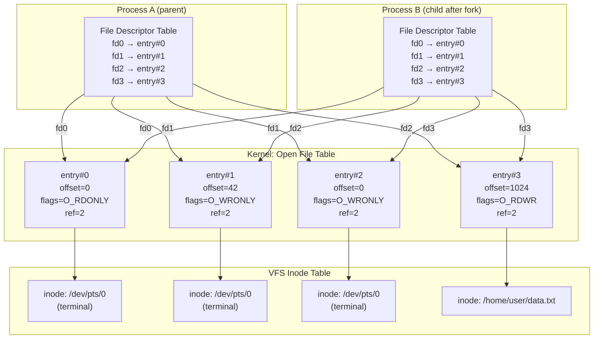
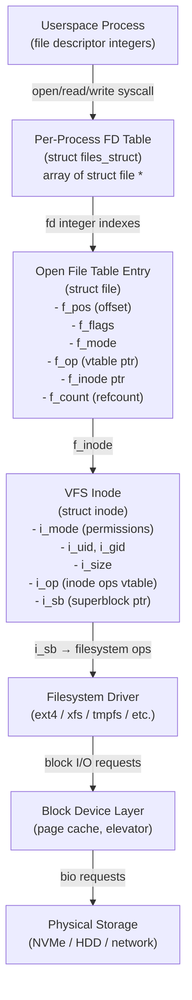
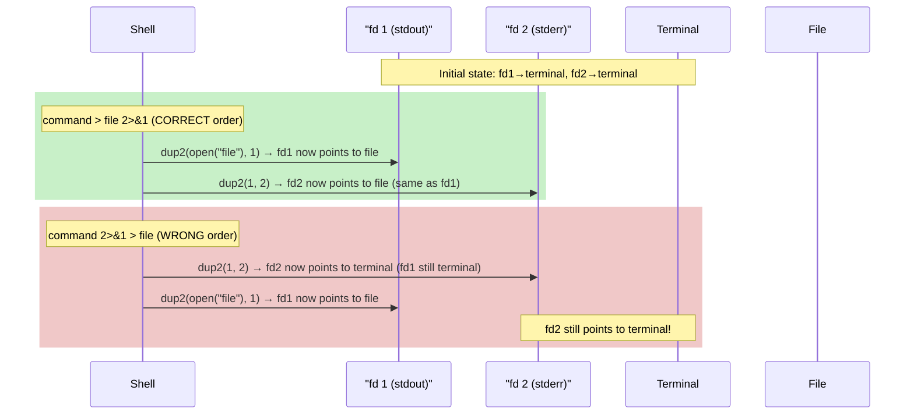
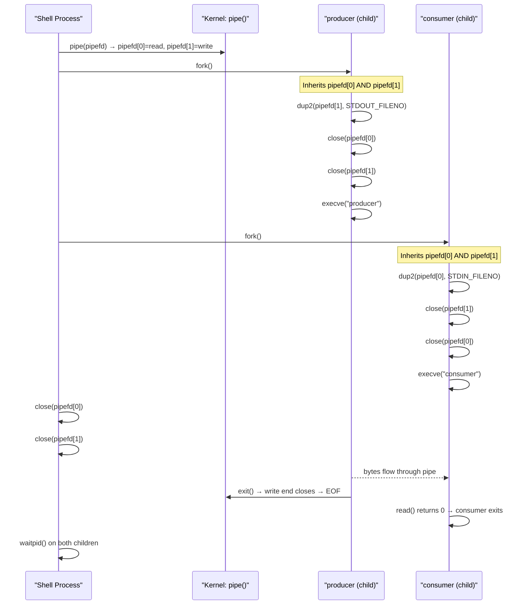
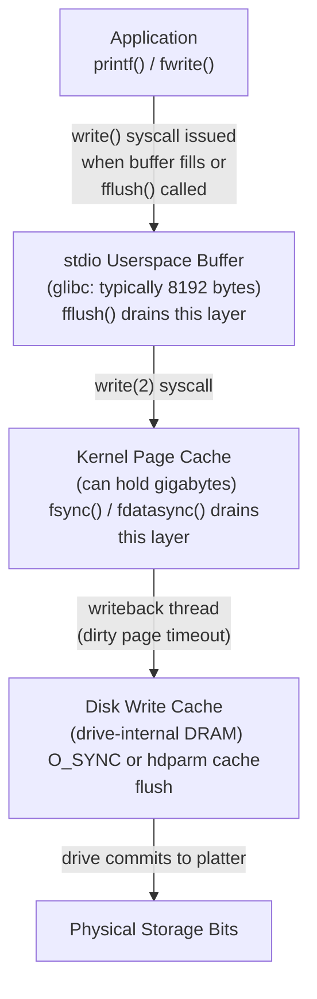

# Lesson 3: I/O Redirection, File Descriptors, and Streams

## 1. First-Principles Intuition & Invariants

When Dennis Ritchie and Ken Thompson designed Unix at Bell Labs circa 1969–1971, they made a radical architectural decision that would define systems programming for the next half-century: **everything is a file**. This deceptively simple abstraction unified the interface to hardware devices, network sockets, inter-process communication channels, and regular disk files under a single coherent model. At the heart of this model lies the **file descriptor**—a non-negative integer that serves as an opaque index into the kernel's per-process open file table.

A file descriptor is not a pointer, not a memory address, and not the file itself. It is an index into a per-process kernel data structure — the **file descriptor table** — where each slot holds a reference to an entry in a separate, process-global **open file table** (also called the open file description table). The open file table entry tracks the current seek offset, the access mode flags (`O_RDONLY`, `O_WRONLY`, etc.), the file status flags (`O_NONBLOCK`, `O_APPEND`, etc.), and a pointer to the **inode** (via a `struct file` with a `file_operations` vtable in the Linux kernel). This two-level indirection is architecturally significant: when a process forks, the child receives a copy of the file descriptor table, with each slot pointing to the **same open file table entries** as the parent. Both parent and child share seek offsets. This is not copy-on-write for the descriptors themselves — both processes literally share offset state until one of them closes or re-opens the descriptor.



Every process launched by the Linux kernel begins life with three pre-opened file descriptors established by convention — not by the kernel's hard requirement, but by the C runtime and shell. **File descriptor 0** is standard input (stdin). **File descriptor 1** is standard output (stdout). **File descriptor 2** is standard error (stderr). These three are pre-wired by the shell (or by `login`, `sshd`, or `init`/`systemd`) before the user's process starts. The kernel itself has no notion of "stdin" or "stdout" — those labels belong to convention. A process that closes fd 0 and opens a socket has not "broken stdin" in any kernel sense; it simply has a socket at index 0.

The separation of stdout and stderr encodes a foundational Unix design principle: **distinguish data from diagnostics**. A well-designed tool emits its primary result — structured, pipeable data — to stdout, while error messages, warnings, and progress indicators flow to stderr. This architectural separation means you can redirect the data stream to a file or pipeline while observing error messages on the terminal. When you execute `grep pattern largefile.txt > results.txt`, matching lines flow silently into `results.txt` via stdout, while any "No such file or directory" message appears immediately on the terminal via stderr, unaffected by the redirection.

The rule governing file descriptor allocation is deterministic and exploited heavily by the shell: **the kernel always assigns the lowest-numbered available file descriptor** when you open a new file or duplicate an existing descriptor. If descriptors 0, 1, and 2 are occupied and you open a file, the kernel assigns descriptor 3. If you then close descriptor 1 and open another file, the kernel reuses descriptor 1 — it is now the lowest available slot. This predictable assignment is the mechanical foundation of shell I/O redirection: to redirect stdout, the shell closes descriptor 1, opens the target file, and relies on the kernel to assign that file descriptor 1.

Redirection operators are not commands and do not appear in `argv`. They are **metacharacters** parsed and consumed by the shell before any command executes. When you type `command > file`, the shell: opens `file` for writing, calls `dup2()` to wire the resulting fd onto descriptor 1, closes the temporary fd, then calls `execve()` to overlay `command` on the current process image. `command` wakes up writing to fd 1 with no knowledge that the kernel routes those bytes to a disk file rather than a terminal. This is **transparent interposition at the file descriptor layer** — the defining mechanism of Unix composability.

The buffering behavior of I/O streams introduces a performance optimization layer with correctness implications. When a process writes to a file descriptor connected to a terminal, the C standard library employs **line buffering**: output accumulates in a userspace buffer until a newline character appears or the buffer fills, at which point the library issues a single `write(2)` system call. When writing to a regular file or pipe, the library switches to **full buffering**, accumulating up to `BUFSIZ` bytes (typically 8192 bytes in glibc) before flushing. This amortizes the cost of `write(2)` system calls, each of which requires a user-to-kernel mode transition. The critical implication: if a process crashes before flushing its userspace buffer, the last several kilobytes of output are lost. `fflush()` drains the userspace buffer to the kernel; `fsync()` drains the kernel page cache to physical storage.

The `/dev/fd/` directory exposes the kernel's file descriptor table as a synthetic filesystem. On Linux, `/dev/fd/` is a symlink to `/proc/self/fd/`, which the kernel populates dynamically with one entry per open descriptor in the calling process. Referencing `/dev/fd/3` as a filename argument to any program that accepts a pathname causes that program to operate on file descriptor 3, without knowing it is not a regular file. `/dev/stdin`, `/dev/stdout`, and `/dev/stderr` are symlinks to `/dev/fd/0`, `/dev/fd/1`, and `/dev/fd/2`, respectively, providing mnemonic aliases for scripts.

Pipelines are the canonical form of inter-process communication in Unix. When the shell encounters `|`, it calls `pipe()` to create an anonymous, unidirectional byte channel — a kernel buffer with a read end and a write end — then forks child processes for each stage. The shell wires the write end of the pipe onto fd 1 of the left-hand process and the read end onto fd 0 of the right-hand process. Each child closes the opposite end. When the left-hand process exits, the write end closes and the pipe reaches EOF, causing `read()` on the right-hand end to return 0, terminating the right-hand process's input loop. This coordinated file descriptor manipulation, completed entirely before either command executes, transforms independent programs into a synchronized data processing chain.

---

## 2. The Linux File Descriptor Stack: Architecture Deep-Dive

Understanding where file descriptors live in the Linux kernel clarifies the semantics of every operation performed on them.



The `struct file` (open file table entry) is the central object. Its `f_pos` field is the seek offset, shared across all file descriptors that were created from the same `open()` call or from `dup()`. Its `f_op` field points to the `file_operations` struct for the underlying file type — this is the C-level vtable dispatch that makes "everything is a file" work: regular files, pipes, sockets, `/dev/null`, and character devices all present the same `read`/`write`/`ioctl` interface but route to different implementations.

The reference count `f_count` tracks how many file descriptors point to this `struct file`. `dup()` and `fork()` increment `f_count`; `close()` decrements it. When `f_count` reaches zero, the kernel frees the `struct file` and decrements the inode's reference count. If the inode's reference count also reaches zero and the inode's link count is zero (the file was deleted with `unlink()` while still open), the kernel finally frees the data blocks. This is why you can delete a file that is currently open: the directory entry disappears immediately, but the data persists until the last `close()`.

---

## 3. Core System Calls & Their Precise Semantics

### `open(2)` — Creating or Opening a File

```c
#include <fcntl.h>

int open(const char *pathname, int flags);
int open(const char *pathname, int flags, mode_t mode);
/* Linux-specific; avoids TOCTOU races in concurrent code: */
int openat(int dirfd, const char *pathname, int flags, mode_t mode);
```

The `flags` argument is a bitwise-OR combination of an access mode and optional modifiers:

| Flag | Meaning |
|------|---------|
| `O_RDONLY` | Open for reading only |
| `O_WRONLY` | Open for writing only |
| `O_RDWR` | Open for reading and writing |
| `O_CREAT` | Create file if it does not exist (requires `mode`) |
| `O_EXCL` | Fail with `EEXIST` if file already exists (atomic with `O_CREAT`) |
| `O_TRUNC` | Truncate existing file to zero length |
| `O_APPEND` | All writes atomically seek to end before writing |
| `O_NONBLOCK` | Non-blocking mode for FIFOs and special files |
| `O_CLOEXEC` | Set close-on-exec flag atomically (avoids race with `fork`) |
| `O_SYNC` | Each write waits for I/O completion (data + metadata) |
| `O_DSYNC` | Each write waits for data I/O completion only |

The `mode` argument specifies the permission bits for newly created files. The kernel masks them with the bitwise complement of the process umask: `effective_mode = mode & ~umask`. If your umask is `0022` and you specify `0666`, the file receives `0644`. Note that `O_CREAT` without `O_EXCL` is not atomic with respect to checking file existence and creating it — another process can create the file between your check and your open. Use `O_CREAT | O_EXCL` when you require atomicity.

`openat()` is the preferred modern form: it accepts a `dirfd` argument that anchors the path resolution, eliminating time-of-check/time-of-use (TOCTOU) vulnerabilities in directory traversal and enabling correct behavior in containers with chroot-like filesystem namespaces.

On success, `open()` returns the lowest-numbered available non-negative integer file descriptor. On failure, it returns -1 and sets `errno`.

### `close(2)` — Releasing a File Descriptor

```c
#include <unistd.h>

int close(int fd);
```

`close()` releases the file descriptor `fd`, decrementing the reference count on the underlying open file table entry. If the count reaches zero, the kernel releases the `struct file`. The critical subtlety: **`close()` does not flush stdio buffers**. If your program used `fprintf()` or `fwrite()` to a `FILE *` stream, those bytes may still reside in a userspace buffer. Closing the underlying file descriptor causes those bytes to be lost. Always call `fclose()` on a `FILE *` stream (which calls `fflush()` internally) rather than `close()` on `fileno(stream)`.

A second subtlety: on Linux, `close()` can return `EINTR` if interrupted by a signal. POSIX specifies that the file descriptor is closed regardless of whether `close()` returns `EINTR`, so retrying `close()` on `EINTR` is incorrect and can close a file descriptor that was reused by another thread. The correct response to `EINTR` from `close()` is to **not retry** — the descriptor is already closed.

### `dup(2)` and `dup2(2)` — Duplicating File Descriptors

```c
#include <unistd.h>

int dup(int oldfd);
int dup2(int oldfd, int newfd);
int dup3(int oldfd, int newfd, int flags);  /* Linux-specific */
```

`dup()` creates a new file descriptor that references the same open file table entry as `oldfd`, using the lowest available descriptor number. `dup2()` does the same, but specifies the target descriptor `newfd`. If `newfd` is already open, `dup2()` closes it atomically before wiring it to `oldfd`'s entry — the close and the assignment are atomic with respect to other `dup2()` calls in the same process, though not with respect to signals. If `oldfd == newfd`, `dup2()` returns `newfd` without closing it.

`dup3()` is a Linux-specific extension that accepts a `flags` argument; the only currently defined flag is `O_CLOEXEC`, which atomically sets the close-on-exec flag on `newfd`. This avoids a race condition in multithreaded programs where a `fork()` can occur between `dup2()` and a subsequent `fcntl(newfd, F_SETFD, FD_CLOEXEC)`.

The canonical shell-redirection sequence using `dup2()`:

```c
/* Redirect stdout to "output.txt" */
int fd = open("output.txt", O_WRONLY | O_CREAT | O_TRUNC, 0666);
if (fd < 0) { perror("open"); exit(1); }
dup2(fd, STDOUT_FILENO);   /* STDOUT_FILENO == 1 */
close(fd);                  /* fd and 1 now both reference the same OFT entry;
                               close fd, leaving only 1 */
execve("/usr/bin/ls", args, envp);
/* ls writes to fd 1, bytes go to output.txt */
```

After `dup2(fd, 1)`, the open file table entry has `f_count == 2` (both `fd` and `1` reference it). After `close(fd)`, `f_count == 1`. Closing `fd` does not close the file — only `close(1)` or process exit will drop the count to zero.

### `pipe(2)` — Anonymous Inter-Process Channels

```c
#include <unistd.h>

int pipe(int pipefd[2]);
int pipe2(int pipefd[2], int flags);  /* Linux-specific */
```

`pipe()` creates an anonymous, unidirectional byte channel. `pipefd[0]` is the read end; `pipefd[1]` is the write end. The kernel allocates an internal buffer — 65536 bytes by default on Linux 2.6.11+ (previously 4096 bytes). This capacity is tunable via `fcntl(pipefd[1], F_SETPIPE_SZ, size)`.

Writes to `pipefd[1]` of up to `PIPE_BUF` bytes (4096 on Linux) are guaranteed atomic: they will not be interleaved with writes from other processes. Writes larger than `PIPE_BUF` may be interleaved. When the pipe buffer is full, `write()` blocks (or returns `EAGAIN` in non-blocking mode). When all write ends are closed, `read()` returns 0 (EOF). When all read ends are closed, `write()` to the pipe raises `SIGPIPE` and returns -1 with `errno == EPIPE`.

`pipe2()` accepts `O_CLOEXEC` and `O_NONBLOCK` flags, applying them atomically during pipe creation, eliminating the fork-before-fcntl race.

### `fcntl(2)` — Descriptor Control Operations

```c
#include <fcntl.h>

int fcntl(int fd, int cmd, ...);
```

`fcntl()` is the catch-all for file descriptor control. Relevant commands:

| Command | Effect |
|---------|--------|
| `F_DUPFD` | Duplicate fd to lowest fd >= arg |
| `F_DUPFD_CLOEXEC` | Same, but set `FD_CLOEXEC` atomically |
| `F_GETFD` / `F_SETFD` | Get/set file descriptor flags (`FD_CLOEXEC`) |
| `F_GETFL` / `F_SETFL` | Get/set file status flags (`O_NONBLOCK`, `O_APPEND`) |
| `F_GETPIPE_SZ` / `F_SETPIPE_SZ` | Get/set pipe buffer capacity (Linux) |

The close-on-exec flag (`FD_CLOEXEC`) is a file descriptor flag (stored in the fd table, not the open file table entry), so setting it on one duplicate does not affect others sharing the same open file table entry. This is a common source of confusion: `dup2()` creates a new descriptor that **does not** inherit `FD_CLOEXEC` from the original — the close-on-exec flag defaults to clear on duplicated descriptors unless you use `dup3()` or `F_DUPFD_CLOEXEC`.

---

## 4. Shell Redirection: Mechanics and Order Dependence

Shell redirection operators are parsed left-to-right. Each operator is applied sequentially to the shell's current file descriptor table before `execve()` runs. The order is not cosmetic — it changes semantics.

### Output Redirection: `>`

```bash
command > file
```

The shell: opens `file` with `O_WRONLY | O_CREAT | O_TRUNC | 0666`, calls `dup2(fd, 1)`, closes `fd`, forks and execs `command`. If `file` already exists, it is truncated to zero bytes before `command` runs. The previous content is irrecoverable without backups.

Bash provides `set -o noclobber` (`set -C`) to protect against accidental truncation. With noclobber active, `> file` on an existing file fails with an error. Use `>| file` to override noclobber for a specific redirection.

### Append Redirection: `>>`

```bash
command >> file
```

Opens with `O_WRONLY | O_CREAT | O_APPEND`. The `O_APPEND` flag causes each `write()` call to atomically seek to the file's current end before writing. This atomicity guarantee (backed by POSIX) means that multiple independent processes appending to the same file will not corrupt each other's output, provided each individual `write()` is smaller than the filesystem's atomic write limit (typically one block, but guaranteed at the `write()` syscall level for `O_APPEND` on local filesystems).

### Input Redirection: `<`

```bash
command < file
```

Opens `file` with `O_RDONLY`, calls `dup2(fd, 0)`, closes `fd`. `command` reads from fd 0 and receives the file's contents.

### Error Redirection: `2>`

```bash
command 2> errlog
```

Opens `errlog` with `O_WRONLY | O_CREAT | O_TRUNC`, calls `dup2(fd, 2)`, closes `fd`. stderr flows to `errlog`; stdout remains unchanged.

### The Critical Order Dependence of `2>&1`

The most commonly misunderstood redirection pattern:

```bash
# CORRECT: both stdout and stderr go to file
command > file 2>&1

# WRONG: stdout goes to file, stderr goes to terminal
command 2>&1 > file
```

The second form fails because redirection is processed left-to-right:

1. `2>&1` is processed first. At this moment, fd 1 still points to the terminal. So `dup2(1, 2)` makes fd 2 point to the terminal.
2. `> file` is processed next. `dup2(newfd, 1)` makes fd 1 point to `file`.

Result: fd 1 → file, fd 2 → terminal. Counterintuitive, but mechanically correct.



Bash also provides `&>` as a shorthand:

```bash
command &> file   # equivalent to: command > file 2>&1
command &>> file  # equivalent to: command >> file 2>&1
```

`&>` is a Bash-ism. It is not portable to POSIX `sh` or `dash`. Use `> file 2>&1` for portable scripts.

### Here-Documents: `<<`

```bash
command << DELIMITER
  line one
  line two
DELIMITER
```

The shell reads lines following `<<` until it encounters a line containing only the delimiter token (`DELIMITER` above). The accumulated text is written to a temporary file (not a pipe — Bash uses a temp file for here-docs to allow `lseek()`), and the temp file's read end is connected to fd 0 of `command`. The temp file is unlinked immediately after creation, so it has no visible name but persists until the fd is closed.

Quoting the delimiter suppresses variable and command substitution within the body:

```bash
cat << 'EOF'
  No $VARIABLE expansion here.
  No $(command substitution) either.
EOF
```

Without quotes, the shell expands `$VAR` and `$(cmd)` within the body before passing it to `command`.

Here-strings (`<<<`) feed a single string to stdin without a temporary file:

```bash
grep "pattern" <<< "$variable"
```

### Process Substitution: `<(cmd)` and `>(cmd)`

Bash and zsh support process substitution, which makes the stdout of a subcommand appear as a file path:

```bash
diff <(sort file1.txt) <(sort file2.txt)
```

The shell creates a named pipe (FIFO) for each substitution under `/dev/fd/` or `/proc/self/fd/`, forks a subshell to run `sort`, and wires the subshell's stdout to the FIFO's write end. The substituted text in the command line becomes `/dev/fd/N` for some N. `diff` receives two filename arguments, opens them, and reads sorted content from the FIFOs without knowing they are not regular files. This enables programs that accept only filenames (and cannot read from stdin) to participate in pipelines.

```bash
# Feed command output as a "file" to a program requiring a path
wc -l <(find /usr -name "*.conf" 2>/dev/null)
```

`>(cmd)` works in reverse: the substituted path is the write end of a FIFO; writing to it feeds `cmd`'s stdin.

```bash
# Tee output to two processing pipelines simultaneously
command > >(pipeline_a) > >(pipeline_b)
```

---

## 5. File Descriptor Inheritance, Pipelines, and Process Trees

The relationship between `fork()`, `execve()`, and file descriptor inheritance is the mechanical basis of all shell pipeline behavior.



The critical invariant: **the shell must close both ends of the pipe after forking**. If the shell retains the write end open, `consumer` will never see EOF — the kernel tracks whether any write end remains open. The shell's retained write-end keeps the pipe alive indefinitely. This is the most common source of shell script deadlocks involving background processes and pipelines.

File descriptors are inherited across `execve()` by default. The kernel replaces the process image but preserves the file descriptor table. This is intentional: the shell sets up redirection, then `execve()`s the target command, which wakes up with the pre-configured file descriptors. The close-on-exec flag (`FD_CLOEXEC`, set via `fcntl(fd, F_SETFD, FD_CLOEXEC)` or `O_CLOEXEC` at open time) suppresses this inheritance for specific descriptors. Modern code should set `O_CLOEXEC` on every file descriptor that should not leak into child processes.

A subtle correctness issue in multithreaded programs: the sequence `open()` → `fcntl(fd, F_SETFD, FD_CLOEXEC)` is not atomic. If a `fork()` occurs between the two calls, the child inherits the descriptor without `FD_CLOEXEC`. This race is eliminated by using `O_CLOEXEC` in the `open()` flags, which is why POSIX.1-2008 and Linux added it. Similarly, `pipe2(pipefd, O_CLOEXEC)` atomically creates a pipe with close-on-exec set on both ends.

---

## 6. File Descriptor Cloning and Restoration in Shell Scripts

Bash's `exec` builtin performs redirection in the current shell process rather than in a subshell, enabling you to save and restore stream state:

```bash
#!/usr/bin/env bash

# Save original stdout and stderr to high-numbered descriptors
exec 3>&1 4>&2

# Redirect both to a log file for a block of commands
exec 1>/tmp/session.log 2>&1

echo "This goes to the log."
ls /nonexistent  # Error also goes to log.

# Restore original stdout and stderr
exec 1>&3 2>&4

# Close the saved copies
exec 3>&- 4>&-

echo "This appears on the terminal again."
```

The `N>&-` syntax closes descriptor N. This is the shell-level equivalent of `close(N)` in C.

Descriptors 3–9 are conventionally available for user scripts. Descriptors 10 and above are used internally by Bash (for `BASH_XTRACEFD`, co-processes, etc.) and should be avoided unless you have specific knowledge of what your Bash version reserves.

---

## 7. Buffering: Userspace, Kernel, and Storage Layers

I/O buffering exists at three distinct layers, each with independent flush semantics:



A `printf()` that returns to the caller does not guarantee the bytes have left the process, let alone reached disk. Only a full `fflush()` → `fsync()` chain guarantees physical durability.

### stdio Buffering Modes

The C standard library (`stdio`) supports three modes, configured with `setvbuf()`:

```c
#include <stdio.h>

/* Must be called before any I/O on stream, after fopen() */
int setvbuf(FILE *stream, char *buf, int mode, size_t size);
```

| Mode constant | Behavior | Default for |
|---------------|----------|-------------|
| `_IONBF` | Unbuffered: each operation calls `write()` immediately | `stderr` |
| `_IOLBF` | Line-buffered: flush on `\n` or when buffer fills | `stdout` when connected to a terminal |
| `_IOFBF` | Fully buffered: flush only when buffer fills or explicit `fflush()` | `stdout` when connected to a file/pipe; all `fopen()` streams |

`stderr` is unbuffered by default. This guarantees that error messages appear immediately, even if the program crashes before flushing other streams — which is exactly the desired behavior for diagnostics.

The buffering mode is determined at the first I/O operation on the stream. When stdout is redirected to a pipe or file, it switches from line-buffered to fully buffered. This is the reason `grep --line-buffered` and similar flags exist: they force line-buffered output even when writing to a pipe, ensuring downstream consumers see data line-by-line rather than in large chunks.

```bash
# Without --line-buffered, grep's output is block-buffered when piped.
# Real-time monitoring requires line buffering:
tail -f /var/log/syslog | grep --line-buffered "ERROR" | tee -a errors.log
```

Python's `sys.stdout` is line-buffered when connected to a terminal and fully buffered otherwise. The `-u` flag forces unbuffered I/O:

```bash
python3 -u script.py | downstream_processor
```

### Flushing and Durability in C

```c
#include <stdio.h>
#include <unistd.h>

void write_critical_data(FILE *f, const char *data) {
    fputs(data, f);

    /* Layer 1: Drain glibc userspace buffer to kernel */
    if (fflush(f) != 0) {
        perror("fflush");
        return;
    }

    /* Layer 2: Drain kernel page cache to storage device.
     * fdatasync() omits metadata (mtime, etc.) for lower overhead. */
    if (fdatasync(fileno(f)) != 0) {
        perror("fdatasync");
        return;
    }

    /* After fdatasync() returns, the data survives a kernel crash.
     * It does NOT survive a storage device power failure unless the
     * device honors flush commands (many SSDs lie about this). */
}
```

`fsync()` writes both data and metadata (modification time, file size). `fdatasync()` writes only data, skipping metadata unless the metadata is needed to access the data (e.g., file size change). For append-only logs, `fdatasync()` is preferred for lower overhead.

### Non-Blocking I/O

Setting `O_NONBLOCK` on a file descriptor changes `read()` and `write()` from blocking to immediate-return semantics:

```c
#include <fcntl.h>
#include <errno.h>

void set_nonblocking(int fd) {
    int flags = fcntl(fd, F_GETFL, 0);
    if (flags == -1) { perror("fcntl F_GETFL"); return; }
    if (fcntl(fd, F_SETFL, flags | O_NONBLOCK) == -1) {
        perror("fcntl F_SETFL");
    }
}
```

In non-blocking mode: `read()` on an empty pipe returns -1 with `errno == EAGAIN` (not 0, which would mean EOF). `write()` on a full pipe returns -1 with `errno == EAGAIN`. Your code must handle `EAGAIN` by deferring and retrying. Non-blocking I/O is the foundation of event-driven servers (using `select()`, `poll()`, or `epoll()`) but significantly complicates program logic compared to blocking I/O.

**Important correction to a common misconception**: in non-blocking mode, `read()` does **not** return 0 when no data is available — it returns -1 with `EAGAIN`/`EWOULDBLOCK`. A return of 0 from `read()` always means EOF (the write end of the pipe is closed, or the peer closed a socket). This distinction is critical for correct non-blocking I/O loop logic.

---

## 8. Advanced Pipeline Patterns

### Multi-Stage Pipelines and Exit Status

In a pipeline `a | b | c`, the shell forks three processes. The exit status of a bare pipeline is the exit status of the **last** command (`c`), regardless of whether `a` or `b` failed. This is a frequent correctness bug in scripts. Bash provides `pipefail`:

```bash
set -o pipefail
# Now the pipeline's exit status is the rightmost non-zero exit status.
# If all commands succeed, the status is 0.

# Example: will now fail if grep finds no matches
generate_data | grep "pattern" | process_results
```

Access individual pipeline exit statuses via the `PIPESTATUS` array (Bash-specific):

```bash
false | true | false
echo "${PIPESTATUS[@]}"   # prints: 1 0 1
```

### Named Pipes (FIFOs)

Named pipes persist as filesystem objects and allow unrelated processes to communicate:

```bash
mkfifo /tmp/channel

# In one terminal (blocks until a reader opens the other end):
producer_process > /tmp/channel

# In another terminal:
consumer_process < /tmp/channel

# Cleanup:
rm /tmp/channel
```

A FIFO open blocks until both a reader and a writer have opened it (unless `O_NONBLOCK` is used). The kernel enforces this rendezvous because a pipe with only a reader and no writer would immediately return EOF, and a pipe with only a writer and no reader would immediately raise `SIGPIPE`.

### Bidirectional Communication with `coproc`

Bash 4.0+ provides the `coproc` builtin, which creates a background process with its stdin and stdout wired to the shell via a pipe pair:

```bash
coproc MY_PROC { bc -l; }

# MY_PROC[0] is the read end (bc's stdout)
# MY_PROC[1] is the write end (bc's stdin)
echo "scale=10; 4*a(1)" >&"${MY_PROC[1]}"
read result <&"${MY_PROC[0]}"
echo "pi ≈ $result"
```

Under the hood, Bash creates two pipes (one for each direction), forks a subshell for the coprocess, and wires them up with `dup2()`. The array `MY_PROC` contains the shell-side file descriptor numbers.

### Redirecting in Loops Without Subshells

A common pitfall: piping into a loop creates a subshell, so variable assignments inside the loop are lost:

```bash
# BUG: $count is 0 after the loop — the loop runs in a subshell
count=0
cat file.txt | while read line; do
    ((count++))
done
echo "count: $count"   # prints 0

# FIX: redirect directly into the while, no subshell
count=0
while read line; do
    ((count++))
done < file.txt
echo "count: $count"   # correct
```

The `< file.txt` after `done` redirects fd 0 for the entire `while` compound command without creating a subshell, so variable assignments in the loop body persist to the enclosing shell.

---

## 9. Practical Production Examples

### Example 1: Logging with Timestamped Stdout and Stderr

```bash
#!/usr/bin/env bash
# Redirect both streams to a timestamped log file, while keeping
# a copy of stderr on the original terminal.

LOGFILE="/var/log/myjob/$(date +%Y%m%d_%H%M%S).log"
mkdir -p "$(dirname "$LOGFILE")"

# Save original stderr
exec 3>&2

# Pipe stdout through ts(1) for timestamps, tee to log and original stdout
# Pipe stderr through ts(1), tee to log and original stderr (fd 3)
exec \
    1> >(ts '%Y-%m-%dT%H:%M:%.S' | tee -a "$LOGFILE") \
    2> >(ts '%Y-%m-%dT%H:%M:%.S' | tee -a "$LOGFILE" >&3)

echo "Job starting"
some_long_running_command
echo "Job complete"
```

### Example 2: Atomic File Updates via Redirection

Writing directly to a destination file is dangerous: a crash mid-write leaves a partial file. The correct pattern uses a temp file and atomic rename:

```bash
#!/usr/bin/env bash
# Atomically update /etc/app/config.json

DEST="/etc/app/config.json"
TMPFILE="$(mktemp "${DEST}.XXXXXX")"

# Ensure temp file is cleaned up on error
trap 'rm -f "$TMPFILE"' EXIT

generate_config > "$TMPFILE"

# Validate before replacing
if ! python3 -m json.tool "$TMPFILE" > /dev/null 2>&1; then
    echo "ERROR: Generated config is not valid JSON" >&2
    exit 1
fi

# Atomic swap: rename is atomic within the same filesystem
mv -f "$TMPFILE" "$DEST"
trap - EXIT   # Clear trap; temp file now has the target name
```

`mv` on the same filesystem calls `rename(2)`, which atomically updates the directory entry. Readers of `$DEST` see either the old file or the new file, never a partial write.

### Example 3: Parallel Processing with FIFOs and `tee`

```bash
#!/usr/bin/env bash
# Process a large dataset through two independent pipelines simultaneously
# without reading the source file twice.

INPUT="large_dataset.csv"

# Create named pipes for the two branches
mkfifo /tmp/branch_a /tmp/branch_b

# Feed the input to both pipes simultaneously (background)
tee /tmp/branch_a /tmp/branch_b < "$INPUT" > /dev/null &
TEE_PID=$!

# Run both pipelines in parallel
pipeline_a < /tmp/branch_a > results_a.txt &
pipeline_b < /tmp/branch_b > results_b.txt &

# Wait for all background jobs
wait $TEE_PID
wait

rm /tmp/branch_a /tmp/branch_b
```

### Example 4: Robust C Pipeline with Error Handling

```c
#include <unistd.h>
#include <stdlib.h>
#include <stdio.h>
#include <string.h>
#include <errno.h>
#include <sys/types.h>
#include <sys/wait.h>
#include <fcntl.h>

/*
 * Run:  sort < input_file | uniq -c > output_file
 * Demonstrates: pipe(), fork(), dup2(), execvp(), waitpid() with
 * proper error handling and resource cleanup.
 */

static void die(const char *msg) {
    perror(msg);
    exit(EXIT_FAILURE);
}

int main(int argc, char *argv[]) {
    if (argc != 3) {
        fprintf(stderr, "Usage: %s <input_file> <output_file>\n", argv[0]);
        return EXIT_FAILURE;
    }

    int pipefd[2];
    if (pipe2(pipefd, O_CLOEXEC) == -1) die("pipe2");

    /* ---- Fork the producer (sort) ---- */
    pid_t prod_pid = fork();
    if (prod_pid == -1) die("fork(producer)");

    if (prod_pid == 0) {
        /* Child: open input, wire to stdin; wire pipe write-end to stdout */
        int infd = open(argv[1], O_RDONLY | O_CLOEXEC);
        if (infd == -1) die("open(input)");

        /* pipe2 set O_CLOEXEC; we need fd 0 and 1 without it */
        if (dup2(infd, STDIN_FILENO) == -1) die("dup2(infd, stdin)");
        if (dup2(pipefd[1], STDOUT_FILENO) == -1) die("dup2(pipe_write, stdout)");
        /* infd and pipefd[] will be closed by O_CLOEXEC on execvp */

        char *sort_args[] = {"sort", NULL};
        execvp("sort", sort_args);
        die("execvp(sort)");  /* reached only on error */
    }

    /* ---- Fork the consumer (uniq) ---- */
    pid_t cons_pid = fork();
    if (cons_pid == -1) die("fork(consumer)");

    if (cons_pid == 0) {
        /* Child: wire pipe read-end to stdin; open output for stdout */
        int outfd = open(argv[2], O_WRONLY | O_CREAT | O_TRUNC | O_CLOEXEC, 0644);
        if (outfd == -1) die("open(output)");

        if (dup2(pipefd[0], STDIN_FILENO) == -1) die("dup2(pipe_read, stdin)");
        if (dup2(outfd, STDOUT_FILENO) == -1) die("dup2(outfd, stdout)");

        char *uniq_args[] = {"uniq", "-c", NULL};
        execvp("uniq", uniq_args);
        die("execvp(uniq)");
    }

    /* ---- Parent: close pipe ends, wait for both children ---- */
    /*
     * CRITICAL: If parent does not close pipefd[1], consumer never sees EOF.
     * O_CLOEXEC handles child-side closure; parent must close explicitly.
     */
    close(pipefd[0]);
    close(pipefd[1]);

    int status;
    int exit_code = EXIT_SUCCESS;

    waitpid(prod_pid, &status, 0);
    if (!WIFEXITED(status) || WEXITSTATUS(status) != 0) {
        fprintf(stderr, "sort failed with status %d\n", WEXITSTATUS(status));
        exit_code = EXIT_FAILURE;
    }

    waitpid(cons_pid, &status, 0);
    if (!WIFEXITED(status) || WEXITSTATUS(status) != 0) {
        fprintf(stderr, "uniq failed with status %d\n", WEXITSTATUS(status));
        exit_code = EXIT_FAILURE;
    }

    return exit_code;
}
```

### Example 5: Python Script with Explicit Buffering Control

```python
#!/usr/bin/env python3
"""
Demonstrates stream buffering control in Python for pipeline-aware output.
Run as: python3 this_script.py | downstream_consumer
"""
import sys
import os
import time

def main():
    # Force line buffering on stdout even when piped
    # (equivalent to python3 -u or PYTHONUNBUFFERED=1)
    sys.stdout.reconfigure(line_buffering=True)

    for i in range(10):
        # With line buffering, each print() flushes immediately (ends with \n)
        print(f"Processing item {i:04d}", flush=False)
        time.sleep(0.1)

    # For binary output to stdout, bypass stdio entirely
    stdout_fd = sys.stdout.fileno()   # == 1
    os.write(stdout_fd, b"Binary data written directly to fd 1\n")

    # Demonstrate /dev/fd/ access
    with open("/dev/fd/1", "wb") as f:
        f.write(b"Written via /dev/fd/1\n")

if __name__ == "__main__":
    main()
```

---

## 10. Debugging File Descriptor Issues

### Inspecting Open Descriptors at Runtime

```bash
# All open fds of the current shell process
ls -la /proc/self/fd/

# All open fds of a specific process (requires permission or root)
ls -la /proc/1234/fd/

# Show fd limits (soft and hard) for a process
cat /proc/1234/limits | grep "open files"

# Human-readable open files with types, modes, offsets
lsof -p 1234

# Show all processes with a specific file open
lsof /var/log/syslog

# Show all open pipes and sockets for a user
lsof -u username -a -i -U
```

### Tracing System Calls with `strace`

```bash
# Trace all file-descriptor-related syscalls for a command
strace -e trace=openat,open,read,write,close,dup2,dup3,pipe,pipe2,fcntl \
       -o /tmp/trace.txt \
       bash -c 'echo hello > /tmp/out.txt'

# Attach to a running process
strace -p 1234 -e trace=read,write 2>&1 | head -50

# Count syscall frequencies (useful for identifying hot paths)
strace -c command arg1 arg2
```

`strace` output for a simple `echo hello > /tmp/out.txt` reveals the full redirection mechanism:

```text
openat(AT_FDCWD, "/tmp/out.txt", O_WRONLY|O_CREAT|O_TRUNC|O_CLOEXEC, 0666) = 3
dup2(3, 1)                              = 1
close(3)                                = 0
write(1, "hello\n", 6)                 = 6
```

This confirms the exact sequence described in Section 4.

### Detecting Descriptor Leaks

File descriptor leaks — opening descriptors that are never closed — exhaust the per-process limit (`ulimit -n`, typically 1024 or 65536) and cause intermittent `EMFILE` errors:

```bash
# Check current open fd count for a process
ls /proc/1234/fd | wc -l

# Monitor fd count growth over time (leak indicator)
watch -n 1 'ls /proc/1234/fd | wc -l'

# Valgrind with file descriptor tracking (Linux)
valgrind --track-fds=yes ./program
```

In C, tools like `AddressSanitizer` do not catch fd leaks. Use `valgrind --track-fds=yes` or audit with `/proc/self/fd` at key points.

### Handling SIGPIPE

A program that writes to a pipe whose read end has been closed receives `SIGPIPE`. The default handler terminates the process. Many programs (servers, log writers) should not terminate on a broken pipe — they should detect the error and handle it gracefully:

```c
#include <signal.h>
#include <errno.h>

/* Option 1: Ignore SIGPIPE globally; handle EPIPE in write() return value */
signal(SIGPIPE, SIG_IGN);

ssize_t n = write(fd, buf, len);
if (n == -1 && errno == EPIPE) {
    /* Pipe is broken; reader exited */
    handle_broken_pipe();
}

/* Option 2: Block SIGPIPE for a specific write using sigprocmask */
sigset_t block_mask, old_mask;
sigemptyset(&block_mask);
sigaddset(&block_mask, SIGPIPE);
sigprocmask(SIG_BLOCK, &block_mask, &old_mask);

n = write(fd, buf, len);
int saved_errno = errno;

sigprocmask(SIG_SETMASK, &old_mask, NULL);  /* Restore original mask */
errno = saved_errno;
if (n == -1 && errno == EPIPE) { /* handle */ }
```

### `/dev/null`: The Null Device

`/dev/null` is a character device (`major=1, minor=3`) implemented directly in the kernel (`drivers/char/mem.c`). `read()` from it always returns 0 (EOF immediately). `write()` to it always succeeds, discarding all data, returning the count of bytes "written." It never blocks.

```bash
# Silence stdout, keep stderr visible
command > /dev/null

# Silence stderr, keep stdout
command 2> /dev/null

# Suppress all output
command > /dev/null 2>&1

# Check if a command succeeds without seeing output
if grep -q "pattern" file > /dev/null 2>&1; then
    echo "Found"
fi
# Note: grep -q already suppresses output; the redirect is redundant but harmless
```

---

## 11. File Descriptor Limits and Tuning

The kernel enforces two levels of fd limits:

| Limit | Scope | Default (typical) | Tuning |
|-------|-------|-------------------|--------|
| `RLIMIT_NOFILE` soft | Per-process, enforced | 1024 | `ulimit -n 65536` |
| `RLIMIT_NOFILE` hard | Per-process, ceiling | 65536 | root or `/etc/security/limits.conf` |
| `fs.file-max` | System-wide total | ~9 million | `sysctl -w fs.file-max=N` |
| `fs.nr_open` | Per-process maximum | 1048576 | `sysctl -w fs.nr_open=N` |

High-performance servers (databases, web servers, message brokers) routinely require tens of thousands of simultaneous open file descriptors. The soft limit is what the process sees; it can be raised up to the hard limit with `setrlimit(RLIMIT_NOFILE, ...)` or `ulimit -n`. The hard limit requires `CAP_SYS_RESOURCE` to raise above the kernel's `fs.nr_open` ceiling.

```bash
# Check limits for the current shell session
ulimit -a | grep "open files"

# Raise soft limit for the current session
ulimit -n 65536

# Check system-wide file descriptor usage
cat /proc/sys/fs/file-nr
# Output: <allocated> <freed but not released> <maximum>

# Persistent configuration (survives reboot) via /etc/security/limits.conf
# appuser  soft  nofile  65536
# appuser  hard  nofile  131072
```

---

## Summary

The Unix file descriptor model is an exercise in architectural minimalism with maximum compositional power. Three design decisions account for most of the model's expressive range: the integer-indexed per-process table that isolates processes from each other while enabling controlled sharing; the lowest-available-fd allocation rule that makes shell redirection mechanically predictable; and the `fork()`-then-`exec()` process creation model that gives the shell a window to rewire a process's file descriptors before the target program ever runs.

The semantic layers — from userspace stdio buffers through the kernel page cache to physical storage — are independent and require explicit coordination (`fflush()`, `fdatasync()`, `fsync()`) when durability matters. Buffering mode changes silently when stdout is redirected, which is why tools in long pipelines often need `--line-buffered`, `-u`, or `PYTHONUNBUFFERED=1` to maintain responsiveness.

Mastery of these mechanisms — file descriptor lifecycle, `dup2()` semantics, pipe EOF propagation, redirection ordering, and buffering layer interactions — is the prerequisite for correct systems programming, robust shell scripting, and effective debugging of I/O-related failures.
