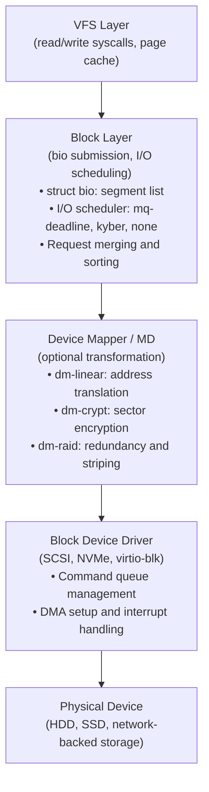

# Lesson 1: Storage Abstraction Fundamentals

## 1. First-Principles Intuition & Invariants

Every filesystem begins not with directories or inodes, but with the raw mechanical reality of persistent storage: spinning magnetic platters, NAND flash cells, or shingled magnetic recording tracks. Yet no filesystem implementation directly manipulates these physical geometries. Instead, all modern filesystems rest upon a carefully engineered illusion—the block device abstraction—which transforms the chaotic heterogeneity of storage hardware into a uniform array of fixed-size, randomly addressable blocks. This abstraction represents one of computing's most successful contracts: hardware vendors promise to expose storage as an array of sectors, and filesystem designers promise to organize all data structures atop this linear address space.

The block device abstraction emerged from the recognition that filesystems require predictable addressing semantics independent of whether data resides on a 1970s IBM 3340 disk drive, a contemporary NVMe solid-state drive, or a cloud-backed network volume. The fundamental contract specifies that storage appears as a one-dimensional array of blocks, each uniquely identified by a logical block address (LBA), and each block accessible in constant time through read and write operations. This contract deliberately conceals rotational latency, head seek mechanics, erase-before-write constraints in flash memory, and the complex remapping strategies employed by modern storage controllers. The filesystem sees only an array; the hardware beneath translates LBA operations into physical media commands.

The block size itself represents a carefully tuned engineering compromise. Traditional hard drives exposed 512-byte sectors, a size rooted in 1950s IBM engineering when memory was expensive and transfer reliability depended on small atomic units. As storage density increased, the industry transitioned to 4096-byte (4 KiB) physical sectors, which reduced format overhead and improved error correction efficiency. Modern filesystems typically operate on block sizes matching or exceeding the physical sector size—common choices include 4 KiB for general-purpose filesystems like ext4 and XFS, though high-performance configurations may use 64 KiB or larger blocks to amortize metadata overhead across larger I/O operations. The choice of block size cascades through every filesystem data structure: smaller blocks reduce internal fragmentation for small files but increase metadata overhead; larger blocks improve sequential throughput but waste space when storing many small files.

Understanding storage abstraction requires grasping the multi-layered hierarchy that transforms raw media into the uniform block device interface. At the physical layer, hard disk drives organize data on concentric tracks divided into sectors, with mechanical heads that must physically seek to the correct cylinder before reading data. Solid-state drives replace mechanical motion with NAND flash organized into pages (typically 4–16 KiB), blocks (128–256 pages), and planes, where erases occur at block granularity but writes occur at page granularity, necessitating complex flash translation layers (FTLs) to map logical addresses to physical pages. Enterprise storage introduces additional layers: RAID controllers aggregate multiple physical drives into logical volumes with redundancy schemes; storage area networks (SANs) expose remote storage as local block devices through iSCSI or Fibre Channel protocols; and cloud providers virtualize storage through distributed systems like Amazon EBS, which replicate blocks across availability zones while maintaining the block device illusion.

The Linux block layer sits at the nexus of this abstraction hierarchy, mediating between filesystem implementations and the underlying device drivers. Each block device appears in the `/dev/` filesystem hierarchy—`/dev/sda` for SCSI/SATA drives, `/dev/nvme0n1` for NVMe devices, `/dev/vda` for paravirtualized disks—and the kernel maintains a request queue for each device where I/O operations await scheduling and dispatch. The block layer implements elevator algorithms (more formally called I/O schedulers) that reorder pending requests to optimize device throughput: the `mq-deadline` scheduler enforces latency bounds while allowing beneficial reordering; the `kyber` scheduler adapts to device characteristics through control theory; and the `none` scheduler simply dispatches requests immediately for NVMe devices where the device's internal parallelism exceeds any reordering benefit the kernel could provide.

Logical block addressing itself operates through a strict invariant: blocks are numbered sequentially from zero, and accessing block *N* requires no knowledge of blocks *N*-1 or *N*+1. This location independence enables critical filesystem algorithms—directory tree traversal need not consider physical locality, and allocators can place data anywhere in the address space. Yet while the abstraction guarantees correctness regardless of placement, performance depends entirely on understanding the mapping between logical addresses and physical geometry. On rotating media, sequential LBAs that map to sequential physical sectors deliver 100–200 MB/s sustained throughput, while random access incurs 5–10 ms seek latencies, reducing effective throughput to mere tens of operations per second. Modern filesystems employ extent-based allocation to maintain long sequential runs of blocks, and log-structured designs transform random writes into sequential log appends.

The abstraction boundary reveals its seams under scrutiny. Block devices expose an `ioctl` interface where filesystem implementations and system administrators query device characteristics: sector size, optimal I/O alignment, discard/TRIM support for freed blocks, write cache behavior, and rotational versus non-rotational media. The `blkid` utility probes superblock signatures to identify filesystem types and UUIDs, while `blockdev --getbsz` reports the logical block size the kernel uses for buffering. Applications performing direct I/O must align buffers and transfer sizes to the logical block size, enforced by the kernel through `-EINVAL` errors on misaligned operations. These requirements leak through the abstraction, forcing awareness of the underlying block granularity despite the promise of uniform addressing.

Partition tables introduce an additional layer of indirection atop the raw block device. Master Boot Record (MBR) partitioning divides a disk into up to four primary partitions, each described by a 16-byte entry specifying starting LBA and length in sectors, with one primary partition designated as an extended partition containing a chain of logical partitions. GUID Partition Table (GPT) supersedes MBR with a more robust scheme: a protective MBR at LBA 0 for backward compatibility, a primary GPT header at LBA 1 containing partition array location and CRC32 checksums, 128-byte partition entries supporting up to 128 partitions, and a backup GPT header at the disk's final LBA. Each partition appears as its own block device (`/dev/sda1`, `/dev/nvme0n1p2`) with LBA space starting from zero, the kernel's partition parser having translated the partition's offset within the parent device.

The storage hierarchy culminates in device mapper (DM) targets, which provide flexible block device transformations entirely in software. The `dm-linear` target concatenates or splits physical devices, enabling volume extension without filesystem awareness. The `dm-crypt` target implements full-disk encryption by encrypting each sector with AES-XTS and a sector-specific tweak, ensuring that identical plaintext blocks at different LBAs produce different ciphertext. The `dm-thin` target enables thin provisioning, where logical volumes appear fully allocated but consume physical blocks only as written, with a metadata device tracking the LBA-to-physical-block mapping. These DM transformations preserve the block device abstraction—a filesystem atop `dm-crypt` issues read and write requests to logical addresses, unaware that each I/O triggers decryption or encryption before reaching the underlying hardware.

## 2. Core Architecture & Mechanics

The block device subsystem architecture in Linux comprises five interconnected layers, each responsible for distinct aspects of the storage abstraction. At the apex, filesystems and applications issue I/O requests through the Virtual Filesystem Switch (VFS) or direct `open(O_DIRECT)` calls. These requests descend into the page cache for buffered I/O or directly into the block layer for direct I/O, where they transform into `struct bio` (block I/O) structures—the kernel's fundamental unit of block device transfer.

The `struct bio` encapsulates a single block I/O operation directed at a specific block device. Each bio contains a `bi_iter` field specifying the starting sector (expressed as a 512-byte sector number regardless of the device's actual sector size, maintaining a unified kernel addressing convention), and a `bi_io_vec` array of segments describing discontiguous physical memory regions to transfer. This scatter-gather capability proves essential because the page cache allocates memory in discrete page frames that may not occupy contiguous physical addresses—a single 16 KiB read might span four non-contiguous 4 KiB pages, and the bio structure captures this fragmentation without requiring the block layer to perform expensive memory copying or allocation of contiguous bounce buffers.

Submitting a bio initiates a pipeline of transformations and optimizations. The block layer first consults the device's request queue to determine if the new bio can merge with existing pending requests—merging consecutive LBA ranges into a single hardware command reduces overhead and improves device throughput. If merging succeeds, the bio attaches to an existing request structure; otherwise, the block layer allocates a new request and invokes the I/O scheduler to determine insertion position within the dispatch queue. The scheduler's algorithm depends on device characteristics: for rotating media, the `mq-deadline` scheduler sorts requests by LBA to minimize seek distance while enforcing maximum latency bounds to prevent starvation; for NVMe SSDs with hundreds of internal parallel channels, the `none` scheduler bypasses reordering entirely, immediately dispatching requests to the device driver's submission queue.

Device drivers translate generic block requests into hardware-specific command protocols. SCSI drivers construct Command Descriptor Blocks (CDBs) specifying READ(10) or WRITE(10) operations with starting LBA and transfer length, then submit these commands through the SCSI midlayer's tagged command queuing mechanism. NVMe drivers build submission queue entries (SQEs) containing opcode (read/write), namespace ID, starting LBA, block count, and a physical region page (PRP) list or scatter-gather list (SGL) describing memory buffer locations, then write these entries into the circular submission queue shared with the NVMe controller. The controller consumes commands via DMA, executes the storage operation, and writes completion queue entries (CQEs) containing status and command-specific results, triggering an MSI-X interrupt that the driver's completion handler processes to finalize the request and notify upper layers.

Direct block device access from userspace illustrates the abstraction's concrete mechanics. Opening `/dev/sda` with `O_DIRECT | O_SYNC` flags bypasses the page cache and enforces immediate storage persistence. Applications must allocate I/O buffers aligned to the logical block size (queryable via `ioctl(BLKPBSZGET)`) using `posix_memalign` or `aligned_alloc`, then issue `pread`/`pwrite` calls with offsets and lengths that are exact multiples of the block size. The kernel validates alignment, constructs a bio referencing the userspace buffer pages (pinning them to prevent swapping), and submits the bio directly to the block layer. Completion notification arrives through `pwrite` return, guaranteeing that data reached persistent storage before the syscall returns—a property critical for database write-ahead logs and journaling systems.

The sysfs filesystem exposes the block layer's internal state for introspection and tuning. Each block device appears under `/sys/block/<device>/`, with files revealing configuration: `queue/scheduler` shows active I/O scheduler and available alternatives; `queue/logical_block_size` and `queue/physical_block_size` report sector sizes; `queue/read_ahead_kb` controls readahead; `queue/nr_requests` limits request queue depth; and `queue/rotational` indicates whether the device exhibits rotational latency. Statistics accumulate in `/sys/block/<device>/stat`, exposing read and write counts, sector totals, and time spent processing I/O—the foundation for tools like `iostat` that compute utilization and throughput metrics.

Device mapper targets implement block device virtualization through table-driven mappings. The `dmsetup` utility creates and manipulates these mappings, which consist of table entries specifying logical sector ranges and target-specific parameters. For example, a `dm-linear` table entry `0 2097152 linear /dev/sda1 0` maps logical sectors 0–2097151 (1 GiB at 512-byte sectors) to physical device `/dev/sda1` starting at sector 0. When the kernel receives an I/O request to a device mapper device, it consults the table to determine which target handles the addressed range, invokes that target's remapping function to translate the logical address into physical device and offset, then reissues the bio to the underlying device. Stacking multiple DM layers enables complex topologies: `dm-thin` atop `dm-crypt` atop `dm-raid` creates thin-provisioned encrypted RAID volumes, each layer transforming addresses and applying its invariant before passing bios downward.

Partition parsing occurs during device discovery, implemented by the kernel's partition scanner which reads the first block to identify partition table format. For GPT, the scanner validates the protective MBR signature `0x55AA` at offset 510, then reads LBA 1 containing the GPT header. The header's signature `EFI PART`, revision, header CRC32, and backup header LBA undergo validation before the scanner reads the partition entry array from the LBA specified in the header. Each 128-byte entry contains partition type GUID (identifying filesystem type or special purposes like EFI System Partition), unique partition GUID, first and last LBAs, attribute flags, and a 36-character UTF-16LE partition name. The kernel instantiates a `struct hd_struct` for each valid partition and registers corresponding block devices, adjusting all subsequent I/O operations by the partition's starting LBA offset.

The distinction between logical and physical sector sizes manifests in device driver implementations and filesystem mount procedures. Modern SSDs commonly report 512-byte logical sectors for compatibility with legacy software while operating internally on 4096-byte physical sectors. Writing 512 bytes to such a device forces the SSD controller to perform a read-modify-write cycle: read the containing 4 KiB physical sector, modify the relevant 512-byte sub-region, then write the entire 4 KiB back to flash. This amplification degrades performance and increases write wear. Filesystems avoid this penalty by aligning all writes to physical sector boundaries, discovered through `ioctl(BLKALIGNOFF)` to query alignment offset and `ioctl(BLKPBSZGET)` for physical size. The `blockdev --getalignoff /dev/sda1` command exposes any partition misalignment—a non-zero offset indicates the partition's starting LBA does not align with physical sectors, forcing the filesystem to operate with degraded performance.

## 3. High-Performance Optimization & Failure Modes

Extracting maximum throughput from block devices demands understanding the interaction between request patterns, device characteristics, and block layer behavior. The most fundamental optimization principle states that sequential access outperforms random access by one to three orders of magnitude on rotating media, but even SSDs exhibit performance variance based on access patterns due to internal parallelism exploitation and garbage collection overhead.

For rotating hard drives, achieving peak throughput requires large sequential transfers that amortize seek and rotational latency. A single random 4 KiB read incurs approximately 7 ms latency (3 ms average seek + 4 ms rotational latency), limiting throughput to roughly 140 IOPS (I/O operations per second) and 560 KiB/s. In contrast, sequential reads deliver 150–200 MB/s sustained throughput because the drive reads consecutive sectors without head movement. Filesystem allocators exploit this disparity through extent-based allocation strategies—ext4 and XFS allocate files in multi-megabyte contiguous extents when possible, and the allocator actively searches for large free regions rather than fragmenting files across scattered blocks. The `e4defrag` utility reorganizes ext4 filesystems to consolidate extents, measurably improving sequential read performance for workloads accessing large files.

Readahead represents the kernel's predictive mechanism for transforming apparent random access into sequential device operations. When an application reads a file sequentially, the block layer detects the pattern by tracking the relationship between successive read offsets. Upon detecting sequential access, the readahead mechanism speculatively issues additional read requests for subsequent blocks, populating the page cache before the application explicitly requests the data. The readahead window grows exponentially up to a configured maximum (`/sys/block/<device>/queue/read_ahead_kb`, typically 128 KiB), allowing the kernel to issue multi-megabyte read commands that fully saturate device bandwidth. Applications can bypass automatic readahead heuristics using `posix_fadvise(POSIX_FADV_SEQUENTIAL)` to explicitly declare sequential access intent, or `posix_fadvise(POSIX_FADV_WILLNEED)` to trigger immediate readahead for a specific file region.

NVMe devices demand different optimization strategies due to their parallel architecture. A contemporary NVMe SSD contains dozens to hundreds of NAND dies organized into channels, with internal controllers distributing I/O operations across this parallelism to maximize throughput. Sequential access patterns that concentrate I/O on a narrow LBA range may inadvertently underutilize this parallelism if those LBAs map to a subset of internal dies. Conversely, distributing many concurrent random operations across the entire LBA space allows the SSD controller to dispatch operations to many dies simultaneously, potentially achieving higher aggregate throughput than sequential access. The block layer's multiqueue architecture (`blk-mq`) exploits this parallelism by maintaining per-CPU submission queues that feed requests to multiple hardware dispatch queues, eliminating the single-queue bottleneck that plagued earlier I/O stacks.

Queue depth profoundly impacts performance across all storage types. Low queue depth (single outstanding request) fails to keep the device busy—on SSDs with 100 µs latencies, issuing one request at a time yields only 10,000 IOPS despite the device supporting 500,000 IOPS or more. Increasing queue depth allows multiple requests to remain in-flight simultaneously, enabling the device to reorder operations internally and maximize parallelism. For NVMe SSDs, optimal queue depth typically ranges from 32 to 256 depending on workload and device specifications. The `fio` (flexible I/O) benchmarking tool provides precise queue depth control through its `iodepth` parameter, enabling empirical determination of optimal settings: `fio --filename=/dev/nvme0n1 --direct=1 --rw=randread --bs=4k --iodepth=64 --numjobs=4 --runtime=60 --name=qd64test` measures random read performance at queue depth 64 with four parallel workers.

Write amplification in SSDs represents a critical failure mode where the ratio of physical writes to logical writes exceeds one, degrading performance and endurance. Flash memory requires erasing entire blocks before writing, and if a block contains some valid pages and some invalid pages, the SSD controller must copy valid pages to new locations before erasing the block—an operation triggered by garbage collection. Workloads performing small random writes scattered across LBA space maximize write amplification because they invalidate individual pages within many blocks, forcing the controller to frequently relocate data during garbage collection. The TRIM/DISCARD mechanism mitigates this by allowing the filesystem to inform the SSD when blocks become unused (typically during file deletion), enabling the controller to erase blocks preemptively during idle periods rather than during active I/O. Filesystems issue TRIM commands through `fstrim` utility invocations or mount-time `discard` options, though continuous online discard imposes performance overhead compared to periodic offline TRIM.

Alignment failures manifest as severe performance degradation, particularly visible when filesystems operate atop device mapper layers or misaligned partitions. Consider a filesystem using 4 KiB blocks atop a `dm-crypt` target backed by an SSD with 8 KiB physical pages. If the partition's starting LBA offset causes filesystem blocks to straddle physical page boundaries, every filesystem write triggers two physical page writes, doubling write amplification and halving throughput. The `blkalgn` utility detects such misalignments: `blkalgn /dev/mapper/crypt-root` reports the partition's alignment offset and optimal I/O size. Proper alignment requires creating partitions with starting sectors that are multiples of the physical sector size, typically achieved by using modern partitioning tools (`parted` with default settings, or `sgdisk` for GPT) which align partitions to 1 MiB boundaries—a value divisible by all common physical sector sizes.

I/O barrier semantics present subtle correctness challenges when combining write caching and journaling filesystems. Modern drives maintain write caches that acknowledge write commands before data reaches persistent media, improving throughput by allowing internal reordering and coalescing. However, filesystems implementing journaling (ext4, XFS, Btrfs) depend on strict ordering between journal commit and metadata writes to guarantee crash consistency—the journal commit block must reach persistent storage before any metadata writes it describes, or filesystem corruption may result from incomplete transactions. The block layer implements barriers through the `REQ_PREFLUSH` and `REQ_FUA` (Force Unit Access) flags: a flush request drains the drive's write cache, and FUA requests bypass the cache, ensuring immediate persistence. Disabling write cache (`hdparm -W0 /dev/sda` or `nvme set-feature --feature-id=0x06 --value=0 /dev/nvme0n1`) eliminates reordering risk but dramatically reduces write throughput, forcing filesystem designers to carefully balance consistency guarantees against performance.

Multi-device configurations introduce opportunities for parallelism and failure domain considerations. Software RAID implemented through Linux MD (multiple devices) or device mapper RAID targets stripes data across multiple block devices, multiplying aggregate throughput. RAID 0 striping divides each write into chunks (typically 64 KiB or 512 KiB) distributed round-robin across component devices, enabling parallel operations that approach N× throughput for N devices—but any single device failure causes total data loss. RAID 1 mirroring duplicates all writes to multiple devices, maintaining throughput for reads (which can satisfy from any replica) while halving write throughput and doubling write amplification. RAID 5 and RAID 6 introduce parity-based redundancy where parity blocks computed via XOR (RAID 5) or Reed-Solomon codes (RAID 6) enable reconstruction after one or two device failures respectively, but parity computation during writes creates a bottleneck that limits write throughput to roughly half of RAID 0 performance.

The kernel's block layer statistics provide detailed performance introspection through `/proc/diskstats` and structured sysfs attributes. Each line in `/proc/diskstats` reports per-device counters including read and write operations completed, sectors transferred, time spent processing I/O, and weighted time spent with requests in-flight. The `iostat -dx 1` command computes derived metrics from these counters: utilization percentage (time spent with at least one I/O pending), average request service time, average queue length, and throughput in MB/s. High utilization (>80%) combined with increasing await times signals that the device has saturated—either the workload must reduce I/O rate, or the system requires faster storage or additional devices for parallelism. The `blktrace` utility captures detailed per-request event traces including submission time, scheduler insertion, dispatch to device driver, and completion, enabling microsecond-level analysis of where I/O latency accrues across the storage stack.

Storage failure modes range from transient communication errors to permanent media failures. Transient errors manifest as I/O operations returning `-EIO`, typically caused by SATA link resets, cable issues, or transient disk firmware bugs. The block layer automatically retries failed operations up to a device-specific retry limit before surfacing errors to the filesystem, and SCSI/SATA error handling performs link resets and command timeouts to recover from transient failures. Filesystems respond to I/O errors based on mount-time error policies—ext4's `errors=remount-ro` setting forces immediate read-only remount upon metadata write failure, preserving filesystem consistency at the cost of losing subsequent writes. Permanent media failures manifest as persistent bad sectors, reported by drives through SMART (Self-Monitoring, Analysis, and Reporting Technology) attributes. The `smartctl -a /dev/sda` command queries SMART data including reallocated sector counts, pending sector remaps, and uncorrectable error tallies—rising values signal imminent drive failure and necessitate proactive replacement before catastrophic data loss.
