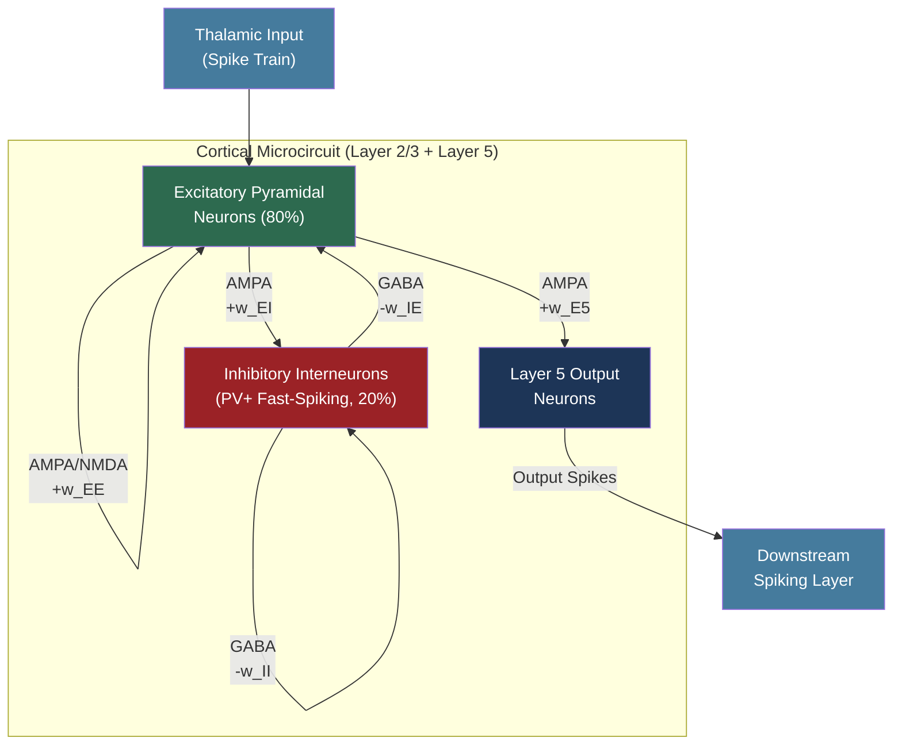

# Lesson 1: Biological Foundations of Neuromorphic Computing

## 1. First-Principles Intuition & Invariants

The central ambition of neuromorphic computing is not to simulate a brain—it is to steal its engineering principles and instantiate them in silicon. That distinction matters enormously. Simulation is a scientific instrument for neuroscientists; neuromorphic engineering is a design discipline for systems architects. When Carver Mead coined the term in the late 1980s, he was not proposing that we build artificial neurons as curiosities. He was asserting that the brain had solved, over 500 million years of metabolic pressure, a class of computational problems that von Neumann architectures handle with embarrassing inefficiency: sparse, asynchronous, event-driven inference at microwatt power budgets. His insight was that VLSI physics and neural physics share a common substrate—subthreshold transistor characteristics obey exponential I-V curves that mirror the Boltzmann statistics governing ion channel conductance. The biological solution and the silicon solution were waiting to converge.

For a systems programmer, the right frame is not biology-as-metaphor but biology-as-specification. The mammalian cortex is a massively parallel, event-driven, analog-stochastic compute fabric that runs the entire sensory-motor stack of a human being on roughly 20 watts—less than a laptop cooling fan. Modern GPU clusters dissipate tens of kilowatts to perform roughly equivalent inference tasks, and they do so by executing dense, synchronous matrix multiplications that bear no structural resemblance to how the brain actually processes information. Understanding *why* the biological implementation is so efficient requires examining its three foundational mechanisms: neuronal spiking dynamics, synaptic plasticity, and temporal coding. Each of these maps directly onto design decisions you must make when implementing a neuromorphic runtime.

**The Efficiency Invariant.** The first invariant every neuromorphic systems engineer must internalize is that biological efficiency derives primarily from sparsity, not from analog arithmetic. At any given millisecond, only roughly 1–5% of cortical neurons are active. This is not a limitation; it is the central design principle. A network that fires rarely communicates information through the *timing* and *identity* of spikes rather than through continuous-valued activations. This maps to a fundamental computational trade-off: you amortize the high metabolic cost of an action potential (approximately $10^9$ ATP molecules) across many silent timesteps, paying only when signal is present. In hardware terms, a neuromorphic processor dissipates dynamic power only on spike events. Static power sets the floor, but dynamic power—which dominates GPU and CPU workloads—scales with spike rate rather than with clock rate. This is the first principle from which every architectural decision in this curriculum descends.

**The Locality Invariant.** The second invariant is that biological computation is strictly local. A neuron integrates inputs from its own dendritic tree, computes its own membrane potential, and emits spikes based solely on that local state. It has no global clock, no shared memory bus, and no central scheduler. Synaptic weight updates during learning depend only on the pre-synaptic and post-synaptic activity at that specific synapse—a principle formalized as Hebbian learning and later sharpened into Spike-Timing-Dependent Plasticity. This locality means that communication bandwidth and synchronization cost—the two primary scaling bottlenecks of distributed von Neumann systems—are almost entirely eliminated. A spike sent across a synaptic connection is a point-to-point, addressed, one-bit event. The address encodes identity; the timing encodes value. There is no broadcast, no cache coherency protocol, and no memory wall.

**The Leaky Integrate-and-Fire Foundation.** The simplest biologically-grounded neuron model that remains implementable in hardware is the Leaky Integrate-and-Fire (LIF) model. It strips away Hodgkin-Huxley ion-channel detail while preserving the essential computational character. The membrane potential $V_m$ evolves according to:

$$\tau_m \frac{dV_m}{dt} = -(V_m - V_{rest}) + R_m I(t)$$

where $\tau_m = R_m C_m$ is the membrane time constant (typically 10–30 ms in cortical neurons), $V_{rest}$ is the resting potential (approximately −70 mV), $R_m$ is the membrane resistance, and $I(t)$ is the total synaptic current arriving at time $t$. When $V_m$ reaches a threshold $V_{th}$ (approximately −55 mV), the neuron emits a spike—a stereotyped, all-or-nothing pulse—and $V_m$ is reset to $V_{reset}$ (approximately −65 mV), entering a refractory period of 2–5 ms during which further spikes are suppressed.

This model encodes a critical systems insight: the neuron is a *stateful accumulator with a firing decision*. Its state decays exponentially toward rest in the absence of input, which is the "leaky" part. It fires only when accumulated evidence exceeds threshold. This is not a rectified linear unit; it is a temporal integrator with a hard decision boundary and a time-decay mechanism that provides implicit normalization. For a compiler engineer, the LIF neuron is equivalent to a first-order IIR filter followed by a comparator with hysteresis. Its discretized form, which you will implement in software and compile to hardware targets throughout this curriculum, is:

$$V_m[t+1] = \alpha \cdot V_m[t] + (1-\alpha) \cdot I[t]$$

where $\alpha = e^{-\Delta t / \tau_m}$ is the decay factor per simulation timestep $\Delta t$. When $V_m[t+1] \geq V_{th}$, a spike is emitted and $V_m$ is reset. This is the innermost loop of every spiking neural network simulation, and its performance characteristics—memory access patterns, vectorization potential, sparse event handling—will drive every optimization decision in later lessons.

---

## 2. Core Architecture & Mechanics

### The Action Potential as a Digital Signal on an Analog Channel

The action potential is the fundamental unit of neural communication, and understanding its physical mechanism dismantles a common misconception: spikes are not analog signals that carry graded information in their amplitude. They are stereotyped, all-or-nothing digital events whose information content lives entirely in their timing and address. When a neuron fires, voltage-gated sodium channels open along the axon in a regenerative wave, depolarizing the membrane from −70 mV to approximately +40 mV in under a millisecond, then repolarizing as potassium channels activate and sodium channels inactivate. The resulting pulse travels down the axon at a conduction velocity of 0.5–120 m/s depending on myelination.

For a systems architect, the actionable insight is that the axon is a *delay line with known propagation characteristics*. Myelinated axons achieve high conduction velocity by saltatory conduction—the signal jumps between Nodes of Ranvier rather than propagating continuously, which minimizes the membrane surface area that must be depolarized and therefore minimizes energy expenditure per unit distance. This is biologically equivalent to repeater-spaced digital transmission lines. In neuromorphic hardware, axonal delay is modeled explicitly as a synaptic delay parameter $d_{ij}$ on the connection from neuron $i$ to neuron $j$, and it encodes temporal structure that is as computationally significant as synaptic weight.

### Synaptic Transmission and the Conductance Model

When a spike arrives at a synapse, it triggers the release of neurotransmitter vesicles into the synaptic cleft. Neurotransmitter molecules bind to post-synaptic receptors, opening ion channels that drive current into the post-synaptic neuron. The two most important receptor types are AMPA receptors, which mediate fast excitatory currents with time constants of 2–5 ms, and NMDA receptors, which mediate slower currents with time constants of 50–150 ms and exhibit a voltage-dependent Mg²⁺ block that makes them coincidence detectors—they open only when both pre-synaptic glutamate binding and post-synaptic depolarization occur simultaneously. This NMDA coincidence detection is the biophysical substrate of Hebbian learning and is the mechanistic foundation of Spike-Timing-Dependent Plasticity.

In conductance-based models, the synaptic current injected into the post-synaptic neuron is:

$$I_{syn}(t) = g_{syn}(t) \cdot (E_{syn} - V_m)$$

where $g_{syn}(t)$ is the time-varying synaptic conductance modeled as an alpha function $g_{syn}(t) = \bar{g} \cdot (t/\tau) \cdot e^{1 - t/\tau}$, and $E_{syn}$ is the reversal potential (0 mV for excitatory AMPA synapses, −70 mV for inhibitory GABA synapses). The sign and magnitude of $(E_{syn} - V_m)$ determine whether the synapse is excitatory or inhibitory—when $V_m$ is below the reversal potential for an excitatory synapse, current flows inward and depolarizes the neuron; when $V_m$ exceeds the reversal potential for an inhibitory synapse, current flows outward and hyperpolarizes it. This voltage-dependent current magnitude is a form of automatic gain control that stabilizes network dynamics, and it is a detail that simplified current-injection models lose.

### Spike-Timing-Dependent Plasticity

STDP is the mechanism by which synaptic weights adapt based on the relative timing of pre- and post-synaptic spikes. If a pre-synaptic neuron fires shortly *before* its post-synaptic target fires (causal order, $\Delta t > 0$), the synapse is potentiated—its weight increases, encoding that the pre-synaptic neuron contributed causally to the post-synaptic output. If the pre-synaptic neuron fires shortly *after* the post-synaptic neuron (anti-causal order, $\Delta t < 0$), the synapse is depressed. The weight change follows an asymmetric exponential window:

$$\Delta w = \begin{cases} A_+ \cdot e^{-\Delta t / \tau_+} & \text{if } \Delta t > 0 \\ -A_- \cdot e^{\Delta t / \tau_-} & \text{if } \Delta t < 0 \end{cases}$$

where $A_+$ and $A_-$ are the maximum potentiation and depression amplitudes, and $\tau_+$, $\tau_-$ are the time constants of the learning windows (typically 20–40 ms). For a systems engineer, STDP is a *local, online, unsupervised weight update rule* that requires storing only the recent spike history of each neuron—specifically, a pair of exponentially-decaying trace variables $x_{pre}(t)$ and $x_{post}(t)$ that are incremented on each spike and decay between spikes. No global loss function, no backpropagation, no batch accumulation. The update at a synapse depends only on the two traces at the moment of a spike event.

The trace variables evolve as:

$$\tau_+ \frac{dx_{pre}}{dt} = -x_{pre}, \quad x_{pre} \mapsto x_{pre} + 1 \text{ on pre-synaptic spike}$$
$$\tau_- \frac{dx_{post}}{dt} = -x_{post}, \quad x_{post} \mapsto x_{post} + 1 \text{ on post-synaptic spike}$$

On a pre-synaptic spike, the weight is updated by $\Delta w = -A_- \cdot x_{post}(t)$ (depression if the post-synaptic neuron fired recently). On a post-synaptic spike, $\Delta w = A_+ \cdot x_{pre}(t)$ (potentiation if the pre-synaptic neuron fired recently). This event-driven formulation processes weight updates only when spikes occur, maintaining the sparsity property throughout learning.

### Temporal Coding and Population Coding

The brain does not use rate coding exclusively. While firing rate averaged over 100–500 ms windows correlates with stimulus intensity, the nervous system also exploits the precise timing of individual spikes to encode information at millisecond resolution. Time-to-first-spike coding, for instance, encodes stimulus intensity inversely in the latency of the first spike after stimulus onset—a stronger stimulus drives faster depolarization, producing an earlier spike. This scheme allows a downstream network to decode an entire stimulus frame from a single spike per neuron rather than waiting for statistical averages to accumulate over hundreds of milliseconds.

```
Temporal Coding Schemes: Information Encoding in Spike Trains
━━━━━━━━━━━━━━━━━━━━━━━━━━━━━━━━━━━━━━━━━━━━━━━━━━━━━━━━━━━━━

Rate Coding:          |  |  |   |  |  |   |  |  |
(high frequency)      0ms                      100ms
                      Info: mean spike rate ~ stimulus intensity

Time-to-First-Spike:  |
(latency encoding)    0ms   10ms  ...
                      Info: first-spike latency encodes intensity

Phase Coding:         θ-oscillation: ~~~~~~~~~~~~~~~~~~~~
                      Spikes:            |  |      |
                      Info: phase of spike relative to oscillation

Rank-Order Coding:    Neuron A: |
                      Neuron B:    |
                      Neuron C:        |
                      Info: order of first spikes across population
```

For the compiler engineer, temporal coding schemes impose direct constraints on simulation timestep resolution. Rate coding tolerates coarse timesteps (1–10 ms) since only mean rates matter. Time-to-first-spike coding requires timestep resolution sufficient to distinguish latency differences of 1–2 ms. Phase coding requires explicit modeling of network oscillations, which introduces synchronization primitives into parallel simulation kernels. These are not academic distinctions; they determine the memory bandwidth requirements, the minimum clock precision of hardware event queues, and the feasibility of real-time operation.

### Network Architecture and Excitatory-Inhibitory Balance



The canonical cortical microcircuit maintains a precise balance between excitation and inhibition. Excitatory pyramidal neurons (approximately 80% of cortical cells) drive network activity via AMPA and NMDA synapses. Parvalbumin-positive fast-spiking interneurons (approximately 20%) provide fast, strong inhibition via GABA synapses, forming a feedback loop that prevents runaway excitation. This E/I balance is not static; it is dynamically maintained by synaptic scaling and inhibitory STDP. For a systems architect, E/I balance is the network-level analog of backpressure in a distributed system: when excitatory drive increases, inhibitory feedback increases proportionally, keeping mean firing rates within a narrow window (2–10 Hz for cortical pyramidal neurons at rest) despite orders-of-magnitude variation in input intensity.

Disrupting E/I balance is the most common failure mode in neuromorphic network simulations. Too much excitation produces epileptiform synchronization—every neuron fires simultaneously in a cascade, destroying all information content. Too much inhibition silences the network entirely. The operating regime of interest is the asynchronous irregular state, where neurons fire at low rates, spike trains have high inter-spike interval variability (Fano factor near 1, consistent with a Poisson process), and population activity is desynchronized. Achieving and maintaining this state in a simulated or hardware network requires careful calibration of weight initialization, synaptic time constants, and the ratio of inhibitory to excitatory synaptic strength—typically $w_{IE}/w_{EE} \approx 4\text{–}6$ to compensate for the numerical minority of inhibitory neurons.

---

## 3. High-Performance Optimization & Failure Modes

### Discretizing the LIF Neuron for Real-Time Simulation

Translating the continuous LIF differential equation into a form that runs efficiently on a CPU or FPGA requires careful attention to numerical stability, vectorization, and memory layout. The standard Euler discretization is:

```c
#include <stdint.h>
#include <string.h>
#include <math.h>

/*
 * LIF neuron population state.
 *
 * Neurons are stored in Structure-of-Arrays (SoA) layout to maximize
 * SIMD vectorization across the population update loop. AoS layout
 * (one struct per neuron) causes stride-1 access on only one field at
 * a time per instruction, defeating AVX-512 width utilization.
 */

#define MAX_NEURONS     65536
#define TIMESTEP_MS     0.1f        /* 0.1 ms timestep: 10 kHz simulation clock   */
#define V_REST          (-70.0f)    /* mV                                          */
#define V_THRESHOLD     (-55.0f)    /* mV                                          */
#define V_RESET         (-65.0f)    /* mV                                          */
#define TAU_M_MS        20.0f       /* ms: membrane time constant                  */
#define T_REFRACTORY    20          /* timesteps: 2 ms refractory at 0.1 ms/step   */

typedef struct {
    float   v_m[MAX_NEURONS];           /* membrane potential, mV                  */
    float   i_syn[MAX_NEURONS];         /* accumulated synaptic current, pA        */
    int32_t refractory[MAX_NEURONS];    /* remaining refractory timesteps          */
    uint8_t spiked[MAX_NEURONS];        /* spike output buffer for current step    */
    int32_t neuron_count;
} LIFPopulation;

/*
 * Precomputed decay factor alpha = exp(-dt / tau_m).
 * Computed once at initialization; avoids repeated exp() in the hot path.
 */
static float g_alpha;

void lif_init(LIFPopulation *pop, int32_t n) {
    pop->neuron_count = n;
    g_alpha = expf(-TIMESTEP_MS / TAU_M_MS);

    for (int32_t i = 0; i < n; i++) {
        pop->v_m[i]        = V_REST;
        pop->i_syn[i]      = 0.0f;
        pop->refractory[i] = 0;
        pop->spiked[i]     = 0;
    }
}

/*
 * Single-timestep population update.
 *
 * Memory access pattern: sequential reads and writes across SoA arrays.
 * The compiler (GCC -O3 -march=native or Clang with -fvectorize) will
 * auto-vectorize the update loop across 16 floats per AVX-512 instruction.
 *
 * The refractory and spike branches are intentionally separated from the
 * voltage update loop to allow the vectorizer to handle the common case
 * (non-refractory update) without scalar fallback for every neuron.
 */
void lif_step(LIFPopulation *pop) {
    const int32_t n     = pop->neuron_count;
    const float alpha   = g_alpha;
    const float v_rest  = V_REST;
    const float v_th    = V_THRESHOLD;
    const float v_reset = V_RESET;

    /* Pass 1: Voltage update for all neurons (vectorizable). */
    for (int32_t i = 0; i < n; i++) {
        float v   = pop->v_m[i];
        float i_s = pop->i_syn[i];

        /*
         * Euler step: V[t+1] = alpha * (V[t] - V_rest) + V_rest + I_syn * dt / C_m
         * With C_m normalized to 1 pF and R_m = tau_m/C_m = 20 MOhm,
         * the current contribution is I_syn * (1 - alpha) * R_m.
         * Here R_m * (1 - alpha) is absorbed into a single scale factor
         * applied to i_syn at injection time by the synaptic kernel.
         */
        pop->v_m[i] = alpha * (v - v_rest) + v_rest + i_s;

        /* Clear injected current for next timestep. */
        pop->i_syn[i] = 0.0f;
    }

    /* Pass 2: Threshold detection, spike emission, and refractory clamping.
     * This pass has data-dependent branches and cannot be fully vectorized,
     * but it touches only neurons that crossed threshold or are refractory—
     * typically <5% of the population per timestep at biologically realistic
     * firing rates, so the branch misprediction cost is negligible.        */
    for (int32_t i = 0; i < n; i++) {
        pop->spiked[i] = 0;

        if (pop->refractory[i] > 0) {
            pop->v_m[i] = v_reset;
            pop->refractory[i]--;
            continue;
        }

        if (pop->v_m[i] >= v_th) {
            pop->spiked[i]     = 1;
            pop->v_m[i]        = v_reset;
            pop->refractory[i] = T_REFRACTORY;
        }
    }
}
```

The two-pass structure separates the vectorizable voltage update from the branch-heavy threshold and refractory logic. At biologically realistic firing rates (2–10 Hz per neuron, 0.1 ms timestep), fewer than 1 neuron in 500 fires per timestep. Pass 2 therefore degenerates to a near-empty loop in the common case, and the branch predictor learns rapidly to predict "not spiking" with near-perfect accuracy. Profiling this loop on a modern out-of-order core with `perf stat -e branch-misses` will confirm miss rates well below 0.1% at physiological activity levels.

### Synaptic Event Dispatch and the Spike Queue

The most consequential data structure in a spiking network simulator is the synaptic event queue. When neuron $i$ fires at time $t$, it must inject current into all post-synaptic neurons $j$ at time $t + d_{ij}$, where $d_{ij}$ is the axonal delay for that connection. This is a classic timed-event dispatch problem, and its implementation dominates simulation performance for large networks.

```c
#include <stdlib.h>
#include <stdint.h>
#include <string.h>

/*
 * Circular buffer spike event queue.
 *
 * We model axonal delays in the range 1–20 ms. At a 0.1 ms timestep, the
 * maximum delay span is 200 timesteps. We allocate a circular buffer of
 * DELAY_SLOTS slots, indexed by (current_step + delay) % DELAY_SLOTS.
 *
 * Each slot holds a list of (target_neuron_index, weight) pairs representing
 * spikes that will arrive at that future timestep. Memory is pre-allocated
 * per slot as a flat array with a slot-local count. For large networks,
 * replace with a bump allocator per slot to avoid per-event malloc.
 */

#define DELAY_SLOTS     256         /* must be power-of-two for fast modulo mask */
#define MAX_EVENTS_SLOT 32768       /* max spike deliveries arriving in one step */

typedef struct {
    int32_t target;
    float   weight;
} SynapticEvent;

typedef struct {
    SynapticEvent events[MAX_EVENTS_SLOT];
    int32_t       count;
} EventSlot;

typedef struct {
    EventSlot slots[DELAY_SLOTS];
    uint32_t  current_step;
} SpikeQueue;

void spike_queue_init(SpikeQueue *q) {
    memset(q, 0, sizeof(*q));
}

/*
 * Schedule a spike delivery from pre-synaptic neuron to target, arriving
 * delay_steps timesteps from now.
 */
void spike_queue_push(SpikeQueue *q, int32_t target, float weight,
                      int32_t delay_steps) {
    uint32_t slot_idx = (q->current_step + (uint32_t)delay_steps) & (DELAY_SLOTS - 1);
    EventSlot *slot   = &q->slots[slot_idx];

    if (slot->count >= MAX_EVENTS_SLOT) {
        /* Saturation: drop spike. In production, log and instrument this
         * path with a hardware performance counter or a user-space counter
         * exposed via /proc or a custom sysfs attribute on embedded targets. */
        return;
    }

    slot->events[slot->count].target = target;
    slot->events[slot->count].weight = weight;
    slot->count++;
}

/*
 * Deliver all events scheduled for the current timestep into the target
 * population's synaptic current accumulators, then advance the clock.
 */
void spike_queue_deliver(SpikeQueue *q, LIFPopulation *pop) {
    uint32_t  slot_idx = q->current_step & (DELAY_SLOTS - 1);
    EventSlot *slot    = &q->slots[slot_idx];

    for (int32_t i = 0; i < slot->count; i++) {
        int32_t t = slot->events[i].target;
        pop->i_syn[t] += slot->events[i].weight;
    }

    /* Clear the slot for reuse 256 steps from now. */
    slot->count = 0;
    q->current_step++;
}
```

This circular buffer design avoids heap allocation in the hot path entirely. The slot size of `DELAY_SLOTS = 256` covers 25.6 ms of delay at 0.1 ms resolution, which exceeds the biological range of cortical axonal delays (0.5–20 ms). The power-of-two size converts modulo to a bitwise AND, eliminating a division instruction in the innermost loop. At 65,536 neurons with 1,000 synapses each and a mean firing rate of 5 Hz, the expected event rate is $65536 \times 1000 \times 5 \times 0.0001 = 32,768$ events per timestep—exactly the `MAX_EVENTS_SLOT` ceiling, which reveals that this configuration is operating at the boundary of the buffer capacity. In production, you instrument this saturation counter and use it as a backpressure signal to throttle input injection rates.

### STDP Weight Update Implementation

```c
#include <stdint.h>
#include <math.h>

/*
 * STDP trace-based weight update.
 *
 * Each synapse stores a weight w_ij. Each neuron stores two trace variables:
 * x_pre decays between pre-synaptic spikes, x_post decays between post-synaptic
 * spikes. Traces are stored in SoA layout alongside neuron state.
 *
 * Weight bounds [W_MIN, W_MAX] implement soft weight normalization, preventing
 * unbounded potentiation (a common failure mode in unregularized STDP).
 */

#define W_MIN        0.0f
#define W_MAX        1.0f
#define A_PLUS       0.01f      /* max potentiation amplitude                */
#define A_MINUS      0.0105f    /* max depression amplitude (slightly > A+)  */
#define TAU_PLUS_MS  20.0f      /* ms: potentiation time window              */
#define TAU_MINUS_MS 20.0f      /* ms: depression time window                */

typedef struct {
    float x_pre[MAX_NEURONS];   /* pre-synaptic eligibility trace            */
    float x_post[MAX_NEURONS];  /* post-synaptic eligibility trace           */
} STDPTraces;

static float g_decay_pre;
static float g_decay_post;

void stdp_init(STDPTraces *traces, int32_t n) {
    g_decay_pre  = expf(-TIMESTEP_MS / TAU_PLUS_MS);
    g_decay_post = expf(-TIMESTEP_MS / TAU_MINUS_MS);

    for (int32_t i = 0; i < n; i++) {
        traces->x_pre[i]  = 0.0f;
        traces->x_post[i] = 0.0f;
    }
}

/*
 * Decay all traces. Called once per timestep for all neurons.
 * Fully vectorizable: element-wise multiply by scalar decay factors.
 */
void stdp_decay_traces(STDPTraces *traces, int32_t n) {
    for (int32_t i = 0; i < n; i++) {
        traces->x_pre[i]  *= g_decay_pre;
        traces->x_post[i] *= g_decay_post;
    }
}

/*
 * Process a pre-synaptic spike from neuron pre_idx.
 *
 * Increment pre-synaptic trace. For each outgoing synapse to post-neuron j,
 * apply LTD (depression): dw = -A_minus * x_post[j].
 * This penalizes synapses where the post-synaptic neuron fired recently
 * before the pre-synaptic neuron—anti-causal ordering.
 *
 * conn_targets and conn_weights are the outgoing adjacency list of pre_idx,
 * with conn_count entries.
 */
void stdp_on_pre_spike(STDPTraces *traces, int32_t pre_idx,
                       int32_t *conn_targets, float *conn_weights,
                       int32_t conn_count) {
    traces->x_pre[pre_idx] += 1.0f;

    for (int32_t k = 0; k < conn_count; k++) {
        int32_t j = conn_targets[k];
        float dw  = -A_MINUS * traces->x_post[j];
        conn_weights[k] += dw;

        /* Clamp to [W_MIN, W_MAX]. */
        if (conn_weights[k] < W_MIN) conn_weights[k] = W_MIN;
        if (conn_weights[k] > W_MAX) conn_weights[k] = W_MAX;
    }
}

/*
 * Process a post-synaptic spike from neuron post_idx.
 *
 * Increment post-synaptic trace. For each incoming synapse from pre-neuron i,
 * apply LTP (potentiation): dw = A_plus * x_pre[i].
 * This strengthens synapses where the pre-synaptic neuron fired recently
 * before the post-synaptic neuron—causal ordering.
 *
 * in_sources and in_weights are the incoming adjacency list of post_idx.
 */
void stdp_on_post_spike(STDPTraces *traces, int32_t post_idx,
                        int32_t *in_sources, float *in_weights,
                        int32_t in_count) {
    traces->x_post[post_idx] += 1.0f;

    for (int32_t k = 0; k < in_count; k++) {
        int32_t i = in_sources[k];
        float dw  = A_PLUS * traces->x_pre[i];
        in_weights[k] += dw;

        if (in_weights[k] < W_MIN) in_weights[k] = W_MIN;
        if (in_weights[k] > W_MAX) in_weights[k] = W_MAX;
    }
}
```

### Failure Modes, Edge Cases, and Their Mitigations

The most dangerous failure mode in LIF network simulation is **silent death**: the network initializes, runs without crashing, but produces zero spikes. This failure arises from three independent causes that produce identical symptoms. The first is incorrect alpha computation—if `g_alpha` is computed as `1.0f` due to a units mismatch (passing seconds instead of milliseconds to `expf`), the membrane potential never decays and input currents accumulate without bound until floating-point saturation. The second cause is weight initialization that is too small: if synaptic weights are initialized from a distribution whose mean is below the threshold-crossing current for a typical input rate, no neuron ever reaches $V_{th}$. The third cause is excessive inhibition: if `w_IE` is set too large during E/I balance calibration, inhibitory feedback suppresses all excitatory activity before the network reaches steady state. The diagnostic procedure is to monitor mean population firing rate, mean membrane potential, and the variance of membrane potential at initialization and at the first 100 ms of simulated time. A silent network with mean $V_m$ hovering near $V_{rest}$ with zero variance indicates insufficient excitatory drive. A silent network with high variance but no spikes indicates threshold set too high or weights too small relative to threshold.

The inverse failure—**epileptiform synchronization**—manifests as the entire population firing within the same timestep, then falling silent for the refractory period, then firing again in a synchronized burst. This produces a characteristic square-wave firing pattern rather than asynchronous irregular activity. The root cause is almost always insufficient inhibitory weight or insufficient inhibitory neuron count. The fix is to increase `w_IE` incrementally by 10% steps while monitoring the population-averaged inter-spike interval coefficient of variation (CV-ISI). The target asynchronous irregular state has CV-ISI near 1.0 (Poisson-like). CV-ISI near 0 indicates synchronization; CV-ISI greater than 2 indicates pathological bursting.

A subtler failure mode specific to the STDP implementation is **weight collapse**: all excitatory synapses converge to `W_MIN` over time, silencing the network. This occurs when $A_- > A_+$ (which the implementation above intentionally sets, following biological convention) combined with high mean firing rates that cause the depression term to dominate. The standard mitigation is **multiplicative STDP**, where the update magnitudes are scaled by the distance from the weight bounds: $\Delta w_{LTP} = A_+ \cdot (W_{max} - w) \cdot x_{pre}$ and $\Delta w_{LTD} = -A_- \cdot (w - W_{min}) \cdot x_{post}$. This creates a stable fixed point for the weight distribution at an intermediate value that depends on the mean firing rate, implementing a form of synaptic homeostasis without requiring an explicit normalization pass.

Finally, the circular spike queue will produce silent or corrupted output if `DELAY_SLOTS` is not a power of two and the bitwise mask is applied anyway, or if `delay_steps` is zero—meaning the spike is delivered in the same timestep it is emitted, before `lif_step` processes that target neuron's voltage. Zero-delay connections require special handling: they must be delivered either at the end of the current step (after all voltage updates complete) or at the beginning of the next step, depending on the network's intended causal semantics. The implementation above, where delivery precedes the LIF step, implicitly uses zero as a one-timestep delay, which is the convention consistent with discrete-time neural simulators such as NEST and Brian2. Document this convention explicitly in any production codebase, because changing it after a network has been trained invalidates all learned weight distributions.
