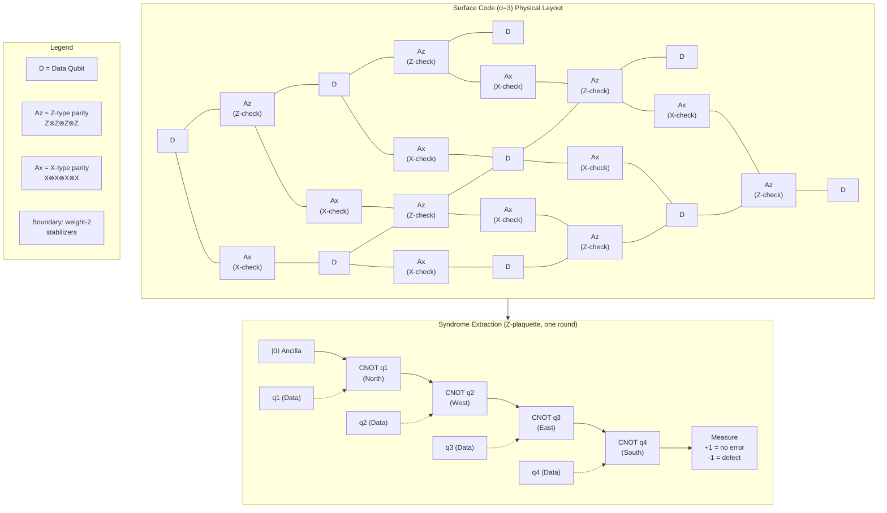
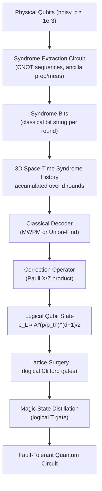

# Lesson 4: Quantum Error Correction and Fault Tolerance

## 1. First-Principles Intuition & Invariants

Classical computers are built on a profound physical luxury: a bit is either zero or one, and the energy gap between those two states is enormous relative to thermal noise. A CMOS transistor operating at room temperature has a switching threshold of roughly half the supply voltage, meaning the noise margin is hundreds of millivolts while thermal fluctuations measure in microvolts. The hardware can afford to be sloppy because the signal-to-noise ratio is astronomically favorable. Quantum computers have no such luxury. A qubit encodes information in a superposition that is, by definition, maximally fragile: the information lives in the *phase relationship* between basis states, and any unintended interaction with the environment—a stray magnetic field, a phonon from the substrate, an imprecisely calibrated microwave pulse—collapses or rotates that phase before the computation finishes. This is not an engineering defect that better fabrication will eliminate. It is a fundamental consequence of quantum mechanics itself.

The phenomenon responsible is called **decoherence**, and understanding it from first principles is the prerequisite for understanding why quantum error correction (QEC) is architecturally necessary rather than merely desirable. A qubit in state $|\psi\rangle = \alpha|0\rangle + \beta|1\rangle$ exists in a coherent superposition where the complex amplitudes $\alpha$ and $\beta$ carry relative phase information. The qubit is not an isolated system; it is coupled, however weakly, to an environment comprising billions of degrees of freedom. Quantum mechanics requires that we write the joint state of qubit-plus-environment as an entangled object: $|\Psi\rangle = \alpha|0\rangle|E_0\rangle + \beta|1\rangle|E_1\rangle$, where $|E_0\rangle$ and $|E_1\rangle$ are environmental states that have become correlated with each qubit basis state. When we trace out (ignore) the environmental degrees of freedom because we cannot observe them directly, the qubit's density matrix transitions from a pure state with off-diagonal coherence terms to a mixed state where those terms decay toward zero. The timescale for this collapse is called $T_2$, the dephasing time, and in state-of-the-art superconducting qubits it ranges from tens to hundreds of microseconds. Separately, $T_1$ quantifies energy relaxation: the excited $|1\rangle$ state spontaneously decays to $|0\rangle$ by emitting a photon or phonon, with similar or shorter characteristic times.

For a systems programmer, the right mental model is this: every qubit is a register that randomly corrupts its contents on a timescale of $T_1$ and $T_2$, and every gate operation introduces additional errors with probability $p$ (gate fidelity is $1 - p$). Current best-in-class superconducting two-qubit gate error rates sit around $10^{-3}$ to $10^{-2}$. A classical CPU with a bit-flip probability of $10^{-3}$ per instruction would be unusable in microseconds. This is the central crisis of quantum computing and the reason QEC is an existential requirement for any practical quantum algorithm of depth beyond a few hundred gates.

The classical intuition for error correction—just copy the data three times and take a majority vote—fails immediately in the quantum case for two distinct reasons. First, the **no-cloning theorem** proves that an arbitrary unknown quantum state $|\psi\rangle$ cannot be duplicated. The proof is a one-line consequence of linearity: a hypothetical cloning unitary $U$ would require $U|\psi\rangle|0\rangle = |\psi\rangle|\psi\rangle$ for all $|\psi\rangle$, but linearity of $U$ over the superposition $|\psi\rangle = \alpha|0\rangle + \beta|1\rangle$ yields a contradiction with $U|0\rangle|0\rangle$ and $U|1\rangle|0\rangle$ individually cloned. Second, measuring a qubit to check for errors *is* the error—measurement collapses the superposition and destroys the quantum information you are trying to protect.

Quantum error correction circumvents both prohibitions through a remarkable sleight of hand. Rather than copying the quantum state, QEC **encodes** one logical qubit into an entangled state of many physical qubits such that errors can be diagnosed through **indirect measurement** that reveals error *syndromes* without ever collapsing the logical state. The syndrome is a classical bit string that tells you which error occurred, not what the logical state is. This is the invariant from which everything else follows: a correctly designed QEC code creates a code space—a subspace of the full Hilbert space—such that different errors map the code space into orthogonal *error subspaces*, and syndrome measurement tells you which subspace you landed in without learning anything about the encoded logical state within that subspace.

The mathematical framework that makes this precise is the **stabilizer formalism**, introduced by Daniel Gottesman in 1997 and now the dominant language for practical QEC. A stabilizer code is defined by a set of $n - k$ commuting Pauli operators $\{S_1, S_2, \ldots, S_{n-k}\}$, each being a tensor product of single-qubit Pauli matrices $\{I, X, Y, Z\}$ over $n$ physical qubits. The code space is the simultaneous $+1$ eigenspace of all stabilizers: a logical state $|\bar{\psi}\rangle$ satisfies $S_i|\bar{\psi}\rangle = |\bar{\psi}\rangle$ for all $i$. The code encodes $k$ logical qubits into $n$ physical qubits, leaving $n - k$ degrees of freedom consumed by the stabilizer constraints. When an error $E$ acts on a physical qubit, the perturbed state $E|\bar{\psi}\rangle$ may no longer lie in the code space. Specifically, if $E$ anticommutes with stabilizer $S_i$—meaning $ES_i = -S_iE$—then measuring $S_i$ on the corrupted state yields $-1$ rather than $+1$. This $-1$ outcome is the syndrome bit for stabilizer $S_i$. Crucially, measuring $S_i$ does not reveal $|\bar{\psi}\rangle$; it only reveals the parity of the error relative to $S_i$, because $|\bar{\psi}\rangle$ remains in the $+1$ eigenspace of $S_i$ and all other stabilizers regardless of its specific superposition content.

The simplest illustration is the **three-qubit bit-flip code**, which protects against $X$ errors (bit flips) but not phase errors. The logical zero is encoded as $|\bar{0}\rangle = |000\rangle$ and logical one as $|\bar{1}\rangle = |111\rangle$. The two stabilizers are $Z_1Z_2$ and $Z_2Z_3$, both of which have eigenvalue $+1$ for both codewords. A bit flip on qubit 1 anticommutes with $Z_1Z_2$ but commutes with $Z_2Z_3$, yielding syndrome $(−1, +1)$. A flip on qubit 2 yields $(−1, −1)$. A flip on qubit 3 yields $(+1, −1)$. The syndrome uniquely identifies the error location, the correction is the inverse error (another $X$ on the offending qubit), and the logical state is never directly observed. This three-qubit code is a toy example, but it establishes the entire operational pattern that scales to practical codes.

The honest reckoning, however, is that the three-qubit code fails against phase errors ($Z$ gates), and in reality both $X$ and $Z$ errors (and their product $Y$) occur simultaneously. Peter Shor's 1995 nine-qubit code was the first construction to handle arbitrary single-qubit errors by concatenating a bit-flip code with a phase-flip code. While historically important, nine physical qubits per logical qubit with no threshold guarantee is not an architectural foundation for scalable quantum computing. The route to practical fault tolerance runs through a different family of codes—**topological stabilizer codes**, of which the **surface code** is currently the leading candidate for near-term hardware.

## 2. Core Architecture & Mechanics

The surface code places physical qubits on the vertices and edges of a two-dimensional lattice. For a distance-$d$ surface code, you arrange $d^2$ **data qubits** on the vertices of a $(d \times d)$ grid and $(d^2 - 1)$ **ancilla (measure) qubits** interleaved between them. Each ancilla participates in a stabilizer measurement of either the $X$ type (a four-body $X \otimes X \otimes X \otimes X$ parity check on the four adjacent data qubits) or the $Z$ type ($Z \otimes Z \otimes Z \otimes Z$), forming a checkerboard pattern of $X$-type and $Z$-type plaquettes. The boundary qubits participate in weight-two stabilizers (only two neighbors), which is what makes the code a *surface* code rather than a toric code. The logical qubit is encoded in a global topological property of the lattice: the logical $\bar{X}$ operator is any horizontal chain of $X$ operators spanning the lattice from left to right, and the logical $\bar{Z}$ operator is any vertical chain of $Z$ operators from top to bottom. Local errors cannot mimic a logical operator without forming a chain spanning the entire lattice, which requires at least $d$ correlated errors—hence the code distance $d$.

The practical appeal of the surface code over competing families (color codes, Reed-Solomon-based codes) comes down to three properties that systems architects care about deeply. First, it requires only nearest-neighbor interactions on a 2D grid, which matches the connectivity constraints of superconducting qubit hardware where long-range couplers are expensive or unavailable. Second, its threshold error rate—the physical error rate below which adding more qubits *reduces* logical error rate rather than increasing it—is approximately $1\%$, the highest of any known code that is also hardware-local. Third, syndrome extraction requires only Clifford gates (CNOT, Hadamard, and single-qubit Pauli gates), which are the highest-fidelity operations available on current hardware.

The syndrome extraction circuit for a single $Z$-type plaquette ($Z \otimes Z \otimes Z \otimes Z$) illustrates the ancilla protocol precisely. The ancilla is initialized to $|0\rangle$, then a sequence of four CNOT gates is applied with the data qubits as controls and the ancilla as target, then the ancilla is measured in the $Z$ basis. Because a CNOT entangles control parity into the target, the ancilla accumulates the parity of all four $Z$-basis data qubit states without learning their individual values. For an $X$-type plaquette, the ancilla is initialized to $|+\rangle = H|0\rangle$, four CNOT gates are applied with the ancilla as control and data qubits as targets, then the ancilla is measured in the $X$ basis (Hadamard followed by $Z$ measurement). The ordering of these four CNOTs is not arbitrary—it must follow a specific sequence (north, west, east, south, or equivalently a fixed "hook" pattern) to avoid introducing correlated errors that the decoder cannot distinguish. A naive ordering that visits data qubits in an asymmetric pattern can convert a single gate error into a correlated two-qubit error that masquerades as a logical error. This hook error problem is a well-known pitfall in real implementations and is handled by choosing the canonical CNOT ordering that minimizes the weight of effective errors the circuit introduces.

The full syndrome extraction cycle for a $d \times d$ surface code proceeds as follows. All $X$-type and $Z$-type ancilla circuits run simultaneously in parallel—the entire $(d^2 - 1)$-ancilla measurement completes in one syndrome extraction round consisting of roughly $O(1)$ gate layers followed by simultaneous ancilla readout and reset. Because measurement itself is noisy (measurement error rate $p_m$ on superconducting hardware is typically similar in magnitude to gate error $p$), the syndrome is not trusted from a single round. Instead, QEC runs for multiple rounds per logical gate cycle, accumulating a **syndrome history** across time. The correct mental model is to think of the syndrome history as a three-dimensional structure: two spatial dimensions (the lattice coordinates of each ancilla) plus one temporal dimension (the round index). An error appears as a **defect**—a location where syndrome parity flips from $+1$ to $-1$—and a measurement error appears as a defect that persists for only one round before vanishing, while a physical qubit error creates a defect that persists until corrected. Errors in this 3D space-time lattice come in pairs (or strings) because Pauli errors either create two defects or move an existing defect to a neighboring position.

The job of the **classical decoder** is to consume this 3D syndrome history in real time and output a correction operator that, applied to the data qubits, returns the system to the code space. This is a matching problem: given the set of defects, find the minimum-weight set of error chains that could have caused them. The state-of-the-art decoder for the surface code is **Minimum Weight Perfect Matching (MWPM)**, which maps the problem to finding the minimum-weight perfect matching on a graph where defect locations are nodes and edge weights encode the negative log-probability of the corresponding error chain. Blossom V is the classical algorithm of choice for exact MWPM, running in $O(n^3)$ time for $n$ defects. For a $d = 7$ surface code (49 data qubits, 48 ancillas) operating with $O(d)$ rounds per logical gate, the number of defects per syndrome cycle scales with physical error rate and lattice size, but the decoder must process each syndrome cycle faster than the next cycle arrives—typically within a few microseconds on superconducting hardware where the cycle time is roughly $1\mu s$. This real-time classical processing requirement is itself a systems engineering challenge, and union-find decoders (Huang et al., 2020) with near-linear $O(n \alpha(n))$ runtime are increasingly favored for their throughput advantages despite slightly lower accuracy at high error rates.



The **logical gate set** for a surface code is severely constrained. The stabilizer formalism provides transversal (bitwise) implementation only for Clifford gates: logical $\bar{X}$ is applied by applying physical $X$ to every data qubit in the logical $\bar{X}$ chain, logical $\bar{Z}$ similarly. The Hadamard $\bar{H}$ swaps $X$-type and $Z$-type stabilizers, which on the standard square surface code requires a 90-degree lattice rotation. The CNOT between two logical qubits is implemented via **lattice surgery**: two adjacent surface code patches are temporarily merged by turning off the boundary stabilizers and introducing joint stabilizer measurements across the seam, then split after a fixed number of rounds with a measurement outcome that implements the logical CNOT up to a Pauli correction. The non-Clifford $T$ gate ($\pi/8$ rotation) cannot be implemented transversally in any known stabilizer code—a result known as the Eastin-Knill theorem—and must instead be synthesized via **magic state distillation**, a resource-intensive procedure where noisy $|T\rangle = T|+\rangle$ states are distilled into high-fidelity copies using only Clifford operations. This asymmetry between cheap Clifford gates and expensive $T$ gates drives the entire resource estimation problem for practical quantum algorithms: the $T$-count of an algorithm circuit directly determines the dominant overhead in fault-tolerant implementation.



## 3. High-Performance Optimization & Failure Modes

The central quantitative invariant of the surface code is its **threshold theorem**: if the physical error rate $p$ on individual gates, state preparation, and measurement is below a threshold value $p_{th}$, then increasing the code distance $d$ exponentially suppresses the logical error rate $p_L$. The relationship follows approximately:

$$p_L \approx A \left(\frac{p}{p_{th}}\right)^{\lfloor (d+1)/2 \rfloor}$$

where $A$ is a constant prefactor of order unity and $p_{th} \approx 1\%$ for the standard surface code under a depolarizing noise model. For a distance-$d = 7$ surface code operating at $p = 10^{-3}$ (ten times below threshold), $\lfloor (d+1)/2 \rfloor = 4$, and the logical error rate is roughly $A \cdot (0.1)^4 = A \cdot 10^{-4}$. Pushing to $d = 15$ gives $A \cdot 10^{-8}$, sufficient for algorithms of moderate gate depth. This exponential scaling is the reason surface codes are practical despite their overhead: a tenfold reduction in physical error rate buys an exponential improvement in code performance at fixed distance, and each incremental increase in $d$ halves the logical error rate.

The qubit overhead, however, is severe. A distance-$d$ surface code consumes $2d^2 - 1$ physical qubits for one logical qubit (data plus ancilla). For $d = 7$, that is 97 physical qubits per logical qubit. For a Shor's algorithm implementation targeting a 2048-bit RSA key, the most aggressive resource estimates require thousands of logical qubits and trillions of $T$ gates, translating to millions of physical qubits at plausible error rates. Current hardware sits at hundreds to low thousands of physical qubits. The gap is not a reason to dismiss QEC as impractical—it is the roadmap that defines the hardware scaling targets for the next decade.

The decoder is the most latency-sensitive component in the entire QEC stack, and optimizing it is a genuine systems programming problem. MWPM with Blossom V achieves threshold decoding accuracy but becomes a bottleneck at scale. The practical constraint is **decoder backlog**: if the decoder falls behind the syndrome stream, errors accumulate faster than corrections are applied, causing the logical qubit to decohere at an effective rate dominated by the decoding latency rather than the physical error rate. For superconducting hardware with $1\mu s$ syndrome cycles and a $d = 25$ lattice (625 ancillas per round), the decoder must process up to 625 potential defects and produce a correction operator within $1\mu s$. FPGA implementations of MWPM running at 300 MHz can achieve this for modest distances, and there is active research on neural network decoders (which outperform MWPM on circuit-level noise models) and hardware-accelerated union-find variants implemented in custom ASICs.

A subtle and frequently underappreciated failure mode is **correlated errors from leakage**. Superconducting transmon qubits are not perfect two-level systems; they have higher energy levels $|2\rangle$, $|3\rangle$, etc., and a gate pulse that is slightly miscalibrated can populate $|2\rangle$ (leakage). A leaked qubit does not participate correctly in subsequent syndrome extraction, because the CNOT gate between a leaked data qubit and an ancilla produces an outcome that the standard MWPM decoder interprets as a standard Pauli error, but the subsequent rounds continue to show anomalous syndromes because the data qubit is still in $|2\rangle$. This creates a **leakage-induced error chain** that can span multiple syndrome rounds, introducing time-correlated defects that look to the decoder like a string of errors moving across the lattice and can cause logical errors at a rate that does not suppress with code distance unless leakage reduction units (LRU) are explicitly incorporated. LRUs are ancilla-based circuits that swap leaked data qubits back to the computational subspace at the cost of additional ancilla qubits and gate operations. Correctly modeling leakage is mandatory for any honest resource estimation on superconducting hardware.

A second critical failure mode is **decoder mismatch**: the decoder is trained or optimized for a particular noise model, and the actual device noise deviates from that model. Standard MWPM assumes independent, identically distributed depolarizing noise on each gate. Real devices exhibit gate-dependent noise, spatially correlated errors from two-level system (TLS) fluctuators in the substrate, and temporally non-stationary noise from charge parity jumps. A decoder calibrated on a depolarizing model but running on a device with an active TLS defect will make systematically wrong matching decisions in the vicinity of the defect, raising the effective logical error rate above what the theoretical threshold predicts. The engineering response is **device-tailored decoding**: edge weights in the MWPM graph are set not from the theoretical noise model but from periodic calibration measurements that characterize the actual error rates of each gate, ancilla, and measurement channel. IBM's heavy-hexagon code deployments and Google's Sycamore surface code experiments both use empirically calibrated decoder weights, and the logical error rate improvement from tailored weights over uniform weights is roughly an order of magnitude at current physical error rates.

The **fault-tolerant threshold** is itself a more nuanced concept than the single number $p_{th} \approx 1\%$ suggests. The threshold is defined with respect to a specific noise model and a specific gate set, and it assumes that syndrome extraction circuits are themselves implemented fault-tolerantly—meaning that a single physical error in the syndrome extraction circuit produces at most one defect, not a correlated chain of defects. This requirement constrains the ancilla preparation and CNOT ordering in ways that add circuit depth and ancilla count. A syndrome extraction circuit that is not fault-tolerant may still function correctly when errors are rare, but it fails to achieve threshold scaling because a single ancilla error can propagate to multiple data qubits through the CNOT fan-out, creating a weight-2 or weight-4 data error that the decoder cannot distinguish from a logical error. The canonical fix is the **Shor syndrome extraction** protocol, which uses ancilla verification circuits to detect ancilla preparation errors before entangling the ancilla with data qubits. For the surface code specifically, the standard circuit already satisfies fault-tolerance by construction due to the hook-error analysis mentioned earlier, but only under the assumption that ancilla measurement errors are independent. Correlated readout errors (common in multiplexed readout architectures where many ancillas share a readout resonator) violate this assumption and require additional mitigation.

Implementing a minimal surface code QEC simulation in Stim—the leading open-source stabilizer circuit simulator developed by Craig Gidney at Google—gives a systems programmer concrete intuition for these trade-offs. Stim operates on stabilizer circuits specified in a simple text format and can simulate millions of syndrome extraction rounds per second by exploiting the binary symplectic representation of Clifford circuits. A distance-3 surface code circuit with depolarizing noise and MWPM decoding runs in seconds on a laptop and immediately makes the threshold behavior observable as $d$ increases.

```python
import stim
import pymatching
import numpy as np

def build_surface_code_circuit(d: int, p: float, rounds: int) -> stim.Circuit:
    """
    Build a rotated surface code circuit of distance d with depolarizing
    noise p, running for `rounds` syndrome extraction cycles.
    Returns a stim.Circuit object ready for sampling.
    """
    # stim.Circuit.generated() produces a complete, hardware-realistic
    # circuit including CNOT ordering, ancilla prep/meas, and noise channels.
    circuit = stim.Circuit.generated(
        code_task="surface_code:rotated_memory_z",
        distance=d,
        rounds=rounds,
        after_clifford_depolarization=p,
        before_round_data_depolarization=p / 10,
        before_measure_flip_probability=p,
        after_reset_flip_probability=p,
    )
    return circuit

def measure_logical_error_rate(d: int, p: float, rounds: int, shots: int) -> float:
    """
    Sample the surface code circuit and decode with MWPM (via PyMatching).
    Returns the per-round logical Z error rate.
    """
    circuit = build_surface_code_circuit(d, p, rounds)

    # Build the detector error model: a hypergraph encoding which detectors
    # each error mechanism triggers, used by PyMatching for MWPM.
    model = circuit.detector_error_model(decompose_errors=True)
    matcher = pymatching.Matching.from_detector_error_model(model)

    # Sample syndrome measurements and observable flips simultaneously.
    sampler = circuit.compile_detector_sampler()
    detection_events, observable_flips = sampler.sample(
        shots=shots, separate_observables=True
    )

    # Decode: for each shot, MWPM returns a predicted correction.
    # XOR with the actual observable flip to determine logical error.
    predictions = matcher.predict_observable_flips_batch(detection_events)
    num_errors = np.sum(predictions != observable_flips)
    logical_error_rate_per_shot = num_errors / shots

    # Normalize to per-round rate using the union bound approximation.
    per_round_rate = 1.0 - (1.0 - logical_error_rate_per_shot) ** (1.0 / rounds)
    return per_round_rate

def threshold_scan():
    """
    Scan over physical error rates and code distances to locate the threshold.
    At p < p_th, larger d gives lower logical error rate (below-threshold regime).
    At p > p_th, larger d gives higher logical error rate (above-threshold).
    """
    distances = [3, 5, 7, 9]
    error_rates = [0.001, 0.003, 0.005, 0.007, 0.010, 0.013, 0.016, 0.020]
    rounds = 10
    shots = 100_000

    print(f"{'p':>8}", end="")
    for d in distances:
        print(f"  d={d:>2}", end="")
    print()

    for p in error_rates:
        print(f"{p:>8.4f}", end="")
        for d in distances:
            rate = measure_logical_error_rate(d, p, rounds, shots)
            print(f"  {rate:.2e}", end="")
        print()

if __name__ == "__main__":
    threshold_scan()
```

Running this scan produces a crossing point in the logical error rate curves near $p \approx 0.01$ where the $d=3$, $d=5$, and $d=7$ curves intersect—the operational signature of the threshold. Below the crossing, every increment in $d$ reduces $p_L$; above it, increasing $d$ makes things worse because error propagation through the larger lattice outpaces the code's correction capacity. The crossing point's exact location shifts depending on the noise model details passed to `stim.Circuit.generated()`, which is itself an important lesson: the threshold is a property of the code-decoder-noise triple, not of the code alone.

The systems engineering conclusion from this lesson is unambiguous. Fault-tolerant quantum computing is not primarily a physics problem anymore—it is a full-stack systems problem in which the correctness of the logical computation depends on a tightly integrated pipeline running from physical qubit control electronics, through hardware-aware syndrome extraction circuits, through real-time classical decoding running within the coherence window, through logical gate synthesis that minimizes $T$-count, to compiler-level optimizations that reduce circuit depth. Every layer of this stack has failure modes that propagate upward, and the systems programmer's discipline of reasoning about error budgets, latency constraints, throughput bottlenecks, and noise model assumptions is exactly the right frame of mind for the work ahead.
