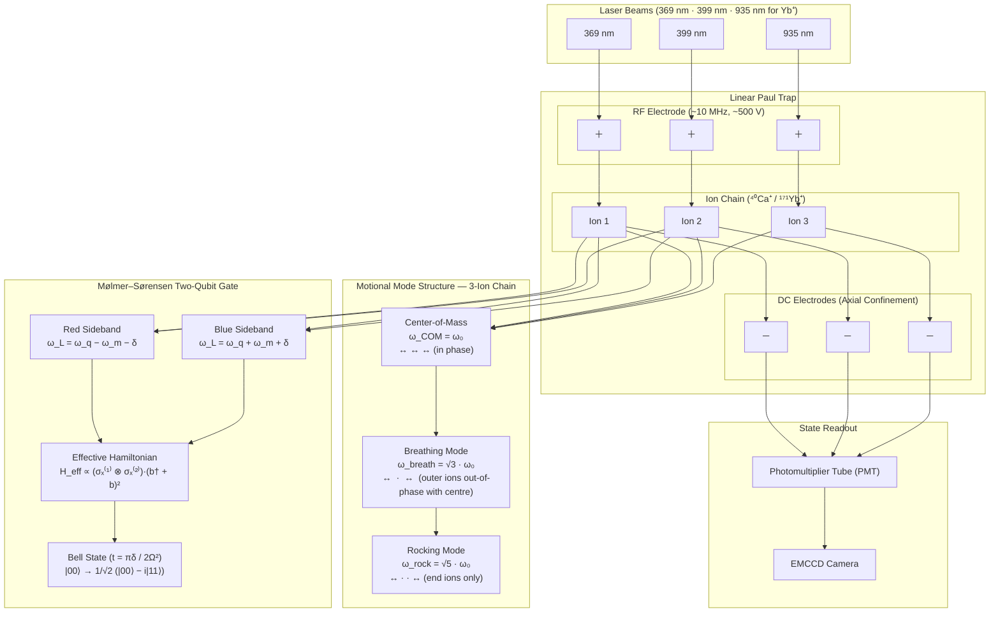
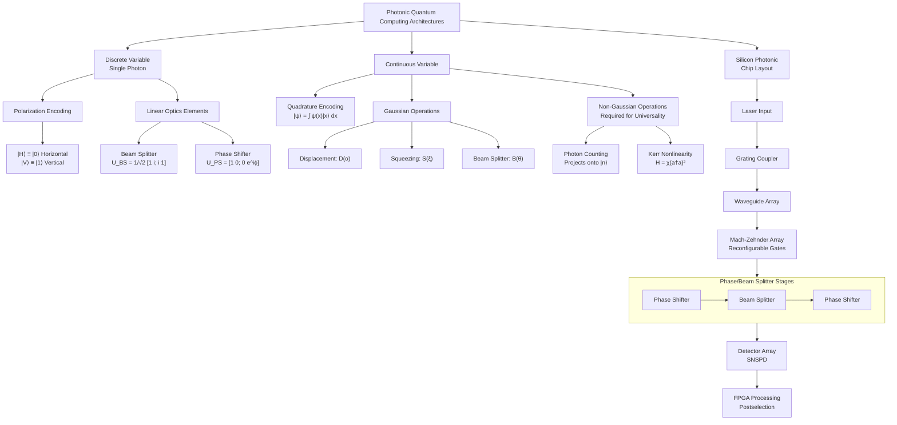

# Lesson 5: Physical Quantum Computing Implementations

## 1. First-Principles Intuition & Invariants

The transition from theoretical quantum information science to operational quantum processors demands a confrontation with the physical world's unforgiving constraints. While the abstract qubit lives in the pristine mathematical realm of Hilbert spaces and unitary transformations, every physical realization must wrestle with thermodynamic noise, electromagnetic interference, materials science limitations, and the fundamental tension between quantum coherence and environmental coupling. The central engineering challenge in quantum computing is not merely building systems that exhibit quantum behavior—physicists have demonstrated quantum effects in countless laboratory experiments—but constructing architectures that preserve quantum coherence long enough to execute meaningful computations while maintaining precise control over quantum state evolution and enabling scalable measurement readout.

At the heart of every quantum computing implementation lies a profound trade-off space defined by three competing imperatives. First, quantum systems must achieve sufficient isolation from their environment to maintain coherent superposition states over timescales that permit multi-gate quantum circuits—typically measured in microseconds to milliseconds depending on the platform. Second, these same systems must remain sufficiently coupled to classical control infrastructure to enable high-fidelity single-qubit and two-qubit gate operations, requiring precise calibration of electromagnetic pulses, laser beams, or magnetic field gradients. Third, the architecture must provide a pathway to scaling from the current regime of tens or hundreds of physical qubits to the millions of logical qubits required for practical quantum advantage, necessitating engineering solutions for interconnect fabrics, error correction overhead, and cryogenic power dissipation budgets.

The coherence time τ_coherence represents the characteristic timescale over which a quantum system maintains phase relationships in its superposition state before environmental decoherence destroys quantum information. This quantity emerges from two distinct physical mechanisms: energy relaxation characterized by T₁ time—the timescale for an excited qubit state to decay to ground state through spontaneous emission or other dissipative channels—and pure dephasing characterized by T₂ time—the timescale for relative phase coherence loss without energy exchange. The relationship T₂ ≤ 2T₁ establishes a fundamental bound, with the coherence time often dominated by T₂ in practical systems due to low-frequency noise sources that cause stochastic phase accumulation without energy loss.

Gate fidelity quantifies the proximity between an ideal unitary quantum gate operation U_ideal and its physical implementation U_actual, typically measured through quantum process tomography or randomized benchmarking protocols. For a single-qubit gate, the average gate fidelity F_avg captures the overlap between desired and achieved quantum states averaged over all possible input states on the Bloch sphere. A fidelity of F = 0.999 indicates that 99.9% of the quantum state evolution proceeds as intended, with the remaining 0.1% error rate accumulating coherently across sequential gate operations. The threshold theorem for fault-tolerant quantum computation establishes that error rates below approximately 10⁻³ per gate enable quantum error correction codes to suppress logical error rates exponentially with code distance, provided sufficient qubit overhead. Current physical implementations span a fidelity range from 99% to 99.99% depending on platform and gate type, positioning contemporary hardware at the boundary where error correction becomes theoretically viable but practically expensive.

Scalability constraints manifest differently across quantum computing platforms but share common structural bottlenecks. Two-qubit connectivity limits the quantum circuit compilation overhead, as gate operations between non-adjacent qubits require expensive SWAP gate sequences that consume coherence time and accumulate error. Control line fanout presents a classical engineering challenge: each physical qubit demands dedicated microwave, optical, or magnetic control channels, with signal routing complexity growing at least linearly and often quadratically with qubit count. Crosstalk between control channels introduces correlated errors that violate the independent error assumptions underlying most quantum error correction codes, necessitating careful electromagnetic or optical isolation. Finally, classical readout bandwidth and processing latency constrain the rate at which quantum measurement results can inform subsequent quantum operations, creating a bottleneck for adaptive quantum algorithms and real-time error correction feedback loops.

The quantum computing landscape currently features four dominant physical platforms, each occupying a distinct region of the engineering trade-off space. Superconducting transmon qubits leverage macroscopic quantum circuits fabricated through silicon-on-insulator or sapphire substrate processes, achieving gate times on the order of tens of nanoseconds and operating in dilution refrigerators at 10-20 millikelvin temperatures. Trapped ion qubits encode quantum information in electronic energy levels of individual atomic ions confined by radio-frequency electromagnetic fields in ultra-high vacuum chambers, delivering exceptional coherence times exceeding one second but with gate operations requiring microseconds to complete. Photonic quantum processors encode qubits in discrete photon number states or continuous-variable quadratures of optical modes, operating at room temperature but confronting fundamental challenges in deterministic two-qubit gate implementation. Topological qubits based on non-abelian anyons in exotic material phases remain in early research stages, promising intrinsic error protection through topological degeneracy but requiring millikelvin temperatures and complex materials engineering with no operational demonstration of universal gate sets to date.

The figure of merit that unifies these platforms is the error budget per logical operation, computed as the product of the number of physical gates required to implement a logical gate (set by the quantum error correction code and architectural constraints) and the physical error rate per gate. A logical qubit implementation using the surface code with code distance d = 5 requires approximately 49 physical qubits for data and additional ancilla qubits for syndrome measurement, with logical error rates scaling as (p/p_th)^((d+1)/2) where p is the physical error rate and p_th ≈ 10⁻² is the threshold error rate. For a physical error rate of p = 10⁻³, this yields a logical error rate of approximately 10⁻⁶ per logical gate cycle, improving by roughly three orders of magnitude at the cost of 50× qubit overhead and increased gate depth from syndrome extraction circuits.

## 2. Core Architecture & Mechanics

Superconducting qubit architectures exploit the quantum dynamics of Josephson junctions—nonlinear circuit elements formed by a thin insulating barrier between two superconducting electrodes—to create artificial atoms with engineered energy level structures. The transmon qubit variant achieves its quantum two-level system by designing a circuit where a Josephson junction with critical current I_c and capacitance C_J is shunted by a large external capacitance C_Σ >> C_J, creating an anharmonic oscillator Hamiltonian H = 4E_C(n̂ - n_g)² - E_J cos(φ̂) where E_C = e²/(2C_Σ) is the charging energy, E_J = (ℏI_c)/(2e) is the Josephson energy, n̂ is the Cooper pair number operator, n_g is the gate-induced offset charge, and φ̂ is the superconducting phase difference across the junction. By operating in the regime E_J/E_C >> 1, the transmon achieves reduced sensitivity to charge noise at the cost of decreased anharmonicity, with typical qubit transition frequencies ω₀₁/(2π) in the 4-8 GHz range and anharmonicity α/(2π) ≈ -200 to -300 MHz creating sufficient separation between the |0⟩ → |1⟩ computational transition and the |1⟩ → |2⟩ leakage transition.

The physical implementation stack for a superconducting quantum processor begins with substrate selection, typically high-resistivity silicon or crystalline sapphire to minimize microwave losses. Aluminum or tantalum films deposited through electron-beam evaporation or sputtering form the superconducting circuits, with feature sizes ranging from millimeter-scale resonators down to sub-micron Josephson junction areas fabricated through double-angle shadow evaporation or bridge-free Dolan techniques. The qubit frequency itself emerges from the LC oscillator formed by the junction inductance L_J = (ℏ)/(2eI_c) and total circuit capacitance, enabling frequency tuning through junction area engineering during fabrication. Cross-shaped coupling geometries create capacitive interaction between neighboring transmons, generating an effective Hamiltonian term H_int = g(a†b + ab†) where g is the coupling strength and a, b are the annihilation operators for adjacent qubits. By engineering g/(2π) in the 1-20 MHz range while maintaining qubit-qubit detuning Δω greater than g, the system remains in the dispersive regime where direct quantum state transfer is suppressed but two-qubit entangling gates remain accessible through microwave drive protocols.

Control and readout of superconducting qubits proceeds through microwave engineering techniques adapted from classical radar and communication systems. Each qubit couples capacitively to a dedicated coplanar waveguide resonator with resonance frequency ω_r typically detuned by hundreds of MHz from the qubit frequency ω_q, creating a dispersive shift χ = g²/(Δ), where Δ = ω_q - ω_r and g is the qubit-resonator coupling strength. When the qubit occupies state |1⟩, the resonator frequency shifts by 2χ relative to the |0⟩ state, enabling quantum non-demolition readout through heterodyne detection of reflected or transmitted microwave signals. Single-qubit gates exploit resonant microwave pulses shaped according to derivative-removal-by-adiabatic-gate (DRAG) protocols to minimize leakage to non-computational states, with typical X or Y rotation gates requiring 20-50 ns with fidelities exceeding 99.9%. Two-qubit entangling gates leverage either the cross-resonance effect, where driving one qubit at the frequency of its neighbor induces conditional rotations, or tunable coupling schemes where an intermediate coupler element's frequency is modulated to turn interaction on and off. The cross-resonance gate typically requires 200-400 ns to implement a CNOT operation with fidelities in the 98-99.5% range, with gate time fundamentally limited by the coupling strength g and detuning Δ according to the Rabi frequency formula.

```
Superconducting Transmon Qubit Physical Stack:

                    ┌─────────────────────────────────┐
  Microwave         │   Coaxial Input (4K Stage)      │
  Control           │   ↓                             │
  Lines             │   Attenuators (-20 dB)          │
  (50 Ω)            │   ↓                             │
                    │   Cold Amplifiers (Still/4K)    │
                    ├─────────────────────────────────┤
                    │   Mixing Chamber (~15 mK)       │
                    │                                 │
                    │   ┌───────────┐   ┌──────────┐ │
  Readout           │   │  Qubit 1  │───│ Coupler  │ │
  Resonators        │   │  (4.5 GHz)│   │          │ │
  (7-8 GHz)         │   └─────┬─────┘   └────┬─────┘ │
                    │         │              │       │
                    │   ┌─────┴─────┐   ┌────┴────┐  │
                    │   │ Resonator │   │ Qubit 2 │  │
                    │   │ (7.2 GHz) │   │(5.1 GHz)│  │
                    │   └─────┬─────┘   └─────────┘  │
                    │         ↓                       │
                    │   Josephson Parametric Amp     │
                    └─────────────────────────────────┘
                              ↓
                    ┌─────────────────────────────────┐
                    │   HEMT Amplifier (4K Stage)     │
                    │   ↓                             │
  Readout           │   Room Temperature Electronics   │
  Chain             │   • IQ Mixers                   │
                    │   • ADC (1-2 GS/s)              │
                    │   • FPGA Processing             │
                    └─────────────────────────────────┘

Energy Level Structure (Transmon):

    |2⟩ ─────────  (ω₁₂ = ω₀₁ + α)
         ^
         │ α ~ -250 MHz (anharmonicity)
         │
    |1⟩ ─────────  
         ^
         │ ω₀₁ ~ 5 GHz (qubit frequency)
         │
    |0⟩ ─────────

Hamiltonian: H/ℏ = ω₀₁|1⟩⟨1| + (2ω₀₁ + α)|2⟩⟨2| + ...
```

Trapped ion quantum computing encodes qubit states in hyperfine or optical atomic transitions of individual ions confined in linear Paul traps or surface electrode geometries. The computational states typically correspond to two hyperfine ground states of alkaline earth or rare earth ions such as ⁴⁰Ca⁺, ⁸⁸Sr⁺, ¹⁷¹Yb⁺, or ¹³⁷Ba⁺, with transition frequencies ranging from GHz for hyperfine qubits to hundreds of THz for optical qubits. The Paul trap itself creates a time-varying quadrupole electric field through radio-frequency voltages applied to segmented electrodes, generating an effective harmonic confining potential that levitates ions against gravity in ultra-high vacuum chambers with pressures below 10⁻¹¹ torr to minimize collisional decoherence. For a linear chain of N ions, the system supports 3N collective motional modes comprising axial, radial, and transverse oscillations, with the center-of-mass mode and higher-order breathing modes serving as quantum buses for entanglement generation.

Single-qubit operations in trapped ion systems exploit laser-driven transitions with wavelengths precisely tuned to atomic resonances. For ¹⁷¹Yb⁺ hyperfine qubits defined by the |F=0, m_F=0⟩ and |F=1, m_F=0⟩ clock states split by 12.642 GHz, direct microwave addressing can drive rotations, but Raman transitions using two laser beams with frequency difference matching the qubit splitting offer superior state discrimination and spatial selectivity through focused beam geometries. The Rabi frequency Ω_R determining single-qubit gate speed scales with laser intensity I and transition dipole moment μ according to Ω_R ∝ μE₀/ℏ where E₀ = √(2I/cε₀) is the electric field amplitude. Typical single-qubit gate times range from 1-10 microseconds with fidelities exceeding 99.99%, fundamentally limited by laser phase noise, ambient magnetic field fluctuations coupling to magnetically sensitive states, and intensity instabilities causing imperfect rotations.

Two-qubit entangling gates in trapped ion systems leverage the Mølmer-Sørensen interaction, which couples internal qubit states to shared motional modes of the ion crystal. The protocol applies bichromatic laser beams with frequencies ω_L detuned from the motional sideband frequencies ω_q ± ω_m by a small detuning δ, where ω_q is the qubit frequency and ω_m is a collective motional mode frequency. The effective interaction Hamiltonian after adiabatic elimination of the motional mode becomes H_MS = ℏΩ²/(4δ) · (σ_x^(1) ⊗ σ_x^(2)) where Ω is the Rabi frequency and σ_x^(i) are Pauli operators for ions i=1,2. Running this interaction for time t = π/(2Ω²/(4δ)) generates a maximally entangling XX(π/2) gate, which combined with single-qubit rotations constructs a universal gate set. Typical Mølmer-Sørensen gates require 50-200 microseconds to complete with fidelities in the 99-99.9% range, with error sources including off-resonant coupling to spectator modes, fluctuating mode frequencies from electric field noise, and imperfect cancellation of geometric phases.



Photonic quantum computing platforms encode quantum information in discrete photon number states, polarization degrees of freedom, or continuous-variable quadratures of optical modes propagating through integrated photonic circuits or free-space optics. Single photons prepared in specific spatial modes, polarizations, or time bins serve as flying qubits with excellent coherence properties—photons do not decohere through thermalization at room temperature and travel at light speed enabling rapid gate operations—but confront fundamental obstacles in implementing deterministic two-photon gates due to the bosonic commutation relations of electromagnetic field operators. The absence of direct photon-photon interaction in linear optical media necessitates measurement-induced nonlinearity protocols where auxiliary photons undergo detection and postselection conditions herald successful entangling operations, introducing probabilistic gate success and scalability bottlenecks.

Linear optical quantum computing circumvents the deterministic gate problem through the KLM protocol (Knill-Laflamme-Milburn), which achieves universal quantum computation using only single-photon sources, passive linear optics (beam splitters, phase shifters, waveplates), photodetectors, and feed-forward operations conditioned on measurement outcomes. A fundamental building block is the Hong-Ou-Mandel effect, where two indistinguishable photons incident on opposite ports of a 50:50 beam splitter always emerge together in one output port due to destructive interference of quantum amplitudes. By combining such beam splitters with auxiliary entangled photon pairs and heralding photodetectors, one can construct non-deterministic CNOT gates with success probabilities on the order of 1/4 to 1/16 depending on gate architecture. Recent advances in multiplexed photon sources using quantum dots or spontaneous parametric down-conversion reduce the effective overhead by generating photons on-demand within narrow temporal windows, but scaling to large photonic processors still requires 10⁴-10⁶ physical components per logical qubit when accounting for loss, imperfect indistinguishability, and detector inefficiency.

Continuous-variable photonic platforms encode quantum information in the quadrature amplitudes X = (a† + a)/√2 and P = i(a† - a)/√2 of optical modes, constructing qubits from superpositions of coherent states or Gottesman-Kitaev-Preskill (GKP) grid states in phase space. Homodyne detection measuring field quadratures through interference with a strong local oscillator beam provides high-efficiency readout without photon counting requirements, while Gaussian operations including squeezed state generation, displacement, and passive linear interferometry form a restricted but efficiently implementable gate set. Non-Gaussian operations required for universality emerge from photon number-resolving measurements combined with Gaussian state preparation, or through cross-Kerr nonlinearities in materials with χ⁽³⁾ optical susceptibility. The challenge in continuous-variable architectures lies in preparing non-Gaussian resource states with sufficient negativity in their Wigner function to enable universal quantum computation, typically requiring cubic or higher-order phase gates that are exponentially expensive to implement fault-tolerantly through Gaussian operations and photon counting.

Silicon photonics implementations integrate waveguides, beam splitters, phase shifters, and tunable Mach-Zehnder interferometers on CMOS-compatible silicon-on-insulator substrates, offering a pathway to mass-manufactured quantum photonic processors leveraging the semiconductor industry's fabrication capabilities. Photon pair sources based on spontaneous four-wave mixing in silicon waveguides or integrated III-V semiconductor quantum dots bonded to silicon provide on-chip photon generation, while superconducting nanowire single-photon detectors (SNSPDs) wirebonded to photonic chips deliver detection efficiencies exceeding 90% with timing jitter below 50 picoseconds. Thermo-optic phase shifters consuming milliwatts of power enable reconfigurable circuit topologies by tuning local refractive indices through resistive heating, though thermal crosstalk between adjacent components necessitates careful thermal isolation engineering. Current silicon photonic processors demonstrate 10-20 qubit computations with gate fidelities in the 95-99% range, fundamentally limited by photon loss (typically 0.1-1 dB/cm propagation loss plus 0.1-0.5 dB/facet coupling loss), modal mismatch reducing photon indistinguishability, and phase instabilities from thermal drift requiring active stabilization feedback loops.



Topological quantum computing represents a radically different architectural paradigm where quantum information encodes in global topological properties of exotic many-body quantum states rather than local degrees of freedom of individual particles. The prototypical platform seeks non-abelian anyons—quasiparticle excitations in two-dimensional topological phases of matter whose exchange statistics obey non-commutative braiding algebra—with the most experimentally pursued candidate being Majorana zero modes (MZMs) emerging at the ends of one-dimensional topological superconductor nanowires or interfaces. A single computational qubit corresponds to the joint parity state of multiple spatially separated Majorana modes, with quantum gates implemented through adiabatic braiding operations that physically transport anyons around one another in real space. The topological nature of this encoding provides intrinsic protection against local perturbations: any decoherence mechanism must globally perturb the system over length scales comparable to the anyon separation to induce logical errors, exponentially suppressing error rates as the separation increases.

The experimental realization of Majorana-based topological qubits proceeds through semiconductor-superconductor heterostructures where a strong spin-orbit coupling semiconductor nanowire (InAs or InSb) interfaces with an s-wave superconductor (Al or NbTiN) under an applied magnetic field parallel to the wire. When the Zeeman energy from the magnetic field exceeds both the superconducting pairing energy and chemical potential, the system enters a topological superconducting phase supporting Majorana zero modes localized at wire endpoints. The signature of MZM formation appears as a zero-bias conductance peak in tunneling spectroscopy measurements, with the peak pinned at zero energy even as external parameters vary—a consequence of the Majorana's self-conjugate nature where particle and hole excitations coincide. However, recent experimental controversies highlight that mundane mechanisms including disorder-induced Andreev bound states, smooth confinement potentials, or thermal broadening can mimic MZM signatures, necessitating stringent validation protocols including topological gap measurements, quantized conductance at e²/2h, and non-local correlation experiments demonstrating parity protection across spatially separated modes.

The computational model for topological quantum computing with Ising anyons (supporting Majorana zero modes) achieves Clifford group operations through braiding alone but requires supplementation with non-topological magic state injection to reach universal quantum computation. A T-gate (π/8 rotation) cannot emerge from braiding operations in the Ising anyon model, necessitating either auxiliary topological states from Fibonacci anyons (requiring different material platforms) or hybrid schemes where magic states prepared through conventional quantum computing inject into the topological substrate. The braiding itself proceeds by adiabatically varying gate voltages on electrostatic plunger gates to manipulate effective wire geometries and tunnel couplings, with braiding times constrained by the adiabatic condition requiring operation much slower than the topological gap energy scale (typically 100 μeV corresponding to ~25 GHz), but fast compared to quasi-particle poisoning rates from thermal excitations or residual non-equilibrium processes that break Cooper pairs and inject spurious fermions that lift the ground state degeneracy.

Readout in topological systems measures the joint fermion parity of multiple Majorana modes by coupling them through Josephson junctions and monitoring the 4π-periodic (rather than 2π-periodic) supercurrent-phase relation characteristic of topologically protected ground states. For a qubit encoded in four Majorana modes γ₁, γ₂, γ₃, γ₄ arranged with γ₁-γ₂ and γ₃-γ₄ forming two conventional fermion operators f₁ = (γ₁ + iγ₂)/2 and f₂ = (γ₃ + iγ₄)/2, the logical qubit states correspond to the total fermion parity P = (f₁†f₁ + f₂†f₂) mod 2, with P=0 and P=1 defining the computational basis. The measurement destructively projects the topological state but preserves the logical information encoded in parity, with readout fidelities theoretically reaching 99.9% but experimentally undemonstrated at scale due to the immature state of Majorana qubit platforms. As of 2025, no experimental group has demonstrated a single topologically protected logical qubit with coherence times or gate fidelities exceeding conventional platforms, positioning topological computing as a long-term research direction rather than near-term hardware solution.

```
Topological Qubit Encoding (Majorana Zero Modes):

Nanowire Heterostructure:

    B_ext (External Magnetic Field)
      ↓↓↓↓↓↓↓↓↓↓↓↓↓↓↓↓↓↓
    ┌─────────────────────────┐
    │   Al (Superconductor)   │
    ├─────────────────────────┤
    │   InAs/InSb Nanowire    │  (Spin-Orbit Coupling)
    │   (Semiconductor)       │
    └─────────────────────────┘
    
    Condition: E_Z > √(Δ² + μ²)
    (Zeeman > Superconducting Gap & Chemical Potential)
    
    Result: Topological Superconductor
            ↓
    γ₁ ○─────────────────────○ γ₂
      (MZM at endpoints, separated by L ~ 1-2 μm)

Four-Majorana Qubit Encoding:

    Island 1:  γ₁ ○────○ γ₂
                   Wire 1
    
    Island 2:  γ₃ ○────○ γ₄
                   Wire 2
    
    Fermion Operators:
    f₁ = (γ₁ + iγ₂)/2
    f₂ = (γ₃ + iγ₄)/2
    
    Logical Qubit:
    |0⟩ ≡ |P=0⟩ (even parity)
    |1⟩ ≡ |P=1⟩ (odd parity)
    
    Braiding Operation (Exchange γ₂ ↔ γ₃):
    U_braid = exp(θ·γ₂γ₃) with θ = π/4
    → Implements Clifford Gates

Experimental Signatures:

    Zero-Bias Conductance Peak:
    
    dI/dV
      ↑
      │     ╱╲
      │    ╱  ╲
      │   ╱    ╲
      │  ╱      ╲
      └─────────────→ V_bias
         │
         0 (MZM at E=0)
    
    Quantized: 2e²/h (predicted), ~0.8·2e²/h (typical exp.)
```

## 3. High-Performance Optimization & Failure Modes

The optimization of quantum computing platforms demands simultaneous navigation of material science constraints, electromagnetic engineering precision, and algorithmic compilation strategies that map abstract quantum circuits onto physical hardware topologies. For superconducting processors, the dominant performance bottleneck shifts across development phases: early research emphasizes T₁ and T₂ coherence time extension through materials purification and improved junction fabrication, mid-stage development focuses on two-qubit gate fidelity optimization via pulse shaping and crosstalk mitigation, while mature systems confront the interconnect fabric challenge of scaling to thousands of qubits with limited control line fanout and cryogenic power dissipation budgets constraining the number of microwave lines entering the millikelvin stage.

Superconducting qubit coherence times fundamentally couple to the density of two-level system (TLS) defects residing at material interfaces and in amorphous dielectrics. These microscopic tunneling states with asymmetric double-well potentials create a bath of lossy oscillators that resonantly absorb qubit excitations when TLS transition frequencies coincide with the qubit frequency, while also contributing to pure dephasing through TLS-induced fluctuations of the local electric field environment. The empirical scaling of T₁ with qubit participation ratio in different material regions drives microwave resonator design toward air-bridge geometries and trenched substrate configurations that minimize electric field concentration in lossy dielectrics. Recent transmon implementations achieve T₁ times exceeding 200 microseconds by replacing aluminum Josephson junctions with tantalum, which exhibits lower native oxide loss tangent, and by fabricating qubits on high-purity crystalline silicon substrates with meticulous surface preparation protocols removing organic contaminants and native oxide layers through buffered hydrofluoric acid etching and controlled oxidation.

Two-qubit gate optimization in superconducting systems navigates the Pareto frontier between gate speed and fidelity. Faster gates minimize the accumulated decoherence during the gate operation (error rate scales approximately as t_gate/T₁ + t_gate/T₂), but high-speed gates require strong drives that risk exciting leakage transitions to non-computational states or violating the rotating wave approximation underlying gate calibration models. The cross-resonance gate exemplifies this trade-off: stronger qubit-qubit coupling g enables shorter gates, but large g requires minimal qubit-qubit detuning Δ, which increases always-on ZZ interaction Hamiltonian terms proportional to g²/Δ that cause unwanted conditional phase accumulation during nominally idle periods. Dynamic decoupling sequences inserting spin-echo pulses during idle intervals suppress slow ZZ dephasing, but consume additional coherence time and require precise timing synchronization. Tunable couplers interpolate between conflicting requirements by modulating the effective coupling strength: during gate operations, the coupler frequency tunes to resonance enabling strong interaction, while during idle periods it detunes away suppressing unwanted ZZ coupling below 1 kHz levels, achieving clean two-qubit gate fidelities approaching 99.5% at gate times of 200 ns.

Crosstalk mitigation emerges as the critical engineering challenge when scaling superconducting processors beyond 50 qubits. On-chip microwave crosstalk arises from multiple pathways: capacitive coupling between neighboring control lines, inductive coupling through shared ground planes, and higher-order interactions mediated by shared resonators or coupler elements. A microwave pulse intended for qubit A generates unwanted excitations in qubits B, C, and D through off-resonant drives with amplitudes suppressed by detuning factors Δ_BA, Δ_CA, Δ_DA but still sufficient to accumulate phase errors approaching 10⁻² per gate if uncorrected. Calibration protocols measure complete crosstalk matrices through simultaneous randomized benchmarking experiments, then apply pre-distortion corrections to drive pulses that anticipate and cancel crosstalk-induced rotations. Time-division multiplexing strategies schedule gates sequentially on spatially proximate qubits to avoid simultaneous pulses, sacrificing circuit depth for improved gate fidelity—an acceptable trade-off in near-term error-prone devices but unsustainable for fault-tolerant algorithms requiring massive spatial parallelism to achieve logical clock speeds exceeding 10 Hz.

Trapped ion systems exhibit complementary performance characteristics and optimization challenges. The exceptional coherence times—T₂ exceeding one second for hyperfine qubits in ¹⁷¹Yb⁺ or ⁴⁰Ca⁺ ions—arise from the atomic nature of the qubits, which inherit the intrinsic stability of atomic energy level structures set by fundamental constants rather than engineered material properties. However, this coherence advantage faces competition from gate speed limitations: the Mølmer-Sørensen two-qubit gate requires 50-200 microseconds, two to three orders of magnitude slower than superconducting CNOT gates. The longer gate times accumulate more coherence loss per operation despite the longer T₂, with gate fidelities saturating in the 99-99.9% range fundamentally limited by laser phase noise, mode frequency fluctuations, and off-resonant coupling to spectator motional modes. Scaling trapped ion systems confronts the motional mode structure explosion: a chain of N ions supports 3N motional modes with frequencies spreading across a bandwidth proportional to √N, causing spectral crowding that increases off-resonant excitation errors and complicates gate calibration as mode splittings become comparable to laser linewidths.

The surface-electrode ion trap architecture addresses scalability through a divide-and-conquer strategy, partitioning a large quantum register into multiple smaller trapping zones connected by ion transport channels. Ions shuttle between zones through time-varying electrode voltage sequences that translate the confining potential minimum along designated transport paths, with transit times ranging from 10-100 microseconds depending on distance and acceleration constraints set by heating rates and mode excitation budgets. The transport operation itself must preserve motional ground states to avoid introducing errors in subsequent gates, requiring precise calibration of electrode voltages and transport trajectories that minimize non-adiabatic excitations. Junctions where multiple transport channels intersect demand sophisticated electrode geometries supporting switchyard routing that directs ions to different destination zones based on dynamic voltage programming, conceptually analogous to classical packet-switched networks but operating on single-atom payloads. Current experimental demonstrations achieve ion transport with fidelities exceeding 99.9% for simple trajectories, though scaling to hundreds of zones with complex routing topologies remains an open engineering challenge requiring integration of thousands of voltage control channels with sub-microsecond timing precision.

Photonic quantum computing performance optimization centers on the photon loss budget, which imposes exponential scaling penalties in most architectural approaches. Each optical component introduces loss characterized by a transmission coefficient η < 1, with typical values η ≈ 0.95-0.99 for beam splitters, η ≈ 0.9-0.99 for integrated waveguides (per centimeter), and η ≈ 0.8-0.95 for detectors. A linear optical circuit with depth D and width W operating on N photons accumulates total loss (1 - η)^(D·W·N), meaning that a circuit with 100 components each having 1% loss retains only e^(-1) ≈ 37% success probability. Probabilistic entangling gates compound this loss: a non-deterministic CNOT gate with intrinsic success probability 1/4 requires repeating until success, consuming on average four photon pairs and suffering loss equivalent to 75% effective optical loss per gate. Multiplexing strategies mitigate this overhead by preparing multiple photons in temporal or spatial multiplexed modes and heralding successful gate operations within a fixed time window, but achieving deterministic-equivalent gate success demands multiplexing factors scaling as M ≥ 1/P_gate for gate success probability P_gate, requiring hundreds to thousands of photon sources for fault-tolerant photonic circuits.

Continuous-variable photonic systems circumvent the photon loss problem through Gaussian state redundancy: squeezed states and displaced coherent states tolerate photon loss while preserving encoded quantum information with fidelity degrading smoothly rather than catastrophically. However, this loss tolerance shifts the bottleneck to non-Gaussian resource state preparation, specifically the generation of high-quality GKP states encoding logical qubits in periodic grid structures in phase space. These states require squeezing levels exceeding 15 dB (factor of 30 variance reduction) to approach threshold fidelity for fault-tolerant quantum computation with surface codes adapted to continuous variables. Optical parametric amplifiers in periodically-poled lithium niobate waveguides achieve squeezing up to 15 dB, but GKP state generation additionally requires high-efficiency photon number-resolving detectors and near-unity-fidelity Gaussian operations, with cumulative requirements positioning GKP-based continuous-variable quantum computing at similar technological maturity as discrete-variable approaches despite the loss tolerance advantage.

Failure modes in quantum computing systems span a spectrum from benign errors that quantum error correction codes gracefully handle to catastrophic failure mechanisms that violate error model assumptions and collapse the computational state. Leakage errors, where qubits transition from the computational {|0⟩, |1⟩} subspace into higher energy levels |2⟩, |3⟩,... or into other non-computational degrees of freedom, represent a particularly insidious failure mode. Standard quantum error correction codes assume errors remain within the computational subspace—represented by Pauli X, Y, Z operators—but leakage creates population outside this space that error correction cannot detect or correct. In superconducting transmons, leakage into the |2⟩ state accumulates at approximately 0.1-1% per two-qubit gate, with leaked population persisting for timescales comparable to T₁. Leakage removal protocols apply resonant drives between |1⟩ ↔ |2⟩ transitions with subsequent measurement-based reset, but these protocols consume hundreds of nanoseconds and add overhead to the syndrome extraction cycle. Advanced quantum error correction codes adapted for leakage, such as the LDPC (low-density parity check) codes with leakage detection flags, monitor population outside the computational space and trigger recovery operations, but require additional ancilla qubits and complex decoding algorithms.

Correlated errors violate the independent error assumption underpinning the threshold theorem and can cause catastrophic degradation of quantum error correction efficacy. Crosstalk-induced errors in superconducting systems, where a single control pulse unintentionally rotates multiple qubits, create correlated error patterns that appear as weight-2 or weight-3 Pauli operators acting on spatially separated qubits. Standard surface code decoders model errors as independent bit flips and phase flips, assigning decoding weights based on this assumption, but correlated errors can create low-weight logical operators that evade detection. Randomized compiling techniques decorrelate errors by conjugating gates with random Pauli operators, converting coherent errors into incoherent Pauli noise that standard error correction handles more gracefully. However, randomized compiling increases circuit depth by factors of 2-5× and consumes precious coherence time, trading error model simplification against raw physical performance.

Heating in trapped ion systems represents a materials-science-limited failure mode where ambient electric field noise at the ion's secular frequency ω_sec drives the motional state away from the ground state, populating higher Fock states |n⟩ with n ≥ 1. The heating rate dn̄/dt, measured in quanta per second, determines the timescale over which motional ground state preparation decays and two-qubit gate fidelity degrades. Modern ion traps achieve heating rates below 10 quanta/second at secular frequencies of 1-3 MHz through cryogenic operation at 4-10 K and careful surface treatment removing adsorbates and oxidation layers from electrode surfaces. The physical mechanism driving heating remains an active research question, with hypothesized sources including thermal Johnson noise from surface conductance, patch potentials from spatially varying work functions, and non-equilibrium charge dynamics from UV-induced surface chemistry. Empirical observations show heating rates scaling as ω_sec^(-α) with α ≈ 1-2, suggesting frequency-dependent noise spectra consistent with surface-adsorbate-mediated models, but no single mechanism definitively explains all experimental observations across different trap geometries and materials.

The quantum computing workflow optimization problem encompasses circuit compilation—mapping abstract quantum algorithms onto physical gate sets and qubit connectivity topologies—calibration—tuning hundreds to thousands of control parameters to optimize gate fidelities—and error mitigation—applying postprocessing techniques to suppress noise-induced errors without full quantum error correction overhead. For superconducting processors with limited connectivity (nearest-neighbor coupling in grid topologies), compiling algorithms requiring all-to-all connectivity demands inserting SWAP gate sequences that transpose qubit states along multi-hop paths, expanding circuit depth by factors of 3-10× and consuming coherence budget that could otherwise perform algorithmic gates. Qubit routing algorithms minimize SWAP overhead through heuristic search over permutation spaces, balancing gate count minimization against lookahead planning that reserves routing resources for future gates. Dynamic circuit optimization leverages mid-circuit measurement and feed-forward to reduce SWAP count: measuring qubits in states that factor into classical bits and teleporting quantum information through entanglement distribution exploits the measurement-based quantum computation paradigm where certain resource states enable gate teleportation at the cost of classical communication latency.

Calibration workflows for quantum processors combine automated scripts and human-in-the-loop supervision, with typical daily calibration requiring 2-6 hours for 50-100 qubit systems. Single-qubit gate calibration measures Rabi oscillations to determine pulse amplitudes and frequencies, Ramsey experiments to extract detuning and dephasing rates, and randomized benchmarking to assess gate fidelity across all Clifford group elements. Two-qubit gate calibration adds chevron measurements scanning gate length and drive amplitude to locate optimal parameter regimes, followed by cross-entropy benchmarking that verifies gate fidelity on random circuits approaching algorithmic complexity. The calibration parameter space dimension scales as O(N²) for N qubits when including crosstalk corrections, demanding efficient optimization algorithms that balance exploration (discovering improved parameter regimes) against exploitation (refining known good configurations). Machine learning methods including Bayesian optimization and neural network surrogate models accelerate calibration by learning parameter-to-fidelity mappings from historical data, reducing calibration time by factors of 2-5× while maintaining or improving fidelity outcomes compared to manual grid searches.

Error mitigation extends quantum processor utility in the near-term pre-error-correction era by extracting noiseless expectation values from noisy measurement data through statistical postprocessing. Zero-noise extrapolation runs quantum circuits at multiple controlled noise levels—implemented through pulse stretching, gate sequence insertion, or probabilistic Pauli frame errors—then extrapolates measured expectation values to the zero-noise limit through polynomial or exponential fitting. The method assumes noise scales linearly with a noise strength parameter λ, fitting ⟨O⟩(λ) = a₀ + a₁λ + a₂λ² + ... and evaluating at λ=0 to recover the ideal expectation value. However, extrapolation amplifies statistical sampling noise, requiring measurement shot counts scaling as O(e^(ε·D)) where ε is the error rate per gate and D is circuit depth, imposing exponential sampling overhead that limits applicability to circuits with ε·D ≲ 3-5. Probabilistic error cancellation methods represent noisy gate implementations as linear combinations of ideal gates plus noise channels, inverting this relationship to sample from quasi-probability distributions that reconstruct ideal expectation values through weighted averaging of noisy circuit outcomes, but negative quasi-probabilities again introduce exponential sampling overhead for highly noisy gates.

The frontier of quantum computing performance in 2025 positions superconducting and trapped ion platforms at comparable maturity levels with complementary strengths: superconducting systems achieve fast gates enabling deeper circuits within coherence times, while trapped ion systems deliver higher individual gate fidelities enabling cleaner execution of moderately deep circuits. Photonic platforms remain in earlier research phases with impressive room-temperature operation but confronting fundamental loss and gate determinism challenges. Topological approaches promise asymptotic advantages through intrinsic error protection but lack experimental validation of basic qubit operations. The convergence of these platforms toward fault-tolerant quantum computation demands simultaneous progress across coherence extension, gate fidelity optimization, scalable architectures, and error correction overhead reduction—a multidimensional optimization problem that no single platform clearly dominates, motivating continued research investment across the full spectrum of physical quantum computing implementations.
